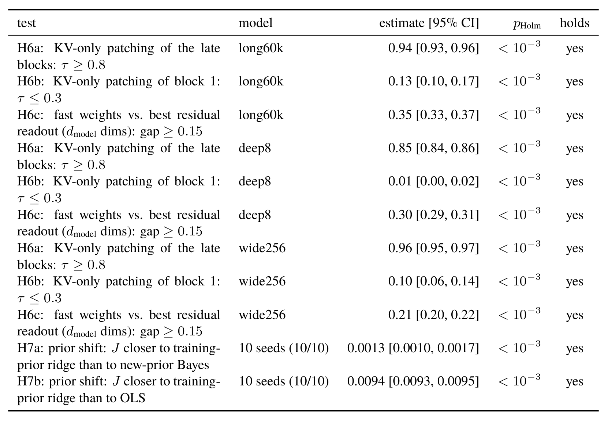

# Embodied AI & World Models News

> 具身智能与世界模型每日研究动态与论文精读。

**最新一期：2026-11-08** ｜ [日报原文](news/2026-11-08.md) · [精读索引](paper-reading/news/2026-11-08/README.md) · [历史归档](#历史归档)

---

<!-- 本段由 codex-deployment/update_readme.py 从 news/2026-11-08.md 自动镜像，请勿手工编辑 -->

## 2026-11-08 Embodied AI & World Models Daily

> 北京时间 11 月 8 日。本期收录 1 项实质性论文更新，精读 1 篇。部分来源核验受限，覆盖范围见文末。

### 🔥 今日必读

#### 1. 【动力学辨识】SUSS v0.2.0 验证晚层注意力缓存的因果作用

**来源与类型**　Anuar Zhambakin，独立研究者，论文修订与可复现实验。  
**公开时间**　2026-11-08 02:44:17，北京时间。  
**评分**　80/100。  
**关键词**　上下文适应 · 动力学辨识 · 预注册 · 注意力缓存。

**一句话。** 第二轮预注册检验发现，交换另一段历史的晚层键和值，可在三种受测配置中显著转移一步预测行为。先验变化试验显示，冻结模型的预测函数仍更接近使用训练先验的岭回归。

- **干预与读出。** 在长训、深层、宽层三个配置中，交换网络后半部分的上下文 K/V，行为转移系数为 0.85–0.96，首层对照为 0.01–0.13。同维度下，快权重相对最佳残差读出的 $R^2$ 优势为 0.21–0.35。探索性 10 万参数模型的优势反向，约为 −0.07。
- **分布变化。** 将测试系统状态转移矩阵元素的先验标准差由 0.4 降至 0.1 后，查询雅可比到训练先验岭回归、新先验贝叶斯参考、普通最小二乘的均方距离约为 0.026、0.028、0.036。10 个训练种子的方向一致，两个先验对照的差距较小。全部 11 项经 Holm 校正后满足预注册判据。
- **与上一版的区别。** 11 月 7 日已报道最初的键值机制线索和控制尾部风险。本次纳入的是新公布的三配置确认与先验偏移试验。新增证据来自低维线性动力学预测，真实机器人与闭环稳定性仍待验证。

**工程含义。** 对用历史做适应的策略，可以把预测函数的雅可比、同维度读出和缓存干预拆开测，分别定位分布偏好、可读出信息和实际影响。后续还需用闭环扰动与失败率衡量是否能迁移到控制。

[正式发布](https://github.com/nonberw/suss/releases/tag/v0.2.0) · [固定版论文](https://raw.githubusercontent.com/nonberw/suss/v0.2.0/paper/main.pdf) · [代码与确认结果](https://github.com/nonberw/suss/blob/v0.2.0/results/confirm/SUMMARY.md) · [本期精读](paper-reading/news/2026-11-08/suss/suss.md) · [前一期报告](news/2026-11-07.md)。

### 📡 论文雷达

本次可见的 arXiv 官方列表与摘要页版本记录里，没有核实到提交时间落在主窗口且达到门槛的额外论文。四分类近期列表的最新可见公告为 11 月 6 日，周末提交可能在后续公告批次出现。本期的 SUSS 修订归在今日必读。

### 🛠️ 工程与开源

未将下列试验纳入正式推荐，两项均低于 T2 的 75 分门槛。

| 线索 | 核验结果 |
| --- | --- |
| [RealMan π0.5 香蕉抓放试验](https://github.com/chao142857/realman-pi05-banana) | 11 月 8 日公开的试验报告使用 50 条遥操作示范，报告仅微调动作专家 9/10、LoRA 0/8。训练配置、测试条件和试验次数不同，样本不足以比较两种微调方案。 |
| [SO-101 世界模型抓取试验](https://github.com/rudranaresh0201/so101-world-model) | 11 月 8 日创建的公开仓库。模型内 50 步滚动训练可利用预测接触信号，回到 MuJoCo 评估时成功率为 0。加真实仿真数据回流、分歧惩罚与抓取约束后，两枚种子出现成功，最高 60%。结果来自作者仿真，尚缺等预算的数据效率对照。 |

### 💬 社区讨论

本次已检索的公开讨论里，没有独立证据足够、且能与主条目去重的达标讨论。该结论限于已访问的公开渠道。

### 🔎 补充窗口筛选记录

窗口为北京时间 11 月 6 日至 7 日，按摘要页版本时间归属。下表不计作 11 月 8 日新增。

| 条目 | 实际提交时间（北京时间） | 处理 |
| --- | --- | --- |
| [arXiv:2611.08209v1](https://arxiv.org/abs/2611.08209) | 2026-11-06 00:00:16 | 已在 11 月 6 日刊载或评分，当前无可核实的新版本。 |
| [arXiv:2611.08259v1](https://arxiv.org/abs/2611.08259) | 2026-11-06 00:34:03 | 已在 11 月 6 日刊载或评分，当前无可核实的新版本。 |
| [arXiv:2611.08275v1](https://arxiv.org/abs/2611.08275) | 2026-11-06 00:44:24 | 已在 11 月 6 日刊载或评分，当前无可核实的新版本。 |
| [arXiv:2611.08295v1](https://arxiv.org/abs/2611.08295) | 2026-11-06 00:55:55 | 已在 11 月 6 日刊载或评分，当前无可核实的新版本。 |
| [arXiv:2611.08318v1](https://arxiv.org/abs/2611.08318) | 2026-11-06 01:14:37 | 已在 11 月 6 日刊载或评分，当前无可核实的新版本。 |
| [arXiv:2611.08338v1](https://arxiv.org/abs/2611.08338) | 2026-11-06 01:24:36 | 已在 11 月 6 日刊载或评分，当前无可核实的新版本。 |
| [arXiv:2611.08352v1](https://arxiv.org/abs/2611.08352) | 2026-11-06 01:34:53 | 已在 11 月 6 日刊载或评分，当前无可核实的新版本。 |
| [arXiv:2611.08361v1](https://arxiv.org/abs/2611.08361) | 2026-11-06 01:41:02 | 已在 11 月 6 日刊载或评分，当前无可核实的新版本。 |
| [arXiv:2611.08364v1](https://arxiv.org/abs/2611.08364) | 2026-11-06 01:42:31 | 已在 11 月 6 日刊载或评分，当前无可核实的新版本。 |
| [arXiv:2611.08368v1](https://arxiv.org/abs/2611.08368) | 2026-11-06 01:48:00 | 已在 11 月 6 日刊载或评分，当前无可核实的新版本。 |
| [arXiv:2611.08372v1](https://arxiv.org/abs/2611.08372) | 2026-11-06 01:50:35 | 已在 11 月 6 日刊载或评分，当前无可核实的新版本。 |
| [arXiv:2611.08373v1](https://arxiv.org/abs/2611.08373) | 2026-11-06 01:52:16 | 已在 11 月 6 日刊载或评分，当前无可核实的新版本。 |
| [arXiv:2611.08390v1](https://arxiv.org/abs/2611.08390) | 2026-11-06 02:05:58 | 已在 11 月 6 日刊载或评分，当前无可核实的新版本。 |
| [arXiv:2611.08392v1](https://arxiv.org/abs/2611.08392) | 2026-11-06 02:06:42 | 临床资源仿真，和物理交互智能的主题关联不足。 |
| [arXiv:2611.08398v1](https://arxiv.org/abs/2611.08398) | 2026-11-06 02:10:25 | 面向触觉呈现的接口，未建立新策略或新评测证据。 |
| [arXiv:2611.08407v1](https://arxiv.org/abs/2611.08407) | 2026-11-06 02:14:06 | 已在 11 月 6 日刊载或评分，当前无可核实的新版本。 |
| [arXiv:2611.08413v1](https://arxiv.org/abs/2611.08413) | 2026-11-06 02:17:29 | 已在 11 月 6 日刊载或评分，当前无可核实的新版本。 |
| [arXiv:2611.08425v1](https://arxiv.org/abs/2611.08425) | 2026-11-06 02:21:07 | 已在 11 月 6 日刊载或评分，当前无可核实的新版本。 |
| [arXiv:2611.08449v1](https://arxiv.org/abs/2611.08449) | 2026-11-06 02:44:43 | 已在 11 月 6 日刊载或评分，当前无可核实的新版本。 |
| [arXiv:2611.08458v1](https://arxiv.org/abs/2611.08458) | 2026-11-06 02:50:06 | 已在 11 月 6 日刊载或评分，当前无可核实的新版本。 |
| [arXiv:2611.08462v1](https://arxiv.org/abs/2611.08462) | 2026-11-06 02:53:16 | 已在 11 月 6 日刊载或评分，当前无可核实的新版本。 |

另有 [Genesis v1.4.6](https://github.com/Genesis-Embodied-AI/Genesis/releases/tag/v1.4.6) 在北京时间 11 月 9 日 05:56:48 发布，留待相应日期。

### 📊 今日技术趋势

低维控制问题仍适合用来检验历史模型的因果机制。SUSS 的跨配置结果支持晚层历史缓存能改变预测，但先验偏移后的效应量很小。SO-101 的仿真线索说明，还应分别记录模型内评分与物理仿真中的任务成功率，尤其要检查接触信号是否可被策略利用。

### 来源覆盖与评分记录

- 直接核对 [cs.RO](https://arxiv.org/list/cs.RO/recent)、[cs.AI](https://arxiv.org/list/cs.AI/recent)、[cs.LG](https://arxiv.org/list/cs.LG/recent)、[cs.CV](https://arxiv.org/list/cs.CV/recent) 的近期及 11 月官方列表。408 个去重候选的摘要页版本时间已核对，21 条在回溯窗口，387 条在窗口外。数字仅涵盖已可见列表和预筛候选。
- 并行检查实验室及企业发布、会议、GitHub、Hugging Face、Hacker News 等公开渠道。CMU 官方新闻页经网页入口补查。上海 AI 实验室原新闻端点和 IROS 会议站点的完整条目未能核验，分别补看 [上海 AI 实验室首页](https://www.shlab.org.cn/) 与 [IEEE RAS 活动页](https://www.ieee-ras.org/ieee-ras-events-at-iros/)。来源检查不完整，尤其是延迟索引和部分会议或机构动态。
- 每列维度顺序为技术份量、信息增量、证据、相关性、社区关注度。论文权重为 4/3/2/1/0，工程权重为 3/1/2/3/1。仅把 SUSS 的新版 PDF、发布记录、预注册和仓库结果视为同一事件。

| 条目 | 第一轮 | 第二轮 | 平均分 | 决策 |
| --- | --- | --- | ---: | --- |
| SUSS v0.2.0 | 8/7/9/9/1 | 8/8/8/8/1 | 80 | 收录并精读 |
| RealMan π0.5 | 7/5/6/9/1 | 6/6/7/9/1 | 66 | 工程线索，未达门槛 |
| SO-101 世界模型 | 7/5/7/9/1 | 6/6/7/9/1 | 67 | 工程线索，未达门槛 |

---

## 历史归档

| 日期 | 日报 | 精读 |
| --- | --- | --- |
| 2026-11-08 | [日报](news/2026-11-08.md) | [1 篇](paper-reading/news/2026-11-08/README.md) |
| 2026-11-07 | [日报](news/2026-11-07.md) | [1 篇](paper-reading/news/2026-11-07/README.md) |
| 2026-11-06 | [日报](news/2026-11-06.md) | [2 篇](paper-reading/news/2026-11-06/README.md) |
| 2026-11-05 | [日报](news/2026-11-05.md) | [2 篇](paper-reading/news/2026-11-05/README.md) |
| 2026-11-04 | [日报](news/2026-11-04.md) | [2 篇](paper-reading/news/2026-11-04/README.md) |
| 2026-11-03 | [日报](news/2026-11-03.md) | [2 篇](paper-reading/news/2026-11-03/README.md) |
| 2026-11-02 | [日报](news/2026-11-02.md) | [3 篇](paper-reading/news/2026-11-02/README.md) |
| 2026-11-01 | [日报](news/2026-11-01.md) | [4 篇](paper-reading/news/2026-11-01/README.md) |
| 2026-10-31 | [日报](news/2026-10-31.md) | [5 篇](paper-reading/news/2026-10-31/README.md) |
| 2026-10-30 | [日报](news/2026-10-30.md) | [5 篇](paper-reading/news/2026-10-30/README.md) |
| 2026-10-29 | [日报](news/2026-10-29.md) | [4 篇](paper-reading/news/2026-10-29/README.md) |
| 2026-10-28 | [日报](news/2026-10-28.md) | [5 篇](paper-reading/news/2026-10-28/README.md) |
| 2026-10-27 | [日报](news/2026-10-27.md) | [3 篇](paper-reading/news/2026-10-27/README.md) |
| 2026-10-26 | [日报](news/2026-10-26.md) | [3 篇](paper-reading/news/2026-10-26/README.md) |
| 2026-10-25 | [日报](news/2026-10-25.md) | [3 篇](paper-reading/news/2026-10-25/README.md) |
| 2026-10-24 | [日报](news/2026-10-24.md) | [3 篇](paper-reading/news/2026-10-24/README.md) |
| 2026-10-23 | [日报](news/2026-10-23.md) | [4 篇](paper-reading/news/2026-10-23/README.md) |
| 2026-10-22 | [日报](news/2026-10-22.md) | [4 篇](paper-reading/news/2026-10-22/README.md) |
| 2026-10-21 | [日报](news/2026-10-21.md) | [7 篇](paper-reading/news/2026-10-21/README.md) |
| 2026-10-20 | [日报](news/2026-10-20.md) | [4 篇](paper-reading/news/2026-10-20/README.md) |
| 2026-10-19 | [日报](news/2026-10-19.md) | [5 篇](paper-reading/news/2026-10-19/README.md) |
| 2026-10-18 | [日报](news/2026-10-18.md) | — |
| 2026-10-17 | [日报](news/2026-10-17.md) | — |
| 2026-10-16 | [日报](news/2026-10-16.md) | [5 篇](paper-reading/news/2026-10-16/README.md) |
| 2026-10-15 | [日报](news/2026-10-15.md) | [5 篇](paper-reading/news/2026-10-15/README.md) |
| 2026-10-14 | [日报](news/2026-10-14.md) | [5 篇](paper-reading/news/2026-10-14/README.md) |
| 2026-10-13 | [日报](news/2026-10-13.md) | — |
| 2026-10-12 | [日报](news/2026-10-12.md) | [5 篇](paper-reading/news/2026-10-12/README.md) |
| 2026-10-11 | [日报](news/2026-10-11.md) | [6 篇](paper-reading/news/2026-10-11/README.md) |
| 2026-10-10 | [日报](news/2026-10-10.md) | [7 篇](paper-reading/news/2026-10-10/README.md) |
| 2026-10-09 | [日报](news/2026-10-09.md) | [6 篇](paper-reading/news/2026-10-09/README.md) |
| 2026-10-08 | [日报](news/2026-10-08.md) | [6 篇](paper-reading/news/2026-10-08/README.md) |
| 2026-10-07 | [日报](news/2026-10-07.md) | [6 篇](paper-reading/news/2026-10-07/README.md) |
| 2026-10-06 | [日报](news/2026-10-06.md) | [6 篇](paper-reading/news/2026-10-06/README.md) |
| 2026-10-05 | [日报](news/2026-10-05.md) | [6 篇](paper-reading/news/2026-10-05/README.md) |
| 2026-10-04 | [日报](news/2026-10-04.md) | [4 篇](paper-reading/news/2026-10-04/README.md) |
| 2026-10-03 | [日报](news/2026-10-03.md) | [4 篇](paper-reading/news/2026-10-03/README.md) |
| 2026-10-02 | [日报](news/2026-10-02.md) | [7 篇](paper-reading/news/2026-10-02/README.md) |

## 目录结构

| 目录 | 内容 |
| --- | --- |
| `news/YYYY-MM-DD.md` | 每日研究动态日报 |
| `paper-reading/news/YYYY-MM-DD/<短slug>/` | 论文精读笔记（`<短slug>.md` + `images/`） |
| `paper-reading/news/YYYY-MM-DD/README.md` | 当日精读索引 |

## 内容许可

- 本仓库全部文字内容（日报与精读笔记）以 [CC BY 4.0](LICENSE) 授权——转载、改写、商用均可，仅需署名。
- 精读笔记中嵌入的论文插图版权归论文原作者 / 出版社所有（figures © original authors），仅作学术评述之引用；本仓库的 CC BY 4.0 授权不覆盖这些图片。

## 自动化

每天北京时间 08:30，无人值守任务生成前一自然日的日报、对入选论文执行全文精读，并把当日日报镜像到本页后提交推送。arXiv 公告存在批次延迟，部分日期的当日投稿只能部分覆盖，具体缺口写在该期日报的「检索覆盖与精读状态」一节。
