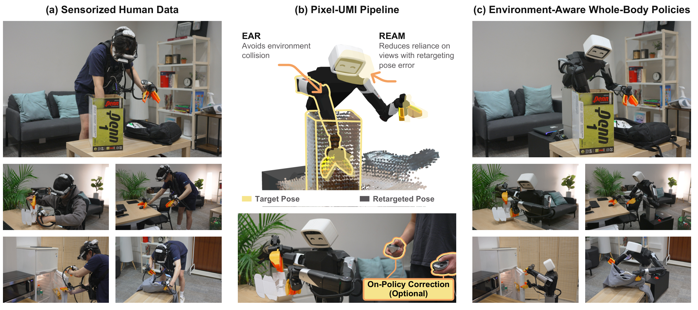
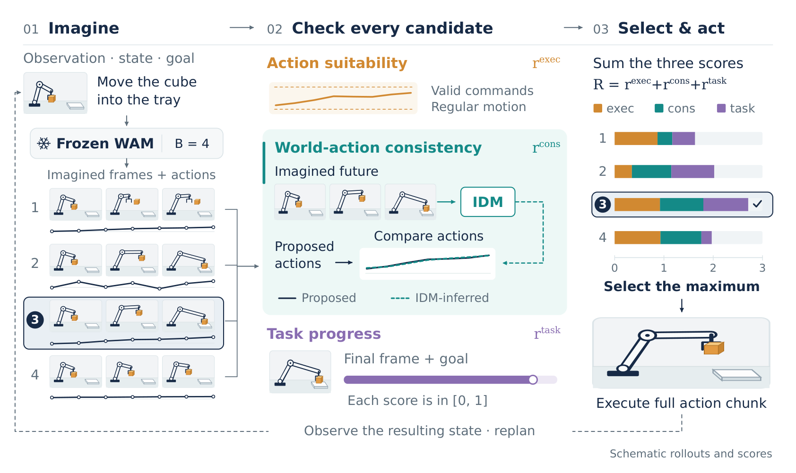

# Embodied AI & World Models News

> 具身智能与世界模型每日研究动态与论文精读。

**最新一期：2026-11-03** ｜ [日报原文](news/2026-11-03.md) · [精读索引](paper-reading/news/2026-11-03/README.md) · [历史归档](#历史归档)

---

<!-- 本段由 codex-deployment/update_readme.py 从 news/2026-11-03.md 自动镜像，请勿手工编辑 -->

## 2026-11-03 Embodied AI & World Models Daily

> 面向具身智能与世界模型研究员、工程师的中文科研日报。
> 本期为补发；主窗口是北京时间2026-11-03自然日，补充窗口为此前两天。只按官方v1实际提交时间归属，不以公告日或编号月份代替。来源检查存在缺口，详见末节；未访问到的内容不能解释为当天没有资讯。

本期保留1个必读事件、7篇论文雷达，完成2篇全文精读；其他论文说明仅基于官方摘要，不代表独立复现。分数为同一agent按五维标准两轮编辑评估的平均，T1门槛62；评分不等于客观质量排名。

### 🔥 今日必读

#### 【跨本体示范】Pixel-UMI：把环境、延迟和视角误差一起带入学习

**来源：** [Pixel-UMI: Learning Environment-Aware Whole-Body Manipulation from Sensorized Human Demonstrations](https://arxiv.org/abs/2611.03647)  
**类型：** Paper / research_paper；T1  
**实际首次提交：** 2026-11-03 02:59:32 北京时间（主窗口）  
**双评分：** 89 / 88 → **88.5/100**

EAR离线重建静态场景，跟踪头腕时同时考虑全身避障；逐关节延迟校准把状态转换为动作标签，REAM降低训练时对错配视角的依赖。接触任务通过两轮DAgger继续纠正。五任务平均87.0%是阶段进度，不是整任务成功率；部署不做在线重建不等于训练没有机器人数据。

*论文方法总览；已对照原PDF整页做视觉审查。*

[全文精读](paper-reading/news/2026-11-03/pixel-umi/pixel-umi.md) · 1图、0占位；完整校验通过。

**配套事件与关注理由：** [Pixel系统论文](https://arxiv.org/abs/2611.03648)提供机器人硬件、数据接口、全身控制与策略学习背景，本期与Pixel-UMI聚为同一系列事件，不重复计数。该工作把跨本体问题拆为几何、时间、视角和接触，适合按模块复现。

### 📄 论文雷达

#### 【世界动作一致性】WISE：想象视频还要与拟执行动作相容

**来源：** [Seeing Through the Illusion: Test-Time Scaling for World Action Models](https://arxiv.org/abs/2611.03585)  
**类型：** Paper / research_paper；T1  
**实际首次提交：** 2026-11-03 02:32:18 北京时间（主窗口）  
**双评分：** 85 / 82 → **83.5/100**

冻结WAM每次采四个动作—未来对，结合动作合理性、逆动力学一致性和任务进度择优。RoboLab成功率6%→24%，LIBERO75.1%→78.3%；最佳同预算对照分别20%与77.4%，优势远小于相对单候选的增益。全程仿真，耗时增加约3.4–3.5倍，小样本及评估器误差仍是限制。

*论文方法总览；已对照原PDF整页做视觉审查。*

[全文精读](paper-reading/news/2026-11-03/wise/wise.md) · 1图、0占位；完整校验通过。

#### 【信念空间规划】TAMPAgent：把观察动作与几何可行性一起求解

**来源：** [TAMPAgent: Agentic Belief-Space Planning for Mobile Manipulation](https://arxiv.org/abs/2611.03584)  
**类型：** Paper / research_paper；T1  
**实际首次提交：** 2026-11-03 02:32:18 北京时间（主窗口）  
**双评分：** 80 / 82 → **81/100**

VLM先拟定参数化观察与执行计划，经典搜索补全，再通过感知和规划工具绑定满足几何约束的参数；执行后更新信念并再次规划。作者在Rainbow Y1与Unitree G1家庭移动操作中比较直接工具调用代理。本期仅核验摘要，不将“显著改善”补写成未核验的具体成功率。

#### 【触觉控制】PanoTac：同时保留接触空间结构与剪切响应

**来源：** [PanoTac: A Dense Three-Axis Tactile Sensor for Robust Touch-Centric Manipulation](https://arxiv.org/abs/2611.03520)  
**类型：** Paper / research_paper；T1  
**实际首次提交：** 2026-11-03 01:55:07 北京时间（主窗口）  
**双评分：** 80 / 79 → **79.5/100**

每指尖给出12×32×3的法向和双轴剪切表征，60Hz、作者报告材料成本低于50美元。试管准备、舀颗粒和倒盐中视触觉策略平均高于视觉基线46.7个百分点。去掉空间接触信息或剪切反馈均退化；该结果属于特定任务和硬件组合，不能直接视为所有触觉模态普遍增益。

#### 【奖励评估】D&A：先描述场景，再按绝对标准评估进度

**来源：** [D&A: Decoupling Description and Assessment Enables VLMs as Zero-Shot Robotic Reward Models](https://arxiv.org/abs/2611.03622)  
**类型：** Paper / research_paper；T1  
**实际首次提交：** 2026-11-03 02:52:11 北京时间（主窗口）  
**双评分：** 79 / 78 → **78.5/100**

将任务相关的客观动态描述与评分分离，先明确绝对成功标准，再评价视频中的部分进度与失败，避免把时间更晚误当作任务更接近完成。方法仅修改提示、保持基础VLM参数不变，但仍可能受描述幻觉影响；摘要未提供可在本期直接核对的完整误差和RL预算数字。

#### 【补充窗口／导航世界模型】OpenNWM：从无动作视频预训练潜动作

**来源：** [OpenNWM: A Generalist Navigation World Model with Latent Action Pretraining](https://arxiv.org/abs/2611.01844)  
**类型：** Paper / research_paper；T1  
**实际首次提交：** 2026-11-01 20:23:38 北京时间（补充窗口）  
**双评分：** 79 / 77 → **78/100**

从1750万视觉观察、15个异构来源学习潜动作，再经动作条件后训练对齐物理运动。覆盖地面机器人、人和无人机视角，报告域内外预测和导航改善。数据规模不等于独立任务数，视觉预测质量也不自动证明闭环可控性；本期摘要层收录，未伪装为全文复现。

#### 【具身共设计】惯量不匹配会改变行为克隆的数据收益

**来源：** [When Robots Outweigh Objects: How Inertia Mismatch Shapes Robot Policy Learning](https://arxiv.org/abs/2611.03501)  
**类型：** Paper / research_paper；T1  
**实际首次提交：** 2026-11-03 01:40:05 北京时间（主窗口）  
**双评分：** 78 / 77 → **77.5/100**

在受控仿真中独立改变机器人与物体质量及电机反射惯量，发现行为克隆更容易学习轻机器人操纵重物体的策略，多数据缩小但未消除差距。作者还通过选择低接触惯量工作区或示范路径改善模仿。证据是仿真控制实验，不应概括成真实机器人越轻越好。

#### 【补充窗口／延迟评测】VLALagBench：延迟代价取决于任务与执行方式

**来源：** [VLALagBench: Understanding When and Why VLA Inference Latency Matters](https://arxiv.org/abs/2611.03103)  
**类型：** Paper / research_paper；T1  
**实际首次提交：** 2026-11-02 21:18:36 北京时间（补充窗口）  
**双评分：** 76 / 75 → **75.5/100**

跨任务、目标速度、同步／异步执行和VLA策略测量推理时延敏感性，摘要报告100ms已能使部分移动目标任务成功率接近减半。异步重叠可恢复部分表现，但增加推理请求频度；校准成功率模型RMSE约5.7–7.8个百分点，不能把单一时延阈值当成通用安全边界。

### 🛠 工程与开源

Pixel硬件、遥操作和人体数据采集接口随上面的同系列论文合并说明。[Pixel-UMI项目入口](https://pixel-robot.com/pixel-umi)由PDF明确给出，但本轮HTTP请求超时，未将代码／权重可用性标为已确认。WISE全文未找到可确认的独立官方代码发布入口。GitHub新建仓库与Hugging Face更新时间已纳入来源扫描；未能确认首次发布及实现内容的项目不独立列为新成果。

### 💬 社区信号

本轮仅取得有限的HN检索样本，X与Reddit未完整覆盖。没有将未回溯到一手技术材料、发布时间不明或仅产品讨论的样本作为独立高分社区事件；这不表示当天没有讨论。

### 🔎 补充窗口筛选记录

检索官方cs.RO、cs.AI、cs.LG、cs.CV recent及月份列表，对关键词候选逐条获取摘要、作者、标题与版本时间，再去重、预筛和评分。非精读候选采用摘要证据层的保守编辑判断；排序靠后不等于论文无价值。

展开逐条窗口归属、预筛及双评分记录

| 论文 | v1北京时间 | 窗口／预筛 | 两轮分数→平均 | 处置 |
|---|---|---|---|---|
| [Pixel: A Co-Designed Full-Stack Robot System for Learning General-Purpose Mobile Manipulation](https://arxiv.org/abs/2611.03648) | 2026-11-03 02:59:32 | main／CLUSTER | — | 按摘要证据属于领域范围；两轮评分后本期排序靠后 |
| [Pixel-UMI: Learning Environment-Aware Whole-Body Manipulation from Sensorized Human Demonstrations](https://arxiv.org/abs/2611.03647) | 2026-11-03 02:59:32 | main／PASS | 89/88→88.5 | 必读 |
| [D&A: Decoupling Description and Assessment Enables VLMs as Zero-Shot Robotic Reward Models](https://arxiv.org/abs/2611.03622) | 2026-11-03 02:52:11 | main／PASS | 79/78→78.5 | 论文雷达 |
| [Seeing Through the Illusion: Test-Time Scaling for World Action Models](https://arxiv.org/abs/2611.03585) | 2026-11-03 02:32:18 | main／PASS | 85/82→83.5 | 论文雷达 |
| [TAMPAgent: Agentic Belief-Space Planning for Mobile Manipulation](https://arxiv.org/abs/2611.03584) | 2026-11-03 02:32:18 | main／PASS | 80/82→81 | 论文雷达 |
| [Mediating Human-Swarm Interactions Through a Robot Helper: A Shepherding-Inspired Approach](https://arxiv.org/abs/2611.03548) | 2026-11-03 02:10:01 | main／PASS | 65/66→65.5 | 按摘要证据属于领域范围；两轮评分后本期排序靠后 |
| [PanoTac: A Dense Three-Axis Tactile Sensor for Robust Touch-Centric Manipulation](https://arxiv.org/abs/2611.03520) | 2026-11-03 01:55:07 | main／PASS | 80/79→79.5 | 论文雷达 |
| [When Robots Outweigh Objects: How Inertia Mismatch Shapes Robot Policy Learning](https://arxiv.org/abs/2611.03501) | 2026-11-03 01:40:05 | main／PASS | 78/77→77.5 | 论文雷达 |
| [SNAP: Semantic Navigation Among Pedestrians](https://arxiv.org/abs/2611.03498) | 2026-11-03 01:37:50 | main／PASS | 65/66→65.5 | 按摘要证据属于领域范围；两轮评分后本期排序靠后 |
| [Delay-Certified Readiness Barriers for Overactuated Multirotor Allocation Without Lipschitz Constants](https://arxiv.org/abs/2611.03490) | 2026-11-03 01:33:40 | main／PASS | 65/66→65.5 | 按摘要证据属于领域范围；两轮评分后本期排序靠后 |
| [Exploring Proximity and Tactile Sensing for Robotic Manipulation](https://arxiv.org/abs/2611.03489) | 2026-11-03 01:33:03 | main／PASS | 65/66→65.5 | 按摘要证据属于领域范围；两轮评分后本期排序靠后 |
| [Clinician-AI Collaboration in Endovascular Neurointerventions: In-Vitro User Study of Copilot Assistance Modes for Robotic Navigation Across the Autonomy Spectrum](https://arxiv.org/abs/2611.03446) | 2026-11-03 00:57:50 | main／PASS | 59/58→58.5 | 范围相关但当前摘要证据双评分低于T1门槛62 |
| [Toward Uncertainty-Aware, Physics-Grounded Human World Models](https://arxiv.org/abs/2611.03428) | 2026-11-03 00:50:52 | main／PASS | 59/58→58.5 | 范围相关但当前摘要证据双评分低于T1门槛62 |
| [Myoelectric Control for Upper-Limb Exoskeletons: A Decoder-Shaper-Controller Framework, Design Guidelines, and Future Directions](https://arxiv.org/abs/2611.03418) | 2026-11-03 00:41:41 | main／PASS | 59/58→58.5 | 范围相关但当前摘要证据双评分低于T1门槛62 |
| [OpenZilo: An Open Smart-Ring Platform for Human-Centric Sensing and Interaction with Robots](https://arxiv.org/abs/2611.03410) | 2026-11-03 00:36:15 | main／PASS | 65/66→65.5 | 按摘要证据属于领域范围；两轮评分后本期排序靠后 |
| [Safe-Ballbot: Tilt-Consistent MPC with Control Barrier Functions for Ballbot Navigation](https://arxiv.org/abs/2611.03307) | 2026-11-02 23:38:13 | supplementary／PASS | 65/66→65.5 | 按摘要证据属于领域范围；两轮评分后本期排序靠后 |
| [ForceLDM: A Force-aware Latent Dynamics Model for Contact-Rich Manipulation](https://arxiv.org/abs/2611.03294) | 2026-11-02 23:31:54 | supplementary／PASS | 65/66→65.5 | 按摘要证据属于领域范围；两轮评分后本期排序靠后 |
| [VerifLM: Physically Verified Image-Edit-Guided Goal Pose Generation for Robotic Manipulation](https://arxiv.org/abs/2611.03268) | 2026-11-02 23:11:59 | supplementary／PASS | 59/58→58.5 | 范围相关但当前摘要证据双评分低于T1门槛62 |
| [TRAILS: Trajectory Generation for Automated Indoor Locomotion Studies](https://arxiv.org/abs/2611.03254) | 2026-11-02 23:00:02 | supplementary／PASS | 59/58→58.5 | 范围相关但当前摘要证据双评分低于T1门槛62 |
| [Towards end-to-end co-design for one-shot printable task-specific soft robots](https://arxiv.org/abs/2611.03216) | 2026-11-02 22:39:49 | supplementary／PASS | 59/58→58.5 | 范围相关但当前摘要证据双评分低于T1门槛62 |
| [Rollout then Recycle: 3,718 Labelled Real-Robot Episodes from Benchmarking 7 Policies on 12 Tasks](https://arxiv.org/abs/2611.03168) | 2026-11-02 22:08:08 | supplementary／PASS | 65/66→65.5 | 按摘要证据属于领域范围；两轮评分后本期排序靠后 |
| [FineCraft: Enhancing VLA Models for Fine-Grained Manipulation](https://arxiv.org/abs/2611.03163) | 2026-11-02 22:03:49 | supplementary／PASS | 59/58→58.5 | 范围相关但当前摘要证据双评分低于T1门槛62 |
| [KlaskTron: An Open-Source Platform for Physical Adversarial Multi-Agent RL](https://arxiv.org/abs/2611.03138) | 2026-11-02 21:49:53 | supplementary／PASS | 65/66→65.5 | 按摘要证据属于领域范围；两轮评分后本期排序靠后 |
| [A Tightly Coupled Magnetic-Inertial SLAM System for Field Robots](https://arxiv.org/abs/2611.03106) | 2026-11-02 21:23:39 | supplementary／PASS | 65/66→65.5 | 按摘要证据属于领域范围；两轮评分后本期排序靠后 |
| [VLALagBench: Understanding When and Why VLA Inference Latency Matters](https://arxiv.org/abs/2611.03103) | 2026-11-02 21:18:36 | supplementary／PASS | 76/75→75.5 | 论文雷达 |
| [KlaskTron-IL: A Contact-Rich Adversarial Imitation Learning Benchmark with a Validated Sim-to-Real Bridge](https://arxiv.org/abs/2611.03091) | 2026-11-02 21:11:21 | supplementary／PASS | 65/66→65.5 | 按摘要证据属于领域范围；两轮评分后本期排序靠后 |
| [PlanContext: Benchmarking In-Context Driving Decision-Making](https://arxiv.org/abs/2611.03067) | 2026-11-02 20:54:47 | supplementary／PASS | 65/66→65.5 | 按摘要证据属于领域范围；两轮评分后本期排序靠后 |
| [BeyondContact: A Reinforcement Learning Framework for Airflow-Based Non-Contact Manipulation](https://arxiv.org/abs/2611.03059) | 2026-11-02 20:50:09 | supplementary／PASS | 65/66→65.5 | 按摘要证据属于领域范围；两轮评分后本期排序靠后 |
| [Swarm Choreography Made Simple: Superposed Guiding Vector Fields for Rigid Formation Path Following](https://arxiv.org/abs/2611.03016) | 2026-11-02 20:16:32 | supplementary／PASS | 59/58→58.5 | 范围相关但当前摘要证据双评分低于T1门槛62 |
| [SyncHeC: Markerless Spatio-Temporal Hand-Eye Calibration via Differentiable Rendering and Continuous-Time Joint Optimization](https://arxiv.org/abs/2611.02999) | 2026-11-02 20:03:20 | supplementary／PASS | 59/58→58.5 | 范围相关但当前摘要证据双评分低于T1门槛62 |
| [MS-DOTT: A Multi-Modal Dataset for Off-Road Traversability Estimation](https://arxiv.org/abs/2611.02992) | 2026-11-02 20:00:20 | supplementary／PASS | 65/66→65.5 | 按摘要证据属于领域范围；两轮评分后本期排序靠后 |
| [ReContact: Reconstruct and Retarget Human Contacts from Video for Contact-Rich Humanoid Manipulation](https://arxiv.org/abs/2611.02968) | 2026-11-02 19:36:51 | supplementary／PASS | 65/66→65.5 | 按摘要证据属于领域范围；两轮评分后本期排序靠后 |
| [Positive Safety Margins from Artificial Potential Field Reward Augmentation for Size-Robust Obstacle Avoidance under Partial Observability](https://arxiv.org/abs/2611.02947) | 2026-11-02 19:12:32 | supplementary／PASS | 65/66→65.5 | 按摘要证据属于领域范围；两轮评分后本期排序靠后 |
| [RESONATE: a Real Social Navigation Testbed for Autonomous Service Robots](https://arxiv.org/abs/2611.02937) | 2026-11-02 19:04:45 | supplementary／PASS | 65/66→65.5 | 按摘要证据属于领域范围；两轮评分后本期排序靠后 |
| [PointPilot: Unified Robotic Manipulation via Object-Centric 3D Point Flow Prediction](https://arxiv.org/abs/2611.02930) | 2026-11-02 18:58:29 | supplementary／PASS | 59/58→58.5 | 范围相关但当前摘要证据双评分低于T1门槛62 |
| [An intelligent satellite must do nothing well](https://arxiv.org/abs/2611.02922) | 2026-11-02 18:52:06 | supplementary／PASS | 65/66→65.5 | 按摘要证据属于领域范围；两轮评分后本期排序靠后 |
| [AnchorHEC: Targetless Hand-Eye Calibration of Wrist and Fixed Cameras](https://arxiv.org/abs/2611.02884) | 2026-11-02 18:19:26 | supplementary／PASS | 59/58→58.5 | 范围相关但当前摘要证据双评分低于T1门槛62 |
| [Design and Experimental Validation of the Separation and Deployment System for the CHERI Lunar Micro-Rovers](https://arxiv.org/abs/2611.02872) | 2026-11-02 18:11:19 | supplementary／PASS | 65/66→65.5 | 按摘要证据属于领域范围；两轮评分后本期排序靠后 |
| [ReGATE: Recurrent Gated Visual Fusion for Reactive Humanoid-Object Interaction](https://arxiv.org/abs/2611.02871) | 2026-11-02 18:10:46 | supplementary／PASS | 59/58→58.5 | 范围相关但当前摘要证据双评分低于T1门槛62 |
| [SomaAlign: Reliability-Aware Multimodal Representation Learning for Soft Robotic Grasping](https://arxiv.org/abs/2611.02794) | 2026-11-02 17:06:11 | supplementary／PASS | 65/66→65.5 | 按摘要证据属于领域范围；两轮评分后本期排序靠后 |
| [Beyond Policy Patches: Distilling RL Specialists into Vision-Language-Action Policies](https://arxiv.org/abs/2611.02777) | 2026-11-02 16:53:49 | supplementary／PASS | 59/58→58.5 | 范围相关但当前摘要证据双评分低于T1门槛62 |
| [Right Ranking, Wrong Scale: Reproducing the Robotic World Model's Dynamics Model and Testing the Uncertainty of Its Follow-up](https://arxiv.org/abs/2611.02699) | 2026-11-02 15:52:09 | supplementary／PASS | 65/66→65.5 | 按摘要证据属于领域范围；两轮评分后本期排序靠后 |
| [Source-Resolved Collective Cognition in Robotics: Mathematical Foundations for Multimodal and Collective Estimation, and Their Reach across the Cognition Loop](https://arxiv.org/abs/2611.02693) | 2026-11-02 15:43:10 | supplementary／PASS | 65/66→65.5 | 按摘要证据属于领域范围；两轮评分后本期排序靠后 |
| [Closing the Dynamics Gap through Self-Directed Robotic Interaction](https://arxiv.org/abs/2611.02691) | 2026-11-02 15:40:51 | supplementary／PASS | 65/66→65.5 | 按摘要证据属于领域范围；两轮评分后本期排序靠后 |
| [Visuo-tactile Diffusion Policy for Robotic Manipulation with Auxiliary Tactile Dynamics Prediction](https://arxiv.org/abs/2611.02677) | 2026-11-02 15:32:10 | supplementary／PASS | 65/66→65.5 | 按摘要证据属于领域范围；两轮评分后本期排序靠后 |
| [HeLM: Hierarchical Explicit Language Memory for Non-Markovian Manipulation](https://arxiv.org/abs/2611.02660) | 2026-11-02 15:20:12 | supplementary／PASS | 59/58→58.5 | 范围相关但当前摘要证据双评分低于T1门槛62 |
| [DexArena: A Unified Benchmark for Long-Horizon Dexterous Manipulation](https://arxiv.org/abs/2611.02629) | 2026-11-02 14:54:36 | supplementary／PASS | 65/66→65.5 | 按摘要证据属于领域范围；两轮评分后本期排序靠后 |
| [Neural Integral Control Barrier Functions for Agile Collision Avoidance](https://arxiv.org/abs/2611.02626) | 2026-11-02 14:53:14 | supplementary／PASS | 65/66→65.5 | 按摘要证据属于领域范围；两轮评分后本期排序靠后 |
| [MAPO: Mixture of Experts with Alternating Policy Optimization for Universal Humanoid Motion Tracking](https://arxiv.org/abs/2611.02613) | 2026-11-02 14:40:14 | supplementary／PASS | 65/66→65.5 | 按摘要证据属于领域范围；两轮评分后本期排序靠后 |
| [W2A: Distilling World Priors into Action Models for Real-Time Robotic Control](https://arxiv.org/abs/2611.02600) | 2026-11-02 14:25:24 | supplementary／PASS | 59/58→58.5 | 范围相关但当前摘要证据双评分低于T1门槛62 |
| [Central pivot point control of a body-attached spring-mass runner: periodic gaits, stabilization, template embedding and approximate analytic return maps](https://arxiv.org/abs/2611.02564) | 2026-11-02 13:45:59 | supplementary／PASS | 65/66→65.5 | 按摘要证据属于领域范围；两轮评分后本期排序靠后 |
| [Sequential Recovery Updates for Learned Controllers under Successful-Trajectory Preservation](https://arxiv.org/abs/2611.02555) | 2026-11-02 13:28:18 | supplementary／PASS | 65/66→65.5 | 按摘要证据属于领域范围；两轮评分后本期排序靠后 |
| [Energy-Based Policy Orchestration](https://arxiv.org/abs/2611.02546) | 2026-11-02 13:16:05 | supplementary／PASS | 65/66→65.5 | 按摘要证据属于领域范围；两轮评分后本期排序靠后 |
| [Interactive 3D Cutaway Visualization for Subsurface Target Localization in Robot-Assisted Surgery](https://arxiv.org/abs/2611.02537) | 2026-11-02 13:07:26 | supplementary／PASS | 65/66→65.5 | 按摘要证据属于领域范围；两轮评分后本期排序靠后 |
| [A Study on the Effects of Finger Movements on a Humanoid Hugging Robot](https://arxiv.org/abs/2611.02517) | 2026-11-02 12:36:46 | supplementary／BLOCK | — | 主要是纯视觉/GUI/文本或行业专用应用，未见足够通用机器人决策/控制落点 |
| [Neuro Inspired Robotics: What Robot Learning Can Borrow from the Sensorimotor Brain](https://arxiv.org/abs/2611.02510) | 2026-11-02 12:30:40 | supplementary／PASS | 65/66→65.5 | 按摘要证据属于领域范围；两轮评分后本期排序靠后 |
| [RoboColosseum: Evaluating Physical Intelligence at Scale In-The-Wild](https://arxiv.org/abs/2611.02497) | 2026-11-02 12:16:47 | supplementary／PASS | 59/58→58.5 | 范围相关但当前摘要证据双评分低于T1门槛62 |
| [To Coordinate or Not to Coordinate? Learning to Swim with Eight Soft Arms](https://arxiv.org/abs/2611.02468) | 2026-11-02 11:33:47 | supplementary／PASS | 65/66→65.5 | 按摘要证据属于领域范围；两轮评分后本期排序靠后 |
| [Learning Purposeful Co-designs of Bio-inspired Quadrupedal Robots](https://arxiv.org/abs/2611.02462) | 2026-11-02 11:25:36 | supplementary／PASS | 59/58→58.5 | 范围相关但当前摘要证据双评分低于T1门槛62 |
| [Late Autumn: LLM Agents Specialize a General Multi-Robot Planner for One Warehouse](https://arxiv.org/abs/2611.02391) | 2026-11-02 10:04:21 | supplementary／PASS | 59/58→58.5 | 范围相关但当前摘要证据双评分低于T1门槛62 |
| [When to Probe and When to Act: Clarity-Aware Risk-Adaptive Control for Interactive Driving](https://arxiv.org/abs/2611.02240) | 2026-11-02 06:03:30 | supplementary／PASS | 59/58→58.5 | 范围相关但当前摘要证据双评分低于T1门槛62 |
| [Beyond Ensemble Disagreement: Predictive STL Monitoring of RL Locomotion under Distribution Shift](https://arxiv.org/abs/2611.02218) | 2026-11-02 05:27:39 | supplementary／PASS | 65/66→65.5 | 按摘要证据属于领域范围；两轮评分后本期排序靠后 |
| [Directional Bounded-Confidence Matrix Alignment in Vicsek Flocking](https://arxiv.org/abs/2611.02189) | 2026-11-02 04:33:55 | supplementary／PASS | 65/66→65.5 | 按摘要证据属于领域范围；两轮评分后本期排序靠后 |
| [Human Sensorimotor Model Adaptation to Account for Robot Accuracy and Speed Augmentation in Human-Robot Co-Manipulation](https://arxiv.org/abs/2611.02181) | 2026-11-02 04:30:04 | supplementary／PASS | 65/66→65.5 | 按摘要证据属于领域范围；两轮评分后本期排序靠后 |
| [Directional Bounded-Confidence Cucker-Smale Flocking](https://arxiv.org/abs/2611.02173) | 2026-11-02 04:22:35 | supplementary／PASS | 65/66→65.5 | 按摘要证据属于领域范围；两轮评分后本期排序靠后 |
| [GoalDex: Learning Image-Goal-Conditioned Policies for Dexterous In-Hand Manipulation](https://arxiv.org/abs/2611.02171) | 2026-11-02 04:19:51 | supplementary／PASS | 59/58→58.5 | 范围相关但当前摘要证据双评分低于T1门槛62 |
| [History-Aware Force Sensing and Tunable Stiffness in a Pneumatic Kresling Origami Cell](https://arxiv.org/abs/2611.02140) | 2026-11-02 03:18:28 | supplementary／PASS | 65/66→65.5 | 按摘要证据属于领域范围；两轮评分后本期排序靠后 |
| [When Delay Meets Drift: Physical Safety of Robot Foundation Models Is a Cross-Layer Problem](https://arxiv.org/abs/2611.02101) | 2026-11-02 02:14:05 | supplementary／PASS | 65/66→65.5 | 按摘要证据属于领域范围；两轮评分后本期排序靠后 |
| [Local Solution Repair for Multi-Agent Pickup and Delivery](https://arxiv.org/abs/2611.02090) | 2026-11-02 01:58:05 | supplementary／PASS | 65/66→65.5 | 按摘要证据属于领域范围；两轮评分后本期排序靠后 |
| [Back to the Future: Predicting Long-Horizon Dynamics with Retrospective Correction for Disturbance-Aware Retrieval](https://arxiv.org/abs/2611.02073) | 2026-11-02 01:25:19 | supplementary／PASS | 59/58→58.5 | 范围相关但当前摘要证据双评分低于T1门槛62 |
| [Do Embodied VLMs Actually Use Their Scene-Graph Memory?](https://arxiv.org/abs/2611.02056) | 2026-11-02 01:01:20 | supplementary／PASS | 65/66→65.5 | 按摘要证据属于领域范围；两轮评分后本期排序靠后 |
| [Answering Without Arriving: An Evidence Audit for Embodied Question Answering](https://arxiv.org/abs/2611.01958) | 2026-11-01 22:46:18 | supplementary／PASS | 65/66→65.5 | 按摘要证据属于领域范围；两轮评分后本期排序靠后 |
| [OpenNWM: A Generalist Navigation World Model with Latent Action Pretraining](https://arxiv.org/abs/2611.01844) | 2026-11-01 20:23:38 | supplementary／PASS | 79/77→78 | 论文雷达 |
| [Control Barrier Functions for Safety-Aware Latent-Space Motion Planning](https://arxiv.org/abs/2611.01814) | 2026-11-01 19:30:51 | supplementary／PASS | 59/58→58.5 | 范围相关但当前摘要证据双评分低于T1门槛62 |
| [CompliantBot: Learning Whole-Body Compliance across Task Interfaces for Humanoid Control](https://arxiv.org/abs/2611.01748) | 2026-11-01 17:52:12 | supplementary／PASS | 59/58→58.5 | 范围相关但当前摘要证据双评分低于T1门槛62 |
| [ODE Policy: Robot Learning via Action Dynamics, Not Actions](https://arxiv.org/abs/2611.01729) | 2026-11-01 17:25:12 | supplementary／PASS | 65/66→65.5 | 按摘要证据属于领域范围；两轮评分后本期排序靠后 |
| [HuG: Learning Humanoid Whole-Body Affordance-Aware Grasping with Active Perception](https://arxiv.org/abs/2611.01659) | 2026-11-01 15:11:31 | supplementary／PASS | 59/58→58.5 | 范围相关但当前摘要证据双评分低于T1门槛62 |
| [MagPillar: A Soft Magnetopillar Array Tactile Sensor for Robotic Surface Perception](https://arxiv.org/abs/2611.01609) | 2026-11-01 13:53:15 | supplementary／PASS | 65/66→65.5 | 按摘要证据属于领域范围；两轮评分后本期排序靠后 |
| [SCOUT: Planning under Occlusion via Object-Centric World Model Rollouts](https://arxiv.org/abs/2611.01600) | 2026-11-01 13:32:18 | supplementary／PASS | 59/58→58.5 | 范围相关但当前摘要证据双评分低于T1门槛62 |
| [Recursive Self-Improvement of Exoskeleton Assistance Policies through Human-in-the-Loop Feedback](https://arxiv.org/abs/2611.01581) | 2026-11-01 13:03:16 | supplementary／PASS | 59/58→58.5 | 范围相关但当前摘要证据双评分低于T1门槛62 |
| [Democratizing Robot-Use Agents: A Unified Harness with Open Models](https://arxiv.org/abs/2611.01560) | 2026-11-01 12:32:23 | supplementary／PASS | 65/66→65.5 | 按摘要证据属于领域范围；两轮评分后本期排序靠后 |
| [$TF^2$-Steering: Action Refinement with Tactile Forecasts and Feedback via Velocity-Field Steering](https://arxiv.org/abs/2611.01483) | 2026-11-01 11:15:09 | supplementary／PASS | 65/66→65.5 | 按摘要证据属于领域范围；两轮评分后本期排序靠后 |
| [Dual Path Following for an Aerial Manipulator Under State and Input Constraints via Transverse Feedback Linearization](https://arxiv.org/abs/2611.01442) | 2026-11-01 10:28:47 | supplementary／PASS | 65/66→65.5 | 按摘要证据属于领域范围；两轮评分后本期排序靠后 |
| [Adaptive Surface Cleaning under Uncertain Cleaning Response](https://arxiv.org/abs/2611.01437) | 2026-11-01 10:19:51 | supplementary／PASS | 59/58→58.5 | 范围相关但当前摘要证据双评分低于T1门槛62 |
| [Serving Agentic Robot Fleets: Workload Characterization, KV-Cache Thrashing, and Admission Control](https://arxiv.org/abs/2611.01404) | 2026-11-01 09:15:32 | supplementary／PASS | 65/66→65.5 | 按摘要证据属于领域范围；两轮评分后本期排序靠后 |
| [Same Path, Less Time: Training-Free Fast Execution of Vision-Language-Action Models under Inference Latency](https://arxiv.org/abs/2611.01390) | 2026-11-01 08:53:26 | supplementary／PASS | 65/66→65.5 | 按摘要证据属于领域范围；两轮评分后本期排序靠后 |
| [Programmable Droplets as Active Matter in a Reconfigurable Environment](https://arxiv.org/abs/2611.01277) | 2026-11-01 05:23:25 | supplementary／BLOCK | — | 主要是纯视觉/GUI/文本或行业专用应用，未见足够通用机器人决策/控制落点 |
| [Shades of Success: Evaluating Manipulation Quality from Object-Centric Constraints](https://arxiv.org/abs/2611.01250) | 2026-11-01 04:30:31 | supplementary／PASS | 59/58→58.5 | 范围相关但当前摘要证据双评分低于T1门槛62 |
| [Differentiable Iterative Learning Control for Black-Box Position-Commanded Manipulators](https://arxiv.org/abs/2611.01220) | 2026-11-01 03:41:24 | supplementary／PASS | 59/58→58.5 | 范围相关但当前摘要证据双评分低于T1门槛62 |
| [Vision-Language Models Are Joint Denoisers in Robotic Action Generation](https://arxiv.org/abs/2611.01215) | 2026-11-01 03:29:39 | supplementary／PASS | 65/66→65.5 | 按摘要证据属于领域范围；两轮评分后本期排序靠后 |
| [Learning Agile Humanoid Dodgeball with Onboard Monocular Vision](https://arxiv.org/abs/2611.01197) | 2026-11-01 02:53:51 | supplementary／PASS | 65/66→65.5 | 按摘要证据属于领域范围；两轮评分后本期排序靠后 |
| [ClothDojo: Learned Data Generation and Benchmarking for Bimanual Garment Flattening and Folding](https://arxiv.org/abs/2611.01190) | 2026-11-01 02:42:11 | supplementary／PASS | 65/66→65.5 | 按摘要证据属于领域范围；两轮评分后本期排序靠后 |
| [Auriga Technical Report: A Task-Agnostic Agent Harness for Zero-Shot Embodied Manipulation](https://arxiv.org/abs/2611.01112) | 2026-11-01 00:59:05 | supplementary／PASS | 59/58→58.5 | 范围相关但当前摘要证据双评分低于T1门槛62 |
| [Robust Safety Assurance for Robotic Swarms Using Decentralized Collision Verification](https://arxiv.org/abs/2611.01081) | 2026-11-01 00:17:19 | supplementary／PASS | 65/66→65.5 | 按摘要证据属于领域范围；两轮评分后本期排序靠后 |
| [Hi-CoLA: High Confidence Lower Bound Approximation Based Reinforcement Learning for Flex-Route Transit Operation Control](https://arxiv.org/abs/2611.01071) | 2026-11-01 00:09:41 | supplementary／BLOCK | — | 主要是纯视觉/GUI/文本或行业专用应用，未见足够通用机器人决策/控制落点 |
| [pico-WAM: Evaluating Counterfactual Prediction and Planning Error in a Compact World Action Model](https://arxiv.org/abs/2611.01039) | 2026-10-31 23:28:50 | outside／OUTSIDE | — | 首次提交在窗口外，近期公告/revision不改变归属 |
| [HALO-LP: A Homogeneous All-Shifted Non-Interior-Point Method for Linear Programming](https://arxiv.org/abs/2611.01038) | 2026-10-31 23:26:09 | outside／OUTSIDE | — | 首次提交在窗口外，近期公告/revision不改变归属 |
| [Generalizable robotic manipulation through compositional skill reuse](https://arxiv.org/abs/2611.00978) | 2026-10-31 22:21:25 | outside／OUTSIDE | — | 首次提交在窗口外，近期公告/revision不改变归属 |
| [Evaluating Tactile Foundation Models for End-to-End Imitation Learning in Contact-Rich Manipulation](https://arxiv.org/abs/2611.00957) | 2026-10-31 22:00:22 | outside／OUTSIDE | — | 首次提交在窗口外，近期公告/revision不改变归属 |
| [Task-Specialized Language-Conditioned Models for Fine-Grained Robotic Manipulation](https://arxiv.org/abs/2611.00955) | 2026-10-31 21:57:49 | outside／OUTSIDE | — | 首次提交在窗口外，近期公告/revision不改变归属 |
| [Why Koopman Structure Does Not Help Differentiable World Models for Humanoid Whole-Body Tracking](https://arxiv.org/abs/2611.00951) | 2026-10-31 21:53:25 | outside／OUTSIDE | — | 首次提交在窗口外，近期公告/revision不改变归属 |
| [Trading Transparency for Stability: Friction-Cone-Constrained Bilateral Teleoperation for Opening Doors of Unsecured Furniture](https://arxiv.org/abs/2611.00898) | 2026-10-31 20:58:45 | outside／OUTSIDE | — | 首次提交在窗口外，近期公告/revision不改变归属 |
| [Verifying Test-State Identity in Paired Evaluation of Vision-Language-Action Models](https://arxiv.org/abs/2611.00896) | 2026-10-31 20:57:36 | outside／OUTSIDE | — | 首次提交在窗口外，近期公告/revision不改变归属 |
| [Multi-quadrotor systems interconnected via structurally unknown forces and moments](https://arxiv.org/abs/2611.00887) | 2026-10-31 20:44:18 | outside／OUTSIDE | — | 首次提交在窗口外，近期公告/revision不改变归属 |
| [Flap like a bat: Soft pneumatic wings for biomimetic ornithopters](https://arxiv.org/abs/2611.00879) | 2026-10-31 20:27:39 | outside／OUTSIDE | — | 首次提交在窗口外，近期公告/revision不改变归属 |
| [A Reproducible Reconstruction and Evaluation Framework for Photorealistic Lunar Analog Scene Reconstruction Toward Digital Twins](https://arxiv.org/abs/2611.00870) | 2026-10-31 20:11:36 | outside／OUTSIDE | — | 首次提交在窗口外，近期公告/revision不改变归属 |
| [MOST: Memory of Object States and Task Progress for Long-Horizon Mobile Manipulation](https://arxiv.org/abs/2611.00734) | 2026-10-31 16:28:53 | outside／OUTSIDE | — | 首次提交在窗口外，近期公告/revision不改变归属 |
| [STEER: Route-Aware Adaptive Reasoning for Autonomous Driving](https://arxiv.org/abs/2611.00718) | 2026-10-31 15:32:06 | outside／OUTSIDE | — | 首次提交在窗口外，近期公告/revision不改变归属 |
| [PREM: Prediction-Regulated Memory for Robot Manipulation](https://arxiv.org/abs/2611.00634) | 2026-10-31 12:58:50 | outside／OUTSIDE | — | 首次提交在窗口外，近期公告/revision不改变归属 |
| [Learning from an Imitable Teacher: Competition Solution for the MetaFine Challenge](https://arxiv.org/abs/2611.00615) | 2026-10-31 12:33:26 | outside／OUTSIDE | — | 首次提交在窗口外，近期公告/revision不改变归属 |
| [Roz: A Taste Test for World Model Latents](https://arxiv.org/abs/2611.00612) | 2026-10-31 12:14:53 | outside／OUTSIDE | — | 首次提交在窗口外，近期公告/revision不改变归属 |
| [SaddleSense: Saddle-Shaped Modules for 3D Shape Sensing with Single-Axis Off-the-Shelf Bend Sensors](https://arxiv.org/abs/2611.00582) | 2026-10-31 11:22:10 | outside／OUTSIDE | — | 首次提交在窗口外，近期公告/revision不改变归属 |
| [Faster Imitation by Re-timing Demonstrations Within the Controller Limit](https://arxiv.org/abs/2611.00539) | 2026-10-31 09:52:25 | outside／OUTSIDE | — | 首次提交在窗口外，近期公告/revision不改变归属 |
| [Reflex: Fast Robot Policy Serving by Reusing and Correcting Past Actions](https://arxiv.org/abs/2611.00524) | 2026-10-31 09:28:56 | outside／OUTSIDE | — | 首次提交在窗口外，近期公告/revision不改变归属 |
| [Behavioral Steering of Vision-Language-Action Models in the Low-Parameter Regime](https://arxiv.org/abs/2611.00522) | 2026-10-31 09:23:01 | outside／OUTSIDE | — | 首次提交在窗口外，近期公告/revision不改变归属 |
| [WorldSketch: Sketching World Models for Zero-Shot Mobile Manipulation](https://arxiv.org/abs/2611.00513) | 2026-10-31 09:06:20 | outside／OUTSIDE | — | 首次提交在窗口外，近期公告/revision不改变归属 |
| [MESSPa: A Multi-modal Embodiment Stimulation Shoulder Pad for Preserving the Sense of Agency in a Detachable Robotic Arm](https://arxiv.org/abs/2611.00509) | 2026-10-31 08:59:35 | outside／OUTSIDE | — | 首次提交在窗口外，近期公告/revision不改变归属 |
| [Knowing Where to Look: Interactive Object Search via Spatial-Semantic Fusion](https://arxiv.org/abs/2611.00499) | 2026-10-31 08:41:39 | outside／OUTSIDE | — | 首次提交在窗口外，近期公告/revision不改变归属 |
| [TacMind: Benchmarking and Modeling Tactile Interaction States for Robotic Manipulation](https://arxiv.org/abs/2611.00455) | 2026-10-31 07:13:52 | outside／OUTSIDE | — | 首次提交在窗口外，近期公告/revision不改变归属 |
| [Behavior Graphs: Unsupervised Graph Structures for Interpreting Robot Deployment Data](https://arxiv.org/abs/2611.00405) | 2026-10-31 05:51:01 | outside／OUTSIDE | — | 首次提交在窗口外，近期公告/revision不改变归属 |
| [Emergent Control of Ant Learning Walks in a Mobile Robot](https://arxiv.org/abs/2611.00392) | 2026-10-31 05:16:30 | outside／OUTSIDE | — | 首次提交在窗口外，近期公告/revision不改变归属 |
| [SPARK: Self-Correcting Embodied Memory via Physical Re-Observation](https://arxiv.org/abs/2611.00344) | 2026-10-31 04:24:55 | outside／OUTSIDE | — | 首次提交在窗口外，近期公告/revision不改变归属 |
| [Teach, Abstract, Apply: A Framework for Dialogue-Driven Task Learning with Collaborative Robots](https://arxiv.org/abs/2611.00297) | 2026-10-31 03:21:30 | outside／OUTSIDE | — | 首次提交在窗口外，近期公告/revision不改变归属 |
| [Does Validation Loss Predict Real-Robot Success? Evidence from Four Imitation-Learning Policies on a Low-Cost Arm](https://arxiv.org/abs/2611.00283) | 2026-10-31 03:05:01 | outside／OUTSIDE | — | 首次提交在窗口外，近期公告/revision不改变归属 |
| [Supervised Autonomous Bimanual Suction and Cauterization for Bleeding Control in Low Grade Splenic Trauma](https://arxiv.org/abs/2611.00237) | 2026-10-31 02:18:29 | outside／OUTSIDE | — | 首次提交在窗口外，近期公告/revision不改变归属 |
| [Anchor 1: Precise and Stable Humanoid Control for Whole-Body Manipulation](https://arxiv.org/abs/2611.00193) | 2026-10-31 01:56:53 | outside／OUTSIDE | — | 首次提交在窗口外，近期公告/revision不改变归属 |
| [Learning to Live: A Step Toward Lifelong Embodied Intelligence](https://arxiv.org/abs/2611.00180) | 2026-10-30 23:23:52 | outside／OUTSIDE | — | 首次提交在窗口外，近期公告/revision不改变归属 |
| [Scaling Trusted Autonomy: Towards Generally Capable Verifiable Robots](https://arxiv.org/abs/2611.00158) | 2026-10-30 16:49:42 | outside／OUTSIDE | — | 首次提交在窗口外，近期公告/revision不改变归属 |
| [From Concepts to Actual Causes: Toward Closing the Concept-Malfunction Gap in Robot Foundation Models](https://arxiv.org/abs/2611.00155) | 2026-10-30 15:57:06 | outside／OUTSIDE | — | 首次提交在窗口外，近期公告/revision不改变归属 |
| [3D-BBDA: Backpropagation-Free Black-Box Domain Adaptation for Robust 3D Point Cloud Recognition](https://arxiv.org/abs/2611.03588) | 2026-11-03 02:33:10 | main／PASS | 59/58→58.5 | 范围相关但当前摘要证据双评分低于T1门槛62 |
| [Evaluating Depth-Augmented Visual Features for Cross-Dataset Lunar Traversability Estimation](https://arxiv.org/abs/2611.03430) | 2026-11-03 00:52:33 | main／PASS | 59/58→58.5 | 范围相关但当前摘要证据双评分低于T1门槛62 |
| [MoSoLoco: Monocular 3D Human Localization through Visual Latent Features and Social Context](https://arxiv.org/abs/2611.03189) | 2026-11-02 22:20:20 | supplementary／PASS | 65/66→65.5 | 按摘要证据属于领域范围；两轮评分后本期排序靠后 |
| [Defining Autonomous Weapon Systems: A schematic framework for refined purpose-driven definitions](https://arxiv.org/abs/2611.02916) | 2026-11-02 18:48:36 | supplementary／BLOCK | — | 主要是纯视觉/GUI/文本或行业专用应用，未见足够通用机器人决策/控制落点 |
| [Gibbs Variational Last Layers for Long-Horizon Dynamics Learning](https://arxiv.org/abs/2611.02891) | 2026-11-02 18:25:14 | supplementary／PASS | 65/66→65.5 | 按摘要证据属于领域范围；两轮评分后本期排序靠后 |
| [Touching Projected Agents through the DAT Screen -System Design and Questions of Interaction Boundaries-](https://arxiv.org/abs/2611.02525) | 2026-11-02 12:51:34 | supplementary／BLOCK | — | 主要是纯视觉/GUI/文本或行业专用应用，未见足够通用机器人决策/控制落点 |
| [Scene-Adaptive Readout and Decoding in Diffusion Driving VLAs](https://arxiv.org/abs/2611.02076) | 2026-11-02 01:30:51 | supplementary／BLOCK | — | 主要是纯视觉/GUI/文本或行业专用应用，未见足够通用机器人决策/控制落点 |
| [4D Triangle Splatting Reconstruction of Dynamic Endoscopic Scenes from Monocular Videos](https://arxiv.org/abs/2611.02034) | 2026-11-02 00:29:57 | supplementary／BLOCK | — | 主要是纯视觉/GUI/文本或行业专用应用，未见足够通用机器人决策/控制落点 |
| [Route-Guided CBF-QP Repair for Safe Vision-Language-Action Models](https://arxiv.org/abs/2611.01713) | 2026-11-01 17:02:42 | supplementary／PASS | 65/66→65.5 | 按摘要证据属于领域范围；两轮评分后本期排序靠后 |
| [GatedVLA with Camera-Based Emergency Braking: AlpaSim E2E Closed Loop Challenge Technical Report](https://arxiv.org/abs/2611.01663) | 2026-11-01 15:16:10 | supplementary／BLOCK | — | 主要是纯视觉/GUI/文本或行业专用应用，未见足够通用机器人决策/控制落点 |
| [UA-Depth: Uncertainty-Aware Depth Restoration for Material-Agnostic Object Manipulation](https://arxiv.org/abs/2611.01645) | 2026-11-01 14:47:58 | supplementary／PASS | 59/58→58.5 | 范围相关但当前摘要证据双评分低于T1门槛62 |
| [Beyond Validation Loss: Coverage and Reliability Dynamics in Robot Policy Pretraining](https://arxiv.org/abs/2611.01565) | 2026-11-01 12:43:33 | supplementary／PASS | 65/66→65.5 | 按摘要证据属于领域范围；两轮评分后本期排序靠后 |
| [DriftingPlanner: Drifting Generative Models for One-Step Trajectory Planning in End-to-End Autonomous Driving](https://arxiv.org/abs/2611.01283) | 2026-11-01 05:34:22 | supplementary／BLOCK | — | 主要是纯视觉/GUI/文本或行业专用应用，未见足够通用机器人决策/控制落点 |
| [SceneBound: How Much Should a Streaming 3D Reconstruction Model Remember?](https://arxiv.org/abs/2611.00756) | 2026-10-31 17:06:16 | outside／OUTSIDE | — | 首次提交在窗口外，近期公告/revision不改变归属 |
| [3D Neural Rendering for Automated Ultrasonic Laser Scans](https://arxiv.org/abs/2611.00527) | 2026-10-31 09:32:31 | outside／OUTSIDE | — | 首次提交在窗口外，近期公告/revision不改变归属 |
| [A Straight Line Is Not a Camera Pose: Auditing Short-Clip Pose Benchmarks](https://arxiv.org/abs/2611.00482) | 2026-10-31 08:14:11 | outside／OUTSIDE | — | 首次提交在窗口外，近期公告/revision不改变归属 |
| [CalVLA: Shaping Native Confidence in Vision-Language-Action Policies with Outcome Supervision](https://arxiv.org/abs/2611.00394) | 2026-10-31 05:18:15 | outside／OUTSIDE | — | 首次提交在窗口外，近期公告/revision不改变归属 |
| [When appearance and motion disagree: evaluating class--motion consistency against disguised uncrewed surface vessels](https://arxiv.org/abs/2611.00367) | 2026-10-31 04:47:42 | outside／OUTSIDE | — | 首次提交在窗口外，近期公告/revision不改变归属 |
| [Catenary Visibility: A Geometric Framework for Planning with Tethered Robots](https://arxiv.org/abs/2611.00324) | 2026-10-31 03:47:20 | outside／OUTSIDE | — | 首次提交在窗口外，近期公告/revision不改变归属 |
| [Spectral and Conformal: Neural Network Methods for Calibrated Trajectory Prediction and Control-Point Intervals](https://arxiv.org/abs/2611.00231) | 2026-10-31 02:12:26 | outside／OUTSIDE | — | 首次提交在窗口外，近期公告/revision不改变归属 |
| [Hierarchical World Models with Implicit Dynamics](https://arxiv.org/abs/2610.42146) | 2026-10-31 01:59:25 | outside／OUTSIDE | — | 首次提交在窗口外，近期公告/revision不改变归属 |
| [RoboArchitect: Automating the Design of Robotic Agents with Persistent Memory](https://arxiv.org/abs/2610.42141) | 2026-10-31 01:58:48 | outside／OUTSIDE | — | 首次提交在窗口外，近期公告/revision不改变归属 |
| [ROOF: Learning Humanoid Fall Recovery under Overhead Constraints](https://arxiv.org/abs/2610.42097) | 2026-10-31 01:41:32 | outside／OUTSIDE | — | 首次提交在窗口外，近期公告/revision不改变归属 |
| [REA: A Routed Embodied Agent Runtime for Asynchronous Brain-Cerebellum Control](https://arxiv.org/abs/2610.42053) | 2026-10-31 01:18:13 | outside／OUTSIDE | — | 首次提交在窗口外，近期公告/revision不改变归属 |
| [A Hybrid Path Planning Framework for Assistive Wheelchair Navigation in Dynamic Pedestrian Environments](https://arxiv.org/abs/2610.42049) | 2026-10-31 01:16:59 | outside／OUTSIDE | — | 首次提交在窗口外，近期公告/revision不改变归属 |
| [Proof-Carrying Evolution: Black-Box Search, White-Box Flight](https://arxiv.org/abs/2610.42043) | 2026-10-31 01:06:12 | outside／OUTSIDE | — | 首次提交在窗口外，近期公告/revision不改变归属 |
| [Nexus-VLA: Bridging Human and Robot Experiences via a Shared Hierarchical Semantic Latent Space](https://arxiv.org/abs/2610.42021) | 2026-10-31 00:53:26 | outside／OUTSIDE | — | 首次提交在窗口外，近期公告/revision不改变归属 |
| [Suspended-Fabric Robotic Manipulation Surfaces: Modelling, Design Space, and Multimodular Extensio](https://arxiv.org/abs/2610.41982) | 2026-10-31 00:31:16 | outside／OUTSIDE | — | 首次提交在窗口外，近期公告/revision不改变归属 |
| [Design and Validation of a Robotic Knee Exoskeleton with Musculoskeletal Simulation-Derived Biological Torque Control](https://arxiv.org/abs/2610.41981) | 2026-10-31 00:29:07 | outside／OUTSIDE | — | 首次提交在窗口外，近期公告/revision不改变归属 |
| [Language-Conditioned Behavioral Cloning for Autonomous Endoscope Guidance](https://arxiv.org/abs/2610.41978) | 2026-10-31 00:27:24 | outside／OUTSIDE | — | 首次提交在窗口外，近期公告/revision不改变归属 |
| [Adaptive Coverage Algorithms for Mobile Ad Hoc Networks in Dynamic Worlds](https://arxiv.org/abs/2610.41936) | 2026-10-30 23:57:29 | outside／OUTSIDE | — | 首次提交在窗口外，近期公告/revision不改变归属 |
| [Online Learning of Heterogeneous Locomotion Dynamics under Reinforcement Learning Policies for Precise Loco-Manipulation](https://arxiv.org/abs/2610.41892) | 2026-10-30 23:34:35 | outside／OUTSIDE | — | 首次提交在窗口外，近期公告/revision不改变归属 |
| [Movens-Zero: Scaling Humanoid Motion Foundation Models with Large-Scale Human Videos](https://arxiv.org/abs/2610.41877) | 2026-10-30 23:25:49 | outside／OUTSIDE | — | 首次提交在窗口外，近期公告/revision不改变归属 |
| [META-Robot: Self-Cognition and Capability Scaling in Agentic Robots](https://arxiv.org/abs/2610.41868) | 2026-10-30 23:19:31 | outside／OUTSIDE | — | 首次提交在窗口外，近期公告/revision不改变归属 |
| [When the Simulator Fails, Not the Policy: Auditing Contact Artifacts in Simulated Robot Benchmarks](https://arxiv.org/abs/2610.41857) | 2026-10-30 23:13:11 | outside／OUTSIDE | — | 首次提交在窗口外，近期公告/revision不改变归属 |
| [SketchMate: Agentic Geometric Reasoning for Zero-Shot Precision Insertion](https://arxiv.org/abs/2610.41844) | 2026-10-30 22:59:43 | outside／OUTSIDE | — | 首次提交在窗口外，近期公告/revision不改变归属 |
| [Integrating Low-Thrust Transfer Dynamics into POMDP Planning for On-Orbit Servicing](https://arxiv.org/abs/2610.41839) | 2026-10-30 22:55:29 | outside／OUTSIDE | — | 首次提交在窗口外，近期公告/revision不改变归属 |
| [Visual-Inertial RGB-D SLAM with Encoders for a Differential Wheeled Robot](https://arxiv.org/abs/2610.41768) | 2026-10-30 22:09:58 | outside／OUTSIDE | — | 首次提交在窗口外，近期公告/revision不改变归属 |
| [Higher-Order Kinematic Derivatives for Aspect-Preserving Real-Time Numerical Inverse Kinematics](https://arxiv.org/abs/2610.41752) | 2026-10-30 21:55:16 | outside／OUTSIDE | — | 首次提交在窗口外，近期公告/revision不改变归属 |
| [When Architectural Spaces Start to Act](https://arxiv.org/abs/2610.41724) | 2026-10-30 21:34:30 | outside／OUTSIDE | — | 首次提交在窗口外，近期公告/revision不改变归属 |
| [Flexibility-Aware Robotic Manipulation: Deformation Estimation, Kinematics, and Control via Distributed Inertial Measurement](https://arxiv.org/abs/2610.41702) | 2026-10-30 21:06:54 | outside／OUTSIDE | — | 首次提交在窗口外，近期公告/revision不改变归属 |
| [When the Past Shapes Action: Understanding Embodied Memory](https://arxiv.org/abs/2610.41688) | 2026-10-30 20:52:37 | outside／OUTSIDE | — | 首次提交在窗口外，近期公告/revision不改变归属 |
| [Biomechanics do not predict perceptual and cognitive consequences of force augmentation](https://arxiv.org/abs/2610.41679) | 2026-10-30 20:47:21 | outside／OUTSIDE | — | 首次提交在窗口外，近期公告/revision不改变归属 |
| [Interaction-Aware Sampling-Based Motion Planning for Autonomous Surface Vessels in Urban Waterways](https://arxiv.org/abs/2610.41676) | 2026-10-30 20:44:27 | outside／OUTSIDE | — | 首次提交在窗口外，近期公告/revision不改变归属 |
| [OpenVIO: A Versatile Open-Source Visual-Inertial Odometry System](https://arxiv.org/abs/2610.41671) | 2026-10-30 20:40:10 | outside／OUTSIDE | — | 首次提交在窗口外，近期公告/revision不改变归属 |
| [GPU-accelerated Incremental Euclidean Distance Transform for Online Motion Planning of Mobile Robots](https://arxiv.org/abs/2610.41667) | 2026-10-30 20:35:49 | outside／OUTSIDE | — | 首次提交在窗口外，近期公告/revision不改变归属 |
| [ResMerge: Residual Policy Learning and Merging for Continual Adaptation of Pre-trained Robot Policies](https://arxiv.org/abs/2610.41663) | 2026-10-30 20:33:47 | outside／OUTSIDE | — | 首次提交在窗口外，近期公告/revision不改变归属 |
| [$\nabla$Mimic: Ultra-Efficient Humanoid Control with Differentiable Simulation](https://arxiv.org/abs/2610.41654) | 2026-10-30 20:27:45 | outside／OUTSIDE | — | 首次提交在窗口外，近期公告/revision不改变归属 |
| [Direct Action-Manifold Modeling for Efficient and Robust Bimanual Manipulation](https://arxiv.org/abs/2610.41643) | 2026-10-30 20:17:46 | outside／OUTSIDE | — | 首次提交在窗口外，近期公告/revision不改变归属 |
| [RTPolicy: Real-Time (32.9 Hz) Multi-View Visuomotor Policy for Robotic Manipulation on Edge Devices](https://arxiv.org/abs/2610.41625) | 2026-10-30 20:01:49 | outside／OUTSIDE | — | 首次提交在窗口外，近期公告/revision不改变归属 |
| [VLA Policies Do Not Know When Not to Act: Unintended Task Execution and Start Suppression](https://arxiv.org/abs/2610.41609) | 2026-10-30 19:45:50 | outside／OUTSIDE | — | 首次提交在窗口外，近期公告/revision不改变归属 |
| [A complete analytical characterization of optimal collision-free motion for two robots](https://arxiv.org/abs/2610.41558) | 2026-10-30 18:53:31 | outside／OUTSIDE | — | 首次提交在窗口外，近期公告/revision不改变归属 |
| [Contact-based optimization for collision-free motion planning for a million robots](https://arxiv.org/abs/2610.41548) | 2026-10-30 18:46:26 | outside／OUTSIDE | — | 首次提交在窗口外，近期公告/revision不改变归属 |
| [AC-SMPC: Differentiable Actor--Critic MPC with State Constraints for Safe and Fast Robot Navigation](https://arxiv.org/abs/2610.41477) | 2026-10-30 17:28:23 | outside／OUTSIDE | — | 首次提交在窗口外，近期公告/revision不改变归属 |
| [SAFARI: Semantic- And Frontier-driven Autonomous Risk Inspection](https://arxiv.org/abs/2610.41456) | 2026-10-30 17:01:50 | outside／OUTSIDE | — | 首次提交在窗口外，近期公告/revision不改变归属 |
| [Physically Constrained Kinematic Calibration for High-Precision Robotic Needle Guidance](https://arxiv.org/abs/2610.41429) | 2026-10-30 16:35:37 | outside／OUTSIDE | — | 首次提交在窗口外，近期公告/revision不改变归属 |
| [BioAgent: Self-Directed Skill Acquisition and Capability Growth for Long-Horizon Laboratory Protocols](https://arxiv.org/abs/2610.41383) | 2026-10-30 15:47:08 | outside／OUTSIDE | — | 首次提交在窗口外，近期公告/revision不改变归属 |
| [MolmoSpaces-CommonSense: Evaluating Commonsense in Robotic Manipulation Policies](https://arxiv.org/abs/2610.41377) | 2026-10-30 15:42:42 | outside／OUTSIDE | — | 首次提交在窗口外，近期公告/revision不改变归属 |
| [DiffWBC: Unlocking Steerable General Humanoid Motion Tracking via One-Step Diffusion Whole-Body Control](https://arxiv.org/abs/2610.41354) | 2026-10-30 15:16:01 | outside／OUTSIDE | — | 首次提交在窗口外，近期公告/revision不改变归属 |
| [CalibSwitch: Observation-Driven Camera-LiDAR Extrinsic Recovery and Selective Maintenance for Multimodal Perception](https://arxiv.org/abs/2610.41352) | 2026-10-30 15:14:52 | outside／OUTSIDE | — | 首次提交在窗口外，近期公告/revision不改变归属 |
| [Geometry-Aware Humanoid Retargeting via Manifold ODEs](https://arxiv.org/abs/2610.41349) | 2026-10-30 15:06:57 | outside／OUTSIDE | — | 首次提交在窗口外，近期公告/revision不改变归属 |
| [Joint-Health-Aware Reinforcement Learning for Robust Robot Control Under Actuator Degradation](https://arxiv.org/abs/2610.41348) | 2026-10-30 15:05:58 | outside／OUTSIDE | — | 首次提交在窗口外，近期公告/revision不改变归属 |
| [HandMimicX: Learning Human-Like Dexterous Manipulation via an Object-Centric Policy from Egocentric Videos](https://arxiv.org/abs/2610.41336) | 2026-10-30 14:51:27 | outside／OUTSIDE | — | 首次提交在窗口外，近期公告/revision不改变归属 |
| [HIPC: Humanoid Iterative Planning and Control via Goal-Conditioned Motion Closure](https://arxiv.org/abs/2610.41334) | 2026-10-30 14:48:20 | outside／OUTSIDE | — | 首次提交在窗口外，近期公告/revision不改变归属 |
| [Cross-Embodiment Motion Planning by Coupling Body-Agnostic World Model with Differentiable Ego-Dynamics](https://arxiv.org/abs/2610.41330) | 2026-10-30 14:45:17 | outside／OUTSIDE | — | 首次提交在窗口外，近期公告/revision不改变归属 |
| [Learning from Physical Experience:Context-Space Adaptation for Robotic Manipulation](https://arxiv.org/abs/2610.41320) | 2026-10-30 14:32:51 | outside／OUTSIDE | — | 首次提交在窗口外，近期公告/revision不改变归属 |
| [TRACE: Target-State Risk-Aligned Conditional Execution for Embodied Tracking](https://arxiv.org/abs/2610.41275) | 2026-10-30 13:26:41 | outside／OUTSIDE | — | 首次提交在窗口外，近期公告/revision不改变归属 |
| [CONSORT: Uncertainty-Constrained Multi-Robot Planning for Cooperative Localization in GPS-Denied Environments](https://arxiv.org/abs/2610.41235) | 2026-10-30 12:18:51 | outside／OUTSIDE | — | 首次提交在窗口外，近期公告/revision不改变归属 |
| [TinyAstral: Transferring Self-Evolving Harnesses to Tiny Generalist Manipulation Agents](https://arxiv.org/abs/2610.41216) | 2026-10-30 11:53:42 | outside／OUTSIDE | — | 首次提交在窗口外，近期公告/revision不改变归属 |
| [Capability-Conditioned Graph Control Barrier Functions for Zero-Shot Safe Navigation of Heterogeneous Mobile Robot Teams](https://arxiv.org/abs/2610.41214) | 2026-10-30 11:52:02 | outside／OUTSIDE | — | 首次提交在窗口外，近期公告/revision不改变归属 |
| [A Capability-Aware Backup-Recoverability Filter for Heterogeneous Multi-Robot Navigation](https://arxiv.org/abs/2610.41188) | 2026-10-30 11:11:02 | outside／OUTSIDE | — | 首次提交在窗口外，近期公告/revision不改变归属 |
| [Mechanistic Interpretability for End-to-End Self-Driving](https://arxiv.org/abs/2610.41185) | 2026-10-30 11:05:24 | outside／OUTSIDE | — | 首次提交在窗口外，近期公告/revision不改变归属 |
| [Veloxity: Towards Memory-Safe UAV Embedded Firmware using the Rust Programming Language](https://arxiv.org/abs/2610.41053) | 2026-10-30 06:51:34 | outside／OUTSIDE | — | 首次提交在窗口外，近期公告/revision不改变归属 |
| [Contact Imitation Interface: Transferring Dexterous Skills by Showing How Contact Unfolds](https://arxiv.org/abs/2610.41028) | 2026-10-30 06:14:31 | outside／OUTSIDE | — | 首次提交在窗口外，近期公告/revision不改变归属 |
| [STAR: Steering Action Representations during Inference](https://arxiv.org/abs/2610.41009) | 2026-10-30 05:42:17 | outside／OUTSIDE | — | 首次提交在窗口外，近期公告/revision不改变归属 |
| [Confidence-Modulated Safety Filtering for End-to-End Policies](https://arxiv.org/abs/2610.40922) | 2026-10-30 03:48:12 | outside／OUTSIDE | — | 首次提交在窗口外，近期公告/revision不改变归属 |
| [FlapSim: A Composable MuJoCo Simulation Platform and Reduced-Order Aerodynamic Model Hierarchy for Flapping-Wing Robotics](https://arxiv.org/abs/2610.40902) | 2026-10-30 03:25:20 | outside／OUTSIDE | — | 首次提交在窗口外，近期公告/revision不改变归属 |
| [From Teleoperation to Long-Horizon Dexterity: Evaluating Visuomotor Skills and Offline Proxies for Dexterous Manipulation](https://arxiv.org/abs/2610.40828) | 2026-10-30 02:07:37 | outside／OUTSIDE | — | 首次提交在窗口外，近期公告/revision不改变归属 |
| [CaPtain: A Pipeline for Post-Training Code-as-Policy Robot Agents](https://arxiv.org/abs/2610.40799) | 2026-10-30 02:01:07 | outside／OUTSIDE | — | 首次提交在窗口外，近期公告/revision不改变归属 |
| [WorldBridge: Bridging Video and Action for Task Generalization in World Action Models](https://arxiv.org/abs/2610.40748) | 2026-10-30 00:00:06 | outside／OUTSIDE | — | 首次提交在窗口外，近期公告/revision不改变归属 |
| [CausalWAM: Learning the Causes of Actions in World Action Models](https://arxiv.org/abs/2610.42096) | 2026-10-31 01:40:00 | outside／OUTSIDE | — | 首次提交在窗口外，近期公告/revision不改变归属 |
| [Sensorium: An Open-Source Multimodal Data Collection and Curation Library for Embodied Surgical AI](https://arxiv.org/abs/2610.41946) | 2026-10-31 00:04:23 | outside／OUTSIDE | — | 首次提交在窗口外，近期公告/revision不改变归属 |
| [PGGT-Loc: Primitive-Grounded Geometry Transformer for Feed-Forward Camera Localization](https://arxiv.org/abs/2610.41833) | 2026-10-30 22:50:55 | outside／OUTSIDE | — | 首次提交在窗口外，近期公告/revision不改变归属 |
| [DrawSplat: Atlanta World-Guided Implicit Gaussian SLAM for Indoor Reconstruction](https://arxiv.org/abs/2610.41602) | 2026-10-30 19:35:14 | outside／OUTSIDE | — | 首次提交在窗口外，近期公告/revision不改变归属 |
| [FOCUS: First-Order Control Using Optimal Transport Supervision for Imitation from Observations](https://arxiv.org/abs/2610.41540) | 2026-10-30 18:37:43 | outside／OUTSIDE | — | 首次提交在窗口外，近期公告/revision不改变归属 |
| [SACQ: Structure-Aware Codebook Quantization for Ultra-Low-Bit Vision-Language-Action Models](https://arxiv.org/abs/2610.41408) | 2026-10-30 16:19:50 | outside／OUTSIDE | — | 首次提交在窗口外，近期公告/revision不改变归属 |
| [MotorSense: A Video-EMG Dataset of Motoric Representations for Action Understanding](https://arxiv.org/abs/2610.41127) | 2026-10-30 09:32:19 | outside／OUTSIDE | — | 首次提交在窗口外，近期公告/revision不改变归属 |
| [Consensus Within, Competition Between: Decentralized LLM Teams for Perimeter Defense](https://arxiv.org/abs/2610.41044) | 2026-10-30 06:34:13 | outside／OUTSIDE | — | 首次提交在窗口外，近期公告/revision不改变归属 |
| [CuPIQP: A Batched and Differentiable QP Solver on GPUs for Robot Learning and Control](https://arxiv.org/abs/2610.41021) | 2026-10-30 06:04:05 | outside／OUTSIDE | — | 首次提交在窗口外，近期公告/revision不改变归属 |
| [Robot Navigation and Canine Welfare: A Pilot Study Surfacing Challenges for Cross-Species Legibility and Proxy Validity in Animal-Machine Interaction](https://arxiv.org/abs/2610.40921) | 2026-10-30 03:47:29 | outside／OUTSIDE | — | 首次提交在窗口外，近期公告/revision不改变归属 |
| [AquaProbe: Efficient Adaptation of Frozen Vision Models for Underwater Images](https://arxiv.org/abs/2610.40900) | 2026-10-30 03:22:03 | outside／OUTSIDE | — | 首次提交在窗口外，近期公告/revision不改变归属 |
| [How a group that cannot communicate knows itself by its enemy](https://arxiv.org/abs/2610.40835) | 2026-10-30 02:15:13 | outside／OUTSIDE | — | 首次提交在窗口外，近期公告/revision不改变归属 |
| [Human-Oriented World Model](https://arxiv.org/abs/2611.02690) | 2026-11-02 15:40:04 | supplementary／PASS | 59/58→58.5 | 范围相关但当前摘要证据双评分低于T1门槛62 |
| [RubricWorld: World Model-Guided Rubric Optimization for LLM Graders](https://arxiv.org/abs/2611.01986) | 2026-11-01 23:22:37 | supplementary／BLOCK | — | 主要是纯视觉/GUI/文本或行业专用应用，未见足够通用机器人决策/控制落点 |
| [TriPhysBench: Evaluating Physical Intelligence for Embodied Agents](https://arxiv.org/abs/2611.01934) | 2026-11-01 22:12:41 | supplementary／PASS | 59/58→58.5 | 范围相关但当前摘要证据双评分低于T1门槛62 |
| [Xiaomi Auto World Model 2.0: Causal World Models for Real-World Driving and Embodied Intelligence](https://arxiv.org/abs/2611.01677) | 2026-11-01 15:53:48 | supplementary／PASS | 65/66→65.5 | 按摘要证据属于领域范围；两轮评分后本期排序靠后 |
| [Leap-VLA: High-Rate Robot Control from a Low-Rate VLM Backbone](https://arxiv.org/abs/2611.01011) | 2026-10-31 22:53:16 | outside／OUTSIDE | — | 首次提交在窗口外，近期公告/revision不改变归属 |
| [X-World 1.6: Building Controllable Virtual Cities with World Models](https://arxiv.org/abs/2611.00596) | 2026-10-31 11:45:22 | outside／OUTSIDE | — | 首次提交在窗口外，近期公告/revision不改变归属 |
| [OmniPiano: Diverse Dexterous Piano-Playing Challenges for Standard, Robust, Safe, and Multi-Agent RL](https://arxiv.org/abs/2611.00243) | 2026-10-31 02:24:38 | outside／OUTSIDE | — | 首次提交在窗口外，近期公告/revision不改变归属 |
| [AuroraWorld: Structured 4D World Modeling for Exo-to-Ego Video Generation in Robot Manipulation](https://arxiv.org/abs/2611.00177) | 2026-10-30 22:50:06 | outside／OUTSIDE | — | 首次提交在窗口外，近期公告/revision不改变归属 |
| [The Customer Never Sees the Goal: Measuring and Detecting Vulnerability-Targeted Manipulation in LLM Assistants](https://arxiv.org/abs/2611.02689) | 2026-11-02 15:39:20 | supplementary／BLOCK | — | 主要是纯视觉/GUI/文本或行业专用应用，未见足够通用机器人决策/控制落点 |
| [AgiWorld: An Agentic Video World Model for Building Persistent Worlds](https://arxiv.org/abs/2611.02341) | 2026-11-02 08:39:40 | supplementary／PASS | 65/66→65.5 | 按摘要证据属于领域范围；两轮评分后本期排序靠后 |
| [World Models Need Not Be Right to Rank Policies Right: Relative Bounds and Audit Limits](https://arxiv.org/abs/2611.01139) | 2026-11-01 01:30:15 | supplementary／PASS | 65/66→65.5 | 按摘要证据属于领域范围；两轮评分后本期排序靠后 |
| [Ripple: Deadline-Aware CPU-GPU Sharing for Embodied Inference](https://arxiv.org/abs/2611.01067) | 2026-11-01 00:06:36 | supplementary／PASS | 65/66→65.5 | 按摘要证据属于领域范围；两轮评分后本期排序靠后 |
| [Old Is Not False: Valid-Time Memory for Interactive Video World Models](https://arxiv.org/abs/2611.00758) | 2026-10-31 17:14:06 | outside／OUTSIDE | — | 首次提交在窗口外，近期公告/revision不改变归属 |
| [Agentic World Modeling for Agent Test-time Scaling without Environment Replica](https://arxiv.org/abs/2610.40927) | 2026-10-30 03:55:18 | outside／OUTSIDE | — | 首次提交在窗口外，近期公告/revision不改变归属 |
| [Beyond Plausible Prediction: Safety Sufficiency in Web World Models](https://arxiv.org/abs/2610.40798) | 2026-10-30 02:00:55 | outside／OUTSIDE | — | 首次提交在窗口外，近期公告/revision不改变归属 |
| [One Verdict Is Not Enough: Regression Testing Learned World Models and Their Test Harnesses](https://arxiv.org/abs/2610.41130) | 2026-10-30 09:36:37 | outside／OUTSIDE | — | 首次提交在窗口外，近期公告/revision不改变归属 |
| [Dreams Are Cheaper Than Flights: Curated World-Model Data Improves Aerial Detection](https://arxiv.org/abs/2610.41030) | 2026-10-30 06:17:32 | outside／OUTSIDE | — | 首次提交在窗口外，近期公告/revision不改变归属 |
| [The (Butter)fly Dream: Linear Separability of World-Model Rollouts in a Connectome-Constrained Visual Model](https://arxiv.org/abs/2611.01866) | 2026-11-01 20:57:05 | supplementary／PASS | 65/66→65.5 | 按摘要证据属于领域范围；两轮评分后本期排序靠后 |
| [Stand-In Effects and Pooling Amplification: Design-Based Tests of Whether Biological World Models Use Actions](https://arxiv.org/abs/2611.01666) | 2026-11-01 15:21:43 | supplementary／PASS | 65/66→65.5 | 按摘要证据属于领域范围；两轮评分后本期排序靠后 |
| [When Does Latent Prediction Error Support Physical Surprise Claims in Video World Models?](https://arxiv.org/abs/2611.01815) | 2026-11-01 19:31:09 | supplementary／PASS | 59/58→58.5 | 范围相关但当前摘要证据双评分低于T1门槛62 |
| [GhostPrefix: Synchronization-Free Universal Prefix Attacks for ASR Manipulation](https://arxiv.org/abs/2610.42026) | 2026-10-31 00:55:28 | outside／OUTSIDE | — | 首次提交在窗口外，近期公告/revision不改变归属 |
| [SPT-Flow: One Integration, Many Futures in Continuous-Time World Models](https://arxiv.org/abs/2610.41273) | 2026-10-30 13:26:15 | outside／OUTSIDE | — | 首次提交在窗口外，近期公告/revision不改变归属 |
| [Before We Adapt: The Zero-Shot Generalization Bottleneck in Continual World Models](https://arxiv.org/abs/2610.41041) | 2026-10-30 06:32:09 | outside／OUTSIDE | — | 首次提交在窗口外，近期公告/revision不改变归属 |
| [Density-Guided Bootstrap Boundaries for Latent World-Model Reinforcement Learning](https://arxiv.org/abs/2610.41022) | 2026-10-30 06:05:09 | outside／OUTSIDE | — | 首次提交在窗口外，近期公告/revision不改变归属 |
| [Frozen in Time: How a Physics Foundation Model Forgets Under Sim-to-Real Adaptation](https://arxiv.org/abs/2610.40857) | 2026-10-30 02:36:42 | outside／OUTSIDE | — | 首次提交在窗口外，近期公告/revision不改变归属 |
| [History Forcing: Distilling History-Dependent Continuations for Long-Horizon Video World Models](https://arxiv.org/abs/2611.02782) | 2026-11-02 17:00:31 | supplementary／PASS | 59/58→58.5 | 范围相关但当前摘要证据双评分低于T1门槛62 |
| [OCBI: Order-Sensitive Cross-Branch Interaction for Image Manipulation Localization](https://arxiv.org/abs/2611.01783) | 2026-11-01 18:46:20 | supplementary／BLOCK | — | 主要是纯视觉/GUI/文本或行业专用应用，未见足够通用机器人决策/控制落点 |
| [Teleoperation System for Service Robots using Virtual Reality Headset and Pose Estimation](https://arxiv.org/abs/2611.01759) | 2026-11-01 18:05:56 | supplementary／PASS | 59/58→58.5 | 范围相关但当前摘要证据双评分低于T1门槛62 |
| [CUFormer: Modality-Aware CT-Ultrasound Point Cloud Registration for Orthopedic Navigation](https://arxiv.org/abs/2611.01536) | 2026-11-01 12:07:27 | supplementary／BLOCK | — | 主要是纯视觉/GUI/文本或行业专用应用，未见足够通用机器人决策/控制落点 |
| [FORCE: Factorized Object Relations for Counterfactual Editing in Video World Models](https://arxiv.org/abs/2611.00023) | 2026-10-02 10:52:17 | outside／OUTSIDE | — | 首次提交在窗口外，近期公告/revision不改变归属 |
| [MirrorComm: A Communication-Efficient Cooperative Perception Framework via Mirrored World Models](https://arxiv.org/abs/2611.02405) | 2026-11-02 10:27:14 | supplementary／PASS | 59/58→58.5 | 范围相关但当前摘要证据双评分低于T1门槛62 |
| [From White Canes to Edge AI: A Survey of Assistive Navigation Technologies for Blind and Low-Vision Individuals](https://arxiv.org/abs/2611.00671) | 2026-10-31 14:09:42 | outside／OUTSIDE | — | 首次提交在窗口外，近期公告/revision不改变归属 |
| [WorkIng: A Real-World and Synthetic Highway Work-Zone Benchmark Dataset for Autonomous Navigation](https://arxiv.org/abs/2610.41772) | 2026-10-30 22:11:34 | outside／OUTSIDE | — | 首次提交在窗口外，近期公告/revision不改变归属 |
| [Beyond Trial-and-Error: A Geospatial-Guided Active Reasoning Framework for Robust Aerial Vision-and-Language Navigation](https://arxiv.org/abs/2610.41446) | 2026-10-30 16:50:07 | outside／OUTSIDE | — | 首次提交在窗口外，近期公告/revision不改变归属 |
| [FlowMoDE: Coarse-to-fine Flow Matching for Detail-aware Sim-to-Real Monocular Depth Estimation](https://arxiv.org/abs/2610.41190) | 2026-10-30 11:13:53 | outside／OUTSIDE | — | 首次提交在窗口外，近期公告/revision不改变归属 |
| [Let LiDAR Decide Where to Look: Geometry-Measured Token Selection for Efficient Sparse Latent World Models](https://arxiv.org/abs/2610.40935) | 2026-10-30 04:11:34 | outside／OUTSIDE | — | 首次提交在窗口外，近期公告/revision不改变归属 |
| [Spatial Atlas-Informed Loss Ensembles for Whole-Body PSMA PET/CT Metastasis Segmentation](https://arxiv.org/abs/2610.40834) | 2026-10-30 02:14:49 | outside／OUTSIDE | — | 首次提交在窗口外，近期公告/revision不改变归属 |

### 📊 今日技术趋势

本期主线是把“看起来合理”拆成可以逐项验证的条件：人体示范要对齐环境和动作时间，生成视频要与拟执行动作一致，奖励评分要先定义成功。触觉与惯量工作则提醒我们，视觉表示和更大模型不能替代真实接触条件。延迟敏感性随任务变化，系统优化应同时记录成功率、请求频度与每集成本。

### 来源覆盖与精读状态

- 官方候选页共258条：主窗口17、补充窗口107、窗口外134。窗口外不作为本期新投稿；相关性预筛不以cs.RO分类单独决定。
- 机构、会议与生态扫描包括GEAR、PI、DeepMind、1X、Figure、RAI、TRI、Stanford、BAIR、MIT、机器人厂商、CoRL、RSS、ICRA，以及MuJoCo／Genesis／Isaac Lab／LeRobot发布、NVIDIA与LeRobot模型列表、GitHub四组关键词。网页可访问不代表动态论文列表或会议逐篇增量已完整核验。
- 已知来源缺口：cmu：HTTP 000，退出码35；shlab：HTTP 404，退出码0；iros：HTTP 401，退出码0。GEAR动态论文内容及X/Reddit完整讨论也未覆盖。未用访问失败替代无资讯结论。
- [精读索引](paper-reading/news/2026-11-03/README.md)：2篇均完成全文来源覆盖复核、方法／实验／关键附录阅读、300dpi图像与整页审查、Grounding Lint、Final Note Lint全部8项、质量与可读性审查及正式保存SHA校验。共2张代表图，0占位。

---

## 历史归档

| 日期 | 日报 | 精读 |
| --- | --- | --- |
| 2026-11-04 | [日报](news/2026-11-04.md) | [2 篇](paper-reading/news/2026-11-04/README.md) |
| 2026-11-03 | [日报](news/2026-11-03.md) | [2 篇](paper-reading/news/2026-11-03/README.md) |
| 2026-11-02 | [日报](news/2026-11-02.md) | [3 篇](paper-reading/news/2026-11-02/README.md) |
| 2026-11-01 | [日报](news/2026-11-01.md) | [4 篇](paper-reading/news/2026-11-01/README.md) |
| 2026-10-31 | [日报](news/2026-10-31.md) | [5 篇](paper-reading/news/2026-10-31/README.md) |
| 2026-10-30 | [日报](news/2026-10-30.md) | [5 篇](paper-reading/news/2026-10-30/README.md) |
| 2026-10-29 | [日报](news/2026-10-29.md) | [4 篇](paper-reading/news/2026-10-29/README.md) |
| 2026-10-28 | [日报](news/2026-10-28.md) | [5 篇](paper-reading/news/2026-10-28/README.md) |
| 2026-10-27 | [日报](news/2026-10-27.md) | [3 篇](paper-reading/news/2026-10-27/README.md) |
| 2026-10-26 | [日报](news/2026-10-26.md) | [3 篇](paper-reading/news/2026-10-26/README.md) |
| 2026-10-25 | [日报](news/2026-10-25.md) | [3 篇](paper-reading/news/2026-10-25/README.md) |
| 2026-10-24 | [日报](news/2026-10-24.md) | [3 篇](paper-reading/news/2026-10-24/README.md) |
| 2026-10-23 | [日报](news/2026-10-23.md) | [4 篇](paper-reading/news/2026-10-23/README.md) |
| 2026-10-22 | [日报](news/2026-10-22.md) | [4 篇](paper-reading/news/2026-10-22/README.md) |
| 2026-10-21 | [日报](news/2026-10-21.md) | [7 篇](paper-reading/news/2026-10-21/README.md) |
| 2026-10-20 | [日报](news/2026-10-20.md) | [4 篇](paper-reading/news/2026-10-20/README.md) |
| 2026-10-19 | [日报](news/2026-10-19.md) | [5 篇](paper-reading/news/2026-10-19/README.md) |
| 2026-10-18 | [日报](news/2026-10-18.md) | — |
| 2026-10-17 | [日报](news/2026-10-17.md) | — |
| 2026-10-16 | [日报](news/2026-10-16.md) | [5 篇](paper-reading/news/2026-10-16/README.md) |
| 2026-10-15 | [日报](news/2026-10-15.md) | [5 篇](paper-reading/news/2026-10-15/README.md) |
| 2026-10-14 | [日报](news/2026-10-14.md) | [5 篇](paper-reading/news/2026-10-14/README.md) |
| 2026-10-13 | [日报](news/2026-10-13.md) | — |
| 2026-10-12 | [日报](news/2026-10-12.md) | [5 篇](paper-reading/news/2026-10-12/README.md) |
| 2026-10-11 | [日报](news/2026-10-11.md) | [6 篇](paper-reading/news/2026-10-11/README.md) |
| 2026-10-10 | [日报](news/2026-10-10.md) | [7 篇](paper-reading/news/2026-10-10/README.md) |
| 2026-10-09 | [日报](news/2026-10-09.md) | [6 篇](paper-reading/news/2026-10-09/README.md) |
| 2026-10-08 | [日报](news/2026-10-08.md) | [6 篇](paper-reading/news/2026-10-08/README.md) |
| 2026-10-07 | [日报](news/2026-10-07.md) | [6 篇](paper-reading/news/2026-10-07/README.md) |
| 2026-10-06 | [日报](news/2026-10-06.md) | [6 篇](paper-reading/news/2026-10-06/README.md) |
| 2026-10-05 | [日报](news/2026-10-05.md) | [6 篇](paper-reading/news/2026-10-05/README.md) |
| 2026-10-04 | [日报](news/2026-10-04.md) | [4 篇](paper-reading/news/2026-10-04/README.md) |
| 2026-10-03 | [日报](news/2026-10-03.md) | [4 篇](paper-reading/news/2026-10-03/README.md) |
| 2026-10-02 | [日报](news/2026-10-02.md) | [7 篇](paper-reading/news/2026-10-02/README.md) |

## 目录结构

| 目录 | 内容 |
| --- | --- |
| `news/YYYY-MM-DD.md` | 每日研究动态日报 |
| `paper-reading/news/YYYY-MM-DD/<短slug>/` | 论文精读笔记（`<短slug>.md` + `images/`） |
| `paper-reading/news/YYYY-MM-DD/README.md` | 当日精读索引 |

## 内容许可

- 本仓库全部文字内容（日报与精读笔记）以 [CC BY 4.0](LICENSE) 授权——转载、改写、商用均可，仅需署名。
- 精读笔记中嵌入的论文插图版权归论文原作者 / 出版社所有（figures © original authors），仅作学术评述之引用；本仓库的 CC BY 4.0 授权不覆盖这些图片。

## 自动化

每天北京时间 08:30，无人值守任务生成前一自然日的日报、对入选论文执行全文精读，并把当日日报镜像到本页后提交推送。arXiv 公告存在批次延迟，部分日期的当日投稿只能部分覆盖，具体缺口写在该期日报的「检索覆盖与精读状态」一节。
