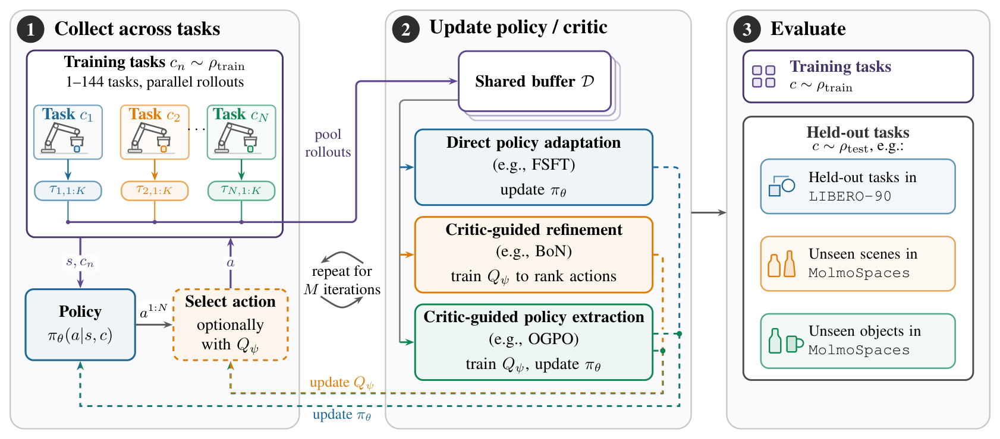

# Embodied AI & World Models News

> 具身智能与世界模型每日研究动态与论文精读。

**最新一期：2026-11-05** ｜ [日报原文](news/2026-11-05.md) · [精读索引](paper-reading/news/2026-11-05/README.md) · [历史归档](#历史归档)

---

<!-- 本段由 codex-deployment/update_readme.py 从 news/2026-11-05.md 自动镜像，请勿手工编辑 -->

## 2026-11-05 Embodied AI & World Models Daily

> 面向具身智能 / Robotics 研究员与工程师的研究与工程资讯。主窗口为北京时间 11 月 5 日，补充窗口为 11 月 3–4 日；arXiv 归属按 v1 实际提交时间换算，不按公告日或编号。
>
> 来源检查不完整：已抓取四分类 recent、11 月列表及 new，并核实 326 个候选的摘要与提交历史，其中主窗口 14 个、补充窗口 153 个、窗口外 159 个。可获得的官方 recent 最晚公告为 11 月 5 日，不能据此保证该日后续投稿已全部公告。机构源存在超时、认证与动态页面缺口，见文末；以下为已核实内容，不是全网无遗漏声明。

### 🔥 今日必读

#### 1. 【Humanoid · Sim-to-Real】HALO：用仿真语料连接语言、全身轨迹与深度反馈控制

**来源：** [arXiv:2611.06908v1](https://arxiv.org/abs/2611.06908)（cs.RO；Apple）  
**类型：** Paper  
**发布时间：** 2026-11-05 02:55:33，北京时间首次提交  
**评分：** 89.5/100  
**关键词：** Humanoid · Synthetic Data · Flow Matching · Whole-Body Control

**一句话：** 在程序生成的室内环境里合成视觉—语言—运动监督，再用慢语义编排、中速轨迹生成、快速深度反馈跟踪，实现在未扫描真实房间的全身技能迁移。

**技术要点：**

- KIMODO 采样运动、几何验证、INFINIGEN 场景放置与第一视角渲染生成约 300 小时语料，覆盖 1,000 训练房间。技能提示和关键帧仍由人工定义，部分运动依赖录制素材。
- 3 Hz 生成器以已承诺执行的十五帧前缀续写五秒全身计划；50 Hz 跟踪器结合深度、本体与参考轨迹执行，分阶段专家训练、蒸馏与多 critic PPO。
- 六任务、六个陌生真环境、360 次单任务试验平均成功率 91%；长链测试仅一处真实环境，三类链平均 70%。坐下仿真消融从完整 84% 降到无分块 24%、无深度 74%。

**为什么值得关注：** 它给出了合成数据如何穿过机载异步接口进入真实接触控制的具体路径。复现要同时核对驱动延迟、深度处理和算力成本；不能将其理解为无限技能、无人工先验或长时安全自主。

**资源：** [论文](https://arxiv.org/abs/2611.06908) · [PDF](https://arxiv.org/pdf/2611.06908) · [官方项目页](https://apple-aiml-research.github.io/ml-halo/) · [已完成精读](paper-reading/news/2026-11-05/halo/halo.md)。项目页可访问，本次未确认可独立核验的公开代码与权重下载入口。

### 📄 论文雷达

#### 【RL · Generalist Policy】Reinforcement Learning Enables Scaling Generalist Robot Policy Improvement

**来源：** [arXiv:2611.06905v1](https://arxiv.org/abs/2611.06905)  
**发布时间：** 2026-11-05 02:52:28（北京时间 v1）  
**关键词：** RL · Generalist Policy  
**核心贡献：** 把成功轨迹微调、冻结策略的价值重排与 OGPO 分开，显示增加相关物体与场景多样性后价值学习能改善留出任务。全部为仿真；LIBERO 未出现新任务泛化，BoN 默认三十二候选存在显著推理代价。  
**值得关注程度：** 87/100  
**Paper：** [摘要与版本历史](https://arxiv.org/abs/2611.06905)

[全文精读](paper-reading/news/2026-11-05/generalist-rl/generalist-rl.md)：重点核对了单物体遗忘、LIBERO 反例、最大任务集十五轮例外及 BoN 的延迟。

#### 【Motion Planning · GPU】cuRoboV2-Fast: Fast Torque-Limited Collision-Free Motion Planning

**来源：** [arXiv:2611.06913v1](https://arxiv.org/abs/2611.06913)  
**发布时间：** 2026-11-05 02:58:20（北京时间 v1）  
**关键词：** Motion Planning · GPU  
**核心贡献：** B-spline 优化配合可微逆动力学和 TimeOpt，在采样速度、加速度、jerk 与力矩约束下优化路径时间。摘要报告 3 kg 负载时 RTX 5090 平均规划 4.4 ms、比 cuRoboV2 快 14.7 倍；YAM 周期 5.93 秒。  
**值得关注程度：** 85.5/100  
**Paper：** [摘要与版本历史](https://arxiv.org/abs/2611.06913)

#### 【Human Data · WAM】Open-HumanScale: An Open Recipe for Scaling Human and Robot Experience for Embodied Foundation Models

**来源：** [arXiv:2611.06817v1](https://arxiv.org/abs/2611.06817)  
**发布时间：** 2026-11-05 01:31:35（北京时间 v1）  
**关键词：** Human Data · WAM  
**核心贡献：** 提供五万小时第一视角人类视频及手部动作、语言标注配方，分别研究纯人类预训练和人机混合预训练。摘要报告混合目标条件版本 RoboTwin Clean2Random 84.60%；需要区分人类预训练、机器人后训练和真机免更新适应。  
**值得关注程度：** 85.5/100  
**Paper：** [摘要与版本历史](https://arxiv.org/abs/2611.06817)

#### 【VLA · Representation】From Pixels to Actions - Towards Native Vision-Language-Action Policies

**来源：** [arXiv:2611.06918v1](https://arxiv.org/abs/2611.06918)  
**发布时间：** 2026-11-05 02:59:58（北京时间 v1）  
**关键词：** VLA · Representation  
**核心贡献：** NEO-VLA 用轻量图像分块卷积代替固定视觉编码终点，让图文在主干共同演化，并让流匹配动作专家读取不同深度的视觉表示。受控比较指向动作相关细节未必在最后一层最强，值得重检 VLA 视觉接口。  
**值得关注程度：** 84/100  
**Paper：** [摘要与版本历史](https://arxiv.org/abs/2611.06918)

#### 【Benchmark · Agentic Robotics】VABAR: A Variational Automation Benchmark for Agentic Robotics

**来源：** [arXiv:2611.06881v1](https://arxiv.org/abs/2611.06881)  
**发布时间：** 2026-11-05 02:38:01（北京时间 v1）  
**关键词：** Benchmark · Agentic Robotics  
**核心贡献：** VABAR 基于 Newton，为工具分类、悬挂、齿轮啮合、注射器装盒、线缆插接和布线六类任务提供变化维度、难度层级与成功指标，并包含三十三项程序参考技能。它测变式自动化，不能直接等同真实工业可靠性。  
**值得关注程度：** 83/100  
**Paper：** [摘要与版本历史](https://arxiv.org/abs/2611.06881)

#### 【Safety · Reachability】ConDR: Conservative Reachability through Neural Hamilton-Jacobi Subsolutions

**来源：** [arXiv:2611.06802v1](https://arxiv.org/abs/2611.06802)  
**发布时间：** 2026-11-05 01:18:50（北京时间 v1）  
**关键词：** Safety · Reachability  
**核心贡献：** ConDR 以单侧损失推动 HJI 残差进入保守裕量，构造障碍与终端分支，并避免全部判不安全的退化解。精确移位变分不等式解的子解定理与有限训练网络误差必须分开，不能把数值结果直接当全状态安全证书。  
**值得关注程度：** 81/100  
**Paper：** [摘要与版本历史](https://arxiv.org/abs/2611.06802)

#### 【VLA · Deployment】Where Is VLA Inference Time Spent? Bottlenecks and Optimization Interactions Across GPUs

**来源：** [arXiv:2611.06710v1](https://arxiv.org/abs/2611.06710)  
**发布时间：** 2026-11-05 00:09:02（北京时间 v1）  
**关键词：** VLA · Deployment  
**核心贡献：** 对七种 VLA、四类 GPU、七类优化进行测量，分析 CPU launch、带宽与 kernel 效率如何改变编译、CUDA Graph、量化和视觉词元裁剪的组合收益。VLA-Triage 强调按真实执行模式验证优化栈，而非逐项加速比相乘。  
**值得关注程度：** 80/100  
**Paper：** [摘要与版本历史](https://arxiv.org/abs/2611.06710)

#### 【World Model · Control】Motion-guided Contrastive Regularization For Latent World Models

**来源：** [arXiv:2611.06901v1](https://arxiv.org/abs/2611.06901)  
**发布时间：** 2026-11-05 02:49:35（北京时间 v1）  
**关键词：** World Model · Control  
**核心贡献：** 针对 JEPA 潜世界模型的静态坍缩，以同 episode 候选未来和光流相似度构造软对比监督，削弱背景身份捷径。摘要报告随机背景 OGBench-Cube 从 52% 到 78%、LIBERO-Object 从 14% 到 54%，其余四个基准相近。  
**值得关注程度：** 81/100  
**Paper：** [摘要与版本历史](https://arxiv.org/abs/2611.06901)

#### 【Robot Learning · RSI】PyRUA-REAL: Robot Exploration and Adaptive Learning through RSI in the Real World

**来源：** [arXiv:2611.06768v1](https://arxiv.org/abs/2611.06768)  
**发布时间：** 2026-11-05 00:46:03（北京时间 v1）  
**关键词：** Robot Learning · RSI  
**核心贡献：** PyRUA-REAL 将真机探索经验保留为持久记忆和可重用程序技能，研究执行反馈、任务规格和旧技能如何影响迭代改进。摘要报告八个真实任务均值 91.1%、RoboDojo 四十二任务 84.4%；这些有限任务结果不证明无限递归提升。  
**值得关注程度：** 79.5/100  
**Paper：** [摘要与版本历史](https://arxiv.org/abs/2611.06768)

#### 【Navigation · Active Sensing】When to Ask for Help: Uncertainty-Triggered Aerial Refinement for Off-Road Navigation

**来源：** [arXiv:2611.06702v1](https://arxiv.org/abs/2611.06702)  
**发布时间：** 2026-11-05 00:02:59（北京时间 v1）  
**关键词：** Navigation · Active Sensing  
**核心贡献：** 在当前 MPPI rollout 上估计消除地图不确定性是否有用，再触发无人机测量。摘要报告一百八十次仿真目标到达 98.9%，相对持续贪心航测减少平均飞行时间 87.7%，另有约两公里地面车现场运行。  
**值得关注程度：** 78/100  
**Paper：** [摘要与版本历史](https://arxiv.org/abs/2611.06702)

### 🛠 工程与开源

- **cuRoboV2-Fast** 与上述论文合并为同一事件：[官方项目](https://research.nvidia.com/labs/lpr/curobov2-fast/)与[代码仓库](https://github.com/NVlabs/curobo)均可访问。适合关注负载变化、力矩限制与边缘 GPU 的规划工程师；这里转述论文性能，不表示已在本机复现或验证特定 commit 包含所有实验配置。
- **多任务策略后训练代码**：[lasgroup/generalist-improvement](https://github.com/lasgroup/generalist-improvement)已核实为配套仓库，GitHub 创建于北京时间 11 月 4 日 20:30:01，论文首次提交为 11 月 5 日；按同一事件聚簇。重点看任务 split、整块 TD 目标及采集/评估候选数差异。
- **Open-HumanScale** 的数据、检查点和训练配方开放声明已由论文摘要确认；本次未确认独立下载入口、许可和全部文件完整性，因此不把声明当作已下载可复现的证据。
- 已检查 MuJoCo、Genesis、Isaac Lab 与 LeRobot 官方 release API。LeRobot v0.7.0 发布于 UTC 11 月 5 日 17:13，即**北京时间 11 月 6 日 01:13**，不属于本期主窗口；其余返回的近期 release 均早于本期补充窗口，不包装成今日更新。

### 💬 社区信号

**重试成功是否真来自针对失败的反馈？** [Rethinking Self-Repair](https://arxiv.org/abs/2611.06863)（北京时间 11 月 5 日 02:19:24，双评分均值 77.5）在同一批 252 个初始失败上，五次重试的模板反馈恢复率 85.3%，重采样 68.3%；但错配反馈和固定任务提示也有相近恢复估计，且不兼容的中心抓取提示损害了螺母任务。这是论文提出的对照问题，不是已证实的社区共识或热点规模；建议评测机器人代码修复时加入这些基线。

Hacker News 的 robotics 时间序列已检查，融资、整机宣传与无可核实技术细节的消息被排除。X、Reddit 与中文社群覆盖不足，不能据此判断全天没有技术讨论，也不将 stars 或转帖数计为方法证据。

### 🔎 补充窗口筛选记录

以下是已核实的过滤样本，实际时间均为北京时间；补充条目不替代本期新投稿。此前日报已经入选的事件不重复发布。

| 事件 | 实际首次提交 | 本期处理 |
|---|---|---|
| [arXiv:2611.03647v1](https://arxiv.org/abs/2611.03647) | 2026-11-03 02:59:32 | 11 月 3 日已入选并精读，与 Pixel 系列合并，不重复 |
| [arXiv:2611.03585v1](https://arxiv.org/abs/2611.03585) | 2026-11-03 02:32:18 | 11 月 3 日已精读，不将旧论文重报 |
| [arXiv:2611.05155v1](https://arxiv.org/abs/2611.05155) | 2026-11-04 00:30:27 | 11 月 4 日已入选并精读 |
| [arXiv:2611.05847v1](https://arxiv.org/abs/2611.05847) | 2026-11-04 10:36:31 | 11 月 4 日已精读 |
| [arXiv:2611.06627v1](https://arxiv.org/abs/2611.06627) | 2026-11-04 23:11:04 | Cosmos 已在 11 月 4 日入选 |
| [arXiv:2611.06475v1](https://arxiv.org/abs/2611.06475) | 2026-11-04 21:16:32 | RoboCasa-Mem 已在 11 月 4 日入选 |
| [arXiv:2611.06120v1](https://arxiv.org/abs/2611.06120) | 2026-11-04 16:06:52 | 具身生成相关，但仅把此处列作回溯线索，未作为本期新论文 |
| [arXiv:2611.04073v1](https://arxiv.org/abs/2611.04073) | 2026-11-03 07:36:18 | 纯 computer-use 软件任务，无物理具身落点，BLOCK |
| [arXiv:2611.05890v1](https://arxiv.org/abs/2611.05890) | 2026-11-04 11:29:21 | 细胞预测的 world model，不是物理具身控制，BLOCK |

另外，[MIT 11 月 5 日的机器人记忆报道](https://news.mit.edu/2026/clearing-up-robot-fuzzy-memory-1105)指向[更早的 UQ-DAAAM 论文](https://arxiv.org/abs/2606.08277)；报道日期不能证明论文在本窗口首次公开，未当作今日新论文。BEAKER 的实验室图像问答和灵巧手全栈综述已读摘要，优先级低于本期闭环方法与工程测量，未进入雷达；不把离线问答得分当成机器人执行成功率。

### 📊 今日技术趋势

仿真与人类视频分别在扩展运动监督，但“数据更大”与“任务真正更多”仍须分开：HALO 的场景多样性很强，技能设计仍有限。多任务强化学习则显示价值排序能保留部分迁移能力，直接改策略也会加剧远分布遗忘。VLA 视觉层级访问、运动敏感潜表示和跨 GPU 测量都在提醒我们，表示信息与执行延迟要在实际闭环里共同验证。

### 来源、评分与精读状态

本期取一篇必读、十篇雷达；未精读的雷达以已核实摘要为信息边界，数字均为论文自报。双评分维度为重要性、新颖性、证据质量、具身相关性、社区关注，各 0–10。研究权重 4/3/2/1/0，工程权重 3/1/2/3/1；取两次加权分均值，T1 门槛 62，按技术价值与本期篇幅排序，并不将过线等同必读。

| 事件 | 第一轮五维 | 第二轮五维 | 均值 |
|---|---|---|---:|
| [arXiv:2611.06908v1](https://arxiv.org/abs/2611.06908) | 9/9/9/10/4 | 9/8/9/10/3 | 89.5 |
| [arXiv:2611.06905v1](https://arxiv.org/abs/2611.06905) | 9/8/9/10/3 | 9/8/8/10/2 | 87 |
| [arXiv:2611.06913v1](https://arxiv.org/abs/2611.06913) | 9/8/9/10/4 | 9/8/8/10/3 | 85.5 |
| [arXiv:2611.06817v1](https://arxiv.org/abs/2611.06817) | 9/8/8/10/3 | 8/9/8/10/3 | 85.5 |
| [arXiv:2611.06918v1](https://arxiv.org/abs/2611.06918) | 8/9/8/10/2 | 8/9/7/10/2 | 84 |
| [arXiv:2611.06881v1](https://arxiv.org/abs/2611.06881) | 8/8/8/10/4 | 8/8/9/10/3 | 83 |
| [arXiv:2611.06802v1](https://arxiv.org/abs/2611.06802) | 8/8/8/9/1 | 8/8/8/9/1 | 81 |
| [arXiv:2611.06901v1](https://arxiv.org/abs/2611.06901) | 8/8/8/10/1 | 8/8/7/10/1 | 81 |
| [arXiv:2611.06710v1](https://arxiv.org/abs/2611.06710) | 8/8/8/10/3 | 8/7/8/10/2 | 80 |
| [arXiv:2611.06768v1](https://arxiv.org/abs/2611.06768) | 8/8/7/10/2 | 8/7/8/10/2 | 79.5 |
| [arXiv:2611.06702v1](https://arxiv.org/abs/2611.06702) | 8/7/8/9/1 | 8/7/8/9/1 | 78 |
| [arXiv:2611.06863v1](https://arxiv.org/abs/2611.06863) | 8/7/8/9/1 | 7/8/8/9/1 | 77.5 |
| [arXiv:2611.06911v1](https://arxiv.org/abs/2611.06911) | 7/7/8/8/1 | 7/7/7/8/1 | 72 |
| [arXiv:2611.06724v1](https://arxiv.org/abs/2611.06724) | 7/6/7/9/1 | 7/6/7/9/1 | 69 |

**精读已完成 2/2：** 必读 HALO，以及雷达最高分的 Generalist Policy Improvement。两篇均通过全文覆盖检查、Grounding、八项笔记检查、最终质量与可读性审查、原脚本正式保存；各有一张经 300 dpi 原页与裁图视觉审查的方法总览图，无占位。复制到正式目录后 SHA-256 与 lint 一致，详见[当日精读索引](paper-reading/news/2026-11-05/README.md)。

**已检查的一手入口：** [cs.RO recent](https://arxiv.org/list/cs.RO/recent)、[cs.AI recent](https://arxiv.org/list/cs.AI/recent)、[cs.LG recent](https://arxiv.org/list/cs.LG/recent)、[cs.CV recent](https://arxiv.org/list/cs.CV/recent)及其月列表/new；[PI](https://www.pi.website/blog)、[DeepMind](https://deepmind.google/blog/)、[Skild](https://www.skild.ai/blogs)、[1X](https://www.1x.tech/discover)、[Figure](https://www.figure.ai/news)、[RAI](https://rai-inst.com/)、[TRI](https://www.tri.global/news)、[Stanford REAL](https://real.stanford.edu/)、[BAIR](https://bair.berkeley.edu/blog/)、[MIT](https://news.mit.edu/topic/robotics)、[CoRL](https://www.corl.org/)、[RSS](https://roboticsconference.org/2026/program/papers/)、[ICRA](https://2026.ieee-icra.org/)及开源 release、GitHub/Hugging Face 发现接口。主页 HTTP 成功不等于所有研究页都已完整检索；HF lastModified 不能作为首发日期。

**明确缺口：** NVIDIA GEAR 主页连接超时，publications 为动态页面且正文不足；CMU 因本机 TLS 吊销检查离线失败；上海 AI 实验室 news 返回 404；IROS 返回 401。国内其他列举机构与 T-RO/IJRR 等期刊未获得完整逐站覆盖；new 附加条目主要为旧编号 revision，本期未对所有 revision 核实是否包含重大更新。补充窗口候选未全部扩展至全文、项目与代码的逐项复核；因此此次发布保留来源不完整标记，不声称没有其他达标资讯。

---

## 历史归档

| 日期 | 日报 | 精读 |
| --- | --- | --- |
| 2026-11-05 | [日报](news/2026-11-05.md) | [2 篇](paper-reading/news/2026-11-05/README.md) |
| 2026-11-04 | [日报](news/2026-11-04.md) | [2 篇](paper-reading/news/2026-11-04/README.md) |
| 2026-11-03 | [日报](news/2026-11-03.md) | [2 篇](paper-reading/news/2026-11-03/README.md) |
| 2026-11-02 | [日报](news/2026-11-02.md) | [3 篇](paper-reading/news/2026-11-02/README.md) |
| 2026-11-01 | [日报](news/2026-11-01.md) | [4 篇](paper-reading/news/2026-11-01/README.md) |
| 2026-10-31 | [日报](news/2026-10-31.md) | [5 篇](paper-reading/news/2026-10-31/README.md) |
| 2026-10-30 | [日报](news/2026-10-30.md) | [5 篇](paper-reading/news/2026-10-30/README.md) |
| 2026-10-29 | [日报](news/2026-10-29.md) | [4 篇](paper-reading/news/2026-10-29/README.md) |
| 2026-10-28 | [日报](news/2026-10-28.md) | [5 篇](paper-reading/news/2026-10-28/README.md) |
| 2026-10-27 | [日报](news/2026-10-27.md) | [3 篇](paper-reading/news/2026-10-27/README.md) |
| 2026-10-26 | [日报](news/2026-10-26.md) | [3 篇](paper-reading/news/2026-10-26/README.md) |
| 2026-10-25 | [日报](news/2026-10-25.md) | [3 篇](paper-reading/news/2026-10-25/README.md) |
| 2026-10-24 | [日报](news/2026-10-24.md) | [3 篇](paper-reading/news/2026-10-24/README.md) |
| 2026-10-23 | [日报](news/2026-10-23.md) | [4 篇](paper-reading/news/2026-10-23/README.md) |
| 2026-10-22 | [日报](news/2026-10-22.md) | [4 篇](paper-reading/news/2026-10-22/README.md) |
| 2026-10-21 | [日报](news/2026-10-21.md) | [7 篇](paper-reading/news/2026-10-21/README.md) |
| 2026-10-20 | [日报](news/2026-10-20.md) | [4 篇](paper-reading/news/2026-10-20/README.md) |
| 2026-10-19 | [日报](news/2026-10-19.md) | [5 篇](paper-reading/news/2026-10-19/README.md) |
| 2026-10-18 | [日报](news/2026-10-18.md) | — |
| 2026-10-17 | [日报](news/2026-10-17.md) | — |
| 2026-10-16 | [日报](news/2026-10-16.md) | [5 篇](paper-reading/news/2026-10-16/README.md) |
| 2026-10-15 | [日报](news/2026-10-15.md) | [5 篇](paper-reading/news/2026-10-15/README.md) |
| 2026-10-14 | [日报](news/2026-10-14.md) | [5 篇](paper-reading/news/2026-10-14/README.md) |
| 2026-10-13 | [日报](news/2026-10-13.md) | — |
| 2026-10-12 | [日报](news/2026-10-12.md) | [5 篇](paper-reading/news/2026-10-12/README.md) |
| 2026-10-11 | [日报](news/2026-10-11.md) | [6 篇](paper-reading/news/2026-10-11/README.md) |
| 2026-10-10 | [日报](news/2026-10-10.md) | [7 篇](paper-reading/news/2026-10-10/README.md) |
| 2026-10-09 | [日报](news/2026-10-09.md) | [6 篇](paper-reading/news/2026-10-09/README.md) |
| 2026-10-08 | [日报](news/2026-10-08.md) | [6 篇](paper-reading/news/2026-10-08/README.md) |
| 2026-10-07 | [日报](news/2026-10-07.md) | [6 篇](paper-reading/news/2026-10-07/README.md) |
| 2026-10-06 | [日报](news/2026-10-06.md) | [6 篇](paper-reading/news/2026-10-06/README.md) |
| 2026-10-05 | [日报](news/2026-10-05.md) | [6 篇](paper-reading/news/2026-10-05/README.md) |
| 2026-10-04 | [日报](news/2026-10-04.md) | [4 篇](paper-reading/news/2026-10-04/README.md) |
| 2026-10-03 | [日报](news/2026-10-03.md) | [4 篇](paper-reading/news/2026-10-03/README.md) |
| 2026-10-02 | [日报](news/2026-10-02.md) | [7 篇](paper-reading/news/2026-10-02/README.md) |

## 目录结构

| 目录 | 内容 |
| --- | --- |
| `news/YYYY-MM-DD.md` | 每日研究动态日报 |
| `paper-reading/news/YYYY-MM-DD/<短slug>/` | 论文精读笔记（`<短slug>.md` + `images/`） |
| `paper-reading/news/YYYY-MM-DD/README.md` | 当日精读索引 |

## 内容许可

- 本仓库全部文字内容（日报与精读笔记）以 [CC BY 4.0](LICENSE) 授权——转载、改写、商用均可，仅需署名。
- 精读笔记中嵌入的论文插图版权归论文原作者 / 出版社所有（figures © original authors），仅作学术评述之引用；本仓库的 CC BY 4.0 授权不覆盖这些图片。

## 自动化

每天北京时间 08:30，无人值守任务生成前一自然日的日报、对入选论文执行全文精读，并把当日日报镜像到本页后提交推送。arXiv 公告存在批次延迟，部分日期的当日投稿只能部分覆盖，具体缺口写在该期日报的「检索覆盖与精读状态」一节。
