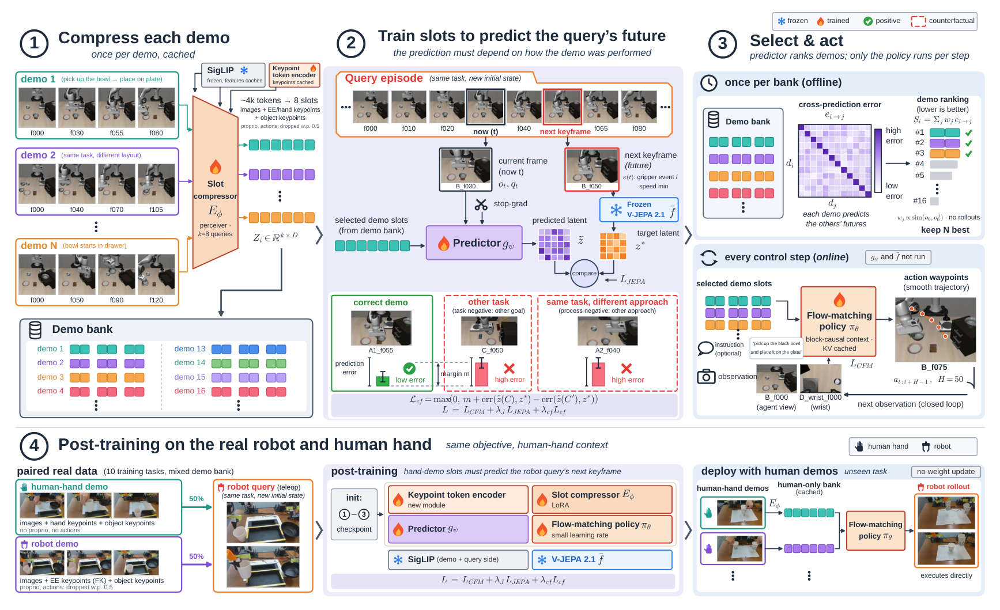
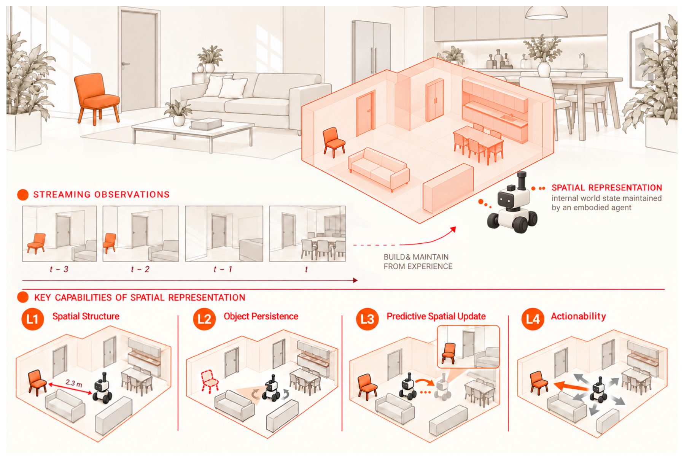
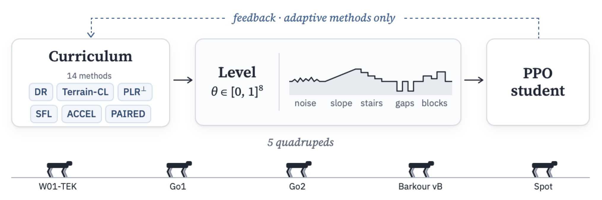

# Embodied AI & World Models News

> 具身智能与世界模型每日研究动态与论文精读。

**最新一期：2026-11-01** ｜ [日报原文](news/2026-11-01.md) · [精读索引](paper-reading/news/2026-11-01/README.md) · [历史归档](#历史归档)

---

<!-- 本段由 codex-deployment/update_readme.py 从 news/2026-11-01.md 自动镜像，请勿手工编辑 -->

## 2026-11-01 Embodied AI & World Models Daily

> 面向具身智能 / Robotics 研究员与工程师的研究与工程资讯。
> 主窗口：北京时间 2026-11-01 00:00–23:59；补充窗口：2026-10-30 00:00 至 2026-10-31 23:59。
> **来源检查不完整（主窗口）：** 2026-11-01 为周日，arXiv 没有新公告批次。运行时刻（2026-11-02 08:55 北京时间，本次任务运行时段）最新 `/new` 页仍为 "Showing new listings for Friday, 30 October 2026"；arXiv API 对 cs.RO 在 submittedDate ∈ [2026-10-30 02:00, 2026-11-02 23:59]（北京时间）的查询返回 0 条，说明周五批次切点（10-30 01:59 北京时间）之后不存在可核验的新投稿。因此本期**不能**断言 11-01 全天无资讯，只能说不存在可检索的新公告。以下全部条目来自 48 小时补充窗口（实际提交时间 10-30 00:03–01:59 北京时间），且均为 10-30、10-31 两期日报未刊载的内容；每条标注实际提交时间，不与前两期重复计数。

### 🔥 今日必读

#### 1. 【感知与多模态】PhysVLMM：把"这扇门会怎么动"做成地图里的后验，而不是标签

**来源：** [arXiv:2610.40539v1](https://arxiv.org/abs/2610.40539)（cs.RO；独立作者 Dibyendu Ghosh，论文未标注机构）  
**类型：** Paper，research_paper 权重  
**发布时间：** 2026-10-30 01:35 北京时间（补充窗口）  
**评分：** 82.5/100（T1；独立双评 83.0、82.0）  
**关键词：** Articulated Objects · Physical Belief · Mobile Manipulation

**一句话：**  
现有的场景地图只记录"这是什么、有没有被移动过"，不记录"拉一下会怎样"；PhysVLMM 给每个可动部件维护机构类型与动力学的后验，把一次拉动的证据以闭式解传给未接触的同款部件，并在给定风险下回答"这次拉动会成功吗"，答不了就弃权。

*经视觉审查的 Fig. 1：VLMM 元素如何扩展出关节几何、动力学后验与动作响应分布；秩条件、闭式证据共享与 18 户真机结果见[精读笔记](paper-reading/news/2026-11-01/physvlmm/physvlmm.md)。*

**技术要点：**

- 两个负结果撑起方法：没有测力时，任意摩擦、阻尼、惯性组合都能复现同一段观察到的运动（Proposition 1），所以"看别人拉过"只能识别几何；一次测力拉动也只约束被拉部件的一个方向（Proposition 2）。因此地图必须保留"证据无法区分的那一维"，而不是取点估计。
- 每个 VLMM 元素扩展三样东西：关节几何、机构与动力学的信念、以及"对提议动作的响应分布"（运动、接触、碰撞）。证据传播是闭式的——同一建筑里同型号、同批次安装的门与抽屉共享先验，未测过的部件也能得到有依据的预测。
- 查询算法回答二值问题："这次拉动能否让它继续动并避开障碍"，在给定时风险水平下给出答复，风险不可控时弃权；单次查询 0.03 ms。
- 主结果（真实门与抽屉、18 个家庭的 Hoi! 数据，加 120 个仿真厨房）：held-out 拉动中关节类型识别 86%，单视图学习方法为 48%；对拉动响应的预测误差比可微仿真低 41%（CRPS 0.323 对 0.544），单例耗时 13 ms 对 230 s，快四个数量级。
- 后验把最终位置误差从 0.460 降到 0.270；证据共享把未接触部件的力误差从 56% 降到 42%；在 0.02–0.30 的每一档名义风险上，false-safe 答复都落在名义风险之内。
- 作者自己给出的反例：把整户已测部件直接合并（pooling）与按 look-alike 分组效果相当；更简单的变体在"被拉部件停在哪"上至少一样好。

**为什么值得关注：**  
它把"地图里的物理可动性"从人工标签变成了带不确定性的可查询后验，而且给出的是闭式证据传播而不是再训一个网络——这类"地图即信念"的接口对移动操作的任务规划很实用，18 户真实数据加可微仿真基线的证据质量在单作者论文里少见。需要保留的判断是：作者只有一位、未见代码与项目页，查询只回答成功/弃权与响应分布，不直接输出可供规划的轨迹。

**资源：**

- Paper：[arXiv 摘要页](https://arxiv.org/abs/2610.40539)
- Code：未找到可确认的公开代码仓库
- Project：未找到项目页
- 精读：[PhysVLMM 精读笔记](paper-reading/news/2026-11-01/physvlmm/physvlmm.md)

---

#### 2. 【模仿学习与策略】JEDI：压缩演示时该保留什么，由"预测下一阶段关键帧"来定义

**来源：** [arXiv:2610.40356v1](https://arxiv.org/abs/2610.40356)（cs.RO；纽约大学 Tandon、NYU Abu Dhabi CAIR / AIR Lab）  
**类型：** Paper，research_paper 权重  
**发布时间：** 2026-10-30 00:11 北京时间（补充窗口）  
**评分：** 73.5/100（T1；独立双评 74.0、73.0）  
**关键词：** In-Context Imitation Learning · Demonstration Compression · Video JEPA

**一句话：**  
上下文模仿学习的瓶颈是演示占满上下文，而现有压缩器只用动作损失训练；JEDI 把每条演示独立压成 latent slots，要求这些槽能预测 query episode 的下一阶段关键帧（在冻结 V-JEPA 2.1 空间里），于是槽保留的是执行过程，不只是任务身份。

*经视觉审查的 Fig. 2：演示压缩、槽预测、演示选择与策略执行四个阶段；消融、干扰项与推理成本见[精读笔记](paper-reading/news/2026-11-01/jedi/jedi.md)。*

**技术要点：**

- 问题定义很具体：一条多视角、数百步的演示重采样后仍有数千 token，现有 ICIL 策略通常只能用 1–2 条演示，超出训练时见过的提示长度还会退化；ContextFlow 这类压缩器只用动作损失训练，而且只评过单条演示。
- 压缩器独立处理每条演示，输出 $k$ 个 latent slots 并缓存；预测器在冻结 V-JEPA 2.1 的嵌入空间里从槽预测 query 的下一阶段关键帧。因为未来帧大部分可由当前帧推出，论文加入反事实项：槽来自另一任务、或同任务但执行过程不同时，预测必须变差。
- 测试时 query 的未来未知，但演示库里的未来已知，于是用预测器给每条候选演示打分来选择上下文；后训练阶段加入关键点 token，使策略能接受人手演示的条件。
- 主结果：单演示设置下 LIBERO-Spatial / Object / Goal 与 RLBench 成功率为 92.7 / 83.6 / 63.0 / 82.1，ContextFlow 为 85.6 / 76.4 / 56.5 / 73.6；N=16 时升到 95.4 / 86.2 / 69.1 / 86.3。
- 过程保真度是关键证据：LIBERO-Order 的标准指令不揭示物体顺序，JEDI 跟随演示顺序的比例为 84.1%，仅动作压缩为 52.2%；共享场景中无指令到达被演示目标 74.9% 对 34.1%；未见牛奶物体的抓取高度误差 2.0 cm 对 4.1 cm。
- 消融把收益归因到目标函数而非架构：任务负例把 $DD_{task}$ 从 1.11 提到 2.06、上下文跟随率 69.7%；过程负例把 $DD_{proc}$ 从 1.09 提到 1.49、顺序匹配 57.4%→84.1%；只用同样的标签做对比学习（无预测）顺序匹配只有 73.5%。

**为什么值得关注：**  
它把"压缩该保留什么"从架构选择变成了可检验的训练目标，并用多演示、过程跟随、抓取高度三类证据支撑，对做长上下文策略或演示检索的人可以直接借用。边界也清楚：实验集中在 LIBERO/RLBench 加 5 个真机任务，依赖冻结的 V-JEPA 特征与关键点标注，未报告推理延迟与显存占用，也没给出与更大规模真机数据的 scaling 曲线。

**资源：**

- Paper：[arXiv 摘要页](https://arxiv.org/abs/2610.40356)
- Code：未找到可确认的公开代码仓库
- Project：未找到项目页
- 精读：[JEDI 精读笔记](paper-reading/news/2026-11-01/jedi/jedi.md)

---

#### 3. 【世界模型】Probing Spatial State：能读出画面，不等于能维持世界

**来源：** [arXiv:2610.40636v1](https://arxiv.org/abs/2610.40636)（cs.CV；纽约大学、南洋理工大学、香港科技大学、香港中文大学）  
**类型：** Paper，research_paper 权重  
**发布时间：** 2026-10-30 01:58 北京时间（补充窗口）  
**评分：** 72.5/100（T1；独立双评 73.0、72.0）  
**关键词：** Spatial State · Frozen-Feature Probing · World Models

**一句话：**  
论文用 10 个冻结表征、ScanNet++ 的流式第一视角轨迹和四个能力层级（空间结构、物体持久性、预测性更新、可操作性）来问：视觉基础模型是否真的提供了可持续的空间状态？答案是没有单一最优表征，而且"看得清"与"记得住""用得上"是三件不同的事。

*经视觉审查的 Fig. 1：移动观察者从局部视角建立内部空间表示，L1–L4 逐级要求读出、维持、预测与行动；十种表示的完整结果见[精读笔记](paper-reading/news/2026-11-01/spatial-probe/spatial-probe.md)。*

**技术要点：**

- 四个层级对应四种逐级加码的要求：L1 从当前观测读出深度与相机位姿；L2 在物体离开视野后仍能定位；L3 在自运动下预测下一段特征（直接预测与路径积分分开评）；L4 把状态接到目标条件动作上（候选选择与连续输出两种设置）。
- 实验设计上沿两个轴扫：网络深度（多层骨干逐 block）与流式前缀长度（8 到 24 帧，每个前缀独立编码，问的是"因果前缀的表征支持什么"，而不是模型是否在线维护状态）；并加入匹配控制：改运动、改历史、改变换顺序、改目标。
- 主结果：没有任务无关的赢家。Fast3R 的相机位姿与物体持久性最好（持久性误差 32.79°），DINOv2 直接预测最好（R@1 0.2373），V-JEPA2 路径积分最好（0.1588）；持久性与相机位姿读出的秩相关 $\rho=0.76$，与深度、实例、视角一致性只有 $\rho\le0.43$。
- 两个反直觉现象：更长前缀让 8 个模型的持久性全部变差；改目标会让预测动作旋转 30–46°，但把正确目标交给模型并不能可靠提升推进进度——"输入被使用"不等于"具备功能效用"。
- 作者主动标注的混淆项：Fast3R 的训练数据包含 ScanNet++，部分验证场景可能在其训练集中，它的领先可能部分来自场景熟悉度；多数实验为单训练种子。

**为什么值得关注：**  
这是给"世界模型/空间表征"降温的一篇：它把评测拆成可分别证伪的四层，并给出"强可读性不保证持久性、更不保证可操作性"的负结果。做 VLA 视觉骨干选型、世界模型评测或空间记忆模块的人，可以直接复用它的控制变量设计。注意它是分析性论文，不提出新模型，结论限于静态室内场景与观察者运动，不含物体动力学与接触物理。

**资源：**

- Paper：[arXiv 摘要页](https://arxiv.org/abs/2610.40636)
- Project：[项目页](https://yyyybq.github.io/probing-spatial-state/)
- Code：[GitHub](https://github.com/yyyybq/Probing_Spatial_State_Release)
- 精读：[Probing Spatial State 精读笔记](paper-reading/news/2026-11-01/spatial-probe/spatial-probe.md)

---

### 📄 论文雷达

以下 2 篇按双评分均值排序；UED 基准已完成全文精读，DAWN 仅依据全文摘要、方法与实验章节筛选，数字属于作者报告。

#### 【强化学习】Is It the Curriculum or Just the Easy Start? 14 种课程法在 5 个四足上同台

**来源 / Paper：** [arXiv:2610.40364v1](https://arxiv.org/abs/2610.40364)（cs.LG/cs.RO；弗罗茨瓦夫理工大学、Machinekind、Solvro）  
**实际提交：** 2026-10-30 00:15 北京时间（补充窗口）  
**关键词：** Unsupervised Environment Design · Terrain Curriculum · Quadruped Locomotion  
**值得关注程度：** 69.0/100（T1；双评 70.0、68.0）  
**核心贡献：** 把 14 种 UED、域随机化与机器人课程法放进同一协议：5 个四足（闭链 W01-TEK、Go1、Go2、Barkour vB、Spot）、MuJoCo MJX、同一 PPO 学生、匹配环境步数，关卡是 8 维可解释地形参数；结论是没有任何方法在所有机器人和 level set 上进入 top group，而分布内随机地形上的 top group 几乎都由"简单/低难度训练关卡"构成。

*经视觉审查的 Fig. 1：课程法提出八维地形参数、同一 PPO 学生在五台四足上训练与评测；统计算力与 top group 结果见[精读笔记](paper-reading/news/2026-11-01/ued-quadrupeds/ued-quadrupeds.md)。*

**关键证据与边界：** Go1 上 ACCEL-LP 64.0% 领先，全范围均匀 DR 只有 34.9%，PAIRED 家族 24.6–33.3%；但三个机器人上分布内领先者不是 held-out 地形领先者——DR-easy 与 Terrain-CL 在 Go1 的 d=0.25 上几乎打平（61.6 对 62.3），OOD 上差 7.2 点（38.6 对 45.8）。代码：[Solvro/ml-wojtek-ued](https://github.com/Solvro/ml-wojtek-ued)（MIT）；全文精读见 [UED 精读笔记](paper-reading/news/2026-11-01/ued-quadrupeds/ued-quadrupeds.md)。边界：全部在仿真内，成功率为最终确定性策略、5 个种子的均值，未做真机迁移。

#### 【操作与抓取】DAWN：把拧螺丝拆成对准插入与受控退扣两段

**来源 / Paper：** [arXiv:2610.40537v1](https://arxiv.org/abs/2610.40537)（cs.RO；马里兰大学机械工程系，8 页）  
**实际提交：** 2026-10-30 01:35 北京时间（补充窗口）  
**关键词：** Diffusion Policy · Contact-Rich Manipulation · Force Control  
**值得关注程度：** 65.0/100（T1；双评 67.0、63.0）  
**核心贡献：** 面向回收场景的自动拆螺丝：AlignNet 用扩散策略做 4 mm 容差内的起子对准与插入，LatchNet 用视觉+力分类阶段转换（准确率 0.90、精确率 0.90、召回 0.98、F1 0.94），UnfastNet 用轻量网络加力启发式（反馈力 ≥10 N 即关停电动起子）完成退扣；Franka 加 3 台 RealSense D435i、10 Hz 采集，退扣阶段只有 15 条演示。

**关键证据与边界：** 作者报告对准插入成功率与熟练人工操作员相当（3 名操作员各 10 次），消融显示仅用 mount 相机加本体感觉即可，额外相机与力反馈对对准没有增益——这与"多模态一定更好"的直觉相反。边界：单一任务族（十字螺丝拆卸）、演示极少、退扣阶段依赖手工力阈值，摘要未给绝对成功率与失败分布。

### 🛠 工程与开源

本期窗口内没有独立于论文、且达到筛选阈值的新模型权重发布。以下三项与本期条目配套，登记而不重复计分：

- [Solvro/ml-wojtek-ued](https://github.com/Solvro/ml-wojtek-ued)：UED 四足基准的代码、关卡空间与评测套件，MIT 许可，8 月建库、10-29 仍在推送，当前 4 star；配套机器人模型在 [machinekind/w01-tek](https://github.com/machinekind/w01-tek)（Apache-2.0，9 star）。这是本期少数"代码与论文同源可核对"的工程产物。
- [yyyybq/Probing_Spatial_State_Release](https://github.com/yyyybq/Probing_Spatial_State_Release)：Probing Spatial State 的探针与评测代码，10-19 建库，11-01（UTC）仍有推送；[项目页](https://yyyybq.github.io/probing-spatial-state/) 提供分层结果浏览。
- [yixue888/Coract_checkpoint](https://huggingface.co/yixue888/Coract_checkpoint)：11-01 新建的 CoRAct（[arXiv:2610.39543](https://arxiv.org/abs/2610.39543)，10-31 期已收录）检查点仓库，标注 MIT 与 vla / vlabench / robocasa / grpo 标签。**本次未核实是否为论文作者本人发布**，因此只作为"权重开始出现"的信号登记，不作为已验证的官方发布。
- [ZJU-REAL/Worldline](https://github.com/ZJU-REAL/Worldline)：10-30 00:09 新建的 MIT 框架，把 RUA（Robot-Use Agent）与 CUA 的沙盒执行、并行 rollout、轨迹采集、验证器、蒸馏与训练（对接 verl）串成一条可复现流水线，基于 Embodied First Exam 的任务与评测协议。当前 0 star、无配套论文，定位是基础设施而非新算法；登记原因是它把"评测—采数据—训练—复评"做成了同一套任务定义，对做具身 agent 数据引擎的人有参考价值。

### 💬 社区信号

- **CoRAct 的权重出现，但来源待确认。** 10-31 期日报记录"未确认公开代码"，11-01 出现上述 Hugging Face 检查点；如果它确实是作者发布，那么该工作的可复现性门槛会明显下降。当前它只有 1 个 like，且账号与该文 GitHub 项目页署名不一致，需要等作者确认后再当作官方权重。
- **本期未发现独立复现、技术争议或第三方基准对比。** 对 PhysVLMM、JEDI、Probing Spatial State 三个标题做的检索只返回 arXiv 镜像页，没有 Hacker News、Reddit 或研究者博客讨论；UED 的代码库虽有 4 star，但没有 issue 或复现报告可引用。

### 🔎 补充窗口筛选记录

| 候选 | 实际提交时间（北京时间） | 处理与原因 |
|---|---|---|
| [PhysVLMM](https://arxiv.org/abs/2610.40539) | 10-30 01:35 | 入「今日必读」；18 户真实门/抽屉 + 120 仿真厨房，证据最强。 |
| [JEDI](https://arxiv.org/abs/2610.40356) | 10-30 00:11 | 入「今日必读」；ICIL 压缩目标 + 多演示与过程跟随证据。 |
| [Probing Spatial State](https://arxiv.org/abs/2610.40636) | 10-30 01:58 | 入「今日必读」；四层探针与两个负结果，分析价值高。 |
| [UED on Quadrupeds](https://arxiv.org/abs/2610.40364) | 10-30 00:15 | 入雷达并精读；14 种课程法统一协议，"简单起点"结论有信息量。 |
| [DAWN](https://arxiv.org/abs/2610.40537) | 10-30 01:35 | 入雷达；真机接触富任务，但单任务族、演示少、缺绝对成功率。 |
| [DEED](https://arxiv.org/abs/2610.40430) | 10-30 00:51 | 约 53.5 分，低于 T1 门槛；CoRL 2026 RoboFineMani workshop 挑战赛方案，主要是演示扩增与执行工程，方法增量有限。 |
| [TouchBridge](https://arxiv.org/abs/2610.40349) | 10-30 00:06 | 10-30 期「今日必读」已收录，去重。 |
| [HiFOR](https://arxiv.org/abs/2610.40373) | 10-30 00:21 | 10-30 期已收录，去重。 |
| [CoAWM](https://arxiv.org/abs/2610.40401) | 10-30 00:34 | 10-30 期已收录，去重。 |
| [BURGER](https://arxiv.org/abs/2610.40532) | 10-30 01:34 | 10-30 期已收录，去重。 |
| [Gym-Anything](https://arxiv.org/abs/2610.40565) | 10-30 01:42 | 10-30 期已收录，去重。 |
| [SymAnt](https://arxiv.org/abs/2610.40632) | 10-30 01:58 | 10-30 期已收录，去重。 |
| [world2vec](https://arxiv.org/abs/2610.40637) | 10-30 01:58 | 10-30 期已收录，去重。 |
| [SwapBot](https://arxiv.org/abs/2610.40646) | 10-30 01:59 | 10-30 期「今日必读」已收录，去重。 |
| [Wizard](https://arxiv.org/abs/2610.40339) | 10-30 00:03 | 排除：游戏世界模型的角色动作控制，无物理具身与决策落点。 |
| [Securing the Robotics Supply Chain](https://arxiv.org/abs/2610.40385) | 10-30 00:26 | 排除：政策与投资议程文章，无技术方法。 |
| [SCARL](https://arxiv.org/abs/2610.40407) | 10-30 00:38 | 排除：通用 RL 对齐方法，无机器人实验。 |
| [socx](https://arxiv.org/abs/2610.40427) | 10-30 00:50 | 排除：JAX 机会约束最优控制库，是工具而非新的具身学习方法。 |
| [UFLD](https://arxiv.org/abs/2610.40421) | 10-30 00:45 | 排除：晶圆缺陷检测，非机器人。 |
| [Algebraic World Model](https://arxiv.org/abs/2610.40503) | 10-30 01:20 | 排除：形式化数学证明环境，"world model"非物理具身含义。 |
| [Two-Wheeled Quadrotor](https://arxiv.org/abs/2610.40502) | 10-30 01:20 | 排除：机构与硬件设计，无学习方法。 |
| [Shape Servoing Tutorial](https://arxiv.org/abs/2610.40559) | 10-30 01:40 | 排除：教程 Part I，非新研究。 |
| [Continuum Robot Conveyor](https://arxiv.org/abs/2610.40600) | 10-30 01:50 | 排除：机构硬件。 |
| [Fight World Model](https://arxiv.org/abs/2610.40607) | 10-30 01:53 | 排除：格斗游戏视频生成，无 action-conditioned 决策落点。 |
| [VLA 该多信任自己的推理](https://arxiv.org/abs/2610.40002) | 10-29 21:20 | 窗口外（早于 10-30 00:00），按规则不计入；两期日报均未刊载，留待后续回看。 |
| [PASA-KV](https://arxiv.org/abs/2610.39816) | 10-29 18:58 | 窗口外；世界动作模型的动作视觉通路攻击，值得后续单独评估。 |
| [When More Planning Hurts](https://arxiv.org/abs/2610.37891) | 10-28 03:32 | 窗口外；世界模型上学到的规划器负结果。 |
| [11-01 全天投稿](https://arxiv.org/list/cs.RO/recent) | 未公告 | 周日无公告批次，API 查询窗口内 0 条，无法检查，不写成"无资讯"。 |

### 📊 今日技术趋势

今天能核验的三条线都围绕"状态的可用性"而不是模型规模。第一条是把物理状态变成可查询、可校准的量：PhysVLMM 让地图对每个可动部件保留后验并在风险不可控时弃权，Probing Spatial State 则证明视觉基础模型的"可读出"并不等于"能维持、能用来行动"。第二条是压缩的信息论转向：JEDI 不再问压缩器长什么样，而是问压缩后的槽能否预测自己这条 episode 的下一阶段，把"保留执行过程"变成可检验的目标。第三条是评测的冷静化：UED 在 5 个四足上发现"简单起点"常常进入 top group，且分布内领先者在 held-out 地形上会换人。

本期的方法证据形态比前两期弱一档：PhysVLMM 有 18 户真实数据但与可微仿真对比、无代码；JEDI 有 4 个仿真套件加 5 个真机任务、无代码；Probing 只有单训练种子且部分场景与 Fast3R 训练集重叠；UED 与 DAWN 分别缺真机迁移与绝对成功率。四篇精读都没有执行训练或机器人实验，数字均来自论文。

### 检索覆盖与精读状态

- **官方 arXiv 召回：** 直接抓取 [cs.RO recent](https://arxiv.org/list/cs.RO/recent)（485 条）、[cs.AI recent](https://arxiv.org/list/cs.AI/recent)（1,497 条）、[cs.LG recent](https://arxiv.org/list/cs.LG/recent)（1,438 条）与 [cs.CV recent](https://arxiv.org/list/cs.CV/recent)（926 条），并核对四个分类的 `/new` 页。最新公告日为 2026-10-30（周五），其后无新批次；用 arXiv API 逐条取 v1 时间戳后，落在补充窗口 [2026-10-30 00:00, 2026-11-01 23:59] 的条目共 46 条（去重后 33 篇），其中 8 篇已由 10-30/10-31 两期收录。**主窗口 11-01 无公告批次，这是本期最大来源缺口。**
- **机构与会议：** Google DeepMind blog 未见 10-30 之后的新条目（Gemini Robotics ER 2 上云公告发布于 10-28 的 Google Cloud blog，不在窗口）；Physical Intelligence blog 最新为 10-13 的 Pi API beta；Figure news 最新 9-30；1X discover 最新 7-09；RAI Institute 最新 10-28；NVIDIA GEAR 未列新发布；未发现 10-30 至 11-01 的新研究发布。
- **工程与社区：** GitHub 新建仓库检索在 10-29 之后的新库里只找到个人主页、课程整理与微调检查点，没有独立算法/权重发布；核对 UED、Probing、CoRAct 三个配套仓库与 Hugging Face 检查点，均未见独立复现或技术争议。仿真器侧无新版本：Isaac Lab 最新 10-20、MuJoCo 3.17.0 于 10-22、Genesis v1.4.5 于 10-22。
- **精读：** [索引](paper-reading/news/2026-11-01/README.md)。必读 3 篇 + 雷达最高 1 篇，共 4 篇；均为完整全文提取，grounding、八项笔记 lint、质量与可读性审查、原脚本正式保存及 SHA-256 全部通过。本次未执行训练、推理或机器人实验。

---

## 历史归档

| 日期 | 日报 | 精读 |
| --- | --- | --- |
| 2026-11-01 | [日报](news/2026-11-01.md) | [4 篇](paper-reading/news/2026-11-01/README.md) |
| 2026-10-31 | [日报](news/2026-10-31.md) | [5 篇](paper-reading/news/2026-10-31/README.md) |
| 2026-10-30 | [日报](news/2026-10-30.md) | [5 篇](paper-reading/news/2026-10-30/README.md) |
| 2026-10-29 | [日报](news/2026-10-29.md) | [4 篇](paper-reading/news/2026-10-29/README.md) |
| 2026-10-28 | [日报](news/2026-10-28.md) | [5 篇](paper-reading/news/2026-10-28/README.md) |
| 2026-10-27 | [日报](news/2026-10-27.md) | [3 篇](paper-reading/news/2026-10-27/README.md) |
| 2026-10-26 | [日报](news/2026-10-26.md) | [3 篇](paper-reading/news/2026-10-26/README.md) |
| 2026-10-25 | [日报](news/2026-10-25.md) | [3 篇](paper-reading/news/2026-10-25/README.md) |
| 2026-10-24 | [日报](news/2026-10-24.md) | [3 篇](paper-reading/news/2026-10-24/README.md) |
| 2026-10-23 | [日报](news/2026-10-23.md) | [4 篇](paper-reading/news/2026-10-23/README.md) |
| 2026-10-22 | [日报](news/2026-10-22.md) | [4 篇](paper-reading/news/2026-10-22/README.md) |
| 2026-10-21 | [日报](news/2026-10-21.md) | [7 篇](paper-reading/news/2026-10-21/README.md) |
| 2026-10-20 | [日报](news/2026-10-20.md) | [4 篇](paper-reading/news/2026-10-20/README.md) |
| 2026-10-19 | [日报](news/2026-10-19.md) | [5 篇](paper-reading/news/2026-10-19/README.md) |
| 2026-10-18 | [日报](news/2026-10-18.md) | — |
| 2026-10-17 | [日报](news/2026-10-17.md) | — |
| 2026-10-16 | [日报](news/2026-10-16.md) | [5 篇](paper-reading/news/2026-10-16/README.md) |
| 2026-10-15 | [日报](news/2026-10-15.md) | [5 篇](paper-reading/news/2026-10-15/README.md) |
| 2026-10-14 | [日报](news/2026-10-14.md) | [5 篇](paper-reading/news/2026-10-14/README.md) |
| 2026-10-13 | [日报](news/2026-10-13.md) | — |
| 2026-10-12 | [日报](news/2026-10-12.md) | [5 篇](paper-reading/news/2026-10-12/README.md) |
| 2026-10-11 | [日报](news/2026-10-11.md) | [6 篇](paper-reading/news/2026-10-11/README.md) |
| 2026-10-10 | [日报](news/2026-10-10.md) | [7 篇](paper-reading/news/2026-10-10/README.md) |
| 2026-10-09 | [日报](news/2026-10-09.md) | [6 篇](paper-reading/news/2026-10-09/README.md) |
| 2026-10-08 | [日报](news/2026-10-08.md) | [6 篇](paper-reading/news/2026-10-08/README.md) |
| 2026-10-07 | [日报](news/2026-10-07.md) | [6 篇](paper-reading/news/2026-10-07/README.md) |
| 2026-10-06 | [日报](news/2026-10-06.md) | [6 篇](paper-reading/news/2026-10-06/README.md) |
| 2026-10-05 | [日报](news/2026-10-05.md) | [6 篇](paper-reading/news/2026-10-05/README.md) |
| 2026-10-04 | [日报](news/2026-10-04.md) | [4 篇](paper-reading/news/2026-10-04/README.md) |
| 2026-10-03 | [日报](news/2026-10-03.md) | [4 篇](paper-reading/news/2026-10-03/README.md) |
| 2026-10-02 | [日报](news/2026-10-02.md) | [7 篇](paper-reading/news/2026-10-02/README.md) |

## 目录结构

| 目录 | 内容 |
| --- | --- |
| `news/YYYY-MM-DD.md` | 每日研究动态日报 |
| `paper-reading/news/YYYY-MM-DD/<短slug>/` | 论文精读笔记（`<短slug>.md` + `images/`） |
| `paper-reading/news/YYYY-MM-DD/README.md` | 当日精读索引 |

## 内容许可

- 本仓库全部文字内容（日报与精读笔记）以 [CC BY 4.0](LICENSE) 授权——转载、改写、商用均可，仅需署名。
- 精读笔记中嵌入的论文插图版权归论文原作者 / 出版社所有（figures © original authors），仅作学术评述之引用；本仓库的 CC BY 4.0 授权不覆盖这些图片。

## 自动化

每天北京时间 08:30，无人值守任务生成前一自然日的日报、对入选论文执行全文精读，并把当日日报镜像到本页后提交推送。arXiv 公告存在批次延迟，部分日期的当日投稿只能部分覆盖，具体缺口写在该期日报的「检索覆盖与精读状态」一节。
