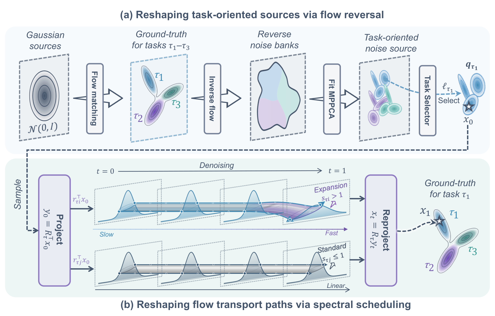
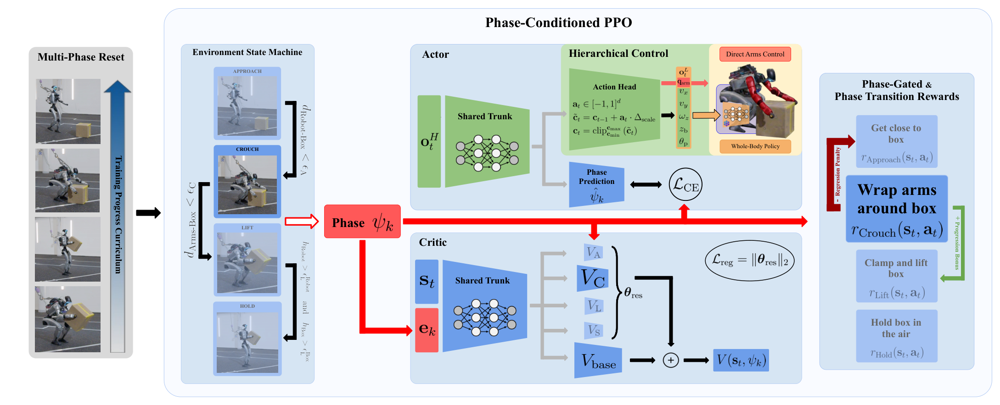
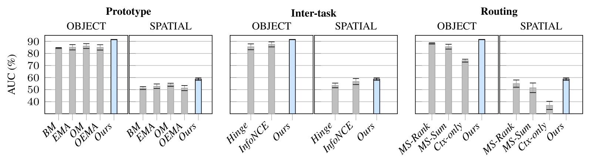
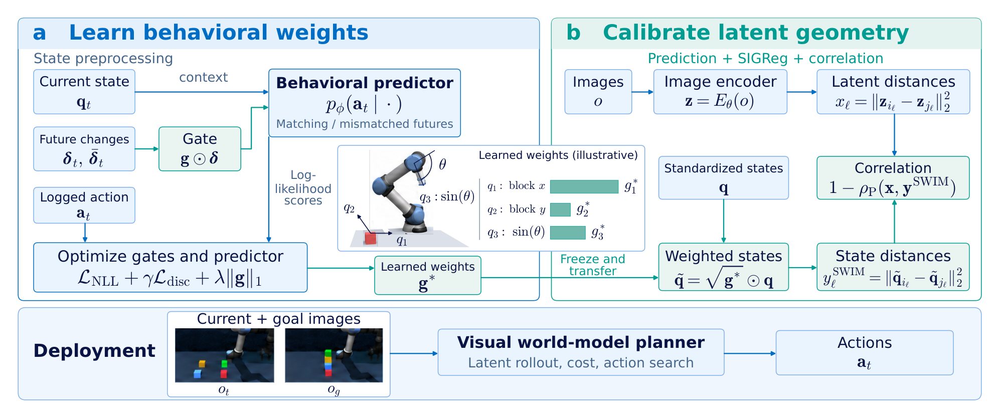

# Embodied AI & World Models News

> 具身智能与世界模型每日研究动态与论文精读。

**最新一期：2026-10-29** ｜ [日报原文](news/2026-10-29.md) · [精读索引](paper-reading/news/2026-10-29/README.md) · [历史归档](#历史归档)

---

<!-- 本段由 codex-deployment/update_readme.py 从 news/2026-10-29.md 自动镜像，请勿手工编辑 -->

## 2026-10-29 Embodied AI & World Models Daily

> 面向具身智能 / Robotics 研究员与工程师的研究与工程资讯。
> 主窗口：北京时间 2026-10-29 00:00–23:59；补充窗口：10-27 00:00 至 10-28 23:59。论文按 v1 实际提交时间换算，不以公告日期归属。
> **来源检查不完整（主窗口）：** 运行时 arXiv 最新公告批次仍为 2026-10-28，按实际提交时间只覆盖到北京时间 10-28 01:59；10-29 与 10-30 批次均未出现在 recent 列表或 API 中。因此本期不能断言 10-29 主窗口无资讯。以下内容全部来自 48 小时补充窗口，逐条标注实际提交时间；与 10-27、10-28 两期日报重复的条目已在筛选记录中说明并去重。机构侧 Google DeepMind、Physical Intelligence、NVIDIA GEAR 截至本次运行未见 10-29 新增可核实条目；GitHub 与社区只保留可回溯信号。

### 🔥 今日必读

#### 1. 【模仿学习与策略】TOPS：不改网络，改 flow 的起点与时间表

**来源：** [arXiv:2610.36694v1](https://arxiv.org/abs/2610.36694)（南洋理工大学 MARS Lab；cs.RO/cs.AI）  
**类型：** Paper，research_paper 权重  
**发布时间：** 2026-10-27 14:11 北京时间（补充窗口）  
**评分：** 81.0/100（T1；独立双评 82.0、80.0）  
**关键词：** Flow Matching · Task-Specific Source · Optimal Transport Schedule

**一句话：**  
先反演已训练的多任务 flow 策略，按任务拟合低秩高斯混合源，再在高斯 OT 特征基里只对少数扩张方向做“先慢后快”插值；一步两阶段采样在 LIBERO-10 上把成功率从 53.44% 提到 69.67%，延迟降到约六分之一。

*经视觉审查的总览图 2；完整 MPPCA 源、OT 特征基、风险上界与真机分母见[精读笔记](paper-reading/news/2026-10-29/tops/tops.md)。*

**技术要点：**

- 用预热 300 epoch 的标准 FM 策略把专家动作块反演成噪声样本，按任务拟合 $M_\tau$ 分量 MPPCA；$D=160$（16 步 × 10 维动作）下仍用低秩协方差，避免高维样本不足。
- 由源协方差与专家协方差构造 Gaussian OT 映射并特征分解，得到逐方向标准差比 $s_{\tau j}$。扩张方向只占 7.4–9.7% 的维度，却承担 60.9–69.6% 的 OT 协方差代价。
- 在特征基中把源权重写成 $a_{\tau j}(t)=(1-t)e^{\rho_{\tau j}t}$，只在 $s_{\tau j}>1$ 时启用；闭式路径 $x_t=x_1+(1-t)e^{-tK_\tau}(x_0-x_1)$ 与原 FM 损失兼容，部署用一次两阶段积分（NFE=2）。
- LIBERO-10 53.44%→69.67%，LIBERO-Plus 27.11%→35.29%，CALVIN D→D 链长 1.90→2.27、ABC→D 0.70→1.05；单次调用 49.4→8.2 ms。π0.5 上 LIBERO-Plus 64.4%→69.0%、CALVIN ABC→D 3.033→3.744。
- 真机 8 任务合并 124/160（77.50%）对 Standard FM 82/160（51.25%），提升 26.25 点，$z=4.90$、$p<0.001$；但上抽屉 20%→80% 的增益远大于 daikon/corn 的 100%→100%。

**为什么值得关注：**  
它把多任务 flow 策略的改进从“换更大网络”拉回到“检查生成过程的起点与路径”，而且改动可以闭式表达、直接接到 π0.5 上。边界也清楚：任务身份必须出现在训练集，源与调度离线固定，动作块固定 16 步，真机只验证了单臂 7 维动作；LIBERO-Plus 上 source-only 的 35.21% 与完整方法的 35.29% 几乎相同，说明该基准的增益主要来自源而非调度。

**资源：** [论文](https://arxiv.org/abs/2610.36694) · [项目页](https://ntumars.github.io/TOPS/) · [精读](paper-reading/news/2026-10-29/tops/tops.md)。本次未确认公开训练代码或权重。

---

#### 2. 【运动与全身控制】把阶段结构写进 PPO：G1 与 Spot 共用一个多阶段策略

**来源：** [arXiv:2610.36270v1](https://arxiv.org/abs/2610.36270)（ETH Zurich RSL、RAI Zurich；cs.RO）  
**类型：** Paper，research_paper 权重  
**发布时间：** 2026-10-27 04:44 北京时间（补充窗口）  
**评分：** 76.0/100（T1；独立双评 77.0、75.0）  
**关键词：** Phase-Conditioned PPO · Loco-Manipulation · Sim-to-Real

**一句话：**  
不提供人类动作数据，只用环境状态机切阶段、按阶段门控奖励、让 actor 额外预测阶段、让 critic 按阶段条件化，并在训练早期把 episode 重置到后段；最终在 Unitree G1 与 Boston Dynamics Spot 上各部署一个策略完成 3–7 阶段的长程任务。

*经视觉审查的总览图 3；阶段定义、奖励门控、残差 critic 与真机适配见[精读笔记](paper-reading/news/2026-10-29/locomanip/locomanip.md)。*

**技术要点：**

- 低层全身控制器控制 15 个腿与腰自由度，跟踪 5 维命令 $[v_x,v_y,\omega_z,z_{\text{base}},\theta_{\text{pitch}}]$；高层输出 delta 动作，裁剪累加得到命令，天然平滑。
- 环境状态机按局部成功条件切阶段，并用滞回放宽回退；奖励按阶段激活，叠加前向转移奖励与回退惩罚。Actor 不观察阶段，但共享主干上的辅助头用交叉熵预测阶段，迫使表示编码任务进度。
- critic 是全局 base head 加阶段残差头，残差权重加 L2 正则；多阶段重置课程从随机后段状态逐步退回第一阶段，抬箱/搬运还用关键帧绕过夹持死锁。
- 消融：去掉阶段预测，Spot 89%±2%→44%±9%，G1 92%±2%→14%±6%；只用初始阶段重置时 G1 推双箱任务训练崩溃。
- Sim-to-real：执行器延迟随机化 5 个物理步（200 Hz 下 25 ms）、摩擦从 3.0 退火到 1.5–2.0、关节位置偏移折算约 7 N·m 的等效扭矩上限，使双臂夹持稳定到 5 分钟。

**为什么值得关注：**  
它把“阶段”从部署时的状态机变成训练时的归纳偏置，部署时不需要阶段输入或外部编排；这比串接独立子策略更适合动态切换。但论文没有给出每个硬件任务的 rollout 次数与成功率主表，可量化的只有两个消融任务的曲线；阶段仍需人工定义，换箱体形状要重做关键帧，阶段数继续增加时的容量与价值估计问题也未解决。

**资源：** [论文](https://arxiv.org/abs/2610.36270) · [精读](paper-reading/news/2026-10-29/locomanip/locomanip.md)。本次未确认公开代码或权重。

---

#### 3. 【模仿学习与策略】HIDRA：无回放终身模仿，把路由拆成指令锚定与上下文细化

**来源：** [arXiv:2610.36374v1](https://arxiv.org/abs/2610.36374)（IIT、University of Verona/Genoa；cs.RO；NeurIPS 2026）  
**类型：** Paper，research_paper 权重  
**发布时间：** 2026-10-27 06:43 北京时间（补充窗口）  
**评分：** 76.0/100（T1；独立双评 77.0、75.0）  
**关键词：** Lifelong Imitation · Dual-Routing Attention · LoRA Experts

**一句话：**  
冻结多模态主干，每个新任务加一组 LoRA 专家；先用语言指令检索锚定专家并把候选集限制为更早专家，再用当前观测在候选集内细化，最后用键空间的任务内对齐与任务间正交正则稳定路由。

*经视觉审查的主结果图 3（方法总览图 2 的自动裁切未通过视觉审查，本次未插入）；完整两阶段公式、消融与边界见[精读笔记](paper-reading/news/2026-10-29/hidra/hidra.md)。*

**技术要点：**

- 指令查询只依赖语言嵌入，漂移小；锚定专家 $j^\star$ 定义候选集 $S_{j^\star}=\{j<j^\star\}$，只允许更早专家参与上下文竞争，防止新任务反向改写旧任务路由。
- 上下文查询只依赖视觉与本体感受，在候选集内算分数并与指令分数融合，取 Top-$K^\star$；最终系数把锚定专家与选中专家加权到各层 LoRA 输出。
- 键空间正则：每个专家维护上下文原型，任务内损失把键拉向原型，任务间损失把不同任务的键推正交；总目标是行为克隆损失加两项正则。
- LIBERO 四个套件 AUC：OBJECT 91.5%（DMPEL 100% 回放 82.2%）、SPATIAL 66.7%、GOAL 58.7%、LIBERO-10 58.1%；LIBERO-MIX Inc1/Inc4 为 68.0%/67.0%，DMPEL 为 55.2%/59.9%。
- 消融：简单路由 OBJECT AUC 26.1%，双路注意力 85.8%，加两项正则 91.5%；SPATIAL 对应 9.2%→54.2%→58.7%。

**为什么值得关注：**  
它把无回放终身学习的难点从“如何记住旧数据”转成“如何在不访问旧数据时保持路由几何稳定”，两阶段解耦与“候选集只含更早专家”都是有明确机制解释的设计。但全部实验在 LIBERO 仿真中完成，没有真实机器人；专家库随任务线性增长，方法对任务到达顺序有结构性依赖；LIBERO-INS 上只比 DMPEL 高 0.5 点，语言改写仍是薄弱环节。官方 [GitHub](https://github.com/yfqi/HIDRA) 仓库已创建但当前为空，不能作为可运行实现。

**资源：** [论文](https://arxiv.org/abs/2610.36374) · [GitHub](https://github.com/yfqi/HIDRA) · [精读](paper-reading/news/2026-10-29/hidra/hidra.md)。

---

### 📄 论文雷达

以下 7 篇按双评分均值排序；SWIM 已完成全文精读，其余依据官方摘要与项目资料筛选，数字属于作者报告，未冒充全文复核或独立实验。

#### 【世界模型】SWIM：用逆动力学学状态权重，再校准 JEPA 潜空间

**来源 / Paper：** [arXiv:2610.36662v1](https://arxiv.org/abs/2610.36662)（Boston University、Unity Technologies；cs.RO/cs.CV）  
**实际提交：** 2026-10-27 13:28 北京时间（补充窗口）  
**关键词：** JEPA · Inverse Dynamics · State Metric  
**值得关注程度：** 72.0/100（T1；双评 73.0、71.0）  
**核心贡献：** 用门控逆动力学从离线动作学每个状态坐标的权重，冻结后把加权状态距离替换 SCALE 的均匀目标；逆动力学只在训练期使用，部署仍是图像潜空间规划。

*已审查的方法总览图 1；五个任务的 CEM 主表、干扰实验与“平均 1 点增益”的边界见[精读](paper-reading/news/2026-10-29/swim/swim.md)。*

**关键证据与边界：** 五个 OGBench 任务相对 SCALE-All 提升 1.0–6.0 点；默认配置平均 +0.9（$p=0.009$）与 +1.0（$p=0.022$），十配置平均 +0.7（$p=0.006$），五个 seed 方向一致。DINO-WM 在 Cube-Triple 上仍更强（34.2% 对 32.6%）。门控是环境级共享且静态，依赖训练时提供的状态变量；没有真实机器人实验。

#### 【数据与Benchmark】HumiTransfer：把 1,200 段人际视频变成人形交互数据

**来源 / Paper：** [arXiv:2610.36615v1](https://arxiv.org/abs/2610.36615)（cs.RO）  
**实际提交：** 2026-10-27 12:18 北京时间（补充窗口）  
**关键词：** Human-Humanoid Interaction · Retargeting · Motion Dataset  
**值得关注程度：** 71.0/100（T1；双评 72.0、70.0）  
**核心贡献：** 先重建带脚地接触的 3D 人体运动，再用加权关节相对方向与解剖偏移把其中一人重定向到目标人形，并在重定向后优化平衡、接触与碰撞；对 1,200 段野外视频生成约 50 万帧，覆盖 26-DoF Unitree R1 Edu 与 23-DoF HighTorque Mini-hi，形成 HumiMimic 数据集。

**关键证据与边界：** 两台人形上报告更优的运动保真度、交互体关系与接触准确率，HumiMimic 可支撑交互动作生成，真机部署验证了可执行性。摘要未给接触误差、成功率与数据许可细节；“野外视频→物理可执行”的失败率也未报告，需读全文核对。

#### 【操作与抓取】cuArms：GPU 并行的多机械臂冲突规划

**来源 / Paper：** [arXiv:2610.36250v1](https://arxiv.org/abs/2610.36250)（cs.RO；8 页）  
**实际提交：** 2026-10-27 04:31 北京时间（补充窗口）  
**关键词：** Multi-Arm Planning · Conflict-Based Search · GPU  
**值得关注程度：** 70.0/100（T1，engineering_tech 权重；双评 71.0、69.0）  
**核心贡献：** 把 conflict-based search 与 GPU 并行共同设计，用每机械臂可复用的多模态 roadmap 分解搜索空间，用惰性搜索解决冲突与死锁；上层调度器提出任务骨架，下层规划器把任务分配、时序、运动与操作技能一起落地。

**关键证据与边界：** 作者报告实时初始解与 anytime 改进，在仿真与真实工业任务上达到新的 SOTA，且不需要学习方法的领域训练。它不是学习方法，价值在规划基础设施；摘要未给机械臂数量、任务规模与相对基线的具体数字，需读全文核对。

**资源：** [项目页](https://cuarms.github.io/)。

#### 【运动与全身控制】随机运动 token 化：给 G1 一个可生成的动作接口

**来源 / Paper：** [arXiv:2610.36452v1](https://arxiv.org/abs/2610.36452)（cs.RO；Humanoids 2026）  
**实际提交：** 2026-10-27 08:58 北京时间（补充窗口）  
**关键词：** Motion Tokenization · Whole-Body Control · Humanoid  
**值得关注程度：** 70.0/100（T1；双评 71.0、69.0）  
**核心贡献：** 用随机运动 tokenizer 把 Unitree G1 的全身运动压成离散接口，再由高层行为标签或文本生成 token，喂给跟踪策略；在匹配容量下重建精度超过 FSQ 与 VQ-VAE。

**关键证据与边界：** 在真实 G1 上执行舞蹈、格斗、行走各 16.8 秒，以及 35 秒的格斗接舞蹈序列。摘要未给跟踪误差、token 数、生成多样性或失败率的完整数据；这是一条“运动表示 + 跟踪”的接口路线，不是端到端 VLA。

#### 【数据与Benchmark】From 12 to 200 Demonstrations：四种模仿学习策略在低成本机械臂上的缩放

**来源 / Paper：** [arXiv:2610.37170v1](https://arxiv.org/abs/2610.37170)（cs.RO；31 页）  
**实际提交：** 2026-10-27 20:57 北京时间（补充窗口）  
**关键词：** Imitation Learning · Data Scaling · SO-101  
**值得关注程度：** 69.0/100（T1；双评 70.0、68.0）  
**核心贡献：** 在 12/25/50/100/200 个示范的嵌套子集上训练 ACT、Diffusion Policy、SmolVLA 与 π0.5，在真实 SO-101 上评 1,340 个 episode；ACT 从 12 个示范的 1/40 升到 100 个示范的 37/40，π0.5 在少数据时最好但 100 个示范后被 ACT 反超。

**关键证据与边界：** 还报告了 SmolVLA 47% 的“从未启动”、Diffusion Policy 的空转前导、π0.5 的 LoRA 4/110 对 action-expert 130/200，以及 10 episode 块的测量噪声（同一 checkpoint 两次差 2/10）。作者明确说训练长度固定导致“数据量”与“被看次数”混淆，部分结论不能拆开；这是单任务、单机械臂的实证研究，不是新方法。

#### 【运动与全身控制】REACH：让 G1 从直立走到爬行穿过受限空间

**来源 / Paper：** [arXiv:2610.36546v1](https://arxiv.org/abs/2610.36546)（南方科技大学 AISLab；cs.RO；Humanoids 2026）  
**实际提交：** 2026-10-27 10:59 北京时间（补充窗口）  
**关键词：** Humanoid Crawling · Hierarchical RL · Confined Space  
**值得关注程度：** 68.0/100（T1；双评 69.0、67.0）  
**核心贡献：** 分层 RL 让 Unitree G1 在 1.27–0.50 m 的双足行走与 0.50–0.20 m 的爬行之间切换，用历史条件潜表示处理接触丰富的爬行动力学，用双向过渡策略连接两种模式，再与 LiDAR 规划器串成完整管线。

**关键证据与边界：** 真机报告高度/速度跟踪、地形穿越、模式切换与受限空间通行；代码与视频在项目页。摘要未给成功率、试验次数与规划器失败率，需读全文核对。

**资源：** [项目页](https://aislab-sustech.github.io/REACH/)。

#### 【世界模型】GameVerse：面向长程交互世界建模的分钟级游戏数据集

**来源 / Paper：** [arXiv:2610.37257v1](https://arxiv.org/abs/2610.37257)（cs.CV；NeurIPS 2026）  
**实际提交：** 2026-10-27 21:53 北京时间（补充窗口）  
**关键词：** Interactive World Model · Long-Horizon Video · Dataset  
**值得关注程度：** 66.0/100（T1；双评 67.0、65.0）  
**核心贡献：** 69.7K 个片段、1,655 小时、3.496 亿帧，其中 1,358 小时是连续两分钟序列，比既有数据集长约一个数量级；统一管线做场景一致分段、质量过滤、相机位姿估计与事件级 caption，caption 区分静态场景与动态前景。

**关键证据与边界：** 作者报告在规模、多样性与标注质量上超过公开数据集，训练后能延长交互世界模型的时间一致性。它不是机器人数据，动作接口与具身决策的落点需要额外验证；本次未精读，不把“延长 horizon”当作已独立复核的结论。

### 🛠 工程与开源

- **[HIDRA](https://github.com/yfqi/HIDRA)**（NeurIPS 2026）：官方实现仓库已创建，但截至本次运行 `size=0`、无提交内容、0 star，不能作为可运行代码或权重发布。它的价值目前只在论文与路由设计，不作为独立工程成果计分。
- **[REACH](https://aislab-sustech.github.io/REACH/)**（Humanoids 2026）：项目页提供代码与视频入口，覆盖 G1 的变高度行走、爬行与 LiDAR 规划管线，适合作为“人形受限空间通行”的复现起点；本次未克隆验证代码完整性。
- **[cuArms](https://cuarms.github.io/)**：项目页提供仿真与真实工业任务视频，但未确认开源代码；它的 GPU 冲突规划思路对多臂工作单元有参考价值，暂不当作可用框架。
- **作者资源聚簇：** TOPS 提供[项目页](https://ntumars.github.io/TOPS/)但未确认代码；SWIM 本次未确认公开实现；HumiTransfer 的 HumiMimic 数据许可未在摘要页说明。以上并入对应论文事件，不重复计成新成果。

### 💬 社区信号

本次窗口内没有发现可回溯的独立复现、技术争议或第三方基准对比。Hugging Face 上 TOPS、Phase-PPO、HIDRA、SWIM 四篇均无 paper page（API 返回 404），因此没有 upvote 或讨论量可引用；GitHub 上 HIDRA 仓库为空，SO-101 Bench 的 38 star 属于 10-28 已收录事件，不重复计入。社区侧唯一值得继续观察的是“无回放终身学习 + 专家路由”这条线：HIDRA 的 LIBERO-INS 只高 0.5 点，若后续出现独立复现或指令改写评测，才足以判断路由的鲁棒性。

### 🔎 补充窗口筛选记录

| 候选 | 实际提交时间（北京时间） | 处理与原因 |
|---|---|---|
| [ThinkWorld](https://arxiv.org/abs/2610.37666) | 10-28 01:59 | 10-28 必读并精读，去重。 |
| [DexSafe](https://arxiv.org/abs/2610.37652) | 10-28 01:58 | 10-28 必读并精读，去重。 |
| [World Dreamer v5-lite](https://arxiv.org/abs/2610.37518) | 10-28 00:40 | 10-28 必读并精读，去重。 |
| [可微窄缝四旋翼](https://arxiv.org/abs/2610.37557) | 10-28 01:05 | 10-28 必读并精读，去重。 |
| [TAPESTRY](https://arxiv.org/abs/2610.36823) | 10-27 16:23 | 10-28 雷达并精读，去重。 |
| [Trace-WAM](https://arxiv.org/abs/2610.36840) | 10-27 16:38 | 10-28 雷达，去重。 |
| [GAWM](https://arxiv.org/abs/2610.37091) | 10-27 19:55 | 10-28 雷达，去重。 |
| [Best-of-N 世界动作模型](https://arxiv.org/abs/2610.37196) | 10-27 21:17 | 10-27 必读并精读，去重。 |
| [JAM](https://arxiv.org/abs/2610.37219) | 10-27 21:29 | 10-27 雷达并精读，去重。 |
| [Rollback](https://arxiv.org/abs/2610.36068) | 10-27 02:01 | 10-27 雷达并精读，去重。 |
| [RynnWorld-Latent](https://arxiv.org/abs/2610.36791) | 10-27 15:54 | 10-27 雷达，去重。 |
| [CARD](https://arxiv.org/abs/2610.36539) | 10-27 10:51 | 10-27 雷达，去重。 |
| [OpenJaws](https://arxiv.org/abs/2610.36598) | 10-27 11:58 | 10-27 雷达，去重。 |
| [E0.5](https://arxiv.org/abs/2610.36011) | 10-27 01:00 | 10-27 雷达，去重。 |
| [VLA-HWBench](https://arxiv.org/abs/2610.34717) | 10-27 20:56（v2） | v1 于 10-26 提交，窗口外；v2 是重要修订但非首次公开，作为更新记录，不占本期条目。 |
| [MemVLN](https://arxiv.org/abs/2610.35066) | 10-27 11:47（v2） | v1 于 10-26 提交，窗口外；v2 只作更新记录。 |
| [ASPEN](https://arxiv.org/abs/2610.36285) | 10-27 04:37 | 导航 VLA 命令复用，9.5% 调用减少、8.1% 时间减少，评分约 57，低于 T1 门槛 62，未入选。 |
| [Tokens of Motion](https://arxiv.org/abs/2610.37330) | 10-27 22:37 | 标题与摘要的方法描述冲突，补查后仍未消歧，UNKNOWN；不凭标题猜方法。 |
| [Ego-CEVR](https://arxiv.org/abs/2610.37509) | 10-28 00:30 | 人类自我中心视频的跨本体视觉表征，摘要未给关键数字，评分约 60，未入选。 |
| [10-29 00:00–23:59 投稿](https://arxiv.org/list/cs.RO/recent) | 未公告 | 最新批次止于 10-28 01:59；这段时间无法检查，不写成“无资讯”。 |

### 📊 今日技术趋势

今天可核验的补充窗口主线是“把结构先验写进生成或训练过程，而不是加模块”：TOPS 改 flow 的源与时间表，不改网络；Phase-PPO 把阶段写进奖励、critic 与重置课程；HIDRA 把任务身份与瞬时状态拆成两个路由查询；SWIM 把“哪些状态坐标重要”变成可从动作学习的权重。四篇都在强调“训练时的结构与部署时的接口分离”，但证据形态差异很大：TOPS 有一步生成与真机成功率，Phase-PPO 有人形与四足的硬件执行但缺主结果表，HIDRA 与 SWIM 仍停留在 LIBERO/OGBench 仿真。另一个共同点是边界被作者主动写出：任务集固定、状态变量需预先提供、专家库线性增长、平均增益只有 1 点左右。

### 检索覆盖与精读状态

- **官方 arXiv 召回：** 直接抓取 [cs.RO recent](https://arxiv.org/list/cs.RO/recent)（434 条）与 [cs.RO new](https://arxiv.org/list/cs.RO/new)（125 条），并用 arXiv API 按 `submittedDate` 倒序核对最新 v1：cs.RO 最新为 2026-10-27 17:59 UTC（北京时间 10-28 01:59），之后没有新提交；另用 cs.AI/cs.LG/cs.CV 的 embodied、vision-language-action、world model、robot、manipulation 关键词查询交叉核对，最新条目同样落在 10-27。最新公告批次为 2026-10-28，**10-29 与 10-30 批次不可见**，这是本期最大来源缺口。
- **机构与会议：** 检查 Google DeepMind blog（最新为 10 月 Genie 4，已在 10-28 收录）、Physical Intelligence blog（最新 10-13）、NVIDIA GEAR 主页（无 10-29 新增）、CoRL 2026 入口；未发现 10-29 可核实新增。
- **工程与社区：** GitHub API 核对 HIDRA 官方仓库（空仓库）、SO-101 Bench（38 star，已收录）、cuArms/REACH 项目页；Hugging Face paper API 对四篇精读论文均返回 404；未发现独立复现或技术争议。不把 star 数或演示视频当作结果复现。
- **精读：** [索引](paper-reading/news/2026-10-29/README.md)。必读 3 篇 + 雷达最高 1 篇，共 4 篇；TOPS 34 页、Phase-PPO 8 页、HIDRA 21 页、SWIM 25 页均完整提取，grounding、八项笔记 lint、质量/可读性审查、原脚本正式保存及 SHA-256 全部通过。共 7 张图片 materialized，HIDRA 方法总览图 1 张保留占位（裁切未过视觉审查）；本次未执行训练、推理或机器人实验。来源缺口意味着 10-29 主窗口并未被完整覆盖。

---

## 历史归档

| 日期 | 日报 | 精读 |
| --- | --- | --- |
| 2026-10-29 | [日报](news/2026-10-29.md) | [4 篇](paper-reading/news/2026-10-29/README.md) |
| 2026-10-28 | [日报](news/2026-10-28.md) | [5 篇](paper-reading/news/2026-10-28/README.md) |
| 2026-10-27 | [日报](news/2026-10-27.md) | [3 篇](paper-reading/news/2026-10-27/README.md) |
| 2026-10-26 | [日报](news/2026-10-26.md) | [3 篇](paper-reading/news/2026-10-26/README.md) |
| 2026-10-25 | [日报](news/2026-10-25.md) | [3 篇](paper-reading/news/2026-10-25/README.md) |
| 2026-10-24 | [日报](news/2026-10-24.md) | [3 篇](paper-reading/news/2026-10-24/README.md) |
| 2026-10-23 | [日报](news/2026-10-23.md) | [4 篇](paper-reading/news/2026-10-23/README.md) |
| 2026-10-22 | [日报](news/2026-10-22.md) | [4 篇](paper-reading/news/2026-10-22/README.md) |
| 2026-10-21 | [日报](news/2026-10-21.md) | [7 篇](paper-reading/news/2026-10-21/README.md) |
| 2026-10-20 | [日报](news/2026-10-20.md) | [4 篇](paper-reading/news/2026-10-20/README.md) |
| 2026-10-19 | [日报](news/2026-10-19.md) | [5 篇](paper-reading/news/2026-10-19/README.md) |
| 2026-10-18 | [日报](news/2026-10-18.md) | — |
| 2026-10-17 | [日报](news/2026-10-17.md) | — |
| 2026-10-16 | [日报](news/2026-10-16.md) | [5 篇](paper-reading/news/2026-10-16/README.md) |
| 2026-10-15 | [日报](news/2026-10-15.md) | [5 篇](paper-reading/news/2026-10-15/README.md) |
| 2026-10-14 | [日报](news/2026-10-14.md) | [5 篇](paper-reading/news/2026-10-14/README.md) |
| 2026-10-13 | [日报](news/2026-10-13.md) | — |
| 2026-10-12 | [日报](news/2026-10-12.md) | [5 篇](paper-reading/news/2026-10-12/README.md) |
| 2026-10-11 | [日报](news/2026-10-11.md) | [6 篇](paper-reading/news/2026-10-11/README.md) |
| 2026-10-10 | [日报](news/2026-10-10.md) | [7 篇](paper-reading/news/2026-10-10/README.md) |
| 2026-10-09 | [日报](news/2026-10-09.md) | [6 篇](paper-reading/news/2026-10-09/README.md) |
| 2026-10-08 | [日报](news/2026-10-08.md) | [6 篇](paper-reading/news/2026-10-08/README.md) |
| 2026-10-07 | [日报](news/2026-10-07.md) | [6 篇](paper-reading/news/2026-10-07/README.md) |
| 2026-10-06 | [日报](news/2026-10-06.md) | [6 篇](paper-reading/news/2026-10-06/README.md) |
| 2026-10-05 | [日报](news/2026-10-05.md) | [6 篇](paper-reading/news/2026-10-05/README.md) |
| 2026-10-04 | [日报](news/2026-10-04.md) | [4 篇](paper-reading/news/2026-10-04/README.md) |
| 2026-10-03 | [日报](news/2026-10-03.md) | [4 篇](paper-reading/news/2026-10-03/README.md) |
| 2026-10-02 | [日报](news/2026-10-02.md) | [7 篇](paper-reading/news/2026-10-02/README.md) |

## 目录结构

| 目录 | 内容 |
| --- | --- |
| `news/YYYY-MM-DD.md` | 每日研究动态日报 |
| `paper-reading/news/YYYY-MM-DD/<短slug>/` | 论文精读笔记（`<短slug>.md` + `images/`） |
| `paper-reading/news/YYYY-MM-DD/README.md` | 当日精读索引 |

## 内容许可

- 本仓库全部文字内容（日报与精读笔记）以 [CC BY 4.0](LICENSE) 授权——转载、改写、商用均可，仅需署名。
- 精读笔记中嵌入的论文插图版权归论文原作者 / 出版社所有（figures © original authors），仅作学术评述之引用；本仓库的 CC BY 4.0 授权不覆盖这些图片。

## 自动化

每天北京时间 08:30，无人值守任务生成前一自然日的日报、对入选论文执行全文精读，并把当日日报镜像到本页后提交推送。arXiv 公告存在批次延迟，部分日期的当日投稿只能部分覆盖，具体缺口写在该期日报的「检索覆盖与精读状态」一节。
