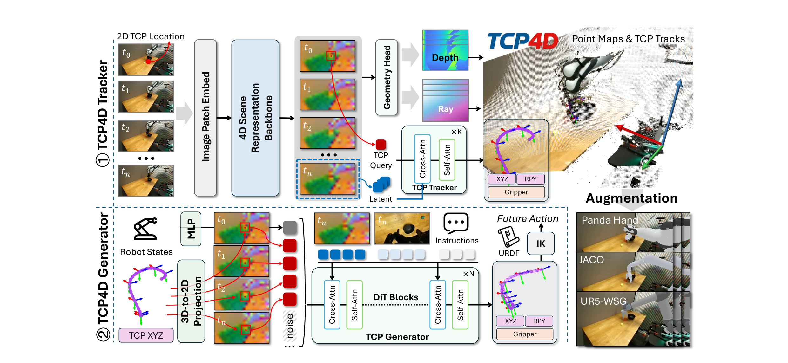
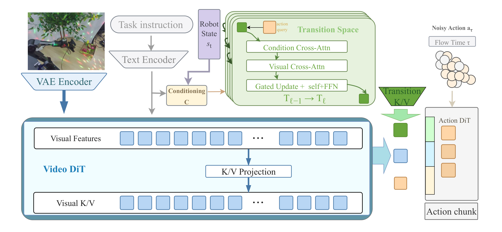

# Embodied AI & World Models News

> 具身智能与世界模型每日研究动态与论文精读。

**最新一期：2026-11-18** ｜ [日报原文](news/2026-11-18.md) · [精读索引](paper-reading/news/2026-11-18/README.md) · [历史归档](#历史归档)

---

<!-- 本段由 codex-deployment/update_readme.py 从 news/2026-11-18.md 自动镜像，请勿手工编辑 -->

## 2026-11-18 Embodied AI & World Models Daily

> 面向具身智能 / Robotics 研究员与工程师的研究与工程资讯。
> 主窗口：北京时间 2026-11-18 00:00–23:59；补充窗口：11 月 16–17 日。所有论文日期按首次提交时间换算，不按公告日归属。
> **来源检查不完整：** 本次取得的 arXiv recent/new 官方列表最新公告仍为 11 月 18 日；针对完整主窗口的官方 API 返回 95 条，其最新实际提交仅到北京时间 18 日 02:56:09。无法确认此后时段的索引覆盖，不将其解释为当天没有其他资讯。Physical Intelligence 返回 429，Hugging Face 机构模型列表与 TCP4D 权重入口超时。本期先发布已核实内容；下述研究结论均区分全文精读与摘要核实。

### 🔥 今日必读

#### 1. 【Sim-to-Real · 实时控制】Magflow：用可微电磁仿真训练4kHz磁悬浮控制器

**来源：** [arXiv:2611.23050v1](https://arxiv.org/abs/2611.23050v1)（cs.RO；Bielefeld University / Fraunhofer IOSB-INA）  
**类型：** Paper  
**发布时间：** 2026-11-18 00:46:26（北京时间，首次 arXiv 提交；论文已标注 RA-L 接受）  
**评分：** 88.5/100（89、88 两次评分均值）  
**关键词：** Differentiable Simulation · Magnetic Levitation · Sim-to-Real

**一句话：** 将磁场、线圈受力、传感器和刚体运动构成可微闭环，离线训练 GRU 直接由霍尔读数生成电流；对应真实工业平台无需真实轨迹微调，实现新的磁体运动范围。

**技术要点：**

- 定子离散为 130368 个导线段；固定姿态下六维力/力矩与 72 维电流呈线性关系，利用这一结构计算精确电流梯度，并降低反传成本。
- 四层 GRU 读取 150 维霍尔观测，输出 24 组二维 Clarke 电流。500 步截断反传覆盖 125 ms；每种磁体/运动设置分别训练，单 A40 每个控制器约五天。
- 单 CPU 核最坏推理 242 微秒，处于 250 微秒周期内。APM 实现离中心圆轨迹上的 360 度偏航，并展示普通条形磁体六维控制；翻滚时偶尔接触 tile，不能描述为始终无接触。
- **代价明确：** 60 秒随机轨迹中 x/y/z RMS 为 0.34/0.30/0.14 mm，专有控制为 0.09/0.07/0.06 mm。扩展可控范围不等于精度全面领先；1.3 kg 是悬浮演示，未建立动态额定载荷。

**为什么值得关注：** 它把高成本物理模型留在训练侧，展示工业实时约束下从模拟学习电流控制的路径。值得迁移的是物理结构、动作表示与安全损失的配合；当前证据仍限单 tile、单 mover，换磁体需要重新训练。

**资源：** [论文与 PDF](https://arxiv.org/abs/2611.23050v1) · [项目页](https://sites.google.com/view/magflow) · [全文精读](paper-reading/news/2026-11-18/magflow/magflow.md)。论文声称提供源码和视频，本次未核实到可确认对应的公开代码仓库与权重，不以同名仓库替代。

#### 2. 【Manipulation · 跨本体数据】TCP4D：用工具中心点连接视频跟踪、动作生成和数据增强

**来源：** [arXiv:2611.23143v1](https://arxiv.org/abs/2611.23143v1)（cs.RO）  
**类型：** Paper  
**发布时间：** 2026-11-18 01:59:42（北京时间，首次提交）  
**评分：** 87.5/100（89、86）  
**关键词：** TCP Tracking · 4D Representation · Flow Matching · Cross-Embodiment

**一句话：** 在共享四维场景表征中恢复末端 SE(3) 轨迹与夹爪状态，再以历史 TCP 局部特征生成未来动作，并通过目标 URDF 与 IK 合成其他本体的演示。

**技术要点：**

- 跟踪需要首帧二维 TCP 查询，骨干联合几何与 TCP 监督；生成器使用四帧历史局部特征、状态、语言和腕部视图，输出未来 32 步双臂动作。
- DROID 原始米制 MPE 为 11.85 mm，允许真值 Sim(3) 对齐后的 ATE 为 7.60 mm；后者不能当作未经校准的绝对部署精度。
- 跨本体增强 397/400=99.25% 指生成管线通过率。ARX 下游策略由增强数据单独训练的 30.5% 到联合数据的 72.0%，增加 **41.5 个百分点**；仅单训练种子，同 epoch 的更大数据集也增加更新预算。
- RoboTwin 48 项任务干净测试 69.19%，随机测试仅 10.94%，另有两项完全遮挡任务未纳入。真实两任务各 30 次试验，成功率 83.33% 与 73.33%，平均 78.33%；这些结果不等于广泛 OOD 已解决。

**为什么值得关注：** TCP 使视频标注、策略动作和跨本体增强拥有可检查的共同接口。真正采用时需逐项核对查询、外参、目标 IK 和图像修补；轨迹可恢复、数据可生成、闭环任务成功是三种不同验证。

**资源：** [论文](https://arxiv.org/abs/2611.23143v1) · [项目页](https://livioni.github.io/TCP4D/) · [Livioni/TCP4D](https://github.com/Livioni/TCP4D) · [Hugging Face 模型集合](https://huggingface.co/collections/HarrisonPENG/tcp-4d-models)（项目页给出，直连超时，未验证可下载性） · [全文精读](paper-reading/news/2026-11-18/tcp4d/tcp4d.md)。仓库身份已核实，未本地执行。

#### 3. 【仿真基础设施】Genesis 1.4.7：修复非刚体耦合，并补齐确定性模式

**来源：** [官方 v1.4.7 Release](https://github.com/Genesis-Embodied-AI/genesis-world/releases/tag/v1.4.7)  
**类型：** Engineering  
**发布时间：** 2026-11-18 01:18:16（北京时间，Release 的 published_at）  
**评分：** 80.5/100（80、81）  
**关键词：** FEM · SPH · SAP Coupler · Determinism

**一句话：** 本次重点是非刚体求解和耦合的正确性、性能与可复现性，适合依赖软体、流体和接触训练的团队检查升级影响。

**技术要点：**

- 官方称 `gs.init(use_deterministic_algorithms=True)` 下所有求解器均支持确定性，代价约 15% 速度下降；这不是本地实测。
- 修复刚/软耦合接触力矩、FEM Newton 阈值与刚性/重场景提前终止、SPH 渗漏和黏性动量等问题，并使 SAP 接触刚度不依赖网格分辨率。
- 支持任意长度运动链与不含第二关节的关节等式；官方报告部分批量 SPH 场景最高约 25% 加速，并减少若干可微 FEM/MPM 场景内存。

**为什么值得关注：** 升级可能改变此前有偏的接触行为及训练轨迹，值得固定旧版配置后回归核心任务；上述变更未在本机安装或跑性能比较。此工程事件不纳入论文精读。

### 📄 论文雷达

除 RelayWAM 已读全文外，下列条目以核实后的官方摘要为证据，不冒充全文审查。所有时间均为 2026-11-18 北京时间。

#### 【World-Action Model】RelayWAM：让未来可预测表征真正进入动作

**来源：** [arXiv:2611.22994v1](https://arxiv.org/abs/2611.22994v1) · 00:10:09  
**关键词：** Predictive Representation · Action Interface · Future-Free Inference  
**核心贡献：** 用线性探测和受控擦除区分“未来可解码”与“动作实际利用”，再沿第 14–29 层递归累计动作条件化过渡标记，将其作为 K/V 注入动作注意力。推理不生成未来帧，每步去噪重置过渡状态。

**值得关注程度：** 85.5/100（86、85）。LIBERO-Plus 全回合加权 72.03%，FastWAM 51.50%；PRO 五轴平均 44.7%，但 Position 仅 1.4%。无未来监督的接口变体也明显提升，不能把全部收益归因预测信息；新增参数小于 0.6% 不等于延迟仅增 0.6%。真机为室内人工树、每条件 20 次。  
**资源：** [论文](https://arxiv.org/abs/2611.22994v1) · [全文精读](paper-reading/news/2026-11-18/relaywam/relaywam.md)。未确认官方代码和权重。

#### 【可变形仿真】RFW-S：把资产生成和独立物理验证分开

**来源：** [arXiv:2611.23056v1](https://arxiv.org/abs/2611.23056v1) · 00:49:52  
**关键词：** Deformable Assets · Simulation Verification · Sim-to-Real  
**核心贡献：** 摘要报告 83365 个日常可变形资产、485 类别与五类材料家族，利用自动物理参数校准，并在不同于校准的交互中独立验证。价值在于避免生成与验收共用同一任务；公开资产可用性及完整验证协议尚未全文核查。  
**值得关注程度：** 81/100（82、80） · [Paper](https://arxiv.org/abs/2611.23056v1)

#### 【世界模型审计】ANYmal RWM：一步预测更好，策略未必能走

**来源：** [arXiv:2611.23118v1](https://arxiv.org/abs/2611.23118v1) · 01:36:40  
**关键词：** Learned Simulator · Calibration · Closed-Loop Evaluation  
**核心贡献：** 摘要报告系统审计 learned simulator 的长时稳定性与控制用途：剪枝保留的一步精度与两秒稳定性可能脱钩，单步预测更好的微调模型也会训练出失败步态。涉及多个模型与变体，但当前任务域仍受限，不能外推所有世界模型无效。  
**值得关注程度：** 81/100（82、80） · [Paper](https://arxiv.org/abs/2611.23118v1)

#### 【多机器人】用障碍函数引导扩散，组合异构团队能力

**来源：** [arXiv:2611.23149v1](https://arxiv.org/abs/2611.23149v1) · 02:03:24  
**关键词：** Heterogeneous Teams · Barrier Functions · Diffusion Planning  
**核心贡献：** 复用个体扩散轨迹先验，通过障碍约束引导组合异构团队的联合轨迹；摘要包含理论可行性条件、数值任务及真实多机器人验证。适用性依赖约束与采样假设，不能当作任意任务的无条件可行保证。  
**值得关注程度：** 77.5/100（79、76） · [Paper](https://arxiv.org/abs/2611.23149v1)

#### 【家庭机器人基准】PAIR：智能家居API没有替机器人完成抓取

**来源：** [arXiv:2611.23070v1](https://arxiv.org/abs/2611.23070v1) · 00:58:30  
**关键词：** Smart Home · Manipulation · API-Physical Interaction  
**核心贡献：** 将 Matter 设备 API 与面板交互接入共享状态，任务仍要求物理操作；摘要称两种微调 VLA 在 120 次运行中均未完整成功，主要失败来自基础导航与操作。具身执行与上层计划应分别诊断，oracle 条件下计划进度也不能当完整成功率。  
**值得关注程度：** 77.5/100（79、76） · [Paper](https://arxiv.org/abs/2611.23070v1)

#### 【腿式控制】CADENCE：学习非周期落足，保留模型控制内层

**来源：** [arXiv:2611.23102v1](https://arxiv.org/abs/2611.23102v1) · 01:25:29  
**关键词：** Acyclic Gaits · RL · Convex MPC  
**核心贡献：** RL 在离散落足/保持选项和摆动时间上决策，内层继续使用凸 MPC，允许非周期步态适应碎片地形。摘要报告仿真多种子对照和控制后端迁移，后者还需重拟合接口；未核实到真机结果，不写成零适配实机迁移。  
**值得关注程度：** 76.5/100（77、76） · [Paper](https://arxiv.org/abs/2611.23102v1)

#### 【高效世界模型】SpikWM：面向视觉规划的脉冲JEPA

**来源：** [arXiv:2611.22981v1](https://arxiv.org/abs/2611.22981v1) · 00:00:02  
**关键词：** Spiking Neural Network · JEPA · Visual Planning  
**核心贡献：** 用区域池化、双脉冲动作编码及因果膜状态组织潜在动力学，在 PushT、TwoRoom、Reacher 与 Cube 上验证规划。摘要的约 75.6% 能量节省来自算术能耗估计，不能写成部署硬件测得功耗下降。  
**值得关注程度：** 73.5/100（75、72） · [Paper](https://arxiv.org/abs/2611.22981v1)

#### 【意图推断】WoRD：用扩散模型在线更新目标后验

**来源：** [arXiv:2611.23192v1](https://arxiv.org/abs/2611.23192v1) · 02:35:53  
**关键词：** Goal Recognition · Diffusion · Posterior Inference  
**核心贡献：** 为候选目标建立扩散轨迹分布，以温启动采样和梯度似然近似在线更新后验，面向早期轨迹含糊的目标识别。包含机器人等场景的通用推断用途，故未按纯自动驾驶工作排除；具体校准与运行成本仍待全文检查。  
**值得关注程度：** 70/100（71、69） · [Paper](https://arxiv.org/abs/2611.23192v1)

### 🛠 工程与开源

本期工程重点为上方的 [Genesis 1.4.7](https://github.com/Genesis-Embodied-AI/genesis-world/releases/tag/v1.4.7)，避免重复计数。TCP4D 的[官方仓库](https://github.com/Livioni/TCP4D)已由作者项目页与仓库元数据交叉确认；权重集合由项目页链接，但直连超时，未验证下载、许可与运行结果。Magflow 同名仓库搜索有大量无关项目，未将其当官方代码。

### 💬 社区信号

本次 GitHub 新建仓库检索与 Hacker News 广义/论文名扩展检索，未取得足以确认上述事件已形成集中技术讨论的证据；名称检索有历史或无关命中，不用于抬高热度分。没有据此推断全社区无人讨论。后续值得观察的是 RWM 审计能否形成独立复现，以及 Genesis 接触修复是否改变既有策略行为；这两点目前只是跟踪问题。

### 🔎 补充窗口筛选记录

以下首次提交均在补充窗口内，已在 17 日刊发布，故本期不重复当作新事件：

| 论文 | 实际首次提交（北京时间） | 排除原因 |
| --- | --- | --- |
| [ScaleVLA，arXiv:2611.21607v1](https://arxiv.org/abs/2611.21607v1) | 11-17 02:59:37 | 已发布并精读，无已核实的重要新版本 |
| [ALOHA Lightning，arXiv:2611.21919v1](https://arxiv.org/abs/2611.21919v1) | 11-17 05:31:18 | 同上 |
| [DreamFAR，arXiv:2611.22001v1](https://arxiv.org/abs/2611.22001v1) | 11-17 07:31:41 | 同上 |
| [InteractVLA，arXiv:2611.22584v1](https://arxiv.org/abs/2611.22584v1) | 11-17 19:07:45 | 同上 |

主窗口另有 [DDPC，arXiv:2611.23215v1](https://arxiv.org/abs/2611.23215v1)（02:56:09，58分）、[触觉DLO，arXiv:2611.22990v1](https://arxiv.org/abs/2611.22990v1)（00:07:04，60.5分）与 [SMT/STL，arXiv:2611.23021v1](https://arxiv.org/abs/2611.23021v1)（00:27:56，60分），相关但未达 T1 的 62 分门槛。[Pressure Drop，arXiv:2611.23120v1](https://arxiv.org/abs/2611.23120v1)（01:38:28）以重力方向估计为主，未显示本任务要求的学习或决策创新；[驾驶状态，arXiv:2611.23211v1](https://arxiv.org/abs/2611.23211v1)（02:50:22）、[驾驶轨迹预测，arXiv:2611.23198v1](https://arxiv.org/abs/2611.23198v1)（02:38:28）和 [驾驶轨迹选择，arXiv:2611.22998v1](https://arxiv.org/abs/2611.22998v1)（00:12:55）未确认通用机器人方法贡献，预筛排除。

### 📊 今日技术趋势

今天已核实工作共同提示，表示、接口和闭环执行应分别验证：未来可解码不等于策略利用，末端轨迹可生成不等于接触任务成功，单步仿真准确也未必产生稳定策略。Magflow 则展示相反方向的机会：把昂贵物理和约束放进训练，在极短部署周期中获得新的可控范围，但必须同时保留精度和功率代价。

### 检索覆盖与精读状态

本次直接读取 [cs.RO](https://arxiv.org/list/cs.RO/recent)、[cs.AI](https://arxiv.org/list/cs.AI/recent)、[cs.LG](https://arxiv.org/list/cs.LG/recent)、[cs.CV](https://arxiv.org/list/cs.CV/recent) 官方 recent，以及当月列表作回溯；RO 月列表 1023 条，其他大分类月列表只取前 2000 条，不声称整月穷尽。官方 API 完整主窗口查询取得 95 条，但其最新实际投稿仍为 02:56:09；官方索引后续覆盖无法确认。

关键词宽召回去重后 1170 项，其中主窗口候选 17、补充窗口 171、窗口外 982；这是候选池数量，不是全文阅读数量。17 项主窗口候选已核对摘要和首次提交时间，PASS 项执行相同五维权重的两次编辑评分，按均值筛选；论文、项目页与代码合并为一个事件。三篇已完成全文精读，其他雷达仅摘要核实。

机构源检查涉及 GEAR、DeepMind、Skild、1X、Figure、RAI、TRI、Stanford、Berkeley、CMU、MIT、上海 AI 实验室、宇树、云深处，以及 CoRL/RSS/ICRA/IROS 和仿真器官方发布页。网页可达不等于这些机构所有入口已穷尽；PI 429、HF 超时与官方索引缺口均未解决，不能将本期称为完整自然日覆盖。

[精读索引](paper-reading/news/2026-11-18/README.md)：Magflow、TCP4D、RelayWAM 三篇笔记已完成；每篇一张方法图通过视觉审查，均无占位图，Grounding、八项 lint、质量/可读性审查与正式保存 SHA 校验通过。

---

## 历史归档

| 日期 | 日报 | 精读 |
| --- | --- | --- |
| 2026-11-18 | [日报](news/2026-11-18.md) | [3 篇](paper-reading/news/2026-11-18/README.md) |
| 2026-11-17 | [日报](news/2026-11-17.md) | [4 篇](paper-reading/news/2026-11-17/README.md) |
| 2026-11-16 | [日报](news/2026-11-16.md) | [4 篇](paper-reading/news/2026-11-16/README.md) |
| 2026-11-15 | [日报](news/2026-11-15.md) | — |
| 2026-11-14 | [日报](news/2026-11-14.md) | [2 篇](paper-reading/news/2026-11-14/README.md) |
| 2026-11-13 | [日报](news/2026-11-13.md) | [5 篇](paper-reading/news/2026-11-13/README.md) |
| 2026-11-12 | [日报](news/2026-11-12.md) | [4 篇](paper-reading/news/2026-11-12/README.md) |
| 2026-11-11 | [日报](news/2026-11-11.md) | [5 篇](paper-reading/news/2026-11-11/README.md) |
| 2026-11-10 | [日报](news/2026-11-10.md) | [5 篇](paper-reading/news/2026-11-10/README.md) |
| 2026-11-09 | [日报](news/2026-11-09.md) | [6 篇](paper-reading/news/2026-11-09/README.md) |
| 2026-11-08 | [日报](news/2026-11-08.md) | [1 篇](paper-reading/news/2026-11-08/README.md) |
| 2026-11-07 | [日报](news/2026-11-07.md) | [1 篇](paper-reading/news/2026-11-07/README.md) |
| 2026-11-06 | [日报](news/2026-11-06.md) | [2 篇](paper-reading/news/2026-11-06/README.md) |
| 2026-11-05 | [日报](news/2026-11-05.md) | [2 篇](paper-reading/news/2026-11-05/README.md) |
| 2026-11-04 | [日报](news/2026-11-04.md) | [2 篇](paper-reading/news/2026-11-04/README.md) |
| 2026-11-03 | [日报](news/2026-11-03.md) | [2 篇](paper-reading/news/2026-11-03/README.md) |
| 2026-11-02 | [日报](news/2026-11-02.md) | [3 篇](paper-reading/news/2026-11-02/README.md) |
| 2026-11-01 | [日报](news/2026-11-01.md) | [4 篇](paper-reading/news/2026-11-01/README.md) |
| 2026-10-31 | [日报](news/2026-10-31.md) | [5 篇](paper-reading/news/2026-10-31/README.md) |
| 2026-10-30 | [日报](news/2026-10-30.md) | [5 篇](paper-reading/news/2026-10-30/README.md) |
| 2026-10-29 | [日报](news/2026-10-29.md) | [4 篇](paper-reading/news/2026-10-29/README.md) |
| 2026-10-28 | [日报](news/2026-10-28.md) | [5 篇](paper-reading/news/2026-10-28/README.md) |
| 2026-10-27 | [日报](news/2026-10-27.md) | [3 篇](paper-reading/news/2026-10-27/README.md) |
| 2026-10-26 | [日报](news/2026-10-26.md) | [3 篇](paper-reading/news/2026-10-26/README.md) |
| 2026-10-25 | [日报](news/2026-10-25.md) | [3 篇](paper-reading/news/2026-10-25/README.md) |
| 2026-10-24 | [日报](news/2026-10-24.md) | [3 篇](paper-reading/news/2026-10-24/README.md) |
| 2026-10-23 | [日报](news/2026-10-23.md) | [4 篇](paper-reading/news/2026-10-23/README.md) |
| 2026-10-22 | [日报](news/2026-10-22.md) | [4 篇](paper-reading/news/2026-10-22/README.md) |
| 2026-10-21 | [日报](news/2026-10-21.md) | [7 篇](paper-reading/news/2026-10-21/README.md) |
| 2026-10-20 | [日报](news/2026-10-20.md) | [4 篇](paper-reading/news/2026-10-20/README.md) |
| 2026-10-19 | [日报](news/2026-10-19.md) | [5 篇](paper-reading/news/2026-10-19/README.md) |
| 2026-10-18 | [日报](news/2026-10-18.md) | — |
| 2026-10-17 | [日报](news/2026-10-17.md) | — |
| 2026-10-16 | [日报](news/2026-10-16.md) | [5 篇](paper-reading/news/2026-10-16/README.md) |
| 2026-10-15 | [日报](news/2026-10-15.md) | [5 篇](paper-reading/news/2026-10-15/README.md) |
| 2026-10-14 | [日报](news/2026-10-14.md) | [5 篇](paper-reading/news/2026-10-14/README.md) |
| 2026-10-13 | [日报](news/2026-10-13.md) | — |
| 2026-10-12 | [日报](news/2026-10-12.md) | [5 篇](paper-reading/news/2026-10-12/README.md) |
| 2026-10-11 | [日报](news/2026-10-11.md) | [6 篇](paper-reading/news/2026-10-11/README.md) |
| 2026-10-10 | [日报](news/2026-10-10.md) | [7 篇](paper-reading/news/2026-10-10/README.md) |
| 2026-10-09 | [日报](news/2026-10-09.md) | [6 篇](paper-reading/news/2026-10-09/README.md) |
| 2026-10-08 | [日报](news/2026-10-08.md) | [6 篇](paper-reading/news/2026-10-08/README.md) |
| 2026-10-07 | [日报](news/2026-10-07.md) | [6 篇](paper-reading/news/2026-10-07/README.md) |
| 2026-10-06 | [日报](news/2026-10-06.md) | [6 篇](paper-reading/news/2026-10-06/README.md) |
| 2026-10-05 | [日报](news/2026-10-05.md) | [6 篇](paper-reading/news/2026-10-05/README.md) |
| 2026-10-04 | [日报](news/2026-10-04.md) | [4 篇](paper-reading/news/2026-10-04/README.md) |
| 2026-10-03 | [日报](news/2026-10-03.md) | [4 篇](paper-reading/news/2026-10-03/README.md) |
| 2026-10-02 | [日报](news/2026-10-02.md) | [7 篇](paper-reading/news/2026-10-02/README.md) |

## 目录结构

| 目录 | 内容 |
| --- | --- |
| `news/YYYY-MM-DD.md` | 每日研究动态日报 |
| `paper-reading/news/YYYY-MM-DD/<短slug>/` | 论文精读笔记（`<短slug>.md` + `images/`） |
| `paper-reading/news/YYYY-MM-DD/README.md` | 当日精读索引 |

## 内容许可

- 本仓库全部文字内容（日报与精读笔记）以 [CC BY 4.0](LICENSE) 授权——转载、改写、商用均可，仅需署名。
- 精读笔记中嵌入的论文插图版权归论文原作者 / 出版社所有（figures © original authors），仅作学术评述之引用；本仓库的 CC BY 4.0 授权不覆盖这些图片。

## 自动化

每天北京时间 08:30，无人值守任务生成前一自然日的日报、对入选论文执行全文精读，并把当日日报镜像到本页后提交推送。arXiv 公告存在批次延迟，部分日期的当日投稿只能部分覆盖，具体缺口写在该期日报的「检索覆盖与精读状态」一节。
