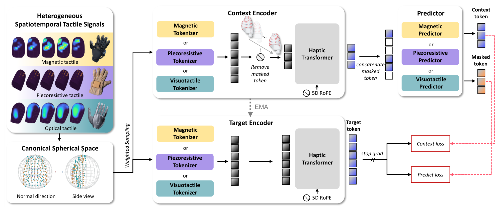
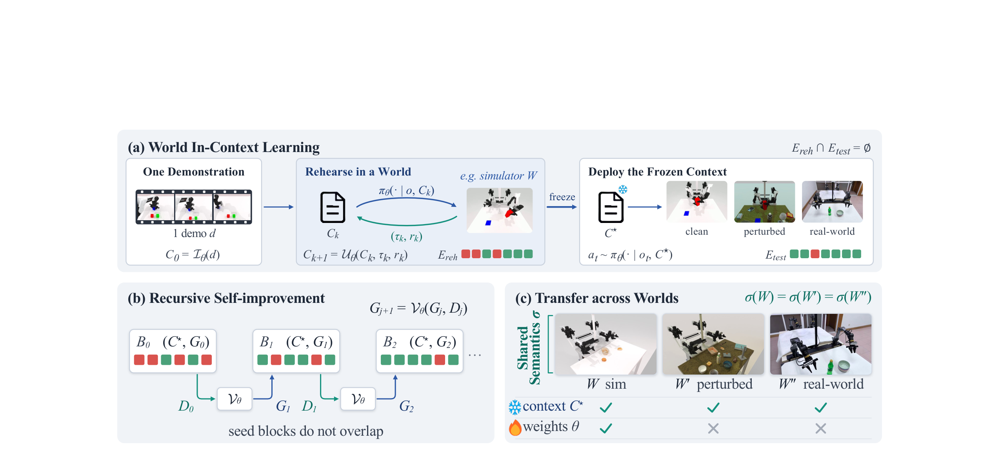
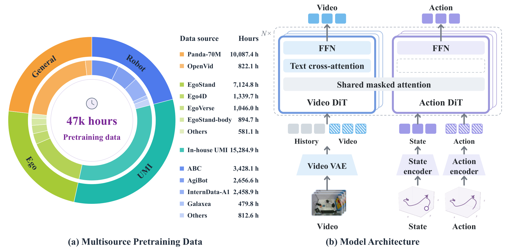
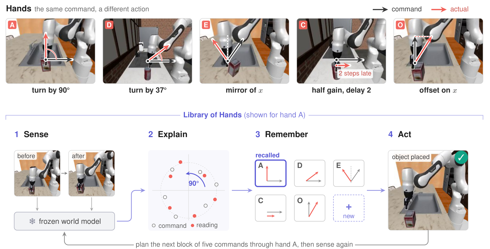
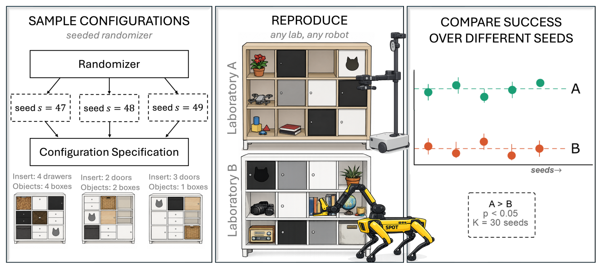

# Embodied AI & World Models News

> 具身智能与世界模型每日研究动态与论文精读。

**最新一期：2026-11-10** ｜ [日报原文](news/2026-11-10.md) · [精读索引](paper-reading/news/2026-11-10/README.md) · [历史归档](#历史归档)

---

<!-- 本段由 codex-deployment/update_readme.py 从 news/2026-11-10.md 自动镜像，请勿手工编辑 -->

## 2026-11-10 Embodied AI & World Models Daily

> 覆盖北京时间 11 月 10 日。完成 5 篇全文精读。arXiv 按摘要页实际提交时间归期，检索覆盖范围见文末。

### 🔥 今日必读

#### 1. 【触觉表征】LingBot-Touch 把三类指尖传感器接入同一编码器

**时间与评分**　02:12 提交，90/100。  
**核心贡献**　把磁、压阻、视触觉的触点映射到规范指尖坐标，使用分组投影与共享 Haptic Transformer，通过遮挡预测学习接触表征。

- 完整数据池有 4,983 小时、464,431 个回合。实机主表使用 4,000 小时版本的 Tiny，编码器冻结，由策略后训练读取触觉特征。
- 26 项真实任务上，π0.5 从 48.1% 到 69.9%，LingBot-VLA 从 48.3% 到 73.1%。实验覆盖两种手。传感器接口仍需几何与量程，电容触觉和掌部接触覆盖有限。
- 论文、官方发布与代码权重入口合并为同一事件。仓库列出 Tiny 与 Small 两种检查点的获取方式。

[arXiv:2611.12806v1](https://arxiv.org/abs/2611.12806) · [官方发布](https://www.sttinfo.fi/tiedote/72489924/robbyant-releases-lingbot-touch-to-bring-general-purpose-touch-perception-to-robots?lang=en&publisherId=58763726) · [官方仓库](https://github.com/Robbyant/lingbot-touch) · [精读](paper-reading/news/2026-11-10/lingbot-touch/lingbot-touch.md)。

#### 2. 【机器人操作】RoboScript 从仿真排练形成可迁移的任务记忆

**时间与评分**　02:59:45 提交，87.5/100。  
**核心贡献**　冻结模型从一条示范整理物体角色与相对抓放规格，再用仿真反馈迭代修改任务记忆。部署时在新实例上读取冻结记忆并调用技能。

- RoboTwin 2.0 的 50 项任务中，干净场景为 83.6%，随机场景为 83.2%。每评估回合平均调用模型 54.7 次。排练阶段仍需要仿真交互与指定角色的反馈。
- 双臂 PiPER 在调整本体参数后，四个任务分别为 10/10、7/10、7/10、6/10。真机使用离线动作计划，仿真中的在线恢复能力仍需在真机验证。

[arXiv:2611.12885v1](https://arxiv.org/abs/2611.12885) · [官方代码](https://github.com/ArcheOne-AI/RoboScript) · [精读](paper-reading/news/2026-11-10/world-in-context/world-in-context.md)。

#### 3. 【世界动作模型】SWAM 比较语言、视频和动作监督的组合

**时间与评分**　02:55:04 提交，85.5/100。  
**核心贡献**　约 47,000 小时的多源数据池支持比较语言标注与动作标签覆盖。模型采用视频与动作分支，动作通过单向掩码注意力读取视频表征。

- 仅用 Clean 示范后训练时，RoboTwin Easy 为 88.10%、Hard 为 61.56%，OpenWAM 分别为 89.30%、48.70%。最大的差距出现在随机化测试。
- 三项双臂实机任务的困难条件下，完整成功率为 40.00%，OpenWAM 为 23.33%。资源开放为论文作者声明，本期未核验全部下载项。

[arXiv:2611.12870v1](https://arxiv.org/abs/2611.12870) · [精读](paper-reading/news/2026-11-10/swam/swam.md)。

### 📄 论文雷达

#### 【动作接口】Library of Hands

00:45:11 提交，82.5/100。用冻结世界模型反演动作，拟合并保存指令映射。在 RoboCasa 仿真中，DINO-WM 在既有接口返回后的成功率从 7.8% 到 26.6%，已知映射参考为 35.9%。单记忆对照在同一设置中为 29.7%。环境摩擦或重心变化可能导致错误校准。

[arXiv:2611.12678v1](https://arxiv.org/abs/2611.12678) · [精读](paper-reading/news/2026-11-10/library-hands/library-hands.md)。

#### 【实机评测】Stochastic Challenges

02:10:28 提交，82/100。用随机种子描述可在不同实验室复现的格柜场景，分别估计场景难度和执行随机性的影响。两地实机实验中，部分共享种子将开门任务的可检测差从 33.3 降到 25.6 个百分点，将抽屉任务从 23.2 降到 18.3 个百分点。共享配置由同一研究者重建，跨团队布置误差仍未测量。

[arXiv:2611.12804v1](https://arxiv.org/abs/2611.12804) · [精读](paper-reading/news/2026-11-10/stochastic-challenges/stochastic-challenges.md)。

| 其他方向 | 论文证据 |
| --- | --- |
| 互联网视频中的三维手物预测 | 联合生成手腕、手指和物体位姿，采用遮挡补全与流匹配。报告用重定向展示轨迹可行性。[arXiv:2611.12879v1](https://arxiv.org/abs/2611.12879) |
| Σ-LeWM | 增加潜空间后向动力学和逆动作预测，在标准基准和两个模拟操作任务评估规划。[arXiv:2611.12732v1](https://arxiv.org/abs/2611.12732) |
| SO-101 棋盘操作适配 | 在单项坐标指令任务比较示范量、更新步数和模拟预训练。实机为十个策略各 25 次试验，论文将结论描述为阶段性结果。[arXiv:2611.12676v1](https://arxiv.org/abs/2611.12676) |
| 仿真辅助强化学习 | 把模拟数据用于控制变量以降低方差，在多项 MuJoCo 任务对比直接混合仿真和目标数据。[arXiv:2611.12643v1](https://arxiv.org/abs/2611.12643) |

### 🛠 工程与开源

LingBot-Touch 和 RoboScript 的代码入口随论文条目登记。已扫描 MuJoCo、Genesis、Isaac Lab、LeRobot 的版本页与模型目录，本期未发现另一个通过时间、去重与技术门槛的版本。会议展示线索中，GENTO 的 21 自由度手官方新闻稿对应北京时间 11 月 11 日 04:00，留待对应窗口。[GENTO 新闻稿](https://www.prnewswire.com/news-releases/tianji-intelligence-debuts-21-dof-dexterous-hand-at-corl-2026-as-nvidia-demos-gr00t-2-on-custom-marvin-pro-302934702.html)。

### 💬 社区信号

CoRL 的展示、论文与项目页用于交叉核验，重复报道归入原事件。本次已访问渠道内，未核实可单列的独立复现。[会议官方入口](https://2026.corl.org/)。

### 🔎 补充窗口筛选记录

| 线索 | 实际日期（北京时间） | 处理 |
| --- | --- | --- |
| DASH | 11 月 9 日 12:23:14 | 上期已收录并精读。[arXiv:2611.11854v1](https://arxiv.org/abs/2611.11854) |
| ObjectWorld | 11 月 8 日 10:55:15 | 上期已补记，归入同一论文事件。[arXiv:2611.11085v1](https://arxiv.org/abs/2611.11085) |
| DexForesight | 11 月 8 日 14:14:36 | 上期已补记，未核实新增实质证据。[arXiv:2611.11166v1](https://arxiv.org/abs/2611.11166) |
| GR00T 2 | 11 月 9 日 22:00:01 | 上期已精读，会场报道归并原发布。[前一期日报](news/2026-11-09.md) |
| WorldFoundry | 11 月 7 日 22:59:22 | 早于回溯起点，索引更新不足以计作当日提交。[arXiv:2611.10771v1](https://arxiv.org/abs/2611.10771) |

### 📊 今日技术趋势

触觉编码器与世界动作模型都在研究如何让不同数据来源共享表征。实机收益需要结合传感器接口、标签覆盖和任务条件来解释。Library of Hands 与 Stochastic Challenges 分别把接口变化和场景波动纳入评估，提示同一个平均成功率可能隐藏不同的失效机制。

### 来源覆盖与双评分

- 官方 [cs.RO](https://arxiv.org/list/cs.RO/recent)、[cs.AI](https://arxiv.org/list/cs.AI/recent)、[cs.LG](https://arxiv.org/list/cs.LG/recent) 与 [cs.CV](https://arxiv.org/list/cs.CV/recent) 的近期、11 月列表均可读取，另核对了四类当期 new 列表。预筛后的 661 个去重候选均核对摘要与版本时间。按 v1 划分，主窗口 15 条、补充窗口 120 条、窗口外 526 条。官方列表可见公告截至 11 月 10 日，主窗口已索引的条目集中在北京时间凌晨，白天提交可能在后续公告出现。
- CMU 机器人研究所和上海 AI 实验室的批量新闻入口未能完整核验。论文作者报告的数据、实验和开源入口按各自证据记录。
- 下表每轮依次给技术份量、增量、证据、相关性、社区关注度。研究论文权重为 4/3/2/1/0，按两轮平均计分。

| 候选 | 第一轮 | 第二轮 | 平均分 |
| --- | --- | --- | ---: |
| LingBot-Touch | 9/9/9/10/6 | 9/9/8/10/6 | 90 |
| RoboScript | 9/9/8/10/3 | 9/8/8/10/3 | 87.5 |
| SWAM | 9/8/8/10/2 | 8/9/8/10/2 | 85.5 |
| Library of Hands | 8/9/8/9/1 | 8/8/8/9/1 | 82.5 |
| Stochastic Challenges | 8/8/9/9/1 | 8/8/8/9/1 | 82 |
| 三维手物预测 | 8/8/7/8/1 | 8/7/8/8/1 | 77.5 |
| Σ-LeWM | 8/8/7/9/1 | 8/7/8/9/1 | 78.5 |
| SO-101 棋盘适配 | 7/7/8/9/1 | 7/8/7/9/1 | 74.5 |
| 仿真辅助控制变量 | 7/8/7/8/1 | 8/7/7/8/1 | 74.5 |

---

## 历史归档

| 日期 | 日报 | 精读 |
| --- | --- | --- |
| 2026-11-10 | [日报](news/2026-11-10.md) | [5 篇](paper-reading/news/2026-11-10/README.md) |
| 2026-11-09 | [日报](news/2026-11-09.md) | [6 篇](paper-reading/news/2026-11-09/README.md) |
| 2026-11-08 | [日报](news/2026-11-08.md) | [1 篇](paper-reading/news/2026-11-08/README.md) |
| 2026-11-07 | [日报](news/2026-11-07.md) | [1 篇](paper-reading/news/2026-11-07/README.md) |
| 2026-11-06 | [日报](news/2026-11-06.md) | [2 篇](paper-reading/news/2026-11-06/README.md) |
| 2026-11-05 | [日报](news/2026-11-05.md) | [2 篇](paper-reading/news/2026-11-05/README.md) |
| 2026-11-04 | [日报](news/2026-11-04.md) | [2 篇](paper-reading/news/2026-11-04/README.md) |
| 2026-11-03 | [日报](news/2026-11-03.md) | [2 篇](paper-reading/news/2026-11-03/README.md) |
| 2026-11-02 | [日报](news/2026-11-02.md) | [3 篇](paper-reading/news/2026-11-02/README.md) |
| 2026-11-01 | [日报](news/2026-11-01.md) | [4 篇](paper-reading/news/2026-11-01/README.md) |
| 2026-10-31 | [日报](news/2026-10-31.md) | [5 篇](paper-reading/news/2026-10-31/README.md) |
| 2026-10-30 | [日报](news/2026-10-30.md) | [5 篇](paper-reading/news/2026-10-30/README.md) |
| 2026-10-29 | [日报](news/2026-10-29.md) | [4 篇](paper-reading/news/2026-10-29/README.md) |
| 2026-10-28 | [日报](news/2026-10-28.md) | [5 篇](paper-reading/news/2026-10-28/README.md) |
| 2026-10-27 | [日报](news/2026-10-27.md) | [3 篇](paper-reading/news/2026-10-27/README.md) |
| 2026-10-26 | [日报](news/2026-10-26.md) | [3 篇](paper-reading/news/2026-10-26/README.md) |
| 2026-10-25 | [日报](news/2026-10-25.md) | [3 篇](paper-reading/news/2026-10-25/README.md) |
| 2026-10-24 | [日报](news/2026-10-24.md) | [3 篇](paper-reading/news/2026-10-24/README.md) |
| 2026-10-23 | [日报](news/2026-10-23.md) | [4 篇](paper-reading/news/2026-10-23/README.md) |
| 2026-10-22 | [日报](news/2026-10-22.md) | [4 篇](paper-reading/news/2026-10-22/README.md) |
| 2026-10-21 | [日报](news/2026-10-21.md) | [7 篇](paper-reading/news/2026-10-21/README.md) |
| 2026-10-20 | [日报](news/2026-10-20.md) | [4 篇](paper-reading/news/2026-10-20/README.md) |
| 2026-10-19 | [日报](news/2026-10-19.md) | [5 篇](paper-reading/news/2026-10-19/README.md) |
| 2026-10-18 | [日报](news/2026-10-18.md) | — |
| 2026-10-17 | [日报](news/2026-10-17.md) | — |
| 2026-10-16 | [日报](news/2026-10-16.md) | [5 篇](paper-reading/news/2026-10-16/README.md) |
| 2026-10-15 | [日报](news/2026-10-15.md) | [5 篇](paper-reading/news/2026-10-15/README.md) |
| 2026-10-14 | [日报](news/2026-10-14.md) | [5 篇](paper-reading/news/2026-10-14/README.md) |
| 2026-10-13 | [日报](news/2026-10-13.md) | — |
| 2026-10-12 | [日报](news/2026-10-12.md) | [5 篇](paper-reading/news/2026-10-12/README.md) |
| 2026-10-11 | [日报](news/2026-10-11.md) | [6 篇](paper-reading/news/2026-10-11/README.md) |
| 2026-10-10 | [日报](news/2026-10-10.md) | [7 篇](paper-reading/news/2026-10-10/README.md) |
| 2026-10-09 | [日报](news/2026-10-09.md) | [6 篇](paper-reading/news/2026-10-09/README.md) |
| 2026-10-08 | [日报](news/2026-10-08.md) | [6 篇](paper-reading/news/2026-10-08/README.md) |
| 2026-10-07 | [日报](news/2026-10-07.md) | [6 篇](paper-reading/news/2026-10-07/README.md) |
| 2026-10-06 | [日报](news/2026-10-06.md) | [6 篇](paper-reading/news/2026-10-06/README.md) |
| 2026-10-05 | [日报](news/2026-10-05.md) | [6 篇](paper-reading/news/2026-10-05/README.md) |
| 2026-10-04 | [日报](news/2026-10-04.md) | [4 篇](paper-reading/news/2026-10-04/README.md) |
| 2026-10-03 | [日报](news/2026-10-03.md) | [4 篇](paper-reading/news/2026-10-03/README.md) |
| 2026-10-02 | [日报](news/2026-10-02.md) | [7 篇](paper-reading/news/2026-10-02/README.md) |

## 目录结构

| 目录 | 内容 |
| --- | --- |
| `news/YYYY-MM-DD.md` | 每日研究动态日报 |
| `paper-reading/news/YYYY-MM-DD/<短slug>/` | 论文精读笔记（`<短slug>.md` + `images/`） |
| `paper-reading/news/YYYY-MM-DD/README.md` | 当日精读索引 |

## 内容许可

- 本仓库全部文字内容（日报与精读笔记）以 [CC BY 4.0](LICENSE) 授权——转载、改写、商用均可，仅需署名。
- 精读笔记中嵌入的论文插图版权归论文原作者 / 出版社所有（figures © original authors），仅作学术评述之引用；本仓库的 CC BY 4.0 授权不覆盖这些图片。

## 自动化

每天北京时间 08:30，无人值守任务生成前一自然日的日报、对入选论文执行全文精读，并把当日日报镜像到本页后提交推送。arXiv 公告存在批次延迟，部分日期的当日投稿只能部分覆盖，具体缺口写在该期日报的「检索覆盖与精读状态」一节。
