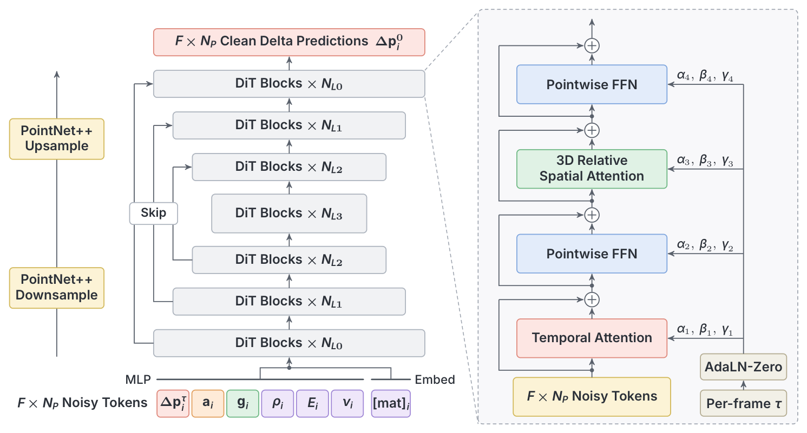
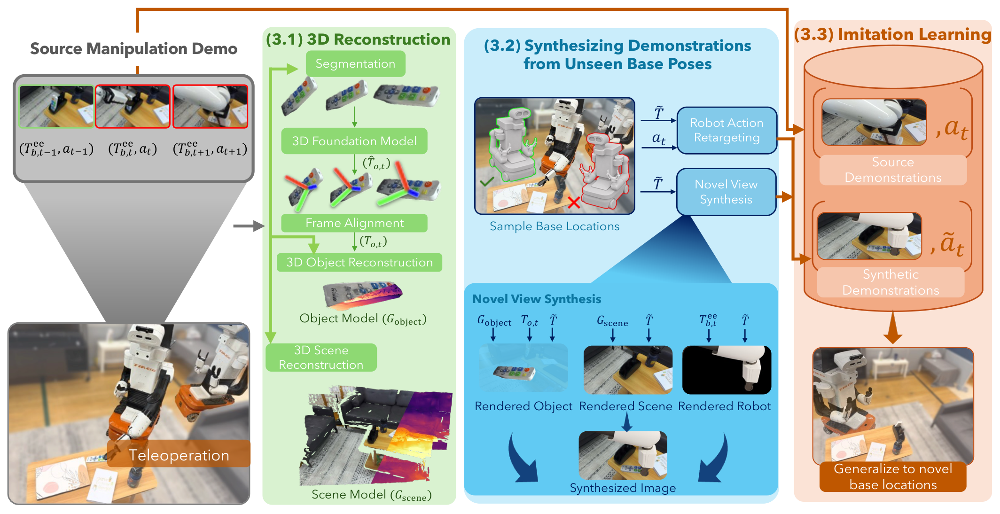

# Embodied AI & World Models News

> 具身智能与世界模型每日研究动态与论文精读。

**最新一期：2026-11-06** ｜ [日报原文](news/2026-11-06.md) · [精读索引](paper-reading/news/2026-11-06/README.md) · [历史归档](#历史归档)

---

<!-- 本段由 codex-deployment/update_readme.py 从 news/2026-11-06.md 自动镜像，请勿手工编辑 -->

## 2026-11-06 Embodied AI & World Models Daily

> 面向具身智能 / Robotics 研究员与工程师。主窗口为北京时间 11 月 6 日，补充窗口为 11 月 4–5 日。来源覆盖不完整，缺口见文末；不能将未检索到理解成没有资讯。

### 🔥 今日必读

#### 1. 【World Model】GPWM：生成粒子交互，而不只预测视频外观

**来源：** [arXiv:2611.08338v1](https://arxiv.org/abs/2611.08338)（CMU、Toyota Research Institute）  
**类型：** Paper  
**发布时间：** 2026-11-06T01:24:36+08:00（北京时间）  
**评分：** 88.5/100  
**关键词：** Particle Dynamics · Flow Matching · Planning

**一句话：** 用粒子位移与刚体增量统一表示多类材料，并在执行器—对象联合轨迹的生成噪声中搜索接触规划。

**技术要点：**

- 对象内分层降采样、粗层跨对象时空注意力，结合逐帧独立噪声与流匹配，支持滚动预测超出十六帧训练窗口。
- ParticleWorlds 有 2550 万仿真帧。六领域平均误差降低 31% 指专家/统一模型逐领域择优；统一模型并非每项都胜出。
- 相同检查点下，噪声空间规划的推物、抓取进度为 0.48–0.57、0.40–0.56。全部为仿真开环，进度不是成功率，单 GPU 预算可达一百或二百秒。

**为什么值得关注：** 它把动作提案分布和预测准确度分开检验；完整跟踪粒子输入、感知缺口及高规划成本仍是部署前提。

**资源：** [论文](https://arxiv.org/abs/2611.08338) · [项目页](https://robertren1122.github.io/gpwm/) · [已完成精读](paper-reading/news/2026-11-06/gpwm/gpwm.md)。本次未确认独立公开权重下载入口。

#### 2. 【Simulation】MuJoCo 4.0.0：接触与形变能力更新

**来源：** [官方 release](https://github.com/google-deepmind/mujoco/releases/tag/4.0.0)  
**类型：** Engineering  
**发布时间：** 北京时间 2026-11-06 23:39:53（GitHub published_at）  
**评分：** 86/100（工程五维第一轮 9/9/9/10/3，第二轮 9/8/9/10/2）  
**关键词：** Contact · Elasto-plasticity · Simulation

**一句话：** 新增 speculative contacts 和有状态弹塑性，并拆分 Python 发行包。值得仿真训练团队评估，但需核对兼容性。  
**技术要点：** speculative contacts 面向快速凸几何穿透薄障碍；弹塑性扩展关节、肌腱及 flex；Python 拆分 core/studio/default 包。  
**为什么值得关注：** 接触与塑性状态直接影响机器人训练环境，发行说明另列出兼容性变化。以上为官方发布信息，本次未运行新引擎验证。  
**资源：** [版本说明与迁移细节](https://github.com/google-deepmind/mujoco/releases/tag/4.0.0)。

### 📄 论文雷达

#### MOMASPLAT: Dynamic Novel-View Demonstration Augmentation for Mobile Manipulation

**来源：** [arXiv:2611.08372v1](https://arxiv.org/abs/2611.08372)  
**发布时间：** 2026-11-06T01:50:35+08:00（北京时间）  
**关键词：** Robotics · Learning · Evaluation  
**核心贡献：** 把导航多视图重建的静态场景与动态对象分开，合成新底座视角并同步变换动作和本体输入。五真机任务未见位姿平均成功率37%，最佳基线17%；仍依赖可见刚性对象，重放不计算接触动力学。  
**值得关注程度：** 87.5/100  
**Paper：** [摘要和版本历史](https://arxiv.org/abs/2611.08372)

[已完成全文精读](paper-reading/news/2026-11-06/momasplat/momasplat.md)。

#### OopsieRecover: Learning Transferable VLA Corrections from Semantic Interventions

**来源：** [arXiv:2611.08462v1](https://arxiv.org/abs/2611.08462)  
**发布时间：** 2026-11-06T02:53:16+08:00（北京时间）  
**关键词：** Robotics · Learning · Evaluation  
**核心贡献：** OopsieRecover 从少量纠正示范归纳失败及纠正语义，将其转成空间表征与条件代价，指导VLA避开不良动作区域。六任务与姿态、场景变体的实验指向纠正迁移，不能从摘要外推无限恢复能力。  
**值得关注程度：** 82.5/100  
**Paper：** [摘要和版本历史](https://arxiv.org/abs/2611.08462)

#### Latent RL Priors for Data-Efficient Dexterous Manipulation

**来源：** [arXiv:2611.08458v1](https://arxiv.org/abs/2611.08458)  
**发布时间：** 2026-11-06T02:50:06+08:00（北京时间）  
**关键词：** Robotics · Learning · Evaluation  
**核心贡献：** 将特权RL经验蒸馏到潜条件流匹配动作解码器，视觉适配时冻结解码器，仅由动作监督学习图像到潜上下文。三项仿真任务的低数据对照有效，尚无摘要支持的真机泛化结论。  
**值得关注程度：** 81/100  
**Paper：** [摘要和版本历史](https://arxiv.org/abs/2611.08458)

#### Failure Prediction and Classification in Vision-Language-Action Models Via Calibrated Latent Probing

**来源：** [arXiv:2611.08425v1](https://arxiv.org/abs/2611.08425)  
**发布时间：** 2026-11-06T02:21:07+08:00（北京时间）  
**关键词：** Robotics · Learning · Evaluation  
**核心贡献：** VLA-Tug 用潜层轻量探针和失败前片段监督改善早期故障检测，并校准漏检与误报。未见任务的界限在至多86%运行中有效，不是任意分布偏移下无条件安全保证；发布3180段标注操作轨迹。  
**值得关注程度：** 81/100  
**Paper：** [摘要和版本历史](https://arxiv.org/abs/2611.08425)

#### VFlash: Fast, Accurate Visual Planning via Flash Primitive Decoding

**来源：** [arXiv:2611.08449v1](https://arxiv.org/abs/2611.08449)  
**发布时间：** 2026-11-06T02:44:43+08:00（北京时间）  
**关键词：** Robotics · Learning · Evaluation  
**核心贡献：** VFlash 利用点、框和变长轨迹的已知结构，一次起草完整视觉原语，不要求与自回归输出逐词元一致。摘要报告四类MolmoSpaces任务70.2%对62.6%；约25倍生成加速仅为初步单rollout测量。  
**值得关注程度：** 80/100  
**Paper：** [摘要和版本历史](https://arxiv.org/abs/2611.08449)

#### Social Humanoid: Socially Responsive Human-Humanoid Interaction

**来源：** [arXiv:2611.08407v1](https://arxiv.org/abs/2611.08407)  
**发布时间：** 2026-11-06T02:14:06+08:00（北京时间）  
**关键词：** Robotics · Learning · Evaluation  
**核心贡献：** Social Humanoid 通过共同词元化建模人和机器人的运动，搭配全身跟踪器，在五套动捕数据上做两阶段自适应重定向，得到260小时交互数据。重点是体型、可达性与接触对齐，而非把人类轨迹直接拷给G1。  
**值得关注程度：** 80/100  
**Paper：** [摘要和版本历史](https://arxiv.org/abs/2611.08407)

#### VisionSIM: Beyond Idealized Sensors - A Multi-Modal Simulator for Robot Perception

**来源：** [arXiv:2611.08368v1](https://arxiv.org/abs/2611.08368)  
**发布时间：** 2026-11-06T01:48:00+08:00（北京时间）  
**关键词：** Robotics · Learning · Evaluation  
**核心贡献：** VisionSIM 把原始测量过程作为模拟对象，覆盖相机、事件、SPAD、ToF和热成像，显式暴露堆积、眩光、相位缠绕与历史热发射等失效。面向相同场景轨迹的跨模态比较，代码数据开放性仍需独立核验。  
**值得关注程度：** 80/100  
**Paper：** [摘要和版本历史](https://arxiv.org/abs/2611.08368)

#### SLA: Scaling Spatial-Language-Action Model via Continual Pre-training

**来源：** [arXiv:2611.08373v1](https://arxiv.org/abs/2611.08373)  
**发布时间：** 2026-11-06T01:52:16+08:00（北京时间）  
**关键词：** Robotics · Learning · Evaluation  
**核心贡献：** SLA 在持续预训练和后训练中将中间视觉表示对齐冻结三维教师，用特征门控聚合多个层级并利用部分深度、标定。辅助部件仅在训练使用，保持pi05推理结构；本次未全文精读，不额外猜测收益幅度。  
**值得关注程度：** 78.5/100  
**Paper：** [摘要和版本历史](https://arxiv.org/abs/2611.08373)

#### RoboARCade: Benchmarking Agentic Robot Control

**来源：** [arXiv:2611.08209v1](https://arxiv.org/abs/2611.08209)  
**发布时间：** 2026-11-06T00:00:16+08:00（北京时间）  
**关键词：** Robotics · Learning · Evaluation  
**核心贡献：** RoboARCade 用MuJoCo和三种本体评估长时机器人agent，区分接口与任务数据包。摘要报告agent错误声称子任务成功占24%–39%，强调评测应核验状态而非只读取模型口头完成声明。  
**值得关注程度：** 78.5/100  
**Paper：** [摘要和版本历史](https://arxiv.org/abs/2611.08209)

### 🛠 工程与开源

**LeRobot 0.7.0** 于北京时间 11 月 6 日 01:13:20 发布。[官方 release](https://github.com/huggingface/lerobot/releases/tag/v0.7.0) 重构安装、训练、推理和硬件层：训练转向 Trackio，FSDP2/HSDP 替代旧分布式路径，旧分片训练检查点的恢复存在兼容性限制，LoRA 配置行为也有变化。工程五维两轮分别为8/7/9/10/2与8/8/8/10/2，均值80.5；升级应依据官方迁移说明，本次未安装或改动现有运行环境。MuJoCo release 与必读合并为同一事件。

### 💬 社区信号

[Learning the Task or Learning the Verifier?](https://arxiv.org/abs/2611.08318) 检验将成功条件暴露给自改进agent的影响：原条件下收益在轻微改写且保持指令含义后消失，跨任务转移也弱。这是一项论文提出的评测警示，不代表已形成社区共识。建议结合RoboARCade中口头完成与实际状态的偏差检验评估器依赖。

已获取HN robotics时间序列和GitHub发现接口，不以stars衡量技术质量；X、Reddit和中文社群未充分覆盖，不能判断全天讨论规模。

### 🔎 补充窗口筛选记录

下列实际时间由arXiv v1核实，避免把公告或再传播当成首次发布。

| 事件 | 北京时间首次提交 | 本期处理 |
|---|---|---|
| [arXiv:2611.06908v1](https://arxiv.org/abs/2611.06908) | 2026-11-05T02:55:33+08:00 | 已在11月4日或5日日报入选，不重复为新事件 |
| [arXiv:2611.06905v1](https://arxiv.org/abs/2611.06905) | 2026-11-05T02:52:28+08:00 | 已在11月4日或5日日报入选，不重复为新事件 |
| [arXiv:2611.06913v1](https://arxiv.org/abs/2611.06913) | 2026-11-05T02:58:20+08:00 | 已在11月4日或5日日报入选，不重复为新事件 |
| [arXiv:2611.06817v1](https://arxiv.org/abs/2611.06817) | 2026-11-05T01:31:35+08:00 | 已在11月4日或5日日报入选，不重复为新事件 |
| [arXiv:2611.05155v1](https://arxiv.org/abs/2611.05155) | 2026-11-04T00:30:27+08:00 | 已在11月4日或5日日报入选，不重复为新事件 |
| [arXiv:2611.05847v1](https://arxiv.org/abs/2611.05847) | 2026-11-04T10:36:31+08:00 | 已在11月4日或5日日报入选，不重复为新事件 |

主窗口另排除触觉软硬与温度显示器（硬件研究，无明确机器人学习控制创新）和ICU患者运营world model（非物理具身落点）。USB Gym、康复轨迹与失效电机分配为较窄的探索或仿真研究，已读摘要但未列入本期雷达；不能把健康受试者结果外推临床疗效。

### 📊 今日技术趋势

GPWM以联合物理轨迹改善规划提案，MOMASPLAT则以几何一致重渲染扩展示范视角，两者分别处理物理先验和视觉覆盖。它们都不能自动消除接触误差：前者依赖完整状态并有较大规划延迟，后者按源轨迹重放而不计算接触。VLA故障探针与评估器依赖研究也说明，宣告完成、满足基准条件和实际任务可靠性需要分别核验。

### 来源、评分与精读状态

研究五维依次为技术份量、新颖性、证据、相关性、社区，各0–10，权重4/3/2/1/0，取两轮加权平均；工程为3/1/2/3/1。T1门槛62，过线不保证本期入选。未精读条目以核实摘要为边界；GPWM和雷达最高分MOMASPLAT已完成全文、视觉审查、Grounding、八项笔记检查、质量/可读性审查和正式保存，各1图、0占位，复制后SHA与lint一致。

| 论文 | 第一轮五维 | 第二轮五维 | 均值 |
|---|---|---|---:|
| [arXiv:2611.08338v1](https://arxiv.org/abs/2611.08338) | 9/9/8/10/1 | 9/8/9/10/1 | 88.5 |
| [arXiv:2611.08372v1](https://arxiv.org/abs/2611.08372) | 9/8/9/10/1 | 8/9/9/10/1 | 87.5 |
| [arXiv:2611.08462v1](https://arxiv.org/abs/2611.08462) | 8/8/8/10/1 | 8/9/7/10/1 | 82.5 |
| [arXiv:2611.08458v1](https://arxiv.org/abs/2611.08458) | 8/8/8/10/1 | 8/8/7/10/1 | 81 |
| [arXiv:2611.08425v1](https://arxiv.org/abs/2611.08425) | 8/8/8/10/1 | 8/8/7/10/1 | 81 |
| [arXiv:2611.08449v1](https://arxiv.org/abs/2611.08449) | 8/8/7/10/1 | 8/8/7/10/1 | 80 |
| [arXiv:2611.08407v1](https://arxiv.org/abs/2611.08407) | 8/8/8/9/1 | 8/8/7/9/1 | 80 |
| [arXiv:2611.08368v1](https://arxiv.org/abs/2611.08368) | 8/8/7/10/1 | 8/8/7/10/1 | 80 |
| [arXiv:2611.08373v1](https://arxiv.org/abs/2611.08373) | 8/7/7/10/1 | 8/8/7/10/1 | 78.5 |
| [arXiv:2611.08209v1](https://arxiv.org/abs/2611.08209) | 8/7/8/10/1 | 8/7/8/9/1 | 78.5 |
| [arXiv:2611.08318v1](https://arxiv.org/abs/2611.08318) | 7/8/8/9/1 | 7/8/7/9/1 | 76 |
| [arXiv:2611.08413v1](https://arxiv.org/abs/2611.08413) | 7/7/8/10/1 | 7/8/7/10/1 | 75.5 |
| [arXiv:2611.08364v1](https://arxiv.org/abs/2611.08364) | 7/7/8/9/1 | 7/7/8/9/1 | 74 |
| [arXiv:2611.08275v1](https://arxiv.org/abs/2611.08275) | 7/7/8/9/1 | 7/7/7/9/1 | 73 |
| [arXiv:2611.08390v1](https://arxiv.org/abs/2611.08390) | 7/7/7/8/1 | 7/7/7/9/1 | 71.5 |
| [arXiv:2611.08352v1](https://arxiv.org/abs/2611.08352) | 6/6/7/8/1 | 6/6/7/8/1 | 64 |
| [arXiv:2611.08295v1](https://arxiv.org/abs/2611.08295) | 6/6/7/8/1 | 6/6/7/8/1 | 64 |
| [arXiv:2611.08259v1](https://arxiv.org/abs/2611.08259) | 6/6/7/8/1 | 6/6/7/8/1 | 64 |
| [arXiv:2611.08361v1](https://arxiv.org/abs/2611.08361) | 6/6/7/8/1 | 6/6/7/8/1 | 64 |

[精读索引](paper-reading/news/2026-11-06/README.md)。

直接抓取[cs.RO](https://arxiv.org/list/cs.RO/recent)、[cs.AI](https://arxiv.org/list/cs.AI/recent)、[cs.LG](https://arxiv.org/list/cs.LG/recent)、[cs.CV](https://arxiv.org/list/cs.CV/recent)的recent与11月列表；409个标题预筛候选已核实摘要和历史，其中21个主窗口、145个补充、243个窗口外。列表最晚公告11月6日，后续尚未公告投稿仍可能缺失；未将通用搜索当作新投稿发现源。

已获取GEAR/PI/DeepMind/Skild/1X/Figure/RAI/TRI、Stanford REAL、BAIR、MIT、Unitree、Deep Robotics、CoRL/RSS/ICRA、MuJoCo/Genesis/Isaac Lab/LeRobot及GitHub/HF官方发现入口。**覆盖不完整：** CMU因TLS吊销检查失败；上海AI实验室404；IROS401；Skild返回部分200正文但传输超时；GEAR publications动态正文不足。国内其他机构、期刊和社区未逐站完整检查，补充窗口及旧revision未全部核验重大变更，不能声称全网无遗漏。HF修改时间不作首发日期。来源访问失败不是“今日无资讯”。

---

## 历史归档

| 日期 | 日报 | 精读 |
| --- | --- | --- |
| 2026-11-06 | [日报](news/2026-11-06.md) | [2 篇](paper-reading/news/2026-11-06/README.md) |
| 2026-11-05 | [日报](news/2026-11-05.md) | [2 篇](paper-reading/news/2026-11-05/README.md) |
| 2026-11-04 | [日报](news/2026-11-04.md) | [2 篇](paper-reading/news/2026-11-04/README.md) |
| 2026-11-03 | [日报](news/2026-11-03.md) | [2 篇](paper-reading/news/2026-11-03/README.md) |
| 2026-11-02 | [日报](news/2026-11-02.md) | [3 篇](paper-reading/news/2026-11-02/README.md) |
| 2026-11-01 | [日报](news/2026-11-01.md) | [4 篇](paper-reading/news/2026-11-01/README.md) |
| 2026-10-31 | [日报](news/2026-10-31.md) | [5 篇](paper-reading/news/2026-10-31/README.md) |
| 2026-10-30 | [日报](news/2026-10-30.md) | [5 篇](paper-reading/news/2026-10-30/README.md) |
| 2026-10-29 | [日报](news/2026-10-29.md) | [4 篇](paper-reading/news/2026-10-29/README.md) |
| 2026-10-28 | [日报](news/2026-10-28.md) | [5 篇](paper-reading/news/2026-10-28/README.md) |
| 2026-10-27 | [日报](news/2026-10-27.md) | [3 篇](paper-reading/news/2026-10-27/README.md) |
| 2026-10-26 | [日报](news/2026-10-26.md) | [3 篇](paper-reading/news/2026-10-26/README.md) |
| 2026-10-25 | [日报](news/2026-10-25.md) | [3 篇](paper-reading/news/2026-10-25/README.md) |
| 2026-10-24 | [日报](news/2026-10-24.md) | [3 篇](paper-reading/news/2026-10-24/README.md) |
| 2026-10-23 | [日报](news/2026-10-23.md) | [4 篇](paper-reading/news/2026-10-23/README.md) |
| 2026-10-22 | [日报](news/2026-10-22.md) | [4 篇](paper-reading/news/2026-10-22/README.md) |
| 2026-10-21 | [日报](news/2026-10-21.md) | [7 篇](paper-reading/news/2026-10-21/README.md) |
| 2026-10-20 | [日报](news/2026-10-20.md) | [4 篇](paper-reading/news/2026-10-20/README.md) |
| 2026-10-19 | [日报](news/2026-10-19.md) | [5 篇](paper-reading/news/2026-10-19/README.md) |
| 2026-10-18 | [日报](news/2026-10-18.md) | — |
| 2026-10-17 | [日报](news/2026-10-17.md) | — |
| 2026-10-16 | [日报](news/2026-10-16.md) | [5 篇](paper-reading/news/2026-10-16/README.md) |
| 2026-10-15 | [日报](news/2026-10-15.md) | [5 篇](paper-reading/news/2026-10-15/README.md) |
| 2026-10-14 | [日报](news/2026-10-14.md) | [5 篇](paper-reading/news/2026-10-14/README.md) |
| 2026-10-13 | [日报](news/2026-10-13.md) | — |
| 2026-10-12 | [日报](news/2026-10-12.md) | [5 篇](paper-reading/news/2026-10-12/README.md) |
| 2026-10-11 | [日报](news/2026-10-11.md) | [6 篇](paper-reading/news/2026-10-11/README.md) |
| 2026-10-10 | [日报](news/2026-10-10.md) | [7 篇](paper-reading/news/2026-10-10/README.md) |
| 2026-10-09 | [日报](news/2026-10-09.md) | [6 篇](paper-reading/news/2026-10-09/README.md) |
| 2026-10-08 | [日报](news/2026-10-08.md) | [6 篇](paper-reading/news/2026-10-08/README.md) |
| 2026-10-07 | [日报](news/2026-10-07.md) | [6 篇](paper-reading/news/2026-10-07/README.md) |
| 2026-10-06 | [日报](news/2026-10-06.md) | [6 篇](paper-reading/news/2026-10-06/README.md) |
| 2026-10-05 | [日报](news/2026-10-05.md) | [6 篇](paper-reading/news/2026-10-05/README.md) |
| 2026-10-04 | [日报](news/2026-10-04.md) | [4 篇](paper-reading/news/2026-10-04/README.md) |
| 2026-10-03 | [日报](news/2026-10-03.md) | [4 篇](paper-reading/news/2026-10-03/README.md) |
| 2026-10-02 | [日报](news/2026-10-02.md) | [7 篇](paper-reading/news/2026-10-02/README.md) |

## 目录结构

| 目录 | 内容 |
| --- | --- |
| `news/YYYY-MM-DD.md` | 每日研究动态日报 |
| `paper-reading/news/YYYY-MM-DD/<短slug>/` | 论文精读笔记（`<短slug>.md` + `images/`） |
| `paper-reading/news/YYYY-MM-DD/README.md` | 当日精读索引 |

## 内容许可

- 本仓库全部文字内容（日报与精读笔记）以 [CC BY 4.0](LICENSE) 授权——转载、改写、商用均可，仅需署名。
- 精读笔记中嵌入的论文插图版权归论文原作者 / 出版社所有（figures © original authors），仅作学术评述之引用；本仓库的 CC BY 4.0 授权不覆盖这些图片。

## 自动化

每天北京时间 08:30，无人值守任务生成前一自然日的日报、对入选论文执行全文精读，并把当日日报镜像到本页后提交推送。arXiv 公告存在批次延迟，部分日期的当日投稿只能部分覆盖，具体缺口写在该期日报的「检索覆盖与精读状态」一节。
