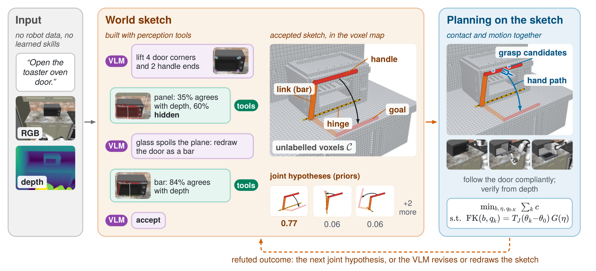
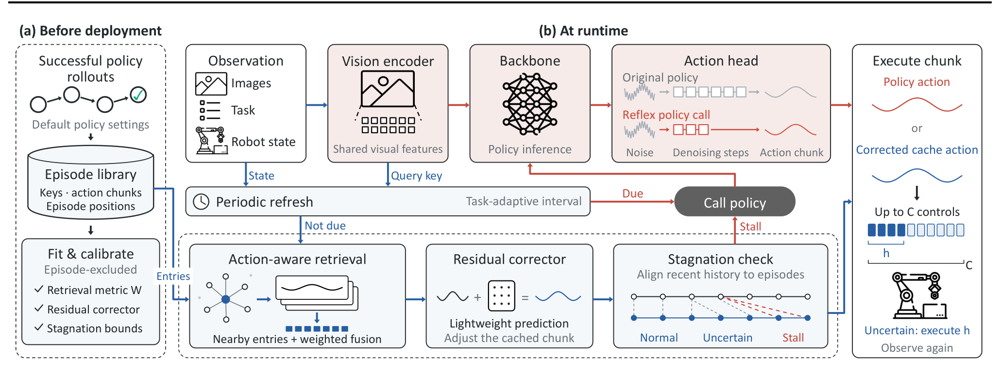
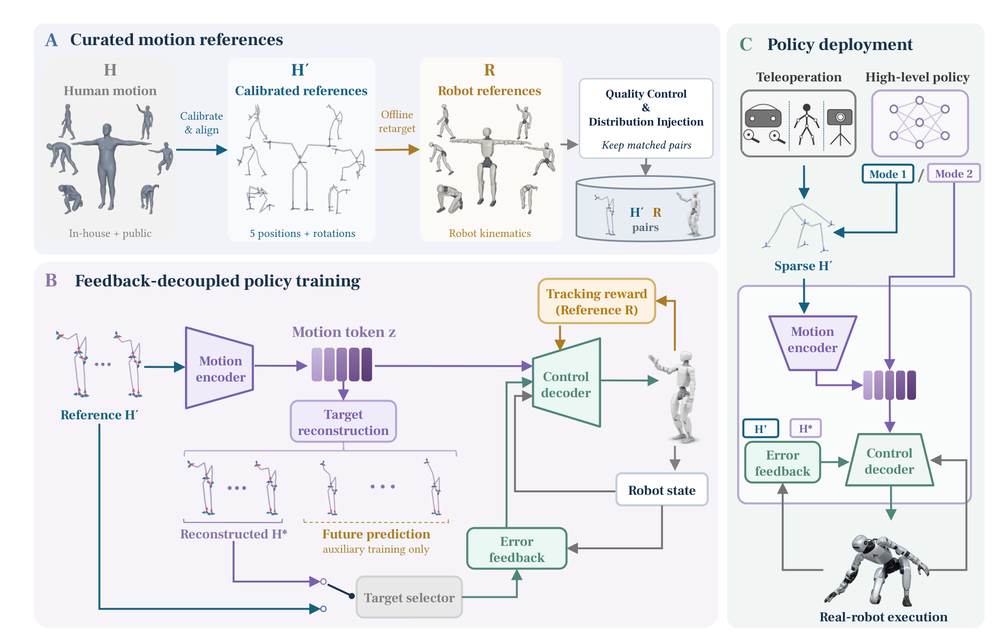

# Embodied AI & World Models News

> 具身智能与世界模型每日研究动态与论文精读。

**最新一期：2026-11-02** ｜ [日报原文](news/2026-11-02.md) · [精读索引](paper-reading/news/2026-11-02/README.md) · [历史归档](#历史归档)

---

<!-- 本段由 codex-deployment/update_readme.py 从 news/2026-11-02.md 自动镜像，请勿手工编辑 -->

## 2026-11-02 Embodied AI & World Models Daily

> 面向具身智能 / Robotics 研究员与工程师的研究与工程资讯。
>
> **来源检查不完整。** 主窗口为北京时间 11 月 2 日 00:00–23:59，补充窗口为 10 月 31 日至 11 月 1 日。本次访问的 arXiv 官方 recent/new 最新仍为 11 月 2 日公告批次，逐篇核验未覆盖到 11 月 2 日实际提交的新论文；不能据此判断当天没有资讯。以下论文全部明确标注为 10 月 31 日补充窗口，11 月 2 日已核验的新事件为两项工程代码发布。
>
> 本期：1 篇必读、10 篇论文雷达、2 项工程动态；完成 3 篇全文精读和 3 张方法总览图审查。[精读索引](paper-reading/news/2026-11-02/README.md)。分数为同一标准两轮编辑评分的平均值，不代表独立复现。

### 🔥 今日必读

#### 1. 【最小世界模型】WorldSketch：让 VLM 建模，把动作交给几何规划器

**来源：** [arXiv:2611.00513v1](https://arxiv.org/abs/2611.00513)（cs.RO；Jiaming Wang）  
**类型：** Paper / research_paper  
**发布时间：** 2026-10-31 09:06:20 北京时间（实际首次提交；补充窗口）  
**评分：** 86.5/100（87 / 86）  
**关键词：** Agentic Robotics · Kinematic World Model · Mobile Manipulation

**一句话：** VLM 不直接生成关节动作，而是主动请求测量，构建任务相关的物体、关节与目标草图；规划器在草图上联合优化接触和全身运动，执行反馈再反驳或修订草图。

*原图 2：从深度检查草图到联合接触规划，再将执行结果反馈给建模。*

**技术要点：**

- 世界表示由无标签碰撞体素、任务实体和目标组成。尺寸由深度测量提供；多个关节机制假设随执行更新，避免让语言模型凭空估计精确几何。
- RoboCasa365 的 30 个原子任务、90 集中成功 82/90；对照 CaP-Agent0 为 30/90，每集输入词元约 88k 对 872k。但全部实验都在仿真中，WorldSketch 每集 7.1 分钟，比约一分钟的训练策略慢。
- LIBERO-PRO 抽取的 150 集中成功 146/150，作者自己的编码代理为 147/150，不能概括成所有编码代理都明显落后。导航达到约 76% 成功率，但路径效率弱于一个逐步代理对照。
- 一厘米深度噪声下早期版本回放显著退化；当前只支持刚体单关节，真实感知、接触与新机制仍待验证。

**为什么值得关注：** 最有价值的是可被测量和执行检验的中间接口。模型负责语义与机制假设，几何后端负责精确约束；这为诊断错误来自“看错世界”还是“执行失败”提供了清晰分界。

**资源：** [论文与 PDF 入口](https://arxiv.org/abs/2611.00513) · [全文精读](paper-reading/news/2026-11-02/worldsketch/worldsketch.md)。本次未找到可确认的独立官方代码、权重发布入口。

### 📄 论文雷达

以下 10 篇均为 **2026-10-31 实际首次提交，属于补充窗口**；按双评分平均分排序，最高两篇已完成精读。除标注全文复核的两篇外，技术概述基于核验后的官方摘要，未经独立复现。

#### 【策略服务】Reflex：复用完整动作块，而不只缓存去噪状态

**来源 / Paper：** [arXiv:2611.00524v1](https://arxiv.org/abs/2611.00524)  
**首次提交：** 2026-10-31 09:28:56 北京时间  
**关键词：** Action Cache · Serving · Residual Correction  
**值得关注程度：** 85.5/100（86 / 85；全文已复核）

**核心贡献：** 用策略自身视觉特征和动作感知距离检索、融合历史动作块，再做残差修正与进度停滞检查。默认设置摊销推理加速 1.4–11 倍，平均 3.3 倍；命中时仍运行视觉编码。SO-101 两任务为 172/200 对 174/200 成功、21.8 对 66.5 ms 决策时延；并发吞吐测试为记录请求回放，不能当作百台真机验证。

*原图 4：缓存路径与必要的原策略刷新共同控制执行漂移。*

[全文精读](paper-reading/news/2026-11-02/reflex/reflex.md)。本次未确认独立官方代码仓库；论文使用 openpi 不代表 openpi 就是 Reflex 实现。

#### 【全身控制】Anchor 1：稀疏参考保留意图，解耦反馈修正误差

**来源 / Paper：** [arXiv:2611.00193v1](https://arxiv.org/abs/2611.00193)  
**首次提交：** 2026-10-31 01:56:53 北京时间（项目页标为 10 月 30 日，未提供可换算时区）  
**关键词：** Humanoid · Sparse Reference · Error Feedback  
**值得关注程度：** 85/100（86 / 84；全文已复核）

**核心贡献：** 校准骨盆、双腕和双踝五姿态，配合离线重定向和数据筛选学习全身协调，再把显式误差送入控制解码器。内部集仿真全局 SR 88.7%，公开集降至 54.2%；真机两组腕全局误差为 44.58 和 75.69 mm。在线无需重定向、60 ms 前瞻具有工程价值，但训练仍使用离线重定向，跟踪准确也不保证抓握与接触稳定。

*原图 10：稀疏姿态与动作词元共用控制器，显式误差走独立反馈支路。*

[全文精读](paper-reading/news/2026-11-02/anchor/anchor.md) · [作者项目页](https://archon.tech/research/anchor1)。项目页写明模型及部署、遥操作资源预计 2026 年晚些时候发布，本次不记作已开放权重。

#### 【动作相关表示】CausalWAM：将动作相关潜变量与干扰因素分开

**来源 / Paper：** [arXiv:2610.42096v1](https://arxiv.org/abs/2610.42096)  
**关键词：** World-Action Model · Sparse Action Routing · Identifiability  
**值得关注程度：** 81.5/100（81 / 82）

**核心贡献：** 用稀疏动作路由分离可被动作影响的表示与干扰表示，同时保留世界预测。其可辨识性结论依赖论文建模与稀疏性假设，并只到可逆变换和置换意义；不能直接读成真实机器人环境中的因果结构已被完整恢复。摘要给出合成和真实数据实验，本期不补造未核验的增益数字。

#### 【冻结策略改进】RoboArchitect：让编码模型修改策略外壳

**来源 / Paper：** [arXiv:2610.42141v1](https://arxiv.org/abs/2610.42141)  
**关键词：** Policy Harness · Persistent Memory · Test-Time Adaptation  
**值得关注程度：** 81/100（82 / 80）

**核心贡献：** 从 rollout 诊断错误，迭代修改冻结策略外围的代码与持久记忆，在任务级优化后测试留出场景和任务。摘要报告未见场景成功率 9.7%→43.3%、未见任务 12.7%→40.2%。应区分外壳优化的试错预算与测试表现；不更新策略权重不等于无需额外计算或经验。

#### 【分层世界模型】ID-WM：高层可达子目标与底层逆动力学配合

**来源 / Paper：** [arXiv:2610.42146v1](https://arxiv.org/abs/2610.42146)  
**关键词：** Hierarchical Planning · Implicit Dynamics · Inverse Dynamics  
**值得关注程度：** 80.5/100（80 / 81）

**核心贡献：** 高层生成可达子目标，底层以世界模型和逆动力学将其落为动作，连接远期规划与局部可执行性。摘要在三个导航、操作评估套件报告相对策略或扩散规划方法提升 38.5%、相对单层 WM-MPC 提升 135%；这些是作者报告的相对增幅，不能写成成功率增加同等百分点。

#### 【接触丰富运动】ROOF：学习人形机器人从狭窄障碍下脱困

**来源 / Paper：** [arXiv:2610.42097v1](https://arxiv.org/abs/2610.42097)  
**关键词：** Humanoid RL · Contact Geometry · Escape  
**值得关注程度：** 80/100（79 / 81）

**核心贡献：** 利用接触支撑几何、逃离指导和运动先验塑造奖励，部署一套仅本体感知策略。摘要的 lift-only 板障碍仿真为 88.5% 对 18.9%，真机 G1 为七种障碍场景中成功 95/150。部署无需外部几何观测，不代表训练不用几何特权信息，也不保证任意障碍可脱困。

#### 【触觉推理】TacMind：用动作条件触觉预测支持反思

**来源 / Paper：** [arXiv:2611.00455v1](https://arxiv.org/abs/2611.00455)  
**关键词：** Tactile Reasoning · Predictive Reflection · Benchmark  
**值得关注程度：** 79.5/100（80 / 79）

**核心贡献：** 在 128 个精细控制、识别与动态任务中，以触觉历史预测动作条件潜表示，并通过预测性反思修正候选动作。评测含静态、动态变体和 12 种扰动，有助于检查模型是否真正利用接触信息。本期仅核验摘要，不把仿真基准表现外推为真实触觉迁移。

#### 【记忆修复】SPARK：触发定向重观察，而不是无限追加场景记忆

**来源 / Paper：** [arXiv:2611.00344v1](https://arxiv.org/abs/2611.00344)  
**关键词：** Embodied QA · Semantic Memory · Active Re-observation  
**值得关注程度：** 77.5/100（78 / 77）

**核心贡献：** 语义评判器识别知识库问题，触发物理重观察，再选择新增、替换或删除条目。摘要在四张 AirSim 室外地图、两类退化视角和 158 个固定问题上报告收益，存储对象少 13%–41%。评估使用可见性 oracle，且本期未核验真机证据；重点是记忆纠错协议而非普遍问答能力。

#### 【评测诊断】Validation Loss：低验证误差何时不能预测真机成功

**来源 / Paper：** [arXiv:2611.00283v1](https://arxiv.org/abs/2611.00283)  
**关键词：** Offline Validation · Robot Learning · Failure Analysis  
**值得关注程度：** 77.5/100（76 / 79）

**核心贡献：** 在 SO-101 单一抓放任务中比较多种策略、82 个检查点和 930 次真机 rollout，发现同策略、跨随机种子和跨策略的验证损失关系不同。一个低留出误差设置仅成功 3/110。该结果提示分别检查停滞、不动作和动作误差，不能直接推出所有离线验证指标都无价值。

#### 【策略可解释性】BehaviorGraphs：用行为模式和时序关系定位故障

**来源 / Paper：** [arXiv:2611.00405v1](https://arxiv.org/abs/2611.00405)  
**关键词：** Policy Diagnosis · Temporal Graph · Human Study  
**值得关注程度：** 76.5/100（77 / 76）

**核心贡献：** 无监督聚类行为模式，再构建关联结果的时序图，帮助开发者检查策略执行。三个真实任务用户研究中 16/18 人偏好该表示，报告感知时间与负担下降；这些属于主观测量，不能当作实际调试耗时减少。数据集上的进度估计改善也不自动意味着策略成功率提升。

### 🛠 工程与开源

#### Retrieve-then-Steer：旧论文新增可检查的实现与评测配置

**来源：** [项目仓库](https://github.com/ZJC25127/Retrieve-then-Steer) · [发布实现的提交](https://github.com/ZJC25127/Retrieve-then-Steer/commit/5d5e3915) · [对应旧论文](https://arxiv.org/abs/2605.10094)  
**类型 / 评分：** open_source；75.5/100（77 / 74）  
**事件时间：** 实现发布提交 2026-11-02 17:35:16 北京时间；仓库创建于同日 17:27:38。

该仓库 README 自述为官方实现，作者名单与论文元数据一致；本次未额外交叉确认账号归属，按 T2 来源门槛处理（75.5 ≥ 75）。冻结 VLA 的成功前缀进入在线记忆，视觉检索与 DTW 过滤形成动作先验，再引导流匹配采样。与 Reflex 直接绕过策略主干不同，这里仍由原 VLA 细化动作，是适合对照的经验复用路线。仓库可见 π0.5 / LIBERO-10 的 baseline、memory+DTW 与 VLAC 评测入口、配置和运行结果；本次核验 README 与目录，未运行复现。Linux、GPU、CUDA、EGL 及独立的策略、仿真与 critic 环境是实际接入成本，模型检查点需另下。此项是**代码发布**，不将旧论文重新算作新投稿，也不单列同一事件中的图文和配置。

#### DWARL：从 MuJoCo 训练到 Nav2 的局部控制器流程

**来源：** [Nobleo Technology 仓库](https://github.com/nobleo/dwarl) · [初始实现提交](https://github.com/nobleo/dwarl/commit/52f99cef) · [官方文档](https://nobleo.github.io/dwarl/)  
**类型 / 评分：** engineering_tech；72/100（73 / 71）  
**事件时间：** 初始实现提交 2026-11-02 19:59:17 北京时间；仓库创建于同日 19:52:53。

把差分驱动机器人的 RL 局部规划训练、MuJoCo/Gazebo 检查点评测及 ONNX 部署串成流程，仓库可见 ROS 2 Nav2 控制器插件和测试。它替换局部控制器，用户仍需提供机器人描述、传感器、驱动和定位；支持环境为 Linux x86-64。README 明确项目处于实验阶段，**不附带可直接用于高质量导航的预训练策略**，smoke 只检验流程。值得关注的是机器人配置与检查点兼容性流程，不将初始化仓库视为经过真机性能验证。

### 💬 社区信号

本次没有核验到同时满足时间、技术细节和来源门槛的独立社区条目。HN 的定量检索样本中，`robots.txt` 属于网络爬虫协议；关于机器人自主性的旧文章再讨论、产品新闻及次日北京时间发布的条目也未收录。X / Reddit 未获得完整覆盖，因此这里不能解释成当天没有技术讨论。

### 🔎 补充窗口筛选记录

主窗口未核验到实际首次提交在 11 月 2 日的论文，原因是官方列表公告覆盖不足。33 条实际提交在补充窗口的候选中，29 条 PASS、4 条 BLOCK；PASS 均进行双评分，最终保留 11 篇，其余按门槛、排序或主题范围排除。下表时间均来自官方摘要页 v1 提交记录，并换算为北京时间；公告日期和编号月份不用于决定窗口。

| 论文 | v1 北京时间 | 预筛 / 两轮分数 → 平均 | 结果与原因 |
|---|---|---|---|
| [Sensorium: An Open-Source Multimodal Data Collection and Curation Library for Embodied Surgical AI](https://arxiv.org/abs/2610.41946) | 2026-10-31 00:04:23 | PASS / 68、64 → 66 | 通过相关性门槛但本期排序靠后或范围较窄；不以数量要求收录 |
| [Language-Conditioned Behavioral Cloning for Autonomous Endoscope Guidance](https://arxiv.org/abs/2610.41978) | 2026-10-31 00:27:24 | PASS / 62、61 → 61.5 | 双评分低于T1入选门槛62 |
| [Design and Validation of a Robotic Knee Exoskeleton with Musculoskeletal Simulation-Derived Biological Torque Control](https://arxiv.org/abs/2610.41981) | 2026-10-31 00:29:07 | PASS / 54、52 → 53 | 双评分低于T1入选门槛62 |
| [Suspended-Fabric Robotic Manipulation Surfaces: Modelling, Design Space, and Multimodular Extensio](https://arxiv.org/abs/2610.41982) | 2026-10-31 00:31:16 | PASS / 50、48 → 49 | 双评分低于T1入选门槛62 |
| [Nexus-VLA: Bridging Human and Robot Experiences via a Shared Hierarchical Semantic Latent Space](https://arxiv.org/abs/2610.42021) | 2026-10-31 00:53:26 | PASS / 70、67 → 68.5 | 通过相关性门槛但本期排序靠后或范围较窄；不以数量要求收录 |
| [GhostPrefix: Synchronization-Free Universal Prefix Attacks for ASR Manipulation](https://arxiv.org/abs/2610.42026) | 2026-10-31 00:55:28 | BLOCK | 语音攻击工作，不以机器人决策/控制为落点 |
| [Proof-Carrying Evolution: Black-Box Search, White-Box Flight](https://arxiv.org/abs/2610.42043) | 2026-10-31 01:06:12 | PASS / 60、57 → 58.5 | 双评分低于T1入选门槛62 |
| [A Hybrid Path Planning Framework for Assistive Wheelchair Navigation in Dynamic Pedestrian Environments](https://arxiv.org/abs/2610.42049) | 2026-10-31 01:16:59 | BLOCK | 普通轮椅路径规划，未见足够具身学习或通用方法贡献 |
| [REA: A Routed Embodied Agent Runtime for Asynchronous Brain-Cerebellum Control](https://arxiv.org/abs/2610.42053) | 2026-10-31 01:18:13 | PASS / 62、60 → 61 | 双评分低于T1入选门槛62 |
| [CausalWAM: Learning the Causes of Actions in World Action Models](https://arxiv.org/abs/2610.42096) | 2026-10-31 01:40:00 | PASS / 81、82 → 81.5 | 论文雷达 |
| [ROOF: Learning Humanoid Fall Recovery under Overhead Constraints](https://arxiv.org/abs/2610.42097) | 2026-10-31 01:41:32 | PASS / 79、81 → 80 | 论文雷达 |
| [Anchor 1: Precise and Stable Humanoid Control for Whole-Body Manipulation](https://arxiv.org/abs/2611.00193) | 2026-10-31 01:56:53 | PASS / 86、84 → 85 | 雷达最高两篇，已全文精读 |
| [RoboArchitect: Automating the Design of Robotic Agents with Persistent Memory](https://arxiv.org/abs/2610.42141) | 2026-10-31 01:58:48 | PASS / 82、80 → 81 | 论文雷达 |
| [Hierarchical World Models with Implicit Dynamics](https://arxiv.org/abs/2610.42146) | 2026-10-31 01:59:25 | PASS / 80、81 → 80.5 | 论文雷达 |
| [Spectral and Conformal: Neural Network Methods for Calibrated Trajectory Prediction and Control-Point Intervals](https://arxiv.org/abs/2611.00231) | 2026-10-31 02:12:26 | PASS / 64、61 → 62.5 | 通过相关性门槛但本期排序靠后或范围较窄；不以数量要求收录 |
| [Supervised Autonomous Bimanual Suction and Cauterization for Bleeding Control in Low Grade Splenic Trauma](https://arxiv.org/abs/2611.00237) | 2026-10-31 02:18:29 | PASS / 64、62 → 63 | 通过相关性门槛但本期排序靠后或范围较窄；不以数量要求收录 |
| [Does Validation Loss Predict Real-Robot Success? Evidence from Four Imitation-Learning Policies on a Low-Cost Arm](https://arxiv.org/abs/2611.00283) | 2026-10-31 03:05:01 | PASS / 76、79 → 77.5 | 论文雷达 |
| [Teach, Abstract, Apply: A Framework for Dialogue-Driven Task Learning with Collaborative Robots](https://arxiv.org/abs/2611.00297) | 2026-10-31 03:21:30 | PASS / 66、63 → 64.5 | 通过相关性门槛但本期排序靠后或范围较窄；不以数量要求收录 |
| [Catenary Visibility: A Geometric Framework for Planning with Tethered Robots](https://arxiv.org/abs/2611.00324) | 2026-10-31 03:47:20 | PASS / 56、53 → 54.5 | 双评分低于T1入选门槛62 |
| [SPARK: Self-Correcting Embodied Memory via Physical Re-Observation](https://arxiv.org/abs/2611.00344) | 2026-10-31 04:24:55 | PASS / 78、77 → 77.5 | 论文雷达 |
| [When appearance and motion disagree: evaluating class--motion consistency against disguised uncrewed surface vessels](https://arxiv.org/abs/2611.00367) | 2026-10-31 04:47:42 | BLOCK | 海上防御应用，不符合本期具身学习核心范围 |
| [Emergent Control of Ant Learning Walks in a Mobile Robot](https://arxiv.org/abs/2611.00392) | 2026-10-31 05:16:30 | PASS / 56、54 → 55 | 双评分低于T1入选门槛62 |
| [CalVLA: Shaping Native Confidence in Vision-Language-Action Policies with Outcome Supervision](https://arxiv.org/abs/2611.00394) | 2026-10-31 05:18:15 | PASS / 74、72 → 73 | 通过相关性门槛但本期排序靠后或范围较窄；不以数量要求收录 |
| [Behavior Graphs: Unsupervised Graph Structures for Interpreting Robot Deployment Data](https://arxiv.org/abs/2611.00405) | 2026-10-31 05:51:01 | PASS / 77、76 → 76.5 | 论文雷达 |
| [TacMind: Benchmarking and Modeling Tactile Interaction States for Robotic Manipulation](https://arxiv.org/abs/2611.00455) | 2026-10-31 07:13:52 | PASS / 80、79 → 79.5 | 论文雷达 |
| [A Straight Line Is Not a Camera Pose: Auditing Short-Clip Pose Benchmarks](https://arxiv.org/abs/2611.00482) | 2026-10-31 08:14:11 | PASS / 58、55 → 56.5 | 双评分低于T1入选门槛62 |
| [Knowing Where to Look: Interactive Object Search via Spatial-Semantic Fusion](https://arxiv.org/abs/2611.00499) | 2026-10-31 08:41:39 | PASS / 69、68 → 68.5 | 通过相关性门槛但本期排序靠后或范围较窄；不以数量要求收录 |
| [MESSPa: A Multi-modal Embodiment Stimulation Shoulder Pad for Preserving the Sense of Agency in a Detachable Robotic Arm](https://arxiv.org/abs/2611.00509) | 2026-10-31 08:59:35 | PASS / 64、61 → 62.5 | 通过相关性门槛但本期排序靠后或范围较窄；不以数量要求收录 |
| [WorldSketch: Sketching World Models for Zero-Shot Mobile Manipulation](https://arxiv.org/abs/2611.00513) | 2026-10-31 09:06:20 | PASS / 87、86 → 86.5 | 必读，已全文精读 |
| [Behavioral Steering of Vision-Language-Action Models in the Low-Parameter Regime](https://arxiv.org/abs/2611.00522) | 2026-10-31 09:23:01 | PASS / 63、60 → 61.5 | 双评分低于T1入选门槛62 |
| [Reflex: Fast Robot Policy Serving by Reusing and Correcting Past Actions](https://arxiv.org/abs/2611.00524) | 2026-10-31 09:28:56 | PASS / 86、85 → 85.5 | 雷达最高两篇，已全文精读 |
| [3D Neural Rendering for Automated Ultrasonic Laser Scans](https://arxiv.org/abs/2611.00527) | 2026-10-31 09:32:31 | BLOCK | 超声扫描测量应用，未提供所需机器人决策方法增量 |
| [Faster Imitation by Re-timing Demonstrations Within the Controller Limit](https://arxiv.org/abs/2611.00539) | 2026-10-31 09:52:25 | PASS / 57、55 → 56 | 双评分低于T1入选门槛62 |

展开 121 条窗口外候选的提交时间与排除记录

只按 v1 实际提交时间归属窗口；近期公告、替换版本或媒体再报道不改变首次提交日期。以下均早于 2026-10-31 00:00 北京时间，未作为本期新投稿。

| 候选论文 | v1 北京时间 | 排除原因 |
|---|---|---|
| [Adaptive Coverage Algorithms for Mobile Ad Hoc Networks in Dynamic Worlds](https://arxiv.org/abs/2610.41936) | 2026-10-30 23:57:29 | 首次提交在窗口之外 |
| [Online Learning of Heterogeneous Locomotion Dynamics under Reinforcement Learning Policies for Precise Loco-Manipulation](https://arxiv.org/abs/2610.41892) | 2026-10-30 23:34:35 | 首次提交在窗口之外 |
| [Movens-Zero: Scaling Humanoid Motion Foundation Models with Large-Scale Human Videos](https://arxiv.org/abs/2610.41877) | 2026-10-30 23:25:49 | 首次提交在窗口之外 |
| [Learning to Live: A Step Toward Lifelong Embodied Intelligence](https://arxiv.org/abs/2611.00180) | 2026-10-30 23:23:52 | 首次提交在窗口之外 |
| [META-Robot: Self-Cognition and Capability Scaling in Agentic Robots](https://arxiv.org/abs/2610.41868) | 2026-10-30 23:19:31 | 首次提交在窗口之外 |
| [When the Simulator Fails, Not the Policy: Auditing Contact Artifacts in Simulated Robot Benchmarks](https://arxiv.org/abs/2610.41857) | 2026-10-30 23:13:11 | 首次提交在窗口之外 |
| [SketchMate: Agentic Geometric Reasoning for Zero-Shot Precision Insertion](https://arxiv.org/abs/2610.41844) | 2026-10-30 22:59:43 | 首次提交在窗口之外 |
| [Integrating Low-Thrust Transfer Dynamics into POMDP Planning for On-Orbit Servicing](https://arxiv.org/abs/2610.41839) | 2026-10-30 22:55:29 | 首次提交在窗口之外 |
| [PGGT-Loc: Primitive-Grounded Geometry Transformer for Feed-Forward Camera Localization](https://arxiv.org/abs/2610.41833) | 2026-10-30 22:50:55 | 首次提交在窗口之外 |
| [WorkIng: A Real-World and Synthetic Highway Work-Zone Benchmark Dataset for Autonomous Navigation](https://arxiv.org/abs/2610.41772) | 2026-10-30 22:11:34 | 首次提交在窗口之外 |
| [Visual-Inertial RGB-D SLAM with Encoders for a Differential Wheeled Robot](https://arxiv.org/abs/2610.41768) | 2026-10-30 22:09:58 | 首次提交在窗口之外 |
| [Higher-Order Kinematic Derivatives for Aspect-Preserving Real-Time Numerical Inverse Kinematics](https://arxiv.org/abs/2610.41752) | 2026-10-30 21:55:16 | 首次提交在窗口之外 |
| [When Architectural Spaces Start to Act](https://arxiv.org/abs/2610.41724) | 2026-10-30 21:34:30 | 首次提交在窗口之外 |
| [Flexibility-Aware Robotic Manipulation: Deformation Estimation, Kinematics, and Control via Distributed Inertial Measurement](https://arxiv.org/abs/2610.41702) | 2026-10-30 21:06:54 | 首次提交在窗口之外 |
| [When the Past Shapes Action: Understanding Embodied Memory](https://arxiv.org/abs/2610.41688) | 2026-10-30 20:52:37 | 首次提交在窗口之外 |
| [Biomechanics do not predict perceptual and cognitive consequences of force augmentation](https://arxiv.org/abs/2610.41679) | 2026-10-30 20:47:21 | 首次提交在窗口之外 |
| [Interaction-Aware Sampling-Based Motion Planning for Autonomous Surface Vessels in Urban Waterways](https://arxiv.org/abs/2610.41676) | 2026-10-30 20:44:27 | 首次提交在窗口之外 |
| [OpenVIO: A Versatile Open-Source Visual-Inertial Odometry System](https://arxiv.org/abs/2610.41671) | 2026-10-30 20:40:10 | 首次提交在窗口之外 |
| [GPU-accelerated Incremental Euclidean Distance Transform for Online Motion Planning of Mobile Robots](https://arxiv.org/abs/2610.41667) | 2026-10-30 20:35:49 | 首次提交在窗口之外 |
| [ResMerge: Residual Policy Learning and Merging for Continual Adaptation of Pre-trained Robot Policies](https://arxiv.org/abs/2610.41663) | 2026-10-30 20:33:47 | 首次提交在窗口之外 |
| [$\nabla$Mimic: Ultra-Efficient Humanoid Control with Differentiable Simulation](https://arxiv.org/abs/2610.41654) | 2026-10-30 20:27:45 | 首次提交在窗口之外 |
| [Direct Action-Manifold Modeling for Efficient and Robust Bimanual Manipulation](https://arxiv.org/abs/2610.41643) | 2026-10-30 20:17:46 | 首次提交在窗口之外 |
| [RTPolicy: Real-Time (32.9 Hz) Multi-View Visuomotor Policy for Robotic Manipulation on Edge Devices](https://arxiv.org/abs/2610.41625) | 2026-10-30 20:01:49 | 首次提交在窗口之外 |
| [VLA Policies Do Not Know When Not to Act: Unintended Task Execution and Start Suppression](https://arxiv.org/abs/2610.41609) | 2026-10-30 19:45:50 | 首次提交在窗口之外 |
| [DrawSplat: Atlanta World-Guided Implicit Gaussian SLAM for Indoor Reconstruction](https://arxiv.org/abs/2610.41602) | 2026-10-30 19:35:14 | 首次提交在窗口之外 |
| [A complete analytical characterization of optimal collision-free motion for two robots](https://arxiv.org/abs/2610.41558) | 2026-10-30 18:53:31 | 首次提交在窗口之外 |
| [Contact-based optimization for collision-free motion planning for a million robots](https://arxiv.org/abs/2610.41548) | 2026-10-30 18:46:26 | 首次提交在窗口之外 |
| [FOCUS: First-Order Control Using Optimal Transport Supervision for Imitation from Observations](https://arxiv.org/abs/2610.41540) | 2026-10-30 18:37:43 | 首次提交在窗口之外 |
| [AC-SMPC: Differentiable Actor--Critic MPC with State Constraints for Safe and Fast Robot Navigation](https://arxiv.org/abs/2610.41477) | 2026-10-30 17:28:23 | 首次提交在窗口之外 |
| [SAFARI: Semantic- And Frontier-driven Autonomous Risk Inspection](https://arxiv.org/abs/2610.41456) | 2026-10-30 17:01:50 | 首次提交在窗口之外 |
| [Beyond Trial-and-Error: A Geospatial-Guided Active Reasoning Framework for Robust Aerial Vision-and-Language Navigation](https://arxiv.org/abs/2610.41446) | 2026-10-30 16:50:07 | 首次提交在窗口之外 |
| [Scaling Trusted Autonomy: Towards Generally Capable Verifiable Robots](https://arxiv.org/abs/2611.00158) | 2026-10-30 16:49:42 | 首次提交在窗口之外 |
| [Physically Constrained Kinematic Calibration for High-Precision Robotic Needle Guidance](https://arxiv.org/abs/2610.41429) | 2026-10-30 16:35:37 | 首次提交在窗口之外 |
| [SACQ: Structure-Aware Codebook Quantization for Ultra-Low-Bit Vision-Language-Action Models](https://arxiv.org/abs/2610.41408) | 2026-10-30 16:19:50 | 首次提交在窗口之外 |
| [From Concepts to Actual Causes: Toward Closing the Concept-Malfunction Gap in Robot Foundation Models](https://arxiv.org/abs/2611.00155) | 2026-10-30 15:57:06 | 首次提交在窗口之外 |
| [BioAgent: Self-Directed Skill Acquisition and Capability Growth for Long-Horizon Laboratory Protocols](https://arxiv.org/abs/2610.41383) | 2026-10-30 15:47:08 | 首次提交在窗口之外 |
| [MolmoSpaces-CommonSense: Evaluating Commonsense in Robotic Manipulation Policies](https://arxiv.org/abs/2610.41377) | 2026-10-30 15:42:42 | 首次提交在窗口之外 |
| [DiffWBC: Unlocking Steerable General Humanoid Motion Tracking via One-Step Diffusion Whole-Body Control](https://arxiv.org/abs/2610.41354) | 2026-10-30 15:16:01 | 首次提交在窗口之外 |
| [CalibSwitch: Observation-Driven Camera-LiDAR Extrinsic Recovery and Selective Maintenance for Multimodal Perception](https://arxiv.org/abs/2610.41352) | 2026-10-30 15:14:52 | 首次提交在窗口之外 |
| [Geometry-Aware Humanoid Retargeting via Manifold ODEs](https://arxiv.org/abs/2610.41349) | 2026-10-30 15:06:57 | 首次提交在窗口之外 |
| [Joint-Health-Aware Reinforcement Learning for Robust Robot Control Under Actuator Degradation](https://arxiv.org/abs/2610.41348) | 2026-10-30 15:05:58 | 首次提交在窗口之外 |
| [HandMimicX: Learning Human-Like Dexterous Manipulation via an Object-Centric Policy from Egocentric Videos](https://arxiv.org/abs/2610.41336) | 2026-10-30 14:51:27 | 首次提交在窗口之外 |
| [HIPC: Humanoid Iterative Planning and Control via Goal-Conditioned Motion Closure](https://arxiv.org/abs/2610.41334) | 2026-10-30 14:48:20 | 首次提交在窗口之外 |
| [Cross-Embodiment Motion Planning by Coupling Body-Agnostic World Model with Differentiable Ego-Dynamics](https://arxiv.org/abs/2610.41330) | 2026-10-30 14:45:17 | 首次提交在窗口之外 |
| [Learning from Physical Experience:Context-Space Adaptation for Robotic Manipulation](https://arxiv.org/abs/2610.41320) | 2026-10-30 14:32:51 | 首次提交在窗口之外 |
| [TRACE: Target-State Risk-Aligned Conditional Execution for Embodied Tracking](https://arxiv.org/abs/2610.41275) | 2026-10-30 13:26:41 | 首次提交在窗口之外 |
| [SPT-Flow: One Integration, Many Futures in Continuous-Time World Models](https://arxiv.org/abs/2610.41273) | 2026-10-30 13:26:15 | 首次提交在窗口之外 |
| [CONSORT: Uncertainty-Constrained Multi-Robot Planning for Cooperative Localization in GPS-Denied Environments](https://arxiv.org/abs/2610.41235) | 2026-10-30 12:18:51 | 首次提交在窗口之外 |
| [TinyAstral: Transferring Self-Evolving Harnesses to Tiny Generalist Manipulation Agents](https://arxiv.org/abs/2610.41216) | 2026-10-30 11:53:42 | 首次提交在窗口之外 |
| [Capability-Conditioned Graph Control Barrier Functions for Zero-Shot Safe Navigation of Heterogeneous Mobile Robot Teams](https://arxiv.org/abs/2610.41214) | 2026-10-30 11:52:02 | 首次提交在窗口之外 |
| [FlowMoDE: Coarse-to-fine Flow Matching for Detail-aware Sim-to-Real Monocular Depth Estimation](https://arxiv.org/abs/2610.41190) | 2026-10-30 11:13:53 | 首次提交在窗口之外 |
| [A Capability-Aware Backup-Recoverability Filter for Heterogeneous Multi-Robot Navigation](https://arxiv.org/abs/2610.41188) | 2026-10-30 11:11:02 | 首次提交在窗口之外 |
| [Mechanistic Interpretability for End-to-End Self-Driving](https://arxiv.org/abs/2610.41185) | 2026-10-30 11:05:24 | 首次提交在窗口之外 |
| [One Verdict Is Not Enough: Regression Testing Learned World Models and Their Test Harnesses](https://arxiv.org/abs/2610.41130) | 2026-10-30 09:36:37 | 首次提交在窗口之外 |
| [MotorSense: A Video-EMG Dataset of Motoric Representations for Action Understanding](https://arxiv.org/abs/2610.41127) | 2026-10-30 09:32:19 | 首次提交在窗口之外 |
| [Veloxity: Towards Memory-Safe UAV Embedded Firmware using the Rust Programming Language](https://arxiv.org/abs/2610.41053) | 2026-10-30 06:51:34 | 首次提交在窗口之外 |
| [Consensus Within, Competition Between: Decentralized LLM Teams for Perimeter Defense](https://arxiv.org/abs/2610.41044) | 2026-10-30 06:34:13 | 首次提交在窗口之外 |
| [Before We Adapt: The Zero-Shot Generalization Bottleneck in Continual World Models](https://arxiv.org/abs/2610.41041) | 2026-10-30 06:32:09 | 首次提交在窗口之外 |
| [Dreams Are Cheaper Than Flights: Curated World-Model Data Improves Aerial Detection](https://arxiv.org/abs/2610.41030) | 2026-10-30 06:17:32 | 首次提交在窗口之外 |
| [Contact Imitation Interface: Transferring Dexterous Skills by Showing How Contact Unfolds](https://arxiv.org/abs/2610.41028) | 2026-10-30 06:14:31 | 首次提交在窗口之外 |
| [Density-Guided Bootstrap Boundaries for Latent World-Model Reinforcement Learning](https://arxiv.org/abs/2610.41022) | 2026-10-30 06:05:09 | 首次提交在窗口之外 |
| [CuPIQP: A Batched and Differentiable QP Solver on GPUs for Robot Learning and Control](https://arxiv.org/abs/2610.41021) | 2026-10-30 06:04:05 | 首次提交在窗口之外 |
| [STAR: Steering Action Representations during Inference](https://arxiv.org/abs/2610.41009) | 2026-10-30 05:42:17 | 首次提交在窗口之外 |
| [Let LiDAR Decide Where to Look: Geometry-Measured Token Selection for Efficient Sparse Latent World Models](https://arxiv.org/abs/2610.40935) | 2026-10-30 04:11:34 | 首次提交在窗口之外 |
| [Agentic World Modeling for Agent Test-time Scaling without Environment Replica](https://arxiv.org/abs/2610.40927) | 2026-10-30 03:55:18 | 首次提交在窗口之外 |
| [Confidence-Modulated Safety Filtering for End-to-End Policies](https://arxiv.org/abs/2610.40922) | 2026-10-30 03:48:12 | 首次提交在窗口之外 |
| [Robot Navigation and Canine Welfare: A Pilot Study Surfacing Challenges for Cross-Species Legibility and Proxy Validity in Animal-Machine Interaction](https://arxiv.org/abs/2610.40921) | 2026-10-30 03:47:29 | 首次提交在窗口之外 |
| [FlapSim: A Composable MuJoCo Simulation Platform and Reduced-Order Aerodynamic Model Hierarchy for Flapping-Wing Robotics](https://arxiv.org/abs/2610.40902) | 2026-10-30 03:25:20 | 首次提交在窗口之外 |
| [AquaProbe: Efficient Adaptation of Frozen Vision Models for Underwater Images](https://arxiv.org/abs/2610.40900) | 2026-10-30 03:22:03 | 首次提交在窗口之外 |
| [Frozen in Time: How a Physics Foundation Model Forgets Under Sim-to-Real Adaptation](https://arxiv.org/abs/2610.40857) | 2026-10-30 02:36:42 | 首次提交在窗口之外 |
| [How a group that cannot communicate knows itself by its enemy](https://arxiv.org/abs/2610.40835) | 2026-10-30 02:15:13 | 首次提交在窗口之外 |
| [Spatial Atlas-Informed Loss Ensembles for Whole-Body PSMA PET/CT Metastasis Segmentation](https://arxiv.org/abs/2610.40834) | 2026-10-30 02:14:49 | 首次提交在窗口之外 |
| [From Teleoperation to Long-Horizon Dexterity: Evaluating Visuomotor Skills and Offline Proxies for Dexterous Manipulation](https://arxiv.org/abs/2610.40828) | 2026-10-30 02:07:37 | 首次提交在窗口之外 |
| [CaPtain: A Pipeline for Post-Training Code-as-Policy Robot Agents](https://arxiv.org/abs/2610.40799) | 2026-10-30 02:01:07 | 首次提交在窗口之外 |
| [Beyond Plausible Prediction: Safety Sufficiency in Web World Models](https://arxiv.org/abs/2610.40798) | 2026-10-30 02:00:55 | 首次提交在窗口之外 |
| [Algebraic World Model: From Exploration to Proofs](https://arxiv.org/abs/2610.40503) | 2026-10-30 01:20:31 | 首次提交在窗口之外 |
| [WorldBridge: Bridging Video and Action for Task Generalization in World Action Models](https://arxiv.org/abs/2610.40748) | 2026-10-30 00:00:06 | 首次提交在窗口之外 |
| [MUSBRIC: LEGO-Compatible Pneumatic Muscle Bricks for Reconfigurable Musculoskeletal Robots](https://arxiv.org/abs/2610.40285) | 2026-10-29 23:36:22 | 首次提交在窗口之外 |
| [LOGIV: Graph-Verified Execution with Causal Local Repair for Long-Horizon Robot Tasks](https://arxiv.org/abs/2610.40016) | 2026-10-29 21:30:16 | 首次提交在窗口之外 |
| [GROME: GROunding Factorized MEmory into Video World Models](https://arxiv.org/abs/2610.39812) | 2026-10-29 18:54:32 | 首次提交在窗口之外 |
| [OpenFlyV2: An onboard vision-language-action model for aerial perception and navigation](https://arxiv.org/abs/2610.39287) | 2026-10-29 11:35:30 | 首次提交在窗口之外 |
| [Seeing and Imagining as One: Unified Video Generation and 4D Perception for Embodied World Modeling](https://arxiv.org/abs/2610.39232) | 2026-10-29 10:50:17 | 首次提交在窗口之外 |
| [Actuator-Aware Observer Inputs for Cascade ADRC of Quadrotors Under Rotor Lag, Measurement Delay and Sensor Noise](https://arxiv.org/abs/2610.39126) | 2026-10-29 09:17:55 | 首次提交在窗口之外 |
| [SimRetract: Zero-Shot Sim-to-Real Robotic Assistance for Retractor Take-Over in Open Surgery](https://arxiv.org/abs/2610.38234) | 2026-10-28 11:36:24 | 首次提交在窗口之外 |
| [PDRVLA: A Vision-Language-Action Model with Physical Dynamics Representations](https://arxiv.org/abs/2610.37381) | 2026-10-27 23:09:10 | 首次提交在窗口之外 |
| [When Is a Relation Worth Trusting? Manipulation Costs, Exposure, and the Trust Trap in Multi-Relational Graph Learning](https://arxiv.org/abs/2610.37239) | 2026-10-27 21:43:56 | 首次提交在窗口之外 |
| [MOON: Learning When to Forget and How to Move On in Vision-and-Language Navigation](https://arxiv.org/abs/2610.33546) | 2026-10-24 16:50:29 | 首次提交在窗口之外 |
| [Dispersive Tree Agreements for Multi-Robot Coordination](https://arxiv.org/abs/2610.31540) | 2026-10-23 00:48:09 | 首次提交在窗口之外 |
| [Do Earth-Trained Humanoid Controllers Walk on the Moon? Gravity, Terrain, and Soil Transfer](https://arxiv.org/abs/2610.30080) | 2026-10-22 01:28:57 | 首次提交在窗口之外 |
| [Learning Goal-Conditioned Subgoals through Frozen Hierarchical World Models](https://arxiv.org/abs/2610.26179) | 2026-10-19 19:13:02 | 首次提交在窗口之外 |
| [Learning from Fleet Experience: Collective Experience Learning Across 96 Robots](https://arxiv.org/abs/2610.25736) | 2026-10-19 11:41:27 | 首次提交在窗口之外 |
| [From Prediction to Action: Population Health World Model for Digital Medicine](https://arxiv.org/abs/2610.24662) | 2026-10-17 20:34:53 | 首次提交在窗口之外 |
| [Self-Building Labs](https://arxiv.org/abs/2610.23826) | 2026-10-17 01:48:29 | 首次提交在窗口之外 |
| [TacClaw-Infinity: A Large-Scale Vision-Tactile-Language-Action Dataset for Dexterous Manipulation](https://arxiv.org/abs/2610.20320) | 2026-10-14 23:06:53 | 首次提交在窗口之外 |
| [I3L: Iterative Interactive Imitation Learning for Whole-Body Mobile Manipulation](https://arxiv.org/abs/2610.17748) | 2026-10-13 13:28:59 | 首次提交在窗口之外 |
| [Detect and Suppress: A Mechanistic Defense against Adversarial Patches in VLA Models](https://arxiv.org/abs/2610.03498) | 2026-10-02 23:57:04 | 首次提交在窗口之外 |
| [FORCE: Factorized Object Relations for Counterfactual Editing in Video World Models](https://arxiv.org/abs/2611.00023) | 2026-10-02 10:52:17 | 首次提交在窗口之外 |
| [Denoising Multirobot Trajectories](https://arxiv.org/abs/2609.35651) | 2026-09-29 01:18:58 | 首次提交在窗口之外 |
| [Compressed delayed-information projection for six-degree-of-freedom underwater vehicle navigation under delayed acoustic positioning](https://arxiv.org/abs/2609.27439) | 2026-09-23 15:02:33 | 首次提交在窗口之外 |
| [Learning and Transferring Closed-Loop Robot Software](https://arxiv.org/abs/2609.19906) | 2026-09-17 16:51:12 | 首次提交在窗口之外 |
| [SV-WAM: An Efficient Surround-View World-Action Model for End-to-End Autonomous Driving](https://arxiv.org/abs/2609.03602) | 2026-09-03 17:47:51 | 首次提交在窗口之外 |
| [Keeping the Franka Emika Panda alive: a ROS 2 stack with a reliable position interface](https://arxiv.org/abs/2608.19740) | 2026-08-20 15:37:48 | 首次提交在窗口之外 |
| [Adaptive-WAM: Quality-Guided Early-Exit Planning from Intermediate Video-Diffusion Features](https://arxiv.org/abs/2608.06008) | 2026-08-06 21:13:07 | 首次提交在窗口之外 |
| [UniCross: Unified Cross-Skill Dexterous Manipulation Synthesis](https://arxiv.org/abs/2607.28198) | 2026-07-30 21:35:45 | 首次提交在窗口之外 |
| [Decompose and Reorganize: Planning with Primitives and Visuomotor Policies Learned from Demonstrations](https://arxiv.org/abs/2607.25397) | 2026-07-28 15:57:09 | 首次提交在窗口之外 |
| [More than a Manipulator: Planning Propellant-Free Attitude Maneuvers for Free-Floating Spacecraft](https://arxiv.org/abs/2607.12130) | 2026-07-14 04:27:09 | 首次提交在窗口之外 |
| [Sequential Planning via Anchored Robotic Keypoints](https://arxiv.org/abs/2606.30613) | 2026-06-30 01:48:01 | 首次提交在窗口之外 |
| [VEGA: Learning Navigation VLAs from In-the-Wild Egocentric Video with Geometric Trajectory Supervision](https://arxiv.org/abs/2606.18426) | 2026-06-17 03:21:14 | 首次提交在窗口之外 |
| [Rapid co-design of Buoyancy-assisted robots for Challenging Locomotion using Gaussian Evolutionary Specialists](https://arxiv.org/abs/2606.07424) | 2026-06-06 00:18:15 | 首次提交在窗口之外 |
| [NDPP-Grasp: Non-Differentiable Physical Plausibility Constraint-Guided Task-Oriented Dexterous Grasp Generation](https://arxiv.org/abs/2606.02432) | 2026-06-02 00:06:14 | 首次提交在窗口之外 |
| [TacO: Benchmarking Tactile Sensors for Object Manipulation](https://arxiv.org/abs/2605.21976) | 2026-05-21 12:11:03 | 首次提交在窗口之外 |
| [Dynamic Control Barrier Function Regulation with Vision-Language Models for Safe, Adaptive, and Realtime Visual Navigation](https://arxiv.org/abs/2603.21142) | 2026-03-22 17:35:18 | 首次提交在窗口之外 |
| [Specification-Aware Distribution Shaping for Robotics Foundation Models](https://arxiv.org/abs/2603.17969) | 2026-03-19 01:36:46 | 首次提交在窗口之外 |
| [FlowTouch: View-Invariant Visuo-Tactile Prediction](https://arxiv.org/abs/2603.08255) | 2026-03-09 19:24:29 | 首次提交在窗口之外 |
| [$\pi$-StepNFT: Wider Space Needs Finer Steps in Online RL for Flow-based VLAs](https://arxiv.org/abs/2603.02083) | 2026-03-03 01:04:49 | 首次提交在窗口之外 |
| [CHOP: Counterfactual Human Preference Labels Improve Obstacle Avoidance in Visuomotor Navigation Policies](https://arxiv.org/abs/2603.02004) | 2026-03-02 23:55:03 | 首次提交在窗口之外 |
| [WildOS: Open-Vocabulary Object Search in the Wild](https://arxiv.org/abs/2602.19308) | 2026-02-23 03:14:00 | 首次提交在窗口之外 |
| [Natural Language Actor-Critic: Scalable Off-Policy Learning in Language Space](https://arxiv.org/abs/2512.04601) | 2025-12-04 17:21:44 | 首次提交在窗口之外 |
| [Reflection-Based Relative Localization for Cooperative UAV Teams Using Active Markers](https://arxiv.org/abs/2511.17166) | 2025-11-21 19:34:08 | 首次提交在窗口之外 |
| [EquiContact: A Hierarchical SE(3) Vision-to-Force Equivariant Policy for Spatially Generalizable Contact-rich Tasks](https://arxiv.org/abs/2507.10961) | 2025-07-15 11:45:26 | 首次提交在窗口之外 |
| [Shared Modular Recurrence in Contextual MDPs for Universal Morphology Control](https://arxiv.org/abs/2506.08630) | 2025-06-10 17:44:30 | 首次提交在窗口之外 |

### 📊 今日技术趋势

本期可验证材料把“经验复用”分成了直接缓存动作与检索后引导生成两条路线，两者应同时评估控制误差、刷新成本和成功率。另一条值得跟进的设计是给大模型与控制器之间增加可检查接口：WorldSketch 用稀疏运动学假设，Anchor 1 用校准姿态和独立纠错。它们的强结果分别受真实深度噪声、缓存分布变化和接触稳定性限制，下一步比较需要把这些边界放到同一套评测协议里。

### 来源覆盖与精读状态

- **arXiv：** 直接抓取 cs.RO、cs.AI、cs.LG、cs.CV 的 official recent、new 及 11 月份列表，并补查 export 入口。recent 条目数分别为 488、1454、1431、914；关键词预筛并去重后逐条核验 154 个候选的标题、作者、摘要与所有版本时间，33 条在补充窗口、121 条在窗口外。11 月份 AI/LG 页明确显示暂无该期更新；recent/new 最新批次仍标为 11 月 2 日，**不能证明已覆盖 11 月 2 日实际投稿**。交叉分类关键词预筛也存在漏检风险。
- **机构：** 访问了 [NVIDIA GEAR](https://research.nvidia.com/labs/gear/)、[Physical Intelligence](https://www.pi.website/blog)、[DeepMind](https://deepmind.google/blog/)、[1X](https://www.1x.tech/discover)、[Figure](https://www.figure.ai/news)、[RAI](https://rai-inst.com/)、[TRI](https://www.tri.global/news)、[Stanford REAL](https://real.stanford.edu/)、[BAIR](https://bair.berkeley.edu/blog/)、[MIT Robotics](https://news.mit.edu/topic/robotics)及机器人厂商页面。仅将网页可访问与日期核验分开记录；GEAR 论文列表的动态内容未完整呈现，Skild 请求超时、CMU 请求遭遇证书吊销检查失败、上海 AI Lab 新闻入口 404，覆盖不完整。
- **会议与生态：** 访问 [CoRL](https://www.corl.org/)、[RSS 论文页](https://roboticsconference.org/2026/program/papers/)、[ICRA](https://2026.ieee-icra.org/)；IROS 入口返回 401，会议逐篇新增情况未取得完整核验。检查 MuJoCo、Genesis、Isaac Lab、LeRobot 发布列表及 NVIDIA / LeRobot 的 Hugging Face 列表；未把 lastModified 当首次发布，LeRobot Cosmos3 条目创建在 10 月 29 日，11 月 2 日修改不足以证明新权重首次开放。
- **工程与去重：** 检查 GitHub 机器人、世界模型、VLA、robot-learning 新建仓库样本，并读取入选仓库的 README、目录树和提交。PRISM-VLA 仅有标题式 README，不记作已完成实现发布。对本期 11 篇及两项工程事件检查 10 月 31 日、11 月 1 日日报，未命中既有条目。未按 Star 或讨论数量排序。
- **精读：** WorldSketch、Reflex、Anchor 1 均完成全文抽取覆盖检查、关键正文与附录复核、300 dpi 裁图和整页视觉审查、Grounding Lint、Final Note Lint 全 8 项、质量与可读性审查以及正式保存、逐文件 SHA 校验。共 3 张方法总览图，0 占位；[逐篇索引与 SHA](paper-reading/news/2026-11-02/README.md)。其他论文为摘要层筛选，没有伪装成已完成全文精读。
- **结论边界：** 本期是带有明确来源缺口的日报；两项工程事件时间已核验，论文来自补充窗口。后续公告可能补出主窗口论文，本次未将未检到或访问失败写成“当天没有资讯”。

---

## 历史归档

| 日期 | 日报 | 精读 |
| --- | --- | --- |
| 2026-11-02 | [日报](news/2026-11-02.md) | [3 篇](paper-reading/news/2026-11-02/README.md) |
| 2026-11-01 | [日报](news/2026-11-01.md) | [4 篇](paper-reading/news/2026-11-01/README.md) |
| 2026-10-31 | [日报](news/2026-10-31.md) | [5 篇](paper-reading/news/2026-10-31/README.md) |
| 2026-10-30 | [日报](news/2026-10-30.md) | [5 篇](paper-reading/news/2026-10-30/README.md) |
| 2026-10-29 | [日报](news/2026-10-29.md) | [4 篇](paper-reading/news/2026-10-29/README.md) |
| 2026-10-28 | [日报](news/2026-10-28.md) | [5 篇](paper-reading/news/2026-10-28/README.md) |
| 2026-10-27 | [日报](news/2026-10-27.md) | [3 篇](paper-reading/news/2026-10-27/README.md) |
| 2026-10-26 | [日报](news/2026-10-26.md) | [3 篇](paper-reading/news/2026-10-26/README.md) |
| 2026-10-25 | [日报](news/2026-10-25.md) | [3 篇](paper-reading/news/2026-10-25/README.md) |
| 2026-10-24 | [日报](news/2026-10-24.md) | [3 篇](paper-reading/news/2026-10-24/README.md) |
| 2026-10-23 | [日报](news/2026-10-23.md) | [4 篇](paper-reading/news/2026-10-23/README.md) |
| 2026-10-22 | [日报](news/2026-10-22.md) | [4 篇](paper-reading/news/2026-10-22/README.md) |
| 2026-10-21 | [日报](news/2026-10-21.md) | [7 篇](paper-reading/news/2026-10-21/README.md) |
| 2026-10-20 | [日报](news/2026-10-20.md) | [4 篇](paper-reading/news/2026-10-20/README.md) |
| 2026-10-19 | [日报](news/2026-10-19.md) | [5 篇](paper-reading/news/2026-10-19/README.md) |
| 2026-10-18 | [日报](news/2026-10-18.md) | — |
| 2026-10-17 | [日报](news/2026-10-17.md) | — |
| 2026-10-16 | [日报](news/2026-10-16.md) | [5 篇](paper-reading/news/2026-10-16/README.md) |
| 2026-10-15 | [日报](news/2026-10-15.md) | [5 篇](paper-reading/news/2026-10-15/README.md) |
| 2026-10-14 | [日报](news/2026-10-14.md) | [5 篇](paper-reading/news/2026-10-14/README.md) |
| 2026-10-13 | [日报](news/2026-10-13.md) | — |
| 2026-10-12 | [日报](news/2026-10-12.md) | [5 篇](paper-reading/news/2026-10-12/README.md) |
| 2026-10-11 | [日报](news/2026-10-11.md) | [6 篇](paper-reading/news/2026-10-11/README.md) |
| 2026-10-10 | [日报](news/2026-10-10.md) | [7 篇](paper-reading/news/2026-10-10/README.md) |
| 2026-10-09 | [日报](news/2026-10-09.md) | [6 篇](paper-reading/news/2026-10-09/README.md) |
| 2026-10-08 | [日报](news/2026-10-08.md) | [6 篇](paper-reading/news/2026-10-08/README.md) |
| 2026-10-07 | [日报](news/2026-10-07.md) | [6 篇](paper-reading/news/2026-10-07/README.md) |
| 2026-10-06 | [日报](news/2026-10-06.md) | [6 篇](paper-reading/news/2026-10-06/README.md) |
| 2026-10-05 | [日报](news/2026-10-05.md) | [6 篇](paper-reading/news/2026-10-05/README.md) |
| 2026-10-04 | [日报](news/2026-10-04.md) | [4 篇](paper-reading/news/2026-10-04/README.md) |
| 2026-10-03 | [日报](news/2026-10-03.md) | [4 篇](paper-reading/news/2026-10-03/README.md) |
| 2026-10-02 | [日报](news/2026-10-02.md) | [7 篇](paper-reading/news/2026-10-02/README.md) |

## 目录结构

| 目录 | 内容 |
| --- | --- |
| `news/YYYY-MM-DD.md` | 每日研究动态日报 |
| `paper-reading/news/YYYY-MM-DD/<短slug>/` | 论文精读笔记（`<短slug>.md` + `images/`） |
| `paper-reading/news/YYYY-MM-DD/README.md` | 当日精读索引 |

## 内容许可

- 本仓库全部文字内容（日报与精读笔记）以 [CC BY 4.0](LICENSE) 授权——转载、改写、商用均可，仅需署名。
- 精读笔记中嵌入的论文插图版权归论文原作者 / 出版社所有（figures © original authors），仅作学术评述之引用；本仓库的 CC BY 4.0 授权不覆盖这些图片。

## 自动化

每天北京时间 08:30，无人值守任务生成前一自然日的日报、对入选论文执行全文精读，并把当日日报镜像到本页后提交推送。arXiv 公告存在批次延迟，部分日期的当日投稿只能部分覆盖，具体缺口写在该期日报的「检索覆盖与精读状态」一节。
