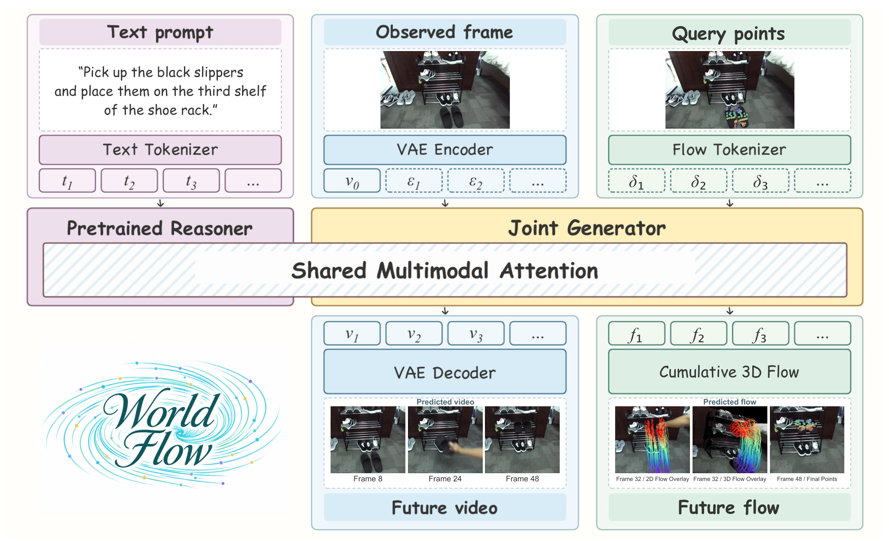
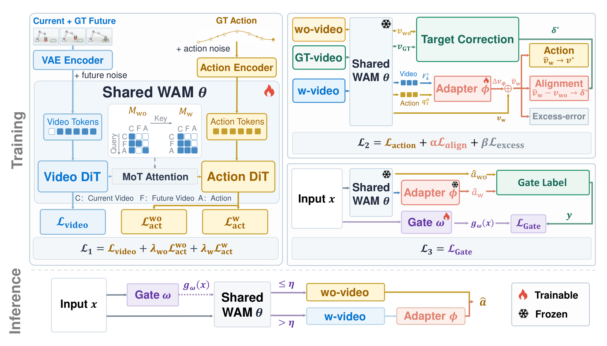
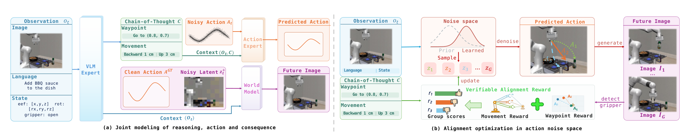
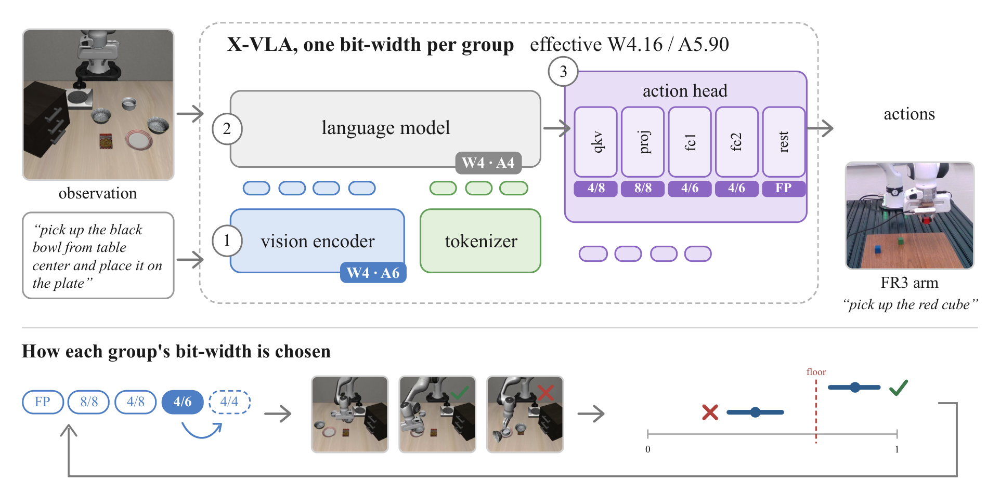

# Embodied AI & World Models News

> 具身智能与世界模型每日研究动态与论文精读。

**最新一期：2026-10-31** ｜ [日报原文](news/2026-10-31.md) · [精读索引](paper-reading/news/2026-10-31/README.md) · [历史归档](#历史归档)

---

<!-- 本段由 codex-deployment/update_readme.py 从 news/2026-10-31.md 自动镜像，请勿手工编辑 -->

## 2026-10-31 Embodied AI & World Models Daily

> 面向具身智能 / Robotics 研究员与工程师的研究与工程资讯。
> 主窗口：北京时间 2026-10-31 00:00–23:59；补充窗口：2026-10-29 00:00 至 2026-10-30 23:59。
> **来源检查不完整（主窗口）：** 2026-10-31 为周六，arXiv 最新可见公告批次仍为 2026-10-30，按 v1 实际提交时间最晚只到北京时间 10-30 01:59；10-31 当天及 10-30 02:00 之后的投稿尚未公告，recent 列表、`/new` 页与 API 均查不到，因此本期不能断言 10-31 全天无资讯。以下条目全部来自 48 小时补充窗口，且均为 10-29、10-30 两期日报未刊载的内容；每条标注实际提交时间，不与前两期重复计数。

### 🔥 今日必读

#### 1. 【世界模型】WorldFlow：把 3D 位移做成寄生在视频网格上的词元

**来源：** [arXiv:2610.39278v1](https://arxiv.org/abs/2610.39278)（RoboScience、新加坡国立大学；cs.CV/cs.RO/cs.LG）  
**类型：** Paper，research_paper 权重  
**发布时间：** 2026-10-29 11:30 北京时间（补充窗口）  
**评分：** 84.0/100（T1；独立双评 85.0、83.0）  
**关键词：** World Model · 3D Motion Forecasting · Mixture-of-Transformers

**一句话：**  
给定一帧观测、一句指令和一组 3D 查询点，用一个共享 MoT 同时去噪未来视频与查询点的逐帧 3D 位移；在 1,438,379 个对象片段上训练后，SpatialCog 的 ADE 为 0.060 m，比最强外部基线低 54.2%，真机 12 个任务的执行成功率从 µ0 的 4/36 提到 24/36。

*经视觉审查的方法图 2；时空对齐、联合整流流与完整消融见[精读笔记](paper-reading/news/2026-10-31/worldflow/worldflow.md)。*

**技术要点：**

- 位移按域特定标量归一化后，与查询点的绝对位置、相对质心位置一起编码成连续 token，并用与视频 token 相同的 RoPE 坐标钉在初始图像 patch 上；这是跨模态对齐的核心。
- 视频与几何共享一次整流流去噪，损失分别计算但共享噪声水平；三项辅助损失只作用在由预测速度场重建的 clean flow 上，按 $1-\sigma$ 加权。
- 数据来自 Sim7、Real3、SpatialCog 与 MolmoMotion-1M，49 帧、16 FPS、64 个查询点；64 张 H800 训练，两阶段 32,000 + 51,100 步。
- 主结果：Sim7/Real3/SpatialCog 的 ADE 为 0.051/0.081/0.060，FDE 0.094/0.113/0.078；相对 flow-only 变体 ADE 降 48.5%/19.8%/55.9%。
- 真机用 7 自由度 xArm、XHand 与 ZED Mini，Qwen3.8-27B 选目标、T(R,O) Grasp 抓取、局部刚体拟合出轨迹；12 任务 × 3 次，flow 预测 35/36、执行 24/36。

**为什么值得关注：**  
它把"几何量如何寄生在视频 token 坐标系里"做成可复用的接口，让 3D 预测同时吃到视频预训练的稠密先验，推理时又不必跑跟踪器。边界同样清楚：查询点仍需预定义，Real3 只比最强基线低 4.7%、PWT 还输给 Cosmos3-Nano+4RC，且没有推理延迟数据。

**资源：** [论文](https://arxiv.org/abs/2610.39278) · [项目页](https://worldflow-rbs.github.io/) · [代码](https://github.com/worldflow-rbs/worldflow) · [精读](paper-reading/news/2026-10-31/worldflow/worldflow.md)

---

#### 2. 【世界模型】Utility-WAM：未来条件带来的不是均匀增益，而是集中崩塌

**来源：** [arXiv:2610.39367v1](https://arxiv.org/abs/2610.39367)（华为；cs.RO）  
**类型：** Paper，research_paper 权重  
**发布时间：** 2026-10-29 12:59 北京时间（补充窗口）  
**评分：** 83.0/100（T1；独立双评 84.0、82.0）  
**关键词：** World Action Model · Negative Transfer · Residual Adapter

**一句话：**  
在同一 Stage-1 检查点上，未来条件让 LIBERO 平均 +0.8、RoboTwin 平均 -0.8，但 50 个任务里有 21 个变差、最差两个掉 54.0 与 34.0 点；冻结 WAM 后加一个残差适配器把这两个损失收窄到 6.0 与 14.0，再用配对结果学门控，RoboTwin 只对 24.5% 的查询生成视频，延迟降 38%，平均升到 93.3%。

*经视觉审查的方法图 1；δ* 构造、三项损失与真机结果见[精读笔记](paper-reading/news/2026-10-31/utility-wam/utility-wam.md)。*

**技术要点：**

- 用同检查点的两条注意力掩码路径构造反事实动作差 $\Delta a$，把"未来带来的改变"变成可测量的量；$\Delta J$ 是它在闭环成功率上的结果。
- 适配器只修未来条件路径的速度：当真值未来比无未来路径好过一个 margin 时，目标修正取 $\delta^*=v_{GT}-v_{wo}$，否则取零；损失由动作项、对齐项与过误差项组成。
- 门控标签是 $y=\mathbf 1[u_{\text{act}}>0]$，只用当前输入，因此可以在视频生成之前决定是否跳过想象。
- 主结果：RoboTwin 91.1→92.8（Correction）→93.3（Selective），LIBERO 98.2→98.7→98.9；单独加过误差项反而低于只加对齐项，两项必须配对。
- 真机三任务各 20 次：53/60（88.3%）对 FAST-WAM 43/60（71.7%），95% Newcombe 区间 [2.3, 30.4]。

**为什么值得关注：**  
它给出了一个干净的实验范式：不争论"要不要世界模型"，而是用同检查点反事实测出"未来到底改了什么"，再针对性地修。需要保留的判断是：所有受控比较共用一个 Stage-1 检查点，门控标签是离线动作误差而非闭环回报，真机只有 60 次试验。

**资源：** [论文](https://arxiv.org/abs/2610.39367) · [精读](paper-reading/news/2026-10-31/utility-wam/utility-wam.md)。本次未确认公开代码或项目页。

---

#### 3. 【VLA与基础模型】CoRAct：把推理字段变成可验证的奖励

**来源：** [arXiv:2610.39543v1](https://arxiv.org/abs/2610.39543)（北京大学、北京人形机器人创新中心、中国人民大学等；cs.RO）  
**类型：** Paper，research_paper 权重  
**发布时间：** 2026-10-29 15:44 北京时间（补充窗口）  
**评分：** 78.0/100（T1；独立双评 79.0、77.0）  
**关键词：** Embodied CoT · GRPO · Reasoning-Action Alignment

**一句话：**  
把具身思维链里的 movement 与 waypoint 改写成两项可计算奖励，在动作噪声空间用 GRPO 只优化一个 512 维噪声策略：VLABench 从无 CoT/无对齐的 39.2% 提到 51.8%，RoboCasa 从 68.6% 提到 75.5%，真机三任务为 56.6%/46.6%/63.3%。

*经视觉审查的框架图 2；奖励构造、逐级消融与真机协议见[精读笔记](paper-reading/news/2026-10-31/coract/coract.md)。*

**技术要点：**

- movement 由相对末端位姿与夹爪动作规则化，waypoint 由未来夹爪位置投影到相机画面；两者都不依赖额外语言模型打分，可批量构造。
- 三专家 MoT 分别建模 ECoT、动作与动作条件未来图；未来预测流显式屏蔽 ECoT，防止图像专家从航点抄答案。
- 对齐阶段冻结骨干与定位器，只更新条件噪声策略；奖励为运动误差的负加权和与航点指数奖励之和，组内均值做基线，不做方差归一化。
- 逐级消融：39.2→44.3（Movement CoT）→47.5（Waypoint CoT）→49.3（Movement 对齐）→51.8（完整）；RoboCasa 对应 68.6→72.9→73.5→74.6→75.5。
- 一致性指标：位置误差 0.401→0.171 cm，夹爪一致率 69.8%→91.8%，航点误差 5.998→0.542 px；真机三任务各 30 次。

**为什么值得关注：**  
它把"推理"从提示词变成了可核对的监督量。消融也诚实：只加 CoT 就有明显收益，显式对齐是增量而非全部；但论文没有"只加对齐、不加 CoT"的对照，且后果奖励依赖未来图预测与 Grounding DINO 定位器。

**资源：** [论文](https://arxiv.org/abs/2610.39543) · [项目页](https://onlyxingxingzyx.github.io/CoRAct/) · [精读](paper-reading/news/2026-10-31/coract/coract.md)。本次未确认公开代码。

---

#### 4. 【数据与Benchmark】WorldProbe：局部画面还好看，世界已经散了

**来源：** [arXiv:2610.39721v1](https://arxiv.org/abs/2610.39721)（cs.CV；19 页）  
**类型：** Paper，research_paper 权重  
**发布时间：** 2026-10-29 17:51 北京时间（补充窗口）  
**评分：** 77.0/100（T1；独立双评 78.0、76.0）  
**关键词：** Video World Model · Closed-Loop Probing · Long-Horizon Evaluation

**一句话：**  
用目标条件代理在生成过程中在线改相机动作，构建 164 个用例、4 类任务、10 个模型、超过 1,600 条 rollout（约 800 分钟、最长 180 秒）的闭环基准；结果显示近期模型的局部画质更稳，但空间记忆 Overall 只有 4.01–6.53、演化 Overall 只有 2.51–5.17（满分 10）。

*经视觉审查的任务图 2；四维度量、评分器依赖与完整结果见[精读笔记](paper-reading/news/2026-10-31/worldprobe/worldprobe.md)。*

**技术要点：**

- 四类任务分别诱导避开遮挡接近目标、沿开放路径长距离行走、跨视角检查同一局部场景、连续转向新区域；代理每步输出离散相机动作，作用到下一个生成块。
- 目标靠 SAM3.1 的文本条件跟踪保持身份，局部几何用 Depth-Anything-3 重建；没有这两个辅助模块，长时程下目标很快丢失。
- 四个维度：MUSIQ/MANIQA/Q-Align 的视觉分、VLM 的单帧内容分、基于 ViPE 重建位姿选锚点的记忆分、以及 VLM 的演化分。
- 内容质量的退化普遍快于视觉质量，斜率全部为负（-0.015 到 -0.093 分/秒）；记忆分里场景与布局通常高于实体与纹理。
- 一条非受限 DreamX rollout 持续 367.9 秒、491 个代理动作，说明代理本身不是硬瓶颈。

**为什么值得关注：**  
它用闭环协议把"世界是否持久"变成可测量的量，并用重建位姿而非指令位姿选记忆锚点，避免把控制误差算进记忆分数。最大保留是评分器：内容、记忆、演化全部由 VLM 打分，论文没有报告与人评的一致性，也没有换裁判做稳健性检查。

**资源：** [论文](https://arxiv.org/abs/2610.39721) · [代码与基准](https://github.com/Untitled-W/WorldProbe) · [精读](paper-reading/news/2026-10-31/worldprobe/worldprobe.md)

---

### 📄 论文雷达

以下 7 篇按双评分均值排序；QbD-VLA 已完成全文精读，其余依据官方摘要与项目资料筛选，数字属于作者报告，未冒充全文复核。

#### 【端侧部署】QbD-VLA：用闭环成功率决定哪一层保留高精度

**来源 / Paper：** [arXiv:2610.38661v1](https://arxiv.org/abs/2610.38661)（cs.RO；13 页）  
**实际提交：** 2026-10-29 02:46 北京时间（补充窗口）  
**关键词：** Mixed-Precision Quantization · Closed-Loop Allocation · VLA Deployment  
**值得关注程度：** 74.0/100（T1；双评 75.0、73.0）  
**核心贡献：** 从全精度出发逐组降一档，每次在仿真里跑少量回合，用 Wilson 界决定接受或拒绝；四个 VLA 的有效位宽为权重 4.00–4.16、激活 4.47–5.94，LIBERO 平均为 π0.5 96.2、OpenVLA-OFT 91.8、X-VLA 95.8、π0 73.5，而均匀 W4A4 在前三个模型上为 0%。

*经视觉审查的方法图 1；序贯检验、SIMPLER 与 FR3 结果见[精读笔记](paper-reading/news/2026-10-31/qbd-vla/qbd-vla.md)。*

**关键证据与边界：** 同成本的敏感性分配在 π0.5 上只有 27.5%/0.0%/52.0%，说明逐组离线打分确实会选错；但 SIMPLER 上 QbD 只比均匀 W4A6 高 2 点、远低于均匀 W4A8，FR3 上 π0.5 的分配 0/6（全精度 6/6，均匀 W8A8 5/6）。代码：[GitHub](https://github.com/jiuyixu25/QbD-VLA)。

#### 【世界模型】GenSight：一个 DiT 同时做未来视频与 4D 感知

**来源 / Paper：** [arXiv:2610.39232v1](https://arxiv.org/abs/2610.39232)（RoboScience、南京大学、香港理工大学、新加坡国立大学；cs.CV/cs.RO）  
**实际提交：** 2026-10-29 10:50 北京时间（补充窗口）  
**关键词：** Video Diffusion · Depth/Segmentation/Flow · Embodied World Model  
**值得关注程度：** 71.0/100（T1；双评 72.0、70.0）  
**核心贡献：** 把视频、深度、本体分割与首帧相对 2D 流都映射成三通道图像序列，用同一个冻结视频自编码器编码；共享 DiT 只有任务自适应 RMSNorm，所有任务在统一的 velocity 预测空间里联合训练，推理时支持多步生成与单步感知两种模式。项目页：[GenSight](https://gensight-rbs.github.io/)。

**关键证据与边界：** 摘要与项目页给出的是统一性与定性结果，没有主表数字、消融规模或真机实验；"跨模态一致性提升"目前是作者主张，本次未精读，不当作已验证结论。

#### 【数据与Benchmark】EgoContact：用第一人称视频测"该在哪里接触"

**来源 / Paper：** [arXiv:2610.39167v1](https://arxiv.org/abs/2610.39167)（剑桥、慕尼黑工大、ETH 等；cs.RO/cs.CV）  
**实际提交：** 2026-10-29 09:57 北京时间（补充窗口）  
**关键词：** Egocentric Video · Contact Prediction · Physical Intelligence  
**值得关注程度：** 69.0/100（T1；双评 70.0、68.0）  
**核心贡献：** 22.5K 个人工核验的交互事件，每个含接触前观测、语义意图与像素级接触点；用"未来接触点预测"评测模型的物理精度，发现现有方法在野外场景里经常连目标物体都定位不准。项目页：[EgoContact](https://egocontact.github.io)。

**关键证据与边界：** 数据规模与人工核验是强项，但摘要没有给出各模型的具体分数与失败率；数据与代码标注为即将发布，本次不可得。

#### 【模仿学习与策略】Cross-Controller Transfer：控制器换了，动作含义也变了

**来源 / Paper：** [arXiv:2610.39280v1](https://arxiv.org/abs/2610.39280)（cs.RO；9 页）  
**实际提交：** 2026-10-29 11:31 北京时间（补充窗口）  
**关键词：** Cross-Controller · In-Context Adaptation · Behavior Representation  
**值得关注程度：** 69.0/100（T1；双评 70.0、68.0）  
**核心贡献：** 用"指令动作 + 实际运动"的示例编码控制器的行为，让单个策略在上下文中适配六种控制器及其增益、柔顺性变化；真机上比朴素数据混合平均高 33 点，未见控制器模式 50%、未见增益 52%。

**关键证据与边界：** 真机结果具体，但任务集中在接触丰富操作（USB 插入、表面擦拭），没有跨本体实验；"行为编码"与直接条件化控制器参数的区别缺少消融。

#### 【端侧部署】Gaussian Distillation of Flow Policies：一次前向替代十步去噪

**来源 / Paper：** [arXiv:2610.40271v1](https://arxiv.org/abs/2610.40271)（cs.RO）  
**实际提交：** 2026-10-29 23:30 北京时间（补充窗口）  
**关键词：** Flow Policy · Gaussian Readout · Inference Speed  
**值得关注程度：** 67.0/100（T1；双评 68.0、66.0）  
**核心贡献：** 观察到所研究的流策略动作分布可被高斯很好近似，于是把最后一层换成高斯读出，只用 0.02% 的可用状态训练、其余网络冻结；单次前向采样、给出闭式似然，任务成功率接近教师模型，推理速度最高提升 2 倍。

**关键证据与边界：** 方法极简、工程价值直接，但摘要没有给出绝对成功率、测试任务数量与速度测量协议；"高近似"是否对所有流策略成立也未验证。

#### 【VLA与基础模型】SaiVLA-JEPA：未来表征监督没有带来聚合增益

**来源 / Paper：** [arXiv:2610.38508v1](https://arxiv.org/abs/2610.38508)（cs.RO/cs.AI）  
**实际提交：** 2026-10-28 18:46 北京时间（补充窗口）  
**关键词：** JEPA · VLA · Negative Result  
**值得关注程度：** 66.0/100（T1；双评 67.0、65.0）  
**核心贡献：** 在已使用 V-JEPA 特征的 VLA 上，额外加两个预测未来表征的辅助头；当前 JEPA 条件化把成功率从 71.6% 提到约 82.5%，但未来监督在给定训练预算下没有可检测的聚合增益。

**关键证据与边界：** 这是一个有价值的负结果，但只在 LIBERO-Plus 的 10,030 条配对回合上验证；"没有增益"可能来自训练预算不足，作者也没有给出更长训练的曲线。

#### 【数据与Benchmark】RoboSeed：把能力、成本与证据放在同一张评分表里

**来源 / Paper：** [arXiv:2610.40026v1](https://arxiv.org/abs/2610.40026)（cs.RO）  
**实际提交：** 2026-10-29 21:34 北京时间（补充窗口）  
**关键词：** VLA Evaluation · Cost-Aware Benchmark · Reproducibility  
**值得关注程度：** 62.0/100（T1；双评 63.0、61.0）  
**核心贡献：** 提出五维评测框架——能力、下游训练可负担性、部署可负担性、本地验证的研究价值、复现证据；用固定归一化锚点映射到 0–100，并给出平衡、训练受限、部署受限三种偏好配置，缺失测量保持显式。仓库：[PrimitiveX/RoboSeed](https://github.com/PrimitiveX/RoboSeed)。

**关键证据与边界：** 作为"怎么选模型"的框架有价值，但它本身不产生新模型结果；权重与锚点的选择是否稳健，摘要没有给出敏感性分析。

### 🛠 工程与开源

本期没有独立于论文、且达到筛选阈值的新开源项目。三条与论文配套的代码在此登记，不重复计分：

- [worldflow-rbs/worldflow](https://github.com/worldflow-rbs/worldflow)：WorldFlow 官方实现，随论文一起发布，含数据与模型入口。
- [jiuyixu25/QbD-VLA](https://github.com/jiuyixu25/QbD-VLA)：QbD-VLA 官方实现，MIT 许可，10-28 新建，当前 0 star。
- [PrimitiveX/RoboSeed](https://github.com/PrimitiveX/RoboSeed)：RoboSeed 评测框架仓库，10-29 新建，本次未核实其代码完整度。

GitHub 搜索在 10-30 至 11-01 新建的仓库里只找到个人主页、学习路线与课程整理类项目，没有发现具备新算法、权重或基准价值的独立发布，因此不把 star 数或仓库数量当作本期成果。

### 💬 社区信号

本次窗口内没有发现可回溯的独立复现、技术争议或第三方基准对比。Hugging Face 与 GitHub 上，WorldFlow、QbD-VLA、RoboSeed 的仓库均为新建、讨论量接近零，不足以作为社区认可的证据。值得继续观察的是两条"负结果"线：Utility-WAM 指出未来条件的伤害集中在少数精度任务，SaiVLA-JEPA 指出未来表征监督在现有预算下没有聚合增益——如果后续出现独立复现或反例，这两条线会比又一个 SOTA 数字更有信息量。

### 🔎 补充窗口筛选记录

| 候选 | 实际提交时间（北京时间） | 处理与原因 |
|---|---|---|
| [GenSight](https://arxiv.org/abs/2610.39232) | 10-29 10:50 | 已入雷达；统一视频生成与 4D 感知，但摘要无主表数字。 |
| [EgoContact](https://arxiv.org/abs/2610.39167) | 10-29 09:57 | 已入雷达；数据集规模强，代码与数据尚未发布。 |
| [Cross-Controller Transfer](https://arxiv.org/abs/2610.39280) | 10-29 11:31 | 已入雷达；真机 33 点提升，但无跨本体实验。 |
| [Gaussian Distillation](https://arxiv.org/abs/2610.40271) | 10-29 23:30 | 已入雷达；方法极简，缺少绝对成功率与速度协议。 |
| [SaiVLA-JEPA](https://arxiv.org/abs/2610.38508) | 10-28 18:46 | 已入雷达；负结果只在 LIBERO-Plus 上验证。 |
| [RoboSeed](https://arxiv.org/abs/2610.40026) | 10-29 21:34 | 已入雷达；评测框架，需看敏感性分析。 |
| [Robotic Data Inoculation](https://arxiv.org/abs/2610.39054) | 10-29 07:31 | 10-30 期已收录，去重。 |
| [Embodied at Sea](https://arxiv.org/abs/2610.38199) | 10-28 10:49 | 10-30 期已收录，去重。 |
| [Event2Reward](https://arxiv.org/abs/2610.39212) | 10-29 10:34 | 10-30 期已收录，去重。 |
| [TouchBridge](https://arxiv.org/abs/2610.40349) / [SwapBot](https://arxiv.org/abs/2610.40646) | 10-30 00:06 / 01:59 | 10-30 期「今日必读」已收录，去重。 |
| [PRIME W0](https://arxiv.org/abs/2610.39528) / [HiFOR](https://arxiv.org/abs/2610.40373) | 10-29 15:25 / 10-30 00:21 | 10-30 期已收录，去重。 |
| [CoAWM](https://arxiv.org/abs/2610.40401) / [BURGER](https://arxiv.org/abs/2610.40532) / [world2vec](https://arxiv.org/abs/2610.40637) | 10-30 00:34 / 01:34 / 01:58 | 10-30 期已收录，去重。 |
| [LLM-guided Loco-Manipulation](https://arxiv.org/abs/2610.40248) | 10-29 23:19 | 四足推箱，44/45 技能组合、34/45 端到端，方法增量中等，约 66 分，未入雷达。 |
| [Safe Flow Matching](https://arxiv.org/abs/2610.40075) | 10-29 21:53 | 仅障碍感知操作一类实验，约 61 分，低于 T1 门槛。 |
| [CAPTURER](https://arxiv.org/abs/2610.39119) | 10-29 09:05 | 空中灵巧抓取系统集成，约 60 分，低于门槛。 |
| [π0.5 on BEHAVIOR-1K](https://arxiv.org/abs/2610.37917) | 10-27 | 实际提交在补充窗口之外，排除。 |
| [METATRON](https://arxiv.org/abs/2610.38027) | 10-27 | 实际提交在补充窗口之外，排除。 |
| [10-31 全天投稿](https://arxiv.org/list/cs.RO/recent) | 未公告 | 周六无新公告批次，无法检查，不写成"无资讯"。 |

### 📊 今日技术趋势

今天可核验的主线是"把未来变成可测量的量，再决定怎么用它"。WorldFlow 把 3D 位移接进视频去噪，Utility-WAM 用同检查点反事实拆出未来带来的动作差，CoRAct 把推理字段变成奖励，WorldProbe 用闭环代理测世界是否持久——四篇的共同点不是更大的模型，而是更细的测量接口。第二条线是部署侧的冷静数字：QbD-VLA 证明闭环成功率能救回均匀 4 位的崩溃，但同一套分配在 FR3 的 π0.5 上 0/6，提醒所有"仿真选型"的工作，真机复测不是可选项。

证据形态差异很大：WorldFlow 有 1.44M 样本与真机 36 次执行，Utility-WAM 有逐任务统计与 60 次真机试验，CoRAct 有逐级消融与一致性指标，WorldProbe 有 1,600 条 rollout；但四篇都缺少独立复现，评分器与自建真机套件也普遍不公开。

### 检索覆盖与精读状态

- **官方 arXiv 召回：** 直接抓取 [cs.RO recent](https://arxiv.org/list/cs.RO/recent)（485 条）、[cs.AI recent](https://arxiv.org/list/cs.AI/recent)（1,497 条）、[cs.LG recent](https://arxiv.org/list/cs.LG/recent)（1,438 条）与 [cs.CV recent](https://arxiv.org/list/cs.CV/recent)（926 条），并核对 `/new` 页（Friday, 30 October 2026，109 新投稿 + 20 交叉）。用 arXiv API 取 v1 时间戳后，落在 10-29 00:00 至 10-31 23:59 的候选共 105 条；10-30 02:00 至 11-01 07:59（北京时间）的 cs.RO 投稿查询结果为 0。**主窗口 10-31 无新公告批次，这是本期最大来源缺口。**
- **机构与会议：** 检查 Google DeepMind blog（10 月条目为 Genie 4、Gemini 4 Argon for Robotics 等，均非 10-30/10-31 新增）、Physical Intelligence blog（最新 10-13）、Figure news（最新 9 月）、1X discover（最新 7 月）、RAI Institute resources（最新 10-28）；NVIDIA GEAR 页面返回 404。未发现 10-31 当天的新研究发布。
- **工程与社区：** GitHub 搜索 10-30 至 11-01 新建仓库，仅见个人主页与学习路线类项目；核对 WorldFlow、QbD-VLA、RoboSeed 三个配套仓库，均为新建、0 star 量级，没有独立复现或技术争议可引用。
- **精读：** [索引](paper-reading/news/2026-10-31/README.md)。必读 4 篇 + 雷达最高 1 篇，共 5 篇；WorldFlow 22 页、Utility-WAM 23 页、CoRAct 9 页、WorldProbe 19 页、QbD-VLA 13 页均完整提取，grounding、八项笔记 lint、质量与可读性审查、原脚本正式保存及 SHA-256 全部通过。共 27 张图片 materialized；WorldProbe 的 Figure 1 与 Table 7、QbD-VLA 的 Table 5 因裁切缺陷未进入正文，已在各自精读 README 登记。本次未执行训练、推理或机器人实验。

---

## 历史归档

| 日期 | 日报 | 精读 |
| --- | --- | --- |
| 2026-10-31 | [日报](news/2026-10-31.md) | [5 篇](paper-reading/news/2026-10-31/README.md) |
| 2026-10-30 | [日报](news/2026-10-30.md) | [5 篇](paper-reading/news/2026-10-30/README.md) |
| 2026-10-29 | [日报](news/2026-10-29.md) | [4 篇](paper-reading/news/2026-10-29/README.md) |
| 2026-10-28 | [日报](news/2026-10-28.md) | [5 篇](paper-reading/news/2026-10-28/README.md) |
| 2026-10-27 | [日报](news/2026-10-27.md) | [3 篇](paper-reading/news/2026-10-27/README.md) |
| 2026-10-26 | [日报](news/2026-10-26.md) | [3 篇](paper-reading/news/2026-10-26/README.md) |
| 2026-10-25 | [日报](news/2026-10-25.md) | [3 篇](paper-reading/news/2026-10-25/README.md) |
| 2026-10-24 | [日报](news/2026-10-24.md) | [3 篇](paper-reading/news/2026-10-24/README.md) |
| 2026-10-23 | [日报](news/2026-10-23.md) | [4 篇](paper-reading/news/2026-10-23/README.md) |
| 2026-10-22 | [日报](news/2026-10-22.md) | [4 篇](paper-reading/news/2026-10-22/README.md) |
| 2026-10-21 | [日报](news/2026-10-21.md) | [7 篇](paper-reading/news/2026-10-21/README.md) |
| 2026-10-20 | [日报](news/2026-10-20.md) | [4 篇](paper-reading/news/2026-10-20/README.md) |
| 2026-10-19 | [日报](news/2026-10-19.md) | [5 篇](paper-reading/news/2026-10-19/README.md) |
| 2026-10-18 | [日报](news/2026-10-18.md) | — |
| 2026-10-17 | [日报](news/2026-10-17.md) | — |
| 2026-10-16 | [日报](news/2026-10-16.md) | [5 篇](paper-reading/news/2026-10-16/README.md) |
| 2026-10-15 | [日报](news/2026-10-15.md) | [5 篇](paper-reading/news/2026-10-15/README.md) |
| 2026-10-14 | [日报](news/2026-10-14.md) | [5 篇](paper-reading/news/2026-10-14/README.md) |
| 2026-10-13 | [日报](news/2026-10-13.md) | — |
| 2026-10-12 | [日报](news/2026-10-12.md) | [5 篇](paper-reading/news/2026-10-12/README.md) |
| 2026-10-11 | [日报](news/2026-10-11.md) | [6 篇](paper-reading/news/2026-10-11/README.md) |
| 2026-10-10 | [日报](news/2026-10-10.md) | [7 篇](paper-reading/news/2026-10-10/README.md) |
| 2026-10-09 | [日报](news/2026-10-09.md) | [6 篇](paper-reading/news/2026-10-09/README.md) |
| 2026-10-08 | [日报](news/2026-10-08.md) | [6 篇](paper-reading/news/2026-10-08/README.md) |
| 2026-10-07 | [日报](news/2026-10-07.md) | [6 篇](paper-reading/news/2026-10-07/README.md) |
| 2026-10-06 | [日报](news/2026-10-06.md) | [6 篇](paper-reading/news/2026-10-06/README.md) |
| 2026-10-05 | [日报](news/2026-10-05.md) | [6 篇](paper-reading/news/2026-10-05/README.md) |
| 2026-10-04 | [日报](news/2026-10-04.md) | [4 篇](paper-reading/news/2026-10-04/README.md) |
| 2026-10-03 | [日报](news/2026-10-03.md) | [4 篇](paper-reading/news/2026-10-03/README.md) |
| 2026-10-02 | [日报](news/2026-10-02.md) | [7 篇](paper-reading/news/2026-10-02/README.md) |

## 目录结构

| 目录 | 内容 |
| --- | --- |
| `news/YYYY-MM-DD.md` | 每日研究动态日报 |
| `paper-reading/news/YYYY-MM-DD/<短slug>/` | 论文精读笔记（`<短slug>.md` + `images/`） |
| `paper-reading/news/YYYY-MM-DD/README.md` | 当日精读索引 |

## 内容许可

- 本仓库全部文字内容（日报与精读笔记）以 [CC BY 4.0](LICENSE) 授权——转载、改写、商用均可，仅需署名。
- 精读笔记中嵌入的论文插图版权归论文原作者 / 出版社所有（figures © original authors），仅作学术评述之引用；本仓库的 CC BY 4.0 授权不覆盖这些图片。

## 自动化

每天北京时间 08:30，无人值守任务生成前一自然日的日报、对入选论文执行全文精读，并把当日日报镜像到本页后提交推送。arXiv 公告存在批次延迟，部分日期的当日投稿只能部分覆盖，具体缺口写在该期日报的「检索覆盖与精读状态」一节。
