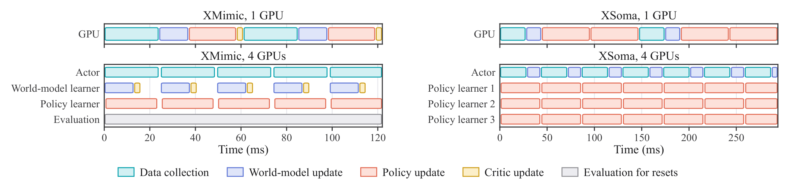
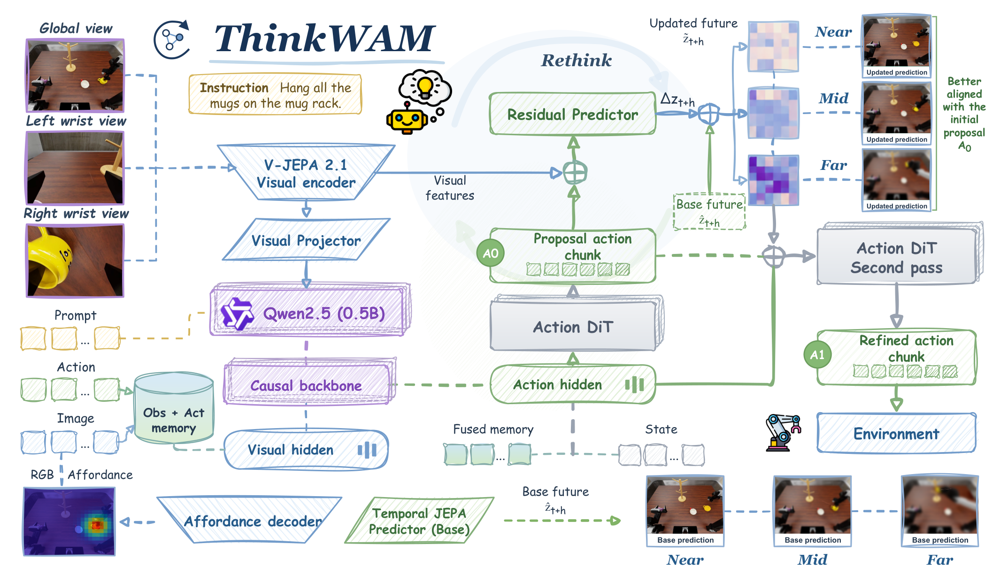
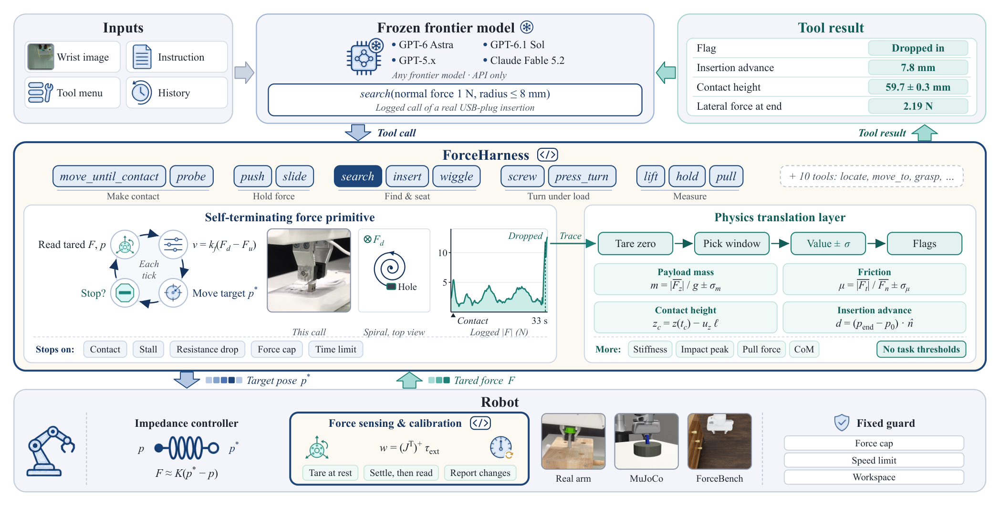
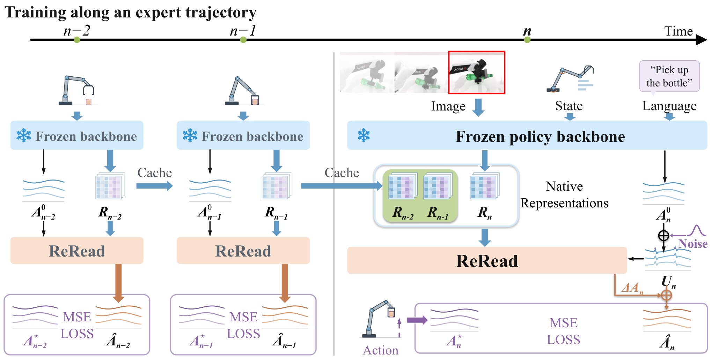

# Embodied AI & World Models News

> 具身智能与世界模型每日研究动态与论文精读。

**最新一期：2026-11-16** ｜ [日报原文](news/2026-11-16.md) · [精读索引](paper-reading/news/2026-11-16/README.md) · [历史归档](#历史归档)

---

<!-- 本段由 codex-deployment/update_readme.py 从 news/2026-11-16.md 自动镜像，请勿手工编辑 -->

## 2026-11-16 Embodied AI & World Models Daily

> 面向具身智能 / Robotics 研究员与工程师的研究与工程资讯。主窗口：北京时间11月16日00:00—23:59；补充窗口：11月14—15日。本期3篇必读、10篇雷达、4篇已完成精读。来源检查有缺口，详见末尾。

### 🔥 今日必读

#### 1. 【运动与全身控制】XMimic / XSoma：缩短世界模型训练关键路径，四张H100在一分钟内达标

**来源：** [arXiv:2611.20452v1](https://arxiv.org/abs/2611.20452v1)（cs.RO；TU Darmstadt等）  
**类型：** Paper  
**发布时间：** arXiv首次提交北京时间2026-11-16 11:22；作者代码及PDF此前已有公开记录，不能解释为所有资源当日首发。  
**评分：** 89.50/100  
**关键词：** World Model · Humanoid · JAX

**一句话：** 将采样、世界模型学习和策略更新拆到多卡流水，沿短期想象轨迹传播解析梯度；XMimic做动作跟踪，XSoma做粗糙地形速度跟踪。

**技术要点：**

- 整个训练循环包括MJX/MuJoCo Warp使用JAX编译，减少串行等待；多卡付出一到两轮参数陈旧的代价，换取吞吐。
- XMimic使用32步展开和critic；XSoma使用48步约一秒展开、取消critic，并将精确运动学与地形奖励留在网络外。三组策略梯度依次应用而非求平均。
- 仿真G1上，XMimic四H100达标0.86分钟，对比BlinkMimic单卡3.19分钟；XSoma四卡0.77分钟，对比FastSAC单卡9.44分钟。单卡XMimic为2.47分钟，单卡XSoma为2.50分钟，不能把多卡壁钟倍数当作单卡算法增益。
- 主计时排除编译启动和离线评估；缓存编译20—40秒、冷编译可能3分钟。论文明确尚无真机部署，四卡也不等于减少总GPU成本。

**为什么值得关注：** 世界模型路线的工程价值需要从迭代关键路径衡量。可优先复用其可微短期训练与分卡策略，再实测冷启动、GPU分钟和目标阈值；不要只追“一分钟”的宣传数字。

**资源：** [Paper](https://arxiv.org/abs/2611.20452v1) · [作者PDF](https://nico-bohlinger.github.io/papers/2026_xmimic_xsoma.pdf) · [XMimic](https://github.com/nico-bohlinger/xmimic) · [XSoma](https://github.com/nico-bohlinger/xsoma) · [全文精读](paper-reading/news/2026-11-16/xmimic/xmimic.md)。未确认独立社区复现。

#### 2. 【世界模型】ThinkWAM：先提出动作，再修正潜在未来，最后重新生成动作

**来源：** [arXiv:2611.21258v1](https://arxiv.org/abs/2611.21258v1)（cs.RO；西安交通大学等）  
**类型：** Paper  
**发布时间：** arXiv首次提交北京时间2026-11-16 23:30  
**评分：** 87.15/100  
**关键词：** World-Action Model · Latent Prediction · Action Refinement

**一句话：** 用首轮动作片段修正一次性预测的多时域未来潜变量，再将修正后的未来送回同一个动作头，第二轮生成的片段才真正执行。

**技术要点：**

- 多时域未来直接并行预测，近处保留更多token；首轮提案通过残差头影响未来表示，不是动作残差相加，也不是重复生成视频。
- 两轮共享flow-matching动作头，各4个Euler步。接触热图摘要只改动作侧记忆；RoboTwin没有对应标签，关闭该分支。
- LIBERO为1974/2000，即98.70%；LIBERO-Plus七类别宏平均84.76%；RoboTwin固定20任务Clean/Random为85.75%/65.85%，不能当成全50任务结果；RoboCasa24为65.17%。
- Galaxea A1Z单模型90回合OOD中成功58次，64.4%，对比π0.5的51/90、FastWAM的34/90。三个条件都要求双目标完成，属于同一拾取任务族。
- 完整模型84.76%，两轮但用未修正未来81.59%，支持潜在反馈有用；这不是任意动作的反事实动力学证明。基线数据、片段长度与积分步数不同，不能将101.2ms/片段解读为完全公平的计算效率排名。

**为什么值得关注：** 它给WAM补上动作提案到未来条件的部署反馈接口。下一步值得检查的是错误提案对应的真实未来，而不是仅看潜变量确实变化。

**资源：** [Paper](https://arxiv.org/abs/2611.21258v1) · [项目页](https://thinkwam-project.github.io/) · [GitHub](https://github.com/HaoyunT/Thinkwam) · [作者给出的Weights地址](https://huggingface.co/Adrain11/ThinkWAM) · [全文精读](paper-reading/news/2026-11-16/thinkwam/thinkwam.md)。代码与项目页可访问；Hugging Face可用性及权重文件未能独立核验。

#### 3. 【操作与抓取】ForceHarness：把高频接触留给自终止原语，把物理量反馈给冻结模型

**来源：** [arXiv:2611.21099v1](https://arxiv.org/abs/2611.21099v1)（cs.RO；NUS Show Lab）  
**类型：** Paper  
**发布时间：** arXiv首次提交北京时间2026-11-16 21:44  
**评分：** 86.65/100  
**关键词：** Force Control · Frozen Model · Tool Interface

**一句话：** 用本地闭环力原语执行和终止接触动作，再把力轨迹转换成重量、摩擦、刚度和插入量等物理反馈，让慢速API模型选择下一步。

**技术要点：**

- 从腕部传感器或关节外力矩估计力，做静止校零；阻抗与导纳原语独立响应接触、停滞、阻力下降、目标深度与限值。模型等待期间先卸载位置超前。
- 原语实测中位14.9Hz，底层关节阻抗1kHz，不能说大模型在1kHz力控。物理量的不确定度主要描述测量误差，不包含全部模型偏差。
- 实际FR3六任务各10次，Astra从无力反馈2/60到54/60，即3.3%→90%；Sol为47/60。结果依赖人工菜单、参数、校准和含操作提示的指令，“不微调模型”不等于无工程先验。
- ForceBench提高17.5个百分点、HiddenPhys提高34.3个百分点；但测试种子参与过调试，部分对照输入与训练预算不同。小模型物理量反馈的决策改善显著，最终成功率相对原始力的差异p=0.19，不显著。

**为什么值得关注：** 对已有API模型与力矩传感机器人，这是一条更清晰的系统分工：让本地控制层处理接触时序，让模型读取有语义的执行结果。当前证据主要覆盖单臂准静态接触，尚不能外推到任意硬件和高速动作。

**资源：** [Paper](https://arxiv.org/abs/2611.21099v1) · [全文精读](paper-reading/news/2026-11-16/forceharness/forceharness.md)。文中[项目地址](https://showlab.github.io/ForceHarness)本次返回404；未找到可确认公开可用的官方代码，不将发布承诺当成已开源。

### 📄 论文雷达

以下未精读条目基于官方摘要及版本页，不声称完成全文实验复核。评分是编辑判断，不能替代独立复现。

#### 【VLA与基础模型】ReRead：读出冻结策略已经算好的时序信息

**来源：** [arXiv:2611.20465v1](https://arxiv.org/abs/2611.20465v1)  
**发布时间：** 北京时间11月16日11:33  
**关键词：** Native KV · History · Residual Correction  
**核心贡献：** 读取当前和两个历史决策的原生KV缓存，训练动作残差修正器，不重编码图像。FastWAM全50任务同实验配对从90.73%到92.66%；Hard11从73.45%到81.45%，但这11项来自训练过的50任务。

**值得关注程度：** 85.35/100  
**Paper：** [arXiv摘要页](https://arxiv.org/abs/2611.20465v1) · [全文精读](paper-reading/news/2026-11-16/reread/reread.md)。A100额外11.66ms，修正器198.52M参数；真实相位歧义任务0/50→18/50，不代表通用长程成功。文中[代码地址](https://github.com/tan2355/reread)本次返回404。

#### 【数据与Benchmark】WinDEX：野外公制手部重建服务于遥操作与策略学习

**来源：** [arXiv:2611.21143v1](https://arxiv.org/abs/2611.21143v1)  
**发布时间：** 北京时间11月16日22:14  
**关键词：** Egocentric Stereo · Hand Data  
**核心贡献：** 融合双目几何、惯性里程计和时序优化，构建1000小时手部标注及蒸馏流式模型。作者报告离线43.61FPS、流式171FPS，世界坐标关节误差37.29mm；重建误差与下游策略收益应分别验证。  
**值得关注程度：** 80.95/100  
**Paper：** [arXiv摘要页](https://arxiv.org/abs/2611.21143v1)

#### 【感知与多模态】TaF-Foundation：用六维力旋量对齐异构触觉

**来源：** [arXiv:2611.20718v1](https://arxiv.org/abs/2611.20718v1)  
**发布时间：** 北京时间11月16日16:25  
**关键词：** Tactile · Cross-Sensor · Wrench  
**核心贡献：** 将24个、四类原理的触觉传感器观测配对到共同wrench监督，收集超1亿对样本。作者报告力RMSE下降17.1%，四项实机任务平均成功46.25%，对照23.75%；不要求传感器之间直接成对。  
**值得关注程度：** 80.25/100  
**Paper：** [arXiv摘要页](https://arxiv.org/abs/2611.20718v1)

#### 【模仿学习与策略】VLA-SSD：随机单步蒸馏为flow策略后训练提供密度

**来源：** [arXiv:2611.20460v1](https://arxiv.org/abs/2611.20460v1)  
**发布时间：** 北京时间11月16日11:28  
**关键词：** Flow Matching · Distillation · GRPO  
**核心贡献：** 以Brownian路径条件化单跳生成器，将多步flow动作头蒸馏成有条件密度的随机单步策略。动作头前向提速7.7倍伴随LIBERO成功率相对下降5.5%；另报告π0.5经GRPO相对改善20.6%，不是百分点。  
**值得关注程度：** 79.75/100  
**Paper：** [arXiv摘要页](https://arxiv.org/abs/2611.20460v1)

#### 【运动与全身控制】QTOP：用分位数critic缓解大规模动作跟踪干扰

**来源：** [arXiv:2611.20791v1](https://arxiv.org/abs/2611.20791v1)  
**发布时间：** 北京时间11月16日17:37  
**关键词：** Distributional RL · Tracking · Scaling  
**核心贡献：** 以状态和参考运动条件化的分布式优势估计提升跟踪RL样本效率。摘要报告仿真和真实跟踪相对多类基线最高约10%改善，并讨论计算量与数据量缩放；具体增益口径仍需全文和代码对齐。  
**值得关注程度：** 79.25/100  
**Paper：** [arXiv摘要页](https://arxiv.org/abs/2611.20791v1)

#### 【操作与抓取】DexFormer 2.0：面向多臂手组合的共享抓取策略

**来源：** [arXiv:2611.20273v1](https://arxiv.org/abs/2611.20273v1)  
**发布时间：** 北京时间11月16日06:06  
**关键词：** Cross-Embodiment · Dexterous · Memory  
**核心贡献：** 用统一关节接口与有效掩码、运动学树注意力偏置及Transformer-XL记忆适配本体差异。18组合训练后已见组合89%、6个留出组合51%，并展示Flexiv双手型实机迁移；组合外性能仍明显下降。  
**值得关注程度：** 78.95/100  
**Paper：** [arXiv摘要页](https://arxiv.org/abs/2611.20273v1)

#### 【开源项目】RoboKit：统一GPU并行可微优化工具链

**来源：** [arXiv:2611.20185v1](https://arxiv.org/abs/2611.20185v1)  
**发布时间：** 北京时间11月16日02:40  
**关键词：** Differentiable Optimization · GPU  
**核心贡献：** 把多初值求解、几何、渲染和物理可微计算组合为机器人优化工具。作者报告七任务2—60倍加速、4096个抓取2.97秒；蒸馏和RL还有单独收益，跨任务最大倍数不应视为所有配置统一加速。  
**值得关注程度：** 78.95/100  
**Paper：** [arXiv摘要页](https://arxiv.org/abs/2611.20185v1)

#### 【数据与Benchmark】Robotic Reward Models：区分执行进度与任务状态

**来源：** [arXiv:2611.20741v1](https://arxiv.org/abs/2611.20741v1)  
**发布时间：** 北京时间11月16日16:45  
**关键词：** Reward Model · Evaluation  
**核心贡献：** 按输出语义整理114项奖励模型，提出1117条真实机器人视频组成的RRM-Bench-1K，比较27个评估器。主要警示是执行顺序一致与下游收益并不保证密集奖励识别真实任务状态或缺失视角。  
**值得关注程度：** 78.85/100  
**Paper：** [arXiv摘要页](https://arxiv.org/abs/2611.20741v1)

#### 【端侧部署】POKE：离线动作敏感度蒸馏，避免剪枝评分自我锁定

**来源：** [arXiv:2611.21033v1](https://arxiv.org/abs/2611.21033v1)  
**发布时间：** 北京时间11月16日20:52  
**关键词：** Token Pruning · Action Sensitivity  
**核心贡献：** 在完整计算图离线估计视觉token的动作一阶敏感度，再蒸馏到不足0.3M参数学生。保留32/512 token时，OpenVLA-OFT与π0.5报告95.2%/90.8%成功、1.85/1.26倍提速，优先核对跨平台时延与分布外代价。  
**值得关注程度：** 78.85/100  
**Paper：** [arXiv摘要页](https://arxiv.org/abs/2611.21033v1)

#### 【感知与多模态】WiTac：让触觉先结合腕部视觉再进入策略

**来源：** [arXiv:2611.21057v1](https://arxiv.org/abs/2611.21057v1)  
**发布时间：** 北京时间11月16日21:08  
**关键词：** Touch · Wrist Vision · VLA  
**核心贡献：** 在近300小时SharpaDex数据上联合触觉、手部运动和腕部视图预训练接触表示，再注入两种VLA。作者报告四项接触任务平均改善28.8%/15.0%，并做无腕部视觉对照；本条保留摘要口径，不自行改写为百分点。  
**值得关注程度：** 77.95/100  
**Paper：** [arXiv摘要页](https://arxiv.org/abs/2611.21057v1)

### 🛠 工程与开源

- **XMimic / XSoma复现入口：** 两个[官方JAX仓库](https://github.com/nico-bohlinger/xmimic)及[XSoma](https://github.com/nico-bohlinger/xsoma)的README均可访问，说明任务、计时、GPU数量和执行布局。与上文为同一论文事件，不重复计分，也不将早于本窗口的仓库更新写成今日新版本。本次只核对说明和公开可访问性，没有实际训练复现。
- **ThinkWAM复现入口：** [官方代码](https://github.com/HaoyunT/Thinkwam)说明包含模型、数据适配、五套附录训练配方和评测工具；外部数据、模拟器、V-JEPA与文本资产另装。作者列出[权重地址](https://huggingface.co/Adrain11/ThinkWAM)，本次HF访问存在超时，未验证文件可下载。与上文聚为一个事件。
- **版本排查：** [MuJoCo](https://github.com/google-deepmind/mujoco/releases)、[Genesis](https://github.com/Genesis-Embodied-AI/Genesis/releases)、[Isaac Lab](https://github.com/isaac-sim/IsaacLab/releases)、[LeRobot](https://github.com/huggingface/lerobot/releases)已检查，当前查得最近正式版本日期均在本窗口前，不将其作为当日发布。新建仓库检索覆盖robotics、VLA、world model、robot learning；星数和创建日期仅作线索，没有据此补凑独立工程条目。

### 💬 社区信号

本次未确认足以单独收录的多源技术讨论或独立复现。已查看Hacker News与GitHub检索线索；不把作者自述、同源转发或新仓库少量星标写成“社区热议”。

### 🔎 补充窗口筛选记录

补充窗口仅用于补漏，不把旧日期工作伪装成16日首发。以下代表性排除记录按官方v1北京时间登记：

- [arXiv:2611.19904v1](https://arxiv.org/abs/2611.19904v1)，2026-11-15 17:33：DiffWAM与当日WAM主题相关，但本期优先展开已全文核验的ThinkWAM；列为补充候选，不冒充16日首发。

- [arXiv:2611.19771v1](https://arxiv.org/abs/2611.19771v1)，2026-11-15 11:51：JEPA4R在补充窗口，未超过本期主文的证据复核优先级；不因标题包含JEPA直接入选。

- [arXiv:2611.19774v1](https://arxiv.org/abs/2611.19774v1)，2026-11-15 12:01：VLA安全研究相关，但本期雷达数量有限；未完成其攻击设置全文审查，避免转述过强安全结论。

- [arXiv:2611.19857v1](https://arxiv.org/abs/2611.19857v1)，2026-11-15 15:45：主要为驾驶视频与4D场景生成，未据摘要确认本期所需的通用机器人决策增量。

- [arXiv:2611.19247v1](https://arxiv.org/abs/2611.19247v1)，2026-11-14 16:22：游戏交互世界模型有技术线索，但具体分工由引擎保留规则与状态；本期优先机器人控制证据，不按通用物理世界模型宣传。

另行排除[ScaleVLA](https://arxiv.org/abs/2611.21607v1)：官方v1是北京时间11月17日02:59，虽在UTC16日提交，仍在本期主窗口之外；留给17日报处理。普通旧论文修订、纯驾驶、纯SLAM/检测、软件Agent和与决策无关的生成工作不因关键词自动收录。

### 📈 趋势与判断

三个不同层面的瓶颈正在被拆开：训练侧把世界模型的迭代依赖链拆开，动作侧让提案影响潜在未来，执行侧把接触闭环放进本地工具。ReRead则提醒，扩充观测之前应先检查现有缓存是否已包含正确动作线索。上述是本期论文的并列编辑观察，不是已经验证的统一方案。

### 📚 精读与发布前检查

已完成4篇：[精读索引](paper-reading/news/2026-11-16/README.md)。每篇均核对全文与附录（XMimic无附录），完成证据规划、视觉审查、八项笔记lint、质量及可读性审查、正式保存与SHA-256一致性检查。每篇1张完整代表图，合计4张物化、0占位；其余决定性比较及消融在表格与正文中保留。未精读雷达未嵌图，也未标为全文已验证。

### 来源覆盖与边界

- **arXiv官方入口：** 直接检查[cs.RO](https://arxiv.org/list/cs.RO/recent)、[cs.AI](https://arxiv.org/list/cs.AI/recent)、[cs.LG](https://arxiv.org/list/cs.LG/recent)、[cs.CV](https://arxiv.org/list/cs.CV/recent)的recent与11月月列表。recent分别解析512、1641、1705、1095条，已见17日公告；月列表分别934、2000、2000、2000条，后三类月列表只取前2000条。不能把月列表前页当成完整整月覆盖。
- **时间核验：** 对宽召回的1065个去重候选逐页取得摘要与提交历史，74篇v1在16日、90篇在14—15日、901篇在窗外；全部以v1实际北京时间分类，公告日期不替代投稿时间。1065是宽召回数，不是1065篇都与具身相关或完成全文阅读。其余未入选候选不等于已证明没有价值。
- **筛选与评分：** 先排除无具身决策落点的工作，再按技术份量、信息增量、证据、相关性、社区五项双次评估，研究论文权重4/3/2/1/0，T1阈值62；入选事件以两次平均分展示，论文、项目与代码聚簇去重。未确认热度不编造热度数据，评分不代表统计检验。
- **机构与会议：** 已直接检查NVIDIA GEAR、1X、Figure、Stanford、TRI、RAI、Berkeley、上海AI实验室、Unitree、Deep Robotics、MIT、CMU、Skild，以及CoRL/RSS/ICRA/IROS入口；DeepMind原入口超时，博客回退可访问。网页可访问不意味着其中每项都属于本日，也不能证明所有机构所有渠道均已穷尽。
- **明确失败：** Physical Intelligence主页及research回退均HTTP429；Hugging Face的NVIDIA与LeRobot渠道原入口及API回退超时；ReRead文中代码地址、ForceHarness文中项目页404。因此来源检查不完整，不写成“当天没有其他资讯”，不声称所有权重和代码都已发布可用。

本期所有性能数值均为作者报告；未进行训练复现或真实机器人实验。README由同一期日报确定性生成，保持原文、精读索引与历史归档入口。

---

## 历史归档

| 日期 | 日报 | 精读 |
| --- | --- | --- |
| 2026-11-16 | [日报](news/2026-11-16.md) | [4 篇](paper-reading/news/2026-11-16/README.md) |
| 2026-11-15 | [日报](news/2026-11-15.md) | — |
| 2026-11-14 | [日报](news/2026-11-14.md) | [2 篇](paper-reading/news/2026-11-14/README.md) |
| 2026-11-13 | [日报](news/2026-11-13.md) | [5 篇](paper-reading/news/2026-11-13/README.md) |
| 2026-11-12 | [日报](news/2026-11-12.md) | [4 篇](paper-reading/news/2026-11-12/README.md) |
| 2026-11-11 | [日报](news/2026-11-11.md) | [5 篇](paper-reading/news/2026-11-11/README.md) |
| 2026-11-10 | [日报](news/2026-11-10.md) | [5 篇](paper-reading/news/2026-11-10/README.md) |
| 2026-11-09 | [日报](news/2026-11-09.md) | [6 篇](paper-reading/news/2026-11-09/README.md) |
| 2026-11-08 | [日报](news/2026-11-08.md) | [1 篇](paper-reading/news/2026-11-08/README.md) |
| 2026-11-07 | [日报](news/2026-11-07.md) | [1 篇](paper-reading/news/2026-11-07/README.md) |
| 2026-11-06 | [日报](news/2026-11-06.md) | [2 篇](paper-reading/news/2026-11-06/README.md) |
| 2026-11-05 | [日报](news/2026-11-05.md) | [2 篇](paper-reading/news/2026-11-05/README.md) |
| 2026-11-04 | [日报](news/2026-11-04.md) | [2 篇](paper-reading/news/2026-11-04/README.md) |
| 2026-11-03 | [日报](news/2026-11-03.md) | [2 篇](paper-reading/news/2026-11-03/README.md) |
| 2026-11-02 | [日报](news/2026-11-02.md) | [3 篇](paper-reading/news/2026-11-02/README.md) |
| 2026-11-01 | [日报](news/2026-11-01.md) | [4 篇](paper-reading/news/2026-11-01/README.md) |
| 2026-10-31 | [日报](news/2026-10-31.md) | [5 篇](paper-reading/news/2026-10-31/README.md) |
| 2026-10-30 | [日报](news/2026-10-30.md) | [5 篇](paper-reading/news/2026-10-30/README.md) |
| 2026-10-29 | [日报](news/2026-10-29.md) | [4 篇](paper-reading/news/2026-10-29/README.md) |
| 2026-10-28 | [日报](news/2026-10-28.md) | [5 篇](paper-reading/news/2026-10-28/README.md) |
| 2026-10-27 | [日报](news/2026-10-27.md) | [3 篇](paper-reading/news/2026-10-27/README.md) |
| 2026-10-26 | [日报](news/2026-10-26.md) | [3 篇](paper-reading/news/2026-10-26/README.md) |
| 2026-10-25 | [日报](news/2026-10-25.md) | [3 篇](paper-reading/news/2026-10-25/README.md) |
| 2026-10-24 | [日报](news/2026-10-24.md) | [3 篇](paper-reading/news/2026-10-24/README.md) |
| 2026-10-23 | [日报](news/2026-10-23.md) | [4 篇](paper-reading/news/2026-10-23/README.md) |
| 2026-10-22 | [日报](news/2026-10-22.md) | [4 篇](paper-reading/news/2026-10-22/README.md) |
| 2026-10-21 | [日报](news/2026-10-21.md) | [7 篇](paper-reading/news/2026-10-21/README.md) |
| 2026-10-20 | [日报](news/2026-10-20.md) | [4 篇](paper-reading/news/2026-10-20/README.md) |
| 2026-10-19 | [日报](news/2026-10-19.md) | [5 篇](paper-reading/news/2026-10-19/README.md) |
| 2026-10-18 | [日报](news/2026-10-18.md) | — |
| 2026-10-17 | [日报](news/2026-10-17.md) | — |
| 2026-10-16 | [日报](news/2026-10-16.md) | [5 篇](paper-reading/news/2026-10-16/README.md) |
| 2026-10-15 | [日报](news/2026-10-15.md) | [5 篇](paper-reading/news/2026-10-15/README.md) |
| 2026-10-14 | [日报](news/2026-10-14.md) | [5 篇](paper-reading/news/2026-10-14/README.md) |
| 2026-10-13 | [日报](news/2026-10-13.md) | — |
| 2026-10-12 | [日报](news/2026-10-12.md) | [5 篇](paper-reading/news/2026-10-12/README.md) |
| 2026-10-11 | [日报](news/2026-10-11.md) | [6 篇](paper-reading/news/2026-10-11/README.md) |
| 2026-10-10 | [日报](news/2026-10-10.md) | [7 篇](paper-reading/news/2026-10-10/README.md) |
| 2026-10-09 | [日报](news/2026-10-09.md) | [6 篇](paper-reading/news/2026-10-09/README.md) |
| 2026-10-08 | [日报](news/2026-10-08.md) | [6 篇](paper-reading/news/2026-10-08/README.md) |
| 2026-10-07 | [日报](news/2026-10-07.md) | [6 篇](paper-reading/news/2026-10-07/README.md) |
| 2026-10-06 | [日报](news/2026-10-06.md) | [6 篇](paper-reading/news/2026-10-06/README.md) |
| 2026-10-05 | [日报](news/2026-10-05.md) | [6 篇](paper-reading/news/2026-10-05/README.md) |
| 2026-10-04 | [日报](news/2026-10-04.md) | [4 篇](paper-reading/news/2026-10-04/README.md) |
| 2026-10-03 | [日报](news/2026-10-03.md) | [4 篇](paper-reading/news/2026-10-03/README.md) |
| 2026-10-02 | [日报](news/2026-10-02.md) | [7 篇](paper-reading/news/2026-10-02/README.md) |

## 目录结构

| 目录 | 内容 |
| --- | --- |
| `news/YYYY-MM-DD.md` | 每日研究动态日报 |
| `paper-reading/news/YYYY-MM-DD/<短slug>/` | 论文精读笔记（`<短slug>.md` + `images/`） |
| `paper-reading/news/YYYY-MM-DD/README.md` | 当日精读索引 |

## 内容许可

- 本仓库全部文字内容（日报与精读笔记）以 [CC BY 4.0](LICENSE) 授权——转载、改写、商用均可，仅需署名。
- 精读笔记中嵌入的论文插图版权归论文原作者 / 出版社所有（figures © original authors），仅作学术评述之引用；本仓库的 CC BY 4.0 授权不覆盖这些图片。

## 自动化

每天北京时间 08:30，无人值守任务生成前一自然日的日报、对入选论文执行全文精读，并把当日日报镜像到本页后提交推送。arXiv 公告存在批次延迟，部分日期的当日投稿只能部分覆盖，具体缺口写在该期日报的「检索覆盖与精读状态」一节。
