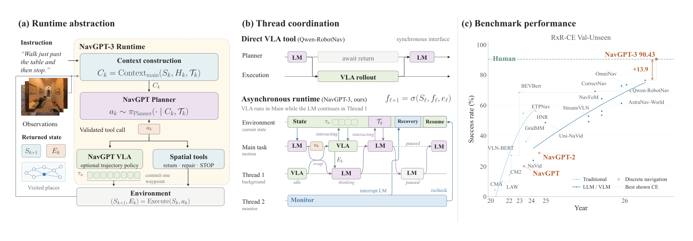
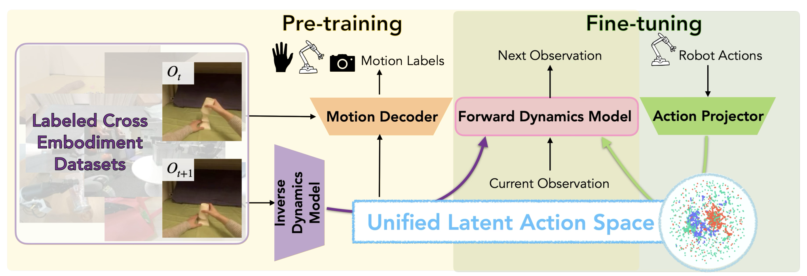
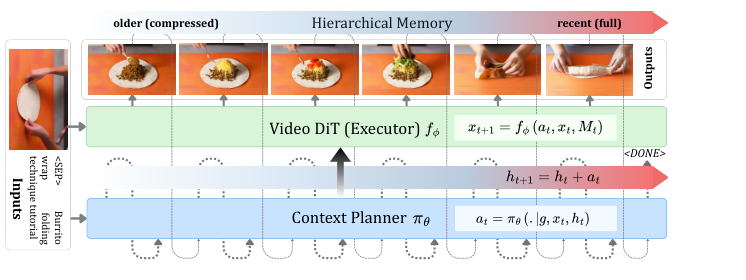
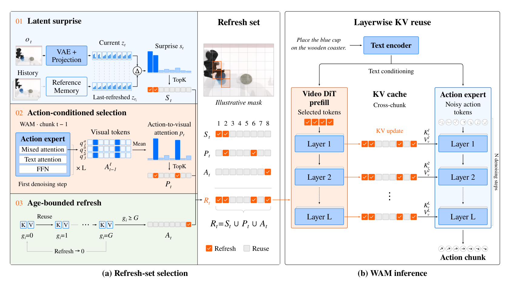

# 2026-10-10 Embodied AI & World Models Daily

> 面向具身智能 / Robotics 研究员与工程师的研究与工程资讯。
>
> 检索窗口：主窗口 2026-10-10 00:00–23:59（北京时间）；补充窗口回溯至 2026-10-08 00:00。**arXiv 公告说明**：触发日 10-10 为周六，arXiv 周末无公告批次——本次运行（北京 10-11 01:00 = ET 10-10 13:00）可见的最新批次仍为 **周五 ET 批次**，与 10-09 日报同批。**主窗口 10-10（周六 UTC）提交的 arXiv 新投稿将出现在周一 ET 批次，下期日报回补。** 本期内容为：(a) 周五批次后半（v1 实际提交北京 10-08 02:00–10-09 01:59）中 10-09 日报未收录的高价值回补条目；(b) 10-10 当日 GitHub / Hugging Face / 工业源事件。回补条目共 26 篇经 abs 页逐条核实（另 10-09 日报已收录条目不重复）；全部条目按 T1（一手源）标准收录，项目页 / GitHub / Hugging Face 均实际访问核实。

## 🔥 今日必读

### 1. 【导航与探索】NavGPT-3：给 LM 和 VLA 造一个操作系统——权限位+中断+线程调度，RxR-CE 首次对齐人类（90.43 vs 90.4）且快 2 倍

**来源：** [arXiv:2610.10787v1](https://arxiv.org/abs/2610.10787)（cs.RO 交叉 cs.AI/CL/CV/LG；Gengze Zhou, …, Stephen Gould, Anton van den Hengel, Qi Wu——Adelaide AIML / Metacognition / Roblox / PKU / SJTU / UNC / UNSW）  
**类型：** Paper（research_paper）  
**发布时间：** 实际提交 2026-10-08 02:46（北京时间，补充窗口；周五 ET 批次公告）  
**评分：** 86/100  
**关键词：** 分层导航 · LM-VLA 运行时 · 人类水平对齐

**一句话：**  
LM 会推理但物理交互要低延迟——最朴素的「LM 调 VLA 工具」是同步阻塞（await return 干等几十秒）。NavGPT-3 把两模型包进 **OS 式 runtime**：reasoning/acting/monitoring 跑成线程、各有 context/tools/permissions，runtime 调度并决定谁握运动权限，突发事件靠中断与线程切换（$f_{\ell+1}=\sigma(S_\ell,f_\ell,e_\ell)$）——**最小反应时间从每语言决策 3–19s 压到 0.78s**；RxR-CE **90.43 SR / 78.47 nDTW 对齐人类跟随者（90.4 / 77.7）**，每 episode 1min22s（人类约 3min），R2R-CE 81.51 SOTA。

**技术要点：**

- NavGPT VLA 8B 单模型 RxR-CE 78.19——**harness 在过硬动作策略之上又加约 12 点**，全部来自接口层；VLA 视觉 token 按 codec 随场景变化分配。
- 工具组消融：VLA 委托一上反应 3.3s→0.78s、回合 32→3.4；Backtrack 把 NE 4.67→2.55；三工具全开反而最省 token（155.0k）。
- Go2 真机运行时：检查频率加密后 Halt p95 2150ms→**180ms**、Missed 9/30→0/30；Resume SR 最高 80——恢复链路仍是短板（如实报出）。
- 子集卫生：R2R 消融子集 |SMD| ≤ 0.207——评测卫生范式。

**为什么值得关注：**  
这是「LM+策略双模型」机器人栈的接口设计模板：Table 12 的六行中断/恢复协议（谁可中断、谁可恢复、runtime 强制什么）可直接照抄。对做导航的团队，8B 策略 + 前沿 LM 的组合第一次把 RxR-CE 拉平人类——且证据链完整（36 页全量评测+真机+子集卫生）。

**资源：**

- Paper：[arXiv 摘要页](https://arxiv.org/abs/2610.10787)
- Project：[项目页](https://metacognitionai.github.io/NavGPT3/)
- Code：论文承诺放出全部模型/代码/评测记录，本日核查未见仓库
- Weights：暂无
- Discussion：暂未发现高质量社区讨论（本窗口内）

---

### 2. 【Sim-to-Real】SimVLA：纯仿真数据端到端训练移动操作 VLA——三源配方零样本真机反超 200-demo π0.5（OOD 档）

**来源：** [arXiv:2610.11248v1](https://arxiv.org/abs/2610.11248)（cs.RO；Kyoungin Baik, Youngwoon Lee——USC 线）  
**类型：** Paper（research_paper）  
**发布时间：** 实际提交 2026-10-08 12:52（北京时间，补充窗口）  
**评分：** 85/100  
**关键词：** Sim-to-Real · 移动操作 · 特权仿真监督

**一句话：**  
移动操作 VLA 的纯仿真配方：**SimAction**（35 任务原子技能组合动作数据）+ **SimVQA**（特权仿真状态模板化成视觉问答监督）预训练（梯度封锁进 VLM），**SimDeploy**（多仿真环境策略 rollout）后训练——真机五任务**全面超过 50 条真机演示微调的 π0.5**，视觉 OOD 档**反超 200-demo 档**（0.63 vs 0.45）；部分可观测协议下 MolmoBOT 全 0.0、SimVLA 51.8–81.0。

**技术要点：**

- Table 1 特征矩阵：**移动性 + 视觉语言监督 + 零样本 sim-to-real 三项同时拿到的此前没有**（11 个数据生成器逐项对比）。
- SimVQA held-out 直接评测：gripper 判断 1.00/0.89、**3D 定位误差 0.06m**、跨视角 IoU 0.61——特权状态监督质量有硬数字。
- 消融干净：去 pre-train 每任务近零（0.08–0.28）；去 SimDeploy 全线掉（0.33–0.45）——两阶段缺一不可。
- 边界（论文没藏）：ID 环境下 200-demo 档 π0.5 仍更高（0.638 vs 0.544）——真机数据在域内仍有价值。

**为什么值得关注：**  
「特权仿真状态 → VQA 模板」是把仿真免费全状态监督变现的通用配方，模板表直接抄；SimDeploy 的 rollout-环境循环是廉价的部署鲁棒性来源；部分可观测协议（遮挡/视野受限）比干净 OOD 更能区分 sim-to-real 质量。

**资源：**

- Paper：[arXiv 摘要页](https://arxiv.org/abs/2610.11248)
- Project：[项目页](https://kyounginbaik.github.io/simvla/)
- Code：本日核查未检索到开源仓库
- Weights：暂无
- Discussion：暂未发现高质量社区讨论（本窗口内）

---

### 3. 【VLA与基础模型】LAC-WM：统一潜动作空间的跨本体世界模型——显式动作标签被证伪（加本体 S.R. 17.7→0.0%），潜动作 16.0→18.3%（Fei-Fei 线）

**来源：** [arXiv:2610.10846v1](https://arxiv.org/abs/2610.10846)（cs.RO；Huang Huang, …, Li Fei-Fei, Jiajun Wu, Tingfan Wu, Franziska Meier——Stanford 线）  
**类型：** Paper（research_paper）  
**发布时间：** 实际提交 2026-10-08 03:51（北京时间，补充窗口；10-09 日报已预告「下期合并评」）  
**评分：** 84/100  
**关键词：** 跨本体 · 潜动作空间 · World Model

**一句话：**  
显式动作条件的世界模型（EAC-WM）在跨本体上**灾难性失败**：UMAP 上动作嵌入按本体分簇互不重叠；加第三个本体 S.R. 直接 17.67%→**0.00%**。LAC-WM 用 IDM 从观测对学**统一潜动作空间**（跨本体共享）：δf 26.50 全场最低、S.R. 0.22 最高，且**随预训练本体数单调正增长**（16.0→17.67→18.33%）——灵巧操作 +46.7%、LIBERO +11.7%。

**技术要点：**

- 对照锋利：VLA-mean/VLA-random（统计注入对照）都**优于**显式动作标签——显式条件在跨本体上不只是没用，是有害的。
- 轻量组件：IDM 46.9M / FDM 93.8M 参数，图像 tokenizer V-JEPA 2 (1B)——潜动作头是接口层不是巨模型。
- 想象 rollout 用法：给定初始图像+动作序列想象未来，用与目标图像的潜距离 δf/δfg 评估动作候选（action selection）。
- 边界：2 本体/24k 档 LAC-WM 16.0 **低于** EAC-WM 17.67——小数据少本体时优势未显现（如实报出）；绝对 S.R. 0.22 离可靠规划器还远。

**为什么值得关注：**  
与 UNITAS（10-09 必读）构成跨本体动作接口的两种解法：UNITAS 用 3D 点流做**物理**接口（要 URDF），LAC-WM 用 IDM 潜动作做**语义**接口（只要观测对）。「IDM 潜动作头」可作为任何跨本体混合预训练的动作接口层；Figure 5 的 scaling 协议（固定数据加本体 vs 同比加数据）是验证可扩展性的标准实验设计。

**资源：**

- Paper：[arXiv 摘要页](https://arxiv.org/abs/2610.10846)
- Project：[项目页](https://lacwm.github.io)
- Code：本日核查未检索到开源仓库
- Weights：暂无
- Discussion：暂未发现高质量社区讨论（本窗口内）

---

### 4. 【世界模型】HWAM：执行后状态当显式预测目标——联合状态-动作生成，OLI 真机三任务全第一（Candy 70.6 vs Fast-WAM 43.3）

**来源：** [arXiv:2610.12026v1](https://arxiv.org/abs/2610.12026)（cs.RO 交叉 cs.AI；Yan Yang, Jikun Rong 等 10 人；Under review）  
**类型：** Paper（research_paper）  
**发布时间：** 实际提交 2026-10-08 22:23（北京时间，补充窗口；10-09 日报承诺「下期合并评」的人形线之一）  
**评分：** 83/100  
**关键词：** 人形 WAM · action-execution gap · 联合状态-动作

**一句话：**  
分层人形系统里策略输出的是**参考动作**，经 WBC+关节伺服+动力学才变成真实运动——论文量化了这条 gap：移动人形 OLI 4.420° MAE vs 固定双臂 ALOHA 0.648°（近 7 倍）。HWAM 把**执行后本体感受状态设为显式预测目标**（联合 token $[s_{t+1}; a_t]$），Policy/FDM/IDM 三条件路径训练——Candy Picking **70.6**（Fast-WAM 43.3、π0.5 62.5），三任务全第一。

**技术要点：**

- 受控消融最干净的一张表：单独换目标 45.5、单独换配方 55.0、**只有「联合目标+三路径」组合 73.3**。
- 不依赖机器人数据预训练（与 Fast-WAM 同），执行状态监督 +27.3 点比机器人预训练（π0.5 +19.2 点）更便宜。
- 负结果如实报：**视频保真 PSNR 非全场最优**（20.501 vs Joint denoising+Action 20.844）——状态监督换来的是动作-后果关联不是像素保真。
- 低位工作区弱（B3 41.7 vs L2 95.8）——弯腰全身协调处 gap 更大，但论文未报 gap-收益相关性（尚不能确定）。

**为什么值得关注：**  
「执行后状态当显式预测目标」是两行代码级别的改动（状态头接在动作专家旁），可移植到任何分层执行器栈；action-execution gap 度量协议（Direct vs 稳态 MAE）可先诊断自己平台再决定要不要上。与 Being-M0.7 同日同题：一个目标侧一个数据侧，理想实验是叠加。

**资源：**

- Paper：[arXiv 摘要页](https://arxiv.org/abs/2610.12026)
- Project：未发现独立项目页（under review，15 页 5 图）
- Code：本日核查未检索到开源仓库
- Weights：暂无
- Discussion：暂未发现高质量社区讨论（本窗口内）

---

### 5. 【世界模型】WorldGuide：闭环程序性视频执行——8.3B 打 33B（33.33 vs 29.90，MiniMax-H3 还拿着参考规划）

**来源：** [arXiv:2610.12459v1](https://arxiv.org/abs/2610.12459)（cs.CV；Ankan Deria, Komal Kumar, Hisham Cholakkal, Fahad Shahbaz Khan, Salman Khan——MBZUAI 线）  
**类型：** Paper（research_paper + benchmark）  
**发布时间：** 实际提交 2026-10-09 01:59（北京时间，补充窗口边界；周四 ET 日间提交、周五批公告）  
**评分：** 81/100  
**关键词：** 程序性视频生成 · 闭环执行 · 层级记忆

**一句话：**  
开环视频生成不看成片结果、撑不起程序性任务（做饭/组装）。WorldGuide 把程序性视频生成当**视觉世界空间的闭环执行**：Planner 预测原子动作 → Executor 生成片段 → **用生成结果选下一步**；层级记忆分段压缩（present 1:1 → distant 64:1，**总 token 成本上界 8**）。WorldGuide Bench 33.33% Task Success **超过拿着参考动作规划的 MiniMax-H3-33B（29.90）**——8.3B 打 33B 靠闭环结构。

**技术要点：**

- 顺手建了 step-level 监督基准：**WorldGuide Bench** 58,679 保留视频（133,360 原始→49% 保留率）、245 任务、27 类。
- 双检查组全指标第一：Plan Acc 62.85 vs 57.99、Order 92.42 vs 86.79、Aesth 49.36、Consist 31.13。
- planner-executor 分离消融：Success 47.04 → **91.75**——执行器决定成败，纯文本规划不够。
- 负结果如实报：Repeat/Skip 6.06 **不是全场最优**（Bernini 0.00）；Task Success 33.33% 绝对值仍低——作者明确承认领域远未解决。

**为什么值得关注：**  
「Planner 选原子动作 + 用生成结果选下一步」是 world model as policy simulator 的视频空间版本；Table 10 分段率记忆设计是长视频上下文预算的现成查表；58,679 步标注视频可直接当 step-level 监督语料复用。

**资源：**

- Paper：[arXiv 摘要页](https://arxiv.org/abs/2610.12459)
- Project：本日核查未发现独立项目页（34 页 14 图 15 表）
- Code：本日核查未检索到开源仓库
- Weights：暂无
- Discussion：暂未发现高质量社区讨论（本窗口内）

---

## 📄 论文雷达

> 以下为周五批次后半中 10-09 日报未收录、已逐条打开 abs 页核实的次高价值论文，按双评分均分降序；其中 WAM-Cache 与 Being-M0.7 按雷达最高分完成完整精读（本日第 6/7 篇）。

### 【端侧部署】WAM-Cache：训练无关的 WAM prefill KV 复用——「动作专家看哪」替代「哪里动了」，-41.6% FLOPs 只掉 1.8pp（已精读并嵌图）

**来源：** [arXiv:2610.11401v1](https://arxiv.org/abs/2610.11401)（cs.RO 交叉 cs.CV/cs.LG；Kai Ding, Yang He, Ruijie Quan, Yi Yang）  
**关键词：** WAM 推理加速 · KV 缓存 · 训练无关  
**核心贡献：** WAM 每 chunk 全量 prefill 占 83.5% FLOPs；朴素「按视觉漂移刷新」是陷阱——oracle 漂移实验证明其平台期远低于 dense。Refresh set $R_t=S_t∪P_t∪A_t$：潜惊讶+**动作专家跨层注意力 TopK**+年龄上界 G；消融瀑布 -37.0→-9.5→-1.8pp，真机五任务比 dense 反高 17.2pp。  
**值得关注程度：** 80/100  
**Paper：** [arXiv 摘要页](https://arxiv.org/abs/2610.11401)　**Project：** [项目页](https://dingkai0302.github.io/wam-cache/)

### 【VLA与基础模型】Being-M0.7：10,226 小时混合模态人形潜世界动作模型——SIMPLE 六任务 128/180 全场第一（已精读并嵌图）

**来源：** [arXiv:2610.11283v1](https://arxiv.org/abs/2610.11283)（cs.RO 交叉 cs.CV/cs.LG；Junpeng Yue 等 14 人，含 Zongqing Lu）  
**关键词：** 人形 WAM · 混合模态预训练 · Unitree G1  
**核心贡献：** video-only/motion-only/paired 三流联合预测（**配对不是必需**）把未配对人类数据变现：~10,226 小时（Internal 49.95% / Ego4D 35.94%）预训练→中训练→gated cross-attention 动作后训练；SIMPLE 128/180 超 Ψ0（116）与 π0.5（95）；Mobile P&P 13/30 暴露复合任务短板（如实报出）。**（本日第 7 篇精读，代表图见下）**  
**值得关注程度：** 79/100  
**Paper：** [arXiv 摘要页](https://arxiv.org/abs/2610.11283)

### 【感知与多模态】SCOPE：扩散轨迹的控制就绪不确定性——CoRL 2026 Spotlight，score 曲率蒸馏出校准高斯管

**来源：** [arXiv:2610.12431v1](https://arxiv.org/abs/2610.12431)（cs.RO；Zhiwei Xue 等；Harold Soh 线）  
**关键词：** Trajectory Diffusion · 不确定性 · 实时控制  
**核心贡献：** 扩散策略的多模态不确定性要靠昂贵 MC 采样——SCOPE 用 score-曲率信息蒸馏结构化精度矩阵，单次前馈出**校准高斯管**（每时间步协方差），既当移动体占用预测又当自适应探索引导；行人预测/人群导航/Maze2D/真机 Franka 验证。  
**值得关注程度：** 77/100  
**Paper：** [arXiv 摘要页](https://arxiv.org/abs/2610.12431)

### 【模仿学习与策略】REACT：滚动去噪让流匹配 VLA 反应更快——CoRL 2026 Spotlight，交错时间步持久动作缓冲

**来源：** [arXiv:2610.12007v1](https://arxiv.org/abs/2610.12007)（cs.RO 交叉 cs.AI；Houlong Xiong 等 11 人）  
**关键词：** 反应式控制 · 滚动去噪 · 双解耦  
**核心贡献：** 长 chunk 平滑 vs 频繁重规划反应性的两难：REACT 维护交错流时间步的持久动作缓冲，每步全视野去噪、执行最干净块、部分精炼块前移、尾部补噪——每个执行块经多次观测精炼；感知/VLM 编码/DiT 去噪/执行四链解耦支撑高频流式；RoboTwin 2.0+多平台真机成功率高、反应延迟低。  
**值得关注程度：** 77/100  
**Paper：** [arXiv 摘要页](https://arxiv.org/abs/2610.12007)　**Project：** [项目页](https://react-vla.github.io)

### 【VLA与基础模型】NegaAlign：VLA 学会「不要做什么」——π0.5 否定指令成功率 2.6%→88.45%（11.6M 参数即插层）

**来源：** [arXiv:2610.11952v1](https://arxiv.org/abs/2610.11952)（cs.RO；Fazeng Li, Gan Sun, Hao Cheng, Weihong Ren, Yang Cong——东北大学线）  
**关键词：** 否定理解 · 参数高效 · 即插即用  
**核心贡献：** VLA 听不懂排除性约束（「不要碰红色杯子」）：NegaAlign 插入 Negation Transformation Layers（~11.6M 参数）+ 教师引导对齐，冻结全部预训练权重与动作生成器；NegaBench（10 场景 5 域）+ 真机 12.4%→88.8%，肯定指令性能不丢。  
**值得关注程度：** 76/100  
**Paper：** [arXiv 摘要页](https://arxiv.org/abs/2610.11952)

### 【强化学习】Higher-Order Action Supervision：只监督零阶动作是控制不稳的根源——NeurIPS 2026，即插即用损失

**来源：** [arXiv:2610.11175v1](https://arxiv.org/abs/2610.11175)（cs.RO 交叉 cs.AI；Peng Cheng, …, Xianyuan Zhan）  
**关键词：** 高阶动作监督 · IL/RL 通用 · 理论保证  
**核心贡献：** IL/RL 的控制不稳来自只监督动作标签（零阶）而忽略动作动态与时间一致性：同时监督零阶+一阶动作即可大幅提升稳健性，带形式化保证；确定性/随机/流策略通用、免改结构，OGBench/D4RL 大涨，低数据 OOD 泛化也涨。  
**值得关注程度：** 75/100  
**Paper：** [arXiv 摘要页](https://arxiv.org/abs/2610.11175)

### 【世界模型】LeWAM：JEPA 世界动作模型 + 扩散引导 MPC——线性探针读状态优于重建式 WAM

**来源：** [arXiv:2610.12407v1](https://arxiv.org/abs/2610.12407)（cs.RO 交叉 cs.AI/cs.CV；Shashank Hegde, Alexander Popov, Elie Aljalbout, Nikolai Smolyanskiy）  
**关键词：** JEPA · 免解码器 · 噪声空间规划  
**核心贡献：** 重建式表示携带冗余噪声：LeWAM 在免解码器 JEPA 潜空间端到端训四模式（前向/反向/逆动力学/策略）；对齐——线性探针读机器人与物体状态优于前向-only JEPA；规划——在策略头的噪声空间而非原始动作空间做 MPC，避开动力学模型误差被利用。  
**值得关注程度：** 74/100  
**Paper：** [arXiv 摘要页](https://arxiv.org/abs/2610.12407)

### 【世界模型】MiniWAM：紧凑未来目标让世界动作训练提速 8 倍——0.25B 已敌大 WAM

**来源：** [arXiv:2610.12194v1](https://arxiv.org/abs/2610.12194)（cs.RO；Jie Chen 等；Guillaume Sartoretti 线）  
**关键词：** 紧凑预测目标 · PRISM · 训练效率  
**核心贡献：** WAM 在预训练视觉骨干原生空间预测未来太贵：MiniWAM 从特权当前-未来转移学紧凑目标（PRISM：逆动力学监督+特征重建，冻结编码器），65× 少的原生未来 token、**8× 训练加速**；0.25B 在 LIBERO/LIBERO-Plus/RoboTwin 2.0 已敌更大 WAM——「世界动作建模不需要预测原生视觉未来」。  
**值得关注程度：** 74/100  
**Paper：** [arXiv 摘要页](https://arxiv.org/abs/2610.12194)　**Project：** [项目页](https://j1dan.github.io/MiniWAM)

### 【导航与探索】SuperNav：MLLM 零导航微调的通用导航系统——视觉点接口连接决策与运动

**来源：** [arXiv:2610.12126v1](https://arxiv.org/abs/2610.12126)（cs.RO 交叉 cs.CV；Jinkai Zhang, …, Xiaowei Zhou, Sida Peng——浙大 ZJU3DV）  
**关键词：** 通用导航 · agent harness · 真机四足  
**核心贡献：** 微调 MLLM 出导航动作会绑死训练分布：SuperNav 给预训练 MLLM 装 agent harness（导航技能/物理交互工具/任务进度管理），**统一视觉点接口**让模型直接在图像里指定目的地并从执行反馈修正；实例级/多物体/需求驱动任务超四基线，HM3D 类别级+真机四足部署。  
**值得关注程度：** 73/100  
**Paper：** [arXiv 摘要页](https://arxiv.org/abs/2610.12126)　**Project：** [项目页](https://zju3dv.github.io/SuperNav/)

### 【数据与Benchmark】MultiWorldBench：独立控制的多视角是否描述同一个共享世界——生成式系统状态持久性最高 8.00

**来源：** [arXiv:2610.11723v1](https://arxiv.org/abs/2610.11723)（cs.AI 交叉 cs.CV；Zhangbo Xu, Ruoxi Zhang, Rui Hu, Yisong Wang）  
**关键词：** 多人世界模型 · 一致性诊断 · Minecraft  
**核心贡献：** 多玩家世界模型要求独立控制的视角共享一个持久世界：Minecraft 诊断基准 495 配置/7 任务套件/10 能力；Gamma-World 21.39 十能力均分最高（Engine GT 91.69）；**生成式系统状态持久性最高 8.00、结构一致性 1.33、空间推理全败**——「像样的单视角还不构成连贯的多玩家世界」；人机偏好 Spearman 0.96。  
**值得关注程度：** 72/100  
**Paper：** [arXiv 摘要页](https://arxiv.org/abs/2610.11723)

### 【世界模型】WorldCast：分布式多人世界模型——每玩家本地客户端，渲染率提升一个数量级

**来源：** [arXiv:2610.12412v1](https://arxiv.org/abs/2610.12412)（cs.CV；Ziyang Ye, …, Zhuotao Tian, Li Jiang）  
**关键词：** 多人世界模型 · 分布式 · 实时  
**核心贡献：** 联合多视角生成成本随玩家数线性涨：WorldCast 每玩家跑本地客户端（视频生成器+状态模型），交换玩家状态并投影成相机对齐状态场引导他者渲染；Counter-Strike 2 上玩家渲染率**提升超一个数量级**、小时级 rollout 图像质量稳定、每客户端实时。  
**值得关注程度：** 72/100  
**Paper：** [arXiv 摘要页](https://arxiv.org/abs/2610.12412)　**Project：** [项目页](https://ziyang-ye.github.io/WorldCast-Page)

### 【世界模型】SplitJEPA：免重建的不变/变体潜世界分解——块级等距可辨识性证明

**来源：** [arXiv:2610.12349v1](https://arxiv.org/abs/2610.12349)（cs.LG；Ruijin Hua, Zichuan Liu, Zhuokai Zhao, Yujia Zheng）  
**关键词：** JEPA · 不变-变体分解 · 理论  
**核心贡献：** 机器人推立方体时相机移动/光照变化不该改变决策——状态应分解为跨观测共享（不变）与随观测变化（变体）两部分；SplitJEPA 在表示空间直接联合恢复潜状态及其不变/变体组织（**免重建**），平稳高斯预测动态+满秩变化条件下证明块级等距可辨识（无需观测解码器）；合成非线性系统+机器人操作验证。  
**值得关注程度：** 71/100  
**Paper：** [arXiv 摘要页](https://arxiv.org/abs/2610.12349)

### 【操作与抓取】OmniDex：260 万杂乱场景灵巧手抓取基准——seed-and-filter 绕开场景级优化

**来源：** [arXiv:2610.11194v1](https://arxiv.org/abs/2610.11194)（cs.RO 交叉 cs.CV；Naiyu Fang, …, Hongsheng Li——CUHK-MMLab 线）  
**关键词：** 灵巧手抓取 · 大规模基准 · SWTA  
**核心贡献：** 杂乱场景灵巧抓取数据稀缺：高质量 3D 物体+支撑底座、seed-and-filter 策略绕开慢速场景级优化——**260 万+场景 / 4 亿场景级抓取真值**；OmniDex 模型用 Soft Winner-Takes-All+人类启发物理约束+物理驱动排序解决多模态与最后一毫米误差，免事后优化延迟。  
**值得关注程度：** 71/100  
**Paper：** [arXiv 摘要页](https://arxiv.org/abs/2610.11194)

### 【数据与Benchmark】LIVIN：30 个「住过」家庭的数字孪生基准——杂乱与空间约束下的具身智能评测

**来源：** [arXiv:2610.12069v1](https://arxiv.org/abs/2610.12069)（cs.CV；Peijun Xu 等 16 人，Jiayuan Gu 线）  
**关键词：** 数字孪生 · 家庭环境 · 导航与 loco-manipulation  
**核心贡献：** 仿真家庭普遍缺「住过的痕迹」：LIVIN 用人机协同工作流（实例识别/建筑重建/物体生成摆放、每阶段人工对照源观测复核）建 30 个真实住家数字孪生，保留房间布局/家具配置/日常物件；3D 检测/重建/导航/loco-manipulation 四任务评测显示现有方法被**密集物件、遮挡、受限交互区**难住。  
**值得关注程度：** 70/100  
**Paper：** [arXiv 摘要页](https://arxiv.org/abs/2610.12069)

---

## 🛠 工程与开源

### BiGym 2.0 官方仓库（[GitHub](https://github.com/swirl-uk/BiGym2)，25★）

10-08 建仓即放出全套：20 仿真环境 + **60 人类 VR 演示/任务**（LeRobot v3 格式，[SWIRL-Lab/bigym-g1-native60](https://huggingface.co/datasets/SWIRL-Lab/bigym-g1-native60)）+ 100 固定评测种子（逐结果物理指纹）+ NVIDIA GR00T-WBC 下肢控制器权重（NVIDIA Open Model License）+ **coding-agent 基准**（任务描述+演示视频+101k 环境步写 policy.py）。论文（[arXiv:2610.07594](https://arxiv.org/abs/2610.07594)，已在 10-07 日报收录）结论值得复看：**agent 写的程序打败全部 demo 驱动 RL 基线**、VLA 微调九任务均值最佳。

### LingBot-VLA 2.0 登陆 LeRobot 官方组织（[Hugging Face](https://huggingface.co/lerobot/lingbot_vla_v2_base)，120 downloads）

lerobot 官方组织号发布 LingBot-VLA 2.0 的 LeRobot 格式转换（Qwen3-VL-4B 骨干 + 稀疏 MoE Qwen2 动作专家，流匹配；fp32 原样转换+config/processor）：`lingbot_vla_v2_base`（微调起点）与 `lingbot_vla_v2_robotwin`（RoboTwin 适配）。配套论文 [arXiv:2607.06403](https://arxiv.org/abs/2607.06403)（7 月已发）。对 LeRobot 生态用户：一条 `lerobot-train --policy.path=...` 即可起微调——**VLA 权重进入主流开源生态**的标志性事件。

### TokenPB 官方实现（[GitHub](https://github.com/RUCKBReasoning/TokenPB)，NeurIPS 2026）

VLA 动作自验证：流匹配 DiT 出候选动作 chunk，VLM 骨干（Qwen2.5-VL/InternVL-3.5）经辅助损失学预测 bucket-token 序列（FAST 编码/动作 bin），推理时 teacher-forced 平均 NLL 选最优候选——**单 checkpoint 统一生成与自验证**。含 openpi 移植（π0.5 + 自验证）。权重未放（自带外部资产）。

### WorldMemBench（[GitHub](https://github.com/ZJU-REAL/WorldMemBench) + [Hugging Face](https://huggingface.co/datasets/rescuerz/WorldMemBench)）

视频世界模型**记忆**评测基准（浙大 ZJU-REAL / 复旦 / 蚂蚁 / 南大）：人类/物体/环境/动态记忆 + 相机跟随共 12 指标；放出代码（MIT）+ 5,400 Human/Object/Environment 视频 + 评测权重；leaderboard 提交 Coming soon。与 WorldGuide Bench（同日）互补：一个测记忆一个测程序执行。

---

## 💬 社区信号

> 周六窗口社区整体清淡；HN 无具身相关高热帖（robot/humanoid/world model 查询最高 5pts）。值得继续观察的信号：

- **人形 WAM 两条正交路线连续第二天到达**：昨天 VioLA（潜空间对齐人类数据），今天 HWAM（联合状态-动作目标）与 Being-M0.7（混合模态预训练）——目标侧/数据侧/表示侧三条轴正在各自快速展开，叠加实验是明显空白。
- **LM-VLA 接口从「工具调用」进化为「运行时调度」**：NavGPT-3 的权限位+中断+线程（反应 3–19s→0.78s）与 10-09 SpatialHarness（测试时空间脚手架）同属「接口层」赛道——接口设计正在成为独立研究对象，Table 12 协议矩阵是本周最值得盯的设计文档。
- **WAM 效率侧两连发**：WAM-Cache（prefill KV 复用，动作注意力当信号）+ MiniWAM（紧凑未来目标，8× 训练加速）——部署侧加速从架构改造（FastWAM/RealtimeWAM）转向训练无关/免重训路线，「加 GPU 之前先查 prefill 份额」成默认检查项。
- **GitHub/HF 新仓监控**：[swirl-uk/BiGym2](https://github.com/swirl-uk/BiGym2)（10-08 建仓 25★，本批最快）、[ZJU-REAL/WorldMemBench](https://github.com/ZJU-REAL/WorldMemBench)（10-09，1★）、[RUCKBReasoning/TokenPB](https://github.com/RUCKBReasoning/TokenPB)（10-10 建仓即 NeurIPS 标）；lerobot 官方组织收编 LingBot-VLA 2.0（120 downloads）。

---

## 🔎 补充窗口筛选记录

> 本批为周五 ET 公告批次后半（v1 实际提交北京 10-08 02:00–10-09 01:59）中 10-09 日报未收录的回补条目，26 篇经 abs 页逐条核实；10-09 日报已收录的 16 条（VioLA/ARC/UNITAS/SGS/DreamTrue/Dex-One2Many/PLaW-VLA/COAP/LiteNWM/VersaCamVLA/WOVEN/ME-World/SpatialHarness/GNR/HT-Policies/RoboRSI）不重复。cs.RO 批内其余标题 triage 判非学习类（SLAM/传感/医疗执行/无人机单机等）条目不赘。

| 条目 | 实际时间（北京时间） | 处理原因 |
|---|---|---|
| [arXiv:2610.10787v1](https://arxiv.org/abs/2610.10787) NavGPT-3 | 10-08 02:46 | 回补 → 已收录（必读 #1，精读完成） |
| [arXiv:2610.11248v1](https://arxiv.org/abs/2610.11248) SimVLA | 10-08 12:52 | 回补 → 已收录（必读 #2，精读完成） |
| [arXiv:2610.10846v1](https://arxiv.org/abs/2610.10846) LAC-WM | 10-08 03:51 | 回补 → 已收录（必读 #3，精读完成） |
| [arXiv:2610.12026v1](https://arxiv.org/abs/2610.12026) HWAM | 10-08 22:23 | 回补 → 已收录（必读 #4，精读完成） |
| [arXiv:2610.12459v1](https://arxiv.org/abs/2610.12459) WorldGuide | 10-09 01:59 | 回补 → 已收录（必读 #5，精读完成） |
| [arXiv:2610.11401v1](https://arxiv.org/abs/2610.11401) WAM-Cache | 10-08 15:33 | 回补 → 已收录（雷达 #1，精读完成） |
| [arXiv:2610.11283v1](https://arxiv.org/abs/2610.11283) Being-M0.7 | 10-08 13:49 | 回补 → 已收录（雷达 #2，精读完成） |
| [arXiv:2610.12431v1](https://arxiv.org/abs/2610.12431) SCOPE | 10-08 01:57 | 回补 → 已收录（雷达 #3，CoRL 2026 Spotlight） |
| [arXiv:2610.12007v1](https://arxiv.org/abs/2610.12007) REACT | 10-08 22:10 | 回补 → 已收录（雷达 #4，CoRL 2026 Spotlight） |
| [arXiv:2610.11952v1](https://arxiv.org/abs/2610.11952) NegaAlign | 10-08 21:39 | 回补 → 已收录（雷达 #5） |
| [arXiv:2610.11175v1](https://arxiv.org/abs/2610.11175) HOAS | 10-08 11:32 | 回补 → 已收录（雷达 #6，NeurIPS 2026） |
| [arXiv:2610.12407v1](https://arxiv.org/abs/2610.12407) LeWAM | 10-08 01:46 | 回补 → 已收录（雷达 #7） |
| [arXiv:2610.12194v1](https://arxiv.org/abs/2610.12194) MiniWAM | 10-08 23:52 | 回补 → 已收录（雷达 #8） |
| [arXiv:2610.12126v1](https://arxiv.org/abs/2610.12126) SuperNav | 10-08 23:19 | 回补 → 已收录（雷达 #9） |
| [arXiv:2610.11723v1](https://arxiv.org/abs/2610.11723) MultiWorldBench | 10-08 19:24 | 回补 → 已收录（雷达 #10） |
| [arXiv:2610.12412v1](https://arxiv.org/abs/2610.12412) WorldCast | 10-09 01:49 | 回补 → 已收录（雷达 #11） |
| [arXiv:2610.12349v1](https://arxiv.org/abs/2610.12349) SplitJEPA | 10-09 01:19 | 回补 → 已收录（雷达 #12） |
| [arXiv:2610.11194v1](https://arxiv.org/abs/2610.11194) OmniDex | 10-08 11:58 | 回补 → 已收录（雷达 #13） |
| [arXiv:2610.12069v1](https://arxiv.org/abs/2610.12069) LIVIN | 10-08 22:47 | 回补 → 已收录（雷达 #14） |
| [arXiv:2610.12467v1](https://arxiv.org/abs/2610.12467) CSF | 10-09 01:59 | 回补，文本条件运动生成的上下文安全过滤（CBF-QP，危险事件率 -90%）→ 安全过滤线，Ames 线，列观察 |
| [arXiv:2610.12432v1](https://arxiv.org/abs/2610.12432) FAITH | 10-09 01:57 | 回补，可行性感知安全过滤 RL（29-DoF 人形 99.95% 安全率）→ 同上安全线，列观察 |
| [arXiv:2610.11221v1](https://arxiv.org/abs/2610.11221) How Firm Should a Grasp Be | 10-08 12:19 | 回补，视觉触觉实时估计材料属性求最小抓握力（果蔬数据集，CoRL 2026）→ 触觉感知+控制落点，数据集贡献为主，列观察 |
| [arXiv:2610.10857v1](https://arxiv.org/abs/2610.10857) Keyframe Mnemonics | 10-08 04:01 | 回补，自监督关键帧发现支持无穷视野 BC（23 任务 +13.9%、真机 20× 视野保 80%，NeurIPS 2026）→ 长视野记忆线，与 NavGPT-3 记忆设计互补，列观察 |
| [arXiv:2610.10912v1](https://arxiv.org/abs/2610.10912) Scrubbing Visual Cues | 10-08 05:11 | 回补，VLA 视觉捷径学习与 domain-adversarial 清除（action margin 免 rollout 指标）→ 鲁棒性线，方法细节扎实，列观察 |
| [arXiv:2610.10479v1](https://arxiv.org/abs/2610.10479) Agentic RSR | 10-08 01:37 | **已在 10-08 日报收录**（当时列为观察），本次重核无变化，不重复 |
| [arXiv:2610.10079v1](https://arxiv.org/abs/2610.10079) RealtimeWAM | 10-08 21:44 | **已在 10-08 日报收录**，不重复；WAM-Cache 已与其对照（prefill KV 复用 vs 并行执行，正交可叠加） |

---

## 📊 今日技术趋势

第一条主线是 **人形 WAM 的三条轴同时展开**。HWAM 把「执行后状态」做成显式预测目标（联合 token，受控消融 73.3 vs 45.5–60.0）、Being-M0.7 把「未配对人类数据」做成三流联合预训练（10,226 小时，SIMPLE 128/180）——加上昨天的 VioLA（潜空间对齐），**目标侧/数据侧/表示侧三条轴在两天内各出一篇，叠加实验是明显空白**。

第二条是 **LM-VLA 接口成为独立研究对象**。NavGPT-3 用权限位+中断+线程把反应时间 3–19s 压到 0.78s、RxR-CE 首次对齐人类（90.43 vs 90.4）——「接口层贡献 12 点、动作策略本身 78.19」的分解说明：**双模型系统的瓶颈正在从策略质量转向调度设计**，Table 12 协议矩阵是本周最值得抄的设计文档。

第三条是 **WAM 效率从架构改造转向训练无关路线**：WAM-Cache 用动作专家注意力当刷新信号（oracle 证明视觉漂移是错误信号）、MiniWAM 用紧凑未来目标省 65× token——与 RealtimeWAM（并行执行）正交，「先查 prefill 份额再考虑加 GPU」正在变成部署侧默认检查项。

---

## 📚 精读索引

本日精读产物见 [paper-reading/news/2026-10-10/README.md](../paper-reading/news/2026-10-10/README.md)（今日必读论文 5 篇 + 雷达最高分 2 篇 WAM-Cache/Being-M0.7，共 7 篇全部完成完整精读工作流；69 张图通过 Visual Review 后 materialized，其中 1 张为原裁剪缺陷的手动重裁修复）。
