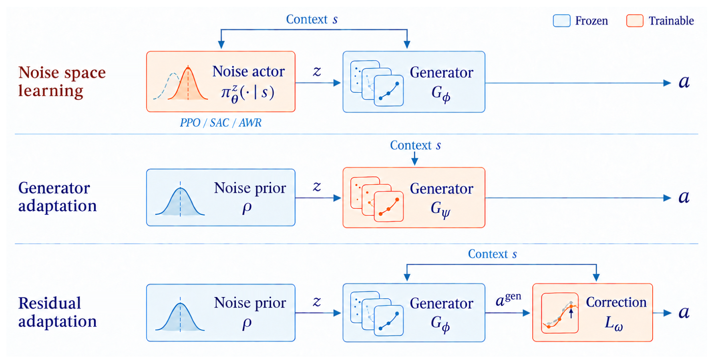
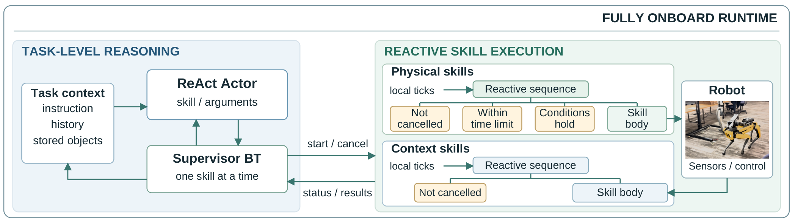

# 2026-10-12 Embodied AI & World Models Daily

> 面向具身智能 / Robotics 研究员与工程师。主窗口：北京时间 2026-10-12 00:00–23:59；补充窗口：2026-10-10 00:00–2026-10-11 23:59。

**本期导读：** 3 篇必读、4 篇论文雷达、1 项工程更新；完成 5 篇全文精读。重点是部署场景的数据生成、冻结 VLA 的噪声适配，以及世界模型如何承担持续学习的记忆。

**日期与覆盖说明：** arXiv 最新公开的 10 月 12 日公告批次不等于 10 月 12 日首次提交。本次从官方分类列表提取并去重核对 96 个候选的摘要与提交历史；11 个处于补充窗口，85 个在窗口外，当前已公开批次没有核实到主窗口首次提交的达标论文。以下 7 篇全部标明真实提交时间，不能据此推断当天没有新投稿。工程部分的 Genesis 发布在主窗口。**来源检查不完整：Physical Intelligence 博客访问失败；其余已检查来源及范围见末尾。**

评分是编辑判断，不是排行榜：通过相关性预筛后，按内容类型的五维权重分别评估两次，取平均；T1 门槛 62、T1.5 门槛 68、T2 门槛 75。没有核实到独立社区关注证据的项目，community 记 0；机构名气不加分。

## 🔥 今日必读

### 1. 【Real-to-Sim-to-Real】Splat2Act：把用户场景变成抓取训练数据

**来源：** [arXiv:2610.13945v1](https://arxiv.org/abs/2610.13945)（cs.RO；Georgia Tech、Waymo、Toyota Research Institute）\
**类型：** Paper · T1\
**发布时间：** 2026-10-10 01:59:06 北京时间，首次提交；**补充窗口**\
**评分：** 87.80/100（两次 88.4 / 87.2）\
**关键词：** VLA · Real-to-Sim · 场景个性化

**一句话：** 手机 RGB-D 扫描加物体照片和尺寸，自动生成部署场景中的可抓取任务与示范，再用两阶段微调把通用策略适配到用户物体。

**技术要点：**

- 3D Gaussian Splatting 提供视觉，网格提供碰撞几何；系统发现桌面、架子等承载面，筛选可达、可稳定放置和可抓取任务，使用具备特权状态的仿真 oracle 生成示范。101 个校园场景产生 852 个承载面和 68,021 条示范。
- 第一阶段用 556 个公共物体适配机器人与场景分布，第二阶段用用户物体个性化。Office 最强方案达到 62.5%，直接个性化为 45.0%；真实 Stretch 3 的 12 任务、36 次试验为 63.9%，对应仿真 12 次为 66.7%。样本量与条件应一起看。
- 原始策略的 0% 包含未见过 Stretch 本体和本文动作空间的影响，不能归因于视觉域差异。跨场景迁移仍弱：OOD 桌面试验仅 22.2%–33.3%；建筑级重建也没有验证全屋自主导航取物。

**为什么值得关注：** 它把每场景遥操作成本转为数据引擎成本，最适合讨论“已知部署场景的抓取个性化”。复现时应分别检查视觉、碰撞、可达性和动作接口，避免把 oracle 数据当成免费监督。

**资源：** [Paper](https://arxiv.org/abs/2610.13945) · [项目页](https://splat2act.github.io/) · [全文精读](../paper-reading/news/2026-10-12/splat2act/splat2act.md)。未找到可确认的公开官方代码或权重；论文称数据集拟在接收后发布。

### 2. 【World Model × 持续学习】Dream to Remember：世界模型做记忆，噪声模块学新任务

**来源：** [arXiv:2610.13816v1](https://arxiv.org/abs/2610.13816)（机器人学习；University of Freiburg、Technical University of Munich）\
**类型：** Paper · T1\
**发布时间：** 2026-10-10 00:28:01 北京时间，首次提交；**补充窗口**\
**评分：** 86.55/100（两次 86.9 / 86.2）\
**关键词：** World Model · Continual Learning · 噪声引导

**一句话：** 冻结策略和世界模型，用小噪声模块学习新行为，同时在世界模型生成的旧任务状态上维持上一阶段的行为分布；低保真想象也可能适合复习。

**技术要点：**

- 每阶段重新初始化当前噪声模块，冻结上一阶段模块作为参考；用新任务奖励和旧任务状态上的 KL 约束共同优化。它既不是无限叠加任务模块，也不是原地续训上一阶段模块。
- 世界模型可信时可在想象中学新任务；不够可信时，新任务通过真实环境 SAC 学习，旧技能仍用想象复习。LIBERO 新任务从 10.4% 到 74.9%，省略复习会使旧任务下降约 30.8 个百分点；纯想象示范的行为克隆只有 19.6%，不能说世界模型已替代真实训练。
- CALVIN 连续 8 任务结果从 63.7% 到 74.8%。真实 Franka 的三个新任务分别提高 40、20、30 个百分点，按每阶段 20 次评估；世界模型预训练使用约 6 小时 play 数据。约 400 初始帧与约 5.9 万帧回放缓存的比较不包含模型存储。

**为什么值得关注：** 世界模型的用途可以分层：生成足以保持旧行为的状态，并不要求它已经能准确优化新接触技能。冻结底座本身不防遗忘，行为约束才是持续学习机制。

**资源：** [Paper](https://arxiv.org/abs/2610.13816) · [全文精读](../paper-reading/news/2026-10-12/dream-to-remember/dream-to-remember.md)。论文声称实现公开，本次未确认可对应此论文的官方代码或权重仓库。

### 3. 【VLA 适配】Noise Space Learning：比较噪声接口的效果与真实成本

**来源：** [arXiv:2610.13943v1](https://arxiv.org/abs/2610.13943)（VLA / policy learning；UTS、Microsoft Research、Nanjing University、Tsinghua University）\
**类型：** Paper · T1\
**发布时间：** 2026-10-10 01:58:50 北京时间，首次提交；**补充窗口**\
**评分：** 84.05/100（两次 84.6 / 83.5）\
**关键词：** VLA · Flow Matching · 机器人 RL

**一句话：** 保持 flow VLA 的动作生成器冻结，只学习条件噪声分布，并用理论、PPO/SAC/AWR 对照和真机实验辨明这种接口的收益与失败边界。

**技术要点：**

- 理论说明在确定性生成器、目标分布绝对连续且噪声分布足够灵活等假设下，改变噪声可以表达行为分布变化；它不保证一个受约束的小网络能达到任意最优策略，也不是首次提出噪声引导。
- LIBERO 两种数据设置平均值：SAC 83.5%、AWR 79.1%、PPO 81.6%；相应更新耗时约 9.93、1.09、2.34 秒，Action-AWR 为 210.20 秒。**这些数字不含环境采样与评估，更不是端到端训练加速比。**
- 四个真机任务、每任务 40 次评估中，自主 AWR 为 71.3%，初始策略 37.5%；人类反馈 AWR 为 83.8%，DAgger 为 66.3%。仿真表现强的 SAC 在真实穿珠任务产生非预期桌面接触，即使限制噪声也不能推导出安全保证。

**为什么值得关注：** 选择适配接口时，应同时衡量梯度更新、交互预算和真实接触风险。冻结 VLA 能降低更新开销，但采样仍需完整模型前向推理；不能只用离线计算时间决定真机优化器。

**资源：** [Paper](https://arxiv.org/abs/2610.13943) · [全文精读](../paper-reading/news/2026-10-12/noise-space-vla/noise-space-vla.md)。未找到可确认的公开官方代码或权重。

## 📄 论文雷达

### 【时间与延迟】Chronos Policy: Learning Robot Policies on Physical Time

**来源：** [arXiv:2610.13929v1](https://arxiv.org/abs/2610.13929) · Stanford\
**发布时间：** 2026-10-10 01:55:20 北京时间，首次提交；**补充窗口**\
**关键词：** Diffusion Policy · 异步传感 · 物理时间\
**核心贡献：** 让观测携带采集时间、动作携带目标执行时间，注意力使用相对物理时差；训练时独立随机化频率和延迟，执行时丢弃过期动作，处理观测与推理时序变化。

Conveyor 组合扰动从 DP 的 0% 到 32.7%；真机移动杯子的组合条件评分 55 对 30，但指标给部分完成半分，不能写成完整成功率。Threading 组合扰动反而由 77.3% 降到 63.3%。小样本真实评估支持有限扰动条件的优势。

**值得关注程度：** 81.55/100（两次 82.1 / 81.0） · T1\
**资源：** [Paper](https://arxiv.org/abs/2610.13929) · [项目页](https://changhaowang.github.io/chronospolicy/) · [全文精读](../paper-reading/news/2026-10-12/chronos-policy/chronos-policy.md)；未确认公开官方代码。

### 【端侧 Agent】BT-Agent: Deploying Onboard Robot Agents with Behavior Trees and Multi-Fidelity Evaluation

**来源：** [arXiv:2610.13862v1](https://arxiv.org/abs/2610.13862) · Stanford、UC Berkeley、NVIDIA\
**发布时间：** 2026-10-10 01:08:45 北京时间，首次提交；**补充窗口**\
**关键词：** Behavior Tree · Onboard LLM · 反应式执行\
**核心贡献：** 模型选择预定义技能，本地行为树持续检查守卫、取消和超时，结构化反馈再进入模型；文本、Habitat 与 Spot 三层评估揭示廉价测试与物理执行的差距。

文本成功案例只有 57.3% 也能在 Habitat 成功。Spot 15 次真机试验完成 11 次，仍由操作员批准运动，场景图也含人工修正；9 次干预的 19 ms 是取消到零指令的中位时间，并非机器人身体停稳耗时。

**值得关注程度：** 77.95/100（两次 78.3 / 77.6） · T1\
**资源：** [Paper](https://arxiv.org/abs/2610.13862) · [全文精读](../paper-reading/news/2026-10-12/bt-agent/bt-agent.md)；官方代码仅有未来 Apache-2.0 发布承诺，本次未确认仓库。

### 【经验迁移审计】MC-EvoBench: Auditing Experience-Driven Self-Improvement in Minecraft Agents

**来源：** [arXiv:2610.13829v1](https://arxiv.org/abs/2610.13829)\
**发布时间：** 2026-10-10 00:37:39 北京时间，首次提交；**补充窗口**\
**关键词：** Embodied Benchmark · 经验迁移 · 匹配预算\
**核心贡献：** 19 条演化链、三类配对迁移探针；目标世界重置，只允许声明的记忆或技能产物跨任务传递，在匹配步数预算和 5 个种子下隔离资源继承与先前暴露的影响。

相关经验没有稳定优于无关经验：工具探针未改善，木材种类的小收益依赖单一种子，区间均含零。它审计的是交互式 Minecraft 能力，不能直接推出真实机器人的自我改进结论。当日未全文精读，不嵌未经视觉审查的图片。

**值得关注程度：** 76.85/100（两次 77.2 / 76.5） · T1\
**资源：** [Paper](https://arxiv.org/abs/2610.13829) · [GitHub](https://github.com/xzw-ustc/mc-bench-open-source)。

### 【导航预演】HorizonNav: Geometry-Guided Video Diffusion for Anticipatory 3D Robot Navigation

**来源：** [arXiv:2610.13849v1](https://arxiv.org/abs/2610.13849)\
**发布时间：** 2026-10-10 00:57:08 北京时间，首次提交；**补充窗口**\
**关键词：** 视频生成 · 几何对齐 · Navigation\
**核心贡献：** 从 RGB 与语言生成未来视图，用 ORB-SLAM3 位姿、三角化地标和 Video Depth Anything 对齐稠密深度，构造供规划使用的想象空间；重点是几何一致性而非视频观感。

19 场景中可规划场景由 13 到 15，RRT 成功由 62/90 到 75/90；25 条生成相机轨迹有 6 条违反重建碰撞约束。**验证发生在想象重建空间，不能当作真实避障安全证明。** 当日未全文精读，不嵌未经视觉审查的图片。

**值得关注程度：** 65.55/100（两次 66.2 / 64.9） · T1\
**资源：** [Paper](https://arxiv.org/abs/2610.13849)。未确认配套公开官方代码或权重。

## 🛠 工程与开源

### Genesis v1.4.4：修复接触与 GPU 确定性，缩减仿真和编译成本

**来源：** [官方 Release](https://github.com/Genesis-Embodied-AI/genesis-world/releases/tag/v1.4.4) · Engineering · T1\
**发布时间：** 2026-10-12 05:53:18 北京时间（GitHub published_at 换算；**主窗口**）\
**评分：** 69.60/100（两次 69.4 / 69.8）

更新修复凸体接触深度、法向、位置和碰撞边界问题，以及 GPU 仿真的非确定性；异构实体支持不同尺度、固定基座位姿与关节参数。性能侧优化 GPU 刚体仿真，降低异构实体内存占用，减少内核重编译并限制跨场景尺寸的求解器编译数量，同时从 TorchScript 迁移到 torch.compile。

对于接触丰富的 RL、批量仿真与域随机化，这些改动比仅看名义吞吐更重要：改变接触结果和确定性也可能改变训练轨迹。**官方发布说明没有给出统一加速倍数，本期未运行 benchmark，也未验证具体任务回归。** 升级实验应保留原版本、种子与接触配置进行比较。代码：[GitHub](https://github.com/Genesis-Embodied-AI/genesis-world)。

## 💬 社区信号

本次公开社区与仓库检索未核实到足够强、且在窗口内的独立技术讨论信号，不强行凑条目。作者自行发布与单个仓库创建都不能证明“社区正在集中关注”。新发现的 dreamforge 作为未达门槛候选登记在下方，不包装成世界模型突破或热门话题。

## 🔎 补充窗口筛选记录

下表列出全部 11 个窗口内 arXiv 候选。主窗口的论文发现受公告节奏限制；窗口归属只用实际提交时间，不用公告标题日期。

| 候选 | 实际首次提交（北京时间） | 决定与理由 |
|---|---|---|
| [arXiv:2610.13788v1](https://arxiv.org/abs/2610.13788) — When LiDAR Fades, Radar Takes Over: LiDAR Reliability-Aware Adaptive Localization Under Airborne Obscurants | 2026-10-10 00:04:41 | BLOCK：LiDAR/Radar 定位可靠性，主要为 SLAM 感知融合而非学习决策 |
| [arXiv:2610.13816v1](https://arxiv.org/abs/2610.13816) — Dream to Remember: Continual Steering of Generalist Robot Policies with World Models | 2026-10-10 00:28:01 | 收录：必读；世界模型复习与持续学习 |
| [arXiv:2610.13829v1](https://arxiv.org/abs/2610.13829) — MC-EvoBench: Auditing Experience-Driven Self-Improvement in Minecraft Agents | 2026-10-10 00:37:39 | 收录：雷达；匹配预算的经验迁移基准 |
| [arXiv:2610.13838v1](https://arxiv.org/abs/2610.13838) — Mapless, Stabilizing, and Anti-Stuck Flipper Control for Articulated Tracked Robots | 2026-10-10 00:48:23 | BLOCK：地图无关履带翻板稳定/防卡控制，未见本期关注的学习或基础模型贡献 |
| [arXiv:2610.13849v1](https://arxiv.org/abs/2610.13849) — HorizonNav: Geometry-Guided Video Diffusion for Anticipatory 3D Robot Navigation | 2026-10-10 00:57:08 | 收录：雷达；想象几何用于规划，真实验证有限 |
| [arXiv:2610.13862v1](https://arxiv.org/abs/2610.13862) — BT-Agent: Deploying Onboard Robot Agents with Behavior Trees and Multi-Fidelity Evaluation | 2026-10-10 01:08:45 | 收录：雷达并精读；本地技能守卫与多保真评估 |
| [arXiv:2610.13872v1](https://arxiv.org/abs/2610.13872) — Tracking the Invisible: Self-Supervised Wheel Track Detection with Thermal-RGB Fusion | 2026-10-10 01:21:28 | BLOCK：热成像/RGB 轮迹检测，主要为感知而非可泛化机器人学习方法 |
| [arXiv:2610.13891v1](https://arxiv.org/abs/2610.13891) — Beyond the Snowflakes: Disentangling Weather Effects from Confounding Meta-Factors in LiDAR Object Detection | 2026-10-10 01:38:30 | BLOCK：自动驾驶 LiDAR 检测的天气因素拆解，无机器人决策落点 |
| [arXiv:2610.13929v1](https://arxiv.org/abs/2610.13929) — Chronos Policy: Learning Robot Policies on Physical Time | 2026-10-10 01:55:20 | 收录：雷达并精读；显式时间与时序扰动 |
| [arXiv:2610.13943v1](https://arxiv.org/abs/2610.13943) — Noise Space Learning for VLA Adaptation | 2026-10-10 01:58:50 | 收录：必读；噪声适配理论、计算预算和真机对照 |
| [arXiv:2610.13945v1](https://arxiv.org/abs/2610.13945) — Splat2Act: From Captured Scenes to Personalized VLA Manipulation | 2026-10-10 01:59:06 | 收录：必读；场景数据引擎与真实抓取验证 |

**其他候选与去重：**

| 候选 | 实际公开时间（北京时间） | 排除原因 |
|---|---|---|
| [rzc156/dreamforge](https://github.com/rzc156/dreamforge) | 仓库创建 2026-10-12 13:09:09；已核实窗口内 [提交 3e4c74c01cf1](https://github.com/rzc156/dreamforge/commit/3e4c74c01cf1)，15:04:13 | T2 / open_source，69.75/100（两次 68.9 / 70.6），未达 75。LIBERO 单套件、单底座、单训练种子的原型；虽有精确状态回放和随机对照，未独立复现，不作为重大研究成果。 |
| NVIDIA SSD pick/place 三个任务导出仓库，[联合模型卡](https://huggingface.co/nvidia/agile_one_s_pickplace_ssd_n2_18200) | 仓库创建 2026-10-10 08:17:13–08:20:17 | 联合导出当前模型卡说明 4 相机、State54/Action54、逻辑 chunk32 和专用任务合同；T1 / engineering，54.35/100（两次 53.6 / 55.1），未达 62。未声明完整 ONNX 数值一致性、TensorRT 验证或机器人成功率；创建时间也不能单独证明当前所有文件在窗口内已发布。 |
| [Satvik1701/RoboARCade](https://github.com/Satvik1701/RoboARCade) | 仓库创建 2026-10-12 12:45:32 | UNKNOWN：截至主窗口末的提交查询返回空，未核实窗口内已经公开可检查的 benchmark 内容；创建元数据不作为成果发布时间。 |
| TokenPB | 已在 2026-10-10 日报收录 | 同一事件去重，本期不重复计数；见 [前期日报](2026-10-10.md)。 |

dreamforge 的窗口内版本报告：想象修正 13.6%，等预算随机扰动 14.7%；修正数据微调 57.0%，底座 61.0%，回放对照 58.0%。这类负结果值得在复现设计中参考，但仍只代表作者公布的有限实验。[窗口内 README](https://github.com/rzc156/dreamforge/blob/3e4c74c01cf1/README.md)

85 个窗口外候选的提交历史核对（展开查看）

以下是官方最新公告批次中核对后排除的候选。普通旧版本或窗口外更新不当作窗口内新成果；日期为本次摘要页核实的最新版本提交时间。

| 论文 | 最新版本提交（北京时间） | 排除原因 |
|---|---|---|
| [SmolWAM: A Latent World-Action Model for Robotic Manipulation on Edge Devices — arXiv:2610.13740v1](https://arxiv.org/abs/2610.13740) | 2026-10-09 23:34:33 | 实际提交在 2026-10-10 00:00 之前，公告日期不改变窗口归属 |
| [Towards a Unified Taxonomy of Agricultural Harvesting Technologies: Linking Physical Interaction, Automation, and Selectivity — arXiv:2610.13688v1](https://arxiv.org/abs/2610.13688) | 2026-10-09 22:52:52 | 实际提交在 2026-10-10 00:00 之前，公告日期不改变窗口归属 |
| [Cooperative Aerial Transportation of a Payload with a Sliding Cable Attachment — arXiv:2610.13665v1](https://arxiv.org/abs/2610.13665) | 2026-10-09 22:35:25 | 实际提交在 2026-10-10 00:00 之前，公告日期不改变窗口归属 |
| [AutoBio+: Benchmarking Dexterous Manipulation with Dynamic Experimental Phenomena in Realistic Laboratories — arXiv:2610.13643v1](https://arxiv.org/abs/2610.13643) | 2026-10-09 22:21:41 | 实际提交在 2026-10-10 00:00 之前，公告日期不改变窗口归属 |
| [JitterVLA: A Replay Benchmark for Motion Quality in VLA-Driven Human-Robot Manipulation — arXiv:2610.13628v1](https://arxiv.org/abs/2610.13628) | 2026-10-09 22:09:55 | 实际提交在 2026-10-10 00:00 之前，公告日期不改变窗口归属 |
| [RARA: Robust Policy Fine-Tuning through Retrieval-Anchored Representation Alignment for Robotic Manipulation — arXiv:2610.13578v1](https://arxiv.org/abs/2610.13578) | 2026-10-09 21:31:20 | 实际提交在 2026-10-10 00:00 之前，公告日期不改变窗口归属 |
| [ATHLETE: Learning Reactive Humanoid Tennis via Trajectory-Guided Motion Matching — arXiv:2610.13572v1](https://arxiv.org/abs/2610.13572) | 2026-10-09 21:25:56 | 实际提交在 2026-10-10 00:00 之前，公告日期不改变窗口归属 |
| [Beyond Successful Robot Demonstrations: Learning from Human Interactions and Modeling Failure Dynamics — arXiv:2610.13522v1](https://arxiv.org/abs/2610.13522) | 2026-10-09 20:44:18 | 实际提交在 2026-10-10 00:00 之前，公告日期不改变窗口归属 |
| [RESCUE: Is This Alarm Worth Acting On? Counterfactual Evaluation of VLA Runtime Monitors — arXiv:2610.13516v1](https://arxiv.org/abs/2610.13516) | 2026-10-09 20:38:35 | 实际提交在 2026-10-10 00:00 之前，公告日期不改变窗口归属 |
| [Reflect-VLA: Internalizing Reflective Guidance via Dual-Path On-Policy Self-Distillation for Autonomous Driving — arXiv:2610.13453v1](https://arxiv.org/abs/2610.13453) | 2026-10-09 19:52:17 | 实际提交在 2026-10-10 00:00 之前，公告日期不改变窗口归属 |
| [ManeuverFlow: Maneuver Hypothesis Generation with Future Evidence for Trajectory Evaluation and Refinement in End-to-End Autonomous Driving — arXiv:2610.13409v1](https://arxiv.org/abs/2610.13409) | 2026-10-09 19:20:55 | 实际提交在 2026-10-10 00:00 之前，公告日期不改变窗口归属 |
| [Robot-WATCHDOG : failure detection through object-centric graph representation — arXiv:2610.13403v1](https://arxiv.org/abs/2610.13403) | 2026-10-09 19:19:25 | 实际提交在 2026-10-10 00:00 之前，公告日期不改变窗口归属 |
| [EndoRSI: Physical-Evidence-Driven Recursive Improvement of Endoscopic Robot Policies — arXiv:2610.13376v1](https://arxiv.org/abs/2610.13376) | 2026-10-09 18:49:39 | 实际提交在 2026-10-10 00:00 之前，公告日期不改变窗口归属 |
| [PartiGen: Part-Aware Representations for Language-Conditioned Humanoid Motion Generation — arXiv:2610.13373v1](https://arxiv.org/abs/2610.13373) | 2026-10-09 18:46:40 | 实际提交在 2026-10-10 00:00 之前，公告日期不改变窗口归属 |
| [Evo-RL: Iterative Robot Reinforcement Learning from Selective Experience — arXiv:2610.13345v1](https://arxiv.org/abs/2610.13345) | 2026-10-09 18:19:54 | 实际提交在 2026-10-10 00:00 之前，公告日期不改变窗口归属 |
| [Dual-Stream Memory for Vision-Language-Action Policies — arXiv:2610.13262v1](https://arxiv.org/abs/2610.13262) | 2026-10-09 17:14:59 | 实际提交在 2026-10-10 00:00 之前，公告日期不改变窗口归属 |
| [Beyond Actions: Learning Future Operation Targets for Vision-Language-Action Models — arXiv:2610.13212v1](https://arxiv.org/abs/2610.13212) | 2026-10-09 16:29:46 | 实际提交在 2026-10-10 00:00 之前，公告日期不改变窗口归属 |
| [PATACON: GPU-Parallel Tangent-Bundle RRT-Connect for Constrained Motion Planning — arXiv:2610.13195v1](https://arxiv.org/abs/2610.13195) | 2026-10-09 16:13:29 | 实际提交在 2026-10-10 00:00 之前，公告日期不改变窗口归属 |
| [Prediction-Informed Landing Window Planning for UAV Landing on USV in High Sea States — arXiv:2610.13190v1](https://arxiv.org/abs/2610.13190) | 2026-10-09 16:12:13 | 实际提交在 2026-10-10 00:00 之前，公告日期不改变窗口归属 |
| [Grounded-Dreamer: Robot Learning from World Model Synthetic Data with Physical Grounding — arXiv:2610.13164v1](https://arxiv.org/abs/2610.13164) | 2026-10-09 15:53:20 | 实际提交在 2026-10-10 00:00 之前，公告日期不改变窗口归属 |
| [Low-Latency Mapless ESDF Queries for MAV Reactive Collision Avoidance — arXiv:2610.13158v1](https://arxiv.org/abs/2610.13158) | 2026-10-09 15:48:39 | 实际提交在 2026-10-10 00:00 之前，公告日期不改变窗口归属 |
| [Human2Dex: Dexterous Robot Learning from Wrist-Centric Human Demonstrations — arXiv:2610.13119v1](https://arxiv.org/abs/2610.13119) | 2026-10-09 15:14:53 | 实际提交在 2026-10-10 00:00 之前，公告日期不改变窗口归属 |
| [The value of information and the emergence of communication in evolved e-puck robots — arXiv:2610.13118v1](https://arxiv.org/abs/2610.13118) | 2026-10-09 15:12:50 | 实际提交在 2026-10-10 00:00 之前，公告日期不改变窗口归属 |
| [Forward Dynamics Models — arXiv:2610.13117v1](https://arxiv.org/abs/2610.13117) | 2026-10-09 15:12:16 | 实际提交在 2026-10-10 00:00 之前，公告日期不改变窗口归属 |
| [ReAT: Residual Action Tokenization for Autoregressive Robot Policies — arXiv:2610.13093v1](https://arxiv.org/abs/2610.13093) | 2026-10-09 14:45:35 | 实际提交在 2026-10-10 00:00 之前，公告日期不改变窗口归属 |
| [Belief-Overlap Partial Inversion: Object-Centric Flow Replanning for Humanoid Loco-Manipulation — arXiv:2610.13087v1](https://arxiv.org/abs/2610.13087) | 2026-10-09 14:40:27 | 实际提交在 2026-10-10 00:00 之前，公告日期不改变窗口归属 |
| [VICAR: Video Imitation with Contact-Aware Retargeting for Humanoid Interactive Skills — arXiv:2610.13079v1](https://arxiv.org/abs/2610.13079) | 2026-10-09 14:34:26 | 实际提交在 2026-10-10 00:00 之前，公告日期不改变窗口归属 |
| [Towards Safer Cities: A Design Process for Perception Datasets in Urban Driving Scenarios — arXiv:2610.13077v1](https://arxiv.org/abs/2610.13077) | 2026-10-09 14:34:17 | 实际提交在 2026-10-10 00:00 之前，公告日期不改变窗口归属 |
| [Failure-Resilient Multi-Robot Coordination with $k$-Connectivity Constrained Submodular Maximization — arXiv:2610.13049v1](https://arxiv.org/abs/2610.13049) | 2026-10-09 14:04:45 | 实际提交在 2026-10-10 00:00 之前，公告日期不改变窗口归属 |
| [CeDR-Nav: Cross-Embodiment Mapless Navigation via Offline Demonstration Recasting — arXiv:2610.13007v1](https://arxiv.org/abs/2610.13007) | 2026-10-09 13:08:44 | 实际提交在 2026-10-10 00:00 之前，公告日期不改变窗口归属 |
| [EgoReveal: Learning Active Vision and Object Manipulation under Partial Occlusions from Egocentric Demonstrations — arXiv:2610.12999v1](https://arxiv.org/abs/2610.12999) | 2026-10-09 13:03:34 | 实际提交在 2026-10-10 00:00 之前，公告日期不改变窗口归属 |
| [Adaptive Whole-Body MPC with Optimal Posture Planning for Humanoid Robots under Unknown Payloads — arXiv:2610.12972v1](https://arxiv.org/abs/2610.12972) | 2026-10-09 12:12:13 | 实际提交在 2026-10-10 00:00 之前，公告日期不改变窗口归属 |
| [JoyInside-VLM-Agent: Product-Conditioned Multimodal Policy Learning for Embodied Agents — arXiv:2610.12957v1](https://arxiv.org/abs/2610.12957) | 2026-10-09 11:54:58 | 实际提交在 2026-10-10 00:00 之前，公告日期不改变窗口归属 |
| [Evo-World: A Lightweight Vision-Language-Action Model with Future Motion Prediction via Optical-Flow Supervision — arXiv:2610.12936v1](https://arxiv.org/abs/2610.12936) | 2026-10-09 11:38:02 | 实际提交在 2026-10-10 00:00 之前，公告日期不改变窗口归属 |
| [Sampling-based Kinodynamic Planning with World Models — arXiv:2610.12910v1](https://arxiv.org/abs/2610.12910) | 2026-10-09 11:01:00 | 实际提交在 2026-10-10 00:00 之前，公告日期不改变窗口归属 |
| [LeapBot-JAC: Joint Action Chains for World Action Models — arXiv:2610.12886v1](https://arxiv.org/abs/2610.12886) | 2026-10-09 10:21:19 | 实际提交在 2026-10-10 00:00 之前，公告日期不改变窗口归属 |
| [TAME-Nav: Temporal Asymmetric Mixture-of-Experts Distillation for Agile and Versatile Robot Navigation — arXiv:2610.12877v1](https://arxiv.org/abs/2610.12877) | 2026-10-09 10:13:21 | 实际提交在 2026-10-10 00:00 之前，公告日期不改变窗口归属 |
| [Evidence-Guided Counterfactual Learning for Long-Tailed Robotic Policies — arXiv:2610.12861v1](https://arxiv.org/abs/2610.12861) | 2026-10-09 09:37:33 | 实际提交在 2026-10-10 00:00 之前，公告日期不改变窗口归属 |
| [VLMs are Native Action Models: Unleashing the Manipulation Capabilities of VLMs with Explicit Action-Space Grounding — arXiv:2610.12832v1](https://arxiv.org/abs/2610.12832) | 2026-10-09 08:33:13 | 实际提交在 2026-10-10 00:00 之前，公告日期不改变窗口归属 |
| [Cubic Spline Interpolation for Smooth Trajectory Generation in Autonomous Motion Systems — arXiv:2610.12826v1](https://arxiv.org/abs/2610.12826) | 2026-10-09 08:12:59 | 实际提交在 2026-10-10 00:00 之前，公告日期不改变窗口归属 |
| [LeWAM: End-to-End World and Action Modeling with JEPAs — arXiv:2610.12818v1](https://arxiv.org/abs/2610.12818) | 2026-10-09 07:58:36 | 实际提交在 2026-10-10 00:00 之前，公告日期不改变窗口归属 |
| [Gamma: Grounded Multi-Agent Memory with Mechanical Audit for Memory-Intensive Manipulation — arXiv:2610.12793v1](https://arxiv.org/abs/2610.12793) | 2026-10-09 07:00:01 | 实际提交在 2026-10-10 00:00 之前，公告日期不改变窗口归属 |
| [Tactile Sensing-based Secure and Gentle Grasping of Unknown Objects — arXiv:2610.12790v1](https://arxiv.org/abs/2610.12790) | 2026-10-09 06:48:24 | 实际提交在 2026-10-10 00:00 之前，公告日期不改变窗口归属 |
| [Multimodal Image-based Robotic Assistance and Guidance Environment (MIRAGE): A Novel Unified Framework for Surgical Navigation and Visualization — arXiv:2610.12780v1](https://arxiv.org/abs/2610.12780) | 2026-10-09 06:37:38 | 实际提交在 2026-10-10 00:00 之前，公告日期不改变窗口归属 |
| [Reflex: Visually Grounded Reactive Humanoid Control — arXiv:2610.12772v1](https://arxiv.org/abs/2610.12772) | 2026-10-09 06:24:03 | 实际提交在 2026-10-10 00:00 之前，公告日期不改变窗口归属 |
| [Verifier-Mediated Multi-LLM Coordination for Multi-Robot Path Planning — arXiv:2610.12761v1](https://arxiv.org/abs/2610.12761) | 2026-10-09 06:12:10 | 实际提交在 2026-10-10 00:00 之前，公告日期不改变窗口归属 |
| [Trajectory Prediction for Autonomous Driving in Road Construction Zones Using Human-in-the-Loop Driving Data — arXiv:2610.12747v1](https://arxiv.org/abs/2610.12747) | 2026-10-09 05:48:35 | 实际提交在 2026-10-10 00:00 之前，公告日期不改变窗口归属 |
| [StereoEngine: Scaling Stereo Bimanual Robot Data without Stereo Cameras — arXiv:2610.12734v1](https://arxiv.org/abs/2610.12734) | 2026-10-09 05:28:58 | 实际提交在 2026-10-10 00:00 之前，公告日期不改变窗口归属 |
| [Visual-Wi-Fi Navigation to Signal-Emitting Devices — arXiv:2610.12733v1](https://arxiv.org/abs/2610.12733) | 2026-10-09 05:28:25 | 实际提交在 2026-10-10 00:00 之前，公告日期不改变窗口归属 |
| [REMM: Revisable Embodied Memory for Manipulation — arXiv:2610.12710v1](https://arxiv.org/abs/2610.12710) | 2026-10-09 04:42:35 | 实际提交在 2026-10-10 00:00 之前，公告日期不改变窗口归属 |
| [FallGown: A Soft Pneumatic Wearable Device for Fall Prevention — arXiv:2610.12706v1](https://arxiv.org/abs/2610.12706) | 2026-10-09 04:36:53 | 实际提交在 2026-10-10 00:00 之前，公告日期不改变窗口归属 |
| [Spa-Bench: A Real-Robot Benchmark for Spatial Grounding in Vision-Language-Action Models — arXiv:2610.12696v1](https://arxiv.org/abs/2610.12696) | 2026-10-09 04:22:35 | 实际提交在 2026-10-10 00:00 之前，公告日期不改变窗口归属 |
| [Non-Prehensile Multi-Object Placement with Mobile Robots via Diffusion-Based Trajectory Planning — arXiv:2610.12684v1](https://arxiv.org/abs/2610.12684) | 2026-10-09 04:09:16 | 实际提交在 2026-10-10 00:00 之前，公告日期不改变窗口归属 |
| [Robust and Scalable UAV-UGV Planning for Aerial Monitoring under Energy and Precedence Constraints — arXiv:2610.12670v1](https://arxiv.org/abs/2610.12670) | 2026-10-09 03:47:55 | 实际提交在 2026-10-10 00:00 之前，公告日期不改变窗口归属 |
| [PriMoRetarget: Humanoid Motion Transfer Through Prioritized Motion Retargeting — arXiv:2610.12642v1](https://arxiv.org/abs/2610.12642) | 2026-10-09 03:03:01 | 实际提交在 2026-10-10 00:00 之前，公告日期不改变窗口归属 |
| [Distributed Harmonic-Covariance Feedback for Hole Closure in Planar Robot Swarms — arXiv:2610.12637v1](https://arxiv.org/abs/2610.12637) | 2026-10-09 02:59:52 | 实际提交在 2026-10-10 00:00 之前，公告日期不改变窗口归属 |
| [Selectively Actuated Fiberbots for High-precision Minimally Invasive Surgery — arXiv:2610.12636v1](https://arxiv.org/abs/2610.12636) | 2026-10-09 02:59:35 | 实际提交在 2026-10-10 00:00 之前，公告日期不改变窗口归属 |
| [Image-Based Path-Planning for Navigation of Soft-Growing Robots in the Spinal Sub-Arachnoid Space — arXiv:2610.12631v1](https://arxiv.org/abs/2610.12631) | 2026-10-09 02:53:25 | 实际提交在 2026-10-10 00:00 之前，公告日期不改变窗口归属 |
| [Graph-Based Heuristics for Minimum Constraint Removal in Cluttered Robot Motion Planning — arXiv:2610.12609v1](https://arxiv.org/abs/2610.12609) | 2026-10-09 02:30:18 | 实际提交在 2026-10-10 00:00 之前，公告日期不改变窗口归属 |
| [CASTER: Formalizing Zero-Shot Manipulation from Synthetic Videos as Constrained Optimization — arXiv:2610.12567v1](https://arxiv.org/abs/2610.12567) | 2026-10-09 02:00:55 | 实际提交在 2026-10-10 00:00 之前，公告日期不改变窗口归属 |
| [What Should Embodied Agents Remember? Benchmarking and Evaluating Memory Modality for Embodied Agents — arXiv:2610.12561v1](https://arxiv.org/abs/2610.12561) | 2026-10-09 02:00:03 | 实际提交在 2026-10-10 00:00 之前，公告日期不改变窗口归属 |
| [PanTact: Teaching Whole-Body Dexterity with a Wearable Contact Interface — arXiv:2610.12558v1](https://arxiv.org/abs/2610.12558) | 2026-10-09 02:00:02 | 实际提交在 2026-10-10 00:00 之前，公告日期不改变窗口归属 |
| [Fly-by-Code: Embodied Coding Agents for Aerial Manipulation with Active Visual and Physical Feedback — arXiv:2610.12549v1](https://arxiv.org/abs/2610.12549) | 2026-10-09 02:00:00 | 实际提交在 2026-10-10 00:00 之前，公告日期不改变窗口归属 |
| [MARGoS: A Configuration-Driven Platform for Reproducible MARL Experiments in ARGoS — arXiv:2610.13772v1](https://arxiv.org/abs/2610.13772) | 2026-10-09 23:55:16 | 实际提交在 2026-10-10 00:00 之前，公告日期不改变窗口归属 |
| [LAPT-Scale: Scaling Embodied Policies with Latent Action Pre-Training on Human Videos — arXiv:2610.13732v1](https://arxiv.org/abs/2610.13732) | 2026-10-09 23:29:20 | 实际提交在 2026-10-10 00:00 之前，公告日期不改变窗口归属 |
| [Probabilistic Ship Trajectory Forecasting using Transformer Models on AIS Data — arXiv:2610.13557v1](https://arxiv.org/abs/2610.13557) | 2026-10-09 21:13:07 | 实际提交在 2026-10-10 00:00 之前，公告日期不改变窗口归属 |
| [MAGMA-Bench: Evaluating Long-Horizon Embodied Agents under Dynamic Tasks and Execution Failures — arXiv:2610.13534v1](https://arxiv.org/abs/2610.13534) | 2026-10-09 20:54:11 | 实际提交在 2026-10-10 00:00 之前，公告日期不改变窗口归属 |
| [A Local Agentic AI Framework to Generate Edge Case Scenarios for Safety Assurance — arXiv:2610.13479v1](https://arxiv.org/abs/2610.13479) | 2026-10-09 20:13:17 | 实际提交在 2026-10-10 00:00 之前，公告日期不改变窗口归属 |
| [AlphaNIST: Emergent Assembly Skills from Binary Task Rewards — arXiv:2610.13354v1](https://arxiv.org/abs/2610.13354) | 2026-10-09 18:29:21 | 实际提交在 2026-10-10 00:00 之前，公告日期不改变窗口归属 |
| [NovaSplat: Model-Free 6D Object Pose Estimation via 3D Gaussian Splatting Onboarding and Refinement — arXiv:2610.13309v1](https://arxiv.org/abs/2610.13309) | 2026-10-09 17:54:00 | 实际提交在 2026-10-10 00:00 之前，公告日期不改变窗口归属 |
| [Sonic-AMG: Streaming Human Motion Generation from Spatial Audio — arXiv:2610.13300v1](https://arxiv.org/abs/2610.13300) | 2026-10-09 17:47:03 | 实际提交在 2026-10-10 00:00 之前，公告日期不改变窗口归属 |
| [What Visual Representations Do World Action Models Need? — arXiv:2610.13024v1](https://arxiv.org/abs/2610.13024) | 2026-10-09 13:26:20 | 实际提交在 2026-10-10 00:00 之前，公告日期不改变窗口归属 |
| [Reinforcement Learning via Fixed-point Flow Matching — arXiv:2610.12848v1](https://arxiv.org/abs/2610.12848) | 2026-10-09 09:15:10 | 实际提交在 2026-10-10 00:00 之前，公告日期不改变窗口归属 |
| [Distributionally Robust Adaptive Iterative Covariance Steering for Small-Body Proximity Operations — arXiv:2610.12774v1](https://arxiv.org/abs/2610.12774) | 2026-10-09 06:27:51 | 实际提交在 2026-10-10 00:00 之前，公告日期不改变窗口归属 |
| [Mind the Temporal Gap: Evaluating Video Models for Temporal Understanding in Driving — arXiv:2610.12575v1](https://arxiv.org/abs/2610.12575) | 2026-10-09 02:02:22 | 实际提交在 2026-10-10 00:00 之前，公告日期不改变窗口归属 |
| [Imagine the Future, Internalize the Gist: Efficient VLA Reasoning via Internalized Spatiotemporal Imagination — arXiv:2610.02626v2](https://arxiv.org/abs/2610.02626) | 2026-10-08 21:20:13 | 实际提交在 2026-10-10 00:00 之前，公告日期不改变窗口归属 |
| [JANUS: Enhancing Long-Horizon Autonomous Research with Co-Evolving World Models — arXiv:2610.13194v1](https://arxiv.org/abs/2610.13194) | 2026-10-09 16:13:28 | 实际提交在 2026-10-10 00:00 之前，公告日期不改变窗口归属 |
| [RoleWorld: Knowledge Transfer in World Modeling with Functional Role Abstractions — arXiv:2610.13172v1](https://arxiv.org/abs/2610.13172) | 2026-10-09 15:58:45 | 实际提交在 2026-10-10 00:00 之前，公告日期不改变窗口归属 |
| [EmbodiedCLBench: Evaluating Continual Learning for Self-Evolving Embodied Agents — arXiv:2610.13021v1](https://arxiv.org/abs/2610.13021) | 2026-10-09 13:23:00 | 实际提交在 2026-10-10 00:00 之前，公告日期不改变窗口归属 |
| [OGPO: Offline Goal-conditioned Policy Optimization for Recoverable Vision-Language-Action Models — arXiv:2610.12914v1](https://arxiv.org/abs/2610.12914) | 2026-10-09 11:04:50 | 实际提交在 2026-10-10 00:00 之前，公告日期不改变窗口归属 |
| [EvoBelief: Falsifiable World Models for Self-Improving LLM Agents — arXiv:2610.12789v1](https://arxiv.org/abs/2610.12789) | 2026-10-09 06:46:14 | 实际提交在 2026-10-10 00:00 之前，公告日期不改变窗口归属 |
| [Beyond Temporal Proximity: Explanatory World Models for Credit Assignment in Reinforcement Learning — arXiv:2610.13504v1](https://arxiv.org/abs/2610.13504) | 2026-10-09 20:30:14 | 实际提交在 2026-10-10 00:00 之前，公告日期不改变窗口归属 |
| [GLIMPSE: Global-Local Indexing with Multi-Precision Spectral Encoding for Explorable Video World Models — arXiv:2610.13706v1](https://arxiv.org/abs/2610.13706) | 2026-10-09 23:01:34 | 实际提交在 2026-10-10 00:00 之前，公告日期不改变窗口归属 |
| [GuidedNav: Shaping Vision-Language Navigation Representations through Pre-action Attention and Spatial Guidance — arXiv:2610.13122v1](https://arxiv.org/abs/2610.13122) | 2026-10-09 15:18:03 | 实际提交在 2026-10-10 00:00 之前，公告日期不改变窗口归属 |
| [Robust Vision-Language Navigation with Awareness of Instruction-Execution Progress — arXiv:2610.13104v1](https://arxiv.org/abs/2610.13104) | 2026-10-09 14:57:43 | 实际提交在 2026-10-10 00:00 之前，公告日期不改变窗口归属 |

## 📊 今日技术趋势

冻结大策略之后，适配问题转移到了输入分布与数据生产：NSL 改噪声，D2R 用想象约束旧行为，Splat2Act 为部署场景生产监督。三者分别依赖生成器已有的行为支持、世界模型对旧状态的覆盖，以及数字孪生和 oracle 的准确性，不能合并成“冻结底座即可低成本泛化”。

机器人系统还需要把物理时间与局部执行约束显式化：Chronos 解释何时观察、何时动作，BT-Agent 让本地技能在模型思考时仍能检查与中断。模型评估分数、零指令延迟、GPU 更新时间，各自都只衡量系统的一部分。

### 来源检查与精读状态

- **arXiv：** 直接读取 [cs.RO recent](https://arxiv.org/list/cs.RO/recent)、[cs.AI recent](https://arxiv.org/list/cs.AI/recent)、[cs.LG recent](https://arxiv.org/list/cs.LG/recent)、[cs.CV recent](https://arxiv.org/list/cs.CV/recent) 的分页列表及 [cs.RO new](https://arxiv.org/list/cs.RO/new)。本次可见公告日包含 10 月 12、9、8、7、6 日；最新 cs.RO 批次 72 新稿、15 cross-list、45 replacements，新稿及交叉稿全部进入初筛，其他分类补入关键词候选，去重后 96 篇均核对摘要和历史。并未逐篇精读所有四分类论文，也未预测尚未公告的投稿。
- **机构：** 已检查 [DeepMind 博客](https://deepmind.google/blog/)、[NVIDIA GEAR](https://research.nvidia.com/labs/gear/)、[Cosmos](https://www.nvidia.com/en-us/ai/cosmos/)、[1X Discover](https://www.1x.tech/discover)、[Figure News](https://www.figure.ai/news)、[Skild 博客](https://www.skild.ai/blog)。这些已检查公开页没有确认到窗口内另一个达标技术事件；页面列举不是全体研究机构的穷尽检查。
- **明确缺口：** [Physical Intelligence 博客](https://www.pi.website/blog) 网页访问返回 403、直接 HTTP 返回 429，本次未完成博客检查。其 Hugging Face 官方账号列表另行检查，不能替代博客覆盖；因此本期为**来源检查不完整**，不是“当天没有资讯”。
- **会议：** 已检查 [CoRL 2026](https://www.corl.org/)、[RSS 2026 论文目录](https://roboticsconference.org/2026/program/papers/)、[ICRA 2026](https://2026.ieee-icra.org/)、[IROS 2026](https://2026.ieee-iros.org/) 的公开页。CoRL 的截稿日等行政事件不计技术成果；既有节目、论文目录没有可确认的窗口内首次公开时间，不重新包装成新成果。IROS 网页工具初次失败，直接 HTTP 已补查成功；没有逐篇审核全部会议节目或登录受限论文集。
- **工程与权重：** 查询官方 [Isaac Lab](https://github.com/isaac-sim/IsaacLab/releases)、[LeRobot](https://github.com/huggingface/lerobot/releases)、[MuJoCo](https://github.com/google-deepmind/mujoco/releases)、[Genesis](https://github.com/Genesis-Embodied-AI/genesis-world/releases) 发布元数据，以及 Hugging Face 的 [lerobot](https://huggingface.co/lerobot)、[Physical-Intelligence](https://huggingface.co/Physical-Intelligence)、[nvidia](https://huggingface.co/nvidia) 各最多 100 个按创建时间排序的模型记录。此范围不是全站权重扫描；用官方 Release 或窗口内提交确认事件，不把后续页面更新时间当成首发。
- **精读：** 3 篇必读加雷达分数最高的 Chronos、BT-Agent，共 5 篇全文完成；31 张已审图片，9 处明确图表占位。全部正文通过 Grounding、8 项 Final Note Lint、最终质量与可读性审查，保存后核对正文与图片校验值；详见 [精读完成登记](../paper-reading/news/2026-10-12/README.md)。其余两篇仅作原文摘要级雷达，不冒充全文精读。
