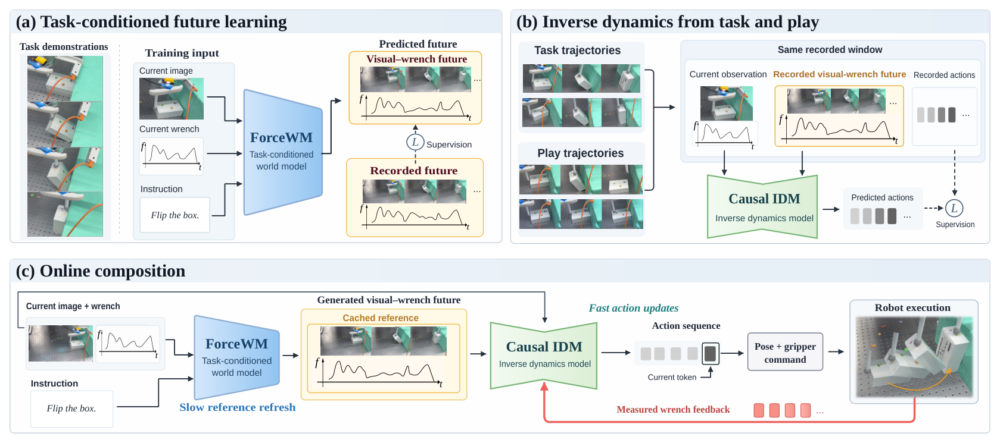
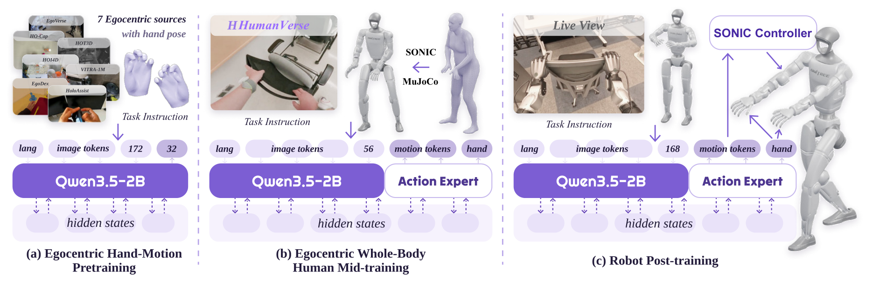
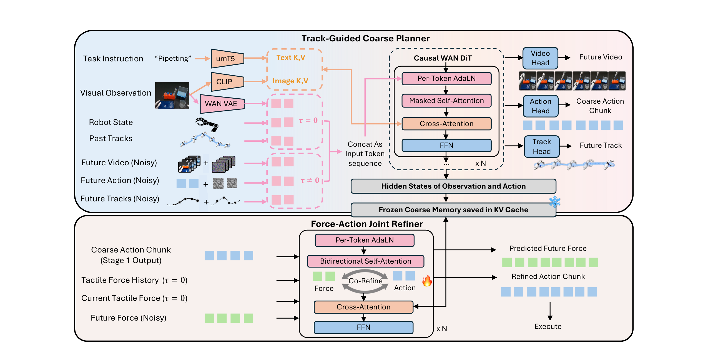

# 2026-10-14 Embodied AI & World Models Daily

> 面向具身智能 / Robotics 研究员与工程师的研究与工程资讯。主窗口：北京时间 10 月 14 日 00:00–23:59；补充窗口：10 月 12–13 日。本文于 10 月 15 日晚间补执行，论文日期按首次提交时间换算，不按公告批次或搜索收录日归属。

今天最值得看的是三种数据利用方式：部署失败如何参与世界模型训练、非任务接触 play 如何帮助执行，以及全身人类数据怎样接上人形控制器。另有 MuJoCo 3.16.0 的模型缩放与保存语义更新。**来源检查存在覆盖缺口**，详见文末；本日已确认有达标资讯。

## 🔥 今日必读

### 1. 【部署回流 / WAM】LoopWAM：失败动作不照抄，物理后果仍学习

**来源：** [arXiv:2610.18873v1](https://arxiv.org/abs/2610.18873)（cs.RO；Wenxuan Guo 等）

**类型：** Paper；**首次提交：** 2026-10-14 01:59:56 北京时间；**评分：** 87.15/100

**关键词：** World-Action Model · Deployment Rollouts · Quality Conditioning

**一句话：** 视频和动作共同去噪，但轨迹质量决定动作模仿权重；失败仍提供完整的视频监督，避免“全量模仿错误”和“过滤掉交互后果”之间的两难。

**技术要点：** 源相关噪声采样使专家数据偏向行为学习、回流偏向结果建模，质量分数同时进入指令与动作损失。Table30-V2 三轮部署训练后，成功率由 23.67% 到 43.33%，约新增 9,000 条真实回流轨迹；RoboTwin 平均 94.5%。失败的直接动作损失为零，但联合注意力仍可传递视频梯度。

**为什么值得关注：** 它提供可直接迁移的数据监督接口。边界也具体：RoboCasa 未见复合任务仅 14.9%，低于 PRTS 的 18.8%；总体领先不代表全部任务最强。闭环包含标注、复位和离线再训练成本，不能称为无人在线自学习。

**资源：** [论文](https://arxiv.org/abs/2610.18873) · [项目页](https://loop-wam.github.io/) · [GitHub](https://github.com/loop-wam/LoopWAM) · [精读](../paper-reading/news/2026-10-14/loopwam/loopwam.md)。本轮确认仓库可访问；官方 README 描述权重与数据准备流程，未把当前仓库状态推断成 14 日精确首次开源时间。未确认独立的新模型权重发布事件。

### 2. 【力觉 / Play】ForceWAM：让示范教目标，让 play 教接触响应

**来源：** [arXiv:2610.18852v1](https://arxiv.org/abs/2610.18852)（cs.RO；Zijun Xu、Wendi Chen 等）

**类型：** Paper；**首次提交：** 2026-10-14 01:58:44 北京时间；**评分：** 86.45/100

**关键词：** Force Feedback · Inverse Dynamics · Contact-Rich Manipulation

**一句话：** 成功示范训练视觉与六轴力矩未来，任务和非任务 play 则训练逆动力学，把生成未来与最新真实力反馈转成动作。

**技术要点：** IDM 训练使用同窗口的记录未来，部署才替换为世界模型生成未来；因果遮罩禁止读取未来真实力反馈。慢参考缓存与固定去噪噪声复用，每次用增长的已测力前缀重算当前动作。固定任务示范和优化步数，增加 play 使四条件成功率由 40/75/65/75% 提至 85/95/85/90%。

**为什么值得关注：** 它把非任务数据引入策略训练时最容易混淆的“目标意图”和“接触响应”拆开。证据来自单机械臂三任务族、四条件，每轮每条件 20 次；滑动要求全路径且维持 5–15 N，不能只按视觉完成。世界模型约 100 ms、IDM 约 60 ms 的单次调用不等于高频低层控制保证。

**资源：** [论文](https://arxiv.org/abs/2610.18852) · [项目页](https://force-wam.github.io/) · [精读](../paper-reading/news/2026-10-14/forcewam/forcewam.md)。摘要称提供代码，但本轮项目页未解析到可确认的公开代码仓库或模型权重直链，故不补造资源地址。

### 3. 【人形 / 人类数据】λ₀：先对齐控制响应，再规模化全身监督

**来源：** [arXiv:2610.18950v1](https://arxiv.org/abs/2610.18950)（cs.RO；humanoid Team）

**类型：** Paper；**首次提交：** 2026-10-14 01:40:58 北京时间；**评分：** 84.40/100

**关键词：** Humanoid · HumanVerse · Loco-Manipulation

**一句话：** HumanVerse 将第一人称视频与全身运动配对，经过尺度、IK 和控制器响应对齐后，进入手部预训练、全身人类中间训练、机器人后训练三阶段流程。

**技术要点：** 500 小时是转换过滤前的原始数据量。离线对齐将测试子集末端位置误差由 17.03 降到 3.83 cm；G1 执行接口为 SONIC 运动潜变量和手命令。四真机任务共 40 次，成功率 62.5%，π0.5 为 40%；去掉全身人类中间阶段后为 22.5%。

**为什么值得关注：** 全身人类数据需要匹配实际控制器，而非只做人形姿态重定向。**SIMPLE 90.0% 使用逐任务最好记录配置，未确认验证集独立选择，也未验证消融配置完全匹配**，应优先参考协议更明确的真机与阶段消融。采集人秒成本、任务进度和完整成功率也不能混用。

**资源：** [论文](https://arxiv.org/abs/2610.18950) · [项目页](https://lambdahumanoid.github.io/) · [GitHub](https://github.com/LambdaHumanoid/openlambda) · [精读](../paper-reading/news/2026-10-14/lambda0/lambda0.md)。本轮确认公开仓库可访问，未确认独立模型权重发布事件。

## 📄 论文雷达

以下均为 10 月 14 日北京时间首次提交；仅前两篇完成全文精读，其余结论限定于已核对的原文摘要，不扩写未检查的实验细节。

### 【灵巧手 / 力觉数据】FACT: A Multimodal Force-Action-Track Foundation Model for Human-to-Robot Dexterity

**来源：** [arXiv:2610.19155v1](https://arxiv.org/abs/2610.19155)；**时间：** 04:21:52；**评分：** 83.55/100；**关键词：** Human-to-Robot · Tactile · Joint Denoising

**核心贡献：** 用视觉轨迹粗规划，再联合去噪未来力和动作后缀。预训练混合 2,000 小时人类与 100 小时机器人数据，每任务微调 10 条机器人加 90 条人类示范。旋钮任务 5/10 次成功接触后的误差为 6.4 µL，不能当成全部试验误差；人类压力阵列未观测的切向分量也不能视作六轴真值。[精读](../paper-reading/news/2026-10-14/fact/fact.md)

### 【受控对照 / 负迁移】What Matters for World Modeling in Vision-Language-Action Models?

**来源：** [arXiv:2610.19825v1](https://arxiv.org/abs/2610.19825)；**时间：** 17:01:30；**评分：** 83.35/100；**关键词：** Future Alignment · MoT · OOD

**核心贡献：** 统一比较隐式对齐、未来查询、MoT 专家和外部预测。MoT 的三种子 LIBERO-Plus 为 76.4±1.0%，基线 71.4±0.4%；直接对齐已有 π0.5 却使成功率下降约 5 个百分点。选择预测接口时应同时计算额外当前图像特征、参数和延迟。[项目页](https://dylanmqs.github.io/WM-in-VLAs/) · [精读](../paper-reading/news/2026-10-14/wm-in-vlas/wm-in-vlas.md)

### 【力觉评测】ForceBench: Benchmarking Force Integration for Robotic Manipulation

**来源：** [arXiv:2610.19604v1](https://arxiv.org/abs/2610.19604)；**时间：** 13:28:09；**评分：** 82.65/100；**关键词：** Benchmark · Wrist Force · VLA

**核心贡献：** 八任务、1,600 条同步示范，在共享 π0.5 上比较无力基线与六种融合设计。Prompt Fusion 仿真 35.31% 对 23.25%，五真机任务均值 63% 对 40%；时序设计却在装配类低于基线，支持按任务需求选融合方式。[项目页](https://forcebench-platform.github.io/)

### 【推理加速】Complementary Future Token Pruning for World Action Models

**来源：** [arXiv:2610.19957v1](https://arxiv.org/abs/2610.19957)；**时间：** 18:39:16；**评分：** 81.25/100；**关键词：** CF-Prune · Token Pruning · Latency

**核心贡献：** 利用指令和动作注意力裁未来视觉 token，并在精细操作阶段恢复密集计算。摘要报告 35% 裁剪加速 1.19–1.27 倍；50% 裁剪在两个仿真基准加速 1.29–1.33 倍、平均成功率距基线不超过 1 个百分点，不能直接外推到所有真机时延。

### 【仿真数据选择】Active Generative Simulation: Meta-Learning What to Simulate for Sim-and-Real Policy Co-Training

**来源：** [arXiv:2610.19479v1](https://arxiv.org/abs/2610.19479)；**时间：** 10:57:04；**评分：** 81.05/100；**关键词：** MetaGenSim · Meta-Gradient · Sim-and-Real

**核心贡献：** 用元梯度训练辅助 rater，优化用户给定参数空间内的仿真生成分布；轻量代理策略筛出的分布还能迁移到 VLA 微调。摘要称相对均匀生成提升 150%，这是相对增益，不能写成增加 150 个百分点。[项目页](https://meta-gensim.github.io/)

### 【世界模型评测】WorldOracle: Benchmarking Action-Conditioned World Models against Real-World Executions

**来源：** [arXiv:2610.18826v1](https://arxiv.org/abs/2610.18826)；**时间：** 01:52:55；**评分：** 80.45/100；**关键词：** Paired Execution · Physical Correctness · Multi-View

**核心贡献：** 固定初始观察与低层动作，将生成 rollout 对齐真实执行，从物理状态、交互空间、关键区域和多视角一致性评七类模型。成功与失败都进入评估，避免只看视频外观。摘要仍写将发布数据与代码，本轮不标成已开源。

### 【VTLA 数据】TacClaw-Infinity: A Large-Scale Vision-Tactile-Language-Action Dataset for Dexterous Manipulation

**来源：** [arXiv:2610.20320v1](https://arxiv.org/abs/2610.20320)；**时间：** 23:06:53；**评分：** 79.35/100；**关键词：** Tactile UMI · Quality Control · Cross-Embodiment

**核心贡献：** 带触觉手持接口同步采集视觉、接触与末端轨迹，报告逾 10,000 小时、百万片段及跨三本体验证。更值得核对的是运动重建、模态质检和本体兼容过滤；摘要未给足逐任务量化结果，暂不因数据量升入必读。

## 🛠 工程与开源

### MuJoCo 3.16.0：编译期缩放与保留模型编辑语义

**类型：** Engineering；**时间：** 10 月 14 日 17:29:02 北京时间；**评分：** 78.60/100。[官方 Release](https://github.com/google-deepmind/mujoco/releases/tag/3.16.0)

frame 新增 `scale`、`scaling`、`massscale`，可编译期缩放模型内容；`similar` 与仅缩几何的策略有不同动力学语义。`savecompiled`、`savecanonical` 控制保存原始 mjSpec、默认类和作者输入约定，另增加 Bazel 构建支持。做资产尺度随机化、模型编辑和 Real2Sim 的工程师应检查质量、惯量、执行器引用及保存后重载语义；Release 含 API 变更，本报未实际运行迁移测试。

### IsaacLab 浏览器演示：合并同日 v2–v5 更新

**类型：** Engineering；**时间：** v2 06:43:44，v3 07:02:34，v4 19:30:20，v5 20:38:15（均为 10 月 14 日北京时间）；**评分：** 73.50/100。[v2](https://github.com/isaac-sim/IsaacLab/releases/tag/browser-demos-v2) · [v3](https://github.com/isaac-sim/IsaacLab/releases/tag/browser-demos-v3) · [v4](https://github.com/isaac-sim/IsaacLab/releases/tag/browser-demos-v4) · [v5](https://github.com/isaac-sim/IsaacLab/releases/tag/browser-demos-v5)

v2 加 MicroDuck 策略演示，v3 主要改交互；v4 加有界仓库场景，v5 加接触驱动道具、复位及碰撞表示。演示归档复用早期资源，需要完整部署目录。它适合展示控制与场景交互，**不是原生训练环境或策略评测 benchmark**；Release 所述验证为维护者报告，本轮未独立进行浏览器物理验收。10 月 13 日 v1 已在前日报出现，不重复当新发布。

## 💬 社区信号

本节只记录两条**观察线索，不作为新增独立达标资讯或已验证结论**：

- [Argon Robotics 讨论](https://news.ycombinator.com/item?id=50074869)创建于北京时间 10 月 14 日 00:55:47；[官方技术文章](https://developers.googleblog.com/gemini-4-argon-for-robotics/)标注 10 月 13 日但未给时区。值得跟踪的是视频阶段/质量标注怎样用真实下游数据验证，不能用演示推断通用动力学能力。文章发布时间待精确核实，不改记为 14 日新模型。
- [Pi API beta 讨论](https://news.ycombinator.com/item?id=50079437)创建于北京时间 10 月 14 日 05:55:25；[官方文章](https://www.pi.website/blog/api-beta)日期为 10 月 13 日、时区未明。其上传数据、托管微调、云推理的工作流值得关注，官方也提到网络连接挑战。讨论创建时间仅证明话题进入当日窗口，不证明具体成功率或开放权重；不使用 15 日抓取的点赞量回填当日热度。

## 🔎 补充窗口筛选记录

| 条目 | 实际时间，北京时间 | 处理及原因 |
|---|---|---|
| [WAVE-0](https://arxiv.org/abs/2610.18568) | 首次提交 10-13 23:37:50 | 属补充窗；13 日已报道配套代码，此次确认完整论文，但不再次升为14日新事件。摘要中的257M未来预测器与反事实目标值得后续对照，未完成全文精读。 |
| [VaM 代码](https://github.com/Virlus/VaM) | 仓库创建 10-13 21:41:33 | 已在13日日报出现，去重；创建时间不是论文发表时间。 |
| [Genesis v1.4.4](https://github.com/Genesis-Embodied-AI/genesis-world/releases/tag/v1.4.4) | Release 10-12 05:53:18 | 补充窗旧版本，已属前期资讯；本轮不把接触修复和GPU优化记成14日更新。 |
| [Spur](https://github.com/cooplabs/spur) | 仓库创建 10-15 02:47:26 | UTC日期为14日，但北京时间已15日，排除本日；低层接管时延需独立验收。 |

## 📊 今日技术趋势

世界模型的价值正在从“画出未来”转向“哪些数据能监督什么”：LoopWAM 保留失败结果，ForceWAM 将 play 限定到执行响应，λ₀ 则先修正人类到控制器的接口。FACT 与 ForceBench 把力觉的采集、预测和融合分别推到台前；受控 VLA 对照同时提醒，未来预测目标可能损伤已有机器人先验，额外模块的延迟也要一起计入。

## 来源覆盖与筛选说明

已直接读取 arXiv cs.RO/cs.CV/cs.AI/cs.LG 官方列表，cs.RO 另查 `new`、`recent` 和月表，逐项核对候选摘要页的首次提交历史。共核对 540 个去重候选：主窗口 115、补充窗口 181、窗外 244；这是日期核验池，不代表 296 篇均通过技术预筛。RO recent 返回 15 日 99 条、14 日 304 条、12 日 87 条，不能把公告日直接当投稿自然日。新投稿按事件聚簇；普通修订、泛视频/自动驾驶及仅产品介绍不因关键词自动入选。

**覆盖限制：** cs.AI、cs.LG 重取后虽出现15日标题，但正文最新完整批次仍为14日，因此可能漏掉14日提交、15日公告且未交叉进入RO/CV的论文；GEAR 静态页面未完整展开动态目录。不能据此断言这些来源没有更新。Skild 首次超时后重试成功。其余已检查 PI、DeepMind、1X、Figure、RAI、TRI、CoRL/RSS/ICRA/IROS 公共入口，属于入口检查，不是对每家所有子页面的穷尽检索。

另检查 IsaacLab、LeRobot、MuJoCo、Genesis 各15条近期 Release，及 NVIDIA、LeRobot、Physical-Intelligence 的 HF 模型列表（每组最多100条）；模型列表未见可确认的本日新事件，不代表整个 HF 没有相关权重。GitHub 使用 robotics、VLA、world-model、robot-learning 四组窗口检索，星数和仓库创建日不单独作为技术通过依据。未独立执行项目代码、模型推理或真机评估。

### 双评分记录

入选独立事件均来自 T1，门槛62；论文权重为 significance/novelty/evidence/relevance/community = 4/3/2/1/0，工程为3/1/2/3/1。分别从机制价值与实验协议/可复用性做两遍维度判断，最终取均值；未确认社区证据的 community 按0计。下面保留分数，不把主观编辑分数解释成统计置信度。

| 事件 | 类型 | 两次分数 | 平均 |
|---|---|---:|---:|
| LoopWAM | research_paper | 87.3 / 87.0 | 87.15 |
| ForceWAM | research_paper | 87.0 / 85.9 | 86.45 |
| λ₀ | research_paper | 84.6 / 84.2 | 84.40 |
| FACT | research_paper | 83.6 / 83.5 | 83.55 |
| What Matters | research_paper | 83.5 / 83.2 | 83.35 |
| ForceBench | research_paper | 82.8 / 82.5 | 82.65 |
| CF-Prune | research_paper | 81.3 / 81.2 | 81.25 |
| MetaGenSim | research_paper | 81.2 / 80.9 | 81.05 |
| WorldOracle | research_paper | 80.6 / 80.3 | 80.45 |
| TacClaw-Infinity | research_paper | 79.5 / 79.2 | 79.35 |
| MuJoCo 3.16.0 | engineering_tech | 78.6 / 78.6 | 78.60 |
| IsaacLab browser demos | engineering_tech | 73.5 / 73.5 | 73.50 |

## 精读状态

[精读索引](../paper-reading/news/2026-10-14/README.md)：LoopWAM、ForceWAM、λ₀、FACT、What Matters 共5篇完成全文精读，Grounding、8项笔记检查、质量与可读性复核均通过。24张图片经过视觉审查并校验SHA；4个重要图表因裁剪质量或正式资产审批未完成而保留定位与数值占位，不以未通过图片充数。
