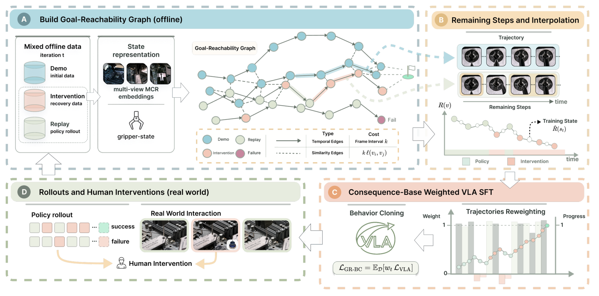

# 2026-10-15 Embodied AI & World Models Daily

> 面向具身智能 / Robotics 研究员与工程师的研究与工程资讯。

主窗口为北京时间 10 月 15 日 00:00–23:59，补充窗口为 10 月 13–14 日。**来源检查不完整**：本轮官方 arXiv 列表最新公告为 10 月 15 日，尚不能覆盖当天晚间可能尚未公告的提交；Skild 重试超时，GEAR 仅取得静态页面，会议首页检查也不等于逐篇会议论文全覆盖。以下是已核实的发现，不代表全天无遗漏。

## 🔥 今日必读

### 1. 【模仿学习与策略】离散动作能否成为精细连续控制器，取决于依赖结构与采样

**来源：** [arXiv:2610.20429](https://arxiv.org/abs/2610.20429)（cs.RO；作者预印本，未核实会议接收）  
**类型：** Paper · T1  
**发布时间：** 2026-10-15 00:20:58（北京时间，v1 实际提交）  
**评分：** 89.25/100  
**关键词：** 动作量化 · 离散流 · CFG

**一句话：** 以同一视觉语言主干比较连续回归、连续流、离散回归和离散流；离散动作的限制不能只用量化误差解释。

**技术要点：**

- 默认每维 512 等宽分箱；离散流通过多轮“预测干净类别—概率替换”形成跨时间依赖，避免整块动作独立抽样的不一致。
- RoboCasa 离散回归加入引导后成功率由 27.1% 升至 49.2%；离散流由 52.3% 至 53.9%，连续流最佳报告配置为 52.7%。引导改善执行不等于重建误差下降。
- 附录的五个种子是评估种子，训练仅固定种子 7；LIBERO 只测 Object/Long。训练表中 composite-unseen 名称与测试划分关系仍需作者清单核对，不能据此宣称已验证严格零样本组合泛化。

**为什么值得关注：** 比较动作头时，应同时控制坐标系、求解预算和引导，并保留闭环成功与延迟，不能只按离线均方误差选型。

**资源：** Paper：[arXiv:2610.20429](https://arxiv.org/abs/2610.20429)；Project：[项目页](https://iscoyizj.github.io/discrete-action-website/)；Code / Weights：未找到可确认的公开代码仓库与权重；[中文全文精读](../paper-reading/news/2026-10-15/discrete-actions/discrete-actions.md)。

### 2. 【模仿学习与策略】用真实时间间隔更新策略记忆，减少查询节奏改变后的时间漂移

**来源：** [arXiv:2610.20524](https://arxiv.org/abs/2610.20524)（cs.RO；作者预印本，未核实会议接收）  
**类型：** Paper · T1  
**发布时间：** 2026-10-15 01:24:13（北京时间，v1 实际提交）  
**评分：** 87.85/100  
**关键词：** 策略记忆 · 物理时间 · 控制频率

**一句话：** 观察预测候选记忆和时间常数，时间戳差控制指数保留率；一次动作求解内保持记忆不变。

**技术要点：**

- 递归更新采用 exp(-Δt/τ)，将事件内容、记忆变化速度和实际经过时间分开；冻结系数时的半群性质不等于任意查询节奏下严格不变。
- 固定 10Hz 训练、跨四节奏测试，三任务平均 DP 为 77.5%，对 S4D 加时间输入的 62.1%；π0.5 为 73.3% 对 66.8%。固定权重仅缩放输入时钟，会定向改变事件动作时间。
- 五真机任务各 20 次，DP 平均 17%→64%，π0.5 为 26%→76%；真机缺少同预算递归记忆基线，不能完全隔离“有历史”与“显式时间”的收益。

**为什么值得关注：** 部署延迟与丢查询是策略输入接口的一部分。本文给出可直接检查的时间戳、回合复位和物理记忆更新位置。

**资源：** Paper：[arXiv:2610.20524](https://arxiv.org/abs/2610.20524)；Code / Weights：未找到可确认的公开代码仓库与权重；[中文全文精读](../paper-reading/news/2026-10-15/temporal-flow/temporal-flow.md)。

### 3. 【强化学习】拆开底盘与手臂残差，用少量接管改善真机移动操作

**来源：** [arXiv:2610.20607](https://arxiv.org/abs/2610.20607)（cs.RO；作者预印本，未核实会议接收）  
**类型：** Paper · T1  
**发布时间：** 2026-10-15 01:59:52（北京时间，v1 实际提交）  
**评分：** 83.95/100  
**关键词：** 残差RL · 人工干预 · 移动操作

**一句话：** 冻结 DP/ACT 基础策略，分开学习底盘和手臂残差，手臂以底盘修正为条件；专家接管还用于校准价值。

**技术要点：**

- 真机 10Hz 交互，约 25–40 分钟任务预算；在线前还有基础策略示范与约 500–600 条人工辅助成功转移。低于 20% 的干预率指采集覆盖，训练批次会均衡重采样专家数据。
- 每任务 20 次测试：Place Only 50%→95%，Sweep 45%→90%；Pick Place 22.5%→40% 是含抓取半分的阶段得分，不能当作完整任务成功率。
- 两任务消融从平坦残差 50%，到分解 80%、加条件 85%、加价值对齐 92.5%；复杂 Pick Place 未纳入该消融，仍依赖操作者与单平台验证。

**为什么值得关注：** 最有价值的是按执行模块的因果关系拆残差，以及把人工纠偏用于价值估计；交互分钟数应连同热启动与干预成本阅读。

**资源：** Paper：[arXiv:2610.20607](https://arxiv.org/abs/2610.20607)；Project：[项目页](https://hire-moma.github.io/)；Code / Weights：未找到可确认的公开代码仓库与权重；[中文全文精读](../paper-reading/news/2026-10-15/hire-moma/hire-moma.md)。

### 4. 【操作与抓取】用轨迹图判断干预后的动作是否推进，过滤失败片段监督

**来源：** [arXiv:2610.20504](https://arxiv.org/abs/2610.20504)（cs.RO；作者预印本，未核实会议接收）  
**类型：** Paper · T1  
**发布时间：** 2026-10-15 01:09:36（北京时间，v1 实际提交）  
**评分：** 80.85/100  
**关键词：** 干预学习 · 图进度 · 精密操作

**一句话：** 通过多视角近邻与时间边拼接轨迹，计算到成功终点的剩余路径，再按动作块的净进展和局部回退重加权模仿损失。

**技术要点：**

- 冻结 MCR 表征，三视角互近邻和夹爪状态过滤约束跨轨迹边；每 15 帧抽节点，按约 30 帧动作块评价进度。零权重片段仍保留在图中。
- X-VLA 四真机任务最终成功率为装配 98%、显卡 93%、螺丝 89%、内存 83%，平均 90.75%；各任务经历 2–4 轮后训练，不能当作统一单轮预算。
- 主进度表是图内诊断；DAgger-style 对照没有逐状态请求专家重新标注。相似图边也不保证物理可达，最短路不等于最低碰撞风险。

**为什么值得关注：** 适合已有共享控制数据、需要把恢复片段利用起来的团队；复现重点是图边抽查与权重定义，而非只观察进度分类满分。

**资源：** Paper：[arXiv:2610.20504](https://arxiv.org/abs/2610.20504)；Project：[项目页](https://gr-bc.github.io/)；Code / Weights：未找到可确认的公开代码仓库与权重；[中文全文精读](../paper-reading/news/2026-10-15/gr-bc/gr-bc.md)。

## 📄 论文雷达

### 【运动与全身控制】KinoGen：运动学约束的视频参考生成与关键帧定制

**来源：** [arXiv:2610.20552](https://arxiv.org/abs/2610.20552) · T1  
**发布时间：** 2026-10-15 01:43:32（北京时间，v1）  
**关键词：** 人形 · 参考合成 · 视频生成  
**核心贡献：** 先渲染已知 G1 与场景，再用视频生成和分阶段运动学重建取得参考；八任务等 PPO 预算下跟踪成功 57%，GRAIL 为 42%。关键帧零误差来自硬约束，仍有穿透；真机主要是四项定性展示。

[中文全文精读](../paper-reading/news/2026-10-15/kinogen/kinogen.md)。

**值得关注程度：** 79.75/100；**Paper：** [arXiv:2610.20552](https://arxiv.org/abs/2610.20552)。 [项目页](https://kinogen-humanoid.github.io/)。

### 【运动与全身控制】直接在策略权重空间扩散生成人形控制网络

**来源：** [arXiv:2610.20606](https://arxiv.org/abs/2610.20606) · T1  
**发布时间：** 2026-10-15 01:59:52（北京时间，v1）  
**关键词：** 策略权重 · 潜空间扩散  
**核心贡献：** 用线性自编码器压缩 RL 训练的 G1 策略参数，再用 DiT 生成网络权重，展示行走、舞蹈与旋踢。还观察到首层权重含运动学结构，但它依赖已有策略库，不能解释为从零免训练得到控制器。

**值得关注程度：** 78.15/100；**Paper：** [arXiv:2610.20606](https://arxiv.org/abs/2610.20606)。 [项目页](https://humanoid-weight-diffusion.github.io/)。

### 【运动与全身控制】PingpongDuo：双人形乒乓球的团队避让与击球技能切换

**来源：** [arXiv:2610.20579](https://arxiv.org/abs/2610.20579) · T1  
**发布时间：** 2026-10-15 01:56:27（北京时间，v1）  
**关键词：** 技能组合 · 团队协调  
**核心贡献：** 团队层联合选位并用学习风险过滤，个体层拆脚步与击球，再用校准仿真的球拍残差修正。作者报告真机双机器人严格交替 10 次以上击球；单机 2.15m 避让恢复用时 2.4 秒。有限展示不构成全面安全保证。

**值得关注程度：** 77.75/100；**Paper：** [arXiv:2610.20579](https://arxiv.org/abs/2610.20579)。 [项目页](https://www.archon.tech/research/PingpongDuo)。

### 【VLA与基础模型】AdaRSI：先修调用方式，再决定是否微调执行器

**来源：** [arXiv:2610.20474](https://arxiv.org/abs/2610.20474) · T1  
**发布时间：** 2026-10-15 00:51:09（北京时间，v1）  
**关键词：** 自改进 · 故障归因  
**核心贡献：** 编码代理先调整技能和执行框架，再从保存状态重试失败子步骤，仅微调持续失败部分。RoboCasa365 的未见组合成功率由 4.6% 至 13.8%，用全子步微调 28% 的 GPU 时间与 22% 自采示范；保存状态的仿真能力限制真机外推。

**值得关注程度：** 76.65/100；**Paper：** [arXiv:2610.20474](https://arxiv.org/abs/2610.20474)。

### 【操作与抓取】DD-GBP：异步消息传递的长时域多臂在线规划

**来源：** [arXiv:2610.20460](https://arxiv.org/abs/2610.20460) · T1  
**发布时间：** 2026-10-15 00:43:32（北京时间，v1）  
**关键词：** 因子图 · 分布式规划  
**核心贡献：** 局部 GP 因子图与动态子网重建结合，四臂动态场景报告 92.5% 无碰撞全目标完成，90% 丢包时 86%。30 臂的 15.80ms 平均热启动求解来自无障碍工作站测试，不能移植成复杂场景实时保证。

**值得关注程度：** 74.65/100；**Paper：** [arXiv:2610.20460](https://arxiv.org/abs/2610.20460)。

### 【端侧部署】EarlyCommit：语言尚未说完时判断何时可以承诺目标

**来源：** [arXiv:2610.20531](https://arxiv.org/abs/2610.20531) · T1  
**发布时间：** 2026-10-15 01:28:46（北京时间，v1）  
**关键词：** 流式语言 · 目标定位  
**核心贡献：** 把增量文本与物体指代概率校准结合，在用户置信阈值满足时提前确认目标。摘要报告阈值 0.9 时承诺准确率至少 92%，单词更新约 31–35ms；目标承诺并不等于动作规划或安全执行已得到保证。

**值得关注程度：** 71.65/100；**Paper：** [arXiv:2610.20531](https://arxiv.org/abs/2610.20531)。

## 🛠 工程与开源

### 【开源项目】Atomic-WAM：新增推理与 RoboLab 评测仓库

[GitHub](https://github.com/ssj9596/Atomic-WAM) · T1 · 78.00/100。GitHub API 记录仓库创建于 **10 月 15 日 11:33:54**，论文 [arXiv:2610.20157](https://arxiv.org/abs/2610.20157) 实际提交于 **10 月 14 日 21:13:35**。下一步原子动作描述由视觉语言推理器产生，再条件化世界动作模型；README 给出双环境安装、权重下载和 120 任务评测入口，适合检查推理器与执行器的接口。训练代码、原子动作标注流程尚未发布。

[权重文件库](https://huggingface.co/datasets/MochunniaN1/Atomic-WAM_Robolab) 已能核实 WAM 分片与推理器 LoRA；HF 元数据最后修改在 9 月 15 日，**不能称为 10 月 15 日首次发布权重**。代码仓库创建时间也不等于已确认的首次公开时间；这里只登记本次新发现的官方代码入口，未运行其评测。

### 【开源项目】FoveaVLA：外部相机局部视野的训练、部署与已有权重入口

[GitHub](https://github.com/Stanford-TML/FoveaVLA) · T1 · 77.30/100。仓库创建于 **10 月 15 日 09:49:19**；论文 [arXiv:2610.20064](https://arxiv.org/abs/2610.20064) 提交于 **10 月 14 日 20:04:21**。π0.5 动作块同时预测下一交互区域，从原分辨率外部图像裁剪局部视野，下一查询与全图共同输入，减少对腕部相机的依赖。文档包括单/双 ZED 配置、DROID 数据准备、训练和机器人客户端。

[Single 权重](https://huggingface.co/bingaochen/FoveaVLA-Single) 与 [Dual 权重](https://huggingface.co/bingaochen/FoveaVLA-Dual) 的公开文件清单均已核实；元数据最近修改为 10 月 14 日，列作已有资源而非今日首次权重发布。作者文档估计服务约需 13GB 显存、每份检查点约 12.4GB，部署仍有 RGB-D 与深度处理要求；“去腕部相机”不等于不需要深度或相机配置。首次公开时间未能独立确认，以仓库创建记录为时间线索。

### 【开源项目】OneWM：共享因果视频—动作模型的训练与部署实现

[GitHub](https://github.com/Interactive-Active-AI/OneWM) · T1 · 72.10/100。仓库创建于 **10 月 15 日 09:56:37**，首次公开时间未能可靠确认。作者实现按全干净、部分干净、全噪声动作三种条件训练共享因果模型，分别覆盖指定动作的世界预测与联合动作生成；提供 LIBERO、RoboCasa365 和双 Franka 配方及 WM/WAM 两种输入接口。

工程价值是配方、归一化和动作/视频条件的明确边界。README 的检查点路径是示例，动作专家初始化也不是训练好的策略；未核实公开的完整训练权重，本文没有复现其性能。它是同一研究事件的代码更新，不再拆成论文与演示多条资讯。

### 【导航与探索】Tiered-Resolution：让规划反向决定地图分辨率

[arXiv:2610.20476](https://arxiv.org/abs/2610.20476) · engineering_tech · T1 · 64.60/100。首次提交 **10 月 15 日 00:51:35**。在当前计划走廊内积分细体素，其他区域粗体素，使规划与建图闭环；两组真实遥操作数据的离线回放中，地图小 13–15 倍、CPU 积分少 6–8 倍，路径单位米成本接近全细地图。证据是离线回放对比，尚不等于机器人在未知户外闭环自主导航的完整验收。

官方版本检查中，MuJoCo 3.16.0 的发布为北京时间 **10 月 14 日 17:29:02**，属前日日报内容；Isaac Lab 的 interactive-demos 容器发布为 **10 月 16 日 00:47:05**，超出本期窗口，不提前算作 15 日新版本。Genesis 与 LeRobot 已检查的最新 release 未发现可确认属于本期的新版本。[MuJoCo releases](https://github.com/google-deepmind/mujoco/releases)、[Isaac Lab releases](https://github.com/isaac-sim/IsaacLab/releases)、[Genesis releases](https://github.com/Genesis-Embodied-AI/Genesis/releases)、[LeRobot releases](https://github.com/huggingface/lerobot/releases)。

## 💬 社区信号

本轮未核实到值得单列的、目标日期内的新技术争议或独立复现。已检查的 Argon 与 Physical Intelligence 相关 Hacker News 讨论始于 10 月 14 日，未凭重复媒体报道再次计数；新代码仓库仅有个位数关注，不能据此声称形成社区热点。当前排序以技术价值与可核实证据为主。

## 🔎 补充窗口筛选记录

- **10 月 14 日 20:04:21**：FoveaVLA [arXiv:2610.20064](https://arxiv.org/abs/2610.20064)，论文属补充窗口；只把 15 日新建代码入口与已有权重合成一个更新事件。
- **10 月 14 日 21:13:35**：Atomic-WAM [arXiv:2610.20157](https://arxiv.org/abs/2610.20157)，论文属补充窗口；代码与权重状态见工程条目，不重复列作今日新论文。
- **10 月 14 日 23:06:53**：TacClaw-Infinity [arXiv:2610.20320](https://arxiv.org/abs/2610.20320)，已进入 14 日雷达，本次未核实到新的独立变化，不重复收录。
- **10 月 14 日 22:25:46 / 22:18:04 / 22:06:03**：安全评论家 [arXiv:2610.20255](https://arxiv.org/abs/2610.20255)、几何候选导航 [arXiv:2610.20241](https://arxiv.org/abs/2610.20241)、ObjDream [arXiv:2610.20223](https://arxiv.org/abs/2610.20223)，直连 abs 曾失败，已用官方 abs 网页回退核实摘要和 v1 时间；属补充窗口，保留检索记录，未作为 15 日新论文。
- **10 月 14 日 21:47:41**：[arXiv:2610.20203](https://arxiv.org/abs/2610.20203) 虽为新上传，实际为 BRACIS 2024 已接收稿的归档，并聚焦驾驶；不作新研究收录。
- **10 月 8 日 01:54:42**：RoboJEPA [arXiv:2610.10515](https://arxiv.org/abs/2610.10515) 超出补充窗口；15 日二手介绍不能重置原始提交日期。Gemini Robotics 2 的当前模型页面与 15 日媒体内容未提供可确认的当日首次发布日期，相关 ER 2 官方索引为 7 月，排除“今日新发布”说法。[官方研究索引](https://deepmind.google/blog/)、[模型页](https://deepmind.google/models/gemini-robotics/)。

主窗口预筛另排除：SafeDriveVLA [arXiv:2610.20609](https://arxiv.org/abs/2610.20609) 为驾驶专用端到端系统，未在本轮材料确认独立的通用机器人贡献；CoWear [arXiv:2610.20596](https://arxiv.org/abs/2610.20596) 以穿戴定位为主；可认证状态估计 [arXiv:2610.20490](https://arxiv.org/abs/2610.20490) 本轮仅确认退化配准和估计贡献，未确认学习或具身决策落点。TacEx 的新建仓库目前只有简短 README，缺少方法与实现证据，保留 UNKNOWN；Spur 的单机早期控制器证据不足以达到非官方 T2 门槛。

## 📊 今日技术趋势

动作分箱精度、查询频率和轨迹标签都不是实现细节：它们会直接改变策略在闭环中的行为。今天的几项工作分别通过动作块概率依赖、物理时间记忆与干预片段重加权，减少数据和部署接口之间的错配。人形参考生成则把“视频看起来合理”和“目标机器人可跟踪”拆成独立验证环节；零关键帧误差与真机演示仍不能替代动力学与成功率评测。

### 检索与评分审计

直接读取 [cs.RO recent](https://arxiv.org/list/cs.RO/recent?show=2000)、[cs.AI recent](https://arxiv.org/list/cs.AI/recent?show=2000)、[cs.LG recent](https://arxiv.org/list/cs.LG/recent?show=2000)、[cs.CV recent](https://arxiv.org/list/cs.CV/recent?show=2000)，分别取得 716/1877/2000/1168 个列表项，交叉分类与关键词预筛后去重 457 条，逐条核实 abs；最初直连成功 451 条、失败 6 条，6 条均已通过官方 abs 网页回退核实。初始成功记录中主窗口 15、补充窗口 227、窗口外 209；回退六条均属 14 日补充窗口。LG 的 2000 条是本次列表读取上限，不宣称完整覆盖所有交叉分类。RO new 网页回退可读取，月表直连失败；通用搜索只用于已发现主题、代码、机构与社区扩展，没有代替官方列表发现新投稿。

机构侧已读取 DeepMind、PI、1X、Figure、RAI、TRI 的公开页面，GEAR 仅静态页；Skild 未成功。CoRL/RSS/ICRA/IROS 首页可读，但没有把无更新的首页当成论文逐篇检查完成。GitHub 做 VLA、robotics、robot-learning、world-model 搜索；HF 读取 NVIDIA 100、LeRobot 72 条模型记录，PI 的列表为空，不能据此推断机构没有发布。未能公开读取或核实的新内容不被描述为“没有资讯”。

以下两个五维向量分别记录两次评估，顺序为技术份量、信息增量、证据、相关度、社区；各维 0–10。research_paper 权重 4/3/2/1/0，engineering_tech 为 3/1/2/3/1，open_source 为 2/2/2/3/1；最终取两次加权分均值。T1/T1.5/T2 门槛分别 62/68/75。低热度不降低论文研究评分。重复旧事件先合并，只有形成具体候选的新变化再评分。

| 候选事件 | 类型 / 来源 | 第一次五维 | 第二次五维 | 加权分 A / B | 均值 / 决策 |
|---|---|---|---|---|---|
| [arXiv:2610.20429](https://arxiv.org/abs/2610.20429) | research_paper / T1 | 9/9/8.3/10/2 | 8.8/9.1/8.2/10/1 | 89.60 / 88.90 | 89.25 / 入选 |
| [arXiv:2610.20524](https://arxiv.org/abs/2610.20524) | research_paper / T1 | 8.8/8.7/8.5/9.5/1 | 8.7/8.8/8.6/9.5/1 | 87.80 / 87.90 | 87.85 / 入选 |
| [arXiv:2610.20607](https://arxiv.org/abs/2610.20607) | research_paper / T1 | 8.3/8.1/8.5/9.5/1 | 8.4/8/8.4/9.5/1 | 84.00 / 83.90 | 83.95 / 入选 |
| [arXiv:2610.20504](https://arxiv.org/abs/2610.20504) | research_paper / T1 | 8/7.8/8/9.5/1 | 8.1/7.7/7.9/9.5/1 | 80.90 / 80.80 | 80.85 / 入选 |
| [arXiv:2610.20552](https://arxiv.org/abs/2610.20552) | research_paper / T1 | 8/8.3/7/9/1 | 8.1/8.2/6.8/9/1 | 79.90 / 79.60 | 79.75 / 入选 |
| [arXiv:2610.20606](https://arxiv.org/abs/2610.20606) | research_paper / T1 | 8/8.3/6.2/9/1 | 7.9/8.4/6.1/9/1 | 78.30 / 78.00 | 78.15 / 入选 |
| [ssj9596/Atomic-WAM](https://github.com/ssj9596/Atomic-WAM) | open_source / T1 | 8/8.5/8/9.5/1 | 7.9/8.3/7.8/9.5/1 | 78.50 / 77.50 | 78.00 / 入选 |
| [arXiv:2610.20579](https://arxiv.org/abs/2610.20579) | research_paper / T1 | 7.8/7.7/7.3/9/1 | 7.7/7.8/7.2/9/1 | 77.90 / 77.60 | 77.75 / 入选 |
| [Stanford-TML/FoveaVLA](https://github.com/Stanford-TML/FoveaVLA) | open_source / T1 | 8/8/8/9.5/1 | 8.1/7.8/7.9/9.5/1 | 77.50 / 77.10 | 77.30 / 入选 |
| [arXiv:2610.20474](https://arxiv.org/abs/2610.20474) | research_paper / T1 | 7.5/7.7/7.1/9.5/1 | 7.6/7.6/6.9/9.5/1 | 76.80 / 76.50 | 76.65 / 入选 |
| [arXiv:2610.20460](https://arxiv.org/abs/2610.20460) | research_paper / T1 | 7.3/7.2/7.8/8.5/1 | 7.2/7.3/7.6/8.5/1 | 74.90 / 74.40 | 74.65 / 入选 |
| [Interactive-Active-AI/OneWM](https://github.com/Interactive-Active-AI/OneWM) | open_source / T1 | 7.7/7.8/6.6/9/1 | 7.8/7.7/6.5/9/1 | 72.20 / 72.00 | 72.10 / 入选 |
| [arXiv:2610.20531](https://arxiv.org/abs/2610.20531) | research_paper / T1 | 7/7.1/7/8.5/1 | 7.1/7/6.8/8.5/1 | 71.80 / 71.50 | 71.65 / 入选 |
| [arXiv:2610.20476](https://arxiv.org/abs/2610.20476) | engineering_tech / T1 | 6.3/6.7/7/8/1 | 6.5/6.5/6.8/8/1 | 64.60 / 64.60 | 64.60 / 入选 |
| [cooplabs/spur](https://github.com/cooplabs/spur) | open_source / T2 | 6/5/5/7/1 | 6.2/5.1/4.8/7/1 | 54.00 / 54.20 | 54.10 / 低于门槛 |
| [arXiv:2610.20442](https://arxiv.org/abs/2610.20442) | research_paper / T1 | 5.3/4.5/4.8/8.5/1 | 5.2/4.7/4.7/8.5/1 | 52.80 / 52.80 | 52.80 / 低于门槛 |

评分反映当前材料：动作头与时间机制有受控比较；移动残差和图权重有真机证据但范围有限；KinoGen 因真机主要定性、硬约束误差解释而限制证据分；权重扩散与双人乒乓球按摘要和项目材料评价，未做全文精读。调查型 Agentic Robots 虽相关，但缺少新增实证，未达研究门槛。代码条目按文档与可用文件评价，没有把作者性能声明当成独立复现。

### 精读状态

今日必读 4 篇与雷达最高分 KinoGen 共 5 篇，均已完成全文、图表视觉审查、Grounding Lint、八项 Final Note Lint 和最终质量/可读性审查。正式保存后字节 SHA-256 与 lint 一致；合计 13 张图片、5 处保留占位，详情见 [精读索引](../paper-reading/news/2026-10-15/README.md)。来源覆盖缺口与单篇精读状态分别记录，不能相互替代。
