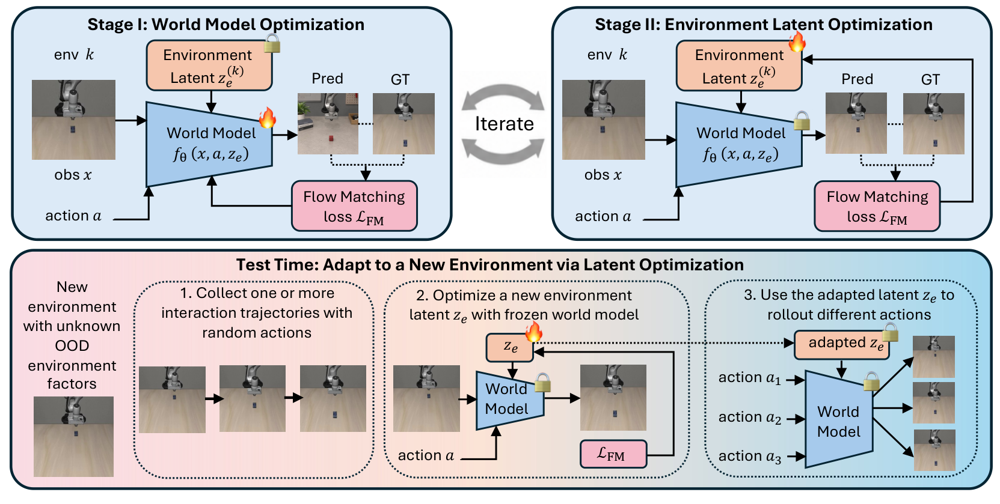
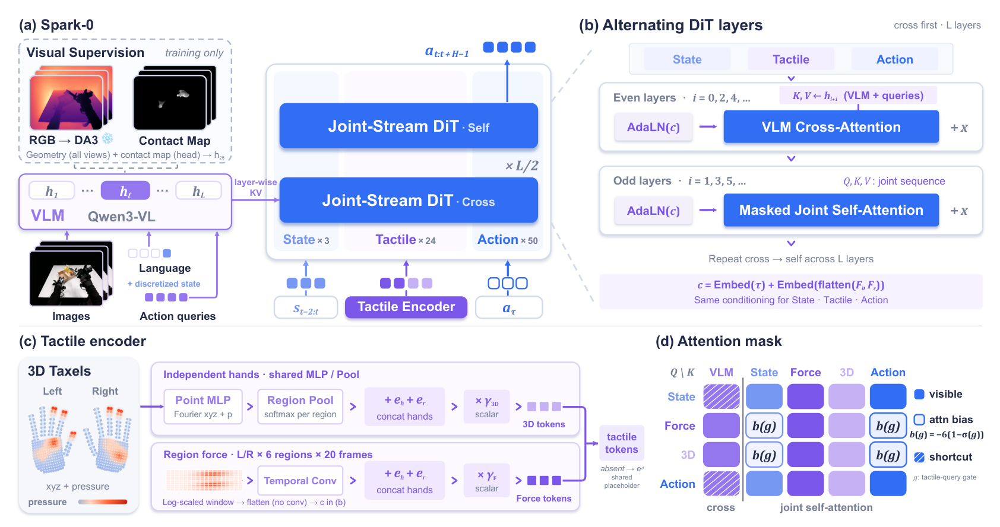
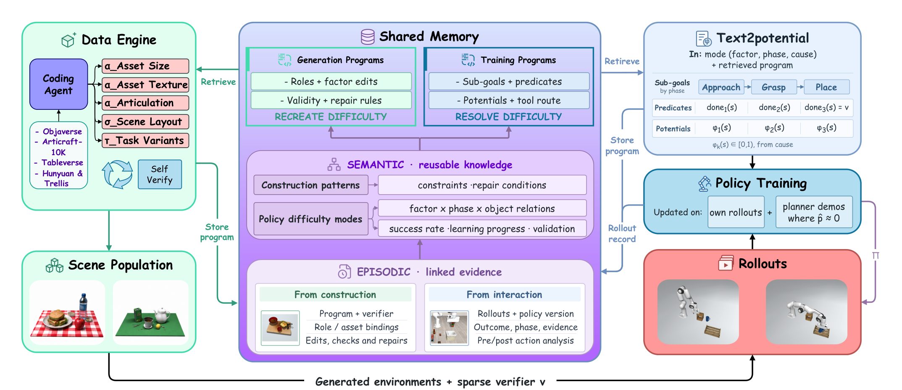

# 2026-10-16 Embodied AI & World Models Daily

> 面向具身智能 / Robotics 研究员与工程师的研究与工程资讯。主窗口：北京时间 2026-10-16 00:00–23:59；补充窗口：10 月 14–15 日。
>
> **来源检查不完整：** 已直接扫描 arXiv 官方四分类列表并逐条核实候选，但当前最新公告批次为 16 日，无法保证北京时间 16 日晚间投稿已全部进入列表；cs.LG 检索达到 2000 条上限。机构与会议页面已检查，动态栏目和逐篇会议论文未穷尽。以下是已验证发现，不能解读为全天无遗漏。精读结论均来自全文；其他雷达条目以已读摘要和官方说明为限。

## 🔥 今日必读

### 1. 【世界模型】T2-z：用环境隐变量适配机器人世界模型

**来源：** [arXiv:2610.22364v1](https://arxiv.org/abs/2610.22364)（T1）  
**类型：** Paper（research_paper）  
**发布时间：** 2026-10-16 01:59:11 北京时间  
**评分：** 88.45/100  
**关键词：** 世界模型 · 测试时优化 · 动作条件视频

**一句话：** 冻结大模型，把新环境中的可适配部分压缩到 32 维隐变量；用一至两条真实交互轨迹优化，再验证候选动作。

**技术要点：**

- 训练交替优化共享参数和各环境变量；新环境只更新变量 40 步，仍需穿过冻结主干反向传播。
- 七项仿真任务平均成功率由 37.9% 升至 74.2%，四项真机由 26.47% 升至 70.80%。像素误差、角度和灯状态误差不可合并解释为同一物理量。
- H200 上适配加五次预测为 18.09 秒计算时间，优于论文配置的 LoRA/TTT，但不是含真实交互的端到端实时延迟。

**为什么值得关注：** 提供了跨环境共享动力学与局部系统辨识之间的折中。最值得复现的是冻结主干、同轨迹预算和候选动作验证接口；尚未证明任意连续规划或所有视觉指标都更好。

**资源：** Paper：[arXiv:2610.22364v1](https://arxiv.org/abs/2610.22364)；[全文精读](../paper-reading/news/2026-10-16/t2-z/t2-z.md)。Code：未找到可确认的公开实现。

### 2. 【感知与多模态】Spark-0：把人类触觉预训练与空间接触对齐接到灵巧策略

**来源：** [arXiv:2610.22342v1](https://arxiv.org/abs/2610.22342)（T1）  
**类型：** Paper（research_paper）  
**发布时间：** 2026-10-16 01:56:17 北京时间  
**评分：** 88.20/100  
**关键词：** 触觉 · 灵巧操作 · 人类预训练

**一句话：** 训练期用空间接触图和几何教师改造视觉表征，运行期用有缺失掩码的触觉词元与动作专家融合，避免把无传感器误当作零接触。

**技术要点：**

- HumanTouch 为 1000 小时、超过 100 类任务；每手筛选后 320 个有效触觉单元，六区域历史力和当前接触点组成 24 个触觉词元。
- 同预训练预算中，视觉预训练与 1000 小时触觉配置的 Ego 平均成功率为 52.45% / 71.72%，真机为 44% / 52%；仿真为 36.57% / 36.86%，并非全面大幅领先。
- 五项真机任务各 10 次，52% 是完整成功率，62.8 是分阶段完成分数；试管任务无完整成功。两项辅助监督与融合结构未被单独隔离消融。

**为什么值得关注：** 把“加一个触觉输入”拆成训练表征、模态缺失与动作融合三个可实现问题。规模收益和同构手套设计都有成本，100 小时配置也没有呈现稳定的单调提升。

**资源：** Paper：[arXiv:2610.22342v1](https://arxiv.org/abs/2610.22342)；[全文精读](../paper-reading/news/2026-10-16/spark-0/spark-0.md)。Project：[项目页](https://xsparkai.com/Spark-0/)。Code：项目页给出 [GitHub 链接](https://github.com/xsparkai/Spark-0/)，本次 README 访问为 404，未验证可运行实现或权重。

### 3. 【VLA与基础模型】REKI：把可缓存的观测寄存器变成 VLA 记忆

**来源：** [arXiv:2610.22178v1](https://arxiv.org/abs/2610.22178)（T1）  
**类型：** Paper（research_paper）  
**发布时间：** 2026-10-16 00:34:06 北京时间  
**评分：** 87.65/100  
**关键词：** VLA · 历史记忆 · 推理效率

**一句话：** 2.4B VLA 在动作专家内保存每帧 32 个观测寄存器，与动作噪声隔离，使跨帧记忆能在多次流积分中复用。

**技术要点：**

- 三帧训练和推理相对单帧，使 RoboCasa365 平均成功率由 33.0% 升至 38.4%；姿态摆动发生率由无记忆模型的 18.6% 降至 4.1%。
- H100、双 256×256 图像、批量 1 条件下，编译后动作块延迟中位数 21.8 毫秒，记忆额外约 0.1 毫秒；不能直接换算为真机控制频率。
- LIBERO-Plus 为 90.4%，Clean2Rand 为 65.8%；RoboCasa 未见组合仅 14.1%，并非所有条件最佳。真机图中的 63.5 是含部分奖励的任务得分，不是完整成功率。

**为什么值得关注：** 公开数据、完整训练部署代码与可访问权重降低了核查门槛。模型主榜多引用其他论文报告值，部署仍需控制输入、动作语义和缓存重置；代码 MIT、权重 CC-BY-NC-SA 4.0。

**资源：** Paper：[arXiv:2610.22178v1](https://arxiv.org/abs/2610.22178)；[全文精读](../paper-reading/news/2026-10-16/reki/reki.md)。Project：[Kyutai](https://kyutai.org/reki/)；Code：[GitHub](https://github.com/kyutai-labs/reki)；Weights：[reki-2b](https://huggingface.co/kyutai/reki-2b)。官网 16 日发布页和本日权重更新均核实；权重仓库创建于 5 日，不把创建时间当发布日期。

### 4. 【运动与全身控制】Whole-Body Dexterity：用身体支撑完成物体重定位

**来源：** [arXiv:2610.22184v1](https://arxiv.org/abs/2610.22184)（T1）  
**类型：** Paper（research_paper）  
**发布时间：** 2026-10-16 00:40:48 北京时间  
**评分：** 86.85/100  
**关键词：** 人形机器人 · 接触模式 · 遥操作

**一句话：** 先从网格生成稳定的手臂与躯干支撑抓握，再训练专家并蒸馏为受粗粒度人类动作引导的技能，减少遥操作对精确接触动作的要求。

**技术要点：**

- 251 万稳定抓握、15 种物体几何；左支撑与右支撑切换需经过双臂模式，训练不包含腿部抓持。
- 专家轨迹筛选后形成约 27.4 万条、8.73 亿帧蒸馏数据；策略不读取在线物体位姿，但输入物体五维几何描述。
- 身体重定位四组共 38/40 次完整往返，货架 7/10，总计 45/50。使用练习超过 8 小时的操作者和独立下肢平衡控制，不能描述为自主全身控制 90% 成功。

**为什么值得关注：** 把身体接触当成可生成、可训练、可蒸馏的技能资源。仿真有两种保留物体和三训练种子，但真机训练包含全部 15 种物体，真机结果不自动继承仿真未见物体结论。

**资源：** Paper：[arXiv:2610.22184v1](https://arxiv.org/abs/2610.22184)；[全文精读](../paper-reading/news/2026-10-16/whole-body-dexterity/whole-body-dexterity.md)。Code / Weights：本次未确认可用公开仓库或检查点。

## 📄 论文雷达

### 【数据与Benchmark】CoDA：让数据引擎和策略共同演化

**来源：** [arXiv:2610.22362v1](https://arxiv.org/abs/2610.22362)（T1；2026-10-16 01:59:02 北京时间）  
**关键词：** 数据引擎 · 奖励塑形 · 后训练  
**核心贡献：** 场景因子程序、三类记忆和经验证的失败诊断生成训练环境，再用有界阶段势和优势加权模仿更新动作策略。五轮同预算三种子平均 27.6%，高于无记忆诊断的 19.2%；十五轮 42.1% 不宜混作同预算提升。仅仿真。  
**值得关注程度：** 84.45/100  
**Paper：** [arXiv:2610.22362v1](https://arxiv.org/abs/2610.22362)

[全文精读](../paper-reading/news/2026-10-16/coda/coda.md) · [项目页](https://plan-lab.github.io/projects/coda/)。本次未确认独立代码或模型权重仓库。

### 【数据与Benchmark】LIBERO-PeRM：完成任务与满足偏好分开评估

**来源：** [arXiv:2610.22372v1](https://arxiv.org/abs/2610.22372)（T1；2026-10-16 01:59:59 北京时间）  
**关键词：** 个性化 · 偏好 · LIBERO  
**核心贡献：** 五套、312 项任务以成对有无偏好示范评估个性化。当前 VLA 零样本偏好遵循薄弱，混合训练改善无偏好能力保留，却可能削弱运动偏好；偏好组合和冲突仍困难。方法价值在可验证协议，不是泛化偏好能力已经解决。  
**值得关注程度：** 82.25/100  
**Paper：** [arXiv:2610.22372v1](https://arxiv.org/abs/2610.22372)

### 【强化学习】VaM：解耦价值函数与策略更新节奏

**来源：** [arXiv:2610.22368v1](https://arxiv.org/abs/2610.22368)（T1；2026-10-16 01:59:31 北京时间）  
**关键词：** 机器人RL · 价值缓存 · 训练效率  
**核心贡献：** 价值缓存和在线价值训练在匹配梯度预算下分别报告最高 +29.4 / +32.8 个百分点，并改善训练流水线。代码已在 13 日日报出现，本日增量是新公开论文的机制和实验，不重新称为首次开源。此条核实摘要，未做全文精读。  
**值得关注程度：** 81.75/100  
**Paper：** [arXiv:2610.22368v1](https://arxiv.org/abs/2610.22368)

### 【模仿学习与策略】MOSS：让多模态流策略保留可控模式

**来源：** [arXiv:2610.22193v1](https://arxiv.org/abs/2610.22193)（T1；2026-10-16 00:44:18 北京时间）  
**关键词：** 流匹配 · 多模态 · 模式引导  
**核心贡献：** 用模式特定高斯源分布和局部多模态约束改造流匹配，避免少数模式消失。六仿真三真机任务报告模式引导改善；10:90 数据下少数模式仍可高比例引导，但“引导率”与任务成功率不同，理想连续流性质不等于有限步积分保证。  
**值得关注程度：** 81.35/100  
**Paper：** [arXiv:2610.22193v1](https://arxiv.org/abs/2610.22193)

### 【VLA与基础模型】Mem4Act：固定容量的多时间尺度潜记忆

**来源：** [arXiv:2610.22323v1](https://arxiv.org/abs/2610.22323)（T1；2026-10-16 01:51:58 北京时间）  
**关键词：** VLA记忆 · 时间聚合 · 语义监督  
**核心贡献：** 用多尺度历史聚合、语义问答和 DINO 关键帧重建训练记忆，再分阶段接入动作。作者报告 RoboMME 49.88、RMBench 61.0、四真机任务平均 81.5%；不同指标不能混成统一成功率，尚未独立复现。  
**值得关注程度：** 80.85/100  
**Paper：** [arXiv:2610.22323v1](https://arxiv.org/abs/2610.22323)

### 【世界模型】Dexterity from Supervised Play：从自由玩耍训练动作世界模型

**来源：** [arXiv:2610.22340v1](https://arxiv.org/abs/2610.22340)（T1；2026-10-16 01:55:50 北京时间）  
**关键词：** 灵巧操作 · 模型预测控制 · 协议待澄清  
**核心贡献：** 以少量无目标人类玩耍启动自主数据收集，再在世界模型中评估大量候选动作并蒸馏。全文审查发现：摘要把一组仿真比较称为真机，RGB 表行名与正文归属不一致，结论仍称硬件结果为暂定。保留研究路线，证据分下调，不采信宣传性真机标题数字。  
**值得关注程度：** 80.25/100  
**Paper：** [arXiv:2610.22340v1](https://arxiv.org/abs/2610.22340)

### 【世界模型】Velox：用空间上下文裁剪加速交互世界模型

**来源：** [arXiv:2610.22311v1](https://arxiv.org/abs/2610.22311)（T1；2026-10-16 01:50:20 北京时间）  
**关键词：** 交互世界模型 · 注意力路由 · 导航  
**核心贡献：** 以视锥和空间分层把上下文路由成固定注意力块，并在同一 H200 异步更新几何。48 帧条件下报告注意力 4.36 倍、去噪 2.43 倍加速；158 项导航任务指标近似保持，不能外推为所有端到端开销同比下降。  
**值得关注程度：** 79.55/100  
**Paper：** [arXiv:2610.22311v1](https://arxiv.org/abs/2610.22311)

### 【世界模型】P3-WAM：把感知、预测和计划放到统一世界动作表征

**来源：** [arXiv:2610.22363v1](https://arxiv.org/abs/2610.22363)（T1；2026-10-16 01:59:07 北京时间）  
**关键词：** 视频世界模型 · 人手动作 · 计划  
**核心贡献：** 通过人体手部、相机和视频的联合注意力与混合可见性训练，衔接感知、未来预测和视觉语言计划。四套数据结果说明统一表征潜力；计划评分尚不能证明真实机器人闭环执行有效，关注其接口而非笼统的通用机器人结论。  
**值得关注程度：** 78.55/100  
**Paper：** [arXiv:2610.22363v1](https://arxiv.org/abs/2610.22363)

### 【端侧部署】FastVLA：按注意力有效支持规模分配压缩预算

**来源：** [arXiv:2610.22146v1](https://arxiv.org/abs/2610.22146)（T1；2026-10-16 00:17:18 北京时间）  
**关键词：** 无需训练压缩 · 注意力 · VLA  
**核心贡献：** 使用逆 Simpson 指标估计任务注意力的有效支持范围，自适应稀疏化视觉计算，无需训练。三类 VLA 报告 FLOPs 降低 35–59%、动作延迟降低 9–32%，三项 Franka 任务端到端用时约降 20%。与 15 日“每回合推理一次”的 Fast-VLA 是不同论文。  
**值得关注程度：** 77.05/100  
**Paper：** [arXiv:2610.22146v1](https://arxiv.org/abs/2610.22146)

### 【强化学习】Asking Smarter Questions：针对欠学习特征询问偏好

**来源：** [arXiv:2610.22285v1](https://arxiv.org/abs/2610.22285)（T1；2026-10-16 01:41:46 北京时间）  
**关键词：** 偏好查询 · 人类反馈 · 数据效率  
**核心贡献：** 结合未充分学习特征的先验与注意力解释选择查询，使少量人类反馈更有信息。作者在仿真低查询区间报告最高 30.8% 改善，并进行交互用户研究；用户解释帮助学习不意味着已经覆盖长期机器人接触任务。  
**值得关注程度：** 73.85/100  
**Paper：** [arXiv:2610.22285v1](https://arxiv.org/abs/2610.22285)

## 🛠 工程与开源

### 【仿真平台】Isaac Lab 的交互演示发布容器与固定提交归档

**来源：** [官方 Release](https://github.com/isaac-sim/IsaacLab/releases/tag/interactive-demos)（T1；Open Source）  
**发布时间：** 北京时间 2026-10-16 00:47:05  
**评分：** 69.35/100

这次发布提供 Newton WebAssembly、浏览器查看器和导出器的归档容器，随后在 00:49:34、00:54:39 上传两份按源码提交固定的 tar.gz。官方说明要求保留既有归档，并按经过审查的提交选择资源；资源 SHA-256 可校验，其中后者摘要为 `08f27711b72fa8b1fffd8fb7f433fbd34775e2e526f0bc94da7f487458b5100a`。这是相对 13 日已报道浏览器演示的发布与可复现分发更新，不称为首次浏览器仿真或新的编号版本。

对工程师的增量在固定源码和二进制对应关系。重建仍依赖指定 Newton Web 编译器与 Emscripten，浏览器演示不等于完整 Isaac Lab 训练环境已可在浏览器运行；本次只核实发行说明与资源元数据，未下载构建验证。

### 【VLA与基础模型】VLA-Fabric：完整局部策略之间的多臂交互接口

**来源：** [项目页](https://nebulis-lab.com/VLA-Fabric/) / [官方代码](https://github.com/NEBULIS-Lab/VLA-Fabric)（T1；Open Source）  
**发布时间：** 仓库创建于北京时间 2026-10-16 15:32:42，作为可确认的代码公开时间锚点  
**评分：** 70.85/100

每条手臂保留自己的视觉、语言条件和动作生成，通过可学习的内部交互传递协作信息；公开说明覆盖 Eagle2 / π0.5、2/3/4 臂、32 项仿真任务，并提供关闭交互及独立策略的比较接口。适合研究多臂策略的模块化组合，而不是将所有手臂重新拼进一个联合动作头。

项目页与仓库交叉链接已核实，README 已读。公开仓库明确不含真机采集、导出和部署流水线，也不附预训练权重；上游检查点需另行取得。本次未运行环境，不将主页真机视频视作公开部署栈验收，也不因文档提到 ICLR 2027 就推断录用。

## 💬 社区信号

本次 Hacker News 与项目扩展检索未确认可定年到主窗口、且具有独立技术内容的讨论。作者项目页和官方代码并为同一事件，不计作多个独立社区信号；不根据名气或即时 Star 数补出“热点”。Reddit / X 的全量讨论未覆盖。

## 🔎 补充窗口筛选记录

| 事件 | 实际时间（北京时间） | 本次处理 |
|---|---|---|
| [Fast-VLA：每回合推理一次](https://arxiv.org/abs/2610.21389) | 2026-10-15 15:05:16，v1 | 已属 15 日窗口；与本日注意力压缩 FastVLA 分开识别，不重复作为 16 日新论文 |
| [FastVLA 压缩代码](https://github.com/jiuyixu25/FastVLA) | 仓库创建 2026-10-15 23:55:14 | 代码作为本日新论文的配套资源聚簇，创建时间不冒充本日代码首发 |
| [EgoEngine 官方代码](https://github.com/GaTech-RL2/EgoEngine-CoRL2026) | 仓库创建 2026-10-15 23:24:24 | 补充发现：配对观测/动作导出；论文 [arXiv:2606.12604](https://arxiv.org/abs/2606.12604) 为六月旧作。README 已读，前期重建与 FoundationPose 不在公开流水线，不单列本日新论文 |
| [MuJoCo 3.16.0](https://github.com/google-deepmind/mujoco/releases) | 2026-10-14 | 已有旧窗口版本，不重报为 16 日发布 |
| [VaM](https://arxiv.org/abs/2610.22368) / [代码](https://github.com/Virlus/VaM) | 代码已在 10 月 13 日日报报道；本日论文 01:59:31 | 雷达只登记新论文和实验增量，不重复首次开源事件 |

### 本轮覆盖与取舍

直接抓取 cs.RO / cs.AI / cs.LG / cs.CV 官方 recent 列表，并检查 cs.RO new 与月表；分类页分别读取 697 / 1881 / 2000 / 1147 条。关键词与分类预筛得到 566 条去重候选，557 条 abs 直接成功，另 9 条通过官方 abs 网页回退补查；原直接结果中，21 条首次投稿属于主窗口、220 条属于补充窗口，其余为窗口外及回退项。日期一律读取版本提交时刻换算，不使用公告日替代。9 条回退来自较早批次，窗口判断同时交叉核对上次已验证的 v1 提交时间；本次未逐版重查其后续修订，未引入新的主窗口条目。

重点机构 DeepMind、Physical Intelligence、GEAR、Skild、1X、Figure、RAI、TRI，CoRL/RSS/ICRA/IROS 页面，以及 Isaac Lab / MuJoCo / Genesis / LeRobot 官方发行页均已访问；HF 作者页、GitHub 最近创建仓库和新工作项目页用于交叉核实。Kyutai 的 REKI 发布得到官网、论文、代码及权重相互支持。其余机构没有从本次可读页面确认新的主窗口技术发布，这不是“当天没有发布”的断言。

GeoState 未确认超出视觉场景预测的具身决策落点，未纳入。月面跳跃无人机方案按工程权重约 59 分，低于 T1 门槛。采摘平滑控制、照明感知检查、通信触发安全控制、惯性自适应全身 MPC、海事偏序博弈均已读摘要；因本轮优先保留可迁移学习机制，未在有限雷达栏逐篇铺开，不等同于相关性 BLOCK。

### 双评分与精读记录

分值为五维技术份量、信息增量、证据、相关性、社区信号按类型权重求和；两轮分别判断并取均值。论文权重 4/3/2/1/0，开源 2/2/2/3/1。没有可确认独立社区讨论，不虚增关注分。完整科研事件的资源已经聚簇，数值均为作者报告而非本机复现。

| 事件 | 第一轮 | 第二轮 | 平均 |
|---|---:|---:|---:|
| T2-z: Test-Time Optimization of Environment Latents for Robotic World Models | 88.60 | 88.30 | 88.45 |
| Spark-0: Scaling Spatially Aligned Tactile Pretraining for Robot Dexterous Manipulation | 88.40 | 88.00 | 88.20 |
| REKI: Registering Knowledge in VLAs | 87.70 | 87.60 | 87.65 |
| Whole-Body Dexterity | 86.90 | 86.80 | 86.85 |
| CoDA: Co-Evolution of Data Engines and Action Policies | 84.30 | 84.60 | 84.45 |
| LIBERO-PeRM: Benchmarking Personalized Robotic Manipulation | 82.30 | 82.20 | 82.25 |
| Value as Memory: Online Value-Guided Post-training for General Robot Policies | 81.90 | 81.60 | 81.75 |
| MOSS: Mode-Oriented Source Shaping for Robot Flow Matching Policies | 81.40 | 81.30 | 81.35 |
| Mem4Act: Learning Effective Latent Memory for Long-Horizon Robotic Manipulation | 80.90 | 80.80 | 80.85 |
| Dexterity from Supervised Play | 80.80 | 79.70 | 80.25 |
| Velox: Spatial Memory Makes World Models Efficient | 79.60 | 79.50 | 79.55 |
| Perceive, Predict, and Plan: a Unified World Action Model for Egocentric Dexterous Manipulation | 78.60 | 78.50 | 78.55 |
| FastVLA: Task-Conditioned and Temporally Adaptive Visual Token Compression for Efficient Vision-Language-Action Models | 77.10 | 77.00 | 77.05 |
| Asking Smarter Questions: Targeted Active Preference Learning for Underspecified Rewards | 73.90 | 73.80 | 73.85 |
| IsaacLab/interactive-demos | 69.40 | 69.30 | 69.35 |
| NEBULIS-Lab/VLA-Fabric | 70.80 | 70.90 | 70.85 |

四篇必读论文与雷达最高分 CoDA 进入全文精读，详见[精读索引](../paper-reading/news/2026-10-16/README.md)。图表只采用身份和视觉均通过的最终图片；Spark-0 真机表、CoDA 主表及全身灵巧两张真机表保留占位，数值在正文依全文解释。

## 📊 今日技术趋势

世界模型适配与数据引擎分别把环境差异压缩为可优化隐变量和可执行场景程序，核心问题都转向“怎样把少量交互变成有效监督”。VLA 侧，REKI 缓存观测历史、Spark-0 对齐接触信号，改进的是信息进入动作模型的接口；收益需要用任务成功、部分得分和延迟分别衡量。身体支撑技能展示了比纯手部抓握更丰富的接触空间，同时保留了操作者和下肢控制器的明确分工。
