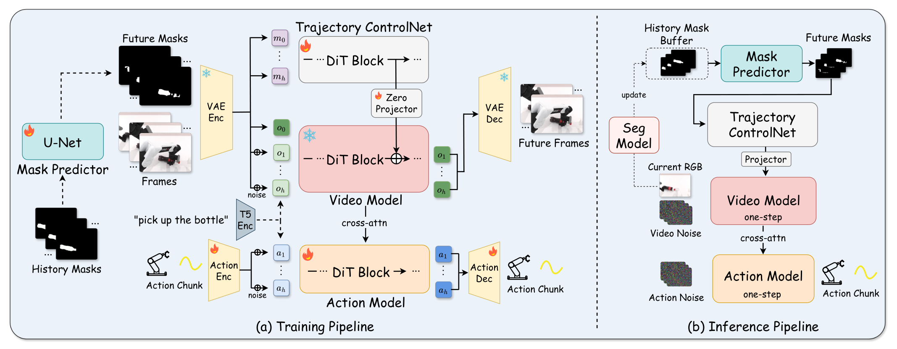

# 2026-10-19 Embodied AI & World Models Daily

> 面向具身智能 / Robotics 研究员与工程师的研究与工程资讯。

主窗口为北京时间2026-10-19 00:00–23:59，补充窗口为17–18日。arXiv按实际v1提交时间归档；下文主窗口论文均于20日公告，不能把公告日当提交日。

## 🔥 今日必读

### 1. 【模仿学习与策略】CTR：把任务约束与双臂示范的偶然时间表分开

**来源：** [arXiv:2610.26507v1](https://arxiv.org/abs/2610.26507)（cs.RO）  
**类型：** Paper  
**发布时间：** 2026-10-19 22:44:03（北京时间）  
**评分：** 91.1/100（A 91.4；B 90.8）  
**关键词：** 模仿学习与策略 · Robot Learning

**一句话：**  
保留每臂局部动作，重组满足任务约束的相对时序，扩大联合进度覆盖，降低把另一臂进度当捷径的倾向。

*来自已审查精读图像；展示方法的数据流与训练、执行接口。*

**技术要点：**

- 四仿真、四真机任务覆盖DP、ACT、π0.5。Sort Letters六初态中最坏成功率由Mixed的56%升至76%，每格50次试验。
- 4秒外部暂停向对臂传递的延迟由2.56秒降至0.25秒；必要约束仍保留，但需要任务特定程序、人工审查与合成一致性处理。

**为什么值得关注：**  
不改部署策略结构，值得先检查自己的示范是否只覆盖一条相对时间表。

**资源：**

- Paper：[arXiv:2610.26507v1](https://arxiv.org/abs/2610.26507)
- Project / Code：[官方入口](https://github.com/MINT-SJTU/CTR)。当前接口404，论文明确写待公开，不作为已开源。

---

### 2. 【World Models】VQ-WM：让潜空间子目标对齐低层控制器的可达性

**来源：** [arXiv:2610.25600v1](https://arxiv.org/abs/2610.25600)（cs.RO）  
**类型：** Paper  
**发布时间：** 2026-10-19 08:06:44（北京时间）  
**评分：** 88.8/100（A 89；B 88.6）  
**关键词：** World Models · Robot Learning

**一句话：**  
用控制器闭环首次到达时间构造离散状态码本，在离散图上搜索，再由连续视觉反馈执行。

*来自已审查精读图像；展示方法的数据流与训练、执行接口。*

**技术要点：**

- CubeHard成功率73.3±0.9%；真机四盘汉诺塔在短子任务训练下平均任务进度100%，每条件18次试验。
- 真机主图统计平均任务进度，不能直接改写为二元成功率。采集使用符号规划和预定义拾放；实验每回合仅一次高层规划。

**为什么值得关注：**  
把“看起来近”改为“控制器能到”，是世界模型接入实际规划的可复用接口。

**资源：**

- Paper：[arXiv:2610.25600v1](https://arxiv.org/abs/2610.25600)
- Code / Weights：未找到可确认的公开代码与权重入口。

---

### 3. 【模仿学习与策略】TILDE：学生需要看见教师实际恢复后经过的状态

**来源：** [arXiv:2610.25376v1](https://arxiv.org/abs/2610.25376)（cs.RO）  
**类型：** Paper  
**发布时间：** 2026-10-19 00:26:20（北京时间）  
**评分：** 87.75/100（A 87.9；B 87.6）  
**关键词：** 模仿学习与策略 · Robot Learning

**一句话：**  
同时学习示范、学生访问状态的教师动作标签，以及教师接管后实际执行的恢复轨迹；AutoDAgger按进度停滞触发接管。

*来自已审查精读图像；展示方法的数据流与训练、执行接口。*

**技术要点：**

- 三项真机任务阶段评分63.9/80.6/69.2，对BC20.8/37.0/16.7；统一12个折布错误状态中恢复8/12，BC4/12。
- 最高4.1倍是阶段评分倍率。2.23–2.60倍效率提升仅指成功接管后的恢复耗时，不是完整数据流水线加速；每项真机12/27/30试验。

**为什么值得关注：**  
适合把已有强EFM转成新架构学生；学生仍用预训练VLM，不能称完全从零或零教师成本。

**资源：**

- Paper：[arXiv:2610.25376v1](https://arxiv.org/abs/2610.25376)
- Project：[项目页](https://hku-sail.github.io/TILDE/)。Code按钮未提供可用仓库链接；未找到可确认的公开训练代码与权重。

---

### 4. 【World Models】TrajWAM：显式预测运动目标，并保留一步动作蒸馏接口

**来源：** [arXiv:2610.25763v1](https://arxiv.org/abs/2610.25763)（cs.RO）  
**类型：** Paper  
**发布时间：** 2026-10-19 12:21:22（北京时间）  
**评分：** 87.45/100（A 87.5；B 87.4）  
**关键词：** World Models · Robot Learning

**一句话：**  
从历史掩码预测目标轨迹，用轻量ControlNet引导未来视频，再以非对称注意力供动作分支读取。

*来自已审查精读图像；展示方法的数据流与训练、执行接口。*

**技术要点：**

- DOMINO 35任务成功率43.54%，真机输送带77.9%、转盘70.4%；每方法共480次真机测试，总体74.2%，π0.5为49.2%。
- 视频DMD→适配器重对齐→动作rollout蒸馏；RTX5090策略延迟108.5ms，SAM3异步另计。动作DMD消融实现并非标准独立fake-score。

**为什么值得关注：**  
动态抓取要同时维持预测准确性、表征接口和执行时效；单纯减少去噪步数会失败。

**资源：**

- Paper：[arXiv:2610.25763v1](https://arxiv.org/abs/2610.25763)
- Project：[项目页](https://kevingeng3.github.io/TrajWAM/)。[官方代码入口](https://github.com/KevinGeng3/TrajWAM)当前仅README，不能当作训练实现或模型权重已发布。

---

## 📄 论文雷达

### 【World Models】Frechet Forcing: Training Long-Horizon Streaming World Models from Short Clips

**来源：** [arXiv:2610.25666v1](https://arxiv.org/abs/2610.25666)  
**发布时间：** 2026-10-19 10:12:39（北京时间）  
**关键词：** World Models · Robot Learning  
**核心贡献：** 以生成锚定、片段中心化潜统计和冻结感知分布约束自由rollout；381帧训练得到4000帧生成。DROID末段FVD2058→81，但约20%长序列仍有局部伪影，摄像机转角只达命令49–60%，尚非机器人闭环任务验证。  
**值得关注程度：** 85.35/100（A 85.5；B 85.2）  
**Paper：** [arXiv:2610.25666v1](https://arxiv.org/abs/2610.25666)

*来自已审查精读图像；该论文没有方法总览图，采用主结果图，指标与参考协议见精读。*

### 【模仿学习与策略】Learning from Fleet Experience: A Collective Learning Paradigm for Robots

**来源：** [arXiv:2610.25736v1](https://arxiv.org/abs/2610.25736)  
**发布时间：** 2026-10-19 11:41:27（北京时间）  
**关键词：** 模仿学习与策略 · Robot Learning  
**核心贡献：** 按失败上下文检索机器人群体成功片段，异步汇总经验并更新共享策略。论文报告五真机任务93.3–99.2%，每任务120次；96机器人手机包装由79.2%升至98.3%。需进一步审计检索对齐和跨机器人数据独立性。  
**值得关注程度：** 84.75/100（A 85；B 84.5）  
**Paper：** [arXiv:2610.25736v1](https://arxiv.org/abs/2610.25736)

### 【强化学习】Long-Horizon Multi-Object Rearrangement via Distilled Tree Search over Continuous Actions

**来源：** [arXiv:2610.25785v1](https://arxiv.org/abs/2610.25785)  
**发布时间：** 2026-10-19 12:50:13（北京时间）  
**关键词：** 强化学习 · Robot Learning  
**核心贡献：** 在连续动作上用策略提议与价值进度引导MCTS，GPU物理并行搜索再迭代蒸馏，使部署策略无需在线树搜索。关注多物体长任务的数据生成成本，以及搜索教师与最终策略的性能差距。  
**值得关注程度：** 84.75/100（A 84.8；B 84.7）  
**Paper：** [arXiv:2610.25785v1](https://arxiv.org/abs/2610.25785)

### 【数据与Benchmark】BiDex-100: A Comprehensive Benchmark for Bimanual Dexterous Manipulation Across 100+ Simulation Tasks

**来源：** [arXiv:2610.25459v1](https://arxiv.org/abs/2610.25459)  
**发布时间：** 2026-10-19 02:44:05（北京时间）  
**关键词：** 数据与Benchmark · Robot Learning  
**核心贡献：** 106项仿真任务、五类能力维度与OOD划分，每任务双本体；8080条经成功验证遥操作示范、625万帧，统一比较七类VLA。适合检查双手灵巧策略的任务覆盖，仿真排行仍需真机转移检验。  
**值得关注程度：** 84/100（A 84；B 84）  
**Paper：** [arXiv:2610.25459v1](https://arxiv.org/abs/2610.25459)

### 【模仿学习与策略】ALIGN: Aligning Condition Estimation and Expression in Advantage-Conditioned Behavior Cloning

**来源：** [arXiv:2610.26455v1](https://arxiv.org/abs/2610.26455)  
**发布时间：** 2026-10-19 22:10:26（北京时间）  
**关键词：** 模仿学习与策略 · Robot Learning  
**核心贡献：** 用成对分类估计相对条件，并以AdaRMS连续表达流模型条件，减少有噪奖励阈值及提示词语义失配。两项真机混合重试任务90%/56.7%，对ACBC56.7%/33.3%；任务规模仍有限。  
**值得关注程度：** 83/100（A 83.1；B 82.9）  
**Paper：** [arXiv:2610.26455v1](https://arxiv.org/abs/2610.26455)

### 【端侧部署】SPAR: Structural Pruning and Action Recovery for Vision-Language-Action Models

**来源：** [arXiv:2610.26487v1](https://arxiv.org/abs/2610.26487)  
**发布时间：** 2026-10-19 22:28:51（北京时间）  
**关键词：** 端侧部署 · Robot Learning  
**核心贡献：** 结构化剪枝后做动作恢复训练，π0.5语言骨干2.34B→0.09B，总模型3.37B→1.12B；LIBERO平均成功率84.55%→93.45%，完整策略推理约1.98倍加速。属于剪枝与恢复组合的仿真证据。  
**值得关注程度：** 82.95/100（A 83.1；B 82.8）  
**Paper：** [arXiv:2610.26487v1](https://arxiv.org/abs/2610.26487)

### 【VLA】FR-VLA: Implicit Force Reasoning VLA for Contact-Rich Manipulation

**来源：** [arXiv:2610.25981v1](https://arxiv.org/abs/2610.25981)  
**发布时间：** 2026-10-19 16:08:41（北京时间）  
**关键词：** VLA · Robot Learning  
**核心贡献：** 学习力查询作为上下文准入，调制外部力信号进入动作路径的时机和强度。五类接触任务、两平台、六阶段评估体现接触上下文价值；尚需进一步核对力传感器、标定及训练成本，不能称无力输入。  
**值得关注程度：** 82.25/100（A 82.3；B 82.2）  
**Paper：** [arXiv:2610.25981v1](https://arxiv.org/abs/2610.25981)

### 【导航与探索】ScaleNav: Scalable Internet Video Pretraining for Language-Conditioned Local Navigation

**来源：** [arXiv:2610.25690v1](https://arxiv.org/abs/2610.25690)  
**发布时间：** 2026-10-19 10:37:24（北京时间）  
**关键词：** 导航与探索 · Robot Learning  
**核心贡献：** 互联网第一人称视频预训练后进行仿真动作对齐和联合微调，将视觉动力学迁移到语言条件局部导航；论文报告OVON单视图86.5%、Habitat GS-LN94.9%及四足真机。任务以局部可见目标为界。  
**值得关注程度：** 82.2/100（A 82.3；B 82.1）  
**Paper：** [arXiv:2610.25690v1](https://arxiv.org/abs/2610.25690)

### 【VLA】HAF-VLA: Hierarchical Action Flow Framework for Humanoid Vision-Language-Action Control

**来源：** [arXiv:2610.26584v1](https://arxiv.org/abs/2610.26584)  
**发布时间：** 2026-10-19 23:33:34（北京时间）  
**关键词：** VLA · Robot Learning  
**核心贡献：** 以底座、腰部到全身的分级动作流扩展人形VLA，在共享空间中通过跨阶段KV传递协调信息。六类真机移动操作检验层级接口；关注阶段训练数据和整机控制依赖，不把结构新颖等同跨本体泛化。  
**值得关注程度：** 81.6/100（A 81.8；B 81.4）  
**Paper：** [arXiv:2610.26584v1](https://arxiv.org/abs/2610.26584)

### 【导航与探索】ReInsVLN: Revisiting Historical Evidence for Training-Free Vision-and-Language Navigation

**来源：** [arXiv:2610.26545v1](https://arxiv.org/abs/2610.26545)  
**发布时间：** 2026-10-19 23:08:06（北京时间）  
**关键词：** 导航与探索 · Robot Learning  
**核心贡献：** 用历史压缩与提醒重新利用过去的导航证据，不增加额外模型调用。R2R未见环境两个设置成功率64.27%/64.44%；匹配工作负载中prefill和cache开销下降，需按具体基础模型区分增益。  
**值得关注程度：** 80.55/100（A 80.7；B 80.4）  
**Paper：** [arXiv:2610.26545v1](https://arxiv.org/abs/2610.26545)

## 🛠 工程与开源

- **Fréchet Forcing官方实现与模型入口**：[代码](https://github.com/zhao-yian/Frechet_Forcing)、[权重](https://huggingface.co/zhaoyian01/Frechet_Forcing)、[项目页](https://zhao-yian.github.io/Frechet_Forcing/)。代码含miniworld与scripts目录，模型列表实际含DROID检查点；权重入口创建于18日12:55北京时间，属配套资源的补充窗口披露；与上文论文合为一个研究事件，未执行安装或复现实验。
- **AR遥操作与对比SAC**：[Cyberyyc/Scalable-Dexterous-Robot-Learning-with-AR-based-Remote-Human-Robot-Interactions](https://github.com/Cyberyyc/Scalable-Dexterous-Robot-Learning-with-AR-based-Remote-Human-Robot-Interactions)。评分79.0/100（A 79.4；B 78.6）。仓库创建于19日00:27北京时间，包含core、examples和训练说明；BC初始化SAC，训练期专家配对对比头。原论文是较早工作，本日仅按代码入口核实；环境工厂、硬件及专家数据仍需另行接入，未独立复现。
- **proxyrank：给仿真代理排序加不确定性**：[GitHub](https://github.com/Dirobots/proxyrank)。评分75.9/100（A 76.2；B 75.6；独立工程项目T2门槛75）。19日13:51北京时间创建，提供相关指标区间、完美代理上界、随机排序检验及真机试验预算规划。仓库G1案例的“real”是修改动力学的仿真代理，不能当真实硬件实验；当前README含20日更新，未把新增行逐一归到19日；本条按19日仓库创建事件和当前可见接口登记，未独立运行统计校准。

## 💬 社区信号

已检索论文标题、GitHub及公开讨论线索，但没有核实到足够的独立技术讨论支持“社区集中关注”。新论文的搜索收录页不计热度证据，本日不补造热门话题。

## 🔎 补充窗口筛选记录

- [HandsOn](https://arxiv.org/abs/2610.26765)：v1北京时间20日01:22:48，超出主窗口，留待20日日报。
- [PICA-WAM](https://arxiv.org/abs/2610.26813)：v1北京时间20日01:50:59；仓库19日00:30创建，但当前只有README、引文与assets、代码计划后续发布，不作为19日完整代码发布。
- [AutoPruner](https://arxiv.org/abs/2610.23880)：官方Submitted为9月23日22:02:34北京时间，虽本批公告仍是旧稿，不当19日新论文。
- [Isaac Lab v3.0.0](https://github.com/isaac-sim/IsaacLab/releases/tag/v3.0.0)：北京时间20日10:05:51发布，超出窗口。MuJoCo、Genesis、LeRobot近期release也未发现可确认属于19日的新正式版本。
- 补充窗口另有71条经摘要与版本时间核实的候选；本期优先14项主窗口论文，不把旧日稿件改标19日。

### 来源覆盖与质量说明

直接抓取cs.RO / cs.AI / cs.LG / cs.CV官方recent，分别733 / 2000 / 2000 / 1259项；AI和LG接口达2000项上限，但所取公告包含20、19与更早日期。去重并核实374个候选的标题、作者、摘要和全部版本时间，主窗口74、补充71、窗口外229；主窗口通过预筛后独立双评分，并按论文、项目与代码聚簇。没有把列表标题直接当作入选证据。

已检查CoRL/RSS/ICRA/IROS、GEAR、PI、1X、Figure、RAI、TRI新闻页、DeepMind博客，以及四仿真器release和NVIDIA/LeRobot/PI模型列表。DeepMind初次压缩解码错误已通过gzip回退核实，TRI首页400后新闻入口成功；Skild连续超时仍未完成，部分公开页面无可靠日级更新时间，GitHub/HF检索也存在返回上限。**来源检查不完整，不能据此断言所有机构19日均无资讯。**

四篇必读及最高分雷达Fréchet Forcing安排全文精读；最终逐篇状态与代表图见[精读索引](../paper-reading/news/2026-10-19/README.md)。评分只用于本日编辑取舍，论文结果均为作者报告，未做机器人独立复现。

## 📊 今日技术趋势

世界模型今天沿两条接口改善：VQ-WM把离散规划状态对齐控制器可达性，TrajWAM把目标运动预测对齐一步动作生成。CTR与TILDE则把关注点从策略架构移到训练状态分布：前者扩大可行双臂进度，后者补齐学生出错后的恢复状态。长视频的视觉统计稳定已有明确进展，但Fréchet Forcing仍暴露局部物体伪影与动作幅度偏差，视觉分数不能直接代替物理执行质量。
