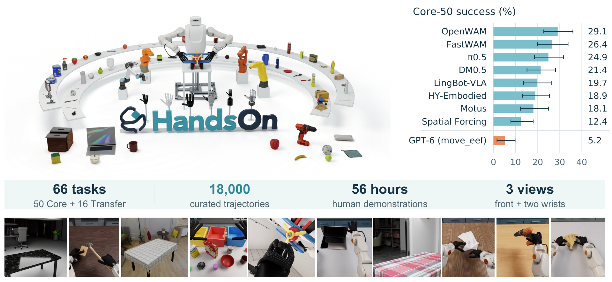
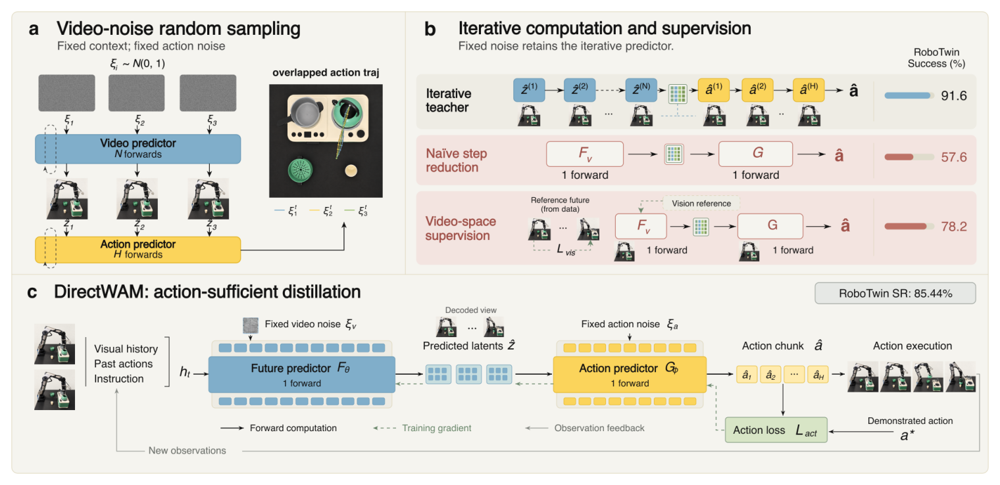
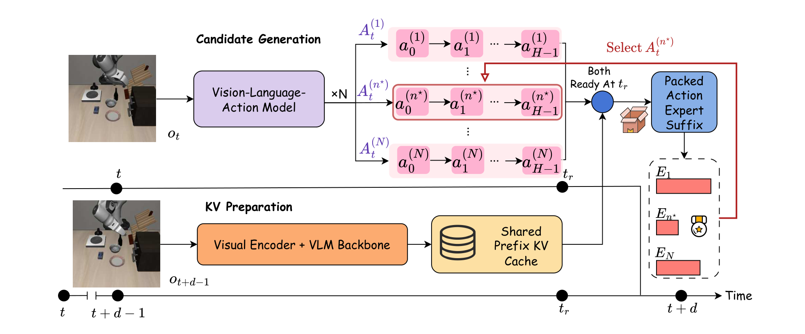

# 2026-10-20 Embodied AI & World Models Daily

> 面向具身智能 / Robotics 研究员与工程师的研究与工程资讯。

主窗口：北京时间2026-10-20 00:00–23:59；补充窗口：18–19日。论文时间按官方v1实际提交时间换算，区别于公告日和PDF封面日期。

## 🔥 今日必读

### 1. 【World Models】Ropedia W0：用人类经验和运动学接口迁移跨本体未来预测

**来源：** [arXiv:2610.26855v1](https://arxiv.org/abs/2610.26855)（cs.RO）  
**类型：** Paper  
**发布时间：** 2026-10-20 01:59:55（北京时间）  
**评分：** 92/100（A 92；B 92）  
**关键词：** World Models · Robot Learning

**一句话：**  
把相机运动与投影骨架作为共同条件，连接人类第一视角经验和机器人数据，再将模型蒸馏为四步流式预测器。

**技术要点：**

- 10,000小时人类与3,000小时机器人训练数据；A14B约27B总参数、14B激活。相同架构1%机器人后训练时，GR1 PSNR由16.04升至20.85。
- 5B四步模型报告21.3fps；这是吞吐，125帧含VAE解码约6秒、首块约1.4秒。规划实验G1的55对26/45是任务进度，不是成功率。

**为什么值得关注：**  
值得检查自己的动作条件接口：投影几何有助迁移，但不能替代接触动力学。目标数据集零样本也不保证本体从未见过。

**资源：**

- Paper：[arXiv:2610.26855v1](https://arxiv.org/abs/2610.26855)
- Project / Code / Weights：[项目页](https://ropedia.github.io/ropedia-w0/) · [代码](https://github.com/Ropedia/ropedia-w0) · [5B权重](https://huggingface.co/ropedia-ai/Ropedia-W0) · [Xp-Teleop](https://huggingface.co/datasets/ropedia-ai/Xp-Teleop)

---

### 2. 【数据与Benchmark】HandsOn：灵巧操作排行榜必须连同时间预算一起读

**来源：** [arXiv:2610.26765v1](https://arxiv.org/abs/2610.26765)（cs.RO）  
**类型：** Paper  
**发布时间：** 2026-10-20 01:22:48（北京时间）  
**评分：** 90.95/100（A 90.9；B 91）  
**关键词：** 数据与Benchmark · Robot Learning

**一句话：**  
18,000条模拟遥操作轨迹配合50个Core任务、16个无目标示范的Transfer任务，把任务谓词、数据质检和执行预算一起固定。

**技术要点：**

- Core任务宏平均OpenWAM29.1%、FastWAM26.4%、π0.5为24.9%；OpenWAM的任务加回合bootstrap95%区间22.8–36.0%。
- 数值实验固定ROKAE/Wuji/PhysX；五臂六手是平台支持范围。1倍专家P75预算下π0.5为14.6%、OpenWAM8.3%，3倍预算排名反转；真机仅定性录像。

**为什么值得关注：**  
强项是公开可检查的评测合同，以及把二元成功和有序进度分开。Transfer的12.9%进度不能当成功率，也不能据平台兼容性宣称跨本体泛化已经解决。

**资源：**

- Paper：[arXiv:2610.26765v1](https://arxiv.org/abs/2610.26765)
- Project / Code / Weights：[官方代码](https://github.com/TsinghuaC3I/HandsOn)

---

### 3. 【端侧部署】DirectWAM：训练动作真正需要的未来，而非直接删去扩散步骤

**来源：** [arXiv:2610.28122v1](https://arxiv.org/abs/2610.28122)（cs.RO）  
**类型：** Paper  
**发布时间：** 2026-10-20 20:30:58（北京时间）  
**评分：** 89.6/100（A 89.6；B 89.6）  
**关键词：** 端侧部署 · Robot Learning

**一句话：**  
保留未来到动作的级联，先训练一步动作专家，再冻结它，用最终动作误差监督一步未来预测器。

**技术要点：**

- RoboTwin主表：全量教师90.7%、朴素一步54.9%、Flash-WAM78.2%、DirectWAM85.4%；LIBERO平均97.1%，Flash的LIBERO项引用原文结果而非匹配权重。
- 模型侧中位时延5042→180ms，约28倍；真机三任务每格20次，香蕉19/20、倒水11/20、茶壶12/20，教师为19/20、9/20、12/20。

**为什么值得关注：**  
它把一步部署的目标从视觉重建转到下游动作充分性。局部表示替换实验提供机制证据，但仅检验特定级联模型家族，不能推成所有随机世界模型都可去扩散。

**资源：**

- Paper：[arXiv:2610.28122v1](https://arxiv.org/abs/2610.28122)
- Project / Code / Weights：未找到可确认的公开代码或模型权重入口。

---

### 4. 【仿真平台】Isaac Lab 3.0：任务层与物理、渲染、可视化后端解耦

**来源：** [官方v3.0.0发布与迁移说明](https://github.com/isaac-sim/IsaacLab/releases/tag/v3.0.0)  
**类型：** Engineering  
**发布时间：** 2026-10-20 10:05:51（北京时间）  
**评分：** 89.45/100（A 90；B 88.9）  
**关键词：** Isaac Lab · Warp · Newton · Migration

**一句话：**  
同一任务API可经工厂选择物理、渲染和可视化，Kit变成可选依赖；Newton/Warp与独立OVPhysX/OVRTX路径扩展训练部署组合。

**技术要点：**

- 只保证文档声明的任务/后端组合，不能假设每个任务任意换物理引擎。迁移前先检查环境presets、观测与动作合同。
- ProxyArray以`.torch` / `.warp`访问共享缓冲；观测噪声不再防御性clone，原地写入可能污染共享数据。旧相机`mdp.image`拆为RGB、深度等term，RGB去alpha，`permute`迁为`channel_first`。
- 目标栈含Isaac Sim6.2、Python3.12、PyTorch2.11/CUDA13、Warp1.17；不建议仅升级依赖而不核验旧checkpoint输入。此处依据官方代码和说明，未做本机安装或仿真运行。

**为什么值得关注：**  
统一任务定义让物理求解器和渲染选择更明确，同时把旧实验的隐藏依赖暴露出来。迁移成本集中在配置、缓冲所有权和观测格式。

**资源：** [GitHub](https://github.com/isaac-sim/IsaacLab) · [Release](https://github.com/isaac-sim/IsaacLab/releases/tag/v3.0.0)

## 📄 论文雷达

### 【端侧部署】PACT-VLA

**来源：** [arXiv:2610.28019v1](https://arxiv.org/abs/2610.28019)  
**发布时间：** 2026-10-20 19:08:41（北京时间）  
**关键词：** 端侧部署 · Robot Learning  
**核心贡献：** 冻结流式策略先生成多个动作块，再用提交前一拍的新观测验证。Kinetix延迟1–4均值77.8→85.8%；真机三任务各50次平均82%，旧观测同N4为64.7%。短延迟LIBERO略退化，残差表示策略一致性而非成功概率。  
**值得关注程度：** 88.35/100（A 88.4；B 88.3）  
**Paper：** [arXiv:2610.28019v1](https://arxiv.org/abs/2610.28019)

### 【World Models】Action Influence Maximization

**来源：** [arXiv:2610.27387v1](https://arxiv.org/abs/2610.27387)  
**发布时间：** 2026-10-20 07:21:18（北京时间）  
**关键词：** World Models · Robot Learning  
**核心贡献：** 以动作对未来的可辨影响作为数据分布目标，主动采集可控制经验。摘要报告500次新交互加3000专家回合，可匹配30万专家回合的末端可控性；85倍描述该数据比，不代表全流程算力或真机任务效率。  
**值得关注程度：** 86.55/100（A 86.5；B 86.6）  
**Paper：** [arXiv:2610.27387v1](https://arxiv.org/abs/2610.27387)

### 【模仿学习与策略】Multi-View Latent Action Pretraining

**来源：** [arXiv:2610.27794v1](https://arxiv.org/abs/2610.27794)  
**发布时间：** 2026-10-20 15:55:43（北京时间）  
**关键词：** 模仿学习与策略 · Robot Learning  
**核心贡献：** 用同步多视角解决单视角潜动作中出平面运动的歧义，再把潜动作专家迁到机器人。摘要报告更好的动作可解码性及真机迁移；关注视角同步、视频与机器人数据预算是否匹配，不能把摘要百分比擅自改成百分点。  
**值得关注程度：** 86.25/100（A 86.3；B 86.2）  
**Paper：** [arXiv:2610.27794v1](https://arxiv.org/abs/2610.27794)

### 【World Models】LaLa-World

**来源：** [arXiv:2610.27851v1](https://arxiv.org/abs/2610.27851)  
**发布时间：** 2026-10-20 16:32:14（北京时间）  
**关键词：** World Models · Robot Learning  
**核心贡献：** 把视觉变化和数值动作转为语言动作，在统一潜预测接口中混合异构数据。摘要报告同设定训练量减少6倍、MPC快13.9倍；仍需区分表征预训练、规划计算和真实机器人成功率。  
**值得关注程度：** 85.8/100（A 85.8；B 85.8）  
**Paper：** [arXiv:2610.27851v1](https://arxiv.org/abs/2610.27851)

### 【World Models】TaskWAM

**来源：** [arXiv:2610.28431v1](https://arxiv.org/abs/2610.28431)  
**发布时间：** 2026-10-20 23:58:45（北京时间）  
**关键词：** World Models · Robot Learning  
**核心贡献：** 以Mode Tokens表达细粒度任务意图，以State Token追踪进度，减少“未来合理但选错目标”的错误；提出StageBench检查意图与阶段。关注状态反馈与未来条件之间的信息流及不同本体的匹配评测。  
**值得关注程度：** 85.55/100（A 85.5；B 85.6）  
**Paper：** [arXiv:2610.28431v1](https://arxiv.org/abs/2610.28431)

### 【导航与探索】SPAR：推物搜索训练动作排序器

**来源：** [arXiv:2610.28362v1](https://arxiv.org/abs/2610.28362)  
**发布时间：** 2026-10-20 23:25:57（北京时间）  
**关键词：** 导航与探索 · Robot Learning  
**核心贡献：** 用至多两次推物搜索教师训练接触动作排序，把开路准备动作和立即到达的局部收益分开。作者报告真机策略37/40、搜索33/40、随机27/40；7倍搜索调用和3.8倍时间改善需按对应计算协议理解。  
**值得关注程度：** 85.3/100（A 85.3；B 85.3）  
**Paper：** [arXiv:2610.28362v1](https://arxiv.org/abs/2610.28362)

### 【数据与Benchmark】RoboValue

**来源：** [arXiv:2610.26663v1](https://arxiv.org/abs/2610.26663)  
**发布时间：** 2026-10-20 00:19:08（北京时间）  
**关键词：** 数据与Benchmark · Robot Learning  
**核心贡献：** 在15个仿真与20个真机任务上评估机器人价值模型，分解状态、进度、失败与一致性，并检验零/一次示例迁移。可用于检查把视频价值评分直接用于规划时的可靠性；任务覆盖不等于闭环优化已验证。  
**值得关注程度：** 84.25/100（A 84.3；B 84.2）  
**Paper：** [arXiv:2610.26663v1](https://arxiv.org/abs/2610.26663)

### 【World Models】PICA-WAM

**来源：** [arXiv:2610.26813v1](https://arxiv.org/abs/2610.26813)  
**发布时间：** 2026-10-20 01:50:59（北京时间）  
**关键词：** World Models · Robot Learning  
**核心贡献：** 以名义外观的EMA深层教师对齐扰动外观的浅层动作相关表征，面向WAM视觉扰动鲁棒性。摘要覆盖四模型、三个仿真与真机；官方仓库当前只有说明和资源，不能当完整训练代码已经发布。  
**值得关注程度：** 84.2/100（A 84.2；B 84.2）  
**Paper：** [arXiv:2610.26813v1](https://arxiv.org/abs/2610.26813)

### 【模仿学习与策略】EventSync

**来源：** [arXiv:2610.27917v1](https://arxiv.org/abs/2610.27917)  
**发布时间：** 2026-10-20 17:29:49（北京时间）  
**关键词：** 模仿学习与策略 · Robot Learning  
**核心贡献：** 让视觉与末端事件监控决定何时写入记忆，只在子目标成功后更新，减少历史依赖任务中的阶段漂移。作者报告RoboMME64.5%、较所比最优高20个百分点，并提供四项真机任务；仍需核对失败监控的漏检成本。  
**值得关注程度：** 84.05/100（A 84；B 84.1）  
**Paper：** [arXiv:2610.27917v1](https://arxiv.org/abs/2610.27917)

### 【运动与全身控制】EmbodyHOI

**来源：** [arXiv:2610.27242v1](https://arxiv.org/abs/2610.27242)  
**发布时间：** 2026-10-20 04:08:32（北京时间）  
**关键词：** 运动与全身控制 · Robot Learning  
**核心贡献：** 在冻结人类手物交互生成器内部加入机器人IK引导，使生成与本体可执行性接轨，再训练灵巧策略。作者报告G1仿真成功率68→79%、H1为62→76%；这些控制收益不能直接替代真实硬件接触验证。  
**值得关注程度：** 83.8/100（A 83.8；B 83.8）  
**Paper：** [arXiv:2610.27242v1](https://arxiv.org/abs/2610.27242)

## 🛠 工程与开源

- **Ropedia W0 5B与Xp-Teleop**：与必读论文合并为一个事件。[模型API对应的权重页](https://huggingface.co/ropedia-ai/Ropedia-W0)确认pretrain/midtrain两个safetensors，[数据页](https://huggingface.co/datasets/ropedia-ai/Xp-Teleop)含轨迹元数据。代码Apache2，模型CC-BY-NC4.0，数据CC-BY4.0；A14B与benchmark后训练权重、训练评测代码仍待发布。模型仓库创建于19日，20日更新，本期按20日新论文聚簇，不把每个资源都宣称首次在20日上线。
- **InternW0代码入口**：[InternRobotics/InternW0](https://github.com/InternRobotics/InternW0)，20日17:52:53北京时间创建。已有推理、配置、脚本与评测适配器，结合慢视频规划器和快ActionDiT并路由复用未来KV。对应[较早论文](https://arxiv.org/abs/2609.27656)，本日归为新代码事件；权重未发布，数据与硬件接入不能由仓库存在推成已部署。开放源码双评均79.8/100。
- **ACE-Brain0.6空间定位**：[论文](https://arxiv.org/abs/2610.27040) · [官方仓库](https://github.com/DAXIAORobotics/ACE-Brain-0.6) · [模型](https://huggingface.co/ACERobotics/ACE-Brain-0.6-9B)。Qwen3.5-9B经150万grounding样本微调，报告七项均值75.41；这是空间定位而非闭环机器人成功率。当前HF可见模型文件，修改时间已到21日，未逐文件证明全部20日上线；GitHub独立推理实现仍待公开。
- **HandsOn与Isaac Lab**：分别见必读论文和正式版本条目；本次核对官方仓库目录和发布说明，不代表依赖安装、训练复现或跨后端验收。

## 💬 社区信号

已扩展检索论文标题、公开讨论与GitHub新仓库；没有核实到足够的独立技术讨论支撑“社区集中关注”。作者宣传和搜索收录不计独立复现，本文不补造热门话题。

## 🔎 补充窗口筛选记录

- [Google Argon](https://developers.googleblog.com/gemini-4-argon-for-robotics/)、[PI API](https://www.pi.website/blog/api-beta)：已访问的一手页面指向13日披露，不改标20日新成果。
- [PrismWAM](https://github.com/THUSI-Lab/PrismWAM)：仓库创建于20日02:57北京时间，README叙述19日；属于代码入口时间与论文日期需要分开的线索。本期未把旧论文重复列为20日新投稿。
- 官方列表另有105条候选实际v1位于18–19日补充窗口，168条在主/补充窗口外；普通修订或公告延迟不据此改写提交日期。

### 来源覆盖与质量说明

直接抓取cs.RO / cs.AI / cs.LG / cs.CV官方recent，取得517 / 1547 / 1593 / 963个列表记录，覆盖21、20、19及更早公告；经关键词宽召回、去重后核实372个abs页的标题、作者、摘要和各版本时间，主窗口99、补充105、窗口外168。主窗口逐条预筛，PASS执行同权重独立双评分，排序优先技术、相关性和证据；纸面评分不是可复现的客观性能指标。

已检查CoRL/RSS/ICRA/IROS、GEAR、PI、DeepMind、Skild、1X、Figure、RAI、TRI，以及IsaacLab/MuJoCo/Genesis/LeRobot release和NVIDIA/LeRobot/PI模型列表；23个端点均取得HTTP响应。**GEAR等动态页面未返回完整研究正文，部分会议与机构页没有可靠日级更新时间，GitHub/HF发现也有返回上限，因此来源检查不完整，不能据此断言所有机构20日均无资讯。**

三篇必读论文与最高分雷达PACT-VLA安排全文精读，状态、代表图和占位原因见[精读索引](../paper-reading/news/2026-10-20/README.md)。论文数值均为作者报告，本次未做机器人独立复现。

## 📊 今日技术趋势

世界模型的接口比视觉逼真度更值得看：Ropedia把跨本体数据接到共同运动学条件，DirectWAM把未来表示接到动作损失，PACT把固定候选接到更晚的观测。HandsOn显示执行时间预算本身会改变排行榜，Isaac Lab3则把任务定义与后端选择分开；复现实验需要同时固定数据、观测、物理引擎和时间合同。
