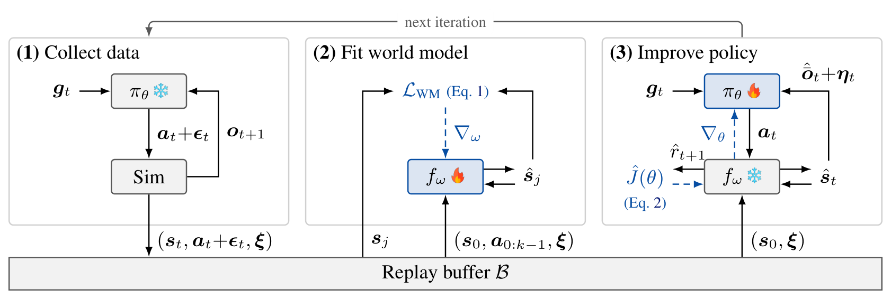
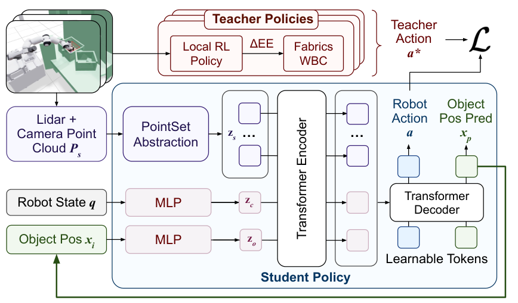

# 2026-10-21 Embodied AI & World Models Daily

> 面向具身智能 / Robotics 研究员与工程师的研究与工程资讯。

主窗口：北京时间2026-10-21 00:00–23:59；补充窗口：19–20日。**22日上午通过完整分页的官方月列表补齐后续投稿，重新筛选和排序；部分机构动态页面及受限搜索的覆盖边界仍保留在文末。** 论文按实际v1提交时间归档，公告日期不等于本地自然日。

## 🔥 今日必读

### 1. 【运动与全身控制】SuperMimic：以可微世界模型摊销大规模动作跟踪

**来源：** [arXiv:2610.28480v1](https://arxiv.org/abs/2610.28480)（cs.RO）  
**类型：** Paper  
**发布时间：** 2026-10-21 00:29:30（北京时间）  
**评分：** 94.2/100（A 94.2；B 94.2）  
**关键词：** 运动与全身控制 · Robot Learning

**一句话：**  
反复交替采集仿真转移、拟合共享动力学、对短想象rollout反向传播更新策略，用critic补足长时域收益。

**技术要点：**

- 单H100约3小时超过SONIC已发布checkpoint回报；129,514个筛选训练动作中失败25个，双H100约9.8小时失败0。SONIC对照用128张L40、7天与更多训练数据，并非匹配硬件/数据。
- 匹配LAFAN1动作、网络与奖励的PPO-Sim在18小时预算内未达到0.82回报，SuperMimic约1.2小时达到；在同世界模型中，相比PPO约少64倍想象步。

**为什么值得关注：**  
把仿真吞吐收益与梯度估计收益分开检验，比单看总GPU小时更有复用价值。零失败测训练覆盖，不是未见动作泛化或整机安全保证。

**资源：**

- Paper：[arXiv:2610.28480v1](https://arxiv.org/abs/2610.28480)
- Project / Code / Weights：[项目页](https://supermimic.github.io)；未确认公开训练代码与权重。

---

### 2. 【Sim-to-Real】COWBOY：把局部灵巧专家扩展到完整移动操作场景

**来源：** [arXiv:2610.28948v1](https://arxiv.org/abs/2610.28948)（cs.RO）  
**类型：** Paper  
**发布时间：** 2026-10-21 05:59:10（北京时间）  
**评分：** 92.2/100（A 92.8；B 91.6）  
**关键词：** Sim-to-Real · Robot Learning

**一句话：**  
用向量化fabrics控制器承担全局接近、视线和避碰，三种局部RL专家承担接触，再以部分点云DAgger蒸馏单一32维全身策略。

**技术要点：**

- 24真实场景按协议每场25物体×3姿态，报告约91%抓取成功；成功要求提起10cm且无碰撞。先得到有效SAM3目标初检，再由60Hz策略与3Hz检测共同跟踪，不能视为任意指令无初始化的完整成功率。
- 留出仿真学生92.4%、教师95.6%、ManipGen63.1%；完整点云训练虽仿真94.4%，真实0%，采用部分传感器观察为91.1%。单类专家约单A6000×36小时，学生8A6000约60小时；并行环境数有主文/附录口径差。

**为什么值得关注：**  
最可复用的是把几何控制先验变成可批量查询的教师，再让学生在自身访问状态上学。它验证的是跨场景抓取，功能抓取和长时技能组合仍需额外条件。

**资源：**

- Paper：[arXiv:2610.28948v1](https://arxiv.org/abs/2610.28948)
- Project：[项目页](https://cowboy-manip.com)；未确认公开训练代码与权重。
- 精读：[完整笔记](../paper-reading/news/2026-10-21/cowboy/cowboy.md)

---

### 3. 【世界模型】PhysCanvas：视觉与触觉统一生成，检验真正的策略后果

**来源：** [arXiv:2610.28613v1](https://arxiv.org/abs/2610.28613)（cs.RO）  
**类型：** Paper  
**发布时间：** 2026-10-21 01:54:03（北京时间）  
**评分：** 91.05/100（A 91；B 91.1）  
**关键词：** World Models · Robot Learning

**一句话：**  
把RGB、光学触觉、marker位移和任务状态放进同一画布，动作以空间对齐投影注入，并用场景、状态、模态三类奖励做一致性后训练。

**技术要点：**

- 四任务逐任务Pearson相关的算术均值由0.602升至0.885；这是世界模型与真实成功率的相关性，不是88.5%准确率。
- 触觉增强π0.5真实平均成功率由SFT59.1%升至M1想象RL67.5%、M4想象RL70.8%；两RL条件都使用状态奖励。Bottle从90%回落86.6%，FM另有两任务始终为0。

**为什么值得关注：**  
生成模型要既保留真实成功，也保留真实失败。奖励目标不能简单把一切未来都美化成成功，低层重建指标也不能替代策略评测。

**资源：**

- Paper：[arXiv:2610.28613v1](https://arxiv.org/abs/2610.28613)
- Project / Code / Weights：[项目页](https://zebinx.github.io/PhysCanvas_HomePage/)；未确认公开训练代码与权重。

---

### 4. 【VLA】UniWALM：在共享表示中生成语言，并把它作为下一步记忆

**来源：** [arXiv:2610.28626v1](https://arxiv.org/abs/2610.28626)（cs.RO）  
**类型：** Paper  
**发布时间：** 2026-10-21 01:59:04（北京时间）  
**评分：** 90.75/100（A 90.7；B 90.8）  
**关键词：** VLA · Robot Learning

**一句话：**  
视频、动作与语言DiT共享注意力，语言和动作同步去噪；生成的子任务与文本状态跨步重消费，RMBench另加入初始视觉锚与完成门控。

**技术要点：**

- RMBench四项记忆任务均值34.5%，FastWAM13.3%、带关键帧Mem-0为28.5%；同期WLA-0更高。真实Find-the-Item为61.1%，FastWAM11.1%，每模型该任务18次。
- 部署关闭未来视频生成。真实Find-the-Item没有视觉锚或完成通道，记忆合同与RMBench不同；语言专家额外使未优化10步推理从76ms到123ms，不能称整体无推理成本。

**为什么值得关注：**  
值得复用的是跨步任务状态和动作执行在同一模型内的接口；但记忆写对也可能因完成信号晚一拍而多按一次，不能由可读文本推断执行正确。

**资源：**

- Paper：[arXiv:2610.28626v1](https://arxiv.org/abs/2610.28626)
- Project / Code / Weights：未找到可确认的官方公开代码或权重入口。

---

### 5. 【VLA与基础模型】SpatialDex：用视频级尺度统一场景几何与双手动作

**来源：** [arXiv:2610.29716v1](https://arxiv.org/abs/2610.29716)（cs.RO）  
**类型：** Paper  
**发布时间：** 2026-10-21 21:28:19（北京时间）  
**评分：** 90.6/100（A 90.9；B 90.3）  
**关键词：** VLA与基础模型 · Robot Learning

**一句话：**  
从人类RGB视频联合恢复场景与手，跨帧双手共享尺度；几何以渐进双门控输入VLM，并监督未来点集，手指动作再条件于双腕计划。

**技术要点：**

- 1M视频预训练，32张A100约72小时；九任务仿真76.3%对π0.5的59.8%，六项真实任务49/60对26/60。真实每任务仅10次；Pick Bucket反而79.3%低于84.0%，装配也仍仅16.7%。
- 匹配同视频、同预算且下游同RGB-D配置的六任务对照：运动预训练58.9%，加入几何预训练73.1%；逐帧独立尺度63.8%，移除未来几何监督65.1%。部署仍需RGB-D、标定与具身专属示范，RGB-only只指预训练来源。

**为什么值得关注：**  
它把“人类动作能否用”拆成几何尺度、表示注入和腕指条件分解三个可检验环节。主榜包含预训练差异，不能把所有提升单独归因给一个几何模块。

**资源：**

- Paper：[arXiv:2610.29716v1](https://arxiv.org/abs/2610.29716)
- Project：[项目页](https://spatial-dex.github.io/)；未确认公开训练代码与权重。
- 精读：[完整笔记](../paper-reading/news/2026-10-21/spatialdex/spatialdex.md)

## 📄 论文雷达

### 【操作与抓取】AdaDex

**来源：** [arXiv:2610.28628v1](https://arxiv.org/abs/2610.28628)  
**发布时间：** 2026-10-21 01:59:32（北京时间）  
**关键词：** 灵巧操作 · 模仿学习  
**核心贡献：** 共享actor兼顾小扰动参考追踪和大偏差目标训练。未见相似动作进度80.02%对纯追踪31.75%；十目标平均进度51.8%较高，但全部成功27.08%低于SimToolReal31.71%。主要数值来自浮空手、每参考单策略，真机示例与系统成功率分开。  
**值得关注程度：** 89.85/100（原双评平均；评分维度与首次发布保持一致）  
**Paper：** [arXiv:2610.28628v1](https://arxiv.org/abs/2610.28628)

### 【数据与Benchmark】Real2Sem2Real

**来源：** [arXiv:2610.28880v1](https://arxiv.org/abs/2610.28880)  
**发布时间：** 2026-10-21 03:59:24（北京时间）  
**关键词：** 数据与Benchmark · Embodied AI  
**核心贡献：** 从每任务一段单目人类示范恢复物体轨迹、语义对齐digital cousins并生成机器人数据，报告约两小时2000多回合；两个真实机器人四任务中与遥操作训练相当或更好。不同渲染/接触仿真后端及单视频条件需按任务理解，本期未精读。  
**值得关注程度：** 89.5/100（A 89.6；B 89.4）  
**Paper：** [arXiv:2610.28880v1](https://arxiv.org/abs/2610.28880)

### 【仿真平台】SceneRig

**来源：** [arXiv:2610.28585v1](https://arxiv.org/abs/2610.28585)  
**发布时间：** 2026-10-21 01:39:42（北京时间）  
**关键词：** 仿真平台 · Embodied AI  
**核心贡献：** 按实体和支撑图初始化单图场景，以有界Move与物理接受门迭代摆放。100个真实回合的模拟结果一致率69%对54%；25段成功示范重播20/25对9/25。机器人应用使用标定RGB-D，并非纯单目；高相关不等于每回合判断准确。  
**值得关注程度：** 89.35/100（A 89.4；B 89.3）  
**Paper：** [arXiv:2610.28585v1](https://arxiv.org/abs/2610.28585)

### 【感知与多模态】T-WLA

**来源：** [arXiv:2610.28814v1](https://arxiv.org/abs/2610.28814)  
**发布时间：** 2026-10-21 02:36:13（北京时间）  
**关键词：** 感知与多模态 · Embodied AI  
**核心贡献：** 视觉分支生成基础动作并缓存共享视觉记忆，轻量触觉编辑器只修正尚未执行的动作块，无需重跑视觉；未来图像/压力仅训练监督。摘要报告手部预测MPJPE相对最佳对照降30%、四项真实操作平均约50%成功，未据此推定高成功率或全链路时延。  
**值得关注程度：** 88.6/100（A 89；B 88.2）  
**Paper：** [arXiv:2610.28814v1](https://arxiv.org/abs/2610.28814)

### 【模仿学习与策略】SimPT

**来源：** [arXiv:2610.29161v1](https://arxiv.org/abs/2610.29161)  
**发布时间：** 2026-10-21 11:53:00（北京时间）  
**关键词：** 模仿学习与策略 · Embodied AI  
**核心贡献：** 借助特权仿真状态的Progress Graph保存恢复点，CuRobo专家回溯生成纠正轨迹；恢复尝试减少75%，恢复成功93.4→98.9%。RECAP细化在仿真76.50→79.36%，真实网线插入25场景72→96%，真实部分仍是人类在环，不能说全部纠正已自动化。  
**值得关注程度：** 88.4/100（A 88.6；B 88.2）  
**Paper：** [arXiv:2610.29161v1](https://arxiv.org/abs/2610.29161)

### 【运动与全身控制】REACT

**来源：** [arXiv:2610.28523v1](https://arxiv.org/abs/2610.28523)  
**发布时间：** 2026-10-21 00:57:52（北京时间）  
**关键词：** 运动与全身控制 · Embodied AI  
**核心贡献：** 以VLM语义接触标注连接人际示范重定向、特权策略和机载深度学生；生成式伙伴状态补足近距离遮挡。作者展示G1五种接触交互；当前官方仓库只含说明与assets，不当代码已完整开放。  
**值得关注程度：** 87.7/100（A 87.7；B 87.7）  
**Paper：** [arXiv:2610.28523v1](https://arxiv.org/abs/2610.28523)

### 【世界模型】Relational Geometry Forcing

**来源：** [arXiv:2610.29282v1](https://arxiv.org/abs/2610.29282)  
**发布时间：** 2026-10-21 14:35:27（北京时间）  
**关键词：** 世界模型 · Embodied AI  
**核心贡献：** 发现逐点对齐几何教师可能改善视频特征却损伤动作学习，改为帧内、跨视角和动作时序的成对关系约束；仅训练使用冻结3D教师，推理不加几何分支。摘要报告多种WAM与仿真/真实场景收益，本期未全文核实各项效应量。  
**值得关注程度：** 87.55/100（A 87.8；B 87.3）  
**Paper：** [arXiv:2610.29282v1](https://arxiv.org/abs/2610.29282)

### 【VLA与基础模型】GeoMem-VLA

**来源：** [arXiv:2610.29866v1](https://arxiv.org/abs/2610.29866)  
**发布时间：** 2026-10-21 23:23:18（北京时间）  
**关键词：** VLA与基础模型 · Embodied AI  
**核心贡献：** 以冻结几何教师监督专用GeoPlan tokens预测点图与末端轨迹，结合历史检索和事件帧压缩；部署不调用3D教师或显式重建。摘要报告下游适配后LIBERO98.9%、RoboTwin91.10/91.24%、五真实任务78%，不可把不同benchmark适配写成统一零样本成绩。  
**值得关注程度：** 87.4/100（A 87.6；B 87.2）  
**Paper：** [arXiv:2610.29866v1](https://arxiv.org/abs/2610.29866)

### 【强化学习】AgenticRoboRL

**来源：** [arXiv:2610.28589v1](https://arxiv.org/abs/2610.28589)  
**发布时间：** 2026-10-21 01:41:09（北京时间）  
**关键词：** 强化学习 · Embodied AI  
**核心贡献：** 用harness适配器连接规划交互与任务结果，在执行组件固定时对机器人规划器做SFT和多轮RL。LIBERO-PRO中9B规划器18.1→71.0%；对比带外部记忆的闭源系统有不同模型和输入，不能只归因训练算法。  
**值得关注程度：** 86.8/100（A 86.8；B 86.8）  
**Paper：** [arXiv:2610.28589v1](https://arxiv.org/abs/2610.28589)

### 【仿真平台】HyperDrone

**来源：** [arXiv:2610.28950v1](https://arxiv.org/abs/2610.28950)  
**发布时间：** 2026-10-21 06:03:11（北京时间）  
**关键词：** 仿真平台 · Embodied AI  
**核心贡献：** 把多旋翼动力学和HyperLux批量光线追踪放上GPU，支持RGB、深度、分割、光流等，并展示视觉yaw策略迁移到Crazyflie机载运行。摘要声称批量渲染吞吐显著提升；未全文核对分辨率、批量与渲染设置，暂不将“百万FPS”写成单机在线控制时延。  
**值得关注程度：** 86.05/100（A 86.2；B 85.9）  
**Paper：** [arXiv:2610.28950v1](https://arxiv.org/abs/2610.28950)

## 🛠 工程与开源

- **CofactVLA实现公开**：[GitHub](https://github.com/zhangy0822/CofactVLA)，21日10:03:42北京时间创建。已核对src、scripts、configs、tests与PiPer部署入口；OPG调整相对反事实预测的正交速度，CCR抑制KV中的协方差差异方向。反事实分支屏蔽整个文本流，包括离散本体状态，不只是指令，因果解释要保留此界限。该条是旧研究的新代码事件；未安装、训练或运行硬件。开放源码双评79.2/100。
- **Future Robots评测伴随仓库**：[GitHub](https://github.com/zhangzaibin/future-robots-eval)，21日14:37:06北京时间创建。包含RoboFactory/ManiSkill环境、逐臂原子指令、阶段转换和成功/子任务进度客户端；对应已有MA-VLA与AE-VLA研究，不能重计为本日新论文。开放源码双评77.4/100；运行仍依赖上游仿真与模型资产。
- **SceneRig已存在实现**：[GitHub](https://github.com/Red-Fairy/SceneRig)，含main.py、lib、isaac和脚本。仓库9月已创建，当前push在10月3日；本期与新公开论文聚簇，不把旧代码冒充21日首次发布。
- **资源缺口**：[REACT仓库](https://github.com/YutoShibata07/REACT-HHI)仅说明与assets，FRDV项目指向的代码入口404；其他重点论文未核实可下载训练代码或权重。IsaacLab/MuJoCo/Genesis/LeRobot最新正式release均非21日新版本。

## 💬 社区信号

已对重点标题及作者/项目页、GitHub与模型资源继续扩展检索，未核实到足够独立讨论或复现证据支持“社区集中关注”。同名SpatialDeX检索会命中肿瘤空间转录组项目，与本期机器人SpatialDex无关，已排除；作者演示和代码链接不自动等于独立验证。

## 🔎 补充窗口筛选记录

- [Ropedia W0](https://arxiv.org/abs/2610.26855)：v1北京时间20日01:59:55，已进入20日日报，不因21日公告重复收录。
- [HandsOn](https://arxiv.org/abs/2610.26765)：v1北京时间20日01:22:48；[DirectWAM](https://arxiv.org/abs/2610.28122)：20日20:30:58，均按实际提交时间归20日。
- [Isaac Lab3](https://github.com/isaac-sim/IsaacLab/releases/tag/v3.0.0)：20日10:05:51发布，已处理；[PI API beta](https://www.pi.website/blog/api-beta)与[Google Argon](https://developers.googleblog.com/gemini-4-argon-for-robotics/)为更早披露，不标成21日更新。
- 两轮合计180条摘要与版本时间已核实的候选属于19–20日补充窗口；另192条窗口外或旧稿，均不据公告日改写为21日新投稿。

- [CW-WAM](https://arxiv.org/abs/2610.30117)、[PhysiCalWorld](https://arxiv.org/abs/2610.30125)、[Agentic World Action Models](https://arxiv.org/abs/2610.30136)等后续条目v1已到北京时间22日，排除出21日；不因月列表可见而提前归档。

### 来源覆盖与质量说明

本版按北京时间v1提交时间归档。凌晨从四分类官方recent抓取的372个候选已核实标题、作者、摘要和版本历史：20条主窗口、176补充、176窗口外。08:30补检时new/recent和RSS仍返回旧批次，直连月列表等接口连接超时；此前标注来源缺口是获取失败，不能解释成21日后续没有成果。

22日上午继续补查后，带独立查询参数的官方月列表可正常获取，并出现更晚编号。已完整分页抓取[cs.RO](https://arxiv.org/list/cs.RO/2026-10?show=2000)、[cs.AI](https://arxiv.org/list/cs.AI/2026-10?show=2000)、[cs.LG](https://arxiv.org/list/cs.LG/2026-10?show=2000)、[cs.CV](https://arxiv.org/list/cs.CV/2026-10?show=2000)的1704/4879/5292/2913条分类记录，按机器人主类与技术关键词扩召回，新增92个去重候选全部核实abs页：72主窗口、4补充、16窗口外，无本轮abs核验失败。两轮共464个已核实候选，92条主窗口；新增主窗口64项PASS经两次五维评分，8项因纯LLM、驾驶感知、医疗重建等缺少本任务落点排除，低于T1门槛者不入选。分数是编辑判断，不是论文benchmark或社区共识。

这次已补入21日后续时段的投稿，重新聚簇排序为五篇必读、十篇雷达。new/recent与四分类RSS在本次交叉检查仍显示旧批次；不能仅凭单一入口判断新投稿是否存在。官方月列表的不同分类与cross-listing各段并非简单全局倒序，因此本次把各页全部取回，不只读取首尾一页。

CoRL/RSS/ICRA/IROS、GEAR、PI、DeepMind、Skild、1X、Figure、RAI、TRI，以及四仿真器release和三组模型列表共23个端点沿用本日上午已完成的检查；新增重点论文项目页已再次直接核实。**arXiv后续投稿获取缺口本轮已补上；部分机构/会议动态页面仍没有完整正文或可靠日级更新，GitHub/HF搜索也有上限，整体来源检查仍有限，不能宣称互联网全量覆盖或“当天无资讯”。**

五篇必读及最高分雷达AdaDex均完成全文精读；另保留本期早先完成的SceneRig，共七篇，23张已审查图片、8处有原因的图表占位，状态见[精读索引](../paper-reading/news/2026-10-21/README.md)。本次新增SpatialDex和COWBOY，原五篇正文及图片SHA-256保持一致。所有结果均为论文或官方实现报告，未独立运行模型训练、仿真或真实机器人复现。

## 📊 今日技术趋势

几何正从输入附件变成训练组织方式：SpatialDex统一人类手与场景尺度，COWBOY用几何控制器产生可扩展教师，RGF与GeoMem则尝试将几何知识内化到动作表示。另一条主线是让反馈发生在适当时间尺度：T-WLA用触觉修正未执行动作，SimPT把失败恢复结构化；这些收益仍须和深度传感、目标初始化及人类介入成本一起评估。世界模型的价值继续落到策略梯度、任务一致性和跨步记忆等具体接口，而不能只看视频逼真度。
