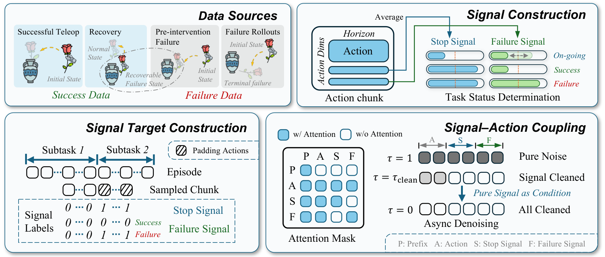
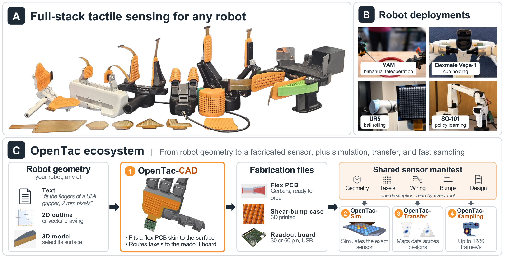

# 2026-10-23 Embodied AI & World Models Daily

> 面向具身智能 / Robotics 研究员与工程师的研究与工程资讯。
> 主窗口：北京时间 2026-10-23 00:00–23:59；补充窗口：10-21 至 10-22。来源检查不完整：官方列表最新为 23 日公告，尚不能确认主窗口较晚投稿的后续公告覆盖；部分机构页也未能可靠核验。本版发布已核实资讯，不代表全天无遗漏。

## 🔥 今日必读

### 1. 【VLA 状态与恢复】Echo：先得到较干净状态，再引导动作

**来源：** [arXiv:2610.31569](https://arxiv.org/abs/2610.31569)（SJTU、Spirit AI、THU 等）  
**类型：** Paper  
**发布时间：** 2026-10-23 01:12:16 北京时间，v1  
**评分：** 93.1/100  
**关键词：** VLA · Failure Detection · Recovery · Flow Matching

**一句话：** 停止和失败信号与动作共同生成，但信号更早完成去噪，让状态判断直接影响后续动作更新。

**技术要点：**

- 成功、终端失败、接管前失败和恢复轨迹分别提供不同监督；失败动作不参与模仿。仍需人工子任务边界与恢复示范，不能说完全免标注。
- 状态与动作双向注意力，停止与失败信号禁止直接互看；真机状态在动作噪声时间 0.5 提前完成去噪。
- 五真机任务，每模型每任务 30 次，插花完成分 5.67→8.33、开抽屉 5.40→7.90。0–10 分含碰撞及夹空扣分，不是成功率。
- 匹配动作监督下去掉状态到动作注意力，插花分数降到 5.00；ID 插花 8.67 仍低于基线 9.33，收益并非处处成立。

**为什么值得关注：** 与外部告警不同，它尝试让策略在可恢复错误时改变动作。更多终端失败数据提高状态 F1，却没有单调提高完成分；恢复能力仍依赖对应动作数据。

**资源：** [arXiv:2610.31569](https://arxiv.org/abs/2610.31569) · [项目页](https://lyfeng001.github.io/Echo/) · [精读笔记](../paper-reading/news/2026-10-23/echo/echo.md)。未核实可获取的公开代码或权重仓库。

### 2. 【触觉全栈】OpenTac：从机器人几何到剪切触觉与策略

**来源：** [arXiv:2610.31661](https://arxiv.org/abs/2610.31661)（JHU、MIT）  
**类型：** Paper / Open Source  
**发布时间：** 2026-10-23 01:59:06 北京时间，v1  
**评分：** 91.95/100  
**关键词：** Tactile · Shear · CAD · Manipulation

**一句话：** 共设计柔性压阻阵列、剪切凸点与几何 manifest，将定制制造、读出、仿真和跨皮肤映射接到同一接口。

**技术要点：**

- 凸点把切向载荷转成四 taxel 的差分响应，共模用于法向；经标定才得到力值。31 块不同设计制造并通过功能检查。
- SO-101 每策略 100 示范、50 次评估，不用视觉；3D 触觉相对自己的 pose-only 基线，插孔 66→82%、插座 54→70%。凸点也改变摩擦，因此保留每皮肤基线。
- 1024 单元全读 67 Hz，对每次读取 16 单元的部分更新可达 1286 Hz，不能称全阵列千赫兹。
- YAM 最高结果图标 61%、正文写 62%，未当作精确可复现计数；论文 FEM 与官方网页柔顺关节仿真描述也存在差异，尚未运行代码确认。

**为什么值得关注：** 可迁移的是几何、扫描与标定共享的接口。跨皮肤实验主要检验已知接触位姿下的法向形状映射，不是控制策略的跨本体或 sim-to-real 成功证明。

**资源：** [arXiv:2610.31661](https://arxiv.org/abs/2610.31661) · [项目页](https://opentac.github.io/) · [GitHub](https://github.com/opentac/opentac) · [精读笔记](../paper-reading/news/2026-10-23/opentac/opentac.md)。

### 3. 【可微控制】DiffDreamer：世界模型想象外部运动，仿真预测自身运动

**来源：** [arXiv:2610.31617](https://arxiv.org/abs/2610.31617)  
**类型：** Paper  
**发布时间：** 2026-10-23 01:41:13 北京时间，v1  
**评分：** 90.95/100  
**关键词：** World Model · Differentiable Simulation · Quadrotor · RL

**一句话：** 同一动作同步推进 RSSM 外部隐状态与显式飞行动力学，并把离散事件回报与可微运动回报分开优化。

**技术要点：**

- actor 读取隐状态与显式状态，latent 输入 detach，物理状态保留梯度；actor 优化阶段固定世界模型和 critic 参数。
- 五训练种子下比较 PPO、DreamerV3、BPTT；跟踪距离误差 0.381 m，Elastic Tracker 为 0.793 m。
- 最大门速 1/1.5/2 m/s，512 仿真步内通过 16/12/8 次，对照 MPC 12/4/1。循环四扇门，计数不是成功率。
- Jetson Orin NX 真机超过 100 Hz，但飞行器和目标、门均依赖外部动捕状态，且事先辨识动力学，只是受控室内概念验证。

**为什么值得关注：** 不必让学习模型承担全部已知刚体物理；可微运动梯度和离散任务价值可以分工。尚未验证纯机载视觉、感知噪声或其他接触本体。

**资源：** [arXiv:2610.31617](https://arxiv.org/abs/2610.31617) · [精读笔记](../paper-reading/news/2026-10-23/diffdreamer/diffdreamer.md)。未找到可确认的官方配套代码与权重仓库。

### 4. 【仿真基础设施】MuJoCo 3.17.0：原生批处理 API 与模型编译接口变化

**来源：** [官方 release](https://github.com/google-deepmind/mujoco/releases/tag/3.17.0)  
**类型：** Engineering  
**发布时间：** 北京时间 2026-10-23 05:45:20（GitHub published_at）  
**关键词：** MuJoCo · Batch Simulation · Memory · API

**一句话：** 新增 `mjbatch.h` 与 Python `mujoco.batch`，在独立线程池中批量推进同一模型的多个状态，并提供逐仿真模型参数与轨迹接口。

**技术要点：**

- 官方称每个线程使用 `mjData`，各仿真保留积分状态，内存随线程数扩展，并与普通循环结果位一致；本次未独立重跑该保证。
- 一维 flex 新增弯曲弹性；已有 `young` 参数现在会生效。`mj_setConst` 不再重解部分编译期约定，参数随机化代码应核对修改的是 spec 还是已编译模型。
- `mjs_fuseStatic` / `mjs_discardVisual` 现在返回处理数量，错误判断从 `!=0` 改为 `<0`；`mjNEQDATA` 从 11 到 12，需留意绑定 ABI。

**为什么值得关注：** 批量 CPU 仿真、资产重复装载和参数随机化可能直接受益，但不能把 API 发布等同于所有训练框架无修改升级。本次只核对官方说明，未安装或基准测试。

## 📄 论文雷达

### 【运行监测】Progress Probes：线性读取 VLA 的剩余进度

**来源：** [arXiv:2610.31613](https://arxiv.org/abs/2610.31613)  
**发布时间：** 2026-10-23 01:40:19 北京时间，v1  
**关键词：** VLA · Linear Probe · Monitoring  
**核心贡献：** 仅用成功轨迹的归一化剩余时间拟合激活探针，以落后名义节奏的程度监测失败。A6000 增量 0.026 ms；真机 state AUROC 0.78，episode 约 0.65。监测不等于纠错，也不代表策略总延迟只有该数。  
**值得关注程度：** 90.05/100  
**Paper：** [arXiv:2610.31613](https://arxiv.org/abs/2610.31613)

[精读笔记](../paper-reading/news/2026-10-23/p2/p2.md)；仅验证 π0.5，保留强基线、误报与检测时机限制。

### 【动作表征】SkeLAM：分开机器人运动与视觉残差

**来源：** [arXiv:2610.31474](https://arxiv.org/abs/2610.31474)  
**发布时间：** 2026-10-23 00:01:33 北京时间，v1  
**关键词：** World Model · Latent Action · Skeleton  
**核心贡献：** 骨架监督约束运动 latent，跨模态交换重建促使 RGB 与骨架表示可互换；残差分支保留场景变化，分支 dropout 降低未来信息依赖。DROID 末端 ADE 与 LPIPS 对 DreamDojo 分别下降 19.5% 与 11.1%，仍需核对控制与生成的差别。  
**值得关注程度：** 87.85/100  
**Paper：** [arXiv:2610.31474](https://arxiv.org/abs/2610.31474)

### 【人形移动】Attention-based Contacts：把接触作为运动先验接口

**来源：** [arXiv:2610.31608](https://arxiv.org/abs/2610.31608)  
**发布时间：** 2026-10-23 01:37:36 北京时间，v1  
**关键词：** Humanoid · Contact · RL  
**核心贡献：** 训练时由动作数据学习接触规划与接触条件跟踪，再用 RL 探索超出参考运动的环境；部署不需参考动作输入。值得看接触抽象如何保留协调性，但摘要没有给出可直接比较的统一真机统计。  
**值得关注程度：** 87.05/100  
**Paper：** [arXiv:2610.31608](https://arxiv.org/abs/2610.31608)

### 【多机器人】WarpWeaver：异步协商分散搜索树

**来源：** [arXiv:2610.31540](https://arxiv.org/abs/2610.31540)  
**发布时间：** 2026-10-23 00:48:09 北京时间，v1  
**关键词：** Multi-Robot · Planning · Anytime  
**核心贡献：** 以局部约束与分散树替代联合优化，通过共享空间租金协商接近联合最优。Dynobench 上旅行时间最多减 22%，对去中心实时基线最多减 37%，六机器人板载实验验证可执行；静止协商时的证书不应外推到任意截止时刻。  
**值得关注程度：** 86.35/100  
**Paper：** [arXiv:2610.31540](https://arxiv.org/abs/2610.31540)

### 【离线评估】Sensorimotor Alignment：用表示与运动几何对齐筛模型

**来源：** [arXiv:2610.31670](https://arxiv.org/abs/2610.31670)  
**发布时间：** 2026-10-23 01:59:51 北京时间，v1  
**关键词：** Representation · Evaluation · VLA  
**核心贡献：** 无需训练的离线指标衡量感觉表示与物理运动轨迹结构的对齐，报告与机器人任务成功相关，也用于筛选 VLM 骨干。相关性适合优先级排序，尚不能替代闭环测试或证明对齐本身造成成功。  
**值得关注程度：** 85.9/100  
**Paper：** [arXiv:2610.31670](https://arxiv.org/abs/2610.31670)

### 【规划数据】SCOPE：用规划失败反向修正场景图

**来源：** [arXiv:2610.31518](https://arxiv.org/abs/2610.31518)  
**发布时间：** 2026-10-23 00:31:11 北京时间，v1  
**关键词：** TAMP · Scene Graph · Dataset  
**核心贡献：** 以多层多样性与规划执行反馈修正场景图逻辑不一致，减少不可解长程规划样本。用于 LLM 微调后对 DELTA 数据训练对照提升 12.33 个百分点；可执行性仍依赖规划器及场景谓词定义。  
**值得关注程度：** 83.3/100  
**Paper：** [arXiv:2610.31518](https://arxiv.org/abs/2610.31518)

### 【触觉】VecTile：低成本柔性三轴力阵列

**来源：** [arXiv:2610.31472](https://arxiv.org/abs/2610.31472)  
**发布时间：** 2026-10-23 00:00:09 北京时间，v1  
**关键词：** Tactile · Force · Manipulation  
**核心贡献：** 6 mm 厚压阻阵列与被动硅胶凸点将法向和剪切编码为空间压力模式。4×4 系统成本声称低于35美元；受控测试法向/剪切 RMSE 0.39/0.16 N，并展示插头策略用途。代码计划录用后发布，当前不写成已开放。  
**值得关注程度：** 82.5/100  
**Paper：** [arXiv:2610.31472](https://arxiv.org/abs/2610.31472)

### 【协调规划】广义根轨迹生成互不相交的多机器人路径

**来源：** [arXiv:2610.31625](https://arxiv.org/abs/2610.31625)  
**发布时间：** 2026-10-23 01:45:31 北京时间，v1  
**关键词：** Multi-Robot · Harmonic Planning · Certification  
**核心贡献：** 共形映射后将起点和目标转成有理函数的极点与零点，以广义根轨迹分支产生分配和路径。有限反射使用有限检验证明所计算势函数安全，覆盖离线路径与可交换机器人假设，不等于动力学受限实时避障。  
**值得关注程度：** 82.1/100  
**Paper：** [arXiv:2610.31625](https://arxiv.org/abs/2610.31625)

### 【空间记忆】可修订语义地图：逐点降低陈旧与错误证据

**来源：** [arXiv:2610.31476](https://arxiv.org/abs/2610.31476)  
**发布时间：** 2026-10-23 00:02:16 北京时间，v1  
**关键词：** Semantic Map · Navigation · Memory  
**核心贡献：** 通过多视角时间证据更新点置信度，配合对象跟踪与重识别，避免语义地图只累积不清理。Replica 与 ScanNet 改善及导航/问答结果支持空间记忆用途，但感知与任务协议尚未全文复核。  
**值得关注程度：** 81.3/100  
**Paper：** [arXiv:2610.31476](https://arxiv.org/abs/2610.31476)

### 【分布式控制】在轨载荷运输的去中心双层优化

**来源：** [arXiv:2610.31562](https://arxiv.org/abs/2610.31562)  
**发布时间：** 2026-10-23 01:05:17 北京时间，v1  
**关键词：** Decentralized · Optimal Control · Payload  
**核心贡献：** 将锥约束推力分配作为内层凸优化，外层搜索载荷力矩轨迹，以精确梯度协调小型航天器。提供理论与 Monte Carlo 故障恢复仿真；适用在轨载荷及姿态约束，尚无硬件实证。  
**值得关注程度：** 80.45/100  
**Paper：** [arXiv:2610.31562](https://arxiv.org/abs/2610.31562)

## 🛠 工程与开源

- **MuJoCo 3.17.0** 与上文 release 合并为一个事件，不重复计入资讯数。[GitHub](https://github.com/google-deepmind/mujoco/releases/tag/3.17.0) 的批处理、flex、资产去重及编译接口变更值得对照本地仿真框架逐项迁移；本次没有升级用户环境。
- **Genesis v1.4.5**：[官方 release](https://github.com/Genesis-Embodied-AI/genesis-world/releases/tag/v1.4.5)，北京时间 10-23 05:38:18。重点是细凸分解与非凸碰撞性能、跨会话 kernel 缓存及轨迹记录；官方称多数情况记录开销低于 20%，未独立验证。可微仿真改为普通 torch tensor、支持闭环策略并移除自定义 tensor，是需要迁移检查的变化。另修复 AMDGPU 约束 Hessian、RDNA4 挂起及 CUDA 重建等问题，不能不加条件概括为全平台性能倍增。
- **OpenTac 官方代码与硬件**：[GitHub](https://github.com/opentac/opentac)、[设计与使用文档](https://opentac.github.io/)，与论文同属一事件。可从 manifest、制造、读取和仿真入口理解接口；代码 MIT、硬件 CERN-OHL-P-2.0 的许可在官方页面注明。本次检查不等于制造、固件与策略验收。

## 💬 社区信号

检查 [Hacker News robotics 检索](https://hn.algolia.com/?query=robotics&sort=byDate&type=story) 与 world-model/robot 检索，并检查 GitHub 新仓库。未核实上述论文在主窗口内形成集中技术讨论，不以新建仓库或单次 star 快照制造热度。教程、资源清单、产品及非机器人关键词误匹配没有作为研究突破收录。

## 🔎 补充窗口筛选记录

- [arXiv:2610.31432](https://arxiv.org/abs/2610.31432)：实际提交 2026-10-22 23:30:33 北京时间。跨会话室内导航，实际 22 日提交，记录补充窗口，不改写为 23 日新论文。
- [arXiv:2610.31334](https://arxiv.org/abs/2610.31334)：实际提交 2026-10-22 22:22:01 北京时间。GelSlim 5.0 属于 22 日提交，本版优先本日触觉全栈与策略方法，保留补充候选。
- [arXiv:2610.30136](https://arxiv.org/abs/2610.30136)：实际提交 2026-10-22 01:59:56 北京时间。已在 22 日日报完成精读，不因后续列表仍有条目重复头条。
- [arXiv:2610.31567](https://arxiv.org/abs/2610.31567)：实际提交 2026-10-23 01:10:35 北京时间。摘要为水凝胶离子给药研究，没有具身学习或决策贡献，BLOCK；未因分类或物理关键词收录。
- [Isaac Lab v3.0.0](https://github.com/isaac-sim/IsaacLab/releases/tag/v3.0.0)：北京时间 10-20 10:05:51，已在此次 48 小时补充窗口之前，且此前已跟踪，不重复作为新事件。
- 前日 [AW-0](https://arxiv.org/abs/2610.30136)、[PhysiCalWorld](https://arxiv.org/abs/2610.30125) 等当前列表内的旧投稿，以原始 v1 时间归属；普通再次出现不算本日发布。

## 来源覆盖与筛选说明

直接取得官方 [cs.RO recent](https://arxiv.org/list/cs.RO/recent)、[cs.AI recent](https://arxiv.org/list/cs.AI/recent)、[cs.LG recent](https://arxiv.org/list/cs.LG/recent)、[cs.CV recent](https://arxiv.org/list/cs.CV/recent) 和 RO 月表，从官方列表发现候选，再核实摘要、作者、全部版本及北京时间原始提交。四 recent 返回 463、1422、1432、907 条列表记录，去重筛出 281 个待核实候选；最终 14 个主窗口、175 个补充窗口、92 个窗口外。早先访问超时后通过官方 export 入口恢复；部分已核实旧摘要复用前次保存内容，并与本轮官方列表交叉核对。

**来源检查不完整：** 四类列表最新仍为 23 日公告，不能确认 23 日较晚提交的后续批次已全部纳入。[Skild](https://www.skild.ai/blogs) 请求失败，[Stanford REAL](https://real.stanford.edu/publications/) 返回 404；动态机构页面及其他实验室的日期级更新也未全部核实。不能将这些缺口解释为当日没有资讯。

已检查 [NVIDIA GEAR](https://research.nvidia.com/labs/gear/publications/)、[PI](https://www.pi.website/blog)、[DeepMind](https://deepmind.google/blog/)、[1X](https://www.1x.tech/discover)、[Figure](https://www.figure.ai/news)、[RAI](https://rai-inst.com/)、[TRI](https://www.tri.global/news)，以及 [CoRL](https://www.corl.org/)、[RSS](https://roboticsconference.org/2026/program/papers/)、[ICRA](https://2026.ieee-icra.org/)、[IROS](https://2026.ieee-iros.org/)、BAIR 与 MIT 页面；本轮没有从中核实到另一个日期明确、足以独立头条的新事件。可访问的动态页面不代表完成该机构全部研究覆盖。

工程检查包含 MuJoCo、Genesis、Isaac Lab、LeRobot release，GitHub 四组关键词新仓库与 Hugging Face NVIDIA、LeRobot、PI 作者模型列表。时间按 published_at/created_at 换算北京时间，仓库最近 push 不直接视为首次发布。没有下载或运行陌生仓库代码。

论文采用五维 4/3/2/1/0、工程采用 3/1/2/3/1 权重，两轮分别判断意义、创新、证据、相关性与社区，再取平均；T1 门槛 62。主窗口论文 13 PASS、1 BLOCK；工程两项官方 release PASS。社区证据低未因机构名气加分。三篇主栏论文和雷达最高分 Progress Probes 完成精读；其余雷达仅摘要核实，强结论待全文复核。论文、项目、代码与硬件按事件聚簇，不拆成重复头条。

## 📊 今日技术趋势

本轮方法把机器人“怎样知道自己做错了”分成两层：Progress Probes 从已有激活旁路读出滞后，Echo 则把状态带回动作生成。触觉和可微控制提供更直接的物理接口，但 OpenTac 的部分扫描速率与 DiffDreamer 的动捕飞行都需要保留协议边界。MuJoCo 与 Genesis 的更新进一步说明，批处理、记录与参数编译语义本身也会影响研究复现。

精读完成与代表图登记见 [本日精读索引](../paper-reading/news/2026-10-23/README.md)。
