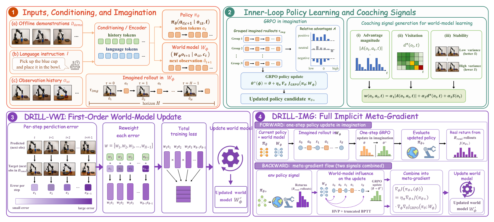
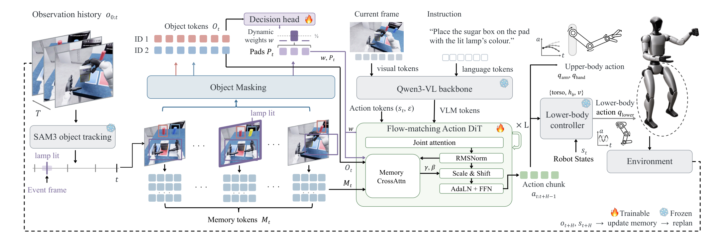

# 2026-10-24 Embodied AI & World Models Daily

> 面向具身智能 / Robotics 研究员与工程师的研究与工程资讯。
> 主窗口：北京时间 2026-10-24 00:00–23:59；补充窗口：10-22 至 10-23。论文首次提交、权重上传和代码仓库创建分别计时，补充内容不会标成 24 日新论文。
> **来源检查不完整：** arXiv 四分类 recent 最新仍是 23 日公告，已重新核验候选版本，但不能据此排除 24 日稍后被公告的投稿。Skild 超时、Stanford REAL 的 publications 路径 404；部分机构动态页面和国内发布的一手论文入口未完整核实。本版发布已核实内容，不代表全天无遗漏。

## 🔥 今日必读

### 1. 【机器人评测】RoboJev：开放终局成功判别器，近域收益与跨域代价一起报告

**来源：** [作者模型卡](https://huggingface.co/josefchen/RoboJev-27B)（Josef Chen，独立研究者）  
**类型：** Paper / Open Source  
**发布时间：** 论文首次文件 2026-10-24 09:45:43、客户端仓库 09:46:46 北京时间；权重已于 10-23 22:13:54 上传，属于补充窗口，不能称为 24 日首次权重发布。  
**评分：** 74.5/100（T1；两次独立评估均按 research_paper 权重）  
**关键词：** Success Detection · Reward Evaluation · LoRA · Calibration

**一句话：** 以 JEV-27B-VL 为底座，将任务文字、10 张轨迹采样帧和辅助相机终帧变成终局成功概率，语言侧适配并用部分研究数据上的 KL 约束保留原有能力。

*方法总览：图像编码器冻结，语言侧 rank-32 LoRA 适配，false/true 两类 logit 经温度校准读出成功概率。*

**技术要点：**

- 52,598 个拟合 episodes；102,172 是增强与重复后的训练示例数。混合人工、数据集及高置信教师共识监督，研究来源启用 KL 锚定，社区来源不启用。
- 同输入 SO-101 268 条测试中，BA 从底座 88.1% 升到 95.2%，配对增益区间为 +3.04 至 +11.45 个百分点。开发时曾查看测试 benchmark，不能当严格盲测。
- 459 条域外样本 AUROC 从底座 0.900 变成 0.890，ECE 为 0.148，明显高于 SO-101 的 0.032。API 对照只看 4 帧，和本模型 10 帧加辅助视角不是等预算排名。
- H100 串行推理中位 0.257 秒；每千条约 0.192 美元是 GPU 租金折算，不含下载、解码、排队。bf16 检查点约 55 GB，目标为 80 GB 级显存。

**为什么值得关注：** 给数据清洗和终局反馈提供了可检查的开放接口，也保留了失败对照。论文没有测量接入奖励后策略是否变好，不能将成功判别直接写成机器人控制提升。

**资源：** [固定版本论文 PDF](https://huggingface.co/josefchen/RoboJev-27B/resolve/b1873c298b85344afa1b249d473f0766122bd5f2/paper/RoboJev.pdf) · [客户端](https://github.com/josefchen/robojev) · [模型权重](https://huggingface.co/josefchen/RoboJev-27B) · [精读笔记](../paper-reading/news/2026-10-24/robojev/robojev.md)。未查到作者给出的 arXiv 标识；论文与权重归为同一事件。

## 📄 论文雷达

以下 8 篇均为补充窗口 v1，按双评分均值排序；它们不是 24 日首次提交。只对最高分的 DRILL、Memory before Goal 增加精读，其他条目依据官方摘要核验，未冒充全文精读。

### 【世界模型优化】DRILL: Training World Models to Improve Policies, Not Predict Pixels

**来源 / Paper：** [arXiv:2610.30814v1](https://arxiv.org/abs/2610.30814)  
**实际提交：** 2026-10-22 14:40:31 北京时间（补充窗口）  
**关键词：** World Models · GRPO · Meta-gradient  
**值得关注程度：** 82.75/100（T1）  
**核心贡献：** 把世界模型训练成有益的策略学习环境：VWI 用访问密度、带符号优势和置信度重加权，IMG 通过想象 GRPO 更新反传元梯度。五仿真平均相对 WMPO +13.1 个百分点，下一帧 MSE 反而增加约 17%。

**证据边界：** IMG 每外层还需 30 条目标仿真轨迹、截断 HVP 和更高计算；没有真机实验。代码及检查点计划公开，本次未核实可下载入口。

*经视觉审查的方法总览，完整机制、对照及适用边界见[精读笔记](../paper-reading/news/2026-10-24/drill/drill.md)。*

### 【人形记忆】Memory before Goal: Role of Pre-History Memory for Humanoid Loco-Manipulation

**来源 / Paper：** [arXiv:2610.31166v1](https://arxiv.org/abs/2610.31166)  
**实际提交：** 2026-10-22 20:24:25 北京时间（补充窗口）  
**关键词：** Humanoid · Memory · Loco-Manipulation  
**值得关注程度：** 80.5/100（T1）  
**核心贡献：** 用 SAM3 物体事件选择少量关键历史帧，经独立交叉注意力与 FiLM 调制动作专家，并用目标决策头连接历史线索和当前垫子。HuMeGo 让线索在执行前消失，区分记忆决策正确率和操作成功率。

**证据边界：** 同 539 视觉 token 的事件选帧为 60.4%，均匀记忆为 44.4%；完整模型仿真 72.6%、真机 53/60 对基线 22/60。真机没有均匀记忆对照，代码模型仍 coming soon。

*经视觉审查的方法总览，完整机制、对照及适用边界见[精读笔记](../paper-reading/news/2026-10-24/memory/memory.md)。*

**官方补充：** [项目页](https://memory-before-goal.github.io)

### 【世界动作模型】UniFlowWAM: A Unified World-Action Model with Visual Semantics and 4D Geometry

**来源 / Paper：** [arXiv:2610.30991v1](https://arxiv.org/abs/2610.30991)  
**实际提交：** 2026-10-22 17:35:56 北京时间（补充窗口）  
**关键词：** World-Action Model · 3D Flow · Bimanual  
**值得关注程度：** 78/100（T1）  
**核心贡献：** 把 3D scene flow 提升为与视觉、动作并列的模态，三个专家通过联合注意力交换信息，用十种目标/条件/缺省角色组合统一策略及正逆动力学。RoboCasa-GR1 无 flow 底座 52.1%→56.4%，四项真机双臂任务平均 87.0% 对最强基线 68.5%。

**证据边界：** LIBERO 98.1% 与 LIBERO-Plus 零样本 87.7% 属于各自协议；不能用成功率直接证明精确接触动力学或跨任意本体泛化。

**官方补充：** [项目页](https://kksham111.github.io/UniFlowWAM_ProjectPage/)

### 【显式三维动力学】DeXplicit: Making Physical State Explicit in Dexterous Manipulation World Models

**来源 / Paper：** [arXiv:2610.30781v1](https://arxiv.org/abs/2610.30781)  
**实际提交：** 2026-10-22 14:02:09 北京时间（补充窗口）  
**关键词：** Dexterous · 3D Dynamics · Video Rendering  
**值得关注程度：** 77.75/100（T1）  
**核心贡献：** 先根据初始场景和未来手部轨迹预测物体中心的度量三维运动、形变，再输送给视频渲染器，分离动力学与外观生成。HOT3D、OakInk2、PhysTwin 上相对 PointWorld 移动点误差降低 27%–40%。

**证据边界：** 两步因果生成相对作者 14B 双向配置的 57 倍视频合成加速，不是机器人闭环控制加速；当前摘要未证明下游策略成功率提升。

**官方补充：** [项目页](https://dexplicit.github.io)

### 【全身评测平台】LocoManiLab: A Unified Testbed for Data, Policies, Controllers, and Deployment in Humanoid Loco-Manipulation

**来源 / Paper：** [arXiv:2610.30876v1](https://arxiv.org/abs/2610.30876)  
**实际提交：** 2026-10-22 15:56:54 北京时间（补充窗口）  
**关键词：** Humanoid · Benchmark · Controller  
**值得关注程度：** 77.5/100（T1）  
**核心贡献：** 将数据、策略、控制器和部署接入同一人形全身操作测试平台：234 项原子及组合任务、五类家庭场景、51.5 小时仿真遥操作；共享控制器比较 12 个策略，并让两策略跨五控制器评测。

**证据边界：** 三项匹配仿真与真实场景的策略排序提供有限交叉验证，不能覆盖全部 234 项真机任务；未核实完整可运行发布包。

### 【多视角策略】FocusVLA: Future-Intent Guided Dynamic View Routing for Vision-Language-Action Models

**来源 / Paper：** [arXiv:2610.31423v1](https://arxiv.org/abs/2610.31423)  
**实际提交：** 2026-10-22 23:25:02 北京时间（补充窗口）  
**关键词：** VLA · Multi-view · Intent Routing  
**值得关注程度：** 75.75/100（T1）  
**核心贡献：** 从历史动作预测未来交互意图，再以意图引导全局和腕部视角的动态路由，缓解策略长期偏重腕部图像的问题。作者报告 RoboTwin 2.0 相对 π0.5 平均 +10.10 个百分点。

**证据边界：** 真机报告 71.7%→85.0%，是 +13.3 个百分点；摘要未给出本次可核验的完整试验分母与置信区间，未独立复现。

### 【动作推理效率】When One Step Is Enough: An Empirical Study of Euler Integration in Flow-Matching Policies

**来源 / Paper：** [arXiv:2610.30735v1](https://arxiv.org/abs/2610.30735)  
**实际提交：** 2026-10-22 13:05:29 北京时间（补充窗口）  
**关键词：** Flow Matching · VLA · Inference  
**值得关注程度：** 75.25/100（T1）  
**核心贡献：** 在六种 flow-matching VLA 上检查一步 Euler 能否替代多步积分，发现充分训练且容量足够时，一步动作生成大体匹配多步，不必自动增加蒸馏或单步训练目标。

**证据边界：** 这是带训练充分性和模型容量条件的经验结论，不能推出所有小模型、未收敛检查点及任务均可无损一步推理；未报告统一端到端加速数字。

### 【群体控制】Probabilistic Energy Modeling Unifies Versatile Swarm Control

**来源 / Paper：** [arXiv:2610.31371v1](https://arxiv.org/abs/2610.31371)  
**实际提交：** 2026-10-22 22:42:55 北京时间（补充窗口）  
**关键词：** Swarm · Energy Model · Decentralized RL  
**值得关注程度：** 74.75/100（T1）  
**核心贡献：** 将共享交互原则写成 Gibbs 能量项，通过结构化奖励训练分散策略，再由轻量 gating 组合；局部交互注意力与无量纲归一化支撑跨任务、规模和平台复用。

**证据边界：** 摘要报告六类任务、10–100 agents、两硬件平台及室外部署；1–10 ms 是仿真中每 agent 推理，不是整个群体含通信的闭环延迟。

## 🛠 工程与开源

### 【Real-to-Sim】Mundo：显式代理状态、物理模拟和视频外观分工

**类型 / 评分：** Engineering，T1.5，双评均值 74.25/100。**时间：** 作者博客标注 2026-10-23，未给出时区，按补充线索记录，不改写成 24 日新发布。  
**资源：** [作者技术博客](https://huggingface.co/blog/Luo-Yihang/mundo-world-model) · [项目页](https://mundo-world-model.github.io/) · [官方仓库](https://github.com/Luo-Yihang/Mundo)。

多视图先恢复可编辑三维代理，场景代码维护物体和物理参数，MuJoCo 等模拟器算状态变化，视频模型负责外观。作者报告重建约 10–20 分钟，8 张 A800、20 步推理约 1.5 fps；尚有小物体漂浮、精细交互幻觉和长期记忆限制。仓库目前以说明与素材为主，代码、权重计划 11 月底发布。它值得作为可控场景生成方向观察，尚无可核验的机器人策略收益，不能当现成实时仿真产品。

**其余资源归并：** RoboJev 的论文、客户端、权重已经归入必读事件，不另计一条权重新闻；Memory before Goal 的 [HuMeGo 数据集合](https://huggingface.co/collections/ChenyuanC/humego-6ada5cbea74d4cc678c91c68)提供 LeRobot v2.1 格式数据，但[官方说明](https://github.com/crystalccy1/MemoryBeforeGoal#code-and-models)仍将代码和模型标为 coming soon。

## 💬 社区信号

本次检查 HN 的机器人与世界模型讨论入口，未核实到足以标为“研究者集中讨论”或“独立复现”的技术事件。Mundo 的作者发布与 RoboJev 的自有仓库均是来源证据，不能充作多个独立社区背书；本版不编造热度排名。

## 🔎 补充窗口筛选记录

主窗口独立资源候选与论文分开核查，仓库创建时间不等于方法首次发表。以下记录说明为何未增加更多头条。

| 候选与实际时间（北京时间） | 决定与原因 |
|---|---|
| [OpenTac，v1 10-23 01:59](https://arxiv.org/abs/2610.31661)、[Echo，v1 10-23 01:12](https://arxiv.org/abs/2610.31569) | 已在 23 日日报主条目及精读覆盖，本次未验证新实质更新，去重。 |
| [DiffDreamer，v1 10-23 01:41](https://arxiv.org/abs/2610.31617)、[Progress Probes，v1 10-23 01:40](https://arxiv.org/abs/2610.31613) | 已有前日报事件，不把相同官方公告重复发布。具体版本时间以摘要页 history 为准。 |
| [SmolVLA-MoE，v1 10-22 12:58:45](https://arxiv.org/abs/2610.30732) | PASS，T1 双评 64/100；LIBERO 平均 84.25% 对 82.75%，约 800M 存储、500M 激活，不是整体模型压到更小；增量较窄，未进本版八项雷达。 |
| [FastHarness，v1 10-22 23:27:10](https://arxiv.org/abs/2610.31427) | PASS，T1 双评 69/100；四仿真任务的监督调度值得观察，但 token 与时长比较依赖经验累积，未作真机或等预算独立复现，留作后续。 |
| [RGraph-Eval，v1 10-22 19:39:01](https://arxiv.org/abs/2610.31121) | PASS，T1 双评 73/100；统一任务场景图评视频，1,000 场景注释；尚不能从评分一致性推断世界模型训练或机器人控制收益。 |
| [WAM-0.1，仓库 10-24 02:28:32](https://github.com/adityapp1213/Wam-0.1) | PASS，普通独立数据项目按 T2 双评 56.5/100 未达 75。RoboSuite/RoboCasa 的动作条件帧、状态格式可检查，但规模与学习收益未独立验证。 |
| [vla-simpler-b，仓库 10-24 16:30:21](https://github.com/juiceooorange/vla-simpler-b) | PASS，T2 双评 58/100；两任务适配、单训练种子和特权状态标签，不能将小测试集结果扩写为通用 VLA 增益。 |
| [ComfyUI-Hy-Nomas，仓库 10-24 05:50:08](https://github.com/PedroMarinhoDev/ComfyUI-Hy-Nomas) | UNKNOWN；可交互驾驶视频包装没有核实到可迁移的机器人策略/控制证据，不因 world model 关键词直接纳入。 |
| [云深处五项研究发布线索](https://www.streetinsider.com/Globe%2BNewswire/DEEP%2BRobotics%2BUnveils%2BFive%2BResearch%2BAdvances%2Bin%2BEmbodied%2BAI/27229068.html)，报道日期 10-24 | UNKNOWN；补查国内发布时发现，报道页面直接复查超时，未完成一手论文、版本及评测入口核验，不能仅据报道把五个名称写成五项已验证成果。 |

MuJoCo 3.17 与 Genesis 1.4.5 属于已在 23 日记录的发布，Isaac Lab 最近所核验版本早于本次窗口，不重复列入新开源。纯自动驾驶规划、软件 agent、教学项目及不含决策用途的生成/重建条目按预筛规则排除。

### 来源核验范围

直接读取 arXiv 官方 [cs.RO](https://arxiv.org/list/cs.RO/recent)、[cs.AI](https://arxiv.org/list/cs.AI/recent)、[cs.LG](https://arxiv.org/list/cs.LG/recent)、[cs.CV](https://arxiv.org/list/cs.CV/recent) recent，并用 [RO 月列表](https://arxiv.org/list/cs.RO/2026-10)交叉检查。四分类列表分别返回 463、1,422、1,432、907 条列表记录，跨分类去重后重新核验 281 个预筛候选的完整版本 history：96 个 v1 在补充窗口、185 个在窗口外，本批中没有主窗口 v1。列表 latest 为 23 日且与上次相同，未公告部分仍是覆盖缺口，不能据此宣称 24 日没有新论文。

另查 [GEAR](https://research.nvidia.com/labs/gear/publications/)、[PI](https://www.pi.website/blog)、[DeepMind](https://deepmind.google/blog/)、[1X](https://www.1x.tech/discover)、[Figure](https://www.figure.ai/news)、[RAI](https://rai-inst.com/)、[TRI](https://www.tri.global/news)、BAIR 与 MIT Robotics 的公开入口，CoRL/RSS/ICRA/IROS 会议页，Isaac Lab/LeRobot/MuJoCo/Genesis release API、官方 Hugging Face 模型列表、四组 GitHub 新仓库查询及 HN。HTTP 200 只证明入口可取，不保证动态目录或全年会议论文已完整扫描；Skild 超时与 Stanford REAL 404，以及国内发布的原文缺口，均未当作“没有资讯”。

## 📊 今日技术趋势

终局判别与动作侧记忆从两个位置处理长轨迹：前者检查任务是否完成，后者保留会消失的决策线索，二者的指标不能互换。DRILL 与显式三维动力学工作进一步把世界模型拆成策略学习效用、状态演化和外观三个可单独测试的环节；更低像素误差或更快视频生成都不足以单独证明机器人收益。Mundo 的研究预览则表明，显式状态的可编辑性已有技术披露，公开可运行性和闭环验证仍是下一步。

## 📚 精读状态

本版应精读 3 篇：必读论文 RoboJev，加雷达最高分 DRILL 与 Memory before Goal。三篇均完成全文证据核对、计划与 Grounding Lint、八项 Final Note Lint、质量及可读性审查、原脚本正式保存与 SHA-256 复核；共 10 张插图、2 个表格占位。其余雷达仅作摘要级筛选。

[精读索引与逐篇状态](../paper-reading/news/2026-10-24/README.md)
