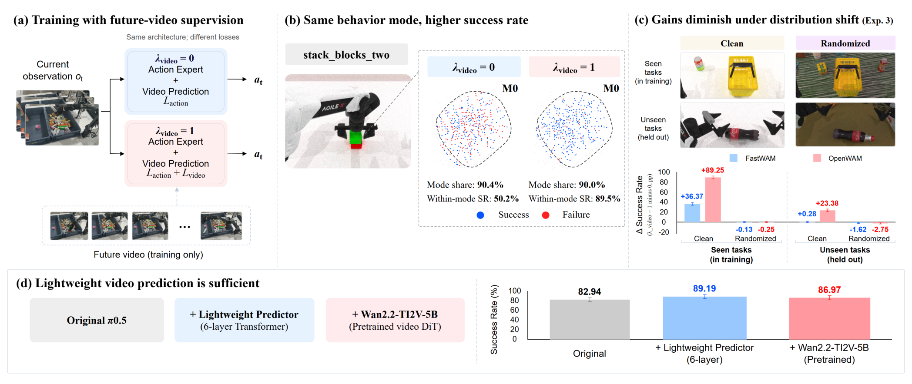

# 2026-10-26 Embodied AI & World Models Daily

> 面向具身智能 / Robotics 研究员与工程师的研究与工程资讯。
> 主窗口：北京时间2026-10-26 00:00–23:59；补充窗口：10-24至10-25。论文按实际v1提交时间归属；27日公告不等于27日首发，代码开放另行核时。
> **来源检查不完整：** arXiv四分类recent和RO月列表已抓取，235条候选均核验官方摘要页；机构侧仍存在CMU入口TLS失败、部分目录404、动态页面无法完整遍历的缺口。以下是已核实内容，不能据此断言26日没有其他资讯。

## 🔥 今日必读

### 1. 【世界模型】预测未来到底改善了什么：熟悉任务的执行收益，不等于可靠迁移

**来源：** [arXiv:2610.34593v1](https://arxiv.org/abs/2610.34593)（cs.RO；Hanwen Cui、Yuanyuan Li等）  
**类型：** Paper，research_paper权重  
**发布时间：** 2026-10-26 05:47:19 北京时间  
**评分：** 87.75/100（T1；独立双评88.5、87）  
**关键词：** Future Prediction Loss · Controlled Ablation · Generalization

**一句话：** 在固定架构、初始化、机器人数据和训练步数后，只切换未来视频损失；论文把熟悉任务成功率提升、轨迹变化和分布外迁移分开检验，并在π0.5上测试训练期辅助预测器。

*已通过视觉审查的方法与实验总览图1；完整条件见[精读笔记](../paper-reading/news/2026-10-26/world-loss/world-loss.md)。*

**技术要点：**

- FastWAM和OpenWAM分别进行视频损失关闭/开启的配对实验。第一组已见任务成功率为14.97%→39.34%、7.00%→79.91%，增幅24.38和72.91个百分点；两模型之间不能当成纯规模对照。
- 轨迹聚类显示某些粗粒度行为模式占比接近、簇内成功率却上升，支持“收益不只来自换一种常见轨迹”。聚类是观察分析，不能证明具体控制机制的因果作用。
- 未见任务的改善随模型和任务而变，环境随机化下成功率普遍低；不能把干净场景收益外推为鲁棒性已经解决。
- π0.5的轻量预测器只在训练时使用，成功率82.94%→89.19%；预训练视频DiT分支为86.97%。后两者差异的置信区间跨零，未证明轻量模型显著更强。轻量分支仍使用冻结视频VAE，不是完全没有预训练视觉成分。

**为什么值得关注：** 这套消融能帮助判断世界模型目标是否值得接入现有策略，而不只比较不同系统的总成功率。结果仍受单训练种子、仿真评测和缺少系统成本对照限制；论文未证明真机泛化收益，也未证明大型视频模型普遍无用。

**资源：** [论文](https://arxiv.org/abs/2610.34593) · [全文精读](../paper-reading/news/2026-10-26/world-loss/world-loss.md)。未找到可确认的公开代码或权重仓库；本次未进行训练或机器人复现。

## 📄 论文雷达

按双评分均值排序。Zero-HLM与Predictable Latents为雷达最高两篇，均已全文精读；其余六篇基于官方摘要与项目资料筛选，实验数字属于作者报告，没有独立复现。

### 【Sim-to-Real】Zero-HLM：用可执行仿真示范训练人形移动操作

**来源 / Paper：** [arXiv:2610.35075v1](https://arxiv.org/abs/2610.35075)（Dianyi Yang等）  
**实际提交：** 2026-10-26 17:20:31 北京时间  
**关键词：** Real-to-Sim-to-Real · Gaussian Splatting · Whole-Body Motion  
**值得关注程度：** 84.75/100（T1；双评85.5、84）  
**核心贡献：** 手机采集场景后，同时构造视觉渲染与物理交互资产；用仿真执行反馈共同调整全身动作、物体关系和过渡轨迹，再以真实执行状态生成训练视频。

*已审查的图2；数据、控制频率及外推边界见[精读笔记](../paper-reading/news/2026-10-26/zero-hlm/zero-hlm.md)。*

**关键证据与边界：** 45条仿真源示范扩展为4,800条有效示范。三项G1任务各20次真机试验，800条/任务仿真训练成功40/60，100条/任务真实示范训练28/60。扩展配置汇总23/100→69/100，但配置权重不均、部分仅5次试验。“无真实机器人数据”指高层策略训练没有真实动作示范；仍需现实场景采集、标定、重建，以及预训练模型和底层控制器。论文没有证明所有采集与适配都可免除。

**资源：** [项目页](https://young-bit.github.io/zero-hlm/) · [精读](../paper-reading/news/2026-10-26/zero-hlm/zero-hlm.md)。未确认公开训练代码与权重。

### 【世界模型】Video World Models Need Predictable Latents：把时间可预测性写进潜空间

**来源 / Paper：** [arXiv:2610.34663v1](https://arxiv.org/abs/2610.34663)（Mattia Scardecchia、Sherry Yang）  
**实际提交：** 2026-10-26 08:50:03 北京时间  
**关键词：** Temporal Representation · Past-Conditioned Decoder · Policy Evaluation  
**值得关注程度：** 84.75/100（T1；双评85.5、84）  
**核心贡献：** 在重建目标之外加入潜空间预测或逆动力学监督，并让解码器读取过去帧；让生成器承担较简单的动态预测，同时借助历史信息保留像素细节。

*已审查的方法总览图1；[精读](../paper-reading/news/2026-10-26/latent/latent.md)保留图6的一处裁剪失败占位说明，其余三张图已保存。*

**关键证据与边界：** Bridge实验中，潜空间预测版本OOD像素误差36.15→27.54、长时47.93→39.08，但部分分布质量指标不如只有历史条件的重建版本。“5倍”指2步对10步采样下若干指标更优，不是所有指标或端到端墙钟都加速5倍；“7倍以上”指达到基线感知误差阈值所需更新数，未包含全部自编码器训练成本。WorldGym两步策略评估相关度0.67对0.21；十步0.62对0.51差异未达显著。单世界模型种子、评审模型存在误报，不能外推为实际控制成功率提升。

**资源：** [作者代码](https://github.com/mattia-scardecchia/predictable-latents) · [精读](../paper-reading/news/2026-10-26/latent/latent.md)。代码可访问不等于本次已验证训练复现。

### 【VLA与基础模型】RynnVLA-Latent：以三维约束潜动作吸收异构视频

**来源 / Paper：** [arXiv:2610.34356v1](https://arxiv.org/abs/2610.34356)（Haoyu Zhao等）  
**实际提交：** **2026-10-25 23:05:32 北京时间，补充窗口**；27日公告。  
**关键词：** Latent Action · 3D Flow · Cross-Embodiment  
**值得关注程度：** 82.75/100（T1；双评83、82.5）  
**核心贡献：** RynnLAM以残差未来特征预测、相机补偿三维流和相机运动解耦学习潜动作；由视频产生控制相关监督，再将潜动作块预测迁移到本体动作空间。

**关键证据与边界：** 30.1K小时人类、机器人和仿真视频生成745.52M潜动作描述。4B策略报告LIBERO 98.8%、无需基准专门适配的LIBERO-Plus 84.7%、VLABench五轨均值51.9%、RoboTwin 2.0为88.6%。六项真机任务报告在比较方法中最高，但摘要未给试验分母与置信区间；不能把无原生控制标签预训练说成部署时无需本体适配。

**资源：** [项目页](https://alibaba-damo-academy.github.io/RynnVLA-Latent.github.io/) · [作者代码](https://github.com/alibaba-damo-academy/RynnVLA-Latent)。本条与昨日RynnUnify属于不同论文，资源首次开放时间未单独核定。

### 【端侧部署】TRIAGE：漂移小就复用，漂移大则重算或裁剪

**来源 / Paper：** [arXiv:2610.34519v1](https://arxiv.org/abs/2610.34519)（Sooyoung Kwon、Carlee Joe-Wong、Kyunghan Lee）  
**实际提交：** 2026-10-26 03:22:02 北京时间  
**关键词：** KV Cache · Token Drift · Embedded VLA  
**值得关注程度：** 82.5/100（T1；双评82、83）  
**核心贡献：** 根据浅层value变化和缓存年龄判定视觉token是否仍可复用；固定重算预算优先分配给重要且失效的token，其余有效缓存复用、无效token裁剪。

**关键证据与边界：** LIBERO与SimplerEnv平均成功率距全重算不超过3个百分点，Jetson AGX Orin上的prefill延迟最多降低48%；仅重算7%视觉token时，LIBERO-Object较最强比较基线高24.4个百分点。48%针对prefill，不是完整机器人控制周期；不同骨干需分别校准漂移阈值。本次未确认公开代码。

### 【端侧部署】VLA-HWBench：动作生成方式比参数量更能解释延迟

**来源 / Paper：** [arXiv:2610.34717v1](https://arxiv.org/abs/2610.34717)（Borui Xu等）  
**实际提交：** 2026-10-26 10:07:42 北京时间  
**关键词：** Jetson AGX Thor · Ryzen AI · Kernel Fusion  
**值得关注程度：** 81.75/100（T1；双评82.5、81）  
**核心贡献：** 比较18个开放VLA在两类边缘平台和不同后端上的七阶段耗时，定位动作生成迭代、内核融合、内存带宽及CPU预处理之间的瓶颈转移。

**关键证据与边界：** Jetson配置中14/19由动作生成策略主导；跨模型延迟跨度82倍与157倍，参数量最多解释15%方差。4bit融合后端让π0.5和GR00T N1.7比torch.compile下PyTorch快2.6–2.9倍，但该优化仅覆盖这两模型和Jetson。CPU预处理占比12%→39%是其他阶段被加速后的份额变化，不代表CPU绝对耗时增加三倍。摘要误识别出的文本URL不作为代码资源；本次未确认公开benchmark实现。

### 【数据与Benchmark】EmbodiedLab：让机器人通过操作装置取得未知实验答案

**来源 / Paper：** [arXiv:2610.35385v1](https://arxiv.org/abs/2610.35385)（Hongcheng Gao等）  
**实际提交：** 2026-10-26 21:06:33 北京时间  
**关键词：** Active Experiment · Physical Interaction · Grounded Evaluation  
**值得关注程度：** 80.75/100（T1；双评81、80.5）  
**核心贡献：** 五学科、14类装置上的30种物理仿真实验按实例重采样参数，智能体必须选择实验程序、操作装置并从相机读数；评分同时检查答案的观测依据与任务物理状态。

**关键证据与边界：** 测试六种前沿模型及其编码代理，原生控制条件下最强者成功率仍低于一半；多数失败来自装置交互，操作技能对较弱模型的帮助大于额外感知和规划。它测量仿真装置中的主动求知，不能视作真实湿实验室的自主科研验证。

**资源：** [项目页](https://hexafuture.ai/benchmarks/embodiedlab/) · [作者代码](https://github.com/HexaFuture/EmbodiedLab)。

### 【操作与抓取】ARPG：先预训练动作表示，再学习条件动作分布

**来源 / Paper：** [arXiv:2610.34453v1](https://arxiv.org/abs/2610.34453)（Yanjinghao Xu等）  
**实际提交：** 2026-10-26 01:19:28 北京时间  
**关键词：** Action Representation · Human Manipulation · Dexterous Hands  
**值得关注程度：** 79.75/100（T1；双评80、79.5）  
**核心贡献：** 把动作表征学习和任务条件生成分开：先从大规模人类操作数据训练编码器，冻结后由130M生成骨干学习其表示空间内的动作分布。

**关键证据与边界：** 作者报告DexJoCo领先，双手灵巧操作均值由π0.5的10.1%提升到44.7%，人类动作覆盖更广时下游性能继续改善。130M描述生成骨干，不是整套系统总参数量；摘要不足以确认不同方法的全部训练预算是否等同。

**资源：** [项目页](https://arpg-project.github.io/)。

### 【仿真平台】AuRA：自主交互降低可变形数字孪生的数据采集成本

**来源 / Paper：** [arXiv:2610.34452v1](https://arxiv.org/abs/2610.34452)（Xinchen Yu等）  
**实际提交：** 2026-10-26 01:10:27 北京时间  
**关键词：** Deformable Digital Twin · Autonomous Collection · Robot State  
**值得关注程度：** 79.25/100（T1；双评79.5、79）  
**核心贡献：** 将考虑执行可行性的抓取、由机器人状态导出的夹爪运动，以及交互前几何外观配准组合起来；减少人工操作，并恢复被机器人遮挡的物体信息。

**关键证据与边界：** 13种可变形物体上，单个成功重建资产的主动人工工时与墙钟采集时间分别减少88.5%、55.4%。已知夹爪运动条件下9项指标中7项优于人工采集PhysTwin，单向L1 Chamfer下降28.1%；未见交互下平均IoU和Chamfer相近。这些是采集和预测指标，不能写成操作策略成功率提升。

**资源：** [项目页](https://aura-robot.github.io/)。

## 🛠 工程与开源

### 【开源项目】UniAction代码开放：让不同动作条件共用视频模型的位置空间

**来源：** [作者项目页](https://uniaction.github.io/)双向链接[GitHub](https://github.com/KBRASK/UniAction)；T1，open_source双评77、77，均值77/100。仓库创建于**2026-10-26 14:59:50 北京时间**；[论文](https://arxiv.org/abs/2610.32977)实际提交于**10-24 01:59:13**，属于补充窗口。本条是代码开放事件，与论文合并登记。

- **新东西：** 稀疏动作元素包含离散语义身份和连续时空坐标，映射到预训练视频模型原生位置空间；按元素数量校准注意力，减少不同动作粒度带来的偏置。支持力、相机、手姿和机器人姿态四类条件。
- **可看什么：** [26日固定版本](https://github.com/KBRASK/UniAction/tree/b0d09151335f0682af4d6f5858ae188ed1c64981)提供推理、训练、缓存准备和评测入口；基于Wan2.2-I2V-A14B，示例训练为81帧、832×480。适合检查异构动作接口如何接入视频骨干。
- **边界：** 作者链接[模型资源](https://huggingface.co/BowenXue/UniAction)与[训练集](https://huggingface.co/datasets/BowenXue/UniAction-Train)，本次没有核定各资源首次上传时间、逐个下载权重或运行生成。代码Apache-2.0不覆盖所有模型、数据和第三方资产；动作跟随结果不等于真实机器人规划或控制可靠性。

## 💬 社区信号

本次未确认达到T2门槛、可独立刊为研究进展的讨论。已检查[Awesome SuperMimic的26日固定版本](https://github.com/DiaoOrg/awesome-supermimic/tree/28231b6aecd7dd705bb390f3d309b3b544c4e416)：社区清单将原方法、独立实现与扩展分组，但没有独立重跑各项目。双评50、51，均值50.5，作为发现线索留档，不以当前star或后续更新充当26日复现成功证据。

## 🔎 补充窗口筛选记录

以下时间均为北京时间；选稿优先当前日的重要增量，再兼顾方向覆盖，达门槛不意味着全部刊入雷达。

| 候选 | 实际首次提交 | 处理 |
|---|---|---|
| [RynnVLA-Latent](https://arxiv.org/abs/2610.34356) | 10-25 23:05:32 | 27日公告后核验；补充入雷达，不标为26日新稿。 |
| [UniAction](https://arxiv.org/abs/2610.32977) | 10-24 01:59:13 | 与26日代码开放聚簇，仅在工程栏登记一次。 |
| [RynnUnify](https://arxiv.org/abs/2610.32965) | 10-24 01:54:07 | 25日日报已报道论文与代码事件，无已核定的新重大更新，去重。 |
| [DexPort](https://arxiv.org/abs/2610.32969) | 10-24 01:56:28 | 25日雷达已收录，本次去重。 |
| [RoboJev](https://arxiv.org/abs/2610.33718) | 10-24 23:06:27 | 24日已按作者论文资源报道；补充核实arXiv标识，不把新增标识当作新方法。 |
| [HuGe](https://arxiv.org/abs/2610.34186) | 10-25 17:46:41 | 双评均值79；保留候选，当前版优先Rynn潜动作及当日移动操作、部署与评测，未重复扩展VLA条数。 |
| [RoboWorM](https://arxiv.org/abs/2610.33807) | 10-25 01:11:06 | 双评均值79；与多项世界模型评测主题相近，未进入有限雷达位。 |
| [WorldFailBench](https://arxiv.org/abs/2610.33565) | 10-24 17:33:52 | 双评均值79.25；保留失败评测线索，当前版优先已精读的潜空间与直接监督消融。 |
| [PoT-LIF](https://arxiv.org/abs/2610.33658) | 10-24 21:16:20 | 双评均值69.25；能耗来自算术能量模型，不能写成硬件实测节能，本版未列部署主条。 |

## 📊 今日技术趋势

世界模型研究开始拆开监督收益、潜空间几何和真实评估一致性：熟悉任务成功率、长时预测误差、策略排名是三个不同目标，改善其中一个不能替代另两个。端侧VLA工作则把优化对象从参数量转向动作生成迭代与token处理路径，prefill收益和整个控制周期需要分别计时。仿真数据链路同时向可执行全身示范与自主数字孪生采集推进，判断成本时应保留场景采集、标定、适配和硬件条件。

## 检索覆盖与精读状态

- **arXiv：** 直接抓取官方[cs.RO recent](https://arxiv.org/list/cs.RO/recent)、[cs.AI recent](https://arxiv.org/list/cs.AI/recent)、[cs.LG recent](https://arxiv.org/list/cs.LG/recent)、[cs.CV recent](https://arxiv.org/list/cs.CV/recent)，分别437、1,385、1,320、858条；另抓[RO十月列表](https://arxiv.org/list/cs.RO/2026-10?show=2000)1,973条。分类交叉与关键词召回去重后235条逐一核实标题、作者、摘要和v1提交时间：主窗口66、补充窗口91、窗口外78。一次摘要连接超时经有界补查成功，候选核时不再有未解决错误；这不保证覆盖尚未公告的所有当日投稿。
- **机构及会议：** 检查NVIDIA GEAR、PI、DeepMind、Skild、1X、Figure、RAI、TRI、Stanford、Berkeley、CMU、MIT和国内机构入口，以及CoRL、RSS、ICRA、IROS目录。GEAR/部分国内页依赖动态内容，PI返回客户端挑战内容，HTTP 200不能证明目录已完整检查。Stanford publications与SHLAB news入口404，Stanford首页可访问；CMU news证书吊销检查离线导致TLS失败，未绕过验证。会议入口可访问不等于全部论文已遍历。Skild本次可访问；DeepMind压缩响应已正确解码重查。
- **工程与社区：** 检查GitHub近期四组关键词、HF相关模型入口、MuJoCo/Genesis/Isaac Lab/LeRobot发布及HN两组查询，并扩展搜索作者、项目和机构技术信息。MuJoCo 3.17、Genesis 1.4.5的发布时间换算为北京时间23日，已在前版覆盖；Isaac Lab与LeRobot所见版本也在当前窗口之外，不重复记作26日新版本。未将融资、整机宣传或单个社区清单升级为研究事实。
- **精读：** [索引与状态](../paper-reading/news/2026-10-26/README.md)。必读1篇及雷达最高2篇，共3篇完成全文、相关附录、grounding、八项lint、质量与可读性审查、原保存脚本和SHA-256校验；合计12张已审查图片、1处明确占位。Predictable Latents图6裁剪及一次修复仍混入正文，按视觉门禁保留失败原因，没有嵌入缺陷图。本次没有执行模型或机器人实验。
