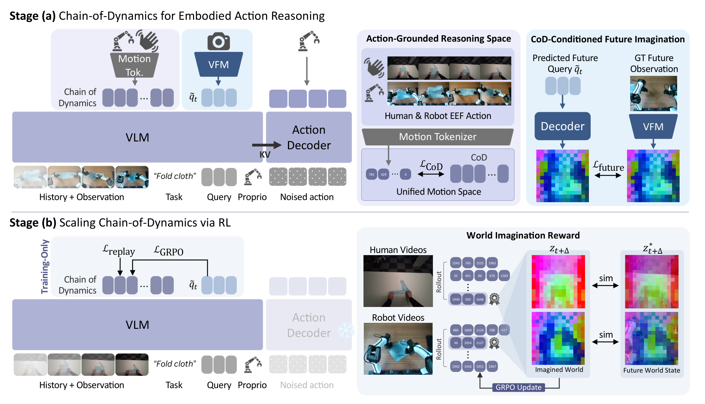
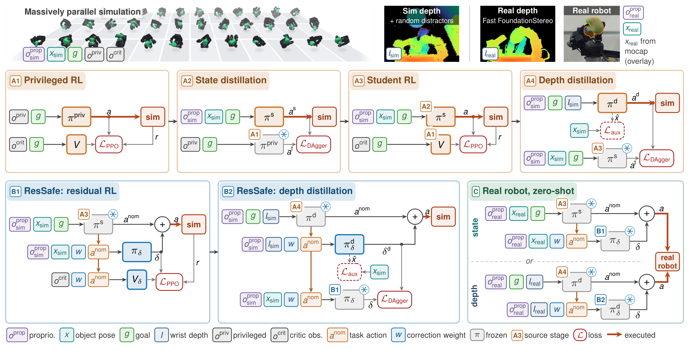
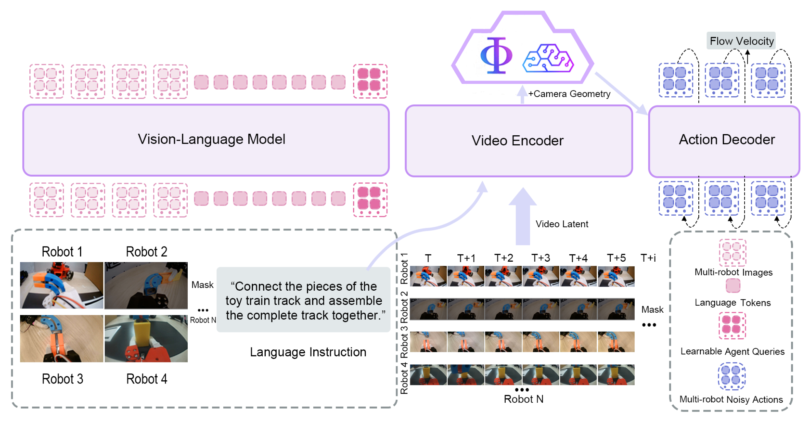
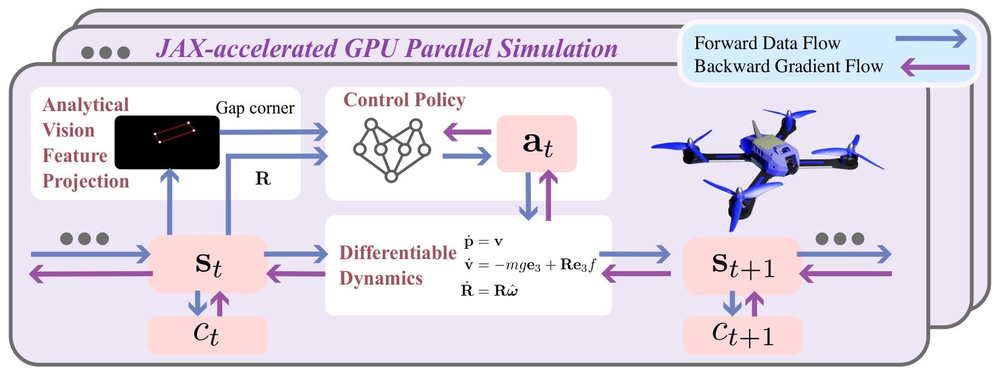
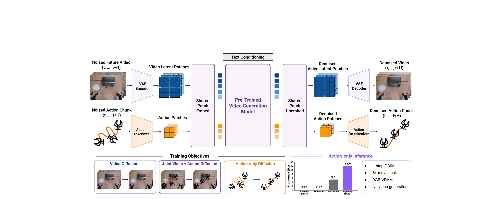

# 2026-10-28 Embodied AI & World Models Daily

> 面向具身智能 / Robotics 研究员与工程师的研究与工程资讯。
> 主窗口：北京时间 2026-10-28 00:00–23:59；补充窗口：10-26 00:00 至 10-27 23:59。论文按 v1 实际提交时间换算，不以公告日期归属。
> **来源检查不完整：** 运行时 arXiv 最新公告批次为 2026-10-28，实际只覆盖到北京时间 10-28 01:59；10-28 02:00–23:59 的投稿尚未公告，10-29 批次不可见。因此主窗口只检查了约两小时，不能据此断言当天其余时间没有重要工作。机构侧 DeepMind、Physical Intelligence、NVIDIA GEAR 已检查，10-28 无新增可核实条目；GitHub 与社区只保留可回溯信号。以下是已核实内容。

## 🔥 今日必读

### 1. 【世界模型】ThinkWorld：用想象未来给动作推理链发奖励

**来源：** [arXiv:2610.37666v1](https://arxiv.org/abs/2610.37666)（NVIDIA、KAIST；cs.RO/cs.CV）  
**类型：** Paper，research_paper 权重  
**发布时间：** 2026-10-28 01:59 北京时间  
**评分：** 90.8/100（T1；独立双评 91.3、90.3）  
**关键词：** Chain-of-Dynamics · World Imagination · GRPO

**一句话：**  
把动作写成共享的离散运动 token 链，再用冻结 DINO 特征空间中“想象未来”与真实未来的相似度做 GRPO 奖励；部署时删掉整条推理路径。

*经视觉审查的总览图 2；完整公式、消融与边界见[精读笔记](../paper-reading/news/2026-10-28/thinkworld/thinkworld.md)。*

**技术要点：**

- CoD 把机器人轨迹与带标注人手轨迹都映射到归一化 delta 末端执行器表示，经 FAST 风格 tokenizer 变成共享离散词表；VLM（Qwen3-VL-2B）自回归生成 CoD，动作专家（MolmoAct2）只消费 VLM 表示，不直接解码 CoD。
- 未来查询经两层 MLP 与六层 cross-attention 解码成 196 个 DINOv3 patch 特征，目标是一秒后的真实帧特征；训练损失把 CoD 交叉熵与未来特征距离相加，避免像素重建把背景纹理算进来。
- RL 对同一上下文采样 4 条 CoD，用变化 patch 加权的特征相似度作为奖励，GRPO 组内归一化后只更新 VLM；部署时不做 CoD 生成与未来预测，p50 延迟 324.84 ms。
- LIBERO 平均 97.3%（π0.5 96.9%），LIBERO-PRO 平均 55.6%（π0.5 53.2%）；真机三任务 macro 94.4%（ID 60/60、OOD 52/60）。LIBERO-PRO 的 Position 轴仍只有 18.2%，RL 相对 CoD SFT 只提升 1.2 点，且 Object 轴从 74.5% 降到 73.3%。

**为什么值得关注：**  
它把“世界模型”从部署时的视频生成器改造成训练期的奖励来源，给出了一条不需要动作标签就能利用人类视频的具体路径。但全部真机结果来自一台双臂 YAM、四个物体，训练只报一个 seed；预训练用 128 张 H100 做 SFT、64 张做 RL，复现门槛不低。

**资源：** [论文](https://arxiv.org/abs/2610.37666) · [项目页](https://thinkworld-project.github.io/) · [精读](../paper-reading/news/2026-10-28/thinkworld/thinkworld.md)。项目页代码与模型入口标注 coming soon，本次未确认公开权重。

---

### 2. 【操作与抓取】DexSafe：让五指手在大范围位姿到达时少掉物体

**来源：** [arXiv:2610.37652v1](https://arxiv.org/abs/2610.37652)（UC Berkeley、UC Davis；cs.RO）  
**类型：** Paper，research_paper 权重  
**发布时间：** 2026-10-28 01:58 北京时间  
**评分：** 89.6/100（T1；独立双评 90.2、89.0）  
**关键词：** In-Hand Manipulation · Residual Safety Filter · Sim-to-Real

**一句话：**  
用生成抓取数据集定义目标与 reset，经特权教师到状态/深度学生的蒸馏，再在冻结策略上学一个残差安全过滤器；13.3 小时、4,800 个真机目标验证到达率与掉落率的权衡。

*经视觉审查的总览图 4；完整误差定义、课程与真机分母见[精读笔记](../paper-reading/news/2026-10-28/dexsafe/dexsafe.md)。*

**技术要点：**

- 目标不直接在 SE(3) 采样，而是从 LightningGrasp 的 10 万抓取经 RRT 扩展到 50 万，剔除碰撞后每个物体保留 42.2 万–45.3 万个抓取，同时作为 reset 与目标分布。
- A1 用特权观测和 asymmetric critic 跑 PPO，A2 蒸馏到状态学生，A3 继续 PPO，A4 蒸馏到腕部深度学生；B1 在冻结的 A3 上学习残差修正，B2 蒸馏到深度输入。执行器用 BAM 电压驱动直流电机模型加摩擦模型辨识，控制 20 Hz。
- 真机状态策略 95.2% 到达（2 cm/0.4 rad），加 ResSafe 后 91.5%，掉落 16→4；深度策略整体 72%，掉落 88→46。仿真同掉落率下，ResSafe 粗成功率 91.3%，HCSF 在相近掉落率下只有 82.0%。
- 安全代价并不均匀：仿真精成功率从 88.4% 降到 80.1%，橡胶鸭在过滤器下付出最大成功率代价；深度策略的精确到达明显弱于状态策略。

**为什么值得关注：**  
它把“安全”做成冻结策略上的可调残差，而不是重新训练或运行时搜索，部署接口很干净；4,800 个目标的长序列评估也比常见的短程灵巧手试验更有说服力。但只有 4 个物体、1 只手、1 台 UR5，安全集用 0.3 m 距离阈值定义，不是接触力意义上的保证。

**资源：** [论文](https://arxiv.org/abs/2610.37652) · [项目页](https://ian-chuang.github.io/dexsafe/) · [精读](../paper-reading/news/2026-10-28/dexsafe/dexsafe.md)。项目页代码标注 coming soon，本次未确认公开实现。

---

### 3. 【世界模型】World Dreamer v5-lite：用一个共享世界状态协调多机器人

**来源：** [arXiv:2610.37518v1](https://arxiv.org/abs/2610.37518)（World Agents；cs.RO）  
**类型：** Paper，research_paper 权重  
**发布时间：** 2026-10-28 00:40 北京时间  
**评分：** 86.8/100（T1；独立双评 87.8、85.8）  
**关键词：** Multi-Robot · Shared World State · World Action Model

**一句话：**  
把多相机特征按相机几何写入固定大小的三平面共享世界状态，每个机器人保留独立动作流，只通过姿态感知的查询交互协调。

*经视觉审查的总览图 1；三平面构造、公式与缺失消融见[精读笔记](../paper-reading/news/2026-10-28/worlddreamer/worlddreamer.md)。*

**技术要点：**

- VLM（Qwen3-VL）形成共享场景前缀，每个机器人槽位附一个查询 $r_i=q_s+e_i$，一次前向条件化所有机器人；视频编码器提取历史观测，按内参/外参（有深度时用深度点，无深度时沿射线取 8 个候选）投影到 workspace，再以双线性 splatting 写入 XY/XZ/YZ 三平面。
- 动作解码器 36 层，按 read–decode–communicate 更新：查询读共享状态，动作流读 VLM KV cache，查询间用相对位姿偏置的注意力交换；每机器人动作流保持独立，动作块 30 步，5 步 Euler 积分。
- 训练用遮挡视图协同：随机遮挡某机器人全部或部分相机，但保留其动作目标，迫使模型利用队友观测。预训练超过 10,000 小时、20 种仿真机器人、60+ 任务类型。
- RoboFactory 平均 74.0%（π0.5 50.3%），真机四任务平均 78.8%（π0.5 65.0%），RoboCasa365 总体 58.08%（PatchWAM 47.6%）。Composite-Unseen 只有 30.6%，Take Photo 只有 50%。

**为什么值得关注：**  
它没有把多相机 token 直接拼接，而是用一个与相机数无关的空间状态承载跨视角证据；这对多机器人、异构本体的世界动作模型是一个可复用的结构选择。论文没有给出共享状态、遮挡训练、姿态偏置的单独消融，也没有推理延迟与算力报告，因此 74.0% 与 78.8% 中各项设计的贡献仍不清楚。

**资源：** [论文](https://arxiv.org/abs/2610.37518) · [精读](../paper-reading/news/2026-10-28/worlddreamer/worlddreamer.md)。本次未确认公开代码或权重。

---

### 4. 【Sim-to-Real】可微仿真让四旋翼从零学会穿过会动的窄缝

**来源：** [arXiv:2610.37557v1](https://arxiv.org/abs/2610.37557)（ETH Zurich、University of Zurich；cs.RO；CoRL 2026）  
**类型：** Paper，research_paper 权重  
**发布时间：** 2026-10-28 01:05 北京时间  
**评分：** 86.5/100（T1；独立双评 87.6、85.4）  
**关键词：** Differentiable Simulation · Dynamic Narrow Gap · Visuomotor Policy

**一句话：**  
用时变缝隙平面的符号距离门控居中、对齐与碰撞代价，经可微四旋翼动力学做 BPTT，从随机初始化直接训练视觉-惯性穿越策略，不需要教师、规划器或蒸馏。

*经视觉审查的总览图 3；代价项、方差分析与真机失败原因见[精读笔记](../paper-reading/news/2026-10-28/quadrotor/quadrotor.md)。*

**技术要点：**

- 60 Hz 策略输出集体推力与期望机体角速度，1000 Hz 底层控制器跟踪；仿真在 $t$ 步使用 $u_{t-1}$ 模拟一步延迟。四旋翼约 10×38×38 cm，缝隙 25×80×2 cm。
- 代价由进度、居中、近缝精细居中、姿态对齐、平滑碰撞、稳定性与相机视场七项组成，按到缝隙平面的符号距离门控；移动缝隙的平面时变，居中与对齐始终与当前孔径姿态耦合。
- 受控实验里，pathwise 梯度在 LQR 上的方差随 horizon 近似 $O(T)$，score-function 是 $O(T^2)$，相差约 4977 倍；窄缝导航中 PW 每次更新 1 条 rollout，SF 即使 4096 条仍失败。
- 仿真四种组合达到 ≥98.9%，训练 0.4–5.6 分钟（单张 RTX 4080 SUPER）；匹配 1,000 环境、五 seed 的 PPO 用 19 倍 transition、45.5 倍训练时间。真机 10 次可验证飞行成功 8 次（80%，Wilson 区间 49%–94%），但训练仿真 99.3% 到高保真仿真降到 81%。

**为什么值得关注：**  
它把“可微仿真为什么值得”从工程直觉变成了可测的梯度方差差异，并给出了移动缝隙这一比静态缝隙更完整的时空任务。边界也很清楚：视觉输入是工程化门角特征而非原始图像，真机只测 LED 标记的平面单摆门，10 次飞行的统计功效很弱。

**资源：** [论文](https://arxiv.org/abs/2610.37557) · [代码](https://github.com/uzh-rpg/agile_narrow_gap_diffsim) · [视频](https://youtu.be/z-txORkhnrg) · [精读](../paper-reading/news/2026-10-28/quadrotor/quadrotor.md)。

---

## 📄 论文雷达

以下 6 篇按双评分均值排序；TAPESTRY 已完成全文精读，其余依据官方摘要与项目资料筛选，数字属于作者报告，未冒充全文复核或独立实验。

### 【VLA与基础模型】TAPESTRY：把动作塞进视频 patch，部署时不生成视频

**来源 / Paper：** [arXiv:2610.36823v1](https://arxiv.org/abs/2610.36823)（GAIR、Toyota Research Institute 等；cs.RO；CoRL 2026）  
**实际提交：** 2026-10-27 16:23 北京时间（补充窗口）  
**关键词：** Video Diffusion · Action Tokenization · Single-Step Inference  
**值得关注程度：** 85.2/100（T1；双评 86.0、84.4）  
**核心贡献：** 每个动作时间步经线性投影、affine-free LayerNorm 与共享 patchify 卷积变成一个 DiT token，动作通路只增 1,280 参数；三路扩散目标训练，零终端 SNR 支持单步 DDIM，16 步动作块 84 ms、9 GB 显存。

*已审查的方法总览图 1；单步推理分析、真机分母与 p=0.07 的边界见[精读](../paper-reading/news/2026-10-28/tapestry/tapestry.md)。*

**关键证据与边界：** LIBERO 学习自视频协议平均 76%，最强视频基线 70%，从头训练消融 58%；真机 ID 93±5% vs BC 50±9%，OOD 67±12% vs DreamZero 27±11%，但 OOD 每条件仅 5 次、p=0.07，未达显著。单步 vs 多步没有成功率直接对照。

**资源：** [项目页](https://tapestry-wam.github.io/) · [精读](../paper-reading/news/2026-10-28/tapestry/tapestry.md)。

### 【VLA与基础模型】OmniBrain-0：用多教师 on-policy 蒸馏统一操作与导航

**来源 / Paper：** [arXiv:2610.36013v1](https://arxiv.org/abs/2610.36013)（小米具身智能团队、澳门大学、清华；cs.CL/cs.CV）  
**实际提交：** 2026-10-27 01:15 北京时间（补充窗口）  
**关键词：** Embodied Agent · Multi-Teacher Distillation · Recursive Self-Improvement  
**值得关注程度：** 84.0/100（T1；双评 85.0、83.0）  
**核心贡献：** 一个轻量高层决策模型统一操作与导航，先做具身预训练与领域专家蒸馏，再用多教师 on-policy 蒸馏合并决策能力；配套 Meta-Agent 把执行证据转成 rubric、步骤提醒与验证轨迹，形成递归自改进数据飞轮。

**关键证据与边界：** 在 LIBERO-Pro、LIBERO-Plus、RoboCasa365、RoboTwin 2.0、R2R-CE Val-Unseen 与多项真机任务上评估，摘要只称“强跨域表现、显著更低推理开销”，未给统一数字；40 页技术报告，需读全文才能核对分母与基线。

**资源：** [项目页](https://public-bots.github.io/OmniBrain-0/)。

### 【VLA与基础模型】PDRVLA：用物理动力学 token 替代在线视频生成

**来源 / Paper：** [arXiv:2610.37381v1](https://arxiv.org/abs/2610.37381)  
**实际提交：** 2026-10-27 23:09 北京时间（补充窗口）  
**关键词：** Physical Dynamics · VLA · World Model Supervision  
**值得关注程度：** 82.4/100（T1；双评 83.2、81.6）  
**核心贡献：** 轻量物理动力学模块从视觉-语言特征提取物理 token，直接条件化动作生成；训练时预测未来 RGB、深度与光流特征，并由冻结视频世界模型提供辅助监督，部署时不做在线视频生成。

**关键证据与边界：** LIBERO 99.3%、LIBERO-Plus 89.9%、RoboTwin 2.0 93.6%、SimplerEnv 81.5%；训练全部用公开数据，辅以人到机器人合成、子任务标注与具身思维链标注。摘要未给真机结果与推理延迟，未确认公开代码。

### 【世界模型】Trace-WAM：用未来三维运动预测约束世界动作模型

**来源 / Paper：** [arXiv:2610.36840v1](https://arxiv.org/abs/2610.36840)  
**实际提交：** 2026-10-27 16:38 北京时间（补充窗口）  
**关键词：** 3D Motion Prediction · World Action Model · Tri-MoT  
**值得关注程度：** 82.3/100（T1；双评 83.0、81.6）  
**核心贡献：** 在未来视频预测之外增加未来三维运动预测辅助目标，监督时间点对应、图像平面位移与深度变化；三支 Mixture-of-Transformer 分别学视频、运动与动作，运动监督塑造动作专家使用的表示，但动作专家不消费预测轨迹，推理仍是一次视觉前向加动作去噪。

**关键证据与边界：** 在 RoboCasa-GR1、LIBERO、LIBERO-Plus 上报告优于 Fast-WAM，尤其在少量示范与分布偏移下；摘要未给具体成功率与试验分母，需读全文核对。

**资源：** [项目页](https://trace-wam.github.io/)。

### 【世界模型】GAWM：不到 1 亿参数的紧凑潜空间世界动作模型

**来源 / Paper：** [arXiv:2610.37091v1](https://arxiv.org/abs/2610.37091)  
**实际提交：** 2026-10-27 19:55 北京时间（补充窗口）  
**关键词：** Compact WAM · Frozen DINOv3 · Latent Prediction  
**值得关注程度：** 81.6/100（T1；双评 82.4、80.8）  
**核心贡献：** 在冻结 DINOv3 特征的潜空间预测未来观测，每路相机压缩成少量 token；任务条件（而非动作条件）的轻量预测器预测两个未来 horizon，动作解码器直接从当前与预测 token 回归动作块。参数量不到 1 亿、无机器人与视频预训练。

**关键证据与边界：** 作者报告在 RoboTwin 2.0 上超过十亿参数 WAM，在 LIBERO 上与十亿参数 VLA 相当，双臂真机上动作误差低于微调的十亿参数 VLA、推理延迟显著更低；消融称潜空间世界模型在数据或训练时间受限时收益最大。

**资源：** [代码](https://github.com/gaoxiang12/ga-wm)。

### 【世界模型】Understanding the limits of latent world models：用 LRC 检验“是否真的学到了动力学”

**来源 / Paper：** [arXiv:2610.37588v1](https://arxiv.org/abs/2610.37588)  
**实际提交：** 2026-10-28 01:25 北京时间（主窗口）  
**关键词：** Latent World Model · Equivariance · Rollout Consistency  
**值得关注程度：** 80.4/100（T1；双评 81.0、79.8）  
**核心贡献：** 把“忠实的潜空间世界模型”定义为环境转移映射与学习到的潜动力学之间的等变性条件，并提出 latent rollout consistency（LRC）度量动作条件潜预测；作者称在所研究的 SOTA 潜世界模型中，没有一个真正通过忠实建模环境动力学来完成任务。

**关键证据与边界：** 这是摘要层面的强主张，具体模型清单、LRC 定义与实验设置需读全文；本次未精读，不把“没有一个”当作已独立复核的结论。未确认公开代码。

## 🛠 工程与开源

- **[Genie 4](https://deepmind.google/blog/genie-4-a-new-generation-of-world-simulation/)**（Google DeepMind，2026-10-27，补充窗口）：新一代交互式世界模拟器，加入原生音频与实时 steering，定位从“生成视频”转向“可交互环境”。官方博客未给基准数字、模型卡或开放权重，只有 waitlist；对具身研究的价值在于交互式环境生成，但本次无法核实其物理一致性与动作条件接口。评分约 81/100（T1，engineering_tech 权重）。
- **[SO-101 Bench](https://arxiv.org/abs/2610.36420)**（2026-10-27 08:02 北京时间，补充窗口）：基于 Isaac Lab 的 SO-101 数字孪生 benchmark，4 个任务/5 个族、138 个物体、916 个评测 episode、3,629 条仿真示范；9 个 VLA/世界动作模型在等算力微调后最好约 61%，而“LLM 写代码 + 学习策略抓取”的组合达到 83.2%。作者报告仿真与真机策略排序 Spearman ρ=1.00，但仿真高估成功率。评分 77.3/100（T1，benchmark 权重）。[项目页](https://so-101-bench.github.io/)
- **[EgoThumb](https://arxiv.org/abs/2610.37582)**（2026-10-28 01:22 北京时间，主窗口；IROS 2026）：开源超数机器人拇指，双腱驱动、执行器移到前臂以减轻末端重量；用掌心相机图像直接回归连续关节位置的视觉模仿策略。硬件与软件全部开源，适合作为“可穿戴操作接口 + 视觉模仿”的工程参考。本次未精读，未核实开源仓库实际可用性。
- **作者资源聚簇：** Quadrotor 提供[代码](https://github.com/uzh-rpg/agile_narrow_gap_diffsim)，GAWM 提供[代码](https://github.com/gaoxiang12/ga-wm)，TAPESTRY 提供[项目页](https://tapestry-wam.github.io/)；ThinkWorld 与 DexSafe 代码仍标注 coming soon。以上均并入对应论文事件，不重复计成新成果。

## 💬 社区信号

Hugging Face 的 [ThinkWorld 论文页](https://huggingface.co/papers/2610.37666)获得 47 个 upvote，提交者在页面发布了摘要说明；这是本次窗口内最明确的研究者关注信号，但未发现独立复现、技术争议或第三方基准对比。GitHub 近三日新建的 embodied/world-model 仓库多为零 star 的课程项目或个人实验，未确认足以单独入选的技术讨论；不把 star 数或演示视频当作结果复现。

## 🔎 补充窗口与未入选记录

| 候选 | 实际提交时间（北京时间） | 处理与原因 |
|---|---|---|
| [RynnWorld-Latent](https://arxiv.org/abs/2610.36791) | 10-27 23:54 | 27 日已收录并完成精读，去重。 |
| [CARD](https://arxiv.org/abs/2610.36539) | 10-27 10:51 | 27 日已收录，去重。 |
| [OpenJaws](https://arxiv.org/abs/2610.36598) | 10-27 11:58 | 27 日已收录，去重。 |
| [ARC 残差修正](https://arxiv.org/abs/2610.37547) | 10-28 00:58 | 主窗口；真机 33.3%→75.0% 有价值，但评分 79.4 未进雷达前六，保留候选。 |
| [CRS 铰接物体评测](https://arxiv.org/abs/2610.37550) | 10-28 01:00 | 主窗口；用关节轴投影分离“进度”与“离轴浪费”，评测思路有价值，但仅仿真 74 个物体，未入选。 |
| [Ego-CEVR](https://arxiv.org/abs/2610.37509) | 10-28 00:30 | 主窗口；人类自我中心视频的跨本体视觉表征，摘要未给关键数字，未入选。 |
| [双臂工具使用失败诊断](https://arxiv.org/abs/2610.37533) | 10-28 00:53 | 主窗口；单仿真任务、诊断分析为主，未入选。 |
| [事件帧仿真导航](https://arxiv.org/abs/2610.37543) | 10-28 00:56 | 主窗口；400× 加速、真机 82% 很强，但任务聚焦微型无人机导航，未占雷达位。 |
| [RESPLE2 多传感器里程计](https://arxiv.org/abs/2610.37602) | 10-28 01:33 | 主窗口；状态估计而非学习决策，预筛 BLOCK。 |
| [Tokens of Motion](https://arxiv.org/abs/2610.37330) | 10-27 22:37 | 27 日列表标题与摘要冲突，补查后仍未消歧，UNKNOWN；本次不凭标题猜方法。 |
| [管道对扣](https://arxiv.org/abs/2610.37535) | 10-28 00:53 | 主窗口；1:4 Froude 缩放 MuJoCo，200 组试验，但油气工程专用，外推有限。 |
| [10-28 02:00–23:59 投稿](https://arxiv.org/list/cs.RO/recent) | 未公告 | 最新批次止于 01:59；这段时间无法检查，不写成“无资讯”。 |

## 📊 今日技术趋势

今天可核验窗口的主线是“把未来或世界状态当作训练信号，而不是部署时生成”：ThinkWorld 用想象未来做 RL 奖励，World Dreamer 用共享世界状态协调多机，TAPESTRY 复用视频主干但部署不生成视频。另一条线是把任务约束写进训练目标：DexSafe 把安全做成冻结策略上的残差，Quadrotor 把时变缝隙的符号距离写进稠密代价。五篇工作都在强调训练路径与部署路径的分离，但证据仍集中在仿真、少量本体和有限 trial 上。

## 检索覆盖与精读状态

- **官方 arXiv 召回：** 直接抓取 [RO recent](https://arxiv.org/list/cs.RO/recent)、[AI recent](https://arxiv.org/list/cs.AI/recent)、[LG recent](https://arxiv.org/list/cs.LG/recent)、[CV recent](https://arxiv.org/list/cs.CV/recent)，分别为 434、1,316、1,306、831 条，跨分类去重 3,392 条；按领域关键词宽召回 504 条，逐条打开 44 条官方 abs 页核验标题、作者、摘要与全部版本时间。最新公告批次为 2026-10-28，实际覆盖到北京时间 10-28 01:59，**02:00–23:59 未公告**；这是本次最大的来源缺口。
- **机构与会议：** 检查 Google DeepMind blog、Physical Intelligence blog、NVIDIA GEAR、NVIDIA Cosmos 与 CoRL 2026 入口。DeepMind 的 Genie 4 发布于 10-27，已收入工程栏目；PI 最新为 10-13，GEAR 无 10-28 新增；NVIDIA Cosmos 的 10-22 更新在窗口外，未充数。
- **工程与社区：** GitHub API 搜索 10-25 后新建/更新的 VLA、world model、robot learning 仓库，确认 Quadrotor 与 GAWM 作者代码；其余多为零 star 课程项目。HN/Reddit 未确认技术讨论，HF ThinkWorld 47 upvote 仅作为关注信号。
- **精读：** [索引](../paper-reading/news/2026-10-28/README.md)。必读 4 篇 + 雷达最高 1 篇，共 5 篇；34/26/10/21/22 页提取完整，grounding、八项笔记 lint、质量/可读性审查、原脚本正式保存及 SHA-256 全部通过。23 张图片已审查，0 占位；本次未执行训练、推理或机器人实验。来源缺口意味着 10-28 全天并未被完整覆盖。
