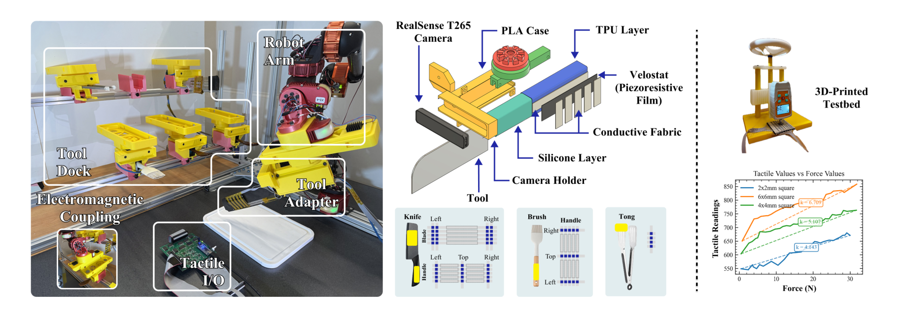
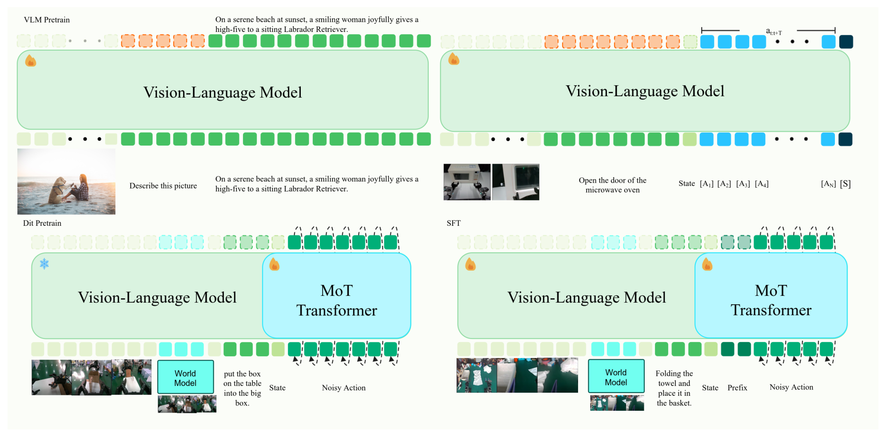
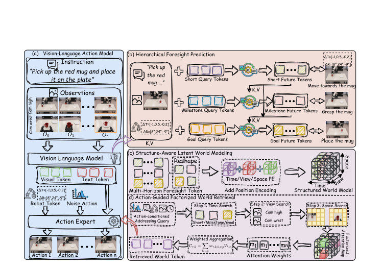

# 2026-10-30 Embodied AI & World Models Daily

> 面向具身智能 / Robotics 研究员与工程师的研究与工程资讯。
> 主窗口：北京时间 2026-10-30 00:00–23:59；补充窗口：10-28 00:00 至 10-29 23:59。论文按 v1 实际提交时间换算，不以公告日期归属。
> **来源检查不完整（主窗口）：** 运行时 arXiv 最新公告批次为 2026-10-30，按实际提交时间只覆盖到北京时间 10-30 01:59；10-30 02:00–23:59 的投稿尚未公告，recent 列表与 API 均查不到。因此本期不能断言 10-30 全天无资讯。以下条目除标注「主窗口」者外均来自 48 小时补充窗口，逐条给出实际提交时间；与 10-28、10-29 两期重复的条目已在筛选记录中说明并去重。

## 🔥 今日必读

### 1. 【数据与Benchmark】TouchBridge：用触觉把人的接触搬到机器人指尖

**来源：** [arXiv:2610.40349v1](https://arxiv.org/abs/2610.40349)（清华大学、浙江大学、南洋理工大学等；cs.RO）  
**类型：** Paper，research_paper 权重  
**发布时间：** 2026-10-30 00:06 北京时间（主窗口）  
**评分：** 79.5/100（T1；独立双评 80.0、79.0）  
**关键词：** Tactile Retargeting · Human-to-Robot Transfer · GR00T N1.7

**一句话：**  
用测量到的指尖接触而不是指尖位姿做跨本体对应：先对齐人机两侧的腕相机与指尖触觉布局，再把"接触块中心 + 活跃 taxel + 多指接触图"写进重定向优化，转换出的人类示教微调 GR00T N1.7 后，在四个真机接触任务上达到 72.5%，接近等量遥操作数据的 77.5%，而采集速度快 7.0 倍。

*经视觉审查的方法图 3；接触中心公式、接触图消融与完整数字见[精读笔记](../paper-reading/news/2026-10-30/touchbridge/touchbridge.md)。*

**技术要点：**

- 硬件对齐：TouchBridge-Cap 用 D455 自我中心相机、两个腕相机、Manus 手套（130 Hz）与每指尖一枚 PaXini 触觉阵列（90 Hz）；机器人侧用同款触觉与几何定制的腕相机支架，使人机观测处在可比坐标系下。
- 重定向目标由姿态项、接触项、接触图项与正则项组成。关键实现是接触时把姿态跟踪权重压到非接触时的 0.15 倍（$\eta=0.05$），让触觉项压过运动学项；接触中心按触觉响应加权，接触图用距离加权 Laplacian 保持多指接触的相对布局。
- 全程不需要物体网格、物体位姿或物理仿真；视觉侧用 SAM 2 分割人手、ProPainter 修补背景、再渲染机器人手网格，动作按 UMI 方式锚定到动作块起始帧。
- 四个真机任务（翻书页、拧灯泡、挤酱、夹蛋卷）各 60 条人类与 60 条遥操作示教，每策略 20 次试验：人类数据 72.5% 对遥操作 77.5%，翻书页持平；采集 11.7 秒对 81.7 秒。
- 接触误差（Isaac Sim 回放）4.667 mm，DexPilot 6.354 mm、UniDex 7.715 mm；去掉接触图 6.659 mm、去掉接触对齐 7.071 mm、纯运动学 7.540 mm，对应真机成功率 48.8%、43.8%、38.8%。从零训练的 GR00T N1.7 只有 6.2%，说明方法高度依赖预训练。

**为什么值得关注：**  
它把"人类示教能不能替代遥操作"这个老问题推进到接触层面：不是让指尖位姿更像，而是让接触位置与接触之间的结构更像。0.15 倍的接触期跟踪权重是一个几乎零成本、可直接搬到自己重定向管线里的实现技巧。边界也清楚：触觉只用于重定向、不进入策略，全部实验在同一台 Moz1 加 Wuji 手上完成。

**资源：** [论文](https://arxiv.org/abs/2610.40349) · [项目页](https://touchbridge2026.github.io/) · [精读](../paper-reading/news/2026-10-30/touchbridge/touchbridge.md)。本次未确认公开代码或权重。

---

### 2. 【操作与抓取】SwapBot：把家用工具变成带触觉的可换末端执行器

**来源：** [arXiv:2610.40646v1](https://arxiv.org/abs/2610.40646)（University of Washington；cs.RO）  
**类型：** Paper，research_paper 权重  
**发布时间：** 2026-10-30 01:59 北京时间（主窗口）  
**评分：** 77.5/100（T1；独立双评 78.0、77.0）  
**关键词：** Tool Use · Tactile Sensing · Diffusion Policy

**一句话：**  
机器人侧只留一个自对准电磁耦合接口，工具侧用约 10 美元的 3D 打印适配器把刀、刷子、夹子、筷子变成带压阻触觉的末端执行器，约 10 秒完成换装；再用分层策略（工具选择器 + 工具专用扩散策略）完成刷酱、夹豆腐、切割，触觉让三个技能分别达到 85%、70%、90%，比 RGB-only 高 15 到 25 点。

*经视觉审查的系统图 2；电极尺寸标定、分层策略与完整消融见[精读笔记](../paper-reading/news/2026-10-30/swapbot/swapbot.md)。*

**技术要点：**

- 耦合设计：机器人侧电磁轮毂配运动学导向齿轮，允许小范围对准误差，保持力规格 50 N；工具侧 PLA/TPU 适配器加硅胶填充吸收手柄差异，铰接工具由末端关节经轴承传扭矩，无末端关节的 UR 系列补一个舵机。
- 触觉是三明治压阻结构：Velostat 夹在正交导电布电极之间，$n\times n$ 阵列只需 $2n$ 根电极；标定显示大电极灵敏度高但会突跳并让 10-bit ADC 饱和，最终选 2 mm 宽度。
- 遥操作主手与机器人工具同构，T265 给 6-DoF 位姿、双 IMU 解铰接开合，多视角 RGB、触觉、关节与动作以 20 Hz 同步；策略侧选择器用 ResNet+MLP 在自顶视图像与目标图上输出工具分布（测试集 96.8%），低层是条件于多视角 RGB、触觉与本体的 U-Net 扩散策略。
- 每阶段 100 条示教、每策略 20 次试验、20 cm × 20 cm 工作区；整任务串联 60% 对 RGB-only 35%；仅触觉几乎学不会（10%–20%），自我中心视角最高只有 40%，说明触觉是补充而非替代视觉。

**为什么值得关注：**  
它给出的是一条与"更大 VLA"不同的路线：不追求单一模型覆盖所有工具，而是让硬件与技能库承担多样性。最可复用的是"传感器随工具走到工具-物体界面"这个判断，以及用接触状态决定该信视觉还是该信触觉的工程直觉。作者承认的局限是传感器分辨率低、易磨损、布置靠直觉、任务分段需人工给定；跨机器人策略迁移与换装长期可靠性都没有定量证据。

**资源：** [论文](https://arxiv.org/abs/2610.40646) · [项目页](https://personalrobotics.github.io/SwapBot) · [精读](../paper-reading/news/2026-10-30/swapbot/swapbot.md)。项目页称硬件指南稍后发布，本次未确认公开代码。

---

### 3. 【VLA与基础模型】PRIME W0：把世界模型子目标图异步接进流匹配 VLA

**来源：** [arXiv:2610.39528v1](https://arxiv.org/abs/2610.39528)（LumosBot 等；cs.RO）  
**类型：** Paper，research_paper 权重  
**发布时间：** 2026-10-29 15:25 北京时间（补充窗口）  
**评分：** 73.5/100（T1；独立双评 75.0、72.0）  
**关键词：** World Model · Flow Matching · Mixture-of-Experts

**一句话：**  
三条条件通路汇入一个流匹配动作专家：VLM 逐层 KV 交叉注意力、世界模型从上一帧预测的子目标 RGB 图（异步注入，不阻塞当前帧）、以及 DINOv2 编码的历史帧；动作在由示教协方差决定的噪声上做流匹配，LIBERO 平均 99.1%、自建真机五任务平均 78.1%。

*经视觉审查的流程图 2；消融序列、缩放实验与证据边界见[精读笔记](../paper-reading/news/2026-10-30/primew0/primew0.md)。*

**技术要点：**

- 逐层 KV 注入让动作头读到 VLM 所有层的 Key/Value，而不是一个池化向量；世界模型把预测解码成图像再用同一视觉编码器编码，复用 VLM 原生视觉接口。
- 异步调度是关键工程点：子目标只依赖 $o_{t-1}$，可在采集当前帧时后台生成，端到端延迟约为 $\max(T_{\text{wm}},T_{\text{vision}})$。
- 协方差噪声：用示教动作块的 $\hat\Sigma_a=LL^\top$ 采样 $\varepsilon=L\xi$，替代各向同性高斯；推理用 8 步 Euler 积分，动作块长度 $H$。
- 四阶段训练：VLM 预训练 → DAT 离散动作词元 + NTP → 冻结 VLM 的流匹配预训练（含世界模型注入）→ 端到端 SFT；数据约 10,000 小时（遥操作 60%、UMI 30%、仿真 10%）。
- 累积消融（LIBERO-Long / 真机）：OpenVLA 53.7/15.7 → DAT 61.2/22.4 → ADM 72.4/45.3 → MoE 81.6/58.2 → 历史帧 88.3/64.7 → 世界模型 93.5/71.4 → 协方差噪声 96.2/75.8 → SFT 98.6/78.1。子目标图与下一帧相似度同成功率的相关系数 0.79（OpenVLA 0.09）。

**为什么值得关注：**  
它把"世界模型参与在线控制"做成了一个可部署的调度问题，而不是只把预测当离线数据。消融顺序也诚实：最大增益来自流匹配动作头加相位专家，世界模型是有效增量而非全部。需要保留的判断是：真机套件自建且未公开、LIBERO 已接近饱和、0.79 只是相关而非因果、装配任务 +24.1 点的跳变没有解释。

**资源：** [论文](https://arxiv.org/abs/2610.39528) · [精读](../paper-reading/news/2026-10-30/primew0/primew0.md)。本次未确认公开代码或权重。

---

### 4. 【强化学习】Event2Reward：奖励只需要相邻状态的序，不需要绝对进度

**来源：** [arXiv:2610.39212v1](https://arxiv.org/abs/2610.39212)（cs.RO；44 页含附录）  
**类型：** Paper，research_paper 权重  
**发布时间：** 2026-10-29 10:34 北京时间（补充窗口）  
**评分：** 73.0/100（T1；独立双评 74.0、72.0）  
**关键词：** Reward Shaping · Progress Relations · Real-Robot RL

**一句话：**  
用真实执行中的事件（停顿、回退并恢复、无进展、未恢复的回退）构造同一轨迹内的进度比较关系，与成功示教的归一化时间标签联合训练进度模型，再把进度差作为势函数塑形奖励；LIBERO 四套件比各套件最强基线高 9.96–13.76 点，真机插入任务从 37.8% 提到 60.0%。

*经视觉审查的总览图 1；关系损失、标注协议与逐项结果见[精读笔记](../paper-reading/news/2026-10-30/event2reward/event2reward.md)。*

**技术要点：**

- 进度模型输入为指令、参考起始帧、短视觉历史与可选目标图，Qwen3.5-4B 骨干加进度头（离散分布取期望）与趋势头；成功轨迹用归一化时间做软标签，只负责锚定 0–1 尺度。
- 事件关系用带 margin 的合页损失约束：回退事件的观测必须低于回退前参考与恢复状态的较小者；停顿给容差；无进展惩罚高于参考的预测。参考分数梯度截断，事件内与事件间取平均。
- 塑形奖励为 $r^{\text{shaped}}=r^{\text{env}}+\beta[\gamma p_{t+1}-p_t]$，$\beta=1$；执行时不需要在线事件标签。
- 数据来自约 10 万条真机执行记录，两遍 VLM 加独立人工标注，8,146 条 RoboArena 轨迹上主类别一致率 87.56%；预训练约 20,000 小时。
- 真机六任务：插入 37.8%→60.0%，操作 81.7%→90.0%；RAM Insert 只有 16.7%，是明显弱项；插头插入 15 分钟对 45 分钟达到连续十次成功，但各只跑了一次训练。

**为什么值得关注：**  
它把奖励标注从"逐帧完成百分比"降到"事件 + 时间锚点"，让失败数据从负担变成监督来源；时间标签管尺度、关系管方向的分解也很干净。边界在于：消融骨干（Qwen3-VL-4B）与主实验骨干（Qwen3.5-4B）不一致，真机每条件仅三次训练，效率结论是单次运行，且没有报告进度预测在回退片段上的方向准确率。

**资源：** [论文](https://arxiv.org/abs/2610.39212) · [精读](../paper-reading/news/2026-10-30/event2reward/event2reward.md)。论文称将公开标注、数据划分与工具，本次运行时尚不可得。

---

## 📄 论文雷达

以下 7 篇按双评分均值排序；HiFOR 已完成全文精读，其余依据官方摘要与项目资料筛选，数字属于作者报告，未冒充全文复核。

### 【VLA与基础模型】HiFOR：三层未来预测 + 动作引导的世界检索

**来源 / Paper：** [arXiv:2610.40373v1](https://arxiv.org/abs/2610.40373)（cs.CV/cs.RO）  
**实际提交：** 2026-10-30 00:21 北京时间（主窗口）  
**关键词：** Hierarchical Foresight · Latent World Model · Factorized Retrieval  
**值得关注程度：** 73.5/100（T1；双评 75.0、72.0）  
**核心贡献：** 用层级依赖掩码联合预测短期状态、语义里程碑与最终目标，再把预测按时间、视角、空间组织成结构化潜世界，动作表示在每步去噪中沿三个维度做因子化检索；LIBERO 平均 98.3%（π0.5 96.9%），RoboTwin 2.0 Hard 49.40%（π0.5 40.35%），真机六任务 81.7%（比 π0.5 高 11.0 点）。

*经视觉审查的框架图 2；累积消融、短时域分析与证据边界见[精读](../paper-reading/news/2026-10-30/hifor/hifor.md)。*

**关键证据与边界：** 累积消融在 RoboTwin 上为 40.35→44.15→45.60→46.95→49.40，LIBERO-Long 为 92.4→95.8；5 步预测优于 10/15 步，说明时域要与控制间隔对齐。真机只与 π0.5 一个基线比较，主表没有方差，注意力可视化只是相关性证据，也没有推理延迟数据。

### 【世界模型】Continuous-Action World Models：跨本体的连续动作函数空间

**来源 / Paper：** [arXiv:2610.40401v1](https://arxiv.org/abs/2610.40401)（cs.RO/cs.CV/cs.LG；12 页）  
**实际提交：** 2026-10-30 00:34 北京时间（主窗口）  
**关键词：** Cross-Embodiment · Action Function Space · World Model  
**值得关注程度：** 64.5/100（T1；双评 66.0、63.0）  
**核心贡献：** 先在不同本体、不同采样频率的轨迹上预训练一个共享的潜函数空间（动作重建 + 跨时间采样一致性），再把该空间接到世界模型骨干上，由观测、指令与当前状态条件化预测潜动作函数，单解码器可在任意查询时刻输出末端动作。

**关键证据与边界：** 摘要给出的是框架与动机，没有主结果数字、消融或真机实验；12 页正文。（本次未精读，不把"支持跨本体"当作已验证结论。）

### 【数据与Benchmark】Robotic Data Inoculation：让残差策略扰动遥操作，主动采集"会犯错"的数据

**来源 / Paper：** [arXiv:2610.39054v1](https://arxiv.org/abs/2610.39054)（Sergey Levine 等；cs.RO）  
**实际提交：** 2026-10-29 07:31 北京时间（补充窗口）  
**关键词：** Shared Control · Data Collection · Offline RL  
**值得关注程度：** 72.5/100（T1；双评 74.0、71.0）  
**核心贡献：** 人持续遥操作，残差策略在线学习并扰动人类命令，把机器人推向"用这批数据训练出的策略将来会犯的错误"附近，人的纠正同时提供恢复示教；在三个真机任务上，用该数据训练的行为克隆与离线 RL 策略达到或超过常规采集。

**关键证据与边界：** 摘要只给方向性结论（"improves or matches"），没有成功率数字、试验次数与方差；"扰动分布随学习演化"的收敛性也没有理论保证。

### 【数据与Benchmark】Embodied at Sea：水下多任务操作的 VLA 实证研究

**来源 / Paper：** [arXiv:2610.38199v1](https://arxiv.org/abs/2610.38199)（cs.RO/cs.LG；8 页）  
**实际提交：** 2026-10-28 10:49 北京时间（补充窗口）  
**关键词：** Underwater Manipulation · VLA · Field Robotics  
**值得关注程度：** 70.0/100（T1；双评 71.0、69.0）  
**核心贡献：** 在平静与湍流水域采集 1,616 条水下操作数据，训练 14 个不同本体感受配置的 VLA，在 1,260 次可评分硬件 rollout 中最高达到 93.3%（含部分成功）；另在二战沉船与游艇码头做 748 条数据的案例研究，ACT 显著优于 SmolVLA（47.9% 对 7.9%），并开源 BLUEMBODIED KIT。

**关键证据与边界：** 这是目前少见的真实水下 VLA 规模评估，包含失败与部分成功统计；但任务是抓取与系泊两类，水体扰动与视觉畸变的可控性有限，跨站点泛化未验证。

### 【数据与Benchmark】BURGER：用"画图"做 VLA 泛化基准

**来源 / Paper：** [arXiv:2610.40532v1](https://arxiv.org/abs/2610.40532)（cs.RO/cs.AI）  
**实际提交：** 2026-10-30 01:34 北京时间（主窗口）  
**关键词：** VLA Benchmark · Embodied Drawing · Data Scaling  
**值得关注程度：** 69.5/100（T1；双评 71.0、68.0）  
**核心贡献：** 以语言条件化的机器人绘画为任务，构建可扩展的轨迹生成管线，28,200 条仿真示教覆盖 282 个绘画任务；在同一空白画布上评估五个 VLA 模型的数据缩放、语言 grounding 与多模态行为，并在 Franka 上部署策略做人在环的实时绘画。

**关键证据与边界：** 任务允许开放式笔顺与多种有效画法，适合分析多模态与组合泛化；但"绘画"与接触丰富操作的距离较远，真机只做定性演示，结论不能直接外推到装配或灵巧手任务。代码与数据：[GitHub](https://github.com/Qxjyqzw/BURGER)、[Hugging Face](https://huggingface.co/datasets/Zhaosying66/BURGER)。

### 【世界模型】world2vec：用潜动力学学"机制性"世界模型

**来源 / Paper：** [arXiv:2610.40637v1](https://arxiv.org/abs/2610.40637)（cs.LG）  
**实际提交：** 2026-10-30 01:58 北京时间（主窗口）  
**关键词：** Latent Dynamics · System Identification · Interpretability  
**值得关注程度：** 66.5/100（T1；双评 68.0、65.0）  
**核心贡献：** 不依赖奖励，仅从观测与动作学习能在长时域忠实复现真实系统的潜动力学，参数量比 DreamerV3、TD-MPC2、LeWM 少至少一个数量级；在 71 个吸引子基准上做系统辨识，并在连续控制任务上从像素达到 SOTA。

**关键证据与边界：** 摘要给出参数效率与基准覆盖，但没有逐任务数字与真机实验；"mechanistic"更多指潜空间可辨识性，与机器人决策的落点仍需额外验证。

### 【模仿学习与策略】AcrossDEX 1.0：从人类运动预训练到双手灵巧操作

**来源 / Paper：** [arXiv:2610.40210v1](https://arxiv.org/abs/2610.40210)（cs.RO）  
**实际提交：** 2026-10-29 22:56 北京时间（补充窗口）  
**关键词：** Bimanual · Hand Embodiment · Motion Pretraining  
**值得关注程度：** 64.5/100（T1；双评 66.0、63.0）  
**核心贡献：** 在 HOT3D Aria 上预训练"由五帧图像与三十个手部状态预测未来一秒双手运动"，再保留视觉编码器、时序骨干与腕部参数适配到六通道 Inspire 手与十六关节 Allegro 手；策略从正面图像、命令历史与任务条件预测六十个控制目标，执行前缀并重规划。

**关键证据与边界：** 开盖回放 40.6%、Inspire 重定向 100%、Allegro 重定向 93.3%，流匹配在 Allegro 上 90.0%；"重规划受上一计划约束能改善连续执行"是有趣发现，但任务只有两类、没有跨本体泛化实验。

## 🛠 工程与开源

- **[DexSuite](https://huggingface.co/dexsuite)**（[arXiv:2610.37799](https://arxiv.org/abs/2610.37799)，10-28 02:21）：基于 Genesis 的灵巧操作一体化仿真框架，30 个任务可搭配 10 种机械臂与 12 种末端（并行夹爪到灵巧手），含统一环境 API、集成遥操作与仿真触觉；定义 16 个任务-本体对的基准，发布 4,700 条成功 episode 数据集。适合作为"换手型/换臂"实验的现成底座，项目页在 [dexsuiteorg.github.io](https://dexsuiteorg.github.io)。
- **[Gym-Anything for Robotics](https://github.com/gym-anything/robotics)**（[arXiv:2610.40565](https://arxiv.org/abs/2610.40565)，10-30 01:42）：让编码代理自动生成机器人仿真与任务，按美国 GDP 选出 25 个仿真、25 个测试与 175 个训练 RL 环境；作者报告最强前沿模型在 25 个测试任务上全部失败、平均奖励仅 0.06，并给出上下文学习、特权教师蒸馏与代码策略生成示教等改进路径。仓库 10-30 新建、5 star，属于"仿真生成基础设施"而非可直接用的 benchmark。
- **[UMI-Live](https://github.com/AfterQuery-Research/umi-live)**（[arXiv:2610.39385](https://arxiv.org/abs/2610.39385)，10-29 13:18）：双臂 UMI 野外采集全栈，夹爪集成相机、LiDAR-惯性、板载算力与供电，单键录制、异步 SLAM 重建并发布 LeRobot 数据集；π0.5 与 MolmoAct2 在六橙子放置任务上分别 10/10 与 8/10，公开约 40 小时数据与 [Hugging Face 数据集](https://huggingface.co/datasets/brandonyang/umi-live-dataset)。
- **[RoboAtom](https://arxiv.org/abs/2610.40207)**（10-29 22:55）：给现有多源数据补统一、时间对齐的原子动作标注，覆盖 145 万条轨迹、688 万段技能标签、16,882 小时；配套 RoboAtom-Bench 评测技能识别与时间边界定位，并报告原子动作监督加分层执行在 LIBERO-Long、LIBERO-Plus、RoboTwin 上优于任务级基线。论文称将公开数据、基准与模型，本次运行时尚不可得。
- **Safety flow matching**（[arXiv:2610.40075](https://arxiv.org/abs/2610.40075)，10-29 21:53）：只用二值可行性 oracle 的流匹配安全护栏，前向用可行性查询修正不安全更新、反向提取局部边界信息做约束感知学习，障碍感知操作上报告 100% 约束满足；思路轻量，但实验面较窄（约 61 分，未入选雷达）。

## 💬 社区信号

本次窗口内没有发现可回溯的独立复现、技术争议或第三方基准对比。Hugging Face paper API 对本期五篇精读论文均返回 404，没有 upvote 或讨论量可引用；GitHub 侧 BURGER 仓库 10-30 新建（1 star）、Gym-Anything 仓库 10-30 新建（5 star），UMI-Live 仓库仅 1 star，均不足以作为社区认可的证据。值得继续观察的是"接触接口"这条线：TouchBridge 与 SwapBot 同一天出现在 arXiv，前者把触觉用于人→机数据转换，后者把触觉随工具带到接触界面，二者共同点是"在策略之外先把接触测准"；如果后续出现独立复现或跨平台迁移结果，这条线才足以判断是否可推广。

## 🔎 补充窗口筛选记录

| 候选 | 实际提交时间（北京时间） | 处理与原因 |
|---|---|---|
| [Ego-CEVR](https://arxiv.org/abs/2610.37509) | 10-28 00:30 | 10-28 雷达已收录，去重。 |
| [CAPTURER](https://arxiv.org/abs/2610.39119) | 10-29 09:05 | 空中灵巧抓取系统，厘米级精度但方法以系统集成为主，约 60 分，低于 T1 门槛 62。 |
| [RAIBO-Wagon](https://arxiv.org/abs/2610.39267) | 10-29 11:20 | 四足拖车导航，40 次试验 85% 成功、负载接近体重，工程扎实但学习增量有限，约 63 分，未入选。 |
| [FORGE](https://arxiv.org/abs/2610.37974) | 10-28 05:12 | Humanoids 2026，G1 上 -2.0 到 2.8 m/s 的统一参考生成与全身跟踪，无主结果表，约 62 分，未入选。 |
| [Echo](https://arxiv.org/abs/2610.37865) | 10-28 03:11 | 16 页 preliminary report，离策略视觉 RL 的加速结果，任务与基线都较少，约 60 分。 |
| [SymAnt](https://arxiv.org/abs/2610.40632) | 10-30 01:58 | WACV 2027，长程动作预判，偏视频理解而非机器人决策，约 58 分。 |
| [Safe flow matching](https://arxiv.org/abs/2610.40075) | 10-29 21:53 | 约束满足 100% 但仅障碍感知操作一类实验，约 61 分，未达门槛。 |
| [LLM-guided Loco-Manipulation](https://arxiv.org/abs/2610.40248) | 10-29 23:19 | 四足推箱，44/45 技能组合正确、34/45 端到端成功，但 LLM 规划器为 LoRA 微调、方法增量中等，约 66 分，落选雷达。 |
| [DexSuite](https://arxiv.org/abs/2610.37799) | 10-28 02:21 | 仿真框架与数据集，已并入「工程与开源」，不重复计分。 |
| [10-30 02:00–23:59 投稿](https://arxiv.org/list/cs.RO/recent) | 未公告 | 最新批次止于 10-30 01:59；这段时间无法检查，不写成"无资讯"。 |

## 📊 今日技术趋势

今天可核验的主线是"把接触与未来写进接口，而不是只堆策略网络"：TouchBridge 把指尖接触变成跨本体对应量，SwapBot 把触觉随工具送到工具-物体界面，Event2Reward 把"进度是否回退"变成奖励的局部序约束，PRIME W0 与 HiFOR 则把世界模型的未来表示接进动作生成，并分别用异步调度与结构化检索解决"怎么用"的问题。第二条线是数据与仿真基础设施：DexSuite 统一手型与任务、UMI-Live 把野外双臂采集做成开源栈、RoboAtom 补原子动作标注、Gym-Anything 让编码代理生成仿真，四者都在降低"换任务/换本体"的边际成本。

证据形态差异很大：TouchBridge 与 Event2Reward 有真机对照与消融，PRIME W0 与 HiFOR 的主战场仍是 LIBERO 与自建真机套件，CoAWM 与 world2vec 目前只有摘要级证据。共同短板也很一致——自建真机套件不公开、缺少方差与失败案例分析、跨平台迁移普遍未验证。

## 检索覆盖与精读状态

- **官方 arXiv 召回：** 直接抓取 [cs.RO recent](https://arxiv.org/list/cs.RO/recent)（485 条）、[cs.AI recent](https://arxiv.org/list/cs.AI/recent)（1,497 条）、[cs.LG recent](https://arxiv.org/list/cs.LG/recent)（1,438 条）与 [cs.CV recent](https://arxiv.org/list/cs.CV/recent)（926 条），解析 10-27、10-28、10-30 三个公告批次共 2,492 个唯一条目，用 arXiv API 取 v1 提交时间并按北京时间筛选出 930 条落在 10-28 00:00 至 10-30 01:59 的候选，再按关键词预筛出 113 条强相关、74 条中等相关逐条读摘要。最新公告批次为 10-30，**10-30 02:00–23:59 批次不可见**，这是本期最大来源缺口；主窗口只覆盖 2/24 小时。
- **机构与会议：** 检查 Google DeepMind blog（10 月条目为 Genie 4、Gemini 4 Argon for Robotics 等，均非 10-29/10-30 新增）、NVIDIA GEAR 主页（无新条目）、Figure news（最新 9-30）、1X discover（最新 7 月）；Physical Intelligence 站点返回 308 重定向循环，本次无法读取，记为来源缺口。
- **工程与社区：** GitHub API 核对 Gym-Anything（10-30 新建，5 star）、BURGER（10-30 新建，1 star）、UMI-Live（1 star）；Hugging Face paper API 对五篇精读论文均 404；未发现独立复现或技术争议。不把 star 数或演示视频当作结果复现。
- **精读：** [索引](../paper-reading/news/2026-10-30/README.md)。必读 4 篇 + 雷达最高 1 篇，共 5 篇；TouchBridge 10 页、SwapBot 9 页、PRIME W0 22 页、Event2Reward 44 页、HiFOR 11 页均完整提取，grounding、八项笔记 lint、质量与可读性审查、原脚本正式保存及 SHA-256 全部通过。共 6 张图片 materialized，正文无占位；TouchBridge 的总览图 1 因裁切混入标题与图注、一次修复后仍含图注首行，最终改用方法图 3 作为代表图并如实登记。本次未执行训练、推理或机器人实验。
