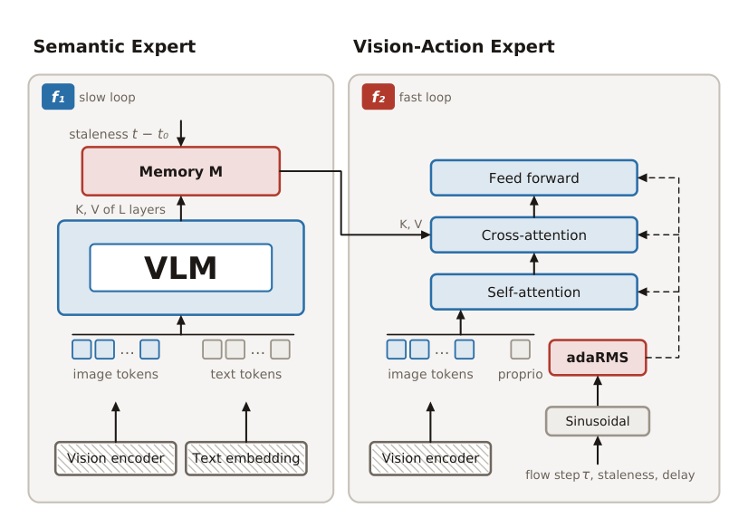
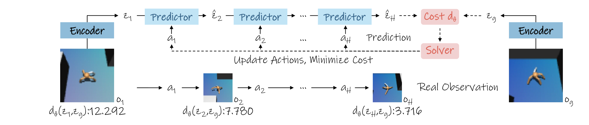

# 2026-11-04 Embodied AI & World Models Daily

> 面向具身智能与世界模型研究员、工程师的中文科研日报。
> 本期为补发；主窗口是北京时间2026-11-04自然日，补充窗口为此前两天。只按官方v1实际提交时间归属，不以公告日或编号月份代替。来源检查存在缺口，详见末节；未访问到的内容不能解释为当天没有资讯。

本期保留1个必读事件、7篇论文雷达，完成2篇全文精读；其他论文说明仅基于官方摘要，不代表独立复现。分数为同一agent按五维标准两轮编辑评估的平均，T1门槛62；评分不等于客观质量排名。

## 🔥 今日必读

### 【异步策略】ARP：慢语义与快视觉动作分别运行

**来源：** [Asynchronous Robot Policies](https://arxiv.org/abs/2611.05155)  
**类型：** Paper / research_paper；T1  
**实际首次提交：** 2026-11-04 00:30:27 北京时间（主窗口）  
**双评分：** 89 / 86 → **87.5/100**

低频VLM发布固定宽度语义记忆，快专家结合实时视觉、本体、记忆年龄与执行延迟生成动作。真正关键的是训练中加入陈旧语义：0.5Hz刷新时，无增强仅2%成功，默认年龄增强81.8%。动态扰动主要来自仿真；完整RoboLab上ARP20.0%仍低于π0.5的37.9%，不能概括为全面领先。

*论文方法总览；已对照原PDF整页做视觉审查。*

[全文精读](../paper-reading/news/2026-11-04/asynchronous/asynchronous.md) · 1图、0占位；完整校验通过。

**关注理由：** 将语义年龄和快路径延迟显式放入策略接口，比只在服务端缓存特征更能解释动态任务的收益；通信与共享GPU竞争仍需独立测量。

## 📄 论文雷达

### 【规划代价】Time-to-Goal：预测表示还需要时间排序监督

**来源：** [Time-to-Goal: Learned Temporal Metrics for Long-Horizon Planning with JEPA World Models](https://arxiv.org/abs/2611.05847)  
**类型：** Paper / research_paper；T1  
**实际首次提交：** 2026-11-04 10:36:31 北京时间（主窗口）  
**双评分：** 87 / 84 → **85.5/100**

冻结JEPA编码器和动力学，只训练约0.182M参数的小距离网络，以离线近远状态排序替换欧氏规划代价。四仿真任务平均成功率32.7%→63.0%，但全轨迹聚合在Cube仅4%，末段聚合63.3%；Cube也改变了规划时域。学习的是相对时间代价，不是校准剩余步数。

*论文方法总览；已对照原PDF整页做视觉审查。*

[全文精读](../paper-reading/news/2026-11-04/time-to-goal/time-to-goal.md) · 1图、0占位；完整校验通过。

### 【交互世界模拟】Cosmos：区分动作后果预测与外部物理状态渲染

**来源：** [Interactive World Simulation with Cosmos for Physical AI](https://arxiv.org/abs/2611.06627)  
**类型：** Paper / research_paper；T1  
**实际首次提交：** 2026-11-04 23:11:04 北京时间（主窗口）  
**双评分：** 84 / 83 → **83.5/100**

共享框架让Cosmos流式响应动作和场景控制，覆盖相机导航、操作、视频迁移及多视角自动驾驶。应区分模型自身预测物理后果与根据外部仿真器状态生成观察，两者的正确性来源不同。本期核验摘要和论文给出的资源入口；119页报告未登记为已完成精读，不据“实时”一词补造所有配置的吞吐。

### 【力与运动接口】Ctrl-F：给全身跟踪增加三维接触力命令

**来源：** [Ctrl-F: Force as an Interface for Humanoid Loco-Manipulation](https://arxiv.org/abs/2611.05507)  
**类型：** Paper / research_paper；T1  
**实际首次提交：** 2026-11-04 03:04:27 北京时间（主窗口）  
**双评分：** 82 / 80 → **81/100**

低层同时跟踪参考动作并施加指定接触力，高层根据对象状态和本体信息在线发出力命令。作者在硬件展示推、拖、抬与踢，推踢任务操作最高20kg箱体并适应中途负载变化。力盲基线不足支持这一接口方向，但重量上限不等于任意姿态、接触面和持续时间的负载能力。

### 【视频示范学习】ELA：联合优化潜动作、策略和动作解码

**来源：** [ELA: End-to-End Latent Action Policy Learning from Video Demonstrations](https://arxiv.org/abs/2611.05571)  
**类型：** Paper / research_paper；T1  
**实际首次提交：** 2026-11-04 04:03:16 北京时间（主窗口）  
**双评分：** 79 / 80 → **79.5/100**

联合训练潜动作模型、潜动作策略和连续动作解码器，使表示不仅解释观察变化，也服务于下游控制。作者在仿真和真机操作中比较已有潜动作方法，采用约4M参数轻量动作解码器。其目标是减少动作标注示范，不等于完全不需要机器人动作数据；本期不引入摘要未给的样本数。

### 【潜动作】DreamX：用视频扩散先验提取跨本体动作接口

**来源：** [DreamX: Video Diffusion Model is a Universal Latent Action Learner](https://arxiv.org/abs/2611.05377)  
**类型：** Paper / research_paper；T1  
**实际首次提交：** 2026-11-04 02:59:56 北京时间（主窗口）  
**双评分：** 80 / 79 → **79.5/100**

从预训练视频扩散模型时空特征中提取紧凑潜动作，将每潜视频帧1200个词元压为4个，作者称压缩300倍。跨外观和本体的视频／动作迁移有价值，但词元压缩比不是端到端推理加速比，潜动作迁移也不保证真实接触动力学完全一致。

### 【记忆评测】RoboCasa-Mem：后续约束取决于机器人先前做过什么

**来源：** [Robocasa-Mem: Benchmarking Environment and Process Memory in Long-Horizon Mobile Manipulation](https://arxiv.org/abs/2611.06475)  
**类型：** Paper / research_paper；T1  
**实际首次提交：** 2026-11-04 21:16:32 北京时间（主窗口）  
**双评分：** 79 / 77 → **78/100**

九项移动操作任务覆盖环境记忆和过程记忆，并提供1800条成功示范。行为条件评测根据机器人之前的行动产生后续约束，减少固定目标捷径；HMAP结合实体／过程记忆与低层VLA。关键是检查行为是否与自己的交互历史一致，而不只是为普通任务加更长上下文。

### 【检查点选择】RACE：把动作偏差的可恢复性纳入离线排序

**来源：** [RACE: Calibrated Cumulative Scoring for Rollout-Free Robot Policy Checkpoint Selection](https://arxiv.org/abs/2611.05838)  
**类型：** Paper / research_paper；T1  
**实际首次提交：** 2026-11-04 10:26:29 北京时间（主窗口）  
**双评分：** 78 / 76 → **77/100**

在固定留出成功轨迹上，以相似状态的动作差异校准阈值，用累积乘积降低大偏差之后参考预测的贡献。作者报告仿真与真机检查点排序更贴近部署成功率。它减少逐检查点rollout需求，不保证新任务分布下仍校准，也不能用排序相关性替代绝对成功率或安全保证。

## 🛠 工程与开源

[T2G作者代码](https://github.com/yrluestc/T2G-JEPA)访问通过，与论文事件合并，不额外计数；本次未运行其训练或基准复现。[ARP项目入口](https://arp.insait.ai)由论文给出；本轮返回部分页面后超时，未确认其完整代码或权重可用性。Cosmos的[框架代码](https://github.com/nvidia/cosmos-framework)、[示例检查点集合](https://huggingface.co/collections/nvidia/cosmos3-examples)与[官方项目页](https://research.nvidia.com/labs/cosmos-lab/cosmos-simulation)作为上面同一研究事件的资源入口；不把论文、代码和权重拆成三项新闻，也不根据lastModified推断首次开源日期。

## 💬 社区信号

本轮仅取得有限的HN检索样本，X与Reddit未完整覆盖。没有将未回溯到一手技术材料、发布时间不明或仅产品讨论的样本作为独立高分社区事件；这不表示当天没有讨论。

## 🔎 补充窗口筛选记录

检索官方cs.RO、cs.AI、cs.LG、cs.CV recent及月份列表，对关键词候选逐条获取摘要、作者、标题与版本时间，再去重、预筛和评分。非精读候选采用摘要证据层的保守编辑判断；排序靠后不等于论文无价值。

展开逐条窗口归属、预筛及双评分记录

| 论文 | v1北京时间 | 窗口／预筛 | 两轮分数→平均 | 处置 |
|---|---|---|---|---|
| [cuRoboV2-Fast: Fast Torque-Limited Collision-Free Motion Planning](https://arxiv.org/abs/2611.06913) | 2026-11-05 02:58:20 | outside／OUTSIDE | — | 首次提交在窗口外，近期公告/revision不改变归属 |
| [Perceptive Humanoid Motion from Simulation](https://arxiv.org/abs/2611.06908) | 2026-11-05 02:55:33 | outside／OUTSIDE | — | 首次提交在窗口外，近期公告/revision不改变归属 |
| [VABAR: A Variational Automation Benchmark for Agentic Robotics](https://arxiv.org/abs/2611.06881) | 2026-11-05 02:38:01 | outside／OUTSIDE | — | 首次提交在窗口外，近期公告/revision不改变归属 |
| [Rethinking Self-Repair in Code-as-Policy Agents: What Drives Retry Success?](https://arxiv.org/abs/2611.06863) | 2026-11-05 02:19:24 | outside／OUTSIDE | — | 首次提交在窗口外，近期公告/revision不改变归属 |
| [ConDR: Conservative Reachability through Neural Hamilton-Jacobi Subsolutions](https://arxiv.org/abs/2611.06802) | 2026-11-05 01:18:50 | outside／OUTSIDE | — | 首次提交在窗口外，近期公告/revision不改变归属 |
| [PyRUA-REAL: Robot Exploration and Adaptive Learning through RSI in the Real World](https://arxiv.org/abs/2611.06768) | 2026-11-05 00:46:03 | outside／OUTSIDE | — | 首次提交在窗口外，近期公告/revision不改变归属 |
| [Dexterous Robotic Hands in the Foundation-Model Era: A Full-Stack Survey of Hardware, Data, Cross-Embodiment Transfer, Learning, and Evaluation](https://arxiv.org/abs/2611.06724) | 2026-11-05 00:13:29 | outside／OUTSIDE | — | 首次提交在窗口外，近期公告/revision不改变归属 |
| [Where Is VLA Inference Time Spent? Bottlenecks and Optimization Interactions Across GPUs](https://arxiv.org/abs/2611.06710) | 2026-11-05 00:09:02 | outside／OUTSIDE | — | 首次提交在窗口外，近期公告/revision不改变归属 |
| [When to Ask for Help: Uncertainty-Triggered Aerial Refinement for Off-Road Navigation](https://arxiv.org/abs/2611.06702) | 2026-11-05 00:02:59 | outside／OUTSIDE | — | 首次提交在窗口外，近期公告/revision不改变归属 |
| [Cognitive and Behavioural Effects of Haptic Feedback for ROV Teleoperation in Hazardous Environments](https://arxiv.org/abs/2611.06689) | 2026-11-04 23:55:47 | main／PASS | 65/66→65.5 | 按摘要证据属于领域范围；两轮评分后本期排序靠后 |
| [Which Physical Tactile Cues Matter for Contact-Rich Imitation Learning? A Controlled Real-Robot Study](https://arxiv.org/abs/2611.06673) | 2026-11-04 23:45:40 | main／PASS | 65/66→65.5 | 按摘要证据属于领域范围；两轮评分后本期排序靠后 |
| [Compounding Physical RSI: Turning Execution Failure into Inherited Capability](https://arxiv.org/abs/2611.06654) | 2026-11-04 23:31:04 | main／PASS | 59/58→58.5 | 范围相关但当前摘要证据双评分低于T1门槛62 |
| [Detecting Silent Action-Interface Mismatch with Calibrated Relational World Models](https://arxiv.org/abs/2611.06653) | 2026-11-04 23:30:52 | main／PASS | 65/66→65.5 | 按摘要证据属于领域范围；两轮评分后本期排序靠后 |
| [SCRUB: Contact-Based Surface-Frame Estimation for Force-Motion Control with an Armless Quadruped](https://arxiv.org/abs/2611.06649) | 2026-11-04 23:28:29 | main／PASS | 65/66→65.5 | 按摘要证据属于领域范围；两轮评分后本期排序靠后 |
| [Dynamic Shape Control of Soft Trunk Robots](https://arxiv.org/abs/2611.06625) | 2026-11-04 23:09:19 | main／PASS | 65/66→65.5 | 按摘要证据属于领域范围；两轮评分后本期排序靠后 |
| [FOSCo-Net: Ego-centric Voxel Completion for Forest LiDAR Occlusions](https://arxiv.org/abs/2611.06588) | 2026-11-04 22:42:57 | main／PASS | 59/58→58.5 | 范围相关但当前摘要证据双评分低于T1门槛62 |
| [Playing Soccer Like Humans Do: Learning Versatile and Agile Humanoid Soccer via Latent Motion Priors](https://arxiv.org/abs/2611.06564) | 2026-11-04 22:28:40 | main／PASS | 59/58→58.5 | 范围相关但当前摘要证据双评分低于T1门槛62 |
| [H^2MARL: Hierarchical Heterogeneous Multi-agent Reinforcement Learning for Humanoid Robot Control](https://arxiv.org/abs/2611.06523) | 2026-11-04 21:48:34 | main／PASS | 59/58→58.5 | 范围相关但当前摘要证据双评分低于T1门槛62 |
| [Robocasa-Mem: Benchmarking Environment and Process Memory in Long-Horizon Mobile Manipulation](https://arxiv.org/abs/2611.06475) | 2026-11-04 21:16:32 | main／PASS | 79/77→78 | 论文雷达 |
| [Beyond Infraction Scores: Failure-Boundary Profiles for Closed-Loop Evaluation of Driving and Robot Navigation Agents](https://arxiv.org/abs/2611.06453) | 2026-11-04 20:54:09 | main／PASS | 65/66→65.5 | 按摘要证据属于领域范围；两轮评分后本期排序靠后 |
| [$A^3$-VLA: Automatic Perception-Guided Attention Alignment for Robot Manipulation](https://arxiv.org/abs/2611.06447) | 2026-11-04 20:50:54 | main／PASS | 59/58→58.5 | 范围相关但当前摘要证据双评分低于T1门槛62 |
| [TwinBridge: Digital Twin-Driven Policy and Reward Transfer for Real-World Reinforcement Learning in Laboratory Robotics](https://arxiv.org/abs/2611.06442) | 2026-11-04 20:44:51 | main／PASS | 59/58→58.5 | 范围相关但当前摘要证据双评分低于T1门槛62 |
| [UniLoop: Unified Loop Closure Detection from Retrieval to Geometric Verification and Relative Pose Estimation](https://arxiv.org/abs/2611.06378) | 2026-11-04 19:41:55 | main／PASS | 59/58→58.5 | 范围相关但当前摘要证据双评分低于T1门槛62 |
| [Vortex-Induced Torque in Grasping Soft Objects: Influence of Geometry and Pneumatic Parameters](https://arxiv.org/abs/2611.06359) | 2026-11-04 19:21:23 | main／BLOCK | — | 主要是纯视觉/GUI/文本或行业专用应用，未见足够通用机器人决策/控制落点 |
| [Scale Anchoring via Implicit Semantics and Sequence-Consistent Loop Closure for VGGT-Based SLAM](https://arxiv.org/abs/2611.06308) | 2026-11-04 18:42:52 | main／PASS | 65/66→65.5 | 按摘要证据属于领域范围；两轮评分后本期排序靠后 |
| [Corridor-Based Monitoring and Emergency Braking Decision for Automated Vehicle Safety](https://arxiv.org/abs/2611.06287) | 2026-11-04 18:24:36 | main／BLOCK | — | 主要是纯视觉/GUI/文本或行业专用应用，未见足够通用机器人决策/控制落点 |
| [Riemannian Optimization-based Whole-body Obstacle Avoidance for Mobile Continuum Robots in Cluttered Environments](https://arxiv.org/abs/2611.06214) | 2026-11-04 17:27:00 | main／PASS | 59/58→58.5 | 范围相关但当前摘要证据双评分低于T1门槛62 |
| [Beyond Terminal Constraints: Reliable Robot Control with Learned Safe Sets](https://arxiv.org/abs/2611.06196) | 2026-11-04 17:12:15 | main／PASS | 65/66→65.5 | 按摘要证据属于领域范围；两轮评分后本期排序靠后 |
| [Can Astra Solve RoboMME without Breaking the Bank?](https://arxiv.org/abs/2611.06184) | 2026-11-04 17:01:53 | main／PASS | 65/66→65.5 | 按摘要证据属于领域范围；两轮评分后本期排序靠后 |
| [A Layered View of LLM Support in Underwater Robotics](https://arxiv.org/abs/2611.06162) | 2026-11-04 16:43:07 | main／PASS | 65/66→65.5 | 按摘要证据属于领域范围；两轮评分后本期排序靠后 |
| [3D Pose Estimation in Projection Space via Pixel-level Visible Light Communication](https://arxiv.org/abs/2611.06121) | 2026-11-04 16:07:10 | main／BLOCK | — | 主要是纯视觉/GUI/文本或行业专用应用，未见足够通用机器人决策/控制落点 |
| [Online Adaptation to Latent Physical Properties for Learning from Demonstration](https://arxiv.org/abs/2611.06118) | 2026-11-04 16:05:32 | main／PASS | 65/66→65.5 | 按摘要证据属于领域范围；两轮评分后本期排序靠后 |
| [The Effectiveness of Sliding Mode Control for Robust Vision Stabilization under the Plant-Binding Condition](https://arxiv.org/abs/2611.06028) | 2026-11-04 14:29:39 | main／PASS | 65/66→65.5 | 按摘要证据属于领域范围；两轮评分后本期排序靠后 |
| [Learning Object-Centric Motion Priors from Human for Robotic Dexterous Manipulation](https://arxiv.org/abs/2611.05979) | 2026-11-04 13:13:03 | main／PASS | 65/66→65.5 | 按摘要证据属于领域范围；两轮评分后本期排序靠后 |
| [Reflection-Robust Stereo Visual-Inertial Odometry via Kalman-Filtered Ground-Height Estimation](https://arxiv.org/abs/2611.05938) | 2026-11-04 12:26:39 | main／PASS | 65/66→65.5 | 按摘要证据属于领域范围；两轮评分后本期排序靠后 |
| [LumiTac: Compact, High-Rate Six-Axis Optical Tactile Sensing for Human-Robot Interaction](https://arxiv.org/abs/2611.05936) | 2026-11-04 12:24:45 | main／PASS | 65/66→65.5 | 按摘要证据属于领域范围；两轮评分后本期排序靠后 |
| [Diversity-Aware Experience Replay via Statistical Leverage Scores](https://arxiv.org/abs/2611.05929) | 2026-11-04 12:18:33 | main／PASS | 65/66→65.5 | 按摘要证据属于领域范围；两轮评分后本期排序靠后 |
| [FWIK: Multi-Waypoint IK Selection via Lookahead Graph Search](https://arxiv.org/abs/2611.05897) | 2026-11-04 11:43:05 | main／PASS | 65/66→65.5 | 按摘要证据属于领域范围；两轮评分后本期排序靠后 |
| [Does RRT* Work on Uneven Terrain Meshes?](https://arxiv.org/abs/2611.05885) | 2026-11-04 11:18:45 | main／PASS | 65/66→65.5 | 按摘要证据属于领域范围；两轮评分后本期排序靠后 |
| [Time-to-Goal: Learned Temporal Metrics for Long-Horizon Planning with JEPA World Models](https://arxiv.org/abs/2611.05847) | 2026-11-04 10:36:31 | main／PASS | 87/84→85.5 | 论文雷达 |
| [RACE: Calibrated Cumulative Scoring for Rollout-Free Robot Policy Checkpoint Selection](https://arxiv.org/abs/2611.05838) | 2026-11-04 10:26:29 | main／PASS | 78/76→77 | 论文雷达 |
| [ZipDrift: Generating Multimodal Short-Horizon MPC Costs with One-Step Drifting Models](https://arxiv.org/abs/2611.05793) | 2026-11-04 08:58:48 | main／PASS | 65/66→65.5 | 按摘要证据属于领域范围；两轮评分后本期排序靠后 |
| [Closed-Loop Adaptive Sampling on a Generative Ocean Model](https://arxiv.org/abs/2611.05776) | 2026-11-04 08:29:56 | main／PASS | 59/58→58.5 | 范围相关但当前摘要证据双评分低于T1门槛62 |
| [GRASP: Gradient-Guided Sampling for Contact-Rich Physics-Based Motion Retargeting](https://arxiv.org/abs/2611.05754) | 2026-11-04 07:53:22 | main／PASS | 65/66→65.5 | 按摘要证据属于领域范围；两轮评分后本期排序靠后 |
| [OUCH: Objective, Uniform, Controlled Haptic Stimulation for Automated Neurological Assessment](https://arxiv.org/abs/2611.05741) | 2026-11-04 07:27:44 | main／BLOCK | — | 主要是纯视觉/GUI/文本或行业专用应用，未见足够通用机器人决策/控制落点 |
| [OdorSpaces: Visual-Olfactory Embodied Navigation in 3D Environments](https://arxiv.org/abs/2611.05738) | 2026-11-04 07:21:27 | main／PASS | 65/66→65.5 | 按摘要证据属于领域范围；两轮评分后本期排序靠后 |
| [Correct Robots Before They Make Mistakes: Proactive Human-in-the-Loop Intervention via Preference Learning](https://arxiv.org/abs/2611.05667) | 2026-11-04 05:54:27 | main／PASS | 59/58→58.5 | 范围相关但当前摘要证据双评分低于T1门槛62 |
| [$\mathcal{C}^\infty$ Smooth Trajectory Planning with Application to Soft Robots](https://arxiv.org/abs/2611.05615) | 2026-11-04 04:59:09 | main／PASS | 65/66→65.5 | 按摘要证据属于领域范围；两轮评分后本期排序靠后 |
| [Contact-Implicit Whole-Body Trajectory Optimization for Dynamic Humanoid Locomotion on Parameterizable Uneven Terrain](https://arxiv.org/abs/2611.05585) | 2026-11-04 04:17:00 | main／PASS | 59/58→58.5 | 范围相关但当前摘要证据双评分低于T1门槛62 |
| [ELA: End-to-End Latent Action Policy Learning from Video Demonstrations](https://arxiv.org/abs/2611.05571) | 2026-11-04 04:03:16 | main／PASS | 79/80→79.5 | 论文雷达 |
| [MESA: An Evaluation Framework for Compositional, Semantic, and Spatial Generalization in Robotics](https://arxiv.org/abs/2611.05567) | 2026-11-04 04:01:03 | main／PASS | 59/58→58.5 | 范围相关但当前摘要证据双评分低于T1门槛62 |
| [Ctrl-F: Force as an Interface for Humanoid Loco-Manipulation](https://arxiv.org/abs/2611.05507) | 2026-11-04 03:04:27 | main／PASS | 82/80→81 | 论文雷达 |
| [Jev with Foresight: Safe Language-Guided Autonomous Driving via a Language World Model](https://arxiv.org/abs/2611.05448) | 2026-11-04 01:36:47 | main／BLOCK | — | 主要是纯视觉/GUI/文本或行业专用应用，未见足够通用机器人决策/控制落点 |
| [Reinforcement Learning Enables Scaling Generalist Robot Policy Improvement](https://arxiv.org/abs/2611.06905) | 2026-11-05 02:52:28 | outside／OUTSIDE | — | 首次提交在窗口外，近期公告/revision不改变归属 |
| [Interactive World Simulation with Cosmos for Physical AI](https://arxiv.org/abs/2611.06627) | 2026-11-04 23:11:04 | main／PASS | 84/83→83.5 | 论文雷达 |
| [CoSafe: Cooperative Runtime Safety Assurance for Mixed-Traffic Autonomous Driving](https://arxiv.org/abs/2611.06204) | 2026-11-04 17:21:22 | main／BLOCK | — | 主要是纯视觉/GUI/文本或行业专用应用，未见足够通用机器人决策/控制落点 |
| [ReactWorld: Structuring Interaction Responses for Embodied Video Generation](https://arxiv.org/abs/2611.06120) | 2026-11-04 16:06:52 | main／PASS | 65/66→65.5 | 按摘要证据属于领域范围；两轮评分后本期排序靠后 |
| [Fluidic Body: Swarm Robots as a Fluid Extension of the Hand](https://arxiv.org/abs/2611.06068) | 2026-11-04 15:13:34 | main／PASS | 65/66→65.5 | 按摘要证据属于领域范围；两轮评分后本期排序靠后 |
| [Robots in the City: Persona-Based Perceptions of Urban Robots](https://arxiv.org/abs/2611.05954) | 2026-11-04 12:48:53 | main／PASS | 65/66→65.5 | 按摘要证据属于领域范围；两轮评分后本期排序靠后 |
| [WayPOP: A Panoramic Open-Set Panoptic Tracking Benchmark](https://arxiv.org/abs/2611.05801) | 2026-11-04 09:16:49 | main／PASS | 65/66→65.5 | 按摘要证据属于领域范围；两轮评分后本期排序靠后 |
| [Beyond Accuracy: Information-Theoretic Decoder Evaluation Under Latent Intent](https://arxiv.org/abs/2611.05658) | 2026-11-04 05:43:43 | main／PASS | 65/66→65.5 | 按摘要证据属于领域范围；两轮评分后本期排序靠后 |
| [Representations of 3D Rotations: Mathematical Foundations and Comparative Analysis](https://arxiv.org/abs/2605.08086) | 2025-12-17 10:56:03 | outside／OUTSIDE | — | 首次提交在窗口外，近期公告/revision不改变归属 |
| [PolicyIK: High-Precision Inverse Kinematics for Robot Arms with Reinforcement Learning](https://arxiv.org/abs/2611.05372) | 2026-11-04 02:59:14 | main／PASS | 65/66→65.5 | 按摘要证据属于领域范围；两轮评分后本期排序靠后 |
| [GUILD: Guided Iterative Data Collection for Imitation Learning](https://arxiv.org/abs/2611.05368) | 2026-11-04 02:57:35 | main／PASS | 59/58→58.5 | 范围相关但当前摘要证据双评分低于T1门槛62 |
| [PyRUA-DataFarm: LLM Agent as a Cost-Efficient Teleoperator for Real-Ready Robot Data](https://arxiv.org/abs/2611.05320) | 2026-11-04 02:25:14 | main／PASS | 59/58→58.5 | 范围相关但当前摘要证据双评分低于T1门槛62 |
| [PACT: Pose-Robust Actuation Co-Design for Tendon-Driven Robotic Hands](https://arxiv.org/abs/2611.05302) | 2026-11-04 02:13:41 | main／PASS | 59/58→58.5 | 范围相关但当前摘要证据双评分低于T1门槛62 |
| [GSBR: Geometric Support Behavior Regularization for Online RL](https://arxiv.org/abs/2611.05295) | 2026-11-04 02:08:32 | main／PASS | 65/66→65.5 | 按摘要证据属于领域范围；两轮评分后本期排序靠后 |
| [Should the Action Expert Train the VLM? Action-Token Supervision and Gradient Routing in Mixture-of-Transformer VLAs](https://arxiv.org/abs/2611.05249) | 2026-11-04 01:35:27 | main／PASS | 65/66→65.5 | 按摘要证据属于领域范围；两轮评分后本期排序靠后 |
| [Reality and Perceptual Gaps in Expressive Swarm Robotics](https://arxiv.org/abs/2611.05244) | 2026-11-04 01:26:56 | main／PASS | 65/66→65.5 | 按摘要证据属于领域范围；两轮评分后本期排序靠后 |
| [RoboTryOn: Synthesizing Dexterous Robot Demonstrations from Human Videos via Virtual Try-On](https://arxiv.org/abs/2611.05163) | 2026-11-04 00:35:42 | main／PASS | 65/66→65.5 | 按摘要证据属于领域范围；两轮评分后本期排序靠后 |
| [Asynchronous Robot Policies](https://arxiv.org/abs/2611.05155) | 2026-11-04 00:30:27 | main／PASS | 89/86→87.5 | 必读 |
| [WayTrace: A Map-to-Language-to-Trace Hierarchy for Embodied Urban Navigation](https://arxiv.org/abs/2611.05129) | 2026-11-04 00:13:42 | main／PASS | 65/66→65.5 | 按摘要证据属于领域范围；两轮评分后本期排序靠后 |
| [DexHOT: Learning Hand-Object Configuration Transfer for Dexterous Manipulation](https://arxiv.org/abs/2611.05119) | 2026-11-04 00:08:03 | main／PASS | 65/66→65.5 | 按摘要证据属于领域范围；两轮评分后本期排序靠后 |
| [HLO-AMP: Hierarchical Loco-Manipulation from Object-Aware Motion Priors](https://arxiv.org/abs/2611.05113) | 2026-11-04 00:04:49 | main／PASS | 59/58→58.5 | 范围相关但当前摘要证据双评分低于T1门槛62 |
| [LoopQ: Fair, Closed-Loop Evaluation of Quantized Vision-Language-Action Models](https://arxiv.org/abs/2611.05093) | 2026-11-03 23:51:55 | supplementary／PASS | 65/66→65.5 | 按摘要证据属于领域范围；两轮评分后本期排序靠后 |
| [CRONOS: Benchmarking Non-Episodic Reinforcement Learning for Robotic Manipulation](https://arxiv.org/abs/2611.05080) | 2026-11-03 23:41:07 | supplementary／PASS | 65/66→65.5 | 按摘要证据属于领域范围；两轮评分后本期排序靠后 |
| [Nested Field-of-View Barriers for Teleoperated Multi-Robot Relay Chains](https://arxiv.org/abs/2611.05074) | 2026-11-03 23:37:16 | supplementary／PASS | 59/58→58.5 | 范围相关但当前摘要证据双评分低于T1门槛62 |
| [Trajectory Evaluation via Rollout-Free World Model for End-to-end Autonomous Driving](https://arxiv.org/abs/2611.05072) | 2026-11-03 23:36:04 | supplementary／PASS | 65/66→65.5 | 按摘要证据属于领域范围；两轮评分后本期排序靠后 |
| [Do Agentic Policies Need to Look at Every Step? Geometric Abstraction for Reasoning and Action](https://arxiv.org/abs/2611.05058) | 2026-11-03 23:22:46 | supplementary／PASS | 65/66→65.5 | 按摘要证据属于领域范围；两轮评分后本期排序靠后 |
| [Haptic Shared Control for Multi-Robot Systems](https://arxiv.org/abs/2611.05027) | 2026-11-03 23:03:48 | supplementary／PASS | 65/66→65.5 | 按摘要证据属于领域范围；两轮评分后本期排序靠后 |
| [HiLo-WAM: Decoupling Long-Horizon Task Evolution and Local Dynamics in World Action Models](https://arxiv.org/abs/2611.05023) | 2026-11-03 23:02:19 | supplementary／PASS | 65/66→65.5 | 按摘要证据属于领域范围；两轮评分后本期排序靠后 |
| [LLMs as MDP Designers: A Dependency-Aware Agentic Framework for Automated Robot Policy Generation](https://arxiv.org/abs/2611.04974) | 2026-11-03 22:29:36 | supplementary／PASS | 59/58→58.5 | 范围相关但当前摘要证据双评分低于T1门槛62 |
| [Caging Vision-Language Navigation for Legged Robots via Barrier-Certified Safety Architecture](https://arxiv.org/abs/2611.04972) | 2026-11-03 22:29:21 | supplementary／PASS | 65/66→65.5 | 按摘要证据属于领域范围；两轮评分后本期排序靠后 |
| [Safeguarding Multi-Agent Reinforcement Learning for Connected and Automated Vehicles with Recursively Feasible Control Barrier Functions](https://arxiv.org/abs/2611.04957) | 2026-11-03 22:16:51 | supplementary／PASS | 65/66→65.5 | 按摘要证据属于领域范围；两轮评分后本期排序靠后 |
| [Trusting Imagined Futures: Auditing Imagined Rewards for VLA Post-Training](https://arxiv.org/abs/2611.04873) | 2026-11-03 21:26:53 | supplementary／PASS | 65/66→65.5 | 按摘要证据属于领域范围；两轮评分后本期排序靠后 |
| [Physics-Based Plausibility Assessment of AI-Predicted Vehicle Parameters for Automotive Radar in Pre-Crash Scenarios](https://arxiv.org/abs/2611.04871) | 2026-11-03 21:26:46 | supplementary／PASS | 59/58→58.5 | 范围相关但当前摘要证据双评分低于T1门槛62 |
| [PrimeSim: A Generalist World Model Simulator from Large-Scale Cross-Embodiment Demonstrations](https://arxiv.org/abs/2611.04870) | 2026-11-03 21:25:52 | supplementary／PASS | 59/58→58.5 | 范围相关但当前摘要证据双评分低于T1门槛62 |
| [Coordinating Humanoid Loco-Manipulation through Action-Conditioned Latent Foresight](https://arxiv.org/abs/2611.04839) | 2026-11-03 21:06:51 | supplementary／PASS | 65/66→65.5 | 按摘要证据属于领域范围；两轮评分后本期排序靠后 |
| [Mass Scaling Laws for Energy-Optimal Horizontal Multirotor Flight](https://arxiv.org/abs/2611.04748) | 2026-11-03 20:02:36 | supplementary／PASS | 65/66→65.5 | 按摘要证据属于领域范围；两轮评分后本期排序靠后 |
| [CLARA: A Cognitively-Driven Clarification Framework for Grounding Ambiguous Requests](https://arxiv.org/abs/2611.04708) | 2026-11-03 19:28:33 | supplementary／PASS | 59/58→58.5 | 范围相关但当前摘要证据双评分低于T1门槛62 |
| [Future Representation Distillation for Imagination-Free World Action Models](https://arxiv.org/abs/2611.04527) | 2026-11-03 16:55:03 | supplementary／PASS | 65/66→65.5 | 按摘要证据属于领域范围；两轮评分后本期排序靠后 |
| [Action Intent as a Bridge: Transferring Manipulation Knowledge from Human-Centric Videos to Robots](https://arxiv.org/abs/2611.04522) | 2026-11-03 16:47:59 | supplementary／PASS | 65/66→65.5 | 按摘要证据属于领域范围；两轮评分后本期排序靠后 |
| [LLM-Assisted Planning with Distributed Onboard Behaviour Tree Execution for Multi-AUV Missions](https://arxiv.org/abs/2611.04518) | 2026-11-03 16:43:36 | supplementary／PASS | 59/58→58.5 | 范围相关但当前摘要证据双评分低于T1门槛62 |
| [Physical Diffusion Policy via MPM-Guided 3D Gaussian Simulation](https://arxiv.org/abs/2611.04493) | 2026-11-03 16:21:49 | supplementary／PASS | 59/58→58.5 | 范围相关但当前摘要证据双评分低于T1门槛62 |
| [Hybrid Particle-Voxel Dynamics for Multimodal 3D World Simulation](https://arxiv.org/abs/2611.04492) | 2026-11-03 16:20:53 | supplementary／PASS | 59/58→58.5 | 范围相关但当前摘要证据双评分低于T1门槛62 |
| [All-For-One: Distilling Visual Foundation Models to a Fast, Memory-Efficient Visuomotor Policy](https://arxiv.org/abs/2611.04485) | 2026-11-03 16:16:03 | supplementary／PASS | 59/58→58.5 | 范围相关但当前摘要证据双评分低于T1门槛62 |
| [Spectrally Routed Diffusion Policy for Multi-Task Robotic Manipulation](https://arxiv.org/abs/2611.04477) | 2026-11-03 16:09:15 | supplementary／PASS | 65/66→65.5 | 按摘要证据属于领域范围；两轮评分后本期排序靠后 |
| [ReflexArc: Bottom-Up Integration of Instantaneous Tactile Reflexes into Whole-Body Humanoid Control](https://arxiv.org/abs/2611.04424) | 2026-11-03 15:10:52 | supplementary／PASS | 59/58→58.5 | 范围相关但当前摘要证据双评分低于T1门槛62 |
| [RAFT: Reasoning-Aligned Fine-Tuning Improves Robustness of VLA Post-Training](https://arxiv.org/abs/2611.04368) | 2026-11-03 13:56:28 | supplementary／PASS | 65/66→65.5 | 按摘要证据属于领域范围；两轮评分后本期排序靠后 |
| [RAIPAL: A Powerful and Agile Humanoid Arm for Human Tasks](https://arxiv.org/abs/2611.04334) | 2026-11-03 13:18:24 | supplementary／PASS | 65/66→65.5 | 按摘要证据属于领域范围；两轮评分后本期排序靠后 |
| [ActOR: Ambient AI-Based Agentic Orchestration for Humanoid Autonomy in Operating Rooms](https://arxiv.org/abs/2611.04255) | 2026-11-03 11:48:01 | supplementary／PASS | 65/66→65.5 | 按摘要证据属于领域范围；两轮评分后本期排序靠后 |
| [DiMuRe: Diagnosis-Guided Multilevel Recovery for Robotic Task Execution](https://arxiv.org/abs/2611.04226) | 2026-11-03 11:05:25 | supplementary／PASS | 59/58→58.5 | 范围相关但当前摘要证据双评分低于T1门槛62 |
| [Online iLQR-MPC with Whole-Body Control for Robust Humanoid Locomotion](https://arxiv.org/abs/2611.04204) | 2026-11-03 10:42:01 | supplementary／PASS | 65/66→65.5 | 按摘要证据属于领域范围；两轮评分后本期排序靠后 |
| [Grasping and Stabilizing Tumbling Objects with Rotating-Base Multi-Arm Space Manipulators](https://arxiv.org/abs/2611.04176) | 2026-11-03 10:07:45 | supplementary／PASS | 65/66→65.5 | 按摘要证据属于领域范围；两轮评分后本期排序靠后 |
| [Online Hamilton-Jacobi Reachability Onboard the Robot Control Loop: A Real-Time GPU Solver for Safety-Critical Autonomy](https://arxiv.org/abs/2611.04096) | 2026-11-03 08:11:57 | supplementary／PASS | 65/66→65.5 | 按摘要证据属于领域范围；两轮评分后本期排序靠后 |
| [VARP: A Visual Adaptive Rearrangement Planner for Non-Monotone Object Rearrangement Planning](https://arxiv.org/abs/2611.04093) | 2026-11-03 08:03:35 | supplementary／PASS | 65/66→65.5 | 按摘要证据属于领域范围；两轮评分后本期排序靠后 |
| [MABEL: An Open Anthropomorphic Mobile Bimanual Platform for Teleoperation and Learning](https://arxiv.org/abs/2611.04083) | 2026-11-03 07:47:53 | supplementary／PASS | 65/66→65.5 | 按摘要证据属于领域范围；两轮评分后本期排序靠后 |
| [FEIJOA: Task-Driven Grounding and Execution for Mobile Manipulation](https://arxiv.org/abs/2611.04080) | 2026-11-03 07:42:40 | supplementary／PASS | 65/66→65.5 | 按摘要证据属于领域范围；两轮评分后本期排序靠后 |
| [A Practical Causal Framework for Autonomous Mobile Robots: From Simulation to Real-World Human Environments](https://arxiv.org/abs/2611.04027) | 2026-11-03 06:16:09 | supplementary／PASS | 59/58→58.5 | 范围相关但当前摘要证据双评分低于T1门槛62 |
| [Physical Experience Builds Continual Spatial World Models](https://arxiv.org/abs/2611.04016) | 2026-11-03 05:59:48 | supplementary／PASS | 65/66→65.5 | 按摘要证据属于领域范围；两轮评分后本期排序靠后 |
| [Self-governed access control in open robot swarms using a blockchain-based DAO](https://arxiv.org/abs/2611.03975) | 2026-11-03 05:13:43 | supplementary／PASS | 65/66→65.5 | 按摘要证据属于领域范围；两轮评分后本期排序靠后 |
| [h-NESDF: An Infinitely Differentiable Signed Distance Between Two Sets with Robotic Applications](https://arxiv.org/abs/2611.03944) | 2026-11-03 04:44:13 | supplementary／PASS | 65/66→65.5 | 按摘要证据属于领域范围；两轮评分后本期排序靠后 |
| [CoReMatch: Recurrent Continuous Coordinate Refinement for Real-Time Robotic Feature Matching](https://arxiv.org/abs/2611.03932) | 2026-11-03 04:36:30 | supplementary／PASS | 59/58→58.5 | 范围相关但当前摘要证据双评分低于T1门槛62 |
| [Self-Consistent Neural Control: Learning Trajectories for Implicit Equilibrium](https://arxiv.org/abs/2611.03885) | 2026-11-03 03:54:57 | supplementary／PASS | 59/58→58.5 | 范围相关但当前摘要证据双评分低于T1门槛62 |
| [RoboScope Kit: Unified Interfaces for Fast and Scalable Embodied-AI Evaluation](https://arxiv.org/abs/2611.03850) | 2026-11-03 03:20:17 | supplementary／PASS | 65/66→65.5 | 按摘要证据属于领域范围；两轮评分后本期排序靠后 |
| [A Tutorial on Shape Servoing of Deformable Objects-Part II: Advanced Concepts](https://arxiv.org/abs/2611.03825) | 2026-11-03 03:03:00 | supplementary／PASS | 59/58→58.5 | 范围相关但当前摘要证据双评分低于T1门槛62 |
| [AIRoA-0: Long-Horizon, Precise, Cross-Embodiment Manipulation from Handheld Data](https://arxiv.org/abs/2611.03815) | 2026-11-03 03:00:18 | supplementary／PASS | 65/66→65.5 | 按摘要证据属于领域范围；两轮评分后本期排序靠后 |
| [Robot-Matched Soft Fingers for UMI Data Collection: Lessons from 100 Hours of Pick and Place](https://arxiv.org/abs/2611.03779) | 2026-11-03 02:58:19 | supplementary／PASS | 65/66→65.5 | 按摘要证据属于领域范围；两轮评分后本期排序靠后 |
| [DreamX: Video Diffusion Model is a Universal Latent Action Learner](https://arxiv.org/abs/2611.05377) | 2026-11-04 02:59:56 | main／PASS | 80/79→79.5 | 论文雷达 |
| [Visibility-Aware Reference Generation for Benchmarking Visual 3D Reconstruction in Vegetation-Rich Environments](https://arxiv.org/abs/2611.05361) | 2026-11-04 02:54:52 | main／PASS | 65/66→65.5 | 按摘要证据属于领域范围；两轮评分后本期排序靠后 |
| [PadLoc: Training-Free Floor-Plan Localization by Sparse Geometric Matching](https://arxiv.org/abs/2611.05172) | 2026-11-04 00:38:47 | main／PASS | 65/66→65.5 | 按摘要证据属于领域范围；两轮评分后本期排序靠后 |
| [Sparse Anchors for Visual Multi-Session Registration in Changing Environments](https://arxiv.org/abs/2611.05084) | 2026-11-03 23:43:03 | supplementary／PASS | 65/66→65.5 | 按摘要证据属于领域范围；两轮评分后本期排序靠后 |
| [DRAP: Dynamics-Risk Adaptive Plasticity for Continual Learning in Physical AI](https://arxiv.org/abs/2611.05029) | 2026-11-03 23:05:06 | supplementary／PASS | 65/66→65.5 | 按摘要证据属于领域范围；两轮评分后本期排序靠后 |
| [For You, Not for Everyone: Bystander-Aware Delivery of Critical Feedback in Robot Tutoring](https://arxiv.org/abs/2611.05001) | 2026-11-03 22:51:43 | supplementary／PASS | 65/66→65.5 | 按摘要证据属于领域范围；两轮评分后本期排序靠后 |
| [iMED: A Multi-Endoscope Dataset for Surgical 3D Perception](https://arxiv.org/abs/2611.04755) | 2026-11-03 20:06:58 | supplementary／PASS | 65/66→65.5 | 按摘要证据属于领域范围；两轮评分后本期排序靠后 |
| [Cycle WAM: Coupling Action and Video through Cycle Consistency](https://arxiv.org/abs/2611.04711) | 2026-11-03 19:33:51 | supplementary／PASS | 59/58→58.5 | 范围相关但当前摘要证据双评分低于T1门槛62 |
| [Just Between Us? Exploring a Wearable-Mediated Channel for Discreet Human-Agent Interaction in a Shared Game Setting](https://arxiv.org/abs/2611.04692) | 2026-11-03 19:17:45 | supplementary／PASS | 65/66→65.5 | 按摘要证据属于领域范围；两轮评分后本期排序靠后 |
| [Aero-VPA: Few-Step Flow-Matching Control over Non-Reconstructive JEPA Latents for Agile Flight on Edge Hardware](https://arxiv.org/abs/2611.04392) | 2026-11-03 14:25:06 | supplementary／PASS | 65/66→65.5 | 按摘要证据属于领域范围；两轮评分后本期排序靠后 |
| [ReSMap: Recasting Satellite Priors for Robust and Accurate Online HD Map Construction](https://arxiv.org/abs/2611.04352) | 2026-11-03 13:37:27 | supplementary／BLOCK | — | 主要是纯视觉/GUI/文本或行业专用应用，未见足够通用机器人决策/控制落点 |
| [Computing Invariant Reachable Sets through Sum-of-Squares Programming](https://arxiv.org/abs/2611.04325) | 2026-11-03 13:06:08 | supplementary／PASS | 65/66→65.5 | 按摘要证据属于领域范围；两轮评分后本期排序靠后 |
| [Say the Same, Act Differently: Diagnosing and Steering Text-Action Divergence in Reasoning VLAs](https://arxiv.org/abs/2611.04166) | 2026-11-03 09:57:41 | supplementary／PASS | 65/66→65.5 | 按摘要证据属于领域范围；两轮评分后本期排序靠后 |
| [Coordinate Frame Recovery, Per Class NMS and Null Return Modelling for Sim2Real V2X LiDAR Detection](https://arxiv.org/abs/2611.03940) | 2026-11-03 04:42:22 | supplementary／BLOCK | — | 主要是纯视觉/GUI/文本或行业专用应用，未见足够通用机器人决策/控制落点 |
| [Geometric Refinement and Distributional Alignment for Sim2Real Roadside LiDAR Detection](https://arxiv.org/abs/2611.03936) | 2026-11-03 04:39:51 | supplementary／BLOCK | — | 主要是纯视觉/GUI/文本或行业专用应用，未见足够通用机器人决策/控制落点 |
| [te-comp: A Complete MLIR Compiler Generating Self-Contained C Inference Engines for MCUs](https://arxiv.org/abs/2611.03710) | 2026-10-31 08:17:50 | outside／OUTSIDE | — | 首次提交在窗口外，近期公告/revision不改变归属 |
| [Pixel: A Co-Designed Full-Stack Robot System for Learning General-Purpose Mobile Manipulation](https://arxiv.org/abs/2611.03648) | 2026-11-03 02:59:32 | supplementary／DUPLICATE | — | 已纳入11月3日论文或Pixel同系列事件，不跨日报重复计数 |
| [Pixel-UMI: Learning Environment-Aware Whole-Body Manipulation from Sensorized Human Demonstrations](https://arxiv.org/abs/2611.03647) | 2026-11-03 02:59:32 | supplementary／DUPLICATE | — | 已纳入11月3日论文或Pixel同系列事件，不跨日报重复计数 |
| [D&A: Decoupling Description and Assessment Enables VLMs as Zero-Shot Robotic Reward Models](https://arxiv.org/abs/2611.03622) | 2026-11-03 02:52:11 | supplementary／DUPLICATE | — | 已纳入11月3日论文或Pixel同系列事件，不跨日报重复计数 |
| [Seeing Through the Illusion: Test-Time Scaling for World Action Models](https://arxiv.org/abs/2611.03585) | 2026-11-03 02:32:18 | supplementary／DUPLICATE | — | 已纳入11月3日论文或Pixel同系列事件，不跨日报重复计数 |
| [TAMPAgent: Agentic Belief-Space Planning for Mobile Manipulation](https://arxiv.org/abs/2611.03584) | 2026-11-03 02:32:18 | supplementary／DUPLICATE | — | 已纳入11月3日论文或Pixel同系列事件，不跨日报重复计数 |
| [Mediating Human-Swarm Interactions Through a Robot Helper: A Shepherding-Inspired Approach](https://arxiv.org/abs/2611.03548) | 2026-11-03 02:10:01 | supplementary／PASS | 65/66→65.5 | 按摘要证据属于领域范围；两轮评分后本期排序靠后 |
| [PanoTac: A Dense Three-Axis Tactile Sensor for Robust Touch-Centric Manipulation](https://arxiv.org/abs/2611.03520) | 2026-11-03 01:55:07 | supplementary／DUPLICATE | — | 已纳入11月3日论文或Pixel同系列事件，不跨日报重复计数 |
| [When Robots Outweigh Objects: How Inertia Mismatch Shapes Robot Policy Learning](https://arxiv.org/abs/2611.03501) | 2026-11-03 01:40:05 | supplementary／DUPLICATE | — | 已纳入11月3日论文或Pixel同系列事件，不跨日报重复计数 |
| [SNAP: Semantic Navigation Among Pedestrians](https://arxiv.org/abs/2611.03498) | 2026-11-03 01:37:50 | supplementary／PASS | 65/66→65.5 | 按摘要证据属于领域范围；两轮评分后本期排序靠后 |
| [Delay-Certified Readiness Barriers for Overactuated Multirotor Allocation Without Lipschitz Constants](https://arxiv.org/abs/2611.03490) | 2026-11-03 01:33:40 | supplementary／PASS | 65/66→65.5 | 按摘要证据属于领域范围；两轮评分后本期排序靠后 |
| [Exploring Proximity and Tactile Sensing for Robotic Manipulation](https://arxiv.org/abs/2611.03489) | 2026-11-03 01:33:03 | supplementary／PASS | 65/66→65.5 | 按摘要证据属于领域范围；两轮评分后本期排序靠后 |
| [Clinician-AI Collaboration in Endovascular Neurointerventions: In-Vitro User Study of Copilot Assistance Modes for Robotic Navigation Across the Autonomy Spectrum](https://arxiv.org/abs/2611.03446) | 2026-11-03 00:57:50 | supplementary／PASS | 59/58→58.5 | 范围相关但当前摘要证据双评分低于T1门槛62 |
| [Toward Uncertainty-Aware, Physics-Grounded Human World Models](https://arxiv.org/abs/2611.03428) | 2026-11-03 00:50:52 | supplementary／PASS | 59/58→58.5 | 范围相关但当前摘要证据双评分低于T1门槛62 |
| [Myoelectric Control for Upper-Limb Exoskeletons: A Decoder-Shaper-Controller Framework, Design Guidelines, and Future Directions](https://arxiv.org/abs/2611.03418) | 2026-11-03 00:41:41 | supplementary／PASS | 59/58→58.5 | 范围相关但当前摘要证据双评分低于T1门槛62 |
| [OpenZilo: An Open Smart-Ring Platform for Human-Centric Sensing and Interaction with Robots](https://arxiv.org/abs/2611.03410) | 2026-11-03 00:36:15 | supplementary／PASS | 65/66→65.5 | 按摘要证据属于领域范围；两轮评分后本期排序靠后 |
| [Safe-Ballbot: Tilt-Consistent MPC with Control Barrier Functions for Ballbot Navigation](https://arxiv.org/abs/2611.03307) | 2026-11-02 23:38:13 | supplementary／PASS | 65/66→65.5 | 按摘要证据属于领域范围；两轮评分后本期排序靠后 |
| [ForceLDM: A Force-aware Latent Dynamics Model for Contact-Rich Manipulation](https://arxiv.org/abs/2611.03294) | 2026-11-02 23:31:54 | supplementary／PASS | 65/66→65.5 | 按摘要证据属于领域范围；两轮评分后本期排序靠后 |
| [VerifLM: Physically Verified Image-Edit-Guided Goal Pose Generation for Robotic Manipulation](https://arxiv.org/abs/2611.03268) | 2026-11-02 23:11:59 | supplementary／PASS | 59/58→58.5 | 范围相关但当前摘要证据双评分低于T1门槛62 |
| [TRAILS: Trajectory Generation for Automated Indoor Locomotion Studies](https://arxiv.org/abs/2611.03254) | 2026-11-02 23:00:02 | supplementary／PASS | 59/58→58.5 | 范围相关但当前摘要证据双评分低于T1门槛62 |
| [Towards end-to-end co-design for one-shot printable task-specific soft robots](https://arxiv.org/abs/2611.03216) | 2026-11-02 22:39:49 | supplementary／PASS | 59/58→58.5 | 范围相关但当前摘要证据双评分低于T1门槛62 |
| [Rollout then Recycle: 3,718 Labelled Real-Robot Episodes from Benchmarking 7 Policies on 12 Tasks](https://arxiv.org/abs/2611.03168) | 2026-11-02 22:08:08 | supplementary／PASS | 65/66→65.5 | 按摘要证据属于领域范围；两轮评分后本期排序靠后 |
| [FineCraft: Enhancing VLA Models for Fine-Grained Manipulation](https://arxiv.org/abs/2611.03163) | 2026-11-02 22:03:49 | supplementary／PASS | 59/58→58.5 | 范围相关但当前摘要证据双评分低于T1门槛62 |
| [KlaskTron: An Open-Source Platform for Physical Adversarial Multi-Agent RL](https://arxiv.org/abs/2611.03138) | 2026-11-02 21:49:53 | supplementary／PASS | 65/66→65.5 | 按摘要证据属于领域范围；两轮评分后本期排序靠后 |
| [A Tightly Coupled Magnetic-Inertial SLAM System for Field Robots](https://arxiv.org/abs/2611.03106) | 2026-11-02 21:23:39 | supplementary／PASS | 65/66→65.5 | 按摘要证据属于领域范围；两轮评分后本期排序靠后 |
| [VLALagBench: Understanding When and Why VLA Inference Latency Matters](https://arxiv.org/abs/2611.03103) | 2026-11-02 21:18:36 | supplementary／DUPLICATE | — | 已纳入11月3日论文或Pixel同系列事件，不跨日报重复计数 |
| [KlaskTron-IL: A Contact-Rich Adversarial Imitation Learning Benchmark with a Validated Sim-to-Real Bridge](https://arxiv.org/abs/2611.03091) | 2026-11-02 21:11:21 | supplementary／PASS | 65/66→65.5 | 按摘要证据属于领域范围；两轮评分后本期排序靠后 |
| [PlanContext: Benchmarking In-Context Driving Decision-Making](https://arxiv.org/abs/2611.03067) | 2026-11-02 20:54:47 | supplementary／PASS | 65/66→65.5 | 按摘要证据属于领域范围；两轮评分后本期排序靠后 |
| [BeyondContact: A Reinforcement Learning Framework for Airflow-Based Non-Contact Manipulation](https://arxiv.org/abs/2611.03059) | 2026-11-02 20:50:09 | supplementary／PASS | 65/66→65.5 | 按摘要证据属于领域范围；两轮评分后本期排序靠后 |
| [Swarm Choreography Made Simple: Superposed Guiding Vector Fields for Rigid Formation Path Following](https://arxiv.org/abs/2611.03016) | 2026-11-02 20:16:32 | supplementary／PASS | 59/58→58.5 | 范围相关但当前摘要证据双评分低于T1门槛62 |
| [SyncHeC: Markerless Spatio-Temporal Hand-Eye Calibration via Differentiable Rendering and Continuous-Time Joint Optimization](https://arxiv.org/abs/2611.02999) | 2026-11-02 20:03:20 | supplementary／PASS | 59/58→58.5 | 范围相关但当前摘要证据双评分低于T1门槛62 |
| [MS-DOTT: A Multi-Modal Dataset for Off-Road Traversability Estimation](https://arxiv.org/abs/2611.02992) | 2026-11-02 20:00:20 | supplementary／PASS | 65/66→65.5 | 按摘要证据属于领域范围；两轮评分后本期排序靠后 |
| [ReContact: Reconstruct and Retarget Human Contacts from Video for Contact-Rich Humanoid Manipulation](https://arxiv.org/abs/2611.02968) | 2026-11-02 19:36:51 | supplementary／PASS | 65/66→65.5 | 按摘要证据属于领域范围；两轮评分后本期排序靠后 |
| [Positive Safety Margins from Artificial Potential Field Reward Augmentation for Size-Robust Obstacle Avoidance under Partial Observability](https://arxiv.org/abs/2611.02947) | 2026-11-02 19:12:32 | supplementary／PASS | 65/66→65.5 | 按摘要证据属于领域范围；两轮评分后本期排序靠后 |
| [RESONATE: a Real Social Navigation Testbed for Autonomous Service Robots](https://arxiv.org/abs/2611.02937) | 2026-11-02 19:04:45 | supplementary／PASS | 65/66→65.5 | 按摘要证据属于领域范围；两轮评分后本期排序靠后 |
| [PointPilot: Unified Robotic Manipulation via Object-Centric 3D Point Flow Prediction](https://arxiv.org/abs/2611.02930) | 2026-11-02 18:58:29 | supplementary／PASS | 59/58→58.5 | 范围相关但当前摘要证据双评分低于T1门槛62 |
| [An intelligent satellite must do nothing well](https://arxiv.org/abs/2611.02922) | 2026-11-02 18:52:06 | supplementary／PASS | 65/66→65.5 | 按摘要证据属于领域范围；两轮评分后本期排序靠后 |
| [AnchorHEC: Targetless Hand-Eye Calibration of Wrist and Fixed Cameras](https://arxiv.org/abs/2611.02884) | 2026-11-02 18:19:26 | supplementary／PASS | 59/58→58.5 | 范围相关但当前摘要证据双评分低于T1门槛62 |
| [Design and Experimental Validation of the Separation and Deployment System for the CHERI Lunar Micro-Rovers](https://arxiv.org/abs/2611.02872) | 2026-11-02 18:11:19 | supplementary／PASS | 65/66→65.5 | 按摘要证据属于领域范围；两轮评分后本期排序靠后 |
| [ReGATE: Recurrent Gated Visual Fusion for Reactive Humanoid-Object Interaction](https://arxiv.org/abs/2611.02871) | 2026-11-02 18:10:46 | supplementary／PASS | 59/58→58.5 | 范围相关但当前摘要证据双评分低于T1门槛62 |
| [SomaAlign: Reliability-Aware Multimodal Representation Learning for Soft Robotic Grasping](https://arxiv.org/abs/2611.02794) | 2026-11-02 17:06:11 | supplementary／PASS | 65/66→65.5 | 按摘要证据属于领域范围；两轮评分后本期排序靠后 |
| [Beyond Policy Patches: Distilling RL Specialists into Vision-Language-Action Policies](https://arxiv.org/abs/2611.02777) | 2026-11-02 16:53:49 | supplementary／PASS | 59/58→58.5 | 范围相关但当前摘要证据双评分低于T1门槛62 |
| [Right Ranking, Wrong Scale: Reproducing the Robotic World Model's Dynamics Model and Testing the Uncertainty of Its Follow-up](https://arxiv.org/abs/2611.02699) | 2026-11-02 15:52:09 | supplementary／PASS | 65/66→65.5 | 按摘要证据属于领域范围；两轮评分后本期排序靠后 |
| [Source-Resolved Collective Cognition in Robotics: Mathematical Foundations for Multimodal and Collective Estimation, and Their Reach across the Cognition Loop](https://arxiv.org/abs/2611.02693) | 2026-11-02 15:43:10 | supplementary／PASS | 65/66→65.5 | 按摘要证据属于领域范围；两轮评分后本期排序靠后 |
| [Closing the Dynamics Gap through Self-Directed Robotic Interaction](https://arxiv.org/abs/2611.02691) | 2026-11-02 15:40:51 | supplementary／PASS | 65/66→65.5 | 按摘要证据属于领域范围；两轮评分后本期排序靠后 |
| [Visuo-tactile Diffusion Policy for Robotic Manipulation with Auxiliary Tactile Dynamics Prediction](https://arxiv.org/abs/2611.02677) | 2026-11-02 15:32:10 | supplementary／PASS | 65/66→65.5 | 按摘要证据属于领域范围；两轮评分后本期排序靠后 |
| [HeLM: Hierarchical Explicit Language Memory for Non-Markovian Manipulation](https://arxiv.org/abs/2611.02660) | 2026-11-02 15:20:12 | supplementary／PASS | 59/58→58.5 | 范围相关但当前摘要证据双评分低于T1门槛62 |
| [DexArena: A Unified Benchmark for Long-Horizon Dexterous Manipulation](https://arxiv.org/abs/2611.02629) | 2026-11-02 14:54:36 | supplementary／PASS | 65/66→65.5 | 按摘要证据属于领域范围；两轮评分后本期排序靠后 |
| [Neural Integral Control Barrier Functions for Agile Collision Avoidance](https://arxiv.org/abs/2611.02626) | 2026-11-02 14:53:14 | supplementary／PASS | 65/66→65.5 | 按摘要证据属于领域范围；两轮评分后本期排序靠后 |
| [MAPO: Mixture of Experts with Alternating Policy Optimization for Universal Humanoid Motion Tracking](https://arxiv.org/abs/2611.02613) | 2026-11-02 14:40:14 | supplementary／PASS | 65/66→65.5 | 按摘要证据属于领域范围；两轮评分后本期排序靠后 |
| [W2A: Distilling World Priors into Action Models for Real-Time Robotic Control](https://arxiv.org/abs/2611.02600) | 2026-11-02 14:25:24 | supplementary／PASS | 59/58→58.5 | 范围相关但当前摘要证据双评分低于T1门槛62 |
| [Central pivot point control of a body-attached spring-mass runner: periodic gaits, stabilization, template embedding and approximate analytic return maps](https://arxiv.org/abs/2611.02564) | 2026-11-02 13:45:59 | supplementary／PASS | 65/66→65.5 | 按摘要证据属于领域范围；两轮评分后本期排序靠后 |
| [Sequential Recovery Updates for Learned Controllers under Successful-Trajectory Preservation](https://arxiv.org/abs/2611.02555) | 2026-11-02 13:28:18 | supplementary／PASS | 65/66→65.5 | 按摘要证据属于领域范围；两轮评分后本期排序靠后 |
| [Energy-Based Policy Orchestration](https://arxiv.org/abs/2611.02546) | 2026-11-02 13:16:05 | supplementary／PASS | 65/66→65.5 | 按摘要证据属于领域范围；两轮评分后本期排序靠后 |
| [Interactive 3D Cutaway Visualization for Subsurface Target Localization in Robot-Assisted Surgery](https://arxiv.org/abs/2611.02537) | 2026-11-02 13:07:26 | supplementary／PASS | 65/66→65.5 | 按摘要证据属于领域范围；两轮评分后本期排序靠后 |
| [A Study on the Effects of Finger Movements on a Humanoid Hugging Robot](https://arxiv.org/abs/2611.02517) | 2026-11-02 12:36:46 | supplementary／BLOCK | — | 主要是纯视觉/GUI/文本或行业专用应用，未见足够通用机器人决策/控制落点 |
| [Neuro Inspired Robotics: What Robot Learning Can Borrow from the Sensorimotor Brain](https://arxiv.org/abs/2611.02510) | 2026-11-02 12:30:40 | supplementary／PASS | 65/66→65.5 | 按摘要证据属于领域范围；两轮评分后本期排序靠后 |
| [RoboColosseum: Evaluating Physical Intelligence at Scale In-The-Wild](https://arxiv.org/abs/2611.02497) | 2026-11-02 12:16:47 | supplementary／PASS | 59/58→58.5 | 范围相关但当前摘要证据双评分低于T1门槛62 |
| [To Coordinate or Not to Coordinate? Learning to Swim with Eight Soft Arms](https://arxiv.org/abs/2611.02468) | 2026-11-02 11:33:47 | supplementary／PASS | 65/66→65.5 | 按摘要证据属于领域范围；两轮评分后本期排序靠后 |
| [Learning Purposeful Co-designs of Bio-inspired Quadrupedal Robots](https://arxiv.org/abs/2611.02462) | 2026-11-02 11:25:36 | supplementary／PASS | 59/58→58.5 | 范围相关但当前摘要证据双评分低于T1门槛62 |
| [Late Autumn: LLM Agents Specialize a General Multi-Robot Planner for One Warehouse](https://arxiv.org/abs/2611.02391) | 2026-11-02 10:04:21 | supplementary／PASS | 59/58→58.5 | 范围相关但当前摘要证据双评分低于T1门槛62 |
| [When to Probe and When to Act: Clarity-Aware Risk-Adaptive Control for Interactive Driving](https://arxiv.org/abs/2611.02240) | 2026-11-02 06:03:30 | supplementary／PASS | 59/58→58.5 | 范围相关但当前摘要证据双评分低于T1门槛62 |
| [Beyond Ensemble Disagreement: Predictive STL Monitoring of RL Locomotion under Distribution Shift](https://arxiv.org/abs/2611.02218) | 2026-11-02 05:27:39 | supplementary／PASS | 65/66→65.5 | 按摘要证据属于领域范围；两轮评分后本期排序靠后 |
| [Directional Bounded-Confidence Matrix Alignment in Vicsek Flocking](https://arxiv.org/abs/2611.02189) | 2026-11-02 04:33:55 | supplementary／PASS | 65/66→65.5 | 按摘要证据属于领域范围；两轮评分后本期排序靠后 |
| [Human Sensorimotor Model Adaptation to Account for Robot Accuracy and Speed Augmentation in Human-Robot Co-Manipulation](https://arxiv.org/abs/2611.02181) | 2026-11-02 04:30:04 | supplementary／PASS | 65/66→65.5 | 按摘要证据属于领域范围；两轮评分后本期排序靠后 |
| [Directional Bounded-Confidence Cucker-Smale Flocking](https://arxiv.org/abs/2611.02173) | 2026-11-02 04:22:35 | supplementary／PASS | 65/66→65.5 | 按摘要证据属于领域范围；两轮评分后本期排序靠后 |
| [GoalDex: Learning Image-Goal-Conditioned Policies for Dexterous In-Hand Manipulation](https://arxiv.org/abs/2611.02171) | 2026-11-02 04:19:51 | supplementary／PASS | 59/58→58.5 | 范围相关但当前摘要证据双评分低于T1门槛62 |
| [History-Aware Force Sensing and Tunable Stiffness in a Pneumatic Kresling Origami Cell](https://arxiv.org/abs/2611.02140) | 2026-11-02 03:18:28 | supplementary／PASS | 65/66→65.5 | 按摘要证据属于领域范围；两轮评分后本期排序靠后 |
| [When Delay Meets Drift: Physical Safety of Robot Foundation Models Is a Cross-Layer Problem](https://arxiv.org/abs/2611.02101) | 2026-11-02 02:14:05 | supplementary／PASS | 65/66→65.5 | 按摘要证据属于领域范围；两轮评分后本期排序靠后 |
| [Local Solution Repair for Multi-Agent Pickup and Delivery](https://arxiv.org/abs/2611.02090) | 2026-11-02 01:58:05 | supplementary／PASS | 65/66→65.5 | 按摘要证据属于领域范围；两轮评分后本期排序靠后 |
| [Back to the Future: Predicting Long-Horizon Dynamics with Retrospective Correction for Disturbance-Aware Retrieval](https://arxiv.org/abs/2611.02073) | 2026-11-02 01:25:19 | supplementary／PASS | 59/58→58.5 | 范围相关但当前摘要证据双评分低于T1门槛62 |
| [Do Embodied VLMs Actually Use Their Scene-Graph Memory?](https://arxiv.org/abs/2611.02056) | 2026-11-02 01:01:20 | supplementary／PASS | 65/66→65.5 | 按摘要证据属于领域范围；两轮评分后本期排序靠后 |
| [Answering Without Arriving: An Evidence Audit for Embodied Question Answering](https://arxiv.org/abs/2611.01958) | 2026-11-01 22:46:18 | outside／OUTSIDE | — | 首次提交在窗口外，近期公告/revision不改变归属 |
| [OpenNWM: A Generalist Navigation World Model with Latent Action Pretraining](https://arxiv.org/abs/2611.01844) | 2026-11-01 20:23:38 | outside／OUTSIDE | — | 首次提交在窗口外，近期公告/revision不改变归属 |
| [Control Barrier Functions for Safety-Aware Latent-Space Motion Planning](https://arxiv.org/abs/2611.01814) | 2026-11-01 19:30:51 | outside／OUTSIDE | — | 首次提交在窗口外，近期公告/revision不改变归属 |
| [CompliantBot: Learning Whole-Body Compliance across Task Interfaces for Humanoid Control](https://arxiv.org/abs/2611.01748) | 2026-11-01 17:52:12 | outside／OUTSIDE | — | 首次提交在窗口外，近期公告/revision不改变归属 |
| [ODE Policy: Robot Learning via Action Dynamics, Not Actions](https://arxiv.org/abs/2611.01729) | 2026-11-01 17:25:12 | outside／OUTSIDE | — | 首次提交在窗口外，近期公告/revision不改变归属 |
| [HuG: Learning Humanoid Whole-Body Affordance-Aware Grasping with Active Perception](https://arxiv.org/abs/2611.01659) | 2026-11-01 15:11:31 | outside／OUTSIDE | — | 首次提交在窗口外，近期公告/revision不改变归属 |
| [MagPillar: A Soft Magnetopillar Array Tactile Sensor for Robotic Surface Perception](https://arxiv.org/abs/2611.01609) | 2026-11-01 13:53:15 | outside／OUTSIDE | — | 首次提交在窗口外，近期公告/revision不改变归属 |
| [SCOUT: Planning under Occlusion via Object-Centric World Model Rollouts](https://arxiv.org/abs/2611.01600) | 2026-11-01 13:32:18 | outside／OUTSIDE | — | 首次提交在窗口外，近期公告/revision不改变归属 |
| [Recursive Self-Improvement of Exoskeleton Assistance Policies through Human-in-the-Loop Feedback](https://arxiv.org/abs/2611.01581) | 2026-11-01 13:03:16 | outside／OUTSIDE | — | 首次提交在窗口外，近期公告/revision不改变归属 |
| [Democratizing Robot-Use Agents: A Unified Harness with Open Models](https://arxiv.org/abs/2611.01560) | 2026-11-01 12:32:23 | outside／OUTSIDE | — | 首次提交在窗口外，近期公告/revision不改变归属 |
| [$TF^2$-Steering: Action Refinement with Tactile Forecasts and Feedback via Velocity-Field Steering](https://arxiv.org/abs/2611.01483) | 2026-11-01 11:15:09 | outside／OUTSIDE | — | 首次提交在窗口外，近期公告/revision不改变归属 |
| [Dual Path Following for an Aerial Manipulator Under State and Input Constraints via Transverse Feedback Linearization](https://arxiv.org/abs/2611.01442) | 2026-11-01 10:28:47 | outside／OUTSIDE | — | 首次提交在窗口外，近期公告/revision不改变归属 |
| [Adaptive Surface Cleaning under Uncertain Cleaning Response](https://arxiv.org/abs/2611.01437) | 2026-11-01 10:19:51 | outside／OUTSIDE | — | 首次提交在窗口外，近期公告/revision不改变归属 |
| [Serving Agentic Robot Fleets: Workload Characterization, KV-Cache Thrashing, and Admission Control](https://arxiv.org/abs/2611.01404) | 2026-11-01 09:15:32 | outside／OUTSIDE | — | 首次提交在窗口外，近期公告/revision不改变归属 |
| [Same Path, Less Time: Training-Free Fast Execution of Vision-Language-Action Models under Inference Latency](https://arxiv.org/abs/2611.01390) | 2026-11-01 08:53:26 | outside／OUTSIDE | — | 首次提交在窗口外，近期公告/revision不改变归属 |
| [Programmable Droplets as Active Matter in a Reconfigurable Environment](https://arxiv.org/abs/2611.01277) | 2026-11-01 05:23:25 | outside／OUTSIDE | — | 首次提交在窗口外，近期公告/revision不改变归属 |
| [Shades of Success: Evaluating Manipulation Quality from Object-Centric Constraints](https://arxiv.org/abs/2611.01250) | 2026-11-01 04:30:31 | outside／OUTSIDE | — | 首次提交在窗口外，近期公告/revision不改变归属 |
| [Differentiable Iterative Learning Control for Black-Box Position-Commanded Manipulators](https://arxiv.org/abs/2611.01220) | 2026-11-01 03:41:24 | outside／OUTSIDE | — | 首次提交在窗口外，近期公告/revision不改变归属 |
| [Vision-Language Models Are Joint Denoisers in Robotic Action Generation](https://arxiv.org/abs/2611.01215) | 2026-11-01 03:29:39 | outside／OUTSIDE | — | 首次提交在窗口外，近期公告/revision不改变归属 |
| [Learning Agile Humanoid Dodgeball with Onboard Monocular Vision](https://arxiv.org/abs/2611.01197) | 2026-11-01 02:53:51 | outside／OUTSIDE | — | 首次提交在窗口外，近期公告/revision不改变归属 |
| [ClothDojo: Learned Data Generation and Benchmarking for Bimanual Garment Flattening and Folding](https://arxiv.org/abs/2611.01190) | 2026-11-01 02:42:11 | outside／OUTSIDE | — | 首次提交在窗口外，近期公告/revision不改变归属 |
| [Auriga Technical Report: A Task-Agnostic Agent Harness for Zero-Shot Embodied Manipulation](https://arxiv.org/abs/2611.01112) | 2026-11-01 00:59:05 | outside／OUTSIDE | — | 首次提交在窗口外，近期公告/revision不改变归属 |
| [Robust Safety Assurance for Robotic Swarms Using Decentralized Collision Verification](https://arxiv.org/abs/2611.01081) | 2026-11-01 00:17:19 | outside／OUTSIDE | — | 首次提交在窗口外，近期公告/revision不改变归属 |
| [Hi-CoLA: High Confidence Lower Bound Approximation Based Reinforcement Learning for Flex-Route Transit Operation Control](https://arxiv.org/abs/2611.01071) | 2026-11-01 00:09:41 | outside／OUTSIDE | — | 首次提交在窗口外，近期公告/revision不改变归属 |
| [pico-WAM: Evaluating Counterfactual Prediction and Planning Error in a Compact World Action Model](https://arxiv.org/abs/2611.01039) | 2026-10-31 23:28:50 | outside／OUTSIDE | — | 首次提交在窗口外，近期公告/revision不改变归属 |
| [HALO-LP: A Homogeneous All-Shifted Non-Interior-Point Method for Linear Programming](https://arxiv.org/abs/2611.01038) | 2026-10-31 23:26:09 | outside／OUTSIDE | — | 首次提交在窗口外，近期公告/revision不改变归属 |
| [Generalizable robotic manipulation through compositional skill reuse](https://arxiv.org/abs/2611.00978) | 2026-10-31 22:21:25 | outside／OUTSIDE | — | 首次提交在窗口外，近期公告/revision不改变归属 |
| [Evaluating Tactile Foundation Models for End-to-End Imitation Learning in Contact-Rich Manipulation](https://arxiv.org/abs/2611.00957) | 2026-10-31 22:00:22 | outside／OUTSIDE | — | 首次提交在窗口外，近期公告/revision不改变归属 |
| [Task-Specialized Language-Conditioned Models for Fine-Grained Robotic Manipulation](https://arxiv.org/abs/2611.00955) | 2026-10-31 21:57:49 | outside／OUTSIDE | — | 首次提交在窗口外，近期公告/revision不改变归属 |
| [Why Koopman Structure Does Not Help Differentiable World Models for Humanoid Whole-Body Tracking](https://arxiv.org/abs/2611.00951) | 2026-10-31 21:53:25 | outside／OUTSIDE | — | 首次提交在窗口外，近期公告/revision不改变归属 |
| [Trading Transparency for Stability: Friction-Cone-Constrained Bilateral Teleoperation for Opening Doors of Unsecured Furniture](https://arxiv.org/abs/2611.00898) | 2026-10-31 20:58:45 | outside／OUTSIDE | — | 首次提交在窗口外，近期公告/revision不改变归属 |
| [Verifying Test-State Identity in Paired Evaluation of Vision-Language-Action Models](https://arxiv.org/abs/2611.00896) | 2026-10-31 20:57:36 | outside／OUTSIDE | — | 首次提交在窗口外，近期公告/revision不改变归属 |
| [Multi-quadrotor systems interconnected via structurally unknown forces and moments](https://arxiv.org/abs/2611.00887) | 2026-10-31 20:44:18 | outside／OUTSIDE | — | 首次提交在窗口外，近期公告/revision不改变归属 |
| [Flap like a bat: Soft pneumatic wings for biomimetic ornithopters](https://arxiv.org/abs/2611.00879) | 2026-10-31 20:27:39 | outside／OUTSIDE | — | 首次提交在窗口外，近期公告/revision不改变归属 |
| [A Reproducible Reconstruction and Evaluation Framework for Photorealistic Lunar Analog Scene Reconstruction Toward Digital Twins](https://arxiv.org/abs/2611.00870) | 2026-10-31 20:11:36 | outside／OUTSIDE | — | 首次提交在窗口外，近期公告/revision不改变归属 |
| [MOST: Memory of Object States and Task Progress for Long-Horizon Mobile Manipulation](https://arxiv.org/abs/2611.00734) | 2026-10-31 16:28:53 | outside／OUTSIDE | — | 首次提交在窗口外，近期公告/revision不改变归属 |
| [STEER: Route-Aware Adaptive Reasoning for Autonomous Driving](https://arxiv.org/abs/2611.00718) | 2026-10-31 15:32:06 | outside／OUTSIDE | — | 首次提交在窗口外，近期公告/revision不改变归属 |
| [PREM: Prediction-Regulated Memory for Robot Manipulation](https://arxiv.org/abs/2611.00634) | 2026-10-31 12:58:50 | outside／OUTSIDE | — | 首次提交在窗口外，近期公告/revision不改变归属 |
| [Learning from an Imitable Teacher: Competition Solution for the MetaFine Challenge](https://arxiv.org/abs/2611.00615) | 2026-10-31 12:33:26 | outside／OUTSIDE | — | 首次提交在窗口外，近期公告/revision不改变归属 |
| [Roz: A Taste Test for World Model Latents](https://arxiv.org/abs/2611.00612) | 2026-10-31 12:14:53 | outside／OUTSIDE | — | 首次提交在窗口外，近期公告/revision不改变归属 |
| [SaddleSense: Saddle-Shaped Modules for 3D Shape Sensing with Single-Axis Off-the-Shelf Bend Sensors](https://arxiv.org/abs/2611.00582) | 2026-10-31 11:22:10 | outside／OUTSIDE | — | 首次提交在窗口外，近期公告/revision不改变归属 |
| [Faster Imitation by Re-timing Demonstrations Within the Controller Limit](https://arxiv.org/abs/2611.00539) | 2026-10-31 09:52:25 | outside／OUTSIDE | — | 首次提交在窗口外，近期公告/revision不改变归属 |
| [Reflex: Fast Robot Policy Serving by Reusing and Correcting Past Actions](https://arxiv.org/abs/2611.00524) | 2026-10-31 09:28:56 | outside／OUTSIDE | — | 首次提交在窗口外，近期公告/revision不改变归属 |
| [Behavioral Steering of Vision-Language-Action Models in the Low-Parameter Regime](https://arxiv.org/abs/2611.00522) | 2026-10-31 09:23:01 | outside／OUTSIDE | — | 首次提交在窗口外，近期公告/revision不改变归属 |
| [WorldSketch: Sketching World Models for Zero-Shot Mobile Manipulation](https://arxiv.org/abs/2611.00513) | 2026-10-31 09:06:20 | outside／OUTSIDE | — | 首次提交在窗口外，近期公告/revision不改变归属 |
| [MESSPa: A Multi-modal Embodiment Stimulation Shoulder Pad for Preserving the Sense of Agency in a Detachable Robotic Arm](https://arxiv.org/abs/2611.00509) | 2026-10-31 08:59:35 | outside／OUTSIDE | — | 首次提交在窗口外，近期公告/revision不改变归属 |
| [Knowing Where to Look: Interactive Object Search via Spatial-Semantic Fusion](https://arxiv.org/abs/2611.00499) | 2026-10-31 08:41:39 | outside／OUTSIDE | — | 首次提交在窗口外，近期公告/revision不改变归属 |
| [TacMind: Benchmarking and Modeling Tactile Interaction States for Robotic Manipulation](https://arxiv.org/abs/2611.00455) | 2026-10-31 07:13:52 | outside／OUTSIDE | — | 首次提交在窗口外，近期公告/revision不改变归属 |
| [Behavior Graphs: Unsupervised Graph Structures for Interpreting Robot Deployment Data](https://arxiv.org/abs/2611.00405) | 2026-10-31 05:51:01 | outside／OUTSIDE | — | 首次提交在窗口外，近期公告/revision不改变归属 |
| [Emergent Control of Ant Learning Walks in a Mobile Robot](https://arxiv.org/abs/2611.00392) | 2026-10-31 05:16:30 | outside／OUTSIDE | — | 首次提交在窗口外，近期公告/revision不改变归属 |
| [SPARK: Self-Correcting Embodied Memory via Physical Re-Observation](https://arxiv.org/abs/2611.00344) | 2026-10-31 04:24:55 | outside／OUTSIDE | — | 首次提交在窗口外，近期公告/revision不改变归属 |
| [Teach, Abstract, Apply: A Framework for Dialogue-Driven Task Learning with Collaborative Robots](https://arxiv.org/abs/2611.00297) | 2026-10-31 03:21:30 | outside／OUTSIDE | — | 首次提交在窗口外，近期公告/revision不改变归属 |
| [Does Validation Loss Predict Real-Robot Success? Evidence from Four Imitation-Learning Policies on a Low-Cost Arm](https://arxiv.org/abs/2611.00283) | 2026-10-31 03:05:01 | outside／OUTSIDE | — | 首次提交在窗口外，近期公告/revision不改变归属 |
| [Supervised Autonomous Bimanual Suction and Cauterization for Bleeding Control in Low Grade Splenic Trauma](https://arxiv.org/abs/2611.00237) | 2026-10-31 02:18:29 | outside／OUTSIDE | — | 首次提交在窗口外，近期公告/revision不改变归属 |
| [Anchor 1: Precise and Stable Humanoid Control for Whole-Body Manipulation](https://arxiv.org/abs/2611.00193) | 2026-10-31 01:56:53 | outside／OUTSIDE | — | 首次提交在窗口外，近期公告/revision不改变归属 |
| [Learning to Live: A Step Toward Lifelong Embodied Intelligence](https://arxiv.org/abs/2611.00180) | 2026-10-30 23:23:52 | outside／OUTSIDE | — | 首次提交在窗口外，近期公告/revision不改变归属 |
| [Scaling Trusted Autonomy: Towards Generally Capable Verifiable Robots](https://arxiv.org/abs/2611.00158) | 2026-10-30 16:49:42 | outside／OUTSIDE | — | 首次提交在窗口外，近期公告/revision不改变归属 |
| [From Concepts to Actual Causes: Toward Closing the Concept-Malfunction Gap in Robot Foundation Models](https://arxiv.org/abs/2611.00155) | 2026-10-30 15:57:06 | outside／OUTSIDE | — | 首次提交在窗口外，近期公告/revision不改变归属 |
| [3D-BBDA: Backpropagation-Free Black-Box Domain Adaptation for Robust 3D Point Cloud Recognition](https://arxiv.org/abs/2611.03588) | 2026-11-03 02:33:10 | supplementary／PASS | 59/58→58.5 | 范围相关但当前摘要证据双评分低于T1门槛62 |
| [Evaluating Depth-Augmented Visual Features for Cross-Dataset Lunar Traversability Estimation](https://arxiv.org/abs/2611.03430) | 2026-11-03 00:52:33 | supplementary／PASS | 59/58→58.5 | 范围相关但当前摘要证据双评分低于T1门槛62 |
| [MoSoLoco: Monocular 3D Human Localization through Visual Latent Features and Social Context](https://arxiv.org/abs/2611.03189) | 2026-11-02 22:20:20 | supplementary／PASS | 65/66→65.5 | 按摘要证据属于领域范围；两轮评分后本期排序靠后 |
| [Defining Autonomous Weapon Systems: A schematic framework for refined purpose-driven definitions](https://arxiv.org/abs/2611.02916) | 2026-11-02 18:48:36 | supplementary／BLOCK | — | 主要是纯视觉/GUI/文本或行业专用应用，未见足够通用机器人决策/控制落点 |
| [Gibbs Variational Last Layers for Long-Horizon Dynamics Learning](https://arxiv.org/abs/2611.02891) | 2026-11-02 18:25:14 | supplementary／PASS | 65/66→65.5 | 按摘要证据属于领域范围；两轮评分后本期排序靠后 |
| [Touching Projected Agents through the DAT Screen -System Design and Questions of Interaction Boundaries-](https://arxiv.org/abs/2611.02525) | 2026-11-02 12:51:34 | supplementary／BLOCK | — | 主要是纯视觉/GUI/文本或行业专用应用，未见足够通用机器人决策/控制落点 |
| [Scene-Adaptive Readout and Decoding in Diffusion Driving VLAs](https://arxiv.org/abs/2611.02076) | 2026-11-02 01:30:51 | supplementary／BLOCK | — | 主要是纯视觉/GUI/文本或行业专用应用，未见足够通用机器人决策/控制落点 |
| [4D Triangle Splatting Reconstruction of Dynamic Endoscopic Scenes from Monocular Videos](https://arxiv.org/abs/2611.02034) | 2026-11-02 00:29:57 | supplementary／BLOCK | — | 主要是纯视觉/GUI/文本或行业专用应用，未见足够通用机器人决策/控制落点 |
| [Route-Guided CBF-QP Repair for Safe Vision-Language-Action Models](https://arxiv.org/abs/2611.01713) | 2026-11-01 17:02:42 | outside／OUTSIDE | — | 首次提交在窗口外，近期公告/revision不改变归属 |
| [GatedVLA with Camera-Based Emergency Braking: AlpaSim E2E Closed Loop Challenge Technical Report](https://arxiv.org/abs/2611.01663) | 2026-11-01 15:16:10 | outside／OUTSIDE | — | 首次提交在窗口外，近期公告/revision不改变归属 |
| [UA-Depth: Uncertainty-Aware Depth Restoration for Material-Agnostic Object Manipulation](https://arxiv.org/abs/2611.01645) | 2026-11-01 14:47:58 | outside／OUTSIDE | — | 首次提交在窗口外，近期公告/revision不改变归属 |
| [Beyond Validation Loss: Coverage and Reliability Dynamics in Robot Policy Pretraining](https://arxiv.org/abs/2611.01565) | 2026-11-01 12:43:33 | outside／OUTSIDE | — | 首次提交在窗口外，近期公告/revision不改变归属 |
| [DriftingPlanner: Drifting Generative Models for One-Step Trajectory Planning in End-to-End Autonomous Driving](https://arxiv.org/abs/2611.01283) | 2026-11-01 05:34:22 | outside／OUTSIDE | — | 首次提交在窗口外，近期公告/revision不改变归属 |
| [SceneBound: How Much Should a Streaming 3D Reconstruction Model Remember?](https://arxiv.org/abs/2611.00756) | 2026-10-31 17:06:16 | outside／OUTSIDE | — | 首次提交在窗口外，近期公告/revision不改变归属 |
| [3D Neural Rendering for Automated Ultrasonic Laser Scans](https://arxiv.org/abs/2611.00527) | 2026-10-31 09:32:31 | outside／OUTSIDE | — | 首次提交在窗口外，近期公告/revision不改变归属 |
| [A Straight Line Is Not a Camera Pose: Auditing Short-Clip Pose Benchmarks](https://arxiv.org/abs/2611.00482) | 2026-10-31 08:14:11 | outside／OUTSIDE | — | 首次提交在窗口外，近期公告/revision不改变归属 |
| [CalVLA: Shaping Native Confidence in Vision-Language-Action Policies with Outcome Supervision](https://arxiv.org/abs/2611.00394) | 2026-10-31 05:18:15 | outside／OUTSIDE | — | 首次提交在窗口外，近期公告/revision不改变归属 |
| [When appearance and motion disagree: evaluating class--motion consistency against disguised uncrewed surface vessels](https://arxiv.org/abs/2611.00367) | 2026-10-31 04:47:42 | outside／OUTSIDE | — | 首次提交在窗口外，近期公告/revision不改变归属 |
| [Catenary Visibility: A Geometric Framework for Planning with Tethered Robots](https://arxiv.org/abs/2611.00324) | 2026-10-31 03:47:20 | outside／OUTSIDE | — | 首次提交在窗口外，近期公告/revision不改变归属 |
| [Spectral and Conformal: Neural Network Methods for Calibrated Trajectory Prediction and Control-Point Intervals](https://arxiv.org/abs/2611.00231) | 2026-10-31 02:12:26 | outside／OUTSIDE | — | 首次提交在窗口外，近期公告/revision不改变归属 |
| [Hierarchical World Models with Implicit Dynamics](https://arxiv.org/abs/2610.42146) | 2026-10-31 01:59:25 | outside／OUTSIDE | — | 首次提交在窗口外，近期公告/revision不改变归属 |
| [RoboArchitect: Automating the Design of Robotic Agents with Persistent Memory](https://arxiv.org/abs/2610.42141) | 2026-10-31 01:58:48 | outside／OUTSIDE | — | 首次提交在窗口外，近期公告/revision不改变归属 |
| [ROOF: Learning Humanoid Fall Recovery under Overhead Constraints](https://arxiv.org/abs/2610.42097) | 2026-10-31 01:41:32 | outside／OUTSIDE | — | 首次提交在窗口外，近期公告/revision不改变归属 |
| [REA: A Routed Embodied Agent Runtime for Asynchronous Brain-Cerebellum Control](https://arxiv.org/abs/2610.42053) | 2026-10-31 01:18:13 | outside／OUTSIDE | — | 首次提交在窗口外，近期公告/revision不改变归属 |
| [A Hybrid Path Planning Framework for Assistive Wheelchair Navigation in Dynamic Pedestrian Environments](https://arxiv.org/abs/2610.42049) | 2026-10-31 01:16:59 | outside／OUTSIDE | — | 首次提交在窗口外，近期公告/revision不改变归属 |
| [Proof-Carrying Evolution: Black-Box Search, White-Box Flight](https://arxiv.org/abs/2610.42043) | 2026-10-31 01:06:12 | outside／OUTSIDE | — | 首次提交在窗口外，近期公告/revision不改变归属 |
| [Nexus-VLA: Bridging Human and Robot Experiences via a Shared Hierarchical Semantic Latent Space](https://arxiv.org/abs/2610.42021) | 2026-10-31 00:53:26 | outside／OUTSIDE | — | 首次提交在窗口外，近期公告/revision不改变归属 |
| [Suspended-Fabric Robotic Manipulation Surfaces: Modelling, Design Space, and Multimodular Extensio](https://arxiv.org/abs/2610.41982) | 2026-10-31 00:31:16 | outside／OUTSIDE | — | 首次提交在窗口外，近期公告/revision不改变归属 |
| [Design and Validation of a Robotic Knee Exoskeleton with Musculoskeletal Simulation-Derived Biological Torque Control](https://arxiv.org/abs/2610.41981) | 2026-10-31 00:29:07 | outside／OUTSIDE | — | 首次提交在窗口外，近期公告/revision不改变归属 |
| [Language-Conditioned Behavioral Cloning for Autonomous Endoscope Guidance](https://arxiv.org/abs/2610.41978) | 2026-10-31 00:27:24 | outside／OUTSIDE | — | 首次提交在窗口外，近期公告/revision不改变归属 |
| [Adaptive Coverage Algorithms for Mobile Ad Hoc Networks in Dynamic Worlds](https://arxiv.org/abs/2610.41936) | 2026-10-30 23:57:29 | outside／OUTSIDE | — | 首次提交在窗口外，近期公告/revision不改变归属 |
| [Online Learning of Heterogeneous Locomotion Dynamics under Reinforcement Learning Policies for Precise Loco-Manipulation](https://arxiv.org/abs/2610.41892) | 2026-10-30 23:34:35 | outside／OUTSIDE | — | 首次提交在窗口外，近期公告/revision不改变归属 |
| [Movens-Zero: Scaling Humanoid Motion Foundation Models with Large-Scale Human Videos](https://arxiv.org/abs/2610.41877) | 2026-10-30 23:25:49 | outside／OUTSIDE | — | 首次提交在窗口外，近期公告/revision不改变归属 |
| [META-Robot: Self-Cognition and Capability Scaling in Agentic Robots](https://arxiv.org/abs/2610.41868) | 2026-10-30 23:19:31 | outside／OUTSIDE | — | 首次提交在窗口外，近期公告/revision不改变归属 |
| [When the Simulator Fails, Not the Policy: Auditing Contact Artifacts in Simulated Robot Benchmarks](https://arxiv.org/abs/2610.41857) | 2026-10-30 23:13:11 | outside／OUTSIDE | — | 首次提交在窗口外，近期公告/revision不改变归属 |
| [SketchMate: Agentic Geometric Reasoning for Zero-Shot Precision Insertion](https://arxiv.org/abs/2610.41844) | 2026-10-30 22:59:43 | outside／OUTSIDE | — | 首次提交在窗口外，近期公告/revision不改变归属 |
| [Integrating Low-Thrust Transfer Dynamics into POMDP Planning for On-Orbit Servicing](https://arxiv.org/abs/2610.41839) | 2026-10-30 22:55:29 | outside／OUTSIDE | — | 首次提交在窗口外，近期公告/revision不改变归属 |
| [Visual-Inertial RGB-D SLAM with Encoders for a Differential Wheeled Robot](https://arxiv.org/abs/2610.41768) | 2026-10-30 22:09:58 | outside／OUTSIDE | — | 首次提交在窗口外，近期公告/revision不改变归属 |
| [Higher-Order Kinematic Derivatives for Aspect-Preserving Real-Time Numerical Inverse Kinematics](https://arxiv.org/abs/2610.41752) | 2026-10-30 21:55:16 | outside／OUTSIDE | — | 首次提交在窗口外，近期公告/revision不改变归属 |
| [When Architectural Spaces Start to Act](https://arxiv.org/abs/2610.41724) | 2026-10-30 21:34:30 | outside／OUTSIDE | — | 首次提交在窗口外，近期公告/revision不改变归属 |
| [Flexibility-Aware Robotic Manipulation: Deformation Estimation, Kinematics, and Control via Distributed Inertial Measurement](https://arxiv.org/abs/2610.41702) | 2026-10-30 21:06:54 | outside／OUTSIDE | — | 首次提交在窗口外，近期公告/revision不改变归属 |
| [When the Past Shapes Action: Understanding Embodied Memory](https://arxiv.org/abs/2610.41688) | 2026-10-30 20:52:37 | outside／OUTSIDE | — | 首次提交在窗口外，近期公告/revision不改变归属 |
| [Biomechanics do not predict perceptual and cognitive consequences of force augmentation](https://arxiv.org/abs/2610.41679) | 2026-10-30 20:47:21 | outside／OUTSIDE | — | 首次提交在窗口外，近期公告/revision不改变归属 |
| [Interaction-Aware Sampling-Based Motion Planning for Autonomous Surface Vessels in Urban Waterways](https://arxiv.org/abs/2610.41676) | 2026-10-30 20:44:27 | outside／OUTSIDE | — | 首次提交在窗口外，近期公告/revision不改变归属 |
| [OpenVIO: A Versatile Open-Source Visual-Inertial Odometry System](https://arxiv.org/abs/2610.41671) | 2026-10-30 20:40:10 | outside／OUTSIDE | — | 首次提交在窗口外，近期公告/revision不改变归属 |
| [GPU-accelerated Incremental Euclidean Distance Transform for Online Motion Planning of Mobile Robots](https://arxiv.org/abs/2610.41667) | 2026-10-30 20:35:49 | outside／OUTSIDE | — | 首次提交在窗口外，近期公告/revision不改变归属 |
| [ResMerge: Residual Policy Learning and Merging for Continual Adaptation of Pre-trained Robot Policies](https://arxiv.org/abs/2610.41663) | 2026-10-30 20:33:47 | outside／OUTSIDE | — | 首次提交在窗口外，近期公告/revision不改变归属 |
| [$\nabla$Mimic: Ultra-Efficient Humanoid Control with Differentiable Simulation](https://arxiv.org/abs/2610.41654) | 2026-10-30 20:27:45 | outside／OUTSIDE | — | 首次提交在窗口外，近期公告/revision不改变归属 |
| [Direct Action-Manifold Modeling for Efficient and Robust Bimanual Manipulation](https://arxiv.org/abs/2610.41643) | 2026-10-30 20:17:46 | outside／OUTSIDE | — | 首次提交在窗口外，近期公告/revision不改变归属 |
| [RTPolicy: Real-Time (32.9 Hz) Multi-View Visuomotor Policy for Robotic Manipulation on Edge Devices](https://arxiv.org/abs/2610.41625) | 2026-10-30 20:01:49 | outside／OUTSIDE | — | 首次提交在窗口外，近期公告/revision不改变归属 |
| [VLA Policies Do Not Know When Not to Act: Unintended Task Execution and Start Suppression](https://arxiv.org/abs/2610.41609) | 2026-10-30 19:45:50 | outside／OUTSIDE | — | 首次提交在窗口外，近期公告/revision不改变归属 |
| [A complete analytical characterization of optimal collision-free motion for two robots](https://arxiv.org/abs/2610.41558) | 2026-10-30 18:53:31 | outside／OUTSIDE | — | 首次提交在窗口外，近期公告/revision不改变归属 |
| [Contact-based optimization for collision-free motion planning for a million robots](https://arxiv.org/abs/2610.41548) | 2026-10-30 18:46:26 | outside／OUTSIDE | — | 首次提交在窗口外，近期公告/revision不改变归属 |
| [AC-SMPC: Differentiable Actor--Critic MPC with State Constraints for Safe and Fast Robot Navigation](https://arxiv.org/abs/2610.41477) | 2026-10-30 17:28:23 | outside／OUTSIDE | — | 首次提交在窗口外，近期公告/revision不改变归属 |
| [SAFARI: Semantic- And Frontier-driven Autonomous Risk Inspection](https://arxiv.org/abs/2610.41456) | 2026-10-30 17:01:50 | outside／OUTSIDE | — | 首次提交在窗口外，近期公告/revision不改变归属 |
| [Physically Constrained Kinematic Calibration for High-Precision Robotic Needle Guidance](https://arxiv.org/abs/2610.41429) | 2026-10-30 16:35:37 | outside／OUTSIDE | — | 首次提交在窗口外，近期公告/revision不改变归属 |
| [BioAgent: Self-Directed Skill Acquisition and Capability Growth for Long-Horizon Laboratory Protocols](https://arxiv.org/abs/2610.41383) | 2026-10-30 15:47:08 | outside／OUTSIDE | — | 首次提交在窗口外，近期公告/revision不改变归属 |
| [MolmoSpaces-CommonSense: Evaluating Commonsense in Robotic Manipulation Policies](https://arxiv.org/abs/2610.41377) | 2026-10-30 15:42:42 | outside／OUTSIDE | — | 首次提交在窗口外，近期公告/revision不改变归属 |
| [DiffWBC: Unlocking Steerable General Humanoid Motion Tracking via One-Step Diffusion Whole-Body Control](https://arxiv.org/abs/2610.41354) | 2026-10-30 15:16:01 | outside／OUTSIDE | — | 首次提交在窗口外，近期公告/revision不改变归属 |
| [CalibSwitch: Observation-Driven Camera-LiDAR Extrinsic Recovery and Selective Maintenance for Multimodal Perception](https://arxiv.org/abs/2610.41352) | 2026-10-30 15:14:52 | outside／OUTSIDE | — | 首次提交在窗口外，近期公告/revision不改变归属 |
| [Geometry-Aware Humanoid Retargeting via Manifold ODEs](https://arxiv.org/abs/2610.41349) | 2026-10-30 15:06:57 | outside／OUTSIDE | — | 首次提交在窗口外，近期公告/revision不改变归属 |
| [Joint-Health-Aware Reinforcement Learning for Robust Robot Control Under Actuator Degradation](https://arxiv.org/abs/2610.41348) | 2026-10-30 15:05:58 | outside／OUTSIDE | — | 首次提交在窗口外，近期公告/revision不改变归属 |
| [HandMimicX: Learning Human-Like Dexterous Manipulation via an Object-Centric Policy from Egocentric Videos](https://arxiv.org/abs/2610.41336) | 2026-10-30 14:51:27 | outside／OUTSIDE | — | 首次提交在窗口外，近期公告/revision不改变归属 |
| [HIPC: Humanoid Iterative Planning and Control via Goal-Conditioned Motion Closure](https://arxiv.org/abs/2610.41334) | 2026-10-30 14:48:20 | outside／OUTSIDE | — | 首次提交在窗口外，近期公告/revision不改变归属 |
| [Cross-Embodiment Motion Planning by Coupling Body-Agnostic World Model with Differentiable Ego-Dynamics](https://arxiv.org/abs/2610.41330) | 2026-10-30 14:45:17 | outside／OUTSIDE | — | 首次提交在窗口外，近期公告/revision不改变归属 |
| [Learning from Physical Experience:Context-Space Adaptation for Robotic Manipulation](https://arxiv.org/abs/2610.41320) | 2026-10-30 14:32:51 | outside／OUTSIDE | — | 首次提交在窗口外，近期公告/revision不改变归属 |
| [TRACE: Target-State Risk-Aligned Conditional Execution for Embodied Tracking](https://arxiv.org/abs/2610.41275) | 2026-10-30 13:26:41 | outside／OUTSIDE | — | 首次提交在窗口外，近期公告/revision不改变归属 |
| [CONSORT: Uncertainty-Constrained Multi-Robot Planning for Cooperative Localization in GPS-Denied Environments](https://arxiv.org/abs/2610.41235) | 2026-10-30 12:18:51 | outside／OUTSIDE | — | 首次提交在窗口外，近期公告/revision不改变归属 |
| [TinyAstral: Transferring Self-Evolving Harnesses to Tiny Generalist Manipulation Agents](https://arxiv.org/abs/2610.41216) | 2026-10-30 11:53:42 | outside／OUTSIDE | — | 首次提交在窗口外，近期公告/revision不改变归属 |
| [Capability-Conditioned Graph Control Barrier Functions for Zero-Shot Safe Navigation of Heterogeneous Mobile Robot Teams](https://arxiv.org/abs/2610.41214) | 2026-10-30 11:52:02 | outside／OUTSIDE | — | 首次提交在窗口外，近期公告/revision不改变归属 |
| [A Capability-Aware Backup-Recoverability Filter for Heterogeneous Multi-Robot Navigation](https://arxiv.org/abs/2610.41188) | 2026-10-30 11:11:02 | outside／OUTSIDE | — | 首次提交在窗口外，近期公告/revision不改变归属 |
| [Mechanistic Interpretability for End-to-End Self-Driving](https://arxiv.org/abs/2610.41185) | 2026-10-30 11:05:24 | outside／OUTSIDE | — | 首次提交在窗口外，近期公告/revision不改变归属 |
| [Veloxity: Towards Memory-Safe UAV Embedded Firmware using the Rust Programming Language](https://arxiv.org/abs/2610.41053) | 2026-10-30 06:51:34 | outside／OUTSIDE | — | 首次提交在窗口外，近期公告/revision不改变归属 |
| [Contact Imitation Interface: Transferring Dexterous Skills by Showing How Contact Unfolds](https://arxiv.org/abs/2610.41028) | 2026-10-30 06:14:31 | outside／OUTSIDE | — | 首次提交在窗口外，近期公告/revision不改变归属 |
| [STAR: Steering Action Representations during Inference](https://arxiv.org/abs/2610.41009) | 2026-10-30 05:42:17 | outside／OUTSIDE | — | 首次提交在窗口外，近期公告/revision不改变归属 |
| [Confidence-Modulated Safety Filtering for End-to-End Policies](https://arxiv.org/abs/2610.40922) | 2026-10-30 03:48:12 | outside／OUTSIDE | — | 首次提交在窗口外，近期公告/revision不改变归属 |
| [FlapSim: A Composable MuJoCo Simulation Platform and Reduced-Order Aerodynamic Model Hierarchy for Flapping-Wing Robotics](https://arxiv.org/abs/2610.40902) | 2026-10-30 03:25:20 | outside／OUTSIDE | — | 首次提交在窗口外，近期公告/revision不改变归属 |
| [From Teleoperation to Long-Horizon Dexterity: Evaluating Visuomotor Skills and Offline Proxies for Dexterous Manipulation](https://arxiv.org/abs/2610.40828) | 2026-10-30 02:07:37 | outside／OUTSIDE | — | 首次提交在窗口外，近期公告/revision不改变归属 |
| [CaPtain: A Pipeline for Post-Training Code-as-Policy Robot Agents](https://arxiv.org/abs/2610.40799) | 2026-10-30 02:01:07 | outside／OUTSIDE | — | 首次提交在窗口外，近期公告/revision不改变归属 |
| [WorldBridge: Bridging Video and Action for Task Generalization in World Action Models](https://arxiv.org/abs/2610.40748) | 2026-10-30 00:00:06 | outside／OUTSIDE | — | 首次提交在窗口外，近期公告/revision不改变归属 |
| [CausalWAM: Learning the Causes of Actions in World Action Models](https://arxiv.org/abs/2610.42096) | 2026-10-31 01:40:00 | outside／OUTSIDE | — | 首次提交在窗口外，近期公告/revision不改变归属 |
| [Sensorium: An Open-Source Multimodal Data Collection and Curation Library for Embodied Surgical AI](https://arxiv.org/abs/2610.41946) | 2026-10-31 00:04:23 | outside／OUTSIDE | — | 首次提交在窗口外，近期公告/revision不改变归属 |
| [PGGT-Loc: Primitive-Grounded Geometry Transformer for Feed-Forward Camera Localization](https://arxiv.org/abs/2610.41833) | 2026-10-30 22:50:55 | outside／OUTSIDE | — | 首次提交在窗口外，近期公告/revision不改变归属 |
| [DrawSplat: Atlanta World-Guided Implicit Gaussian SLAM for Indoor Reconstruction](https://arxiv.org/abs/2610.41602) | 2026-10-30 19:35:14 | outside／OUTSIDE | — | 首次提交在窗口外，近期公告/revision不改变归属 |
| [FOCUS: First-Order Control Using Optimal Transport Supervision for Imitation from Observations](https://arxiv.org/abs/2610.41540) | 2026-10-30 18:37:43 | outside／OUTSIDE | — | 首次提交在窗口外，近期公告/revision不改变归属 |
| [SACQ: Structure-Aware Codebook Quantization for Ultra-Low-Bit Vision-Language-Action Models](https://arxiv.org/abs/2610.41408) | 2026-10-30 16:19:50 | outside／OUTSIDE | — | 首次提交在窗口外，近期公告/revision不改变归属 |
| [MotorSense: A Video-EMG Dataset of Motoric Representations for Action Understanding](https://arxiv.org/abs/2610.41127) | 2026-10-30 09:32:19 | outside／OUTSIDE | — | 首次提交在窗口外，近期公告/revision不改变归属 |
| [Consensus Within, Competition Between: Decentralized LLM Teams for Perimeter Defense](https://arxiv.org/abs/2610.41044) | 2026-10-30 06:34:13 | outside／OUTSIDE | — | 首次提交在窗口外，近期公告/revision不改变归属 |
| [CuPIQP: A Batched and Differentiable QP Solver on GPUs for Robot Learning and Control](https://arxiv.org/abs/2610.41021) | 2026-10-30 06:04:05 | outside／OUTSIDE | — | 首次提交在窗口外，近期公告/revision不改变归属 |
| [Robot Navigation and Canine Welfare: A Pilot Study Surfacing Challenges for Cross-Species Legibility and Proxy Validity in Animal-Machine Interaction](https://arxiv.org/abs/2610.40921) | 2026-10-30 03:47:29 | outside／OUTSIDE | — | 首次提交在窗口外，近期公告/revision不改变归属 |
| [AquaProbe: Efficient Adaptation of Frozen Vision Models for Underwater Images](https://arxiv.org/abs/2610.40900) | 2026-10-30 03:22:03 | outside／OUTSIDE | — | 首次提交在窗口外，近期公告/revision不改变归属 |
| [How a group that cannot communicate knows itself by its enemy](https://arxiv.org/abs/2610.40835) | 2026-10-30 02:15:13 | outside／OUTSIDE | — | 首次提交在窗口外，近期公告/revision不改变归属 |
| [BEAKER: An Expert-Curated Benchmark for Embodied Brains in Self-Driving Chemical Laboratories](https://arxiv.org/abs/2611.06911) | 2026-11-05 02:57:17 | outside／OUTSIDE | — | 首次提交在窗口外，近期公告/revision不改变归属 |
| [EviSeek: An Evidence-Centric Agentic Framework for Embodied Active Information Seeking](https://arxiv.org/abs/2611.06434) | 2026-11-04 20:35:04 | main／PASS | 59/58→58.5 | 范围相关但当前摘要证据双评分低于T1门槛62 |
| [CellCanon: An Agentic Cellular World Model for Prediction, Explanation, and Observation-Driven Updating](https://arxiv.org/abs/2611.05890) | 2026-11-04 11:29:21 | main／BLOCK | — | 主要是纯视觉/GUI/文本或行业专用应用，未见足够通用机器人决策/控制落点 |
| [SurgTransfer: Multi-Step Latent Action Modeling for Action Transfer in Surgical World Model](https://arxiv.org/abs/2611.05443) | 2026-11-03 23:59:37 | supplementary／PASS | 59/58→58.5 | 范围相关但当前摘要证据双评分低于T1门槛62 |
| [ScamWorld: An Interactive Environment for Evaluating Web Agents Against Online Fraud](https://arxiv.org/abs/2611.04879) | 2026-11-03 21:31:11 | supplementary／BLOCK | — | 主要是纯视觉/GUI/文本或行业专用应用，未见足够通用机器人决策/控制落点 |
| [HTCE: Homeomorphism-inspired Topological Cross-Scene Experience Canonicalization and Reuse for Object Navigation](https://arxiv.org/abs/2611.04836) | 2026-11-03 21:05:18 | supplementary／PASS | 59/58→58.5 | 范围相关但当前摘要证据双评分低于T1门槛62 |
| [A research world model of power engineering learns its dynamics and reveals what-ifs](https://arxiv.org/abs/2611.04566) | 2026-11-03 17:29:05 | supplementary／BLOCK | — | 主要是纯视觉/GUI/文本或行业专用应用，未见足够通用机器人决策/控制落点 |
| [Human-to-Robot Transfer via Bridging Representation and Action Space in VLAs](https://arxiv.org/abs/2611.04391) | 2026-11-03 14:24:29 | supplementary／PASS | 59/58→58.5 | 范围相关但当前摘要证据双评分低于T1门槛62 |
| [Embodied AI for Scientific Discovery: From Physical Action to Scientific Evidence](https://arxiv.org/abs/2611.04371) | 2026-11-03 13:59:43 | supplementary／PASS | 59/58→58.5 | 范围相关但当前摘要证据双评分低于T1门槛62 |
| [Interpretable Early Termination of Web Navigation Agents via Closed Sequential Pattern Mining](https://arxiv.org/abs/2611.04142) | 2026-11-03 09:35:51 | supplementary／BLOCK | — | 主要是纯视觉/GUI/文本或行业专用应用，未见足够通用机器人决策/控制落点 |
| [VagueBench: Benchmarking the Robustness of Embodied Agents on Ambient Context Illusions](https://arxiv.org/abs/2611.03765) | 2026-11-02 23:00:40 | supplementary／PASS | 59/58→58.5 | 范围相关但当前摘要证据双评分低于T1门槛62 |
| [Human-Oriented World Model](https://arxiv.org/abs/2611.02690) | 2026-11-02 15:40:04 | supplementary／PASS | 59/58→58.5 | 范围相关但当前摘要证据双评分低于T1门槛62 |
| [RubricWorld: World Model-Guided Rubric Optimization for LLM Graders](https://arxiv.org/abs/2611.01986) | 2026-11-01 23:22:37 | outside／OUTSIDE | — | 首次提交在窗口外，近期公告/revision不改变归属 |
| [TriPhysBench: Evaluating Physical Intelligence for Embodied Agents](https://arxiv.org/abs/2611.01934) | 2026-11-01 22:12:41 | outside／OUTSIDE | — | 首次提交在窗口外，近期公告/revision不改变归属 |
| [Xiaomi Auto World Model 2.0: Causal World Models for Real-World Driving and Embodied Intelligence](https://arxiv.org/abs/2611.01677) | 2026-11-01 15:53:48 | outside／OUTSIDE | — | 首次提交在窗口外，近期公告/revision不改变归属 |
| [Leap-VLA: High-Rate Robot Control from a Low-Rate VLM Backbone](https://arxiv.org/abs/2611.01011) | 2026-10-31 22:53:16 | outside／OUTSIDE | — | 首次提交在窗口外，近期公告/revision不改变归属 |
| [X-World 1.6: Building Controllable Virtual Cities with World Models](https://arxiv.org/abs/2611.00596) | 2026-10-31 11:45:22 | outside／OUTSIDE | — | 首次提交在窗口外，近期公告/revision不改变归属 |
| [OmniPiano: Diverse Dexterous Piano-Playing Challenges for Standard, Robust, Safe, and Multi-Agent RL](https://arxiv.org/abs/2611.00243) | 2026-10-31 02:24:38 | outside／OUTSIDE | — | 首次提交在窗口外，近期公告/revision不改变归属 |
| [AuroraWorld: Structured 4D World Modeling for Exo-to-Ego Video Generation in Robot Manipulation](https://arxiv.org/abs/2611.00177) | 2026-10-30 22:50:06 | outside／OUTSIDE | — | 首次提交在窗口外，近期公告/revision不改变归属 |
| [The Customer Never Sees the Goal: Measuring and Detecting Vulnerability-Targeted Manipulation in LLM Assistants](https://arxiv.org/abs/2611.02689) | 2026-11-02 15:39:20 | supplementary／BLOCK | — | 主要是纯视觉/GUI/文本或行业专用应用，未见足够通用机器人决策/控制落点 |
| [AgiWorld: An Agentic Video World Model for Building Persistent Worlds](https://arxiv.org/abs/2611.02341) | 2026-11-02 08:39:40 | supplementary／PASS | 65/66→65.5 | 按摘要证据属于领域范围；两轮评分后本期排序靠后 |
| [World Models Need Not Be Right to Rank Policies Right: Relative Bounds and Audit Limits](https://arxiv.org/abs/2611.01139) | 2026-11-01 01:30:15 | outside／OUTSIDE | — | 首次提交在窗口外，近期公告/revision不改变归属 |
| [Ripple: Deadline-Aware CPU-GPU Sharing for Embodied Inference](https://arxiv.org/abs/2611.01067) | 2026-11-01 00:06:36 | outside／OUTSIDE | — | 首次提交在窗口外，近期公告/revision不改变归属 |
| [Old Is Not False: Valid-Time Memory for Interactive Video World Models](https://arxiv.org/abs/2611.00758) | 2026-10-31 17:14:06 | outside／OUTSIDE | — | 首次提交在窗口外，近期公告/revision不改变归属 |
| [Agentic World Modeling for Agent Test-time Scaling without Environment Replica](https://arxiv.org/abs/2610.40927) | 2026-10-30 03:55:18 | outside／OUTSIDE | — | 首次提交在窗口外，近期公告/revision不改变归属 |
| [Beyond Plausible Prediction: Safety Sufficiency in Web World Models](https://arxiv.org/abs/2610.40798) | 2026-10-30 02:00:55 | outside／OUTSIDE | — | 首次提交在窗口外，近期公告/revision不改变归属 |
| [One Verdict Is Not Enough: Regression Testing Learned World Models and Their Test Harnesses](https://arxiv.org/abs/2610.41130) | 2026-10-30 09:36:37 | outside／OUTSIDE | — | 首次提交在窗口外，近期公告/revision不改变归属 |
| [Dreams Are Cheaper Than Flights: Curated World-Model Data Improves Aerial Detection](https://arxiv.org/abs/2610.41030) | 2026-10-30 06:17:32 | outside／OUTSIDE | — | 首次提交在窗口外，近期公告/revision不改变归属 |
| [Computer-Use Agents Gain Little Benefit from a World Model When Conditioned on Tutorials](https://arxiv.org/abs/2611.04073) | 2026-11-03 07:36:18 | supplementary／BLOCK | — | 主要是纯视觉/GUI/文本或行业专用应用，未见足够通用机器人决策/控制落点 |
| [On Discovering Algorithms for Adversarial Imitation Learning](https://arxiv.org/abs/2510.00922) | 2025-10-01 22:02:05 | outside／OUTSIDE | — | 首次提交在窗口外，近期公告/revision不改变归属 |
| [The (Butter)fly Dream: Linear Separability of World-Model Rollouts in a Connectome-Constrained Visual Model](https://arxiv.org/abs/2611.01866) | 2026-11-01 20:57:05 | outside／OUTSIDE | — | 首次提交在窗口外，近期公告/revision不改变归属 |
| [Stand-In Effects and Pooling Amplification: Design-Based Tests of Whether Biological World Models Use Actions](https://arxiv.org/abs/2611.01666) | 2026-11-01 15:21:43 | outside／OUTSIDE | — | 首次提交在窗口外，近期公告/revision不改变归属 |
| [When Does Latent Prediction Error Support Physical Surprise Claims in Video World Models?](https://arxiv.org/abs/2611.01815) | 2026-11-01 19:31:09 | outside／OUTSIDE | — | 首次提交在窗口外，近期公告/revision不改变归属 |
| [GhostPrefix: Synchronization-Free Universal Prefix Attacks for ASR Manipulation](https://arxiv.org/abs/2610.42026) | 2026-10-31 00:55:28 | outside／OUTSIDE | — | 首次提交在窗口外，近期公告/revision不改变归属 |
| [SPT-Flow: One Integration, Many Futures in Continuous-Time World Models](https://arxiv.org/abs/2610.41273) | 2026-10-30 13:26:15 | outside／OUTSIDE | — | 首次提交在窗口外，近期公告/revision不改变归属 |
| [Before We Adapt: The Zero-Shot Generalization Bottleneck in Continual World Models](https://arxiv.org/abs/2610.41041) | 2026-10-30 06:32:09 | outside／OUTSIDE | — | 首次提交在窗口外，近期公告/revision不改变归属 |
| [Density-Guided Bootstrap Boundaries for Latent World-Model Reinforcement Learning](https://arxiv.org/abs/2610.41022) | 2026-10-30 06:05:09 | outside／OUTSIDE | — | 首次提交在窗口外，近期公告/revision不改变归属 |
| [Frozen in Time: How a Physics Foundation Model Forgets Under Sim-to-Real Adaptation](https://arxiv.org/abs/2610.40857) | 2026-10-30 02:36:42 | outside／OUTSIDE | — | 首次提交在窗口外，近期公告/revision不改变归属 |
| [From Pixels to Actions - Towards Native Vision-Language-Action Policies](https://arxiv.org/abs/2611.06918) | 2026-11-05 02:59:58 | outside／OUTSIDE | — | 首次提交在窗口外，近期公告/revision不改变归属 |
| [Motion-guided Contrastive Regularization For Latent World Models](https://arxiv.org/abs/2611.06901) | 2026-11-05 02:49:35 | outside／OUTSIDE | — | 首次提交在窗口外，近期公告/revision不改变归属 |
| [Open-HumanScale: An Open Recipe for Scaling Human and Robot Experience for Embodied Foundation Models](https://arxiv.org/abs/2611.06817) | 2026-11-05 01:31:35 | outside／OUTSIDE | — | 首次提交在窗口外，近期公告/revision不改变归属 |
| [MKD2World: A Typed Spatial MarkDown World Model For Web Agents](https://arxiv.org/abs/2611.06544) | 2026-11-04 22:11:56 | main／BLOCK | — | 主要是纯视觉/GUI/文本或行业专用应用，未见足够通用机器人决策/控制落点 |
| [Navigational Safety of Marine Surface Vehicles in Restricted Visibility: From Intelligent Vision to Vision-Centered Multi-Sensor Fusion](https://arxiv.org/abs/2611.05818) | 2026-11-04 09:55:39 | main／PASS | 59/58→58.5 | 范围相关但当前摘要证据双评分低于T1门槛62 |
| [GVT3D: Gesture-Vision-Text Token Enrichment for 3D Embodied Reference Understanding](https://arxiv.org/abs/2611.04422) | 2026-11-03 15:09:31 | supplementary／PASS | 65/66→65.5 | 按摘要证据属于领域范围；两轮评分后本期排序靠后 |
| [Compression Forcing: Hierarchical History Tokenization Enables Flexible World Models](https://arxiv.org/abs/2611.04028) | 2026-11-03 06:18:31 | supplementary／PASS | 59/58→58.5 | 范围相关但当前摘要证据双评分低于T1门槛62 |
| [History Forcing: Distilling History-Dependent Continuations for Long-Horizon Video World Models](https://arxiv.org/abs/2611.02782) | 2026-11-02 17:00:31 | supplementary／PASS | 59/58→58.5 | 范围相关但当前摘要证据双评分低于T1门槛62 |
| [OCBI: Order-Sensitive Cross-Branch Interaction for Image Manipulation Localization](https://arxiv.org/abs/2611.01783) | 2026-11-01 18:46:20 | outside／OUTSIDE | — | 首次提交在窗口外，近期公告/revision不改变归属 |
| [Teleoperation System for Service Robots using Virtual Reality Headset and Pose Estimation](https://arxiv.org/abs/2611.01759) | 2026-11-01 18:05:56 | outside／OUTSIDE | — | 首次提交在窗口外，近期公告/revision不改变归属 |
| [CUFormer: Modality-Aware CT-Ultrasound Point Cloud Registration for Orthopedic Navigation](https://arxiv.org/abs/2611.01536) | 2026-11-01 12:07:27 | outside／OUTSIDE | — | 首次提交在窗口外，近期公告/revision不改变归属 |
| [FORCE: Factorized Object Relations for Counterfactual Editing in Video World Models](https://arxiv.org/abs/2611.00023) | 2026-10-02 10:52:17 | outside／OUTSIDE | — | 首次提交在窗口外，近期公告/revision不改变归属 |
| [MirrorComm: A Communication-Efficient Cooperative Perception Framework via Mirrored World Models](https://arxiv.org/abs/2611.02405) | 2026-11-02 10:27:14 | supplementary／PASS | 59/58→58.5 | 范围相关但当前摘要证据双评分低于T1门槛62 |
| [From White Canes to Edge AI: A Survey of Assistive Navigation Technologies for Blind and Low-Vision Individuals](https://arxiv.org/abs/2611.00671) | 2026-10-31 14:09:42 | outside／OUTSIDE | — | 首次提交在窗口外，近期公告/revision不改变归属 |
| [WorkIng: A Real-World and Synthetic Highway Work-Zone Benchmark Dataset for Autonomous Navigation](https://arxiv.org/abs/2610.41772) | 2026-10-30 22:11:34 | outside／OUTSIDE | — | 首次提交在窗口外，近期公告/revision不改变归属 |
| [Beyond Trial-and-Error: A Geospatial-Guided Active Reasoning Framework for Robust Aerial Vision-and-Language Navigation](https://arxiv.org/abs/2610.41446) | 2026-10-30 16:50:07 | outside／OUTSIDE | — | 首次提交在窗口外，近期公告/revision不改变归属 |
| [FlowMoDE: Coarse-to-fine Flow Matching for Detail-aware Sim-to-Real Monocular Depth Estimation](https://arxiv.org/abs/2610.41190) | 2026-10-30 11:13:53 | outside／OUTSIDE | — | 首次提交在窗口外，近期公告/revision不改变归属 |
| [Let LiDAR Decide Where to Look: Geometry-Measured Token Selection for Efficient Sparse Latent World Models](https://arxiv.org/abs/2610.40935) | 2026-10-30 04:11:34 | outside／OUTSIDE | — | 首次提交在窗口外，近期公告/revision不改变归属 |
| [Spatial Atlas-Informed Loss Ensembles for Whole-Body PSMA PET/CT Metastasis Segmentation](https://arxiv.org/abs/2610.40834) | 2026-10-30 02:14:49 | outside／OUTSIDE | — | 首次提交在窗口外，近期公告/revision不改变归属 |

## 📊 今日技术趋势

本期将控制瓶颈分别定位到计算时钟、规划代价和物理交互接口：异步策略学习应对旧语义，T2G修复远期潜空间排序，Ctrl-F显式表达接触力。视频潜动作学习和交互世界模拟提供新的数据接口，但压缩、画面一致性和真实可控性需要分别评价。记忆与检查点评测进一步要求用行为结果验证表示，而非只看平均损失。

## 来源覆盖与精读状态

- 官方候选页共412条：主窗口70、补充窗口151、窗口外191。窗口外不作为本期新投稿；相关性预筛不以cs.RO分类单独决定。
- 机构、会议与生态扫描包括GEAR、PI、DeepMind、1X、Figure、RAI、TRI、Stanford、BAIR、MIT、机器人厂商、CoRL、RSS、ICRA，以及MuJoCo／Genesis／Isaac Lab／LeRobot发布、NVIDIA与LeRobot模型列表、GitHub四组关键词。网页可访问不代表动态论文列表或会议逐篇增量已完整核验。
- 已知来源缺口：cmu：HTTP 000，退出码35；shlab：HTTP 404，退出码0；iros：HTTP 401，退出码0。GEAR动态论文内容及X/Reddit完整讨论也未覆盖。未用访问失败替代无资讯结论。
- [精读索引](../paper-reading/news/2026-11-04/README.md)：2篇均完成全文来源覆盖复核、方法／实验／关键附录阅读、300dpi图像与整页审查、Grounding Lint、Final Note Lint全部8项、质量与可读性审查及正式保存SHA校验。共2张代表图，0占位。
