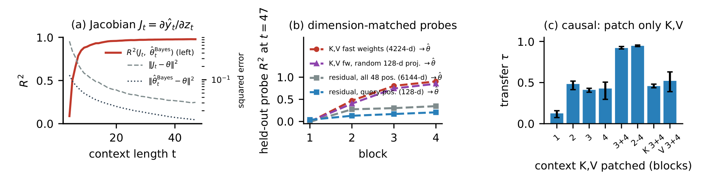

# 2026-11-07 Embodied AI & World Models Daily

> 主窗口为北京时间 11 月 7 日。补充窗口为 11 月 5–6 日。本期收录一项全身跟踪训练实现、一项世界模型多视角工具更新，以及一篇上下文动力学研究。来源检查存在缺口，详见文末。

## 🔥 今日必读

### XMimic 将全身跟踪训练移到 JAX/XLA

**类型** 开源工程  
**时间** 北京时间 11 月 7 日 08:46:17，首个可追溯仓库提交  
**双评分均值** 81.5/100  
**关键词** 全身跟踪 · JAX · 世界模型

XMimic 保留 BlinkMimic 的学习算法和基准超参数，用 JAX 组织 MuJoCo Warp 仿真、回放缓冲、世界模型、策略和 critic。训练迭代可整段编译，多卡方案让采集、模型学习、策略更新和失败动作筛查并行。项目同时提供训练实现和评估记录。[仓库](https://github.com/nico-bohlinger/xmimic) · [首个提交](https://github.com/nico-bohlinger/xmimic/commit/571715f02c51654dca07b5dfa6651d0e586ca93e)。

在 40 段 LAFAN1 动作的 G1 仿真测试中，作者用连续三次检查点达到归一化回报 0.82 且无失败片段作为达标条件。单张 H100 NVL 从 BlinkMimic 的 3.19 分钟降到 2.48 分钟。四卡 XMimic 达到 0.91 分钟，总 GPU 用量为 3.6 GPU·分钟，对照为 3.2。计时扣除一次性编译，末端回报相近。评估新实现时，应分别对齐卡数、编译计时和失败片段标准。[实验协议和日志](https://github.com/nico-bohlinger/xmimic#results)。

## 📄 论文雷达

### SUSS 追踪 Transformer 如何从交互历史适应动力学

**来源** Anuar Zhambakin，作者公开稿与研究归档  
**时间** 北京时间 11 月 7 日 17:47:42 的可追溯 PDF 版本  
**双评分均值** 79/100  
**关键词** 上下文学习 · 系统辨识 · 自适应控制

在线性系统中，原先预注册的残差参数假设被拒绝，最佳线性探针的 $R^2$ 只有 0.19。探索性干预中，置换末两层的上下文键值转移约 0.91–0.94 的预测行为。仿真控制器学会主动探索，但失败率为 10%，对照的带衰减激励控制为 1.4%。结果限定于论文所用的小型模型、低维动力学和仿真协议。[固定版本 PDF](https://raw.githubusercontent.com/nonberw/suss/61b2aac11534c1bf14da4344f1227d6589ceb88b/paper/main.pdf) · [研究归档 DOI](https://doi.org/10.5281/zenodo.24031898)。

[全文精读](../paper-reading/news/2026-11-07/suss/suss.md)详解贝叶斯预测基准、键值干预、接触预测对照和闭环尾部风险。

## 🛠 工程与开源

### Pelican-Sim 1.0 新增 RoboDojo 多视角微调与推理

**时间** 北京时间 11 月 7 日 13:00:01，多视角实现提交  
**双评分均值** 77/100

本次更新把头部和双腕相机放在同一画布，按块自回归生成到整段轨迹结束，并提供多视角推理入口。此前公开的动作条件世界模型以统一动作向量和相机对齐的骨架视频作为输入。这次收录的增量是多视角工具链，论文和既有检查点合并在同一事件下。公开材料可供查看，实际生成质量与复现成本仍需运行验证。[实现提交](https://github.com/ZouShilong1024/Pelican-Sim1.0/commit/e6eee3f23a1dc39f1db8c44d00b34a1085682021) · [官方仓库](https://github.com/ZouShilong1024/Pelican-Sim1.0)。

MuJoCo 4.0.0 与 LeRobot 0.7.0 的发布时刻均落在北京时间 11 月 6 日，已归入上一期。[MuJoCo 发布](https://github.com/google-deepmind/mujoco/releases/tag/4.0.0) · [LeRobot 发布](https://github.com/huggingface/lerobot/releases/tag/v0.7.0)。

## 💬 社区信号

HN 的目标日结果主要是商用机器人报道与旧论文转帖，未发现可独立核实的复现或方法争论。Reddit 返回 403，X、Bluesky 与中文社区覆盖有限。[HN Robotics 检索](https://hn.algolia.com/?dateRange=all&page=0&prefix=false&query=robotics&sort=byDate&type=story)。

## 🔎 补充窗口筛选记录

补充窗口内已查验的 96 个 arXiv 候选均在上期检索范围内，本次检查未发现新增版本改变以下事件的证据。

| 条目 | 首次提交，北京时间 | 处理 |
|---|---|---|
| [arXiv:2611.06908v1](https://arxiv.org/abs/2611.06908) | 2026-11-05 02:55:33 | HALO 已在 11 月 5 日入选并精读 |
| [arXiv:2611.06905v1](https://arxiv.org/abs/2611.06905) | 2026-11-05 02:52:28 | 多任务策略后训练已在 11 月 5 日入选并精读 |
| [arXiv:2611.08338v1](https://arxiv.org/abs/2611.08338) | 2026-11-06 01:24:36 | GPWM 已在 11 月 6 日入选并精读 |
| [arXiv:2611.08372v1](https://arxiv.org/abs/2611.08372) | 2026-11-06 01:50:35 | MOMASPLAT 已在 11 月 6 日入选并精读 |
| [arXiv:2611.08413v1](https://arxiv.org/abs/2611.08413) | 2026-11-06 02:17:29 | T3R 已在上一期评估，当前没有可核实新增实验或代码 |
| [arXiv:2611.08364v1](https://arxiv.org/abs/2611.08364) | 2026-11-06 01:42:31 | SHORE 已在上一期评估，当前没有可核实新版本 |
| [arXiv:2611.08275v1](https://arxiv.org/abs/2611.08275) | 2026-11-06 00:44:24 | 形状教师已在上一期评估，当前没有可核实新版本 |

## 📊 今日技术趋势

XMimic 把世界模型训练的瓶颈落到编译与并行，Pelican-Sim 扩展了策略数据里的相机视角。SUSS 显示，小模型能够利用上下文调整预测并主动激励系统，但面对开环不稳定对象，控制代价的尾部仍显著恶化。

## 来源、评分与精读状态

评分维度依次是技术份量、新颖性、证据、相关性、社区。研究论文权重为 4/3/2/1/0，开源项目为 2/2/2/3/1，T1 入选线 62。论文、实现和相关材料按同一事件归并。以下记录本期入选条目的两轮分数。

| 事件 | 第一轮五维 | 第二轮五维 | 均值 |
|---|---|---|---:|
| XMimic | 8/7/9/10/4 | 8/8/8/10/3 | 81.5 |
| SUSS | 8/8/8/9/1 | 7/8/8/9/1 | 79 |
| Pelican-Sim 多视角更新 | 8/7/8/10/2 | 8/7/7/10/2 | 77 |

已直接检查 [cs.RO](https://arxiv.org/list/cs.RO/recent)、[cs.AI](https://arxiv.org/list/cs.AI/recent)、[cs.LG](https://arxiv.org/list/cs.LG/recent)、[cs.CV](https://arxiv.org/list/cs.CV/recent) 的 recent 和月列表，并补看 [cs.RO new](https://arxiv.org/list/cs.RO/new)。摘要与提交历史共核对 409 项，其中目标日首次提交 0 项、补充窗口 96 项、窗口外 313 项。当前所见官方列表最晚公告为 11 月 6 日，周末尚未公告的投稿仍可能缺失。

已扫描 GEAR、PI、DeepMind、Skild、1X、Figure、RAI、TRI、Stanford REAL、BAIR、MIT、Unitree、Deep Robotics、RSS、ICRA，以及仿真器发布、GitHub 与 Hugging Face 入口。**覆盖缺口**包括 CoRL 连接超时、CMU Robotics Institute TLS 校验失败、上海 AI 实验室入口 404、IROS 入口 401，以及动态机构内容、期刊和社区的有限覆盖。CMU 校级新闻可访问。机构和开源主页的覆盖限于可公开取回的内容，未完整检查旧编号所有修订。

精读完成 1 篇。SUSS 的全文、代表图、Grounding、笔记检查、质量与可读性审查均通过，正式文件 SHA-256 与检查记录一致。[精读索引](../paper-reading/news/2026-11-07/README.md)。
