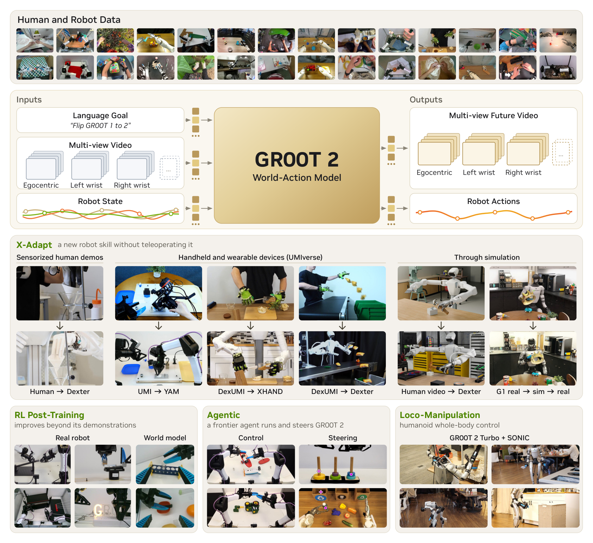
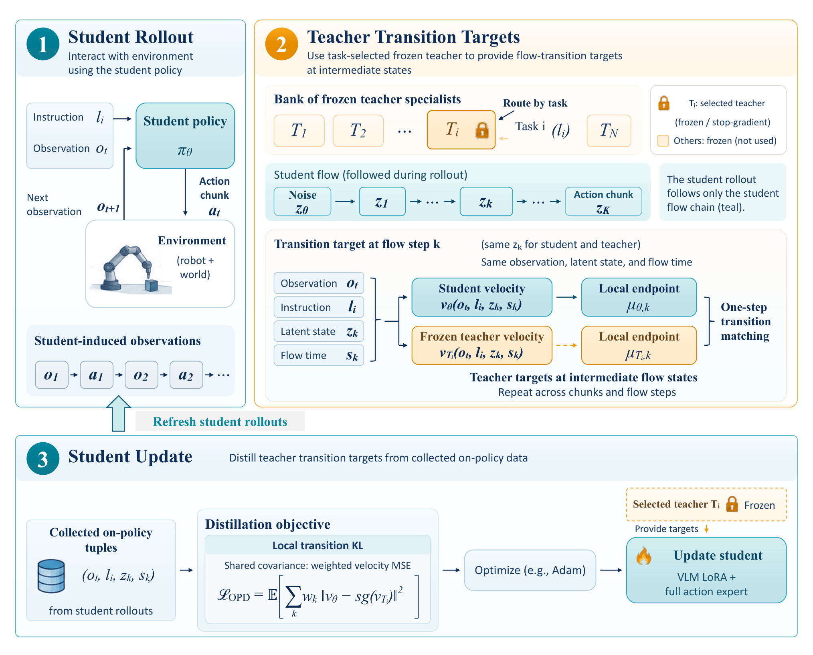
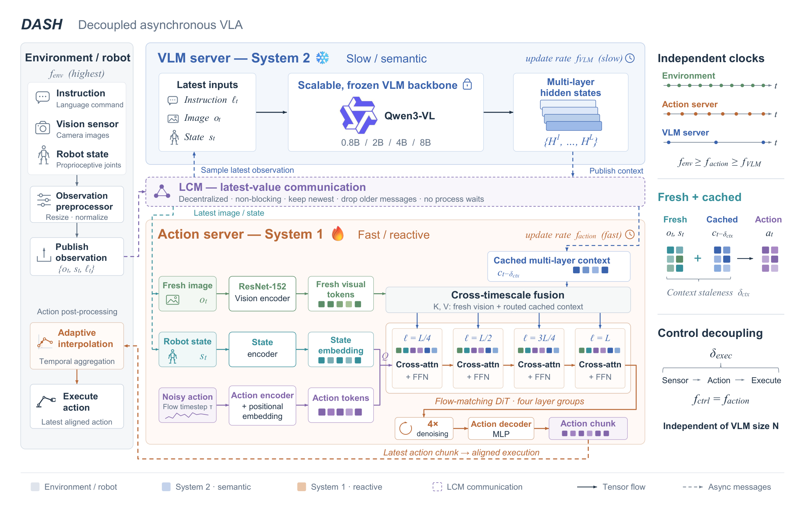
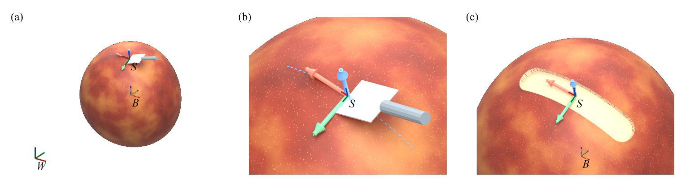
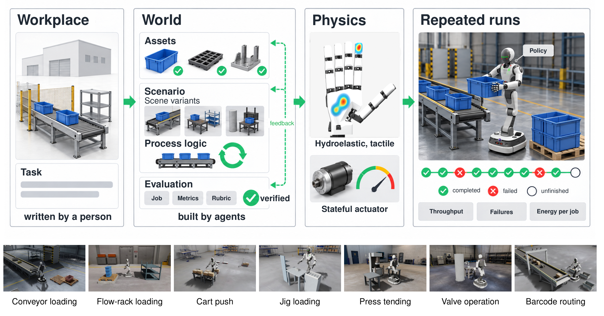
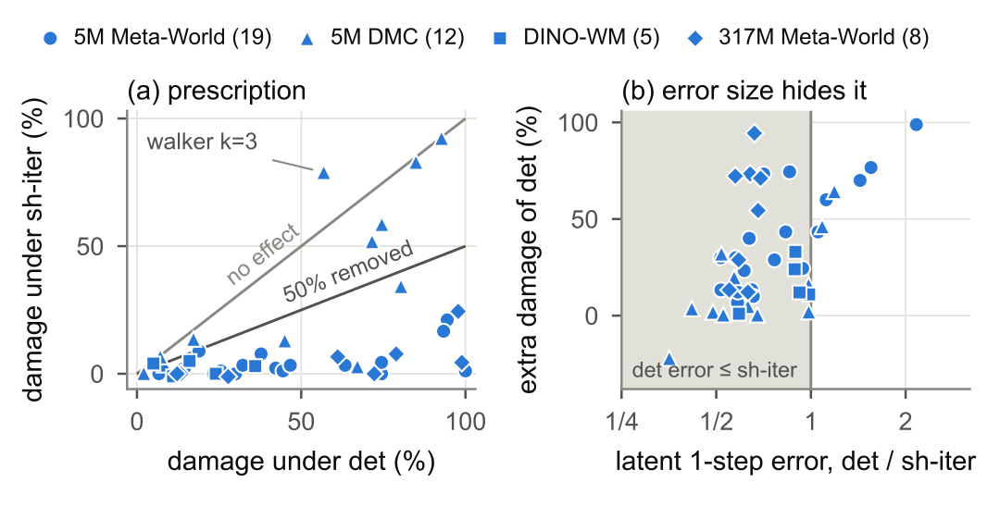

# 2026-11-09 Embodied AI & World Models Daily

> 覆盖北京时间 11 月 9 日。arXiv 归期按实际提交时间，机构公告按可核实的公开时间。来源覆盖缺口见文末。

## 🔥 今日必读

### 1. 【世界动作模型】GR00T 2 联合生成未来视频和机器人动作

**来源与时间**　NVIDIA CoRL 公告，北京时间 22:00:01。  
**类型与评分**　技术报告，93/100。  
**核心贡献**　将语言、多视角视频和本体状态送入共享扩散 Transformer，同时预测未来视频和动作。视频与动作共同建模，使来自不同本体的视觉动力学可以服务于策略学习。

- Dexter-50 中，目标机器人每任务使用 0、1、5 条示范时，作者报告平均成功率 40%、71%、95%。这些技能已出现在其他本体或人类数据中，少样本配置逐任务适配。
- 标准版三视角动作块在 RTX 5090 的预测中位延迟为 153 ms。Turbo 减少视频序列计算用于更紧预算。两类结果分别衡量适配和部署成本。
- 代码计划 12 月开放，当前报告数字来自作者测试，权重公开时间尚未核实。

[官方项目](https://research.nvidia.com/labs/gear/gr00t-2/) · [技术报告](https://research.nvidia.com/labs/gear/gr00t-2/assets/gr00t2_whitepaper.pdf) · [精读](../paper-reading/news/2026-11-09/gr00t2/gr00t2.md)。

### 2. 【多任务 VLA】VLA-MOPD 在学生走到的状态上蒸馏教师

**来源与时间**　[arXiv:2611.12286v1](https://arxiv.org/abs/2611.12286)，北京时间 20:12:37。  
**类型与评分**　论文，87.5/100。  
**核心贡献**　学生闭环采样，保存每个动作块的流匹配中间状态，路由到冻结的任务教师做局部转移匹配。部署时使用单一学生。

- LIBERO 四套任务从学生初始化 75.4% 到 98.9%，相同设置的终点蒸馏为 98.15%。RoboTwin 2.0 三项双臂任务从 73.0% 到 89.3%，路由教师为 94.0%。
- Piper 三个实机任务各 30 次评估，学生从 70.0% 到 90.0%，路由教师为 93.3%。一条示范的设置只用于 LIBERO 学生初始化，完整流程还要训练教师和采样。

[论文](https://arxiv.org/pdf/2611.12286) · [精读](../paper-reading/news/2026-11-09/vla-mopd/vla-mopd.md)。

### 3. 【异步控制】DASH 将大骨干移出动作等待链路

**来源与时间**　[arXiv:2611.11854v1](https://arxiv.org/abs/2611.11854)，北京时间 12:23:14。  
**类型与评分**　论文，88/100。  
**核心贡献**　慢 VLM 发语义缓存，快动作头结合最新图像和本体状态。训练模拟两路观测错位，执行按实测时间插值对齐动作块。

- 带推理时间的 RoboTwin 评估中，0.8B 到 8B 的快路径均为 50 ms、20 Hz。4B 完整方案成功率 69.5%，同步 63.6%，仅切换为异步但不做错位训练为 62.3%。
- 准静态抓放实机为 23/24 对 16/24。实机对照同时改变调度和聚合器，不能从该对照单独归因。

[论文](https://arxiv.org/pdf/2611.11854) · [精读](../paper-reading/news/2026-11-09/dash/dash.md)。

### 4. 【动作坐标】把表面坐标的预测收益落实到动作选择

**来源与时间**　[arXiv:2611.11869v1](https://arxiv.org/abs/2611.11869)，北京时间 12:45:09。  
**类型与评分**　论文，84.5/100。  
**核心贡献**　在同一几何削皮交互上比较世界、物体和表面坐标，把单步预测、候选排序和动作遗憾放在同一套对照中。

- 干净参考系下，三种坐标的两两动作排序准确率分别为 0.484、0.681、0.729。表面坐标的归一化遗憾为 0.226，世界和物体坐标分别为 0.653、0.681。
- 在单独的定位噪声对照中，表面原点逐轴 1 mm 噪声使表面模型 NRMSE 从 0.5678 升到 1.0324。厚度等决定结果的局部状态仍需保留。结果限于受控几何仿真。

[论文](https://arxiv.org/pdf/2611.11869) · [精读](../paper-reading/news/2026-11-09/action-rep/action-rep.md)。

## 📡 论文雷达

### HolidayFactory 1.0 · 连续工业作业评测

[arXiv:2611.11789v1](https://arxiv.org/abs/2611.11789)，10:46:18 提交，85.5/100。将工位规格、生成场景、物理和作业评分分开。24/7-BENCH 覆盖七类工业作业，保留跨作业状态并计量吞吐、时延和能耗。报告演示了脚本轨迹评分，持续运行中的多策略比较尚未完成。[精读](../paper-reading/news/2026-11-09/holidayfactory/holidayfactory.md)。

### Dithered Low-Bit World Models · 量化误差会被规划器主动利用

[arXiv:2611.11780v1](https://arxiv.org/abs/2611.11780)，10:37:20 提交，85.5/100。每轮规划用同一组随机抖动比较候选，下一轮重抽，以减少跨轮累积的固定舍入偏差。TD-MPC2 的 19 个受影响任务与位宽组合均挽回至少一半损失。W8A4 全规划步较 FP32 快 1.3–1.5 倍，未超越预转换权重的 BF16。[精读](../paper-reading/news/2026-11-09/dither/dither.md)。

| 其他方向 | 结果与证据 |
| --- | --- |
| [SPARK](https://arxiv.org/abs/2611.12102) | 将时间信息与原视觉骨干的补丁语义同时保留，作者报告仿真及真实操作上的收益。CoRL 接收信息与论文版本归并。 |
| [Flip Anything](https://arxiv.org/abs/2611.11941) | 代码代理在物理仿真中分阶段学习翻转策略，作者报告仿真指标从 24.7% 到 95.0%，另展示实机。该数字不代表实机成功率。 |
| [FlowEval](https://arxiv.org/abs/2611.11650) | 用成功示范上的流匹配分歧作为训练前诊断，考察四类模型，在 17 个 RoboCasa365 任务上分析适配数据和成功率的关联。 |
| [WanderBench](https://arxiv.org/abs/2611.12557) | 用 745 段源视频测可控重访及动态一致性，作者比较八个模型，长视频里相机控制和源动态更易丢失。 |
| [K-PWM](https://arxiv.org/abs/2611.11521) | 双线性潜状态、非线性观测解码与扩展卡尔曼滤波组合，在部分可观测 MuJoCo 条件下评估预测与控制。 |
| [Be My Eye](https://arxiv.org/abs/2611.12295) | 将伙伴机器人观测压缩成任务条件上下文，再接入 VLA 双向交换。报告含受限通信对照与三项实机任务。 |

## 🛠️ 工程与开源

- **Genesis v1.4.6**，北京时间 05:56:48，79/100。加入隐式 FEM 可微仿真与中点积分可微支持，扩展 PD 目标和关节力梯度，修正接触与若干发散问题。求解器和内存收益取决于批量、后端与设置。版本还移除了 Python 3.10、3.11 支持。[官方版本日志](https://github.com/Genesis-Embodied-AI/genesis-world/releases/tag/v1.4.6)。
- **CoRL 工业评测工具**，82.5/100。NVIDIA 同一公告介绍 Isaac Lab-Arena 0.4 开发预览及两项工业基准。DexBench 在四类场景内给出 15 项任务和物体、空间、物理变化，VABAR 在六项工业任务内设置标准扰动和难度。Isaac Lab 3.0 的大会介绍与仓库版本历史分开，未将其重复记作当天代码首发。[官方公告](https://blogs.nvidia.com/blog/robotics-simulation-advancements-corl/) · [DexBench](https://dexbench.ai/)。

## 💬 社区与会议

CoRL 2026 当地 11 月 9 日开幕。大会和作者页面用于查找原始工作，既有论文的二次介绍不重复计作新论文。FLEX 的 MIT 新闻对应 10 月已公开的技术工作。已查社区线索未另计独立复现。[CoRL 官方日程入口](https://2026.corl.org/) · [MIT 原文](https://news.mit.edu/2026/ai-assisted-learning-platform-helps-robots-reason-beyond-literal-commands-1109) · [FLEX 项目](https://mit-clear-lab.github.io/FLEX/)。

## 🔎 补充窗口筛选记录

北京时间 11 月 7 日至 8 日的候选单独核对，以下代表性记录未计入当天新增。

| 回溯论文 | 实际提交时间（北京时间） | 本次处理 |
| --- | --- | --- |
| [arXiv:2611.11085v1](https://arxiv.org/abs/2611.11085) | 2026-11-08 10:55:15 | ObjectWorld。以包括遮挡表面在内的全物体三维流表达对象动力学，报告汇集 1,210 小时数据。 作为晚索引补充。 |
| [arXiv:2611.10967v1](https://arxiv.org/abs/2611.10967) | 2026-11-08 05:09:55 | BAT-WAM。用连续潜空间连接动作和触觉码本，评估触觉缺失重建与灵巧操作。 作为晚索引补充。 |
| [arXiv:2611.11166v1](https://arxiv.org/abs/2611.11166) | 2026-11-08 14:14:36 | DexForesight。将训练期三维手部及环境预测蒸馏进策略，部署只用 RGB、状态及语言。11 项仿真任务从 49.4% 到 60.5%。 作为晚索引补充。 |
| [arXiv:2611.11123v1](https://arxiv.org/abs/2611.11123) | 2026-11-08 12:16:15 | HARP-Bench。区分主动人类的提示、协作、中断和共处，真机单个任务族的训练增益出现在协作条件。 作为晚索引补充。 |
| [arXiv:2611.10872v1](https://arxiv.org/abs/2611.10872) | 2026-11-08 01:48:28 | DreamVLA。由生成的人体动作引导仿真强化学习，失败后在学生访问状态重启专家收集纠正轨迹。 作为晚索引补充。 |

- SUSS v0.2.0 在 11 月 8 日 02:44:17 已公开并报道，未核实本窗口内新增结果。[前一期日报](../news/2026-11-08.md)。
- LingBot-Touch 论文提交时间为北京时间 11 月 10 日 02:12，正式发布亦在 11 月 10 日。仓库创建时间不足以证明 11 月 9 日已公开。[论文](https://arxiv.org/abs/2611.12806) · [官方仓库](https://github.com/Robbyant/lingbot-touch)。

## 📊 今日技术趋势

几篇工作把误差放回动作闭环衡量。DASH 显示离线模型能力和执行时序必须联合评估，低比特世界模型则表明一步预测误差不足以发现规划器利用固定偏差的问题。HolidayFactory 把同样的原则扩展到连续作业，用吞吐量与恢复后的状态补足单回合成功率。

## 来源覆盖与评分

- 查阅 [cs.RO](https://arxiv.org/list/cs.RO/recent)、[cs.AI](https://arxiv.org/list/cs.AI/recent)、[cs.LG](https://arxiv.org/list/cs.LG/recent)、[cs.CV](https://arxiv.org/list/cs.CV/recent) 的近期及 11 月官方列表。662 个去重预筛候选均核对了摘要与版本时间，主窗口 88 条，补充窗口 88 条，其余 486 条在窗口外。该计数按 v1 时间归档，不能覆盖尚未出现在公告列表的工作。
- 交叉检查 CoRL 等会议、机构站点、GitHub、Hugging Face 和公开技术讨论。上海 AI 实验室新闻端点和 CMU 机器人研究所批量入口未完整核验，后续公告及未索引社区内容也有覆盖缺口。[上海 AI 实验室](https://www.shlab.org.cn/) · [CMU Robotics Institute](https://www.ri.cmu.edu/news/)。
- 双评分维度依次为技术份量、增量、证据、相关性、社区。论文权重 4/3/2/1/0，工程 3/1/2/3/1，开源 2/2/2/3/1。先验时间或同一事件已覆盖的线索不重计。

| 候选 | 第一轮 | 第二轮 | 平均分 |
| --- | --- | --- | ---: |
| GR00T 2 | 10/9/8/10/8 | 9/10/9/9/8 | 93 |
| VLA-MOPD | 9/8/9/9/1 | 9/9/8/9/1 | 87.5 |
| DASH | 9/8/9/10/1 | 9/9/8/9/1 | 88 |
| 动作坐标 | 8/9/8/9/1 | 9/8/8/9/1 | 84.5 |
| HolidayFactory | 9/8/8/9/2 | 9/9/7/9/2 | 85.5 |
| Dithered Low-Bit World Models | 9/8/8/9/1 | 8/9/9/9/1 | 85.5 |
| SPARK | 8/8/8/9/2 | 8/8/7/9/2 | 80 |
| Flip Anything | 8/8/7/9/2 | 8/8/8/8/2 | 79.5 |
| FlowEval | 8/8/8/9/1 | 8/7/9/9/1 | 80.5 |
| WanderBench | 8/8/8/8/1 | 8/8/7/9/1 | 79.5 |
| K-PWM | 8/8/7/9/1 | 8/7/8/9/1 | 78.5 |
| Be My Eye | 8/8/8/9/1 | 8/8/7/9/1 | 80 |
| Genesis v1.4.6 | 8/7/9/9/4 | 8/8/8/9/4 | 79 |
| CoRL 工业评测工具 | 8/8/9/10/3 | 9/8/8/9/4 | 82.5 |
