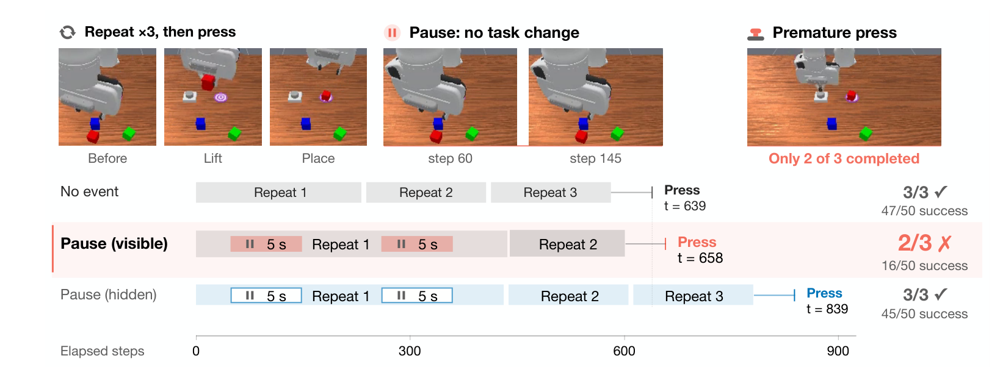
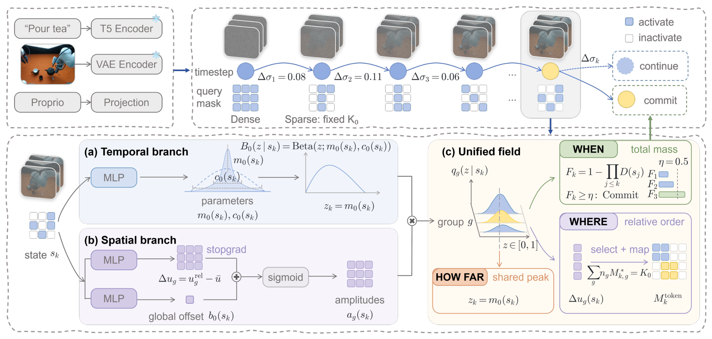
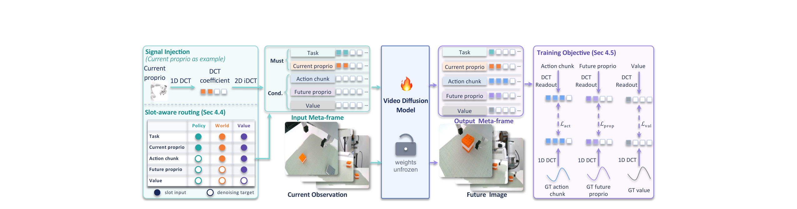
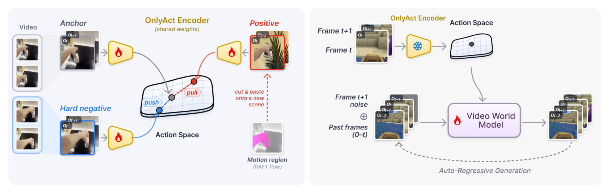
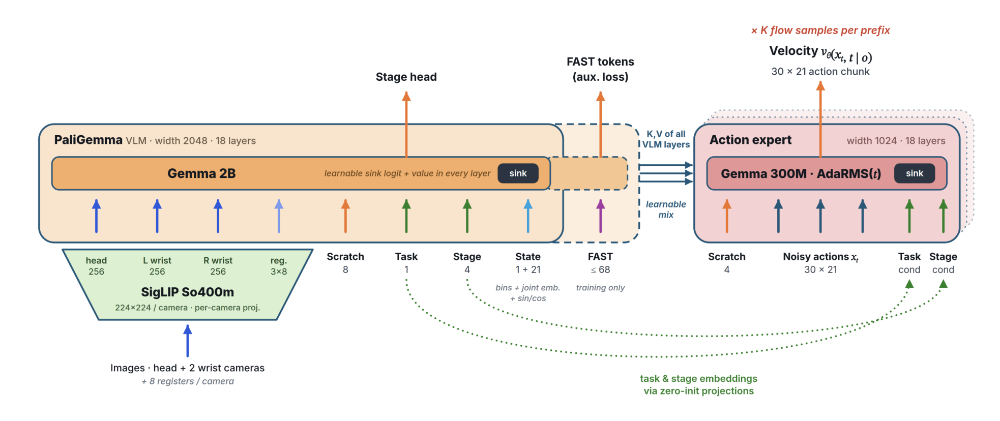

# 2026-11-11 Embodied AI & World Models Daily

> 面向具身智能与 Robotics 研究员、工程师。主窗口为北京时间 11 月 11 日 00:00–23:59，补充窗口为 11 月 9–10 日。完成 5 篇全文精读，所有时间均已换算为北京时间。arXiv 以实际提交时间归期；来源覆盖仍有缺口，详见文末。

## 🔥 今日必读

### 1. 【VLA 记忆】机器人可能把等待误记成任务进展

**来源：** [arXiv:2611.14488v1](https://arxiv.org/abs/2611.14488)  
**类型：** Paper · research_paper  
**发布时间：** 2026-11-11 02:47:57（首次提交）  
**评分：** 89.5/100  
**关键词：** Memory VLA · Robustness · Event Memory

**一句话：** 在 RoboMME 计数任务中插入不改变任务状态的暂停或腕部小动作，可以暴露按时间采样的记忆把经过时间当作完成进度的捷径。

**技术要点：**

- PickXtimes 的成功次数从 47/50 降至 16/50；同样暂停、但不把暂停帧写入记忆时为 45/50。这个控制实验将失效定位到记忆输入。
- 仅缩放同一组图像的时间戳，也会造成提前停止或额外重复。移除显式时间编码仍不能消除时间采样占用记忆槽的影响。
- 在测试设置中，改用事件索引、折叠重复返回状态，无需重训便能恢复至少一半损失。暂停增强训练没有解决问题，还损害计数能力。

**为什么值得关注：** 这是适合加入 VLA 回归测试的任务状态不变扰动。证据主要来自仿真计数任务；事件识别的可靠性与复杂真实操作中的收益仍需验证。

**资源：** [论文](https://arxiv.org/abs/2611.14488) · [全文精读](../paper-reading/news/2026-11-11/temporal-shortcuts/temporal-shortcuts.md)。本期未确认可独立核验的作者代码或权重下载。

### 2. 【世界动作模型】Elastic-WAM 按状态分配想象计算

**来源：** [arXiv:2611.14257v1](https://arxiv.org/abs/2611.14257)  
**类型：** Paper · research_paper  
**发布时间：** 2026-11-11 00:04:16（首次提交）  
**评分：** 88.5/100  
**关键词：** WAM · Adaptive Inference · Robot Control

**一句话：** 学习时间更新密度、空间 token 重要性和总计算需求，让世界动作模型在不同状态下选择未来视频的更新位置与迭代步数。

**技术要点：**

- 三阶段训练计算控制器，时间密度由 Beta 基函数组合表示。冻结的 WAM 先做一次稠密联合更新，再对选中的未来 token 稀疏计算查询，仍保留完整逻辑键值与未更新位置的缓存状态。
- H800 上的 RoboCasa-GR1 测试相对 Joint-WAM 减少 32.2% 延迟。LIBERO-Plus 中，完整自适应方案为 73.71%，仅学习空间选择为 71.71%；扩大更新集合并不保证更高成功率。
- 双 xArm7 泡茶任务的标称条件完整成功率为 50%，Joint-WAM 为 30%；物体分布外条件两者均为 30%。实机证据集中于一项四阶段任务。

**为什么值得关注：** 为部署 WAM 提供可学习的计算分配方案。延迟收益依赖稀疏查询实现与硬件，实机泛化还需要更多任务和样本。

**资源：** [论文](https://arxiv.org/abs/2611.14257) · [全文精读](../paper-reading/news/2026-11-11/elastic-wam/elastic-wam.md)。本期未确认可独立核验的作者代码或权重下载。

### 3. 【多模态接口】MetaWAM 将机器人信号编码成固定大小的 meta-frame

**来源：** [arXiv:2611.14365v1](https://arxiv.org/abs/2611.14365)  
**类型：** Paper · research_paper  
**发布时间：** 2026-11-11 01:21:37（首次提交）  
**评分：** 87.5/100  
**关键词：** World Action Model · Latent Interface · DCT

**一句话：** 把动作、状态和价值等归一化信号放入分离的频率槽，经二维逆 DCT 形成图像潜变量接口，供视频扩散骨干统一读取与预测。

**技术要点：**

- 输入、输出 meta-frame 加六帧视频构成八帧序列，替代逐模态分配的十一帧。输出经二维 DCT 读取指定槽位；任务由输入输出槽配置决定。
- RoboCasa 成功率为 68.9%，逐模态空间编码对照为 67.1%；推理时间从 0.479 秒降至 0.291 秒。其他八帧空间打包对照也达到 0.291 秒，因此速度提升应主要归因于序列缩短，编码的贡献需结合任务成功率判断。
- Franka 三项任务各 20 次试验，平均分布内成功率为 85.0%，分布外为 68.3%。冻结视频骨干的信号重建探针与下游控制训练属于不同证据。

**为什么值得关注：** 统一接口有利于复用视频模型与组合任务，但槽位数量、信号归一化和新模态的动态范围仍是接口设计的一部分。

**资源：** [论文](https://arxiv.org/abs/2611.14365) · [官方代码](https://github.com/showlab/MetaWAM) · [全文精读](../paper-reading/news/2026-11-11/meta-frames/meta-frames.md)。本期未完整验证全部权重下载。

### 4. 【开源模型】Praxis-1 发布机器人权重与训练代码

**来源：** [Runway 官方发布](https://runway.com/news/company-news/praxis-1-is-now-available)  
**类型：** Open Source · open_source  
**发布时间：** 2026-11-11 23:00（官方页面时间戳 15:00 UTC）  
**评分：** 82/100  
**关键词：** Video Pretraining · VLA · Open Weights

**一句话：** 九月已介绍的 Praxis-1 本次新增公开权重、推理和微调代码，作为开源发布事件收录，与原模型介绍归并。

**技术要点：**

- 技术页描述约 26.9B 的 MoE 视频骨干，每 token 激活约 2.8B 参数，动作分支约 314M。视频分块因果计算，动作通过单向注意力读取视频特征。
- 每次生成 24 行、15Hz 的动作块，对应约 1.6 秒。仓库提供 DROID 单臂、YAM 双臂配置和 NVFP4 变体，SO-101 仍列为后续支持。
- 官方报告 RoboLab-120 上 1,200 回合的 46.2% 成功率。本期未独立复核该排行榜、运行检查点或验证真实机器人迁移。

**为什么值得关注：** 工程师可以检查数据接口、显存需求及后训练流程。已核对仓库 README 和 Apache-2.0 许可证；具体权重与其依赖仍应逐项读取许可。

**资源：** [技术说明](https://runway.com/research/praxis-1-video-pretraining-to-robot-control) · [官方代码](https://github.com/runwayml/praxis-1-oss) · [权重集合](https://huggingface.co/collections/runwayml/praxis-1)。本条为开源事件，未虚列论文精读。

## 📄 论文雷达

### 【动作表征】OnlyAct

**来源与时间：** [arXiv:2611.14420v1](https://arxiv.org/abs/2611.14420)，11 月 11 日 01:59:19。  
**关键词：** Latent Action · World Model · Representation  
**评分：** 85/100。  
**核心贡献：** 在 V-JEPA2 上用运动区域换背景构造正样本、同视频不重叠片段构造困难负样本，学习较少携带场景信息的动作表征，再冻结编码器驱动生成模型。

13 项线性动作探针中 11 项领先，平均 R² 为 0.490，冻结骨干为 0.347、最佳潜动作对照为 0.211。生成端使用固定训练协方差白化，并在附录比较白化控制。场景泄漏探针的解码 LPIPS 只能解释为该协议下更难重建背景；论文没有证明真实机器人控制成功率提高。[项目页](https://runjiali-rl.github.io/onlyact/) · [全文精读](../paper-reading/news/2026-11-11/onlyact/onlyact.md)。代码和模型仍为计划开放。

### 【长程操作】One Policy for 100 Household Tasks

**来源与时间：** [arXiv:2611.14432v1](https://arxiv.org/abs/2611.14432)，11 月 11 日 02:06:16。  
**关键词：** BEHAVIOR · π0.5 · Long Horizon  
**评分：** 80.5/100。  
**核心贡献：** 一套 π0.5 检查点覆盖 100 项家庭任务，结合语义阶段、三相机输入、动作流多样本选择和前缀复用，并比较另一条实践记忆路线。

统一策略 100 任务的部分目标完成指标 Q 为 0.392；共同 50 任务上，前一年度方案的 0.260 提高到 0.371。Astra 的 14 任务子集 Q=0.639 与最终部分接入后的公开提交 Q=0.446 属于不同设置；后者完整成功率为 27.3%。全部为 OmniGibson 仿真，系统中的多项改动没有逐一隔离消融。[全文精读](../paper-reading/news/2026-11-11/behavior100/behavior100.md)。本期未确认作者代码或权重下载。

### 【可变形操作】Learning Physical Context for Deformable Linear Object Manipulation

**来源与时间：** [arXiv:2611.14274v1](https://arxiv.org/abs/2611.14274)，11 月 11 日 00:17:48。  
**关键词：** DLO · Dynamics · Physical Context  
**评分：** 78.5/100。  
**核心贡献：** 摘要报告几何特征和历史信息使 470 对仿真比较中的执行误差降低 9.9%；额外物理参数估计虽有利于预测，尚未表现出可检测的控制收益。另有零样本硬件迁移实验。本期仅核验摘要与时间，未完成全文精读，未将预测指标等同于控制改善。

其他通过相关性预筛的方向包括 [SIGMO 交互规划](https://arxiv.org/abs/2611.14414)、[AUV 的 GP-MPCC](https://arxiv.org/abs/2611.14373) 与 [TanCRAFT 装配反馈](https://arxiv.org/abs/2611.14470)。[ForeseeDrive](https://arxiv.org/abs/2611.14286) 偏自动驾驶，[UGG](https://arxiv.org/abs/2611.14440) 偏四维生成补全，暂不扩展为重点条目。[形式化 POSG 生成](https://arxiv.org/abs/2611.14419) 缺少足够直接的机器人方法证据，未通过本期相关性预筛。

## 🛠 工程与开源

### NTT：用物理控制适配器约束视频预测

[官方技术发布](https://group.ntt/en/newsrelease/2026/11/11/261111b.html) 的时间戳对应 11 月 11 日 14:00:30，engineering_tech 双评分平均 78.5/100。方法把物体位置、速度、质量估计与物理 rollout 接入视频模型，用于比较 VLA 或规划器给出的候选动作。在小型机器人装载实验中，公司报告成功率由 73.1% 提高到 92.3%；已取得的正文未提供明确试验次数。本期未发现可确认的公开实现，机场应用仍是计划验证。

Praxis-1 的代码与权重已合并在必读条目，避免重复计数。另检查了 MuJoCo、Genesis、Isaac Lab、LeRobot 的发布入口及模型目录；版本活动本身不作为新方法证据。GENTO 21 自由度手的新闻稿对应本窗口，但主要提供硬件规格，缺少可核验的学习或控制方法实验，本期不列重点。[官方新闻稿](https://www.prnewswire.com/news-releases/tianji-intelligence-debuts-21-dof-dexterous-hand-at-corl-2026-as-nvidia-demos-gr00t-2-on-custom-marvin-pro-302934702.html)。

## 💬 社区信号

已通过 GitHub 机器人、VLA、世界模型关键词，Hugging Face 模型目录和 Hacker News 检索发现线索，再回溯一手页面。本期未核实值得单列的独立复现或争议结论，不将发布方成绩当作社区共识。[CoRL 官方入口](https://2026.corl.org/) 用于核对会场线索，同一论文和仓库归并一个事件。

## 🔎 补充窗口筛选记录

| 线索 | 实际日期（北京时间） | 处理 |
| --- | --- | --- |
| LingBot-Touch | 11 月 10 日 02:12:00 | 已于上期收录与精读；[论文](https://arxiv.org/abs/2611.12806) |
| RoboScript | 11 月 10 日 02:59:45 | 已于上期收录与精读；[论文](https://arxiv.org/abs/2611.12885) |
| SWAM | 11 月 10 日 02:55:04 | 已于上期收录与精读；[论文](https://arxiv.org/abs/2611.12870) |
| DASH | 11 月 9 日 12:23:14 | 已在对应日期精读，排除重复；[论文](https://arxiv.org/abs/2611.11854) |
| GR00T 2 | 11 月 9 日 22:00:01 | 发布与会场报道归并；[对应日报](../news/2026-11-09.md) |
| PAN2 | 官方美国日期 11 月 10 日；另一机构页面标 11 月 11 日 | 未取得可靠时区及小时，无法确定北京时间归期；保留待核实，不计作本日已确认发布 |

## 📊 今日技术趋势

计算预算、信号接口和记忆索引开始成为世界动作模型的重要设计变量。Elastic-WAM 与 MetaWAM 分别优化推理更新和输入表示；记忆捷径实验则提醒，更多历史帧可能引入新的时间偏差。评估时应同时比较计算量、任务状态和真实控制收益，保留零收益或失败条件。

## 来源覆盖与双评分

- 已直接抓取官方 [cs.RO](https://arxiv.org/list/cs.RO/recent)、[cs.AI](https://arxiv.org/list/cs.AI/recent)、[cs.LG](https://arxiv.org/list/cs.LG/recent)、[cs.CV](https://arxiv.org/list/cs.CV/recent) 的近期和 11 月列表，对预筛后的 741 个去重候选逐条核对摘要页和版本时间。按 v1 划分：主窗口 12 条、补充窗口 168 条、窗口外 561 条。AI/LG 月列表只读取前 2,000 条，结合 recent 检查当前窗口，没有声称穷尽整个月份。
- **来源检查不完整：** 官方可见公告截至 11 月 11 日，已索引的本日新稿集中于凌晨。北京时间白天、晚间提交可能尚未进入公开公告，后续需补查。已核验的版本中未发现落在主窗口的 v2+ 更新。
- 检查范围还包括 GEAR、DeepMind、PI、Skild、1X、Figure、TRI、RAI、Stanford、Berkeley、CMU、MIT、上海 AI 实验室、机器人公司与会议入口。PI 的批量访问限流及 CMU 的 TLS 失败通过网页工具补查；机构首页可读取不代表所有子项目已穷尽。
- **PAN2 留有核验缺口：** [IFM 官方发布](https://ifm.ai/pan2/press-release/) 的日期与另一机构页面日期不能可靠换算成同一北京时间；直接正文访问受阻。[官方仓库](https://github.com/ifm-ai/PAN2) 的创建时间也不能充当模型发布时间。未把这条线索写成已核实当日发布。该缺口与 arXiv 公告延迟均不能解释成当天没有资讯。
- 三篇必读论文与雷达最高两篇均完成全文、图像视觉审查、grounding、笔记 lint、质量和可读性审查及正式保存。共 5 张正式图片、0 张占位图。[精读索引](../paper-reading/news/2026-11-11/README.md)。
- 评分向量依次为 significance / novelty / evidence / relevance / community，每项 0–10。research_paper 权重 4/3/2/1/0，open_source 为 2/2/2/3/1，engineering_tech 为 3/1/2/3/1。社区评分保持保守，不以机构名气代替独立关注证据。

| 候选 | 类型 | 第一轮 | 第二轮 | 平均分 |
| --- | --- | --- | --- | ---: |
| Temporal Shortcuts | research_paper | 9/9/9/10/1 | 9/8/9/10/1 | 89.5 |
| Elastic-WAM | research_paper | 9/8/9/10/1 | 9/9/8/10/1 | 88.5 |
| MetaWAM | research_paper | 9/8/9/10/1 | 8/9/9/10/1 | 87.5 |
| OnlyAct | research_paper | 8/9/8/9/1 | 8/9/9/9/1 | 85 |
| BEHAVIOR100 | research_paper | 8/7/9/9/1 | 8/8/8/9/1 | 80.5 |
| DLO 物理上下文 | research_paper | 8/8/7/9/1 | 8/7/8/9/1 | 78.5 |
| SIGMO | research_paper | 8/7/8/9/1 | 8/7/7/9/1 | 77 |
| AUV GP-MPCC | research_paper | 7/7/8/9/1 | 7/8/7/9/1 | 74.5 |
| TanCRAFT | research_paper | 7/7/7/8/1 | 7/8/7/8/1 | 72.5 |
| ForeseeDrive | research_paper | 8/7/7/6/1 | 8/7/8/6/1 | 74 |
| UGG | research_paper | 8/8/7/7/1 | 8/8/7/8/1 | 77.5 |
| Praxis-1 权重发布 | open_source | 9/8/8/10/1 | 9/9/8/10/1 | 82 |
| NTT 物理控制适配器 | engineering_tech | 8/8/7/10/3 | 8/7/7/10/3 | 78.5 |
