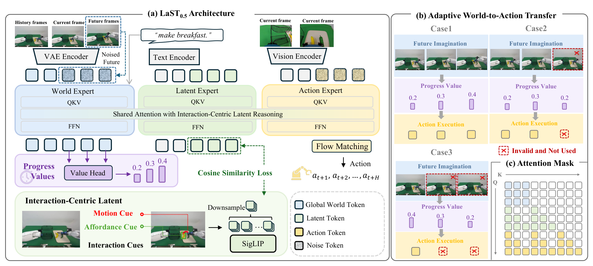
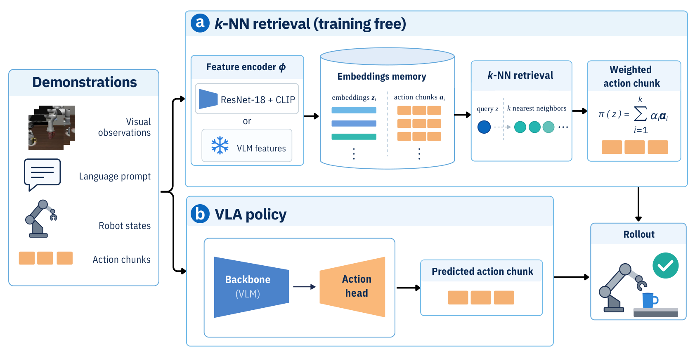
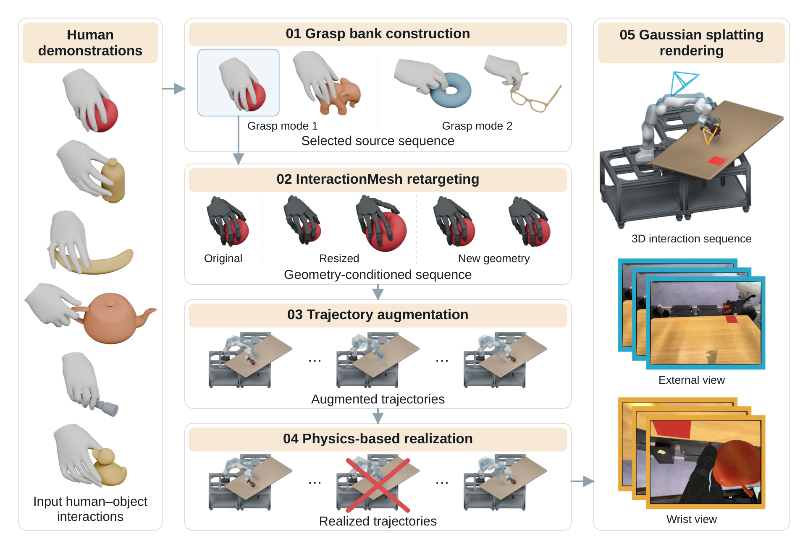
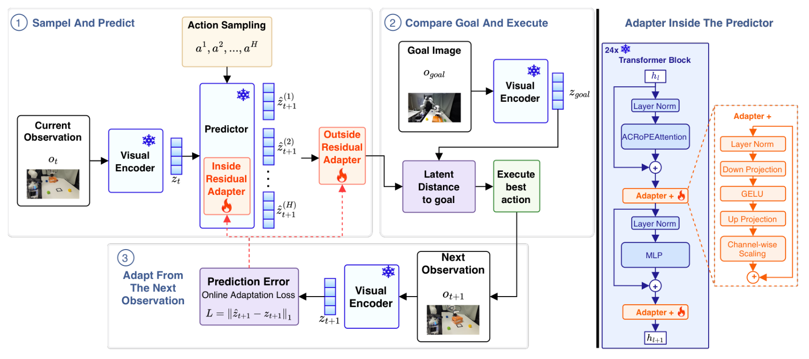

# 2026-11-12 Embodied AI & World Models Daily

> 面向具身智能与 Robotics 研究员、工程师。主窗口为北京时间 11 月 12 日，补充窗口为 11 月 10–11 日。本期完成 4 篇全文精读，重点补记此前未展开的补充窗口工作。**来源检查不完整：arXiv 可见公告仍截至 11 月 11 日，不能据此判断 12 日没有新论文。**

## 🔥 今日必读

### 1. 【世界动作模型·补记】LaST0.5 用交互潜表示连接视频与动作

**来源：** [arXiv:2611.14048v1](https://arxiv.org/abs/2611.14048)（cs.RO；北京大学、香港中文大学等）  
**类型：** Paper · research_paper  
**实际提交时间：** 2026-11-10 21:15:11，北京时间；补充窗口  
**评分：** 89.5/100  
**关键词：** WAM · Interaction Latent · Adaptive Execution

**核心贡献：** 在世界专家与动作专家之间加入交互潜专家，通过带末端轨迹和物体框的未来画面监督，学习紧凑的操作表示，再用预测进度调整动作执行长度。

- 十二帧未来默认分三段，潜查询并行生成；分段因果掩码维持视频、潜表示与动作的对应关系。训练时离线构造视觉交互提示，部署时无需真实未来画面。
- 进度头用示范归一化时间监督，预测进度下降便截断动作，必要时重采样未来。它是进度代理，尚不能解释为安全或物理正确性证书。
- LIBERO 报告训练期间最佳成功率 99.5%；十项 RLBench 为三轮平均 88.0 ± 3.0%，不使用自适应执行为 85.0 ± 2.0%。两套评价口径不同。
- 四项双臂实机各二十次，完整任务平均 63.8%，π0.5 为 52.5%。附录保留拉链卡住、胶带打滑、螺丝错位等失败。

**为什么值得关注：** 把监督放在机器人与目标的局部关系上，比直接复用全局视频特征更有针对性。需要同时验证交互标注成本、暂停时的进度估计和部署延迟。

**资源：** [论文](https://arxiv.org/abs/2611.14048) · [全文精读](../paper-reading/news/2026-11-12/last05/last05.md)。本期未确认可独立核验的作者代码或权重下载。

### 2. 【VLA 评测·补记】近邻动作检索可以恢复多少基准成绩？

**来源：** [arXiv:2611.13160v1](https://arxiv.org/abs/2611.13160)（cs.RO）  
**类型：** Paper · research_paper  
**实际提交时间：** 2026-11-10 03:44:58，北京时间；补充窗口  
**评分：** 88.5/100  
**关键词：** kNN · LIBERO · Generalization

**核心贡献：** 将示范编码后直接检索并组合后续动作块，以免额外策略训练的基线，分析公开 VLA 的表示与动作输出。

- 1,693 条示范形成约 137,000 条记忆；每条源轨迹最多提供一个近邻。多模态距离结合图像、状态、语言、时间与历史。
- 多模态近邻在 LIBERO 为 91.7%，固定 420 个 LIBERO-Plus 变体上为 82.4%；π0.5 分别为 97.7%、85.5%。近邻的下降幅度最小，绝对成绩仍有差距。
- 局部动作一致性 LAC 比较近邻与同任务普通匹配的动作误差，可诊断检索键，但不能可靠排序相近质量的表示。额外训练的 LAC 键达到 93.0%、81.7%，需与免训练版本区分。
- 微调后八个骨干中七个在 Plus 上改善检索，π0 是明显反例。动作相似性未证明 VLA 内部只做查表。

**为什么值得关注：** 密集示范与保留原解法的扰动可能使基准偏向检索。评测应加入近邻、数据覆盖和需要新轨迹的测试；不能将本结果外推为所有机器人问题都能用检索解决。

**资源：** [论文](https://arxiv.org/abs/2611.13160) · [作者代码](https://github.com/sereact/lerobot_knn) · [全文精读](../paper-reading/news/2026-11-12/vla-knn/vla-knn.md)。仓库元数据声明 Apache-2.0，本期未运行复现。

### 3. 【仿真基础设施·补记】MuJoCo 4.0.1 修复稀疏求解器回归

**来源：** [官方版本说明](https://github.com/google-deepmind/mujoco/releases/tag/4.0.1)  
**类型：** Engineering · engineering_tech  
**实际发布时间：** 2026-11-11 23:47:30，北京时间；补充窗口  
**评分：** 79.5/100  
**关键词：** Sparse Cholesky · Newton Solver · Windows

**核心贡献：** 修复 4.0.0 引入的稀疏 Cholesky 超节点合并错误。错误的 Hessian 分解可能导致收敛变慢、加速度错误或发散。

同版还修复圆柱边缘多接触问题，并让无法加载的插件以警告跳过。Windows 的 MuJoCo Studio Web Viewer 通过独立、自动安装的客户端 wheel 获得支持。对使用稀疏约束求解或 Windows 可视化的工程师值得检查；这些结论来自官方变更记录，本期未运行回归或性能实验。

## 📄 论文雷达

### 【灵巧数据·补记】DexSeed

**来源与时间：** [arXiv:2611.14092v1](https://arxiv.org/abs/2611.14092)，11 月 10 日 21:52:18。  
**关键词：** Human Interaction · Data Generation · Dexterous VLA  
**评分：** 86.5/100。  
**核心贡献：** 从十九段人手物体交互、八类抓法出发，保留局部手物几何，扩展物体和手臂轨迹，在手臂跟踪动态下训练手指残差，再把成功物理轨迹渲染成视觉动作示范。

生成 25,270 条示范。FR3 物理实现成功率为 95.50%，这个数字不等于后续策略真机成绩。真机八模式各十次，成功率为 20%–80%，平均 55%；穿把手抓法最困难。当前以单臂抓放为主，手内操作和双臂协调仍待验证。[项目页](https://robbyant-research.github.io/DexSeed/) · [作者代码入口](https://github.com/robbyant-research/DexSeed) · [全文精读](../paper-reading/news/2026-11-12/dexseed/dexseed.md)。代码链接已从项目页确认，本期未验证全部下载和运行。

### 【世界模型适配·补记】Few-Shot Residual Adaptation

**来源与时间：** [arXiv:2611.13592v1](https://arxiv.org/abs/2611.13592)，11 月 10 日 13:04:41。  
**关键词：** Latent Dynamics · Residual Adapter · Deployment Shift  
**评分：** 84.5/100。  
**核心贡献：** 冻结双视角世界模型和 CEM 控制器，在预测器内部与输出处分别增加残差，用三回合交互的真实下一观察进行顺序自监督训练。

每种真机设置三十次：重心偏移从 0% 恢复到 90%，摩擦变化从 3.3% 到 100%；全量微调在摩擦条件也达到 100%。RTX 4060 Ti 每控制步约二十八秒，跨仿真与实机适配迁移很差。它证明特定推箱部署条件的恢复，尚未证明实时或通用物理适配。[全文精读](../paper-reading/news/2026-11-12/residual-adapt/residual-adapt.md)。本期未确认作者代码或权重下载。

其他补充窗口候选，本期仅核验摘要与时间：

| 方向 | 核心线索与边界 |
| --- | --- |
| 跨本体动作接口 | [CIALLO](https://arxiv.org/abs/2611.13732)，11 月 10 日 16:35:27。对齐动作、视觉变化与语言意图，校准本体嵌入；实机与仿真解码器更新协议不同。 |
| 长动作块在线适配 | [ExRL](https://arxiv.org/abs/2611.13482)，11 月 10 日 10:44:05。冻结基础策略，用离策略 RL 学习每块执行长度。 |
| 机器人安全评测 | [LEASH](https://arxiv.org/abs/2611.14115)，11 月 10 日 22:06:20。闭环评估任务、计划、执行、注入及记忆风险，再用任务、动作和提交门控制。 |
| BEHAVIOR 方案 | [WAM is capable in BEHAVIOR-1K](https://arxiv.org/abs/2611.13818)，11 月 10 日 17:46:02。进度路由与分组适配器的系统方案，成绩不能与不同测试设置直接混排。 |
| 人类无动作视频 | [Ego Guidance](https://arxiv.org/abs/2611.13685)，11 月 10 日 15:33:35。联合动作与未来视觉表示预测，研究无动作标签数据的作用。 |
| GPU 控制计算 | [FAME-QP](https://arxiv.org/abs/2611.13766)，11 月 10 日 17:06:55。稠密 MPC 二次规划使用算子缓存、融合内核及 CUDA Graph，需结合具体问题规模评估。 |
| 导航表征 | [DeRep](https://arxiv.org/abs/2611.13499)，11 月 10 日 11:11:47。以可达性和深度重建联合监督，再冻结编码器比较多种策略学习。 |
| 动力学与规划 | [K-MBRL](https://arxiv.org/abs/2611.14186)、[Learn-To-Propagate](https://arxiv.org/abs/2611.13863) 和 [Latent Barrier Steering](https://arxiv.org/abs/2611.13227) 分别研究线性动力学表示、分布鲁棒集合传播与潜空间行为选择。均为 11 月 10 日提交。 |

## 🛠 工程与开源

**Gemini Robotics 2.5，补记。** [DeepMind 官方发布](https://deepmind.google/blog/gemini-robotics-2-5-accelerates-real-world-physical-intelligence/) 的结构化时间为 11 月 10 日 15:00 UTC，即北京时间 23:00。官方报告超过二百项任务的评估、Apollo 2 汽车零件分拣试点，以及推理时安全引导；试点成功率为 96%。页面未给出足以独立复核的完整协议，不能将其当成无人干预通用部署证明。模型面向合作伙伴开放；ASIMOV-Jailbreak 基准入口与模型权重公开是两回事。engineering_tech 双评分平均 79/100。

**Steel 待核实日期。** [Skild 官方技术页](https://www.skild.ai/blogs/steel) 介绍 Newton 中的异构 GPU 刚体求解器，采用按关节数分组、按环境接触工作量路由的方案。页面给出仿真吞吐比较，并明确区别各自最优批次与同批次结果、仿真步进与端到端训练速度。正文及元数据只标“Nov 2026”，发布时间未能可靠确认，暂不计作 12 日发布。

MuJoCo、Genesis、Isaac Lab、LeRobot 的近期版本页和 Hugging Face 模型目录已检查。Praxis-1 权重、推理和微调代码已在上期合并记录，本期二次报道不重复算作新发布。

## 💬 社区信号

[CoRL 世界模型 workshop](https://do-robots-need-world-models.github.io/) 将少样本残差适配列为 spotlight，可作为议题线索；会议日程不等于论文首次公开时间。本期检查了 GitHub、Hugging Face 和 Hacker News 入口，未核实可单列的独立复现结论。检索基线与世界模型适配的成绩均属于作者实验，本期未亲自复现。

## 🔎 补充窗口与去重记录

| 线索 | 北京时间 | 处理 |
| --- | --- | --- |
| 本期四篇精读 | 11 月 10 日，具体时刻见各条 | 首次在本仓库展开精读，明确补记，不改写前期产物。 |
| Temporal Shortcuts、Elastic-WAM、MetaWAM | 11 月 11 日凌晨 | 上期已精读，归并原事件；[上一期](../news/2026-11-11.md)。 |
| OnlyAct、BEHAVIOR100 | 11 月 11 日凌晨 | 上期雷达精读已完成，不重复生成笔记。 |
| Praxis-1 | 11 月 11 日 23:00 | 上期已收录开源发布；12 日媒体报道不构成新事件。 |
| LingBot-Touch、RoboScript、SWAM | 11 月 10 日凌晨 | 对应日报已精读，排除重复；[11 月 10 日日报](../news/2026-11-10.md)。 |
| PAN2 | 官方美国日期 11 月 10 日，精确北京时间未确认 | IFM 正文直接访问仍受阻，不能据二次报道确定新发布归期；[官方入口](https://ifm.ai/pan2/press-release/)。 |
| Steel | 仅能确认 2026 年 11 月 | 未取得可靠日级发布时间，保留技术线索，不归入主窗口。 |

## 📊 今日技术趋势

本期补记围绕表示和闭环证据展开：LaST0.5 用局部交互监督引导动作，近邻基线检验示范覆盖对成功率的贡献；DexSeed 强调物理实现后再训练，残差适配则显示预测误差下降未必带来控制成功。四者的共同启示是将数据支持集、执行误差与真实任务成功分开测量。

## 来源覆盖与双评分

- 官方 [cs.RO](https://arxiv.org/list/cs.RO/recent)、[cs.AI](https://arxiv.org/list/cs.AI/recent)、[cs.LG](https://arxiv.org/list/cs.LG/recent)、[cs.CV](https://arxiv.org/list/cs.CV/recent) 的 recent 与 11 月列表均已直接抓取；另检查四类 new 页，均显示 11 月 11 日公告。AI/LG 月列表读取前 2,000 项，结合 recent 覆盖近期检索，未声称穷尽整个月份。
- 预筛后 741 个去重候选摘要页与版本时间获取成功。按 v1 北京时间归期：可见池中主窗口 0、补充窗口 87、窗口外 654；未见已核验候选有 12 日 v2+ 更新。**这些是当前可见池的统计，不能推出 12 日没有投稿或资讯。主窗口来源检查仍不完整，后续公告需要补查。**
- 已扫描 GEAR、DeepMind、PI、Skild、1X、Figure、RAI、TRI、Stanford、Berkeley、CMU、MIT、上海 AI 实验室、机器人公司及会议入口。PI 限流和 CMU 批量 TLS 失败通过网页工具补查；PAN2 直接正文仍为 403。机构首页能访问也不代表所有子项目已经穷尽。
- 四篇笔记均已完成全文、代表图视觉审查、grounding、全部笔记 lint、质量与可读性审查及正式保存；共 4 张正式图片、0 张占位图。[精读索引](../paper-reading/news/2026-11-12/README.md)。
- 下表两轮向量依次为技术份量、增量、证据、相关性、社区关注度，各 0–10。研究论文权重 4/3/2/1/0；工程技术权重 3/1/2/3/1。篇幅、分数与是否纳入精读按本期可核实证据决定，不把机构知名度当作热度。

| 候选 | 类型 | 第一轮 | 第二轮 | 平均分 |
| --- | --- | --- | --- | ---: |
| LaST0.5 | research_paper | 9/9/9/10/1 | 9/8/9/10/1 | 89.5 |
| VLA kNN | research_paper | 9/8/9/10/1 | 9/9/8/10/1 | 88.5 |
| DexSeed | research_paper | 9/8/8/10/1 | 8/9/9/10/1 | 86.5 |
| 双位置残差适配 | research_paper | 8/9/9/9/1 | 8/8/9/9/1 | 84.5 |
| LEASH | research_paper | 8/8/8/10/1 | 8/9/8/10/1 | 83.5 |
| CIALLO | research_paper | 8/8/8/10/1 | 8/8/7/10/1 | 81 |
| ExRL | research_paper | 8/8/8/9/1 | 8/7/8/9/1 | 79.5 |
| WAM BEHAVIOR | research_paper | 8/7/8/10/1 | 8/8/8/10/1 | 80.5 |
| Ego Guidance | research_paper | 8/7/7/10/1 | 8/8/7/10/1 | 78.5 |
| FAME-QP | research_paper | 8/7/7/9/1 | 8/7/8/9/1 | 77 |
| DeRep | research_paper | 7/8/8/9/1 | 7/8/7/9/1 | 76 |
| K-MBRL | research_paper | 8/7/7/9/1 | 8/7/8/9/1 | 77 |
| Learn-To-Propagate | research_paper | 8/8/7/9/1 | 8/7/7/9/1 | 77.5 |
| Latent Barrier Steering | research_paper | 8/8/7/9/1 | 8/8/8/9/1 | 80 |
| MuJoCo 4.0.1 | engineering_tech | 8/6/9/10/1 | 8/7/9/10/1 | 79.5 |
| Gemini Robotics 2.5 | engineering_tech | 8/8/7/10/2 | 8/8/8/10/2 | 79 |
