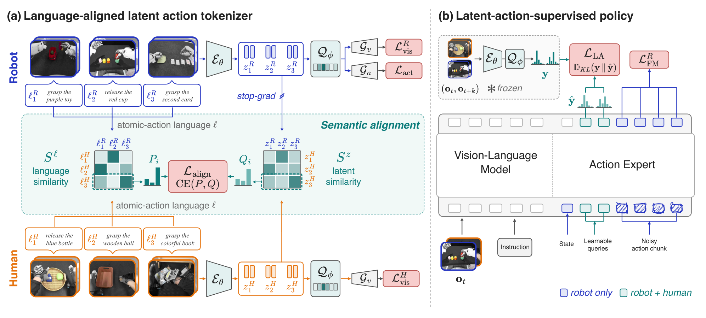
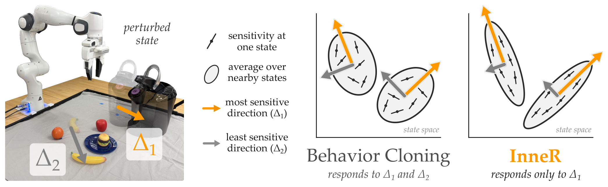
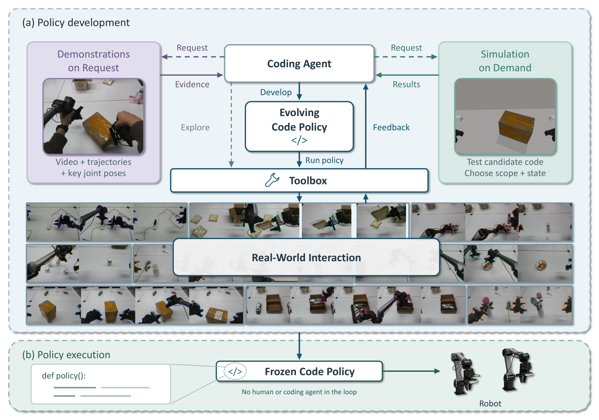
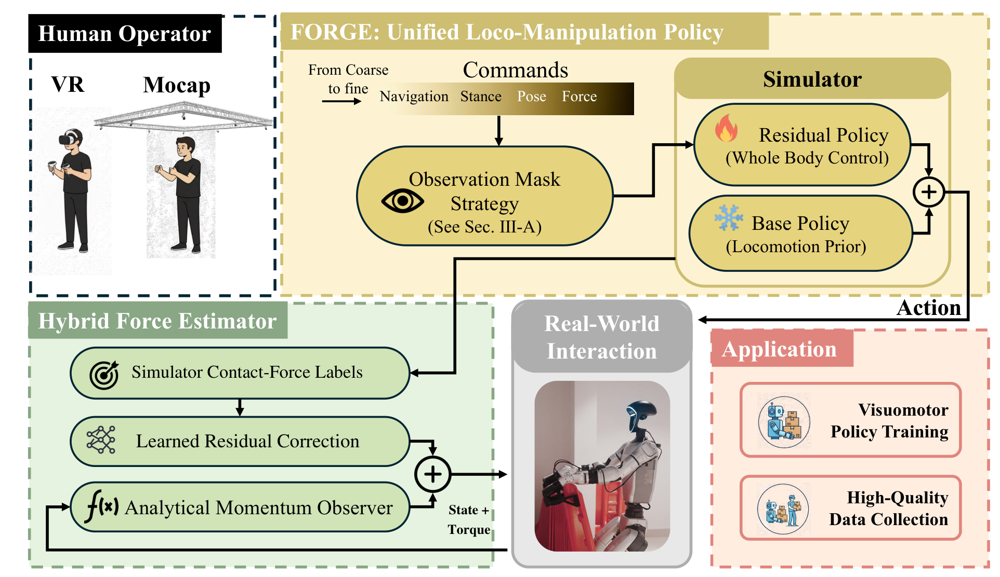
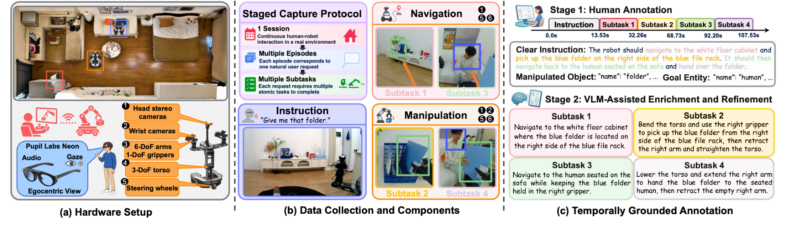

# 2026-11-13 Embodied AI & World Models Daily

> 面向具身智能与 Robotics 研究员、工程师。主窗口为北京时间 11 月 13 日，补充窗口为 11 月 11–12 日。本期完成 5 篇全文精读。arXiv 按实际提交时间归期；公告覆盖与其他来源缺口见文末。

## 🔥 今日必读

### 1. 【潜动作】SALA 用语言软邻域对齐人类与机器人行为

**来源：** [arXiv:2611.17110v1](https://arxiv.org/abs/2611.17110)（cs.RO）  
**类型：** Paper · research_paper  
**发布时间：** 2026-11-13 01:04:50，北京时间首次提交  
**评分：** 89.5/100  
**关键词：** Latent Action · Human Video · Cross-Embodiment

**核心贡献：** 用未配对视频的原子动作语言描述建立软对应，以机器人动作重建锚定潜动作，再让人类视频监督同一个动作专家。

- 共享视觉重建不足以消除背景捷径。语言邻域监督潜变量邻域，对齐路径在机器人端停止梯度，SoftVQ 保留连续的类别分布。
- 冻结标注器从帧对产生目标。人类视频训练潜动作预测，机器人数据额外训练动作流匹配；部署不需要教师或真实未来帧。
- RoboTwin 2.0 五十任务上，Clean 为 80.2%、Random 为 48.6%，均值 64.4%；去掉语义对齐后分别为 75.5%、36.8%。**项目页头部写 66.4%，与 PDF 主表不一致，本期采用 PDF 数值。**
- 四项 Sharpa 实机任务各二十次，完整方案平均 72.5%。任务人类示范从 10% 增至 100%，成功率从 53.75% 增至 72.5%；预训练规模曲线测的是离线动作误差，不能当成实机成功曲线。

**为什么值得关注：** 让无动作视频的监督更接近可控制行为。标注器训练仍需原子动作描述，最高 2,678 小时使用等效训练曝光口径，完整实机比较同时改变潜动作机制和可利用的人类数据。

**资源：** [论文](https://arxiv.org/abs/2611.17110) · [项目页](https://sala-vla.github.io/) · [全文精读](../paper-reading/news/2026-11-13/sala/sala.md)。项目页仍有占位信息和 Code soon，本期未确认可下载实现。

### 2. 【模仿学习】InneR 让策略在不同状态下共同忽略无关扰动

**来源：** [arXiv:2611.17159v1](https://arxiv.org/abs/2611.17159)（cs.RO；Virginia Tech、UT Austin 等）  
**类型：** Paper · research_paper  
**发布时间：** 2026-11-13 01:38:48，北京时间首次提交  
**评分：** 88.5/100  
**关键词：** Regularization · Policy Geometry · Robustness

**核心贡献：** 以策略雅可比或 Fisher 信息表示状态扰动的动作影响，按功能方向聚类后约束平均矩阵的尾特征值，让邻域共享无关方向。

- 目标是共有零空间，不是让所有方向的敏感度一并变小。局部区域按雅可比行空间对齐划分，原模仿目标继续保留有用动作。
- 随机扩散策略用 ELBO 梯度近似输入 Fisher，有限采样及高阶求导带来误差和训练成本。
- Franka 三任务、每任务每条件二十次，三干扰物条件平均由 BC 的 18.3% 到 56.7%；无干扰为 73.3% 对 75.0%。摘要的“18% 到 57%”有明确条件。
- 两毫米额外观察噪声下 InneR 仍失败。实验使用显式状态向量，尚未证明端到端图像策略或大扰动的鲁棒性。

**为什么值得关注：** 给模仿学习提供保留任务反应、抑制干扰的正则化目标。复现需同时测选择性、成功率、噪声范围和训练开销。

**资源：** [论文](https://arxiv.org/abs/2611.17159) · [项目页](https://collab.me.vt.edu/inner/) · [代码入口](https://github.com/VT-Collab/inner) · [全文精读](../paper-reading/news/2026-11-13/inner/inner.md)。代码链接从项目页确认，本期未运行复现。

### 3. 【程序策略·补记】ACE-CaP-0 将开发经验留在冻结代码中

**来源：** [arXiv:2611.16872v1](https://arxiv.org/abs/2611.16872)  
**类型：** Paper · research_paper  
**实际提交时间：** 2026-11-12 22:38:40，北京时间；补充窗口  
**评分：** 87/100  
**关键词：** Code as Policies · Demonstration · Simulation

**核心贡献：** 编码代理按当前未决问题请求机器人示范、运行有针对性的仿真或试真机，迭代后冻结程序，避免每步都由编码代理决策。

- 牵引示范提供视频、轨迹与关键关节姿态；仿真按需选择片段和起点，随后由真机检查感知、几何及接触假设。
- 八项双 PIPERX 操作任务各三十次，冻结程序成功 221/240，即 92.1%；各任务平均物理执行时间为 0.97–2.27 分钟。
- 插充电器开发中，按需仿真相对真实反馈单独开发减少时间但增加输出量。六种开发条件各只有一次运行，尚未证明独立重复开发的稳定性。
- 每任务十次人工协助重置预算不计示范采集重置。冻结程序仍调用运行时感知控制，不能写成无反馈重放或开发阶段无人参与。

**为什么值得关注：** 把推理和试验投入转成可复用的程序。成功率需要与开发成本、示范努力以及新条件下的再开发需求共同阅读。

**资源：** [论文](https://arxiv.org/abs/2611.16872) · [官方项目页](https://acerobotics2025.github.io/ACE-CaP/) · [全文精读](../paper-reading/news/2026-11-13/ace-cap/ace-cap.md)。本期未确认公开完整程序包或权重。

## 📄 论文雷达

### 【人形接触控制】FORGE

**来源与时间：** [arXiv:2611.17142v1](https://arxiv.org/abs/2611.17142)，11 月 13 日 01:30:11。  
**关键词：** Whole-Body Control · Force Estimation  
**评分：** 85.5/100。  
**核心贡献：** 将导航、足位、腕姿态与可选施力放在统一命令接口，用冻结行走先验和非对称残差稳定全身，再以混合腕等效反力估计调整虚拟腕目标。

50Hz 策略不依赖腕力传感器，但用仿真力监督修正。硬件腕部平均位置误差为 4.15cm；刚盒接触 8.52N 是仿真指标。空载及 0.5kg 箱体运输成功率 100%，1kg、2kg 为 90%，各二十次。二十二毫秒表示命令到末端到达的延迟，不是网络推理耗时。力估计限定低频准静态，超训练载荷误差上升。[项目页](https://bb0928.github.io/forge/) · [代码入口](https://github.com/bb0928/FORGE) · [全文精读](../paper-reading/news/2026-11-13/forge/forge.md)。项目页显示 11 月 4 日更新，本期记录新的 arXiv 投稿，不宣称整项工作首次在当天公开。

### 【人机意图数据】HEIR

**来源与时间：** [arXiv:2611.17238v1](https://arxiv.org/abs/2611.17238)，11 月 13 日 02:25:41。  
**关键词：** Egocentric Intent · Gaze · Long-Horizon HRI  
**评分：** 85.5/100。  
**核心贡献：** 同步人类视角、语音与注视，以及机器人观察和遥操作，保留会话、请求、导航操作子任务三层结构，连接意图到执行的分层评价。

三百会话、十七名参与者、38.56 小时，共 1,836 请求、6,416 子任务。Gemma 的位置准确率从人类加机器人视角的 71.13% 到注视完整输入的 77.69%；集成系统整请求仅 18.52% 成功，样本二十七回合。注视的闭环案例为定性证据，未独立隔离完整会话中的因果贡献。划分按会话而非参与者。[项目页](https://heir-project.github.io/) · [标注数据](https://huggingface.co/datasets/Anonymous-HEIR123/HEIR-Dataset) · [全文精读](../paper-reading/news/2026-11-13/heir/heir.md)。已核对三百份处理标注的发布说明，未完整下载全部媒体流；资源已在投稿前存在，不重复计为当天首次开放。

其他本日候选，仅核验摘要与时间，未全文精读：

| 方向 | 研究线索 |
| --- | --- |
| UAV 指令飞行 | [UAV-Flow++](https://arxiv.org/abs/2611.17163)，01:39:43。30,692 条真实飞行示范与 10,109 条仿真轨迹，研究物体相对短程动作；273 个保留仿真回合成功率由 75.58% 到 93.16%，不等同于实机成功率。 |
| UAV 视觉想象 | [ProtoVis-Nav](https://arxiv.org/abs/2611.17330)，02:59:49。先预测局部视觉原型，再用于航点生成；需进一步核对具体闭环与安全评估。 |
| 非语言表达 | [XBot-Omni](https://arxiv.org/abs/2611.17160)，01:38:57。Thinker–Talker–Actor 联合言语、身体与面部表达，落点主要为沟通交互。 |
| 神经近似控制 | [TOMPC 模仿架构](https://arxiv.org/abs/2611.17005)，00:04:44。自引导采样减少专家调用，Furuta 摆实机将控制频率从 1.4Hz 提到 1kHz。 |
| 多机器人分配 | [迭代聚类任务分配](https://arxiv.org/abs/2611.17213)，02:10:27。拆解协作分配并保持效用单调改善，证据为仿真和条件化理论。 |

## 🛠 工程与开源

**Alloy，多材料仿真，补记。** [论文](https://arxiv.org/abs/2611.16312) 于北京时间 11 月 12 日 13:14:10 提交。[官方发布](https://www.argonrobotics.ai/alloy) 标注 11 月 11 日；[仓库](https://github.com/argonrobotics-ai/alloy) 元数据为 Apache-2.0，创建时间对应北京时间 12 日 04:23:06。仓库创建不能替代发布时刻，按同一事件归并。

它把刚体、布、缆线、液体、颗粒和软体路由到适合的求解器，并在控制步内耦合，提供逐世界健康分级和代理接口。[文档](https://alloy.argonrobotics.ai/docs/) 明确多材料混合速度存在限制。性能与“陌生代理训练成功”的数字为发布方报告，本期未安装、运行或独立验证。open_source 双评分平均 77/100。

InneR、FORGE 的代码入口随论文登记。SALA 仍列 Code soon；HEIR 本期核实的是处理标注发布，不能描述为所有模态已完整取得。MuJoCo、Genesis、Isaac Lab、LeRobot 的近期版本与模型目录已检查，既有版本不重复列成新发布。

## 💬 社区信号

本期通过 GitHub、Hugging Face 和 Hacker News 发现开源线索，并回溯官方页面。项目热度、会场展示和二次报道不单独证明方法质量；未核实可另列的独立复现结论。[CoRL 官方入口](https://www.corl.org/) 用于核对会议线索。

## 🔎 补充窗口筛选与去重

| 线索 | 实际时间（北京时间） | 处理 |
| --- | --- | --- |
| ACE-CaP-0 | 11 月 12 日 22:38:40 | 补记并完成精读，不冒充 13 日投稿。 |
| [EgoX](https://arxiv.org/abs/2611.16728) | 11 月 12 日 20:40:24 | 模块化跨本体接口与训练期动力学预测；任务进展不等于完整成功率，本期保留摘要级线索。 |
| [Reins](https://arxiv.org/abs/2611.16632) | 11 月 12 日 19:05:11 | 前沿模型配工具与持续观察叙述，需结合接口约束解释零样本说法；未完成全文精读。 |
| [Genie Sim Benchmark](https://arxiv.org/abs/2611.15020) | 11 月 11 日 12:25:57 | 配对实机仿真与系统辨识；22 对任务的相关不能推出任意新策略仿真可信。 |
| [Action-Affine World Models](https://arxiv.org/abs/2611.15011) | 11 月 11 日 12:08:28 | 局部动作敏感度转为小型 QP；3.8ms 排除基础策略采样，证据为四项仿真。 |
| [世界模型反事实动作审查](https://arxiv.org/abs/2611.15048) | 11 月 11 日 13:21:33 | 强调动作敏感度而非只看预测质量；短篇观点不能当作已验证的大规模性能改进。 |
| Temporal Shortcuts、Elastic-WAM、MetaWAM、OnlyAct、BEHAVIOR100 | 11 月 11 日凌晨 | 已在[对应日报](../news/2026-11-11.md)精读，排除重复。 |
| 上期四篇补记 | 11 月 10 日 | 早于本期回溯起点，不重复；[上期日报](../news/2026-11-12.md)。 |

## 📊 今日技术趋势

从 SALA 到 InneR，研究焦点都涉及让表征或策略明确忽略无关变化，但监督方式和鲁棒性假设不同。ACE-CaP-0 把经验固化成程序，FORGE 与 HEIR 分别暴露接触控制、意图到执行的接口误差。评估应保留开发成本、模态开放范围和完整闭环成功，避免把离线误差、进度或模块成绩当成最终任务收益。

## 来源覆盖与双评分

- 已直接抓取官方 [cs.RO](https://arxiv.org/list/cs.RO/recent)、[cs.AI](https://arxiv.org/list/cs.AI/recent)、[cs.LG](https://arxiv.org/list/cs.LG/recent)、[cs.CV](https://arxiv.org/list/cs.CV/recent) 的 recent 和 11 月列表，并逐条获取预筛候选摘要及版本时间。859 个去重候选中，按 v1 北京时间归期，主窗口 10 条、补充窗口 119 条、窗口外 730 条；未见已核验候选存在主窗口 v2+ 更新。月列表 AI/LG 只读取前 2,000 项，未声称全月穷尽。
- **来源检查不完整：** 官方公告当前截至 11 月 13 日，已索引主窗口集中于凌晨，白天及晚间提交仍可能在后续公告出现；补充窗口有更多待展开的工作，本期保留已经核验的重点。不能解释成当天其余时段没有资讯。
- 机构、会议、版本及代码渠道覆盖 GEAR、DeepMind、PI、Skild、1X、Figure、RAI、TRI、Stanford、Berkeley、CMU、MIT、上海 AI 实验室等。PI 的 429 和 CMU 的 TLS 失败经网页工具补查，IROS 官方入口的 403/访问失败仍未解决。机构首页扫描不代表全部子项目穷尽。
- SALA 项目页与论文数字不一致，按可核对 PDF 主表记录；FORGE 同名旧论文已排除，项目页先于本次投稿公开；HEIR 数据发布与新预印本合为一个研究事件。
- 三篇必读论文与雷达最高两篇全部完成全文、grounding、笔记 lint、质量与可读性审查、正式保存及文件哈希核对。共 5 张正式图片、0 张占位图。[精读索引](../paper-reading/news/2026-11-13/README.md)。
- 两轮评分向量依次为 significance / novelty / evidence / relevance / community，各 0–10。research_paper 权重为 4/3/2/1/0；open_source 为 2/2/2/3/1。代码与论文合并计事件，未以热度代替技术证据。

| 候选 | 类型 | 第一轮 | 第二轮 | 平均分 |
| --- | --- | --- | --- | ---: |
| SALA | research_paper | 9/9/9/10/1 | 9/8/9/10/1 | 89.5 |
| InneR | research_paper | 9/9/8/10/1 | 9/8/9/10/1 | 88.5 |
| ACE-CaP-0 | research_paper | 9/8/9/10/1 | 9/8/8/10/1 | 87 |
| FORGE | research_paper | 9/8/8/10/1 | 8/9/8/10/1 | 85.5 |
| HEIR | research_paper | 8/8/9/10/1 | 8/9/9/10/1 | 85.5 |
| UAV-Flow++ | research_paper | 8/9/8/9/1 | 8/9/8/9/1 | 84 |
| ProtoVis-Nav | research_paper | 8/8/7/9/1 | 8/7/7/9/1 | 77.5 |
| XBot-Omni | research_paper | 8/8/7/8/1 | 8/8/8/8/1 | 79 |
| TOMPC 模仿架构 | research_paper | 8/7/8/9/1 | 8/8/7/9/1 | 78.5 |
| 迭代聚类分配 | research_paper | 7/7/7/8/1 | 7/8/7/8/1 | 72.5 |
| EgoX | research_paper | 8/8/8/10/1 | 8/8/7/10/1 | 81 |
| Reins | research_paper | 8/8/8/9/1 | 8/8/7/9/1 | 80 |
| Genie Sim Benchmark | research_paper | 8/8/8/9/1 | 8/8/7/9/1 | 80 |
| Action-Affine WM | research_paper | 8/8/7/9/1 | 8/8/8/9/1 | 80 |
| 反事实动作审查 | research_paper | 7/8/6/9/1 | 7/7/6/9/1 | 71.5 |
| Alloy | open_source | 8/8/8/9/1 | 9/8/8/9/1 | 77 |
