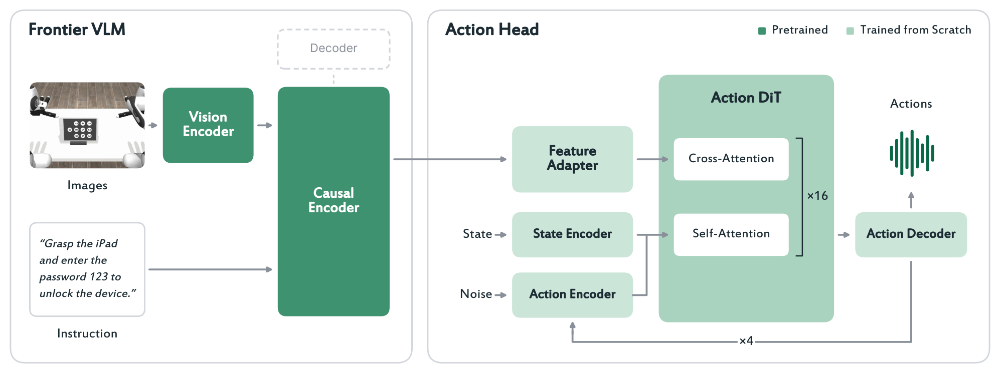
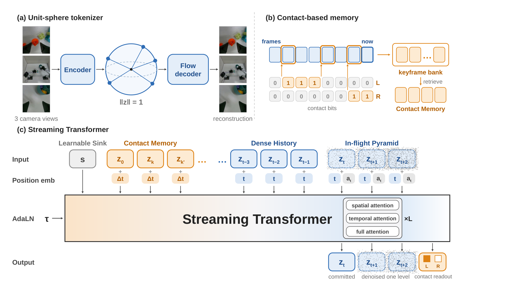
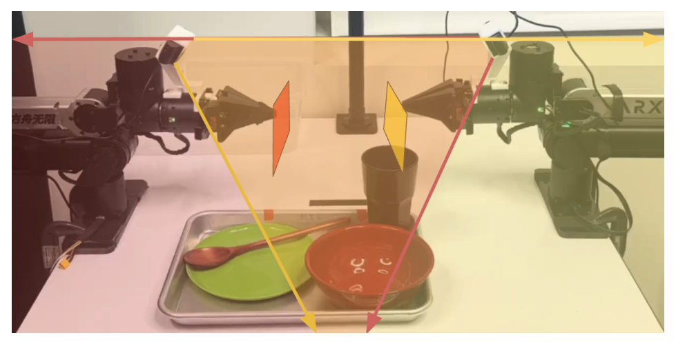
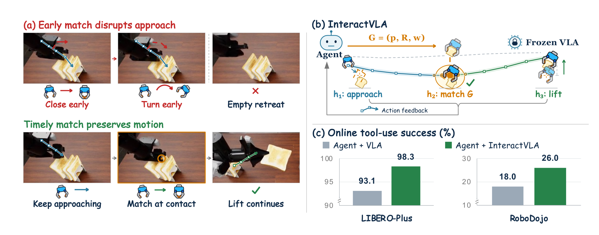

# 2026-11-17 Embodied AI & World Models Daily

> 面向具身智能 / Robotics 研究员与工程师。主窗口为北京时间11月17日，补充窗口15—16日。本期3篇必读、9篇雷达、4篇已完成精读。PI、Hugging Face等来源检查不完整，不能据此断言全天没有其他资讯。

## 🔥 今日必读

### 1. 【VLA与基础模型】ScaleVLA：把552B冻结表示直接接到连续动作头

**来源：** [arXiv:2611.21607v1](https://arxiv.org/abs/2611.21607v1)（cs.RO；清华、北大、上海交大、Galbot）  
**类型：** Paper  
**发布时间：** arXiv v1北京时间2026-11-17 02:59  
**评分：** 88.45/100  
**关键词：** Frozen VLM · Flow Matching · Scaling

**一句话：** 在保持动作DiT、初始化和监督预算相同的比较中，将VLM表示扩到552B；不生成文字推理，只运行因果编码器并将特征映射为动作片段。

**技术要点：**

- 冻结DeepSeek-V4.1-Flash-1017骨干，在编码器—解码器接口读出；适配器和32层动作DiT从零训练，四步flow积分复用一次骨干特征。MoE总参数不等于每token激活量，也不等于完整552B计算图都执行。
- LIBERO四套件96.1%；LIBERO-PRO45.1%，对比小骨干最佳31.3%。Goal10示范87.8%超过2B用50示范85.6%，但归一化统计仍来自全量训练数据，固定5000步也不是收敛后或等总算力比较。
- 真机插头参考布局9/10、空间扰动8/15，对比2B的4/10、5/15；只有一个训练种子，π0.5参考为8/10、7/15，小样本不能宣称稳定显著优于后者。
- RoboCasa四H200中位215.8ms/片段，对比2B单H200114.7ms；真实机器人384ms/片段。计时和成功率使用不同部署路径，未逐元素验证特征一致，不能把216ms直接当真机延迟。

**为什么值得关注：** 强表示可能减少机器人监督需求，并改善精密插接；但应把模型家族、输入量、优化预算和硬件拆开，再判断规模本身的作用。

**资源：** [Paper](https://arxiv.org/abs/2611.21607v1) · [项目页](https://galaxygeneralrobotics.github.io/scalevla/) · [项目列出的代码](https://github.com/GalaxyGeneralRobotics/ScaleVLA) · [全文精读](../paper-reading/news/2026-11-17/scalevla/scalevla.md)。未验证独立训练复现或权重可下载性。

### 2. 【世界模型】DreamFAR：用接触变化选关键帧，减缓分钟级视频展开遗忘

**来源：** [arXiv:2611.22001v1](https://arxiv.org/abs/2611.22001v1)（cs.RO；Amazon FAR及合作高校）  
**类型：** Paper  
**发布时间：** arXiv v1北京时间2026-11-17 07:31  
**评分：** 86.95/100  
**关键词：** Contact Memory · Streaming · Robot-Native Data

**一句话：** 由模型预测接触建立/解除来写入关键帧，再按末端位姿检索；以固定长期槽和短期密集上下文保留离开视野后的交互状态。

**技术要点：**

- 单位球潜变量限制尺度漂移，8帧长期记忆补充5秒近期历史，永久sink和滚动KV服务流式生成。16个在途帧提供10Hz吞吐，也引入16步、约1.6秒流水延迟；不能等同100ms动作反馈。
- 主动力学1.9B，256H200训练六天；图像tokenizer使用预训练SSDD初始化。“无互联网视频动力学预训练”不等于所有模块完全从零。
- 公共ABC公平比较另用约0.8B版本，与WEAVER等在同数据划分上训练。1000留出回合、15秒真实初始化后预测60秒，PSNR16.4dB，对比Cosmos15.8、WEAVER14.5、IWS11.0；视觉指标不等同精确接触物理。
- 模拟与真实任务平均进度相关r=0.71仅来自三个任务×两个检查点的六个点，模型绝对进度偏乐观。单任务混合75真实+75模型示范达到63%进度，但相对75真实对照同时多了一倍数据，且只有10次实机试验。

**为什么值得关注：** 接触事件可作为记忆写入的有意义边界，比固定间隔采帧更有针对性。模型内评测仍需真实硬件复核，不能成为唯一部署门槛。

**资源：** [Paper](https://arxiv.org/abs/2611.22001v1) · [项目页](https://www.yimingdou.com/DreamFAR/) · [GitHub](https://github.com/amazon-far/dreamfar) · [全文精读](../paper-reading/news/2026-11-17/dreamfar/dreamfar.md)。项目及仓库可访问，本次没有运行模型。

### 3. 【模仿学习与策略】ALOHA Lightning：高速直接示教，加同域遮罩和片段平滑

**来源：** [arXiv:2611.21919v1](https://arxiv.org/abs/2611.21919v1)（cs.RO；Stanford）  
**类型：** Paper  
**发布时间：** arXiv v1北京时间2026-11-17 05:31  
**评分：** 86.35/100  
**关键词：** Kinesthetic Teaching · ACT · Fast Manipulation

**一句话：** 人直接握住可反驱双臂末端采集高速动作，训练和部署都遮罩操作者区域，再通过重叠片段平滑维持快速、连续的执行。

**技术要点：**

- 100Hz重力补偿、50Hz三视图及关节采集；ACT预测未来关节位置。操作者采集时有直接触感，不表示策略部署输入含触觉。
- FK与标定确定人手臂区域，训练部署同样置零，减少视觉域偏移；相邻动作片段重叠，用sigmoid权重交接，避免每步推理与平均过时轨迹。
- 每任务50示范，五项任务报告超过80%成功；拔杯3.97秒、电池5.70秒、收桌6.81秒、接抛球1.85秒。普通主从电池任务17.87秒，单纯加倍播放仍慢且精度下降。
- 局限包括近手有效信息被遮掉、无触觉、专门硬件及有限工作台扰动。七人用户研究支持采集易上手，但不代表普适人因结论。

**为什么值得关注：** 高速策略需要真实高速数据与执行机制配合，不能靠把慢策略控制频率翻倍获得。对采集流水线的改造可能比继续扩大策略网络更直接。

**资源：** [Paper](https://arxiv.org/abs/2611.21919v1) · [项目页](https://flash-aloha.github.io/) · [项目列出的代码](https://github.com/JohnYao93/flash-aloha) · [全文精读](../paper-reading/news/2026-11-17/aloha-lightning/aloha-lightning.md)。代表图选方法遮罩图，原文无统一全流程架构图。

## 📄 论文雷达

### 【VLA与基础模型】InteractVLA：让Agent用几何目标引导、检查和修补VLA动作

**来源：** [arXiv:2611.22584v1](https://arxiv.org/abs/2611.22584v1)  
**发布时间：** 北京时间2026-11-17 19:07  
**关键词：** Test-Time Guidance · Soft-Time Alignment · RSI  
**核心贡献：** 冻结动作专家，对输入求梯度，将完整末端目标软匹配到合适执行步，并把动作与相机重投影反馈给Agent。LIBERO-Plus在线98.3%，加RSI后99.4%；RoboDojo对应26.0%与48.62%，不能混成同一预算。

**值得关注程度：** 84.65/100  
**Paper：** [arXiv摘要页](https://arxiv.org/abs/2611.22584v1) · [GitHub](https://github.com/LingwuPro/InteractVLA) · [全文精读](../paper-reading/news/2026-11-17/interactvla/interactvla.md)。真机表报告任务分数，不应转写为成功率；不同对照的练习预算与评测子集存在差异。

### 【运动与全身控制】Body Schema Policy：以运动学树组织视觉到动作接口

**来源：** [arXiv:2611.22713v1](https://arxiv.org/abs/2611.22713v1)  
**发布时间：** 北京时间2026-11-17 20:52  
**关键词：** Body Schema · Loco-Manipulation  
**核心贡献：** 在关节/连杆token上学习螺旋运动，并由各身体部位查询视觉证据。作者报告九项G1仿真任务以少75倍参数匹配Ψ0并展示真实G1和Fetch；模型大小优势仍需结合具体任务与训练数据理解。  
**值得关注程度：** 82.55/100  
**Paper：** [arXiv摘要页](https://arxiv.org/abs/2611.22713v1)

### 【数据与Benchmark】真实机器人数据质量：校准、可见信息和操作补偿会进入策略

**来源：** [arXiv:2611.22388v1](https://arxiv.org/abs/2611.22388v1)  
**发布时间：** 北京时间2026-11-17 16:38  
**关键词：** Teleoperation · Calibration · Data Quality  
**核心贡献：** 结合25种双臂工作空间研究、遥操作控制和π0.5微调，报告策略保留约90%示范额外绕路，测试校准不匹配30次全失败。应优先测操作和标定系统，标题的大数据规模不等于所有结论都在该规模受控验证。  
**值得关注程度：** 82.15/100  
**Paper：** [arXiv摘要页](https://arxiv.org/abs/2611.22388v1)

### 【运动与全身控制】Heave-Ho：从双人形训练到多机器人去中心协作

**来源：** [arXiv:2611.22275v1](https://arxiv.org/abs/2611.22275v1)  
**发布时间：** 北京时间2026-11-17 14:21  
**关键词：** Multi-Agent · Tracking · Speech Coordination  
**核心贡献：** 低层后训练跟踪基础模型以适应物理耦合，高层视觉语言规划配合语音领导—跟随同步。HH-Bench含12项、2—10机器人任务，作者展示异构团队及实机；语音协作不等于没有信息通信。  
**值得关注程度：** 81.45/100  
**Paper：** [arXiv摘要页](https://arxiv.org/abs/2611.22275v1)

### 【模仿学习与策略】Progress Predicts Policy：让标量进度场的导数产生动作

**来源：** [arXiv:2611.22491v1](https://arxiv.org/abs/2611.22491v1)  
**发布时间：** 北京时间2026-11-17 17:46  
**关键词：** Gradient Policy · World Model  
**核心贡献：** 把语言条件潜在进度场与世界模型组合，在固定参考命令处读动作梯度，连续命令用正增益、离散命令用有限差分。用模仿与双重反传约束局部控制几何，不只拟合示范时间进度。  
**值得关注程度：** 80.75/100  
**Paper：** [arXiv摘要页](https://arxiv.org/abs/2611.22491v1)

### 【数据与Benchmark】HubEgo-100K：首版是10124小时职业技能视频

**来源：** [arXiv:2611.21938v1](https://arxiv.org/abs/2611.21938v1)  
**发布时间：** 北京时间2026-11-17 05:56  
**关键词：** Egocentric Data · IMU · Skilled Work  
**核心贡献：** v1.0含12227位贡献者、15548个环境、72754回合1080p视频和100Hz IMU，83%来自工作场景。100K是后续目标，不是当前已发布小时；动作语言为机器标注，尚待下游机器人基准验证。  
**值得关注程度：** 79.05/100  
**Paper：** [arXiv摘要页](https://arxiv.org/abs/2611.21938v1)

### 【世界模型】ReLAP：在JEPA空间递归预测，预训练连续潜在动作

**来源：** [arXiv:2611.22077v1](https://arxiv.org/abs/2611.22077v1)  
**发布时间：** 北京时间2026-11-17 09:56  
**关键词：** Latent Action · Recurrent Prediction  
**核心贡献：** 相邻观察逆动力学提取潜在动作，多步未来损失反传约束早期动作，再蒸馏给VLM并用机器人flow动作适配。部署去掉显式潜在动作/世界模型分支；作者报告11M样本下LIBERO97.9%、Plus70.0%。  
**值得关注程度：** 78.75/100  
**Paper：** [arXiv摘要页](https://arxiv.org/abs/2611.22077v1)

### 【端侧部署】Anchored Path Matching：让学生轨迹上的端点与局部更新共同受监督

**来源：** [arXiv:2611.22592v1](https://arxiv.org/abs/2611.22592v1)  
**发布时间：** 北京时间2026-11-17 19:15  
**关键词：** WAM · Distillation · Gradient Conflict  
**核心贡献：** 从学生实际达到的状态续跑教师，提供零噪声端点和首个中间状态；冲突时优先保留端点梯度。同检查点支持1/2/4步，单步Clean/Random相对基础蒸馏提高2.0/1.4个百分点，最大时延倍数需保留八步教师参照。  
**值得关注程度：** 77.65/100  
**Paper：** [arXiv摘要页](https://arxiv.org/abs/2611.22592v1)

### 【数据与Benchmark】FailureGen：将已观察失败动作迁入新情景生成失败视频

**来源：** [arXiv:2611.22367v1](https://arxiv.org/abs/2611.22367v1)  
**发布时间：** 北京时间2026-11-17 16:21  
**关键词：** Synthetic Failure · Cosmos · Evaluation  
**核心贡献：** 微调动作条件Cosmos，标注失败供体和兼容宿主、迁移动作并过滤生成事件。初步检测实验AP从0.41到0.51，检出28/36到33/36；不是由任意动作生成物理真实失败的证明。  
**值得关注程度：** 76.55/100  
**Paper：** [arXiv摘要页](https://arxiv.org/abs/2611.22367v1)

未精读的八条雷达基于官方摘要与版本页，数值保持作者口径，不标为全文实验已复核。全期评分均为编辑判断，而非独立复现的统计结论。

## 🛠 工程与开源

- **DreamFAR：** [官方仓库](https://github.com/amazon-far/dreamfar)创建于UTC16日21:37，即北京时间17日05:37，属于主窗口。与论文聚成同一事件，不重复计分。项目可作为训练、推理和交互示范入口；权重下载和运行速度本次未实测。
- **InteractVLA：** [官方仓库](https://github.com/LingwuPro/InteractVLA)创建于UTC17日09:24，即北京时间17日17:24。可微动作专家与标定是接入条件，不能把任意黑盒VLA API直接变成可反传接口。
- **版本排查：** [Genesis v1.4.7](https://github.com/Genesis-Embodied-AI/genesis-world/releases/tag/v1.4.7)是UTC17日17:18，即北京时间18日01:18，明确排除本期；其非刚体求解、耦合器和确定性修复留待18日报，不因UTC日期相同误收。MuJoCo、Isaac Lab、LeRobot查得的最近正式版本均早于本窗口。

## 💬 社区信号

已检查Hacker News和GitHub新建仓库线索，尚未确认可单列的独立复现、技术争议或多源集中讨论。作者仓库与项目页只证明资源入口，不等于社区验证；不把少量星标作为研究热度证据。

## 🔎 补充窗口筛选记录

以下按v1实际北京时间归属，不把公告日或UTC日期直接当发布日期：

- [arXiv:2611.20452v1](https://arxiv.org/abs/2611.20452v1)，2026-11-16 11:22：11月16日报已精读XMimic/XSoma，按同一事件去重。

- [arXiv:2611.21258v1](https://arxiv.org/abs/2611.21258v1)，2026-11-16 23:30：11月16日报已精读ThinkWAM，不因今天继续被讨论重发。

- [arXiv:2611.21099v1](https://arxiv.org/abs/2611.21099v1)，2026-11-16 21:44：11月16日报已精读ForceHarness，本次未确认需独立收录的重大更新。

- [arXiv:2611.20465v1](https://arxiv.org/abs/2611.20465v1)，2026-11-16 11:33：11月16日报已精读ReRead，不将普通资源变化假设成新论文。

ScaleVLA在UTC16日提交但北京时间17日，昨日已明确留给本期，现已完成全文和附录精读。纯驾驶、纯SLAM、检测、零售预测、deepfake检测以及没有具身决策落点的软件Agent，不因标题包含World Model或Robot自动入选。

## 📊 今日技术趋势

今天的主线分别从强表示、高速示范和交互记忆降低机器人控制难度。它们也暴露三种成本：大骨干的多卡推理、直接示教的硬件与域对齐，以及流式世界模型的反馈延迟和乐观偏差。判断实用性应同时看数据信息来源、真实任务完成时间与闭环评测，而不是只比较模型参数、FPS或视频质量。

## 📚 精读与检索覆盖

已完成4篇：[精读索引](../paper-reading/news/2026-11-17/README.md)。全文、附录覆盖和图像均经核对，证据规划、八项Final Note Lint、质量/可读性审查、正式保存与SHA一致性均通过；4张图物化，0占位。ALOHA代表图为遮罩方法示意，原文没有统一全流程架构图；关键结果和消融用笔记表格及正文解释。

- **官方列表：** 直接取得[cs.RO](https://arxiv.org/list/cs.RO/recent)、[cs.AI](https://arxiv.org/list/cs.AI/recent)、[cs.LG](https://arxiv.org/list/cs.LG/recent)、[cs.CV](https://arxiv.org/list/cs.CV/recent)recent及11月月列表，公告已覆盖18日。recent分别436、1420、1407、985条；月列表RO1023条，AI/LG/CV各取前2000条，不能声称后三类整月穷尽。
- **时间核验：** 宽召回1170个去重候选，按v1北京时间为主窗口97、补充112、窗外961。已在上次取得的摘要/历史复用其固定v1时间，新ID重新请求；入选精读另由本次pipeline重新确定身份与PDF。该数量不是相关论文数量，也不表示1170篇全文都已阅读；普通修订和未确认更新不当新成果。
- **筛选：** 按PASS/BLOCK/UNKNOWN、双次五维评分、事件聚簇和价值排序执行；研究论文权重4/3/2/1/0，T1门槛62。评分不靠机构名气或星标，全文复核限制已影响主文证据判断。正文只展示平均分，运行记录保留两次维度向量。
- **机构与生态：** NVIDIA GEAR、DeepMind、Skild、1X、Figure、RAI、TRI、Stanford、Berkeley、MIT、CMU、上海AI实验室、Unitree、Deep Robotics，以及CoRL/RSS/ICRA/IROS入口可访问；GitHub四组新建仓库与四个仿真/机器人生态版本源已检查。入口可访问不证明全部渠道更新穷尽。
- **明确缺口：** Physical Intelligence返回429；NVIDIA与LeRobot的Hugging Face模型接口超时。不能将来源不可访问描述为当天没有资讯，也不声称作者权重均已验证可下载。

所有性能和成功率为作者报告，本次未进行机器人实验或训练复现。日报及精读已在本地生成；发布状态以运行结果为准，不能把本地文件存在视为已到达远程。
