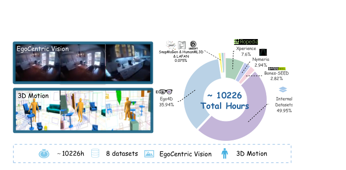
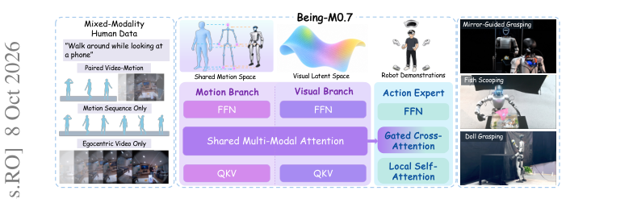
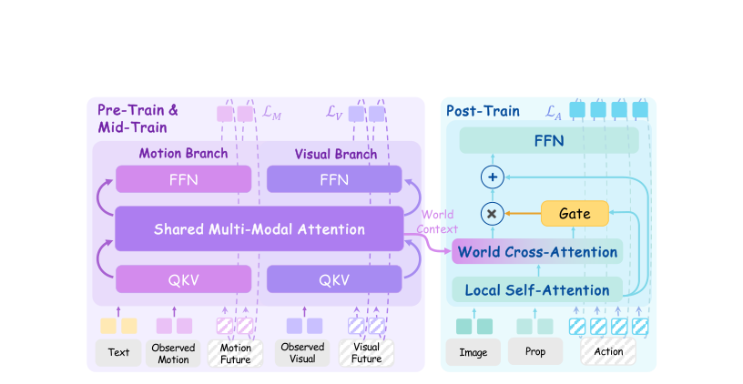
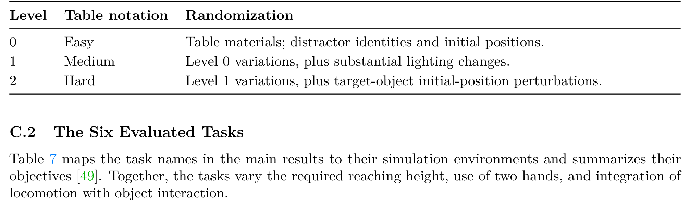
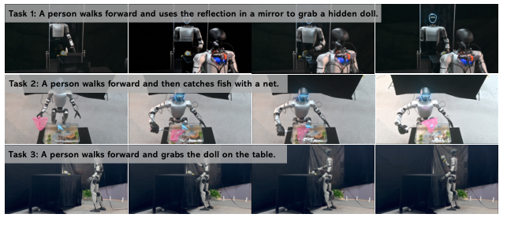
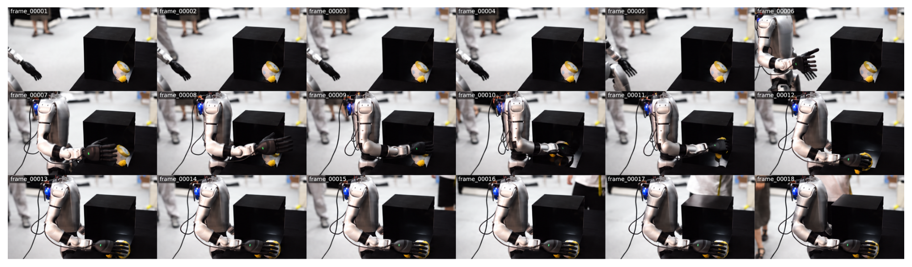
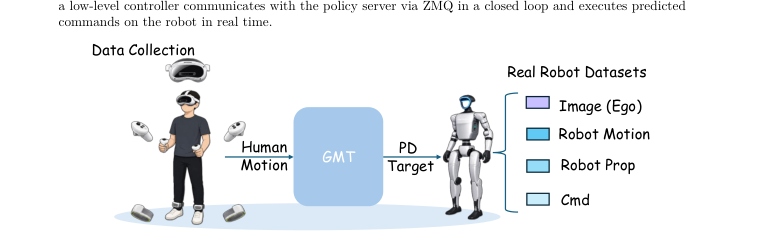
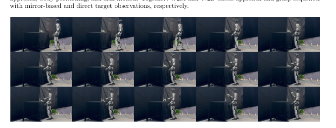
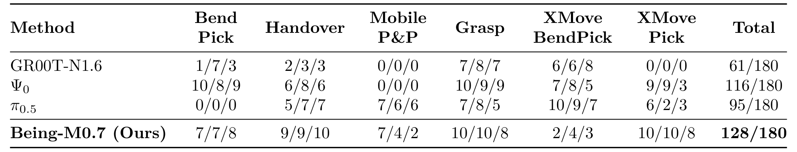

# Being-M0.7: A Latent World-Action Model for Humanoid Robots

> arXiv:2610.11283（cs.RO 交叉 cs.CV/cs.LG）· v1 提交 2026-10-08 13:49 北京时间 · Junpeng Yue, Boyuan Li, Yuxuan Wang 等 14 人（含 Zongqing Lu，清华系）· 真机平台 Unitree G1
>
> 本文对应日报：news/2026-10-10.md（补充窗口条目；10-09 日报列为「下期合并评」的人形 WAM 线之一，与 HWAM 同日对照）

## 人类数据很多但配对很少：动机与语料

人形 loco-manipulation 需要同时协调移动与操作，还要预判场景演化与全身运动。机器人演示稀缺，但人类视频/运动数据量巨大——问题是**大多未配对**（只有视频或只有运动），且人类运动不能直接当机器人动作执行。

Being-M0.7 的押注：**用混合模态（配对 + 单模态）人类数据预训练出携带运动信息的视觉先验**。语料配比（Figure 3）：

*图：语料配比：约 10,226 小时、8 数据源——Internal 49.95%、Ego4D 35.94%、RopeData/Xperience 各 7.6%、Nymeria 2.94%、Bones-SEED 2.82%。*

约 **10,226 小时**，donut 图逐源标注：内部数据近半、Ego4D 三成半、RopeData/Xperience 各 7.6%。配对流（video-motion 成对）占少数——**混合模态配对是例外而非常态**，这正是方法要解决的现实。

## Being-M0.7 的机制流程

*图：Being-M0.7 总览：左（混合模态人类数据三流）、中（架构：Motion/Visual 双分支共享注意力 + Action Expert）、右（真机任务示例）。*

三段训练（Figure 2 双面板）：

*图：三段训练：Pre-Train & Mid-Train（紫，双分支 L_M/L_V 联合预测）→ Post-Train（青，gated cross-attention 动作专家）。*

1. **预训练**：Motion/Visual 双分支共享多模态注意力，**联合预测未来潜视觉状态与运动**（$L_M$/$L_V$ 双损失）——核心假设是让视觉特征编码未来运动学：video-only、motion-only、paired 三流都进同一个预测目标，配对不是必需。
2. **中训练**：把先验适配到机器人视角与身体动力学。
3. **动作后训练**：action expert 经 **gated cross-attention** 融合冻结预测表示 + 当前图像 + 本体感受，输出全身可执行指令。

World Context 从共享注意力流向动作专家的 cross-attention——预训练先验以后训练条件的形式进入策略。

## SIMPLE 仿真主结果

SIMPLE 六任务 × 30 次（Table 1，三段计数逐格给出）：

| 方法 | Bend Pick | Handover | Mobile P&P | Grasp | XMove BendPick | XMove Pick | 总分 |
|---|---|---|---|---|---|---|---:|
| GR00T-N1.6 | 1/7/3 | 2/3/3 | 0/0/0 | 7/8/7 | 6/6/8 | 0/0/0 | 61/180 |
| Ψ₀ | 10/8/9 | 6/8/6 | 0/0/0 | 10/9/9 | 7/8/5 | 9/9/3 | 116/180 |
| π₀.₅ | 0/0/0 | 5/7/7 | 7/6/6 | 7/8/5 | 10/9/7 | 6/2/3 | 95/180 |
| **Being-M0.7** | 7/7/8 | 9/9/10 | 7/4/2 | 10/10/8 | 2/4/3 | 10/10/8 | **128/180** |

**总分全场第一**。逐任务看更有信息量：

- **Handover 28/30、Grasp 28/30、XMove Pick 28/30**——三个近满分的强项。
- **Mobile P&P 13/30**——全场最高但仍低；**XMove BendPick 9/30** 大幅弱项。移动+操作复合任务整体未解决，四个模型都难（Ψ₀ 0/0/0、π₀.₅ 7/6/6）。
- Ψ₀ 的 116 分里 Bend Pick 27/30 最强——基线各有强项，Being-M0.7 赢在均衡。

评测分级定义（Table 6）：Easy（材质/干扰物变化）→ Medium（+光照）→ Hard（+目标位置扰动）：

*图：SIMPLE 三级随机化定义。*

## 真机、短板与边界

真机 Unitree G1 上做长序列任务（Walk to Mirror 镜像抓取等，Figure 5/10/11）：

*图：真机三任务序列：镜像抓取 / 捞鱼 / 桌上抓娃娃。*

*图：Walk to Mirror 完整任务序列 18 帧。*

摘要陈述「匹配最强基线」——但真机结果以**序列快照**呈现，没有逐任务成功率表。这是论文最明显的证据缺口：仿真侧有主表（表1）的硬数字，真机侧只有演示级证据。论文自己的用词也谨慎（「matches the strongest baseline」而非「beats」）。

**边界与短板**（作者如实报出）：Mobile P&P / XMove BendPick 两个复合任务低分；消融表（附录对应表格）在我的提取管线里因裁剪质量问题未通过视觉审查——三段训练各段贡献的完整消融在正文中只有文字陈述，没有可引用的表格数字；语料以人类中心视频为主，工业/服务场景覆盖未报；10K 小时之上的 scaling 走势未报。

## 与 HWAM 的对照（同日同题）

两篇是同一问题的两侧解法：

| | Being-M0.7 | HWAM |
|---|---|---|
| 主打 | **数据侧**：混合模态人类数据预训练 | **目标侧**：联合状态-动作生成 |
| 关键机制 | 三流联合预测（配对非必需）+ gated cross-attention 后训练 | post-execution state 显式预测目标 + FDM/IDM 路径 |
| 真机 | Unitree G1（序列演示级） | LimX OLI（三任务成功率表 + CI） |
| 证据强度 | 仿真侧表格一硬、真机演示级 | 仿真+真机都有量化表 |

理想实验是把两者叠加：混合模态预训练的先验 + 联合状态-动作目标的后训练。两篇都没做——这是我的分析，不是论文主张。

## 复用与后续

1. **「三流联合预测」配方**——把未配对人类数据变现：不需要全配对，video-only/motion-only 都进同一个预测目标。
2. **10,226 小时配比披露**——自己组设计人形语料时的参照系（内部数据占半的混合策略）。
3. **SIMPLE 三级随机化**（材质/光照/位置）——现成的评测分级模板。

后续想看：三段训练完整消融表；真机量化成功率；语料 scaling 走势；与 HWAM 类联合状态-动作目标的叠加。

**真机数据采集系统**（Figure 4，VR 遥操作 → GMT → PD 目标 + 多模态记录）：

*图：Figure 4 真机数据采集系统：VR 遥操作经 GMT 生成 PD 目标与多模态记录。*

**镜像观察任务序列**（Figure 11，Walk to Mirror）：

*图：Figure 11 Walk to Mirror 镜像观察任务序列：机器人经镜像引导完成抓取。*

**SIMPLE 主表原版**（Table 1）：

*图：Table 1 SIMPLE 六任务主表：Being-M0.7 128/180 全场第一。*
