# Humanoid World Action Model With Joint State–Action Generation

> arXiv:2610.12026（cs.RO 交叉 cs.AI）· v1 提交 2026-10-08 22:23 北京时间 · Yan Yang, Jikun Rong, Minzhao Zhu 等 10 人 · Under review，15 页 5 图 · 平台 LimX OLI 人形
>
> 本文对应日报：news/2026-10-10.md（补充窗口条目，2026-10-09 日报承诺「下期合并评」的人形 WAM 线）

## 分层人形系统的执行差距从哪来

一台会走路的人形机器人上跑 VLA 或 WAM，策略输出的是**参考动作**（reference actions）。这些动作要经过全身控制器（WBC）、关节伺服、机器人动力学与接触，才变成真实运动。论文把这条链上的偏差叫 **action–execution gap**：参考动作与实际执行的运动不是同一回事。

作者给了两个平台的量化（Table 3，单位：度，MAE）：

| 平台 | Direct MAE | 稳态 MAE |
|---|---|---|
| LimX OLI（移动人形） | 4.420 | 2.885 |
| ALOHA（固定双臂） | 0.648 | 0.402 |

移动人形的执行偏差是固定双臂的近 7 倍。这个数字本身就是论文动机：**在分层人形系统上，未来视频预测若只以参考动作为条件，就必须同时解释场景演化与「参考 ≠ 执行」的差异**——两件事混在一个监督信号里，动作与物理后果的关联就学不干净。

## HWAM 的机制流程

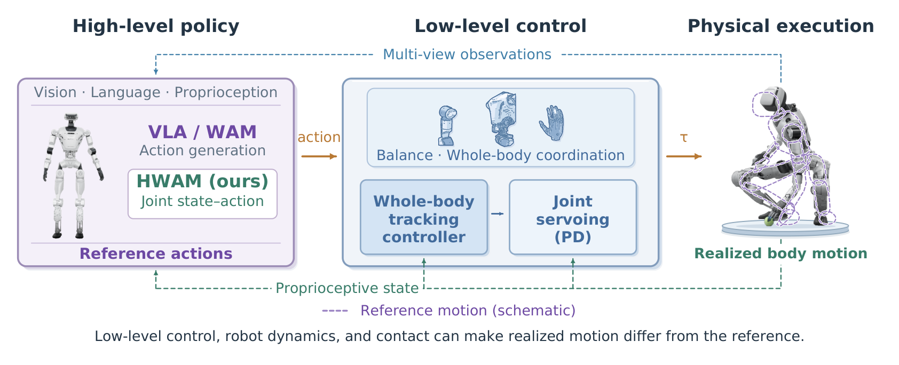
*图：HWAM 分层控制接口：高层策略输出参考动作，低层 WBC+关节伺服执行，实现运动经本体感受回传。*

HWAM（Humanoid World Action Model）的做法一句话：**把执行后本体感受状态（post-execution state）设为显式预测目标**。策略不再只预测动作，而是联合生成「参考动作 + 实现状态」。

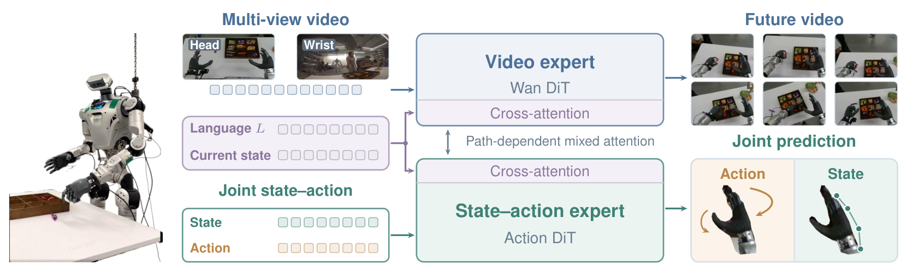
*图：HWAM 双专家架构：Video expert（Wan DiT）出未来视频，State–action expert（Action DiT）出联合状态-动作预测，路径依赖混合注意力互通。*

架构上是双专家：上方 Video expert（Wan DiT）负责未来视频，下方 State–action expert（Action DiT）负责联合预测，两者通过路径依赖混合注意力互通。训练走三条互补条件路径（Figure 3）：

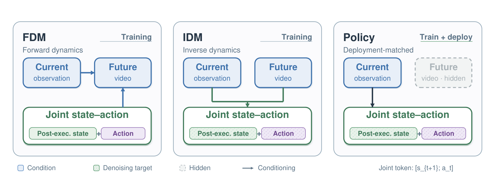
*图：FDM/IDM/Policy 三条件路径：条件与去噪目标的对应，Policy 部署匹配（未来视频隐藏）。*

- **Policy 路径**（部署匹配）：只条件当前观测，联合去噪状态–动作轨迹。推理时只走这条路径。
- **FDM（前向动力学）**：条件动作 + 执行后状态，预测未来视觉观测——把执行结果喂回视觉预测。
- **IDM（逆动力学）**：从视觉转移重建关节轨迹——连接视觉后果与运动。

三条路径共享联拼接token $[s_{t+1};\, a_t]$（下一时刻状态拼接当前动作）。这个拼接是全部机制的核心：状态监督经由它进入动作学习。

## 真机主结果与受控消融

三任务真机评测（LimX OLI，每任务 20 次以上，Table 1）：

| 方法 | 机器人数据预训练 | Candy Picking | Object Collection | Plush-Toy Picking |
|---|---|---:|---:|---:|
| Cosmos3-Edge | 有 | 15.8 | 0.0 | 56.7 |
| GR00T N1.5 | 有 | 40.5 | 42.5 | 60.0 |
| π₀.₅ | 有 | 62.5 | 45.0 | 60.7 |
| Fast-WAM | 无 | 43.3 | 0.0 | 60.0 |
| DiT4DiT | 无 | 52.5 | 15.0 | — |
| **HWAM（本文）** | **无** | **70.6** | **46.7** | **73.3** |

三任务全部第一。值得注意的是 HWAM 与 Fast-WAM 都不依赖机器人数据预训练——在这个基线集里，执行状态监督带来的增益（+27.3 点 Candy）比机器人预训练（π₀.₅ +19.2 点）更便宜。

受控消融（Plush-Toy Picking，同数据同预算，Table 2）把「联合目标」的贡献钉死：

| 配置 | 预测目标 | 训练配方 | 成功率 |
|---|---|---|---:|
| Action + VGM/Policy | 动作 | VGM/Policy | 60.0 |
| State–Action + VGM/Policy | 联合状态-动作 | VGM/Policy | 45.5 |
| Action + FDM/IDM/Policy | 动作 | FDM/IDM/Policy | 55.0 |
| **HWAM** | **联合状态-动作** | **FDM/IDM/Policy** | **73.3** |

单独换目标（第二行）或单独换配方（第三行）都不涨甚至掉；**只有「联合目标 + 三路径」组合拿到 73.3%**。这是论文最干净的一张表。

Table 7 补充了 Candy Picking 的置信区间：HWAM 84/119 成功，95% CI [61.9, 78.0]，不含 Fast-WAM 的点估计 43.3。

## 视频保真与消融边界

论文没有回避负结果。视频保真上（Table 6，PSNR/SSIM，ground-truth 轨迹条件）：

| 配置 | PSNR | SSIM |
|---|---:|---:|
| VGM + Action | 20.690 | 0.7420 |
| Joint denoising + Action | **20.844** | **0.7453** |
| FDM/IDM/Policy + Action | 20.345 | 0.7361 |
| HWAM | 20.501 | 0.7370 |

**HWAM 不是视频保真最高的配置**。作者的解读（也是我的分析）：状态监督换来的不是像素保真，而是动作-后果关联——这与上一节消融一致：联合目标在成功率上赢、在 PSNR 上不赢，说明两个目标不完全对齐。

工作区分解（Table 8，Candy Picking 按 (a) 运动方向与 (b) 工作区区域）显示 HWAM 在上方工作区（L1/L2：83.3/95.8）显著强于低位（B2/B3：65.2/41.7）——低位抓取需要弯腰与全身协调，执行 gap 更大。这从侧面支持「执行状态监督在 gap 大处收益大」的机制解释，但论文没有直接报告 gap 大小与收益的相关性（尚不能确定）。

OLI 任务族快照见下图：

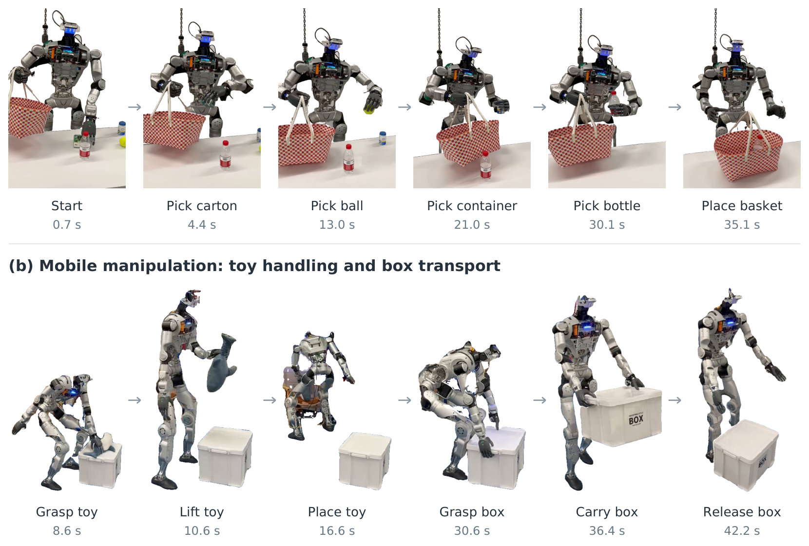
*图：OLI 评测套件示例：固定操作与移动操作两类任务。*

**边界**：全部结论绑定 LimX OLI 单平台三任务；无仿真大规模评测；FDM/IDM 各自单独贡献没有消融行（只有组合）；基线不含最新长上下文 WAM。论文状态 under review。

## 复用与后续

对做分层人形的团队，三个可直接搬走的东西：

1. **执行后状态当显式预测目标**——状态头接在动作专家输出旁即可，两行代码级别的改动，收益见其消融表（表2）。
2. **三路径（Policy/FDM/IDM）条件方式**——作为训练数据增广配方，不需要改骨干。
3. **action-execution gap 的度量协议**（Direct vs 稳态 MAE）——先测自己平台的 gap，再决定要不要上这个方法；gap 小的平台（如 ALOHA 0.648°）预期收益有限——这是我的推断，论文未验证。

后续想看：FDM-only/IDM-only 消融行；换强执行器后的收益曲线；XMove 类复合任务的失败模式分析。

**主表原版**（Table 1）：

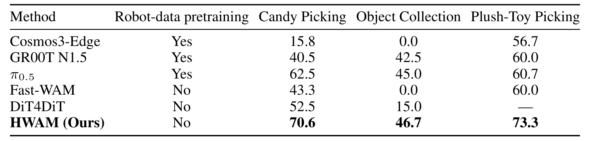
*图：Table 1 真机三任务主表：HWAM 70.6/46.7/73.3 全场第一。*

**受控消融原表**（Table 2）：

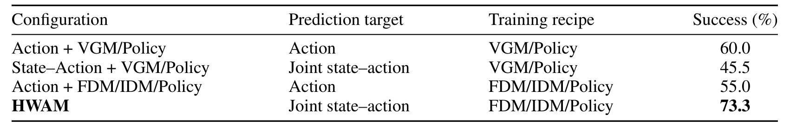
*图：Table 2 受控消融：四种配置 60.0/45.5/55.0/73.3，只有联合目标+三路径组合最优。*

**两平台 gap 原表**（Table 3）：

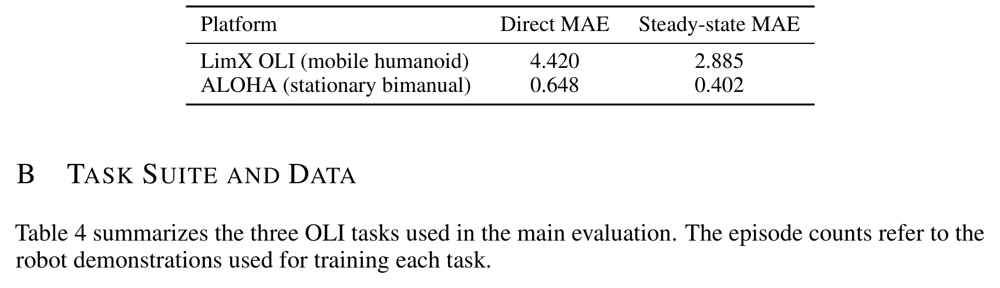
*图：Table 3 两平台 action-execution gap：OLI 4.420 vs ALOHA 0.648 度 MAE。*

**视频保真原表**（Table 5，PSNR/SSIM）：

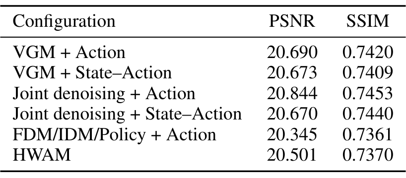
*图：Table 5 PSNR/SSIM 视频保真对照：HWAM 20.501 非全场最优。*

**视频保真全表**（Table 6，ground-truth 轨迹条件）：

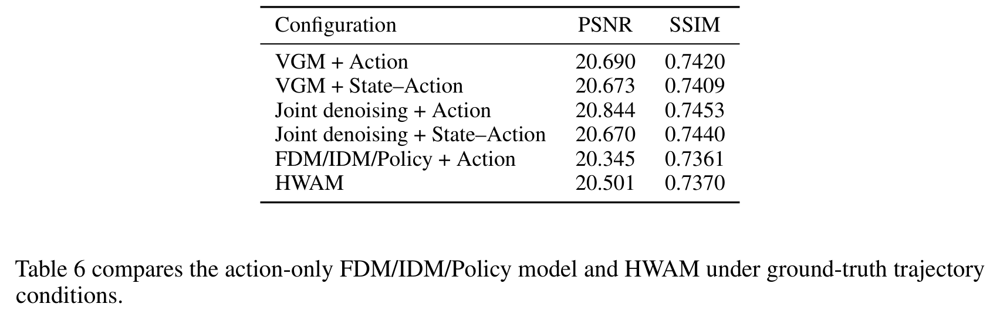
*图：Table 6 ground-truth 轨迹条件下的视频保真：HWAM 20.501/0.7370 非全场最优。*

**真机结果附加表**（Table 7，Candy Picking 置信区间与尝试数）：

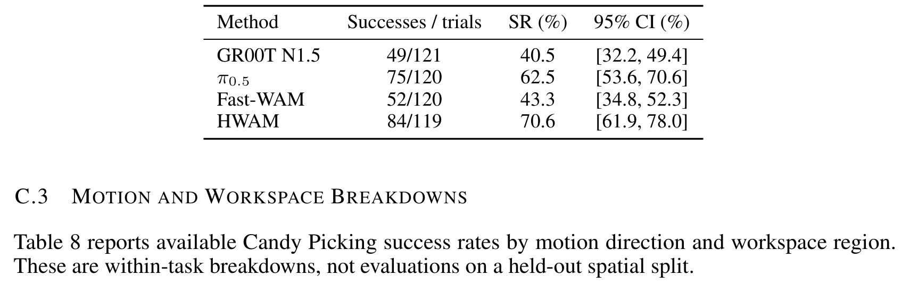
*图：Table 7 Candy Picking 附加表：HWAM 84/119 成功、95% 置信区间 61.9–78.0。*

**方向与工作区分解原表**（Table 8，(a) 运动方向 × (b) 工作区区域）：

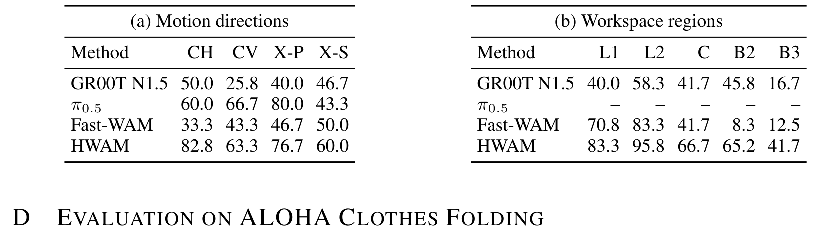
*图：Table 8 Candy Picking 方向/工作区分解：HWAM 低位区弱（B3 41.7）。*

**Table 9 原表/原图补充**（Table 9）：

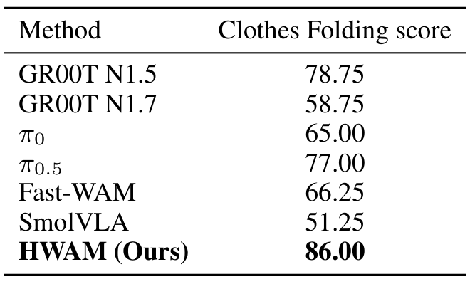
*图：Table 9：ALOHA 衣物折叠任务完成度评分（0–100 分制）。*
