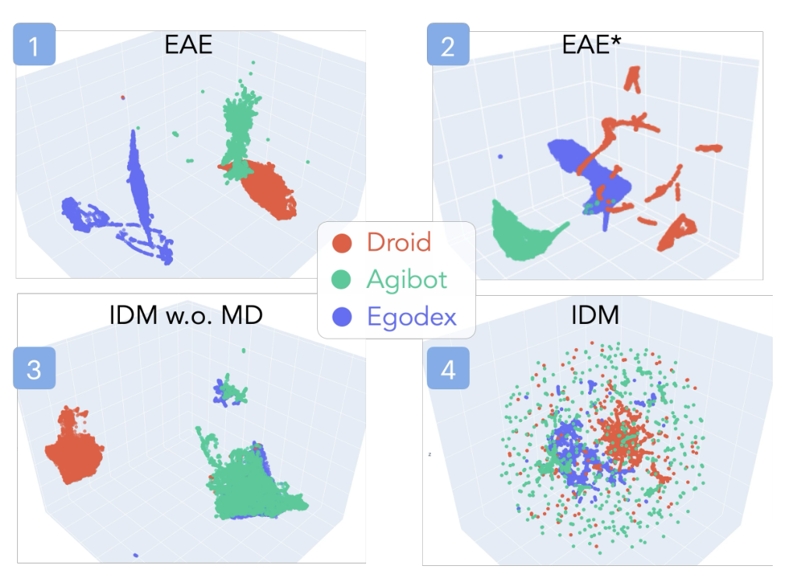
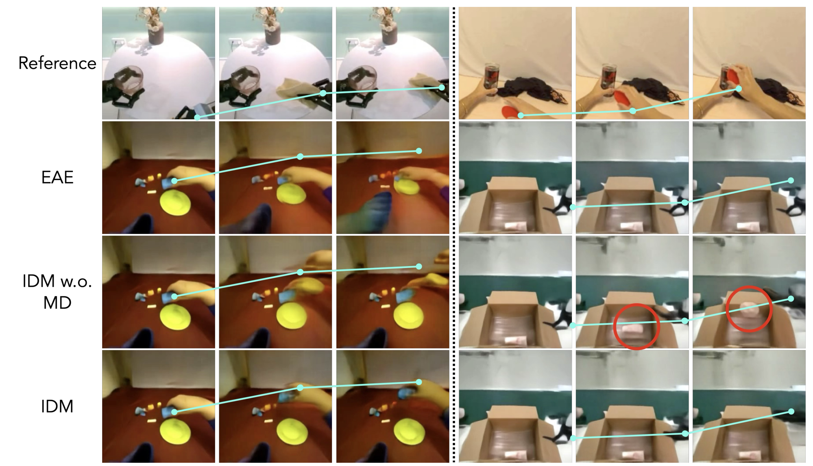
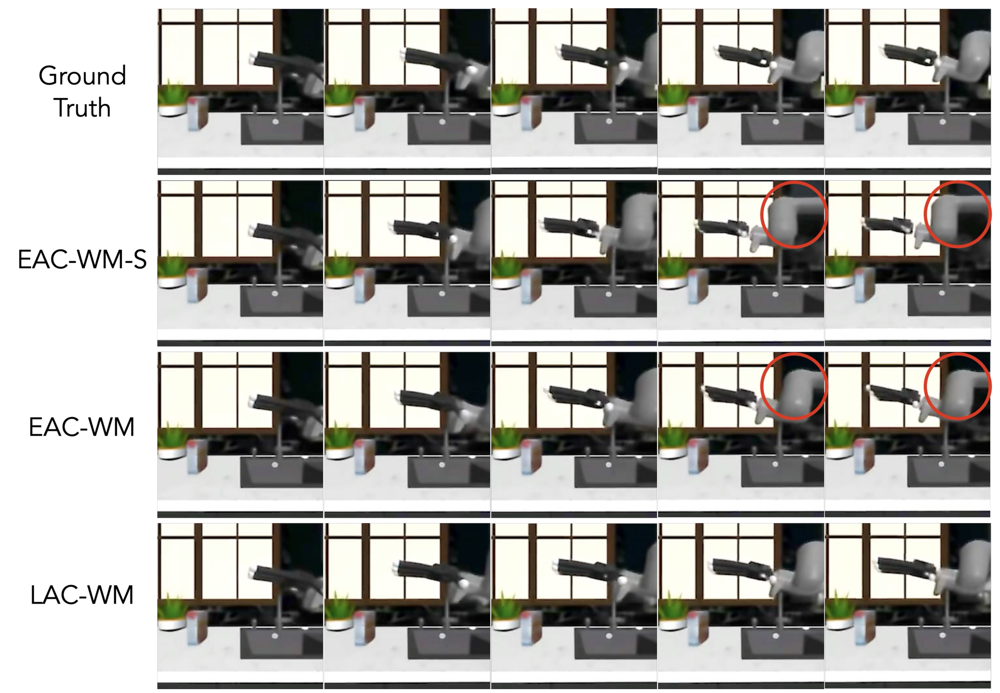
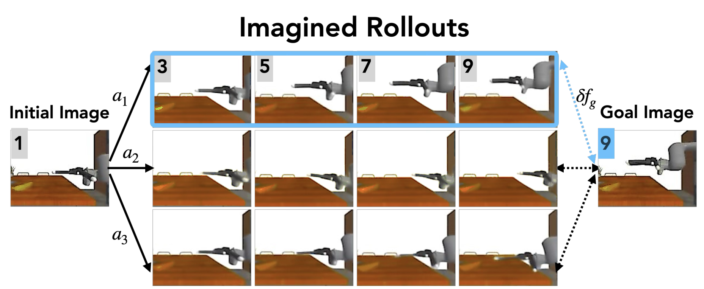
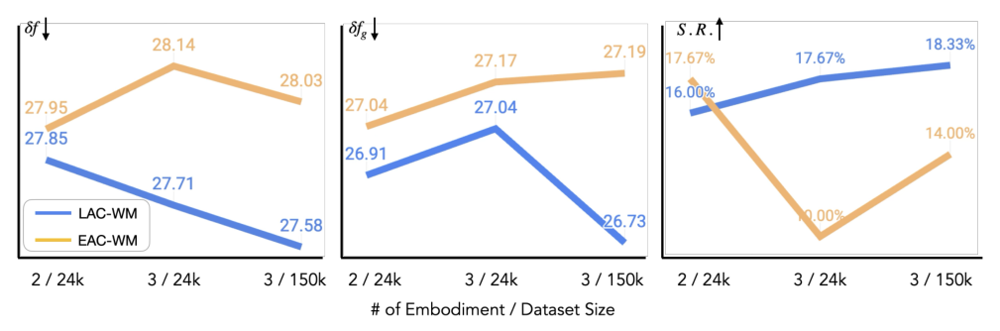
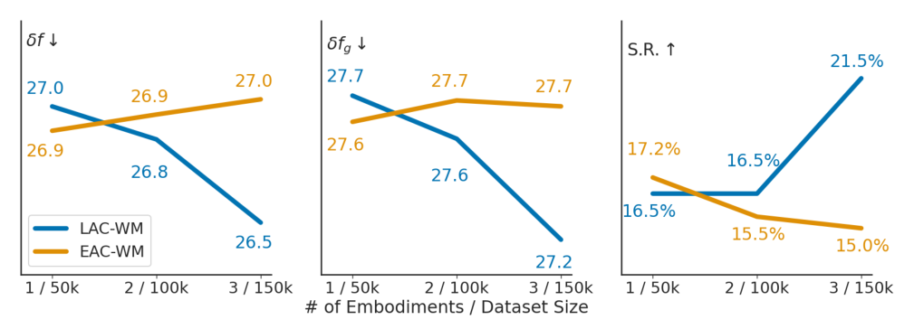
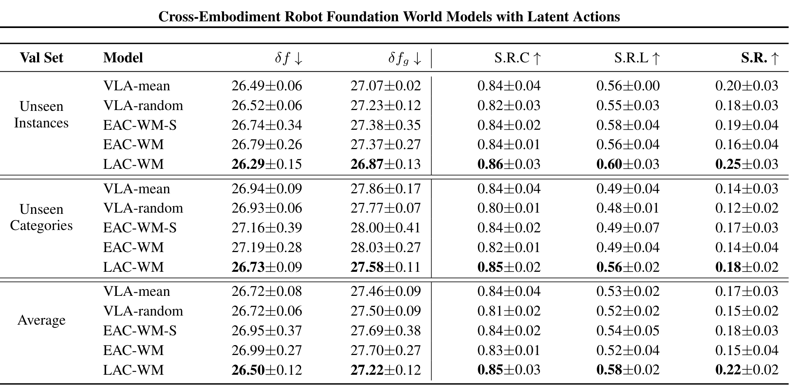
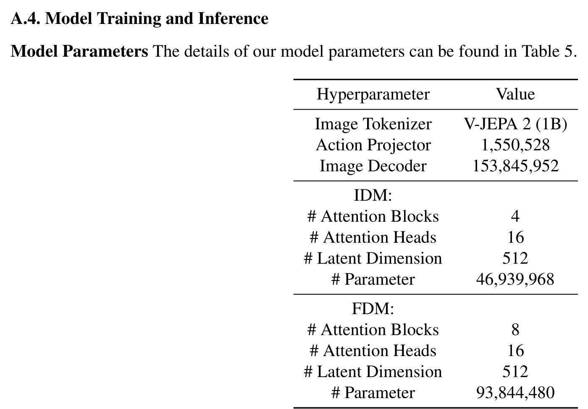
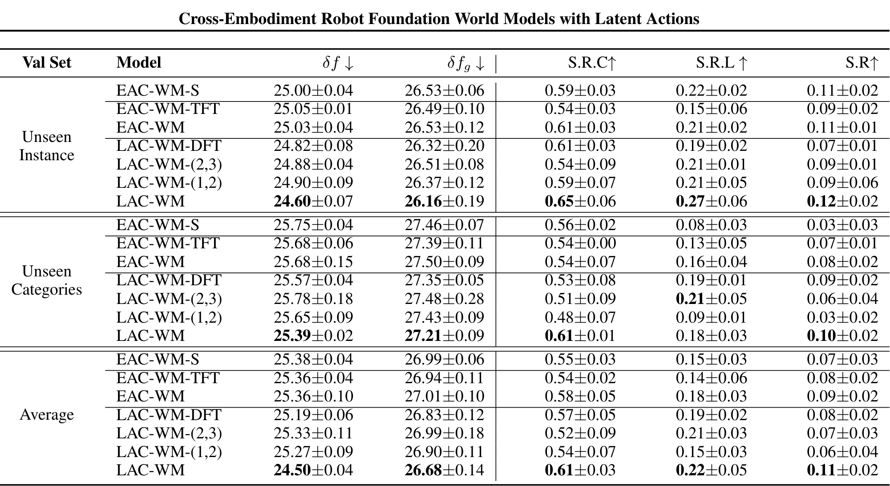

# Cross-Embodiment Robot Foundation World Models with Latent Actions

> arXiv:2610.10846（cs.RO）· v1 提交 2026-10-08 03:51 北京时间 · Huang Huang, Sriram Yenamandra, Arjun Majumdar, …, Li Fei-Fei, Jiajun Wu, Tingfan Wu, Franziska Meier（Stanford / Fei-Fei 线）· [项目页 lacwm.github.io](https://lacwm.github.io)
>
> 本文对应日报：news/2026-10-10.md（10-09 日报补充窗口已预告、承诺「下期与 UNITAS 合并评」的跨本体动作接口线）

## 为什么显式动作条件在跨本体上失败

世界模型要跨本体泛化，第一个障碍是动作空间：Franka 的 7 维关节、ALOHA 的 14 维、灵巧手的 20+ 维——每个本体一套动作标签。显式动作条件的世界模型（EAC-WM：Explicit Action-Conditioned World Model）直接拿这些标签当条件，结果是**每个本体的动作表示互相隔离**。

论文用 UMAP 把这件事画出来了（Figure 2，7,000 个动作嵌入，Droid 红 / Agibot 绿 / Egodex 蓝）：

*图：UMAP：显式动作编码器（EAE/EAE*）按本体分簇，IDM w/o MD 部分混合，IDM 完全混合。*

上两排（EAE/EAE*，显式动作编码器）三个数据集各成一簇，互不重叠；左下（IDM 去掉运动解码）红绿分开；右下（完整 IDM）三色完全混合。**显式动作标签把动作空间按本体切开，逆动力学学到的潜动作把三个本体的动作映进同一个区域。**

跨本体动作迁移的可视化对照（Figure 3）：

*图：跨本体动作迁移：IDM 学到的动作在换本体 rollout 中保持结构，显式编码器变体在右列出现红圈标注的失败。*

## LAC-WM 的机制流程

*图：LAC-WM 架构：预训练（黄色区）IDM 学统一潜动作空间 + Motion Decoder 解码运动标签；微调（绿色区）FDM 前向预测 + Action Projector 投影到本体动作。*

LAC-WM（Latent Action-Conditioned Robot World Model）四个组件：

1. **IDM（逆动力学）**：从观测对 (O_t, O_{t+1}) 推断潜动作 z——统一潜动作空间，跨本体共享。这是把上面 UMAP 里三色混合的那一层。
2. **Motion Decoder**：把潜动作解码为运动序列，可选运动标签监督（保持动作语义）。
3. **FDM（前向动力学）**：条件潜动作预测下一观测潜表示——想象 rollout 的发动机。
4. **Action Projector**：把潜动作投影到具体本体的动作空间——下游可执行。

模型规模（Table 5）：图像 tokenizer 用 V-JEPA 2 (1B)，IDM 46.9M、FDM 93.8M 参数——潜动作头是个轻量组件。

想象 rollout 的用法（Figure 6/7）：给定初始图像与动作序列，世界模型想象未来，用与目标图像的潜距离 δ_f/δ_fg 评估动作候选（action selection）：

*图：想象 rollout：初始图像 + 三条动作分支 a1/a2/a3，各自 rollout 后与目标图像比较 δfg。*

*图：动作选择 rollout：最左为当前观测，选出通向目标的动作。*

## 想象 rollout 与跨本体 scaling

主评测（Table 6，三档验证集，三重复 ± std）：

| 模型 | δf ↓ | δfg ↓ | S.R.C ↑ | S.R.L ↑ | S.R. ↑ |
|---|---:|---:|---:|---:|---:|
| VLA-mean | 26.72±0.08 | 27.46±0.09 | 0.84±0.04 | 0.53±0.02 | 0.17±0.03 |
| VLA-random | 26.72±0.06 | 27.50±0.09 | 0.81±0.02 | 0.52±0.02 | 0.15±0.02 |
| EAC-WM-S | 26.95±0.37 | 27.69±0.38 | 0.84±0.02 | 0.54±0.05 | 0.18±0.03 |
| EAC-WM | 26.99±0.27 | 27.70±0.27 | 0.83±0.01 | 0.52±0.04 | 0.15±0.04 |
| **LAC-WM** | **26.50±0.12** | **27.22±0.12** | **0.85±0.03** | **0.58±0.02** | **0.22±0.02** |

（Average 档；Unseen Instances / Unseen Categories 两档同样是 LAC-WM 全指标第一，，详见对应表格。）注意两个统计注入对照（VLA-mean/random）：**把动作标签换成均值或随机注入，显式条件还不如统计注入**——显式动作标签在跨本体上不只是没用，是有害的。

scaling 实验是论文最锋利的一张图（Figure 5，三档：2 本体/24k → 3 本体/24k → 3 本体/150k）：

*图：本体数 scaling：LAC-WM（蓝）随本体数增加 S.R. 16.0→17.67→18.33，EAC-WM（橙）17.67→0.00→14.00。*

- LAC-WM：δf 27.85→27.71→27.58 单调降；S.R. 16.0%→17.67%→18.33% 单调升。
- EAC-WM：S.R. 17.67%→**0.00%**→14.00%——第三本体一加入直接崩到零，数据加倍才勉强爬回 14%。

**显式动作条件的世界模型不仅不能从新本体受益，还会被新本体伤害**；潜动作空间把「加本体」从风险变成增益。这与摘要里「灵巧操作 +46.7%、LIBERO +11.7%」的下游数字互相印证。

## 边界与可复用组件

如实报出的负结果：LAC-WM 在 2 本体/24k 档 S.R. 16.0 **低于** EAC-WM 17.67——小数据、少本体时潜动作优势还没显现；想象 rollout 绝对成功率 0.22，离「可靠规划器」还远（想象 rollout 的视觉保真见 Figure 4 的 δf 分析）。

*图：δf 潜嵌入距离分析。*

超参数表（Table 5 附录版）与下游动作选择评测（Table 2）：

*图：VLA 动作选择的下游规划评测。*

可搬走的三件东西：

1. **「IDM 学潜动作 + Motion Decoder 可选标签监督」当动作接口层**——插在任何跨本体混合预训练里，LAC-WM 证明这一层随本体数正扩展。
2. **Figure 5 的 scaling 协议**（固定数据量加本体 vs 同比加数据）——验证自己潜动作空间可扩展性的标准实验设计。
3. **δf/δfg 潜距离指标族**——世界模型 rollout 质量的免真值评测，V-JEPA 特征空间里算距离即可。

**与 UNITAS（10-09 必读）的对照**：同一问题的两种解法——UNITAS 用 3D 点流做**物理**接口（URDF 采点、度量坐标系），LAC-WM 用 IDM 潜动作做**语义**接口（观测对推断、跨本体共享）。前者要 URDF，后者只要观测对；前者接地物理距离，后者接地视觉动力学。哪条路对腿式/全身形态更稳，两篇都没回答。

**模型超参数明细**（Table 5）：

*图：Table 5 模型超参数：V-JEPA 2 (1B) tokenizer、IDM 46.9M、FDM 93.8M。*

**三档验证全表**（Table 6 完整版）：

*图：Table 6 三档验证全表：Unseen Instances/Categories/Average 下 LAC-WM 全指标最优。*
