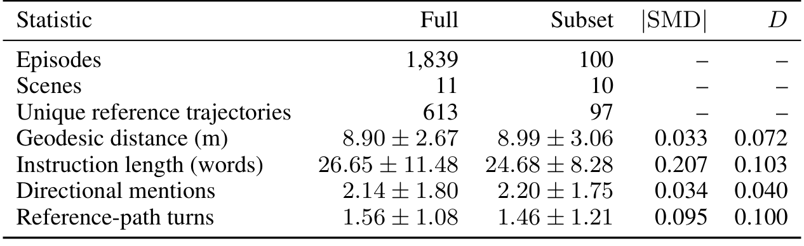
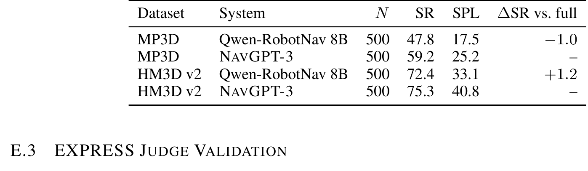
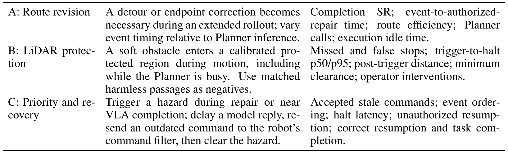
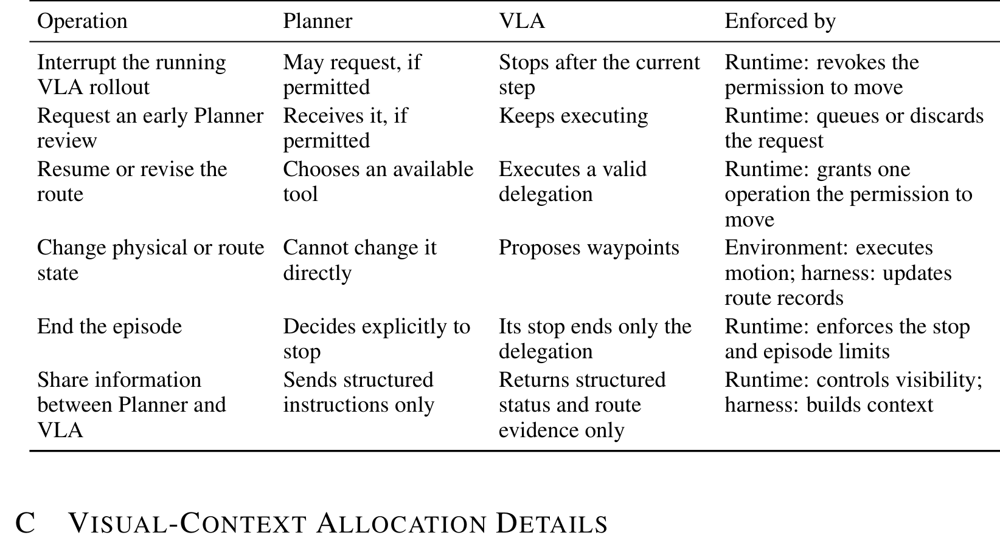
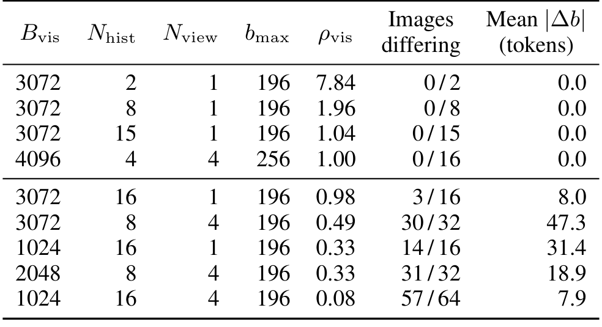
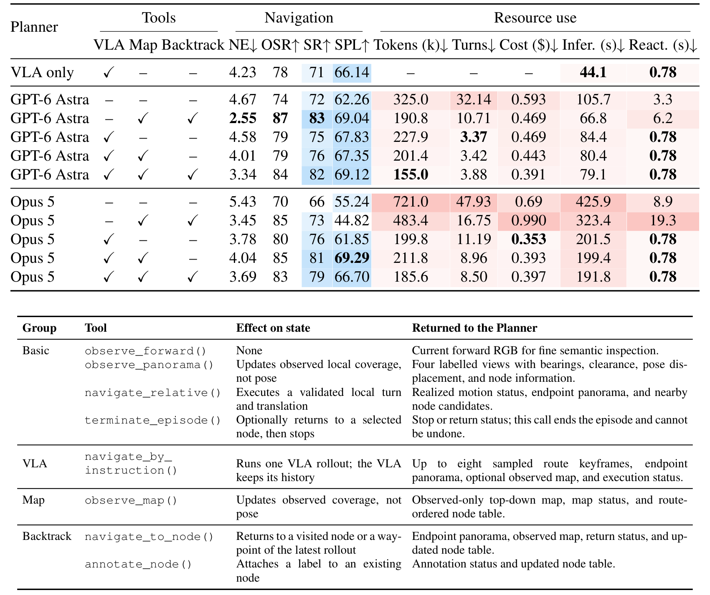
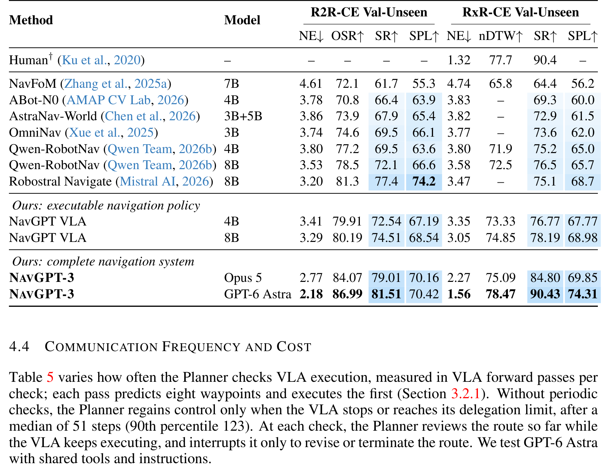
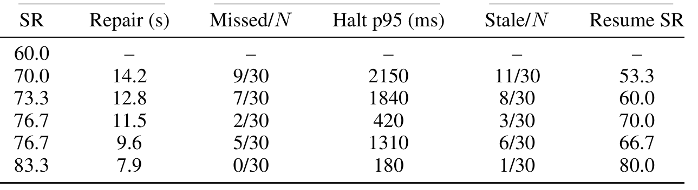

# NavGPT-3: Harnessing Context in a Hierarchical Navigation Runtime

> arXiv:2610.10787（cs.RO 交叉 cs.AI/CL/CV/LG）· v1 提交 2026-10-08 02:46 北京时间 · Gengze Zhou, Yicong Hong, Jiazhao Zhang, …, Stephen Gould, Anton van den Hengel, Qi Wu（Adelaide AIML / Metacognition / Roblox / PKU / SJTU / UNC / UNSW）· 36 页 14 图 · [项目页 metacognitionai.github.io/NavGPT3](https://metacognitionai.github.io/NavGPT3/)
>
> 本文对应日报：news/2026-10-10.md（补充窗口最高分条目；10-09 日报列为「下期合并评」的分层导航线）

## 为什么要给 LM 和 VLA 造一个操作系统

长视野 agentic RL 训出来的语言模型会推理、会用工具、能追目标多步——但物理交互需要的是 10–100ms 级的低延迟控制，这是动作策略（VLA）的领地。把两者接起来，最朴素的办法是让 LM 把 VLA 当工具调用：发指令 → **await return** → 等结果 → 再推理。

论文把这个叫**同步阻塞**：VLA rollout 的几十秒里，LM 干等。反过来，环境事件（障碍、偏航）发生时，得等 LM 的下一次决策才能反应——每语言决策 3–19 秒的最小反应时间就是这么来的。

## NavGPT-3 的机制流程

*图：NavGPT-3 总览：(a) runtime 抽象（Planner/VLA/空间工具）；(b) 同步工具调用 vs 异步线程协调；(c) RxR-CE 年度曲线——90.43 对齐人类 90.4。*

NavGPT-3 的答案是一个 **OS 式 runtime**：reasoning、acting、monitoring 跑成**线程**，各有自己的 context、tools、permissions；runtime 负责调度并决定**哪个线程握着运动权限**。突发事件靠中断与线程切换处理：$f_{\ell+1} = \sigma(S_\ell, f_\ell, e_\ell)$——下一帧的调度状态由当前状态、当前调度与事件共同决定。

四步走一遍执行链：

1. **Planner 决策**：context $C_k = \text{Context}_{main}(S_k, H_k, \mathcal{T}_k)$（状态+历史+工具状态）→ NavGPT Planner 输出动作 $a_k \sim \pi_{Planner}(\cdot \mid C_k, \mathcal{T}_k)$，经校验为工具调用。
2. **VLA 委托**：`navigate_by_instruction()` 触发一次 VLA rollout——至多 8 个采样 waypoint，**commit 单个**给环境执行；VLA 保持自己的历史，视觉token 按 codec 随场景变化分配。
3. **事件中断**：monitor 线程发现障碍/偏航 → runtime **撤销运动权限**、切线程；Planner 重评估（recheck）。
4. **回溯恢复**：Backtrack 工具 `navigate_to_node()` 回到已访问节点；权限位保证任一时刻只有一个操作持运动授权。

工具组四类（Table 4）：Basic（observe/navigate_relative/terminate）、VLA（navigate_by_instruction）、Map（observe_map）、Backtrack（navigate_to_node/annotate_node）。

## R2R-CE/RxR-CE 主结果与工具消融

主表（Table 6，val-unseen）：

| 系统 | R2R-CE SR↑ | R2R-CE SPL↑ | RxR-CE nDTW↑ | RxR-CE SR↑ |
|---|---:|---:|---:|---:|
| Human | — | — | 77.7 | 90.4 |
| NavFoM (7B) | 71.2 | 61.6 | 73.6 | 75.9 |
| Qwen-RobotNav (8B) | 77.4 | 74.2 | 76.8 | 79.2 |
| NavGPT VLA (8B，单模型) | 74.51 | — | 78.19 | 78.19 |
| **NAVGPT-3（GPT-6 Astra）** | **81.51** | 74.31 | **78.47** | **90.43** |

**RxR-CE 90.43 vs 人类 90.4、nDTW 78.47 vs 77.7——首次把自主导航 agent 带到人类跟随者水平**，且每 episode 1 分 22 秒（人类约 3 分钟）。单看 8B VLA 只有 78.19——**harness 在过硬的动作策略之上又加了约 12 点**，全部来自接口层。

工具组消融（Table 3，GPT-6 Astra）把「哪个工具值多少钱」拆开了：

| 配置 | NE↓ | SR↑ | Tokens(k)↓ | Turns↓ | React(s)↓ |
|---|---:|---:|---:|---:|---:|
| 无工具 | 4.67 | 72 | 325.0 | 32.14 | 3.3 |
| Map+Backtrack | 2.55 | 83 | 190.8 | 10.71 | 6.2 |
| VLA | 4.58 | 75 | 227.9 | 3.37 | **0.78** |
| VLA+Map+Backtrack | 3.34 | 82 | **155.0** | 3.88 | **0.78** |

VLA 委托一上，反应时间从 3.3s 掉到 **0.78s**（动作策略 1–2Hz 接管），回合数从 32 掉到 3.4——LM 不再逐 waypoint 微操。Backtrack 把 NE 从 4.67 修到 2.55。最省token 的反而是三工具全开的配置（155.0k）。

子集卫生：R2R ablation 子集与全集的 |SMD| ≤ 0.207（Table 15）——消融子集没有偏离全集分布，这个报告习惯值得抄。

*图：R2R 消融子集覆盖与分布（|SMD| 报告）。*

*图：ObjectNav 同 episode 对照：NAVGPT-3 75.3 vs Qwen-RobotNav 59.2（HM3D v2 子集）。*

## Go2 真机运行时与边界

*图：Go2 场景与测量协议：路线修正/激光保护/优先级与恢复三类场景。*

Go2 四轮真机上的运行时指标（Table 10）随检查频率单调改善：Missed 从 9/30 降到 0/30，Halt p95 从 2150ms 压到 **180ms**，Resume SR 53.3→80.0。修复时间 7.9–14.2s——LM 重新介入的代价如实报出。

中断/恢复协议矩阵（Table 12）：

*图：中断/恢复六行协议：谁可中断、谁可恢复、runtime 强制什么。*

allocator 合成检查（Table 13）验证视觉token预算分配 $b_{max}$、$\rho_{vis}$ 与实际token差 $\lvert\Delta b\rvert$ 的关系——分配机制按设计工作：

*图：视觉上下文分配合成检查：ρ_vis 与 Mean |Δb| tokens。*

**边界与负结果**（论文如实报出）：无工具的 GPT-6 Astra 又贵又慢（325k tokens、React 3.3s）；Opus 5 无工具是最差配置（721k tokens、Infer 425.9s、SR 66）；Go2 中断后 Resume SR 最高 80——恢复链路仍是薄弱环节。全部成本/延迟数字绑定 GPT-6 Astra 与 Opus 5 两个 planner；「人类水平」指 RxR-CE val-unseen 跟随者协议，不是开放世界导航。

## 复用与后续

1. **「线程 + 权限位 + 中断」runtime 抽象**——Table 12 的六行协议是现成设计模板，可搬到任何 LM+策略双模型栈。
2. **codec 视觉token 分配**（随场景变化比例）——端侧预算敏感部署的通用技巧。
3. **|SMD| 子集报告**——避免消融子集偏置的评测卫生范式。

后续想看：planner 换开源 7B 级模型的表现（论文只报两个闭源前沿模型）；1min22s/episode 的成本在长时任务下是否可接受（单集 0.391–0.990 美元）；承诺的「全部模型/代码/评测记录」落地时间。

**工具组完整矩阵**（Table 3 全量，含 Opus 5 全行）：

*图：Table 3 工具组消融全表：VLA/Map/Backtrack 组合矩阵与资源使用。*

**工具组定义全表**（Table 4）：

*图：Table 4 工具定义：Basic/VLA/Map/Backtrack 四组的效果与返回值。*

**导航主结果全表**（Table 6 原表）：

*图：Table 6 导航主结果全表：R2R-CE/RxR-CE 各指标与 Human 基线。*

**Go2 运行时结果原表**（Table 10）：

*图：Table 10 Go2 运行时结果：Missed/Stale/Halt p95/Resume SR 随检查频率改善。*
