# SimVLA: Zero-Shot Sim-to-Real VLA Learning for Mobile Manipulation

> arXiv:2610.11248（cs.RO）· v1 提交 2026-10-08 12:52 北京时间 · Kyoungin Baik, Youngwoon Lee（USC 线）· [项目页 kyounginbaik.github.io/simvla](https://kyounginbaik.github.io/simvla/)
>
> 本文对应日报：news/2026-10-10.md（补充窗口条目；Sim-to-Real 移动操作 VLA 线）

## 仿真数据为什么还没喂饱移动操作 VLA

LLM/VLM 靠大规模多样数据起飞，机器人 VLA 却被真实数据采集成本卡住。仿真便宜，但现有移动操作数据生成器各有缺口（Table 1 特征矩阵，11 个生成器逐项对比）：

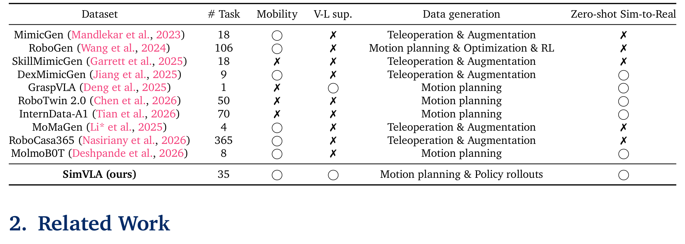
*图：数据生成器特征矩阵：SimVLA 首次同时拿到 mobility + V-L 监督 + 零样本 sim-to-real。*

MimicGen/RoboGen/RoboTwin 2.0 等没有视觉-语言监督（V-L sup. ✗）；GraspVLA 只有 1 个任务；RoboCasa365 有 365 任务但零样本迁移 ✗。**移动性 + 视觉语言监督 + 零样本 sim-to-real 三项同时拿到的此前没有**——SimVLA 这一行三项全 ○。

## SimVLA 的机制流程

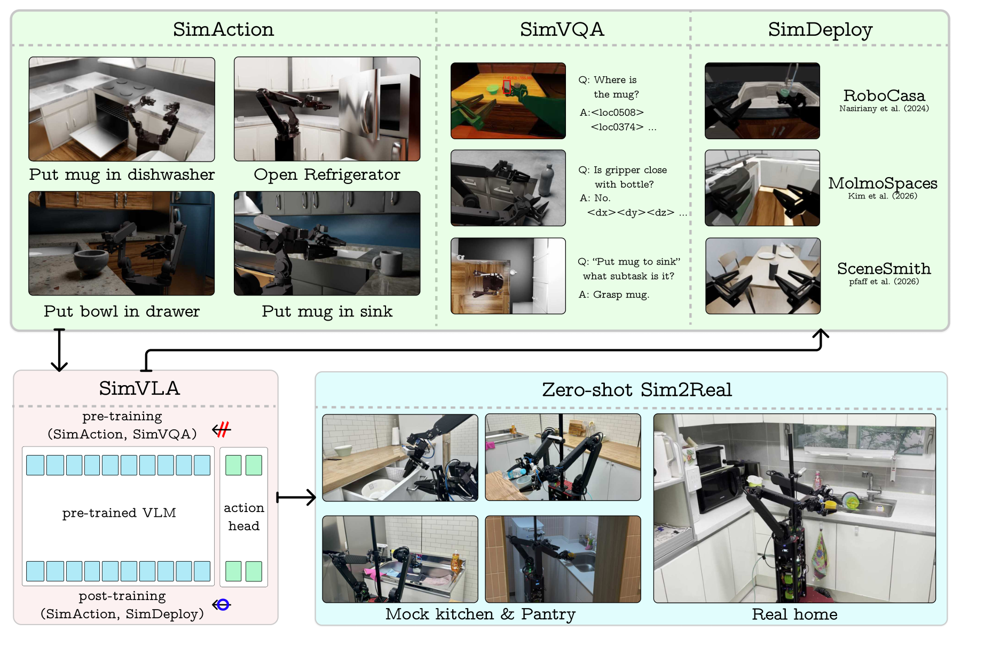
*图：SimVLA 总览：上排三仿真源（SimAction 动作 / SimVQA 视觉问答 / SimDeploy 部署环境），下排两阶段训练后零样本部署真机（mock kitchen 与 real home）。*

三个仿真数据源分工明确：

- **SimAction**：原子技能组合出 35 个移动操作任务的演示（Put mug in dishwasher / Open refrigerator / …）——动作监督。
- **SimVQA**：**特权仿真状态**（物体位姿、几何、子任务标签）模板化成视觉问答对——空间/几何/子任务级监督。模板样例（Table 6）：

  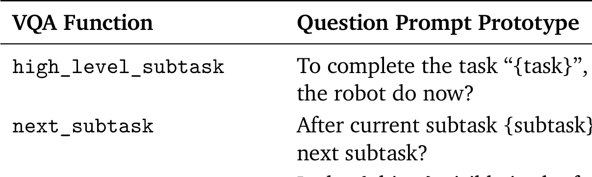
*图：SimVQA 提问原型：high_level_subtask / next_subtask 等。*

- **SimDeploy**：策略在多仿真环境（RoboCasa / MolmoSpaces / SceneSmith）rollout 收集的部署分布数据——环境多样性来源。

两阶段训练（Figure 2）：

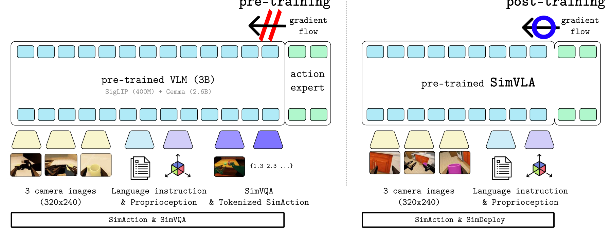
*图：两阶段训练：pre-training（SimAction+SimVQA，gradient 封锁进 VLM）→ post-training（SimAction+SimDeploy，action expert 解锁）。*

- **pre-training**（SimAction+SimVQA）：动作专家流匹配，梯度**封锁**不进预训练 VLM（图里被红斜杠挡住的 gradient flow）——保护 3B VLM（SigLIP 400M + Gemma 2.6B）的语义能力。
- **post-training**（SimAction+SimDeploy）：action expert 解锁（蓝色 gradient flow），在 rollout 分布上适应。

系统辨识关卡（Table 3）：仿真接受条件是 EEF 位置/姿态/速度三误差均低于阈值（混合 joint+EEF 目标最优 13.3mm）：

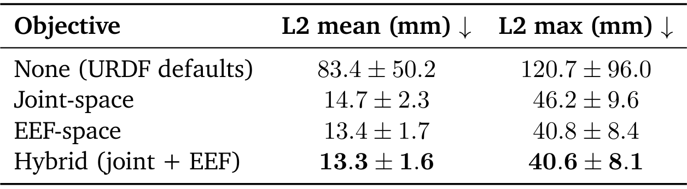
*图：Sim-to-real 系统辨识消融：混合 joint+EEF 目标 L2 mean 13.3mm 最优。*

## 零样本真机与 OOD 主结果

真机五任务（Anubis 移动操作平台，每任务 20 次，均值±std + 成功数，Table 13）：

| 模型 | T1 | T2 | T3 | T4 | T5 |
|---|---:|---:|---:|---:|---:|
| π₀.₅ + 50 demos | 0.55 (8/20) | 0.36 (5/20) | 0.48 (6/20) | 0.45 (7/20) | 0.43 (7/20) |
| π₀.₅ + 200 demos | **0.75** | **0.66** | **0.70** | **0.65** | **0.63** |
| SimVLA（去预训练） | 0.28 | 0.15 | 0.15 | 0.18 | 0.08 |
| SimVLA | 0.60 (9/20) | 0.50 (6/20) | 0.52 (6/20) | 0.55 (9/20) | 0.55 (8/20) |

**纯仿真训练的 SimVLA 全面超过 50 条真机演示微调的 π₀.₅**，但 ID 环境下 200-demo 档仍更高——真机数据在域内有价值，这个边界论文没有藏。

OOD 上局面反转（Table 15，Mock Kitchen OOD-Vis，视觉扰动）：

| 模型 | T1 | T2 | T3 | T4 | T5 |
|---|---:|---:|---:|---:|---:|
| π₀.₅ + 200 demos | 0.45 | 0.45 | 0.45 | 0.53 | 0.48 |
| **SimVLA** | **0.63** | 0.40 | 0.47 | **0.58** | **0.60** |

**视觉 OOD 下 SimVLA 反超 200-demo 档**——SimDeploy 的环境多样性兑现在这里。

部分可观测是区分度最大的协议（Table 2）：Pick/PnP/Partial observation 三条件下 MolmoBOT 全 0.0，SimVLA 51.8/49.0/81.0（SimVLA kitchens 91.2/79.5/81.0）：

| 条件 | MolmoBOT | SimVLA（MolmoSpaces） | SimVLA（自家厨房） |
|---|---:|---:|---:|
| Pick | 36.3 | 71.0 | 91.2 |
| PnP | 1.0 | 49.0 | 79.5 |
| 部分可观测 | 0.0 | 51.8 | 81.0 |

*上表数值转写自原论文第二张表（该表裁剪件未通过视觉审查，故以文字转写呈现）。*

## 消融、监督质量与边界

两阶段缺一不可（Table 16）：

| 模型 | T1 | T2 | T3 | T4 | T5 |
|---|---:|---:|---:|---:|---:|
| w/o SimVQA | 0.43 | 0.36 | 0.37 | 0.50 | 0.45 |
| w/o TokSimAction | 0.40 | 0.29 | 0.42 | 0.43 | 0.50 |
| w/o both | 0.38 | 0.26 | 0.37 | 0.48 | 0.45 |
| **SimVLA** | **0.60** | **0.50** | **0.52** | **0.55** | **0.55** |

SimVQA 监督质量直接评测（Table 11，held-out 1,369 样本）：gripper 判断 L/R 1.00/0.89、子任务判断 0.69/0.77、**3D 定位误差 0.06m**、抓取点 0.05m、跨视角 IoU 0.61。去掉 SimVQA 后这些指标直接未定义（模型输出退化为 tokenized action）——监督的必要性被如实标注：

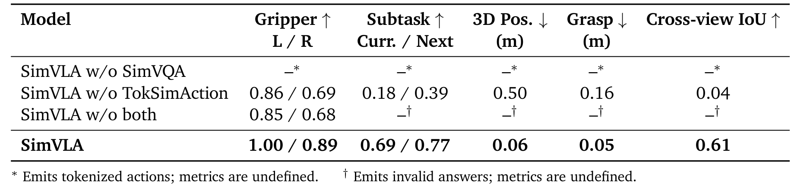
*图：SimVQA held-out 评测：gripper 1.00/0.89、3D Pos 0.06m、IoU 0.61。*

训练配方（Table 7/8）：全局 batch 256、BF16、cosine LR 5e-5、动作 chunk 50、采样 10 步、weight init PaliGemma base → pretrain ckpt。

**边界**：真机验证限于 Anubis 平台三任务族（restocking/pouring/cleaning）；「零样本」指评测环境与物体不在训练数据，任务规格仍需 35 任务内的技能组合；接触富任务（布料/装配）未验证；SimDeploy 环境数-鲁棒性的剂量关系未量化——这是我最想补的实验。

## 复用与后续

1. **「特权仿真状态 → VQA 模板」**——把仿真里免费的全状态监督变现的通用配方，模板表直接抄。
2. **SimDeploy 的 rollout-环境循环**——廉价的部署鲁棒性来源，可插到任何仿真训练栈的 post-training。
3. **部分可观测协议**（遮挡/视野受限）——检验 sim-to-real 鲁棒性的高区分度评测，比干净 OOD 更狠。

后续想看：SimDeploy 环境数的剂量曲线；接触富任务上的配方迁移；与真机数据混合的最优比例（现在只有 0/50/200 三个点）。

**预训练超参数**（Table 7）：

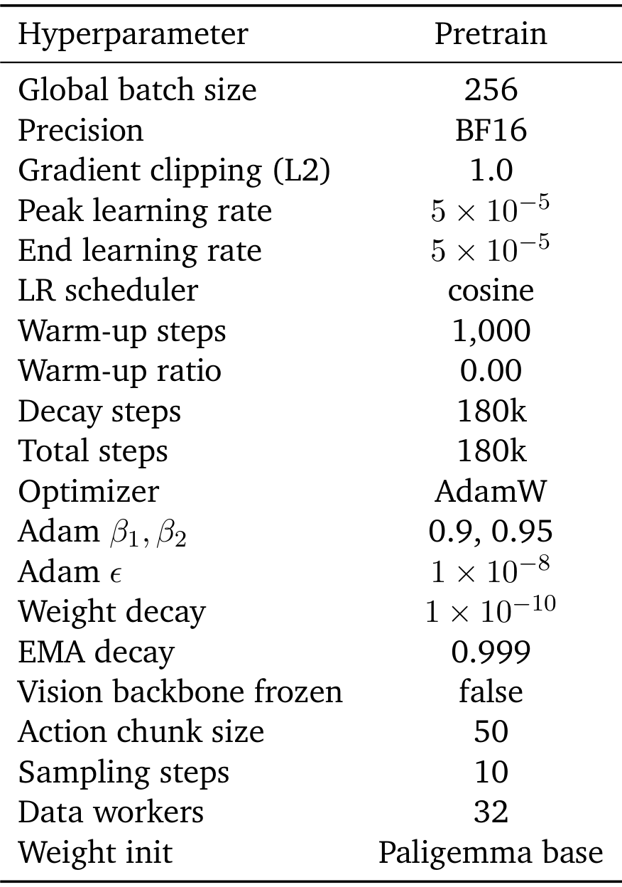
*图：Table 7 预训练超参数：batch 256、cosine 5e-5、chunk 50、采样 10 步。*

**两阶段超参数对照**（Table 8）：

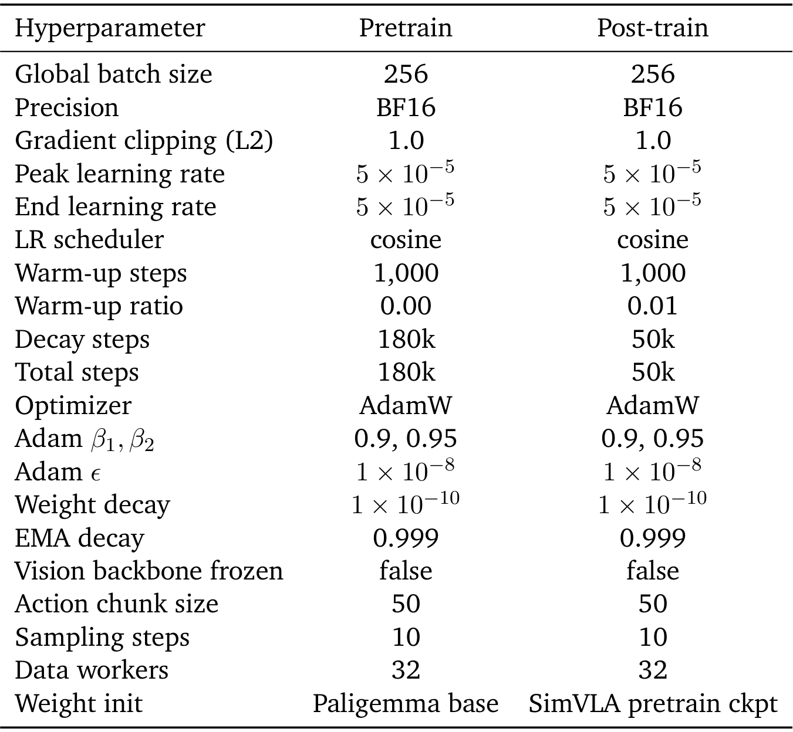
*图：Table 8 两阶段超参数对照：Pretrain 180k 步 vs Post-train 50k 步、weight init 链。*

**真机五任务主表原版**（Table 13）：

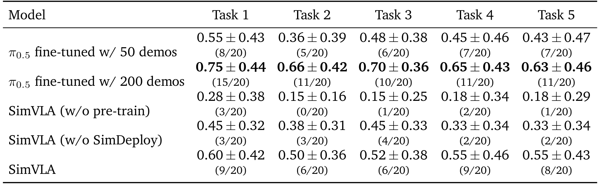
*图：Table 13 真机五任务主表：SimVLA 0.60/0.50/0.52/0.55/0.55 vs π0.5 两档。*

**OOD-Vis 主表原版**（Table 15）：

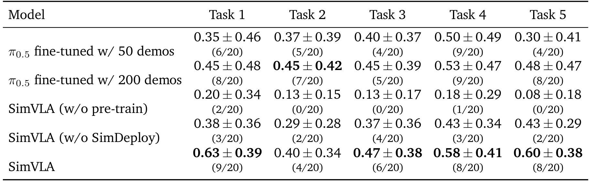
*图：Table 15 Mock Kitchen OOD-Vis 主表：SimVLA 反超 200-demo π0.5。*

**两阶段消融原表**（Table 16）：

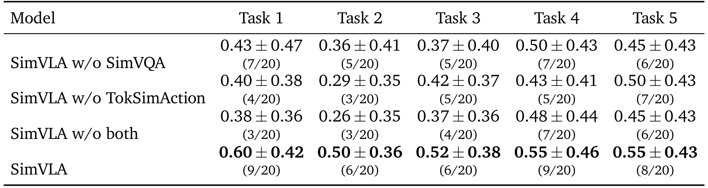
*图：Table 16 两阶段消融：w/o pre-train 近零、w/o SimDeploy 全线掉。*
