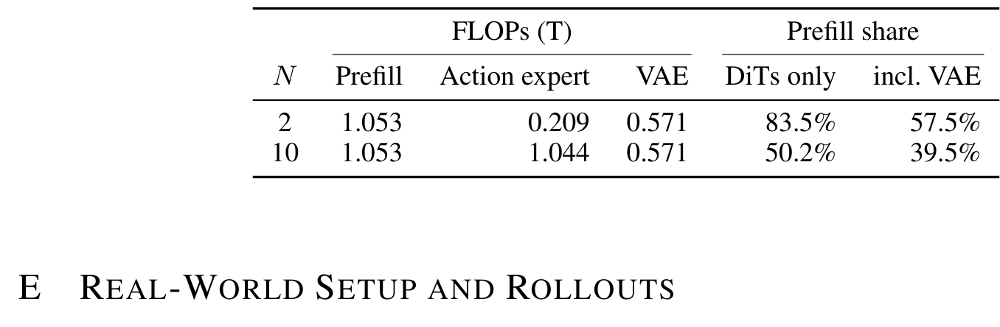
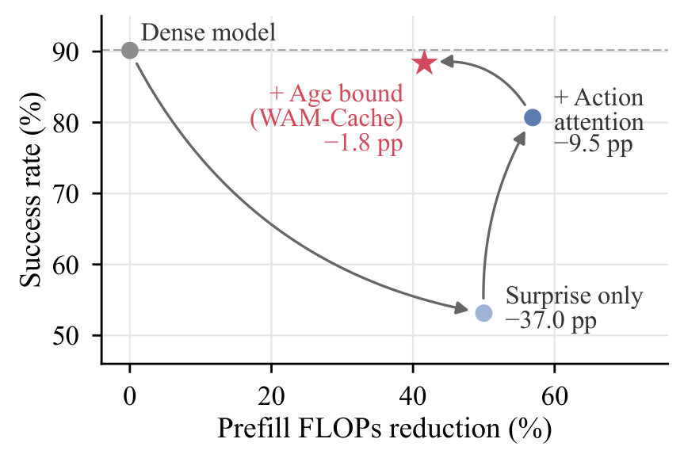
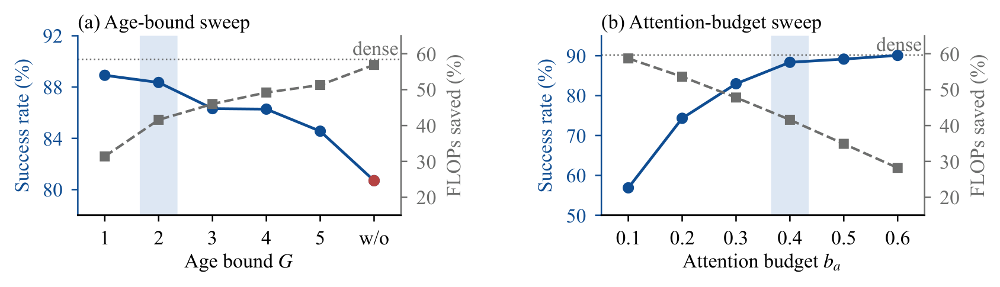
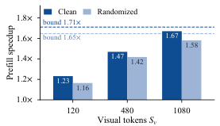
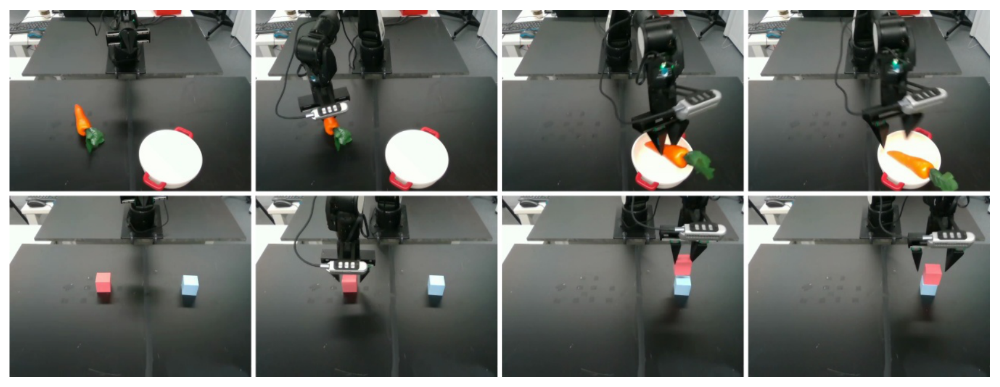
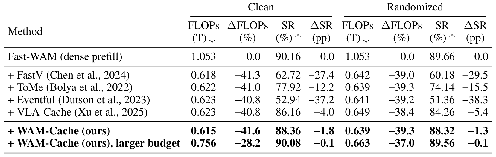
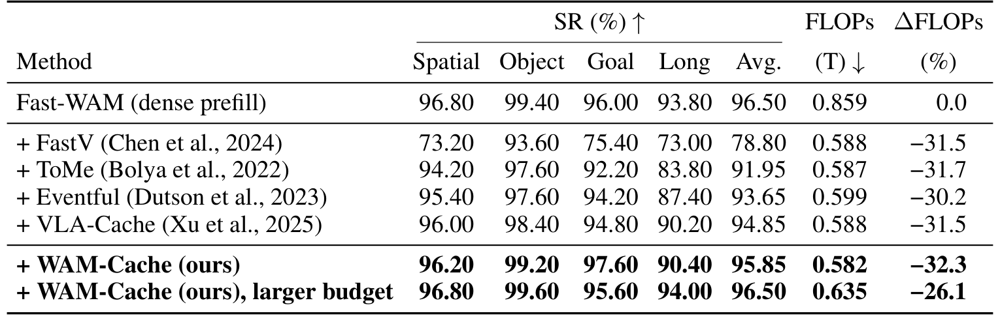
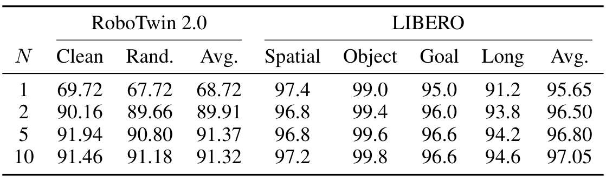

# WAM-Cache: Staleness-Bounded KV Reuse for Efficient World Action Models

> arXiv:2610.11401（cs.RO 交叉 cs.CV/cs.LG）· v1 提交 2026-10-08 15:33 北京时间 · Kai Ding, Yang He, Ruijie Quan, Yi Yang · 19 页 5 图 7 表 · [项目页 dingkai0302.github.io/wam-cache](https://dingkai0302.github.io/wam-cache/)
>
> 本文对应日报：news/2026-10-10.md（补充窗口条目；WAM 推理加速线）

## prefill 为什么贵、朴素缓存为什么失败

World Action Model（WAM）在闭环控制里每个 chunk 都要跑一遍 video DiT，把当前观测编码成层间 KV 给动作专家查询。这一步 **prefill 主导每 chunk 计算成本**：Per-chunk FLOPs 分解（Table 7）显示 N=2 去噪步时 prefill 1.053T 占 DiT-only 份额 **83.5%**——动作专家才 0.209T。

*图：Per-chunk FLOPs 分解：prefill 1.053T、动作专家 0.209T、VAE 0.571T；prefill 份额 83.5%（DiT-only）。*

现有 training-free 加速（FastV/ToMe/Eventful）全在动注意力或token 合并，**没有一个动 prefill 的稠密性**。最直觉的修法是「哪里动了刷哪里」——只刷新视觉漂移的token。论文先把这个直觉干掉了：

**Oracle 实验**：给缓存系统真值的 KV 漂移预测，只刷新漂漂移token——**收益平台期远低于 dense 基线**。视觉漂移不是正确信号。**下游动作精度由动作专家注意哪里决定，不由什么动了决定。**

## WAM-Cache 的机制流程

*图：WAM-Cache 推理管线：(a) 三信号选 refresh set——潜惊讶 / 动作条件选择 / 年龄上界；(b) 选中token 走 Video DiT prefill、层间 KV 跨 chunk 复用、动作专家查询。*

Refresh set $R_t = S_t \cup P_t \cup A_t$，三个信号各管一段：

1. **潜惊讶 $S_t$**（01）：当前观测经 VAE+投影得 $z_t$，与参考记忆（上次刷新的 $z_{\tau_i}$）差分 → surprise → TopK。
2. **动作条件选择 $P_t$**（02）：动作专家每层的动作-视觉注意力 $p_t$（查询来自动动作token）→ 均值 → TopK——**用「动作专家看哪」代替「画面哪变了」**。
3. **年龄上界 $A_t$**（03）：每个token 的年龄 $g_i$ 到界 $G$ 强制刷新——抑制跨 chunk 复用的复合误差。

推理侧（Figure 1b）：选中的token 走 Video DiT prefill，层间 KV 保留跨 chunk 复用；动作专家跨层查询复用 KV 去噪出动作 chunk。

## 主结果与消融瀑布

Fast-WAM 上三个基准（Table 1/2，clean + randomized 双档）：

**RoboTwin 2.0（50 任务 × 100 episodes，Table 1）**：

| 方法 | Clean FLOPs(T)↓ | Clean ΔSR | Rand. FLOPs↓ | Rand. ΔSR |
|---|---:|---:|---:|---:|
| Fast-WAM（dense prefill） | 1.053 | 0.0 | 1.053 | 0.0 |
| + FastV | 0.618 | −27.4 | 0.642 | −29.5 |
| + ToMe | 0.622 | −12.2 | 0.639 | −15.5 |
| + Eventful | 0.623 | −37.2 | 0.641 | −38.3 |
| + VLA-Cache | 0.623 | −4.0 | 0.649 | −5.4 |
| **+ WAM-Cache** | **0.615** | **−1.8** | **0.639** | **−1.3** |
| + WAM-Cache（更大预算） | 0.756 | −0.1 | 0.663 | −0.1 |

**−41.6% FLOPs 只掉 1.8pp 成功率**；同类基线掉的 4–37pp。LIBERO（Table 2，四套件）：Avg 96.50 → 95.85（−32.3% FLOPs）。

消融瀑布（Figure 2）把三信号的贡献逐级剥开：

*图：消融瀑布：Dense 90% → Surprise only 53%（−37.0pp）→ +Action attention 80.5%（−9.5pp）→ +Age bound（WAM-Cache）88.2%（−1.8pp）。*

- Dense 90% → **Surprise only 53%**（−37.0pp）：朴素「按动刷新」是陷阱，论文明确报出。
- → **+动作注意力 80.5%**（−9.5pp）：动作条件选择收回 27.5pp——「动作专家看哪」才是对的信号。
- → **+年龄上界 88.2%**（−1.8pp）：WAM-Cache 完整版。

## 超参、真机与边界

Age bound 扫描（Figure 4a）：G=2–3 是甜点区（成功率 ≈88.5%、FLOPs 省 42–47%）；**去掉年龄上界（w/o）成功率塌到 81%、FLOPs 省 58%**——省过头，陈旧 KV 的复合误差失控。attention budget 扫描（Figure 4b）：b_a=0.4–0.5 处成功率回到 dense 水平。

*图：超参扫描：(a) Age bound G 甜点区 2-3；(b) attention budget b_a 0.4-0.5 回到 dense 水平。*

实际 CUDA 延迟加速（Figure 3）：视觉token S_v=120/480/1080 三档 → clean 1.23×/1.47×/**1.67×**（上界 1.65–1.71×）——实现开销使实际加速略低于 FLOPs 减省比例。

*图：Prefill CUDA 加速：三档视觉token 下 1.23-1.67x，虚线为理论上界。*

真机五任务（Figure 5，AIRBOT Play 单臂）：WAM-Cache 在 Fast-WAM 档比 dense 推理**高 17.2pp** 成功率——缓存不仅没伤真机，更低延迟的执行反而帮忙（推测与动作平滑有关，论文未深究——尚不能确定归因）：

*图：真机任务：放胡萝卜入碗 / 叠积木，AIRBOT Play 臂。*

动作步数扫描（Table 5）：N=1→2 掉点最大（68.7→89.9 RoboTwin），N≥5 趋稳——与 prefill 份额随 N 下降（83.5%→50.2%）一致。

**边界**：全部结果绑定 Fast-WAM 实现（Wan2.1 系骨干）；「FLOPs 减省」只算 prefill 侧（VAE 0.571T 与动作专家另计）；对双向 AR 骨干 WAM（Long-WAM 类）未验证；极端低延迟（<10ms/chunk）未报告。

## 复用与后续

1. **「动作专家注意力当刷新信号」**——可移植到任何 DiT+action expert 双流架构；比视觉新颖性信号可靠（消融瀑布 27.5pp 的差距摆在那里）。
2. **年龄上界 G**——防 KV 陈旧化复合误差的最小机制，两行代码。
3. **Oracle 漂移实验设计**——给真值漂移看收益是否平台，检验任何缓存信号的有效协议。

后续想看：双向 AR 骨干上的动作注意力信号；与 RealtimeWAM 类并行执行的叠加（两者正交，尚无实验证明可叠加）；动态 G（按任务自适应年龄界）。

**RoboTwin 2.0 主表全量**（Table 1，含 randomized 档）：

*图：Table 1 RoboTwin 2.0 全量：WAM-Cache -41.6% FLOPs 只掉 1.8pp。*

**LIBERO 主表全量**（Table 2，Spatial/Object/Goal/Long 四套件）：

*图：Table 2 LIBERO 全量：四套件 Avg 95.85（-32.3% FLOPs）、larger budget 96.50。*

**动作去噪步数扫描**（Table 5）：

*图：Table 5 动作去噪步数扫描：N=1 到 10 的成功率与 FLOPs 变化。*
