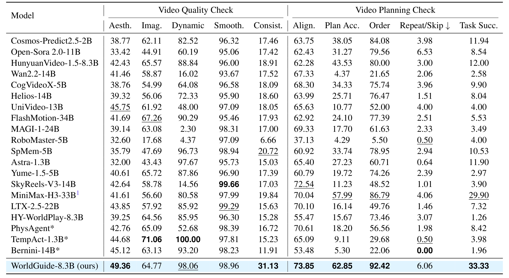
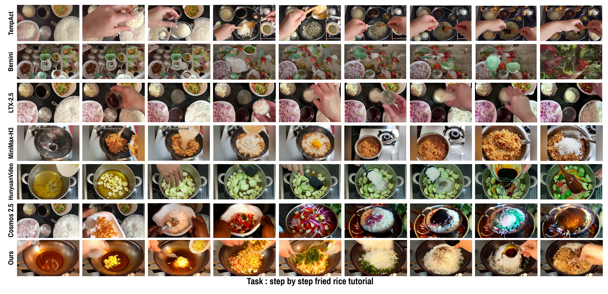
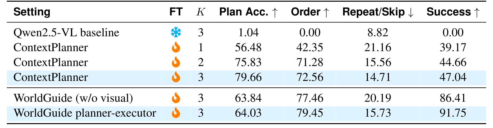
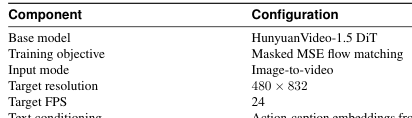
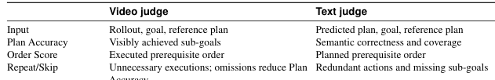
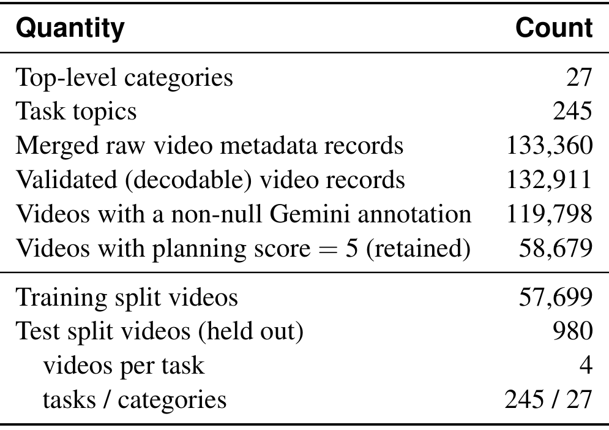
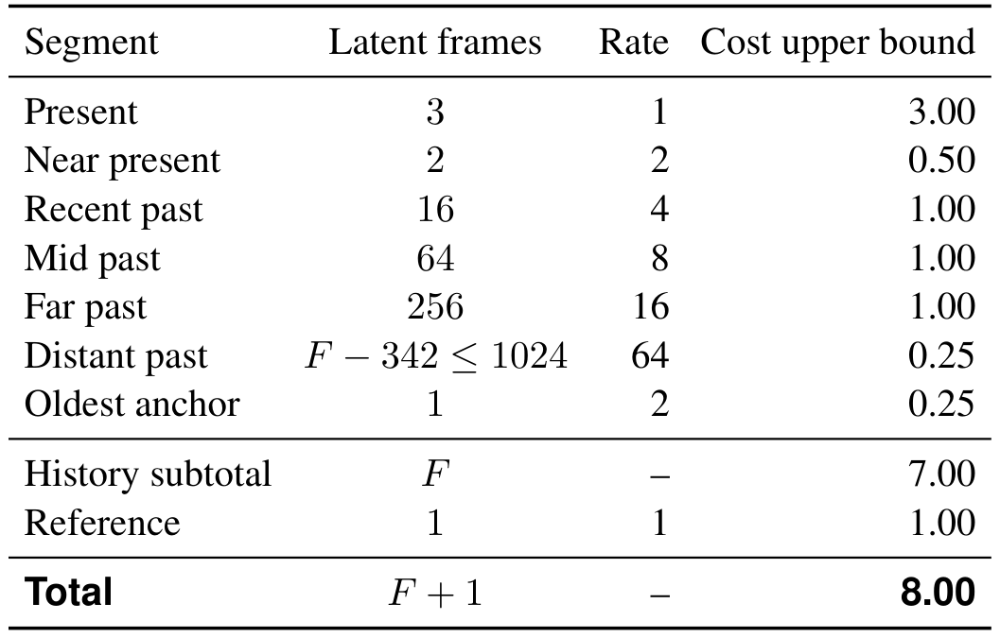

# WorldGuide: Goal-Directed Video World Model for Procedural Task Execution

> arXiv:2610.12459（cs.CV）· v1 提交 2026-10-09 01:59 北京时间（周四 ET 日间提交，周五批公告）· Ankan Deria, Komal Kumar, Hisham Cholakkal, Fahad Shahbaz Khan, Salman Khan（MBZUAI 线）· 34 页 14 图 15 表
>
> 本文对应日报：news/2026-10-10.md（补充窗口条目；程序性视频世界模型线）

## 开环合成为什么撑不起程序性任务

视频生成器能合成看着合理的轨迹，但程序性任务（做饭、组装、折毛巾）是**长视野、强依赖「已生成内容」**的：下一步放什么料取决于锅里现在有什么。开环生成按固定计划走，不看成片结果——(a) 开环 vs 学习执行的对比正是论文 Figure 1 的第一格。

论文的框架化：**把程序性视频生成当作视觉世界空间里的闭环任务执行**——预测一个原子动作、生成对应视频片段、用生成结果决定下一步。

## WorldGuide 的机制流程

*图：WorldGuide 总览：Context Planner 预测原子动作，Video DiT 生成片段，层级记忆（旧压缩/新完整）供执行；a_t=π(·|g,x_t,h_t)、x_{t+1}=f_φ(a_t,x_t,M_t)。*

三组件循环：

1. **Planner** $a_t = \pi_\theta(\cdot \mid g, x_t, h_t)$：给定初始图像 $x_0$、任务目标 $g$、最近 K=3 个 clip–action 对 $h_t$，预测下一个**原子动作**（或终止）。
2. **Executor** $x_{t+1} = f_\varphi(a_t, x_t, M_t)$：动以动作说明文本为条件下生成对应视频片段（HunyuanVideo-1.5 DiT，480×832@24fps，masked MSE flow matching——Table 12）。
3. **层级记忆** $M_t$：旧片段压缩、新片段完整——分段率设计（Table 10）：

| 段 | 潜帧数 | 率 | 成本上界 |
|---|---|---:|---:|
| Present | 3 | 1 | 3.00 |
| Near present | 2 | 2 | 0.50 |
| Recent past | 16 | 4 | 1.00 |
| Mid past | 64 | 8 | 1.00 |
| Far past | 256 | 16 | 1.00 |
| Distant past | F−342 ≤ 1024 | 64 | 0.25 |
| Oldest anchor | 1 | 2 | 0.25 |
| **总计（F+1 帧）** | | | **8.00** |

无论历史多长，**总token 成本上界 8 个单位**——distant past 以 64:1 压缩。这是「长视频上下文预算」的现成查表。

Planner 与 Executor **同源**：都从步级程序演示学习（step-level supervision）——这是论文的关键设计，两个模块共享对「原子步骤」的理解。

执行循环收尾：生成结果更新 $h_{t+1} = h_t + a_t$，Planner 看视觉进度选下一步或输出 `<DONE>`。

## WorldGuide Bench 与主结果

步级监督数据此前不存在——论文顺手建了 **WorldGuide Bench**：构建统计（Table 7）：

| 量 | 计数 |
|---|---:|
| 顶层类目 | 27 |
| 任务主题 | 245 |
| 原始视频元数据 | 133,360 |
| 可解码 | 132,911 |
| Gemini 标注非空 | 119,798 |
| 规划评分=5 保留 | **58,679** |
| 训练/测试 | 57,699 / 980 |

保留率 49%——宁缺毋滥的过滤（后续 4 视频/任务 × 245 任务做测试集）。

主表（Table 2，21 个模型，双检查组）——**视频质量检查**：

| 模型 | Aesth.↑ | Dynamic↑ | Consist.↑ |
|---|---:|---:|---:|
| HunyuanVideo-1.5-8.3B | 42.43 | 88.84 | 18.91 |
| MiniMax-H3-33B¹ | 41.61 | 80.58 | 19.84 |
| **WorldGuide-8.3B** | **49.36** | **98.06** | **31.13** |

**规划检查**（Group 2）：

| 模型 | Align.↑ | Plan Acc.↑ | Order↑ | Task Succ.↑ |
|---|---:|---:|---:|---:|
| Cosmos-Predict2.5-2B | 63.75 | 38.05 | 84.08 | 11.94 |
| MiniMax-H3-33B¹（带参考规划） | 70.04 | 57.99 | 86.79 | 29.90 |
| **WorldGuide-8.3B** | **73.85** | **62.85** | **92.42** | **33.33** |

**MiniMax-H3 拿着参考动作规划仍输给 WorldGuide 4.4 分**（33.33 vs 29.90）——8.3B 打 33B，靠的是闭环结构不是参数量。VideoCraft-Bench（goal-only 条件）47.69 vs 32.73 差距更大。

全 21 模型对照（Table 2 完整版）：

*图：Table 2 全量对照：视频质量与规划双检查组，WorldGuide 行高亮。*

定性对比（Figure 5，炒饭教程）：TempAct/Bernini/LTX-2.5/MiniMax-H3/HunyuanVideo/Cosmos 各行 vs Ours——Ours 的步骤顺序与物体恒常性明显更稳：

*图：炒饭教程定性对比：七行模型 × 九步。*

## 边界与复用

**如实报出的负结果**：Repeat/Skip 6.06——**不是全场最优**（Bernini 0.00、TempAct 0.50 更低），WorldGuide 存在重复/跳步问题；Task Success 33.33% 的绝对水平仍低，作者明确承认领域远未解决；w/o visual 变体 Success 86.41 但 Plan Acc 63.84——视觉证据对规划精度仍有差距（Table 5）。

*图：Table 5：ContextPlanner K 扫描与 planner-executor 消融——Success 47.04 → 91.75。*

Executor/训练配置（Table 12）与指标语义（Table 13）：

*图：Executor 配置：HunyuanVideo-1.5 DiT、480×832、masked MSE flow matching。*

*图：指标语义对照：视频 judge vs 文本 judge 的 Plan Accuracy/Order/Repeat-Skip 定义。*

**边界**：Bench 为 HowTo100M 线派生的烹饪/手工程序类；「成功」按步骤完成判定，**不评物理真实性**（Dynamic 98.06 不代表真实物理）；闭环执行在物理机器人任务上的迁移未测。

可搬走的三件东西：

1. **「Planner 选原子动作 + Executor 生成片段 + 用生成结果选下一步」循环**——world model as policy simulator 的视频空间版本，可直接对接机器人任务规划。
2. **Table 10 分段率记忆设计**——长视频上下文预算的现成查表（present 1:1 → distant 64:1，总成本上界 8）。
3. **WorldGuide Bench 58,679 步标注视频**——现成的 step-level 监督语料（[项目发布]）。

后续想看：Repeat/Skip 6.06 的失败归因（记忆压缩 or planner 误判）；与 action-conditioned 机器人 WAM（LAC-WM/UNITAS 线）的接口——视频空间 vs 潜空间执行；物理机器人任务迁移。

**Bench 构建全漏斗**（Table 7 原表）：

*图：Table 7 Bench 构建统计：133,360 原始到 58,679 保留的全漏斗。*

**记忆成本表原版**（Table 10）：

*图：Table 10 分段率记忆成本表：present rate 1 到 distant rate 64，总上界 8.00。*
