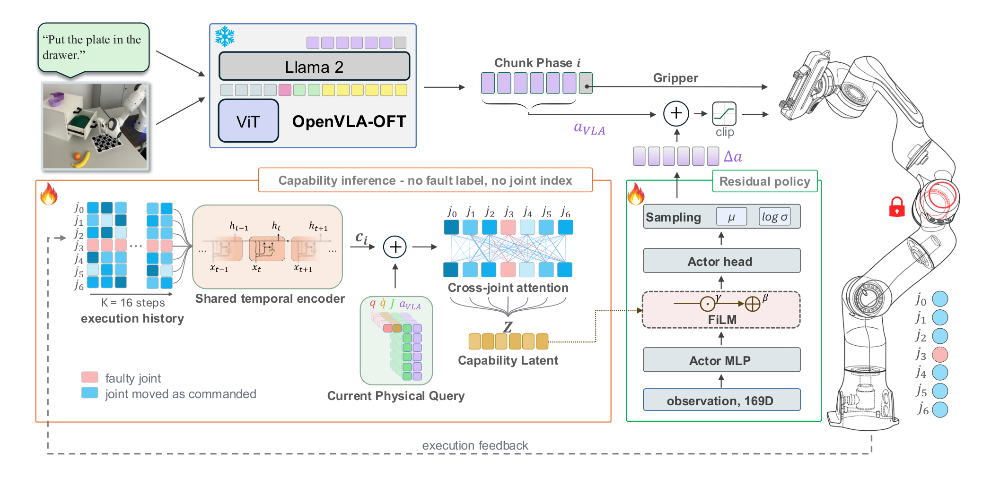
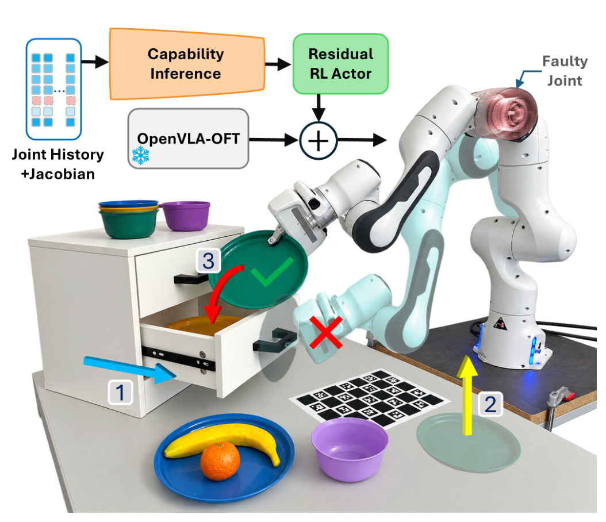

# CAPABLE: Capability-Aware Policy Adaptation via Behavioral Latent Encoding

真机 VLA 部署最常见的失败不在「看不懂任务」而在「使不上力」：关节减速器磨损、卡滞、锁定——同一个动作指令，物理响应完全不同，任务理解再正确也没用。这篇论文处理这个问题的方式不是重训 VLA、不是诊断故障类型，而是**给冻结 VLA 加一个从执行历史推断自身能力的层**：无故障标签、无故障关节标识、无故障专用演示。核心结果是：LIBERO 28 任务上，训练时从未见过故障的 $j_2$ 关节被锁死时，基础策略 24.8% → CAPABLE 59.3%（参数匹配的全局历史基线 41.9%，DEFT 带 oracle 故障与任务状态信息也只到 62.8%）；六关节逐个 leave-one-out 全胜；Franka 真机软件锁定下 13/30 → 24/30。

**论文**：arXiv:2610.11971（cs.RO，2026-10-08 提交）。
作者：M. Khoshnazar、M. Dehghani Tezerjani、D. Qu、Z. Gao、Y. Zhan、J. Schäfer、A. Melnik、Q. Yang（不来梅大学 / 北德州大学 / 丰田北美研究院）。
项目页 capable-vla.github.io（本日核查未见代码仓库）。与 RAFC（arXiv:2610.11956，同团队同日）构成「冻结策略 + 可靠性层」的两个正交轴：RAFC 修感知侧的时间可靠性，这篇修执行侧的能力可靠性。

## 问题：冻结 VLA 遇上关节故障

形式化（式 (1)–(4)）：冻结的 VLA $\pi_\phi$ 收观测与指令输出 7 维动作；持续故障 $f$ 把正常转移动力学 $p_0$ 换成故障条件动力学 $p_f$——**策略不观察 $f$，必须从执行历史推断其物理效应**。残差演员输出 $u_t\in[-1,1]^6$，实际修正 $\Delta a_t = \eta u_t$（$\eta=0.1$，有界），执行动作是裁剪后的 $a^{VLA}_{arm}+\Delta a$，**夹爪直通不经过 RL**。残差奖励就是 LIBERO 任务成功谓词（稀疏）。

设计上值得注意的卫生标准：训练只见 $j_0, j_4, j_5, j_6$ 四个关节的持续锁定；$j_2$ 的故障从所有训练阶段排除（其筛选结果只用于报告）；「未见执行器」的定义是**其失败从未出现在任何训练阶段、只在评测时遇到**。

## 能力推断：一个时间函数处理所有关节

整篇论文的核心先验是**因子化**：不要让网络自由地学「每个关节的故障各是什么样」，而是构造性地保证「同一个命令-响应模式在任何关节上都被同一套权重解释」。

### 机制流程

**第一步（每关节历史编码）**：对 Panda 的每个关节 $i$，构造 28 维命令-响应token——$[q^i_t, \dot q^i_t, \Delta q^i_t, J_i(q_t), a^{VLA}_{arm,t}, a^{exec}_{arm,t}, \Delta x^{eef}_t, \rho_t]$（式 (5)）：关节状态、Jacobian 的第 $i$ 列（**身份通过几何进入**——该关节运动如何贡献末端运动）、VLA 指令、实际执行、实现的末端变化、动作 chunk 相位。每个关节存 $K=16$ 步历史，**一个权重共享的编码器**（线性投影 + LayerNorm + SiLU + GRU 128）产出 $c^i_t\in\mathbb{R}^{32}$（式 (6)）。没有 one-hot 关节标识、没有学习的关节索引嵌入、没有锁目标、没有故障族标签。

**第二步（运动学查询与跨关节组合）**：当前步信息只经物理查询 $\kappa^i_t=[q^i_t, \dot q^i_t, J_i(q_t), a^{VLA}_{arm,t}]$（式 (7)）进入。每关节的 $(c^i, \kappa^i)$ 拼接投影为关节token，一个两层四头、前向宽 256 的 Transformer 在**七个关节token**之间做自注意力，输出平均后过 MLP + LayerNorm 得 $z^{cap}\in\mathbb{R}^{64}$——「这只受损的臂还能做什么运动」。

**第三步（FiLM 条件化残差执行）**：169 维残差观测（末端位姿、夹爪、臂状态、chunk 相位、归一化时间、8 步执行历史、向量化 Jacobian，式 (14)–(15)）输入 twin-critic SAC；$z^{cap}$ 经 FiLM 调制演员与评论家的中间特征 $v_t\to\gamma_t\odot v_t+\beta_t$（式 (16)–(18)）。演员确定性输出**零初始化**——训练从精确复现基础 VLA 臂动作起步。

**第四步（训练与梯度路由）**：与 SAC 并行，共享局部解码器预测实现的关节位移、全局解码器预测实现的末端位移（式 (8)–(9)），Huber 损失加**运动学一致性项** $L_{kin}$（式 (12)：预测的关节位移经 Jacobian 映射后须匹配观测到的末端位移）。编码器梯度 $= \nabla L_{cap} + 0.05\nabla L_Q $（式 (19)）——**演员损失梯度在 $z^{cap}$ 处阻断**，编码器学习由物理预测目标主导。回放分布：任务均匀 1/28，条件按 headroom 加权（健康执行 10%）。

*论文原图编号：Fig. 2——CAPABLE 架构：共享时序编码器 + Jacobian 查询 + 跨关节注意力产出 $z^{cap}$，FiLM 条件化残差 SAC 演员；夹爪直通 RL*

*论文原图编号：Fig. 1——问题设定与三步任务序列（开抽屉/举盘/放盘），故障关节标注*

## 主结果：未见执行器 +34.5 点（参数匹配对照 +17.4）

表 2（28 任务、三种子、每格 300 个 held-out episodes、任务平衡成功率的均值±标准差）：

| 方法 | 健康 | 见过故障 | 未见 $j_2$ | 相对基础 |
|---|---|---|---|---|
| Base VLA（零修正） | 91.4 | 41.6 | 24.8 | — |
| POMDP-RL | 19.6 | 11.3 | 10.1 | −14.7 |
| Classical RR（非学习） | 81.6 | 61.3 | 32.9 | +8.1 |
| DEFT（oracle 故障+任务状态） | 89.7 | 70.1 | 62.8 | +38.0 |
| Global-history SAC（参数匹配） | 88.1 | 73.8 | 41.9 | +17.1 |
| **CAPABLE** | **90.8** | **86.7** | **59.3** | **+34.5** |

四个读法：

- **参数匹配对照隔离单一变量**：Global-history SAC 与 CAPABLE 共享 VLA、残差动作空间、16 步窗口、64 维潜变量、FiLM 演员、twin critics、辅助目标、优化器、回放分布、预算与评测态——唯一区别是因子化结构。+17.4 点归因干净。
- **DEFT 的 3.5 点**：DEFT 收仿真器派生的目标配置与故障身份向量（两重特权），CAPABLE 免特权到 59.3——论文如实把它标为「测量特权信息价值」而非匹配比较。
- **POMDP-RL 反而失败**（10.1% 低于零修正）：该实现与预算下部分可观测策略学习失灵——论文没有隐藏这个负结果。
- **健康不丢**：90.8% vs 91.4%——零初始化 + 有界修正的设计在健康执行时几乎不干预。

分套件（表 3）：四套全胜（+12.8 到 +24.3），28 个任务格中 24 个胜出。零基线任务**保留在平均里**（16 个 $j_2$ 下 0% 基线的任务不丢弃）。

## 消融矩阵：每个组件贡献多少

表 6 是论文最密的一张表（相对完整 CAPABLE 59.3 的未见 $j_2$ 差值）：

| 变体 | 参数 | 未见 $j_2$ | 差值 |
|---|---|---|---|
| 无历史残差（纯当前运动学） | 0.60M | 39.4 | **−19.9** |
| 去能力损失（无物理预测） | 0.80M | 43.7 | **−15.6** |
| 非共享每关节编码器 | 1.23M | 45.8 | **−13.5** |
| 去跨关节注意力 | 0.71M | 46.1 | −13.2 |
| 去 Jacobian 查询 | 0.81M | 47.8 | −11.5 |
| 去 $z^{cap}$ 条件化 | 0.76M | 49.6 | −9.7 |
| 拼接替代 FiLM | 0.84M | 52.6 | −6.7 |
| 等层 replay | 0.82M | 46.4 | −12.9 |

我的分析：三个最有信息量的行——**无历史（−19.9）说明静态运动学重定向解释不了结果**（它甚至低于全局历史基线 41.9）；**非共享编码器（−13.5）说明迁移性买的是「同一时间函数」而不是「更多参数」**（该变体参数还多 50%）；**等层 replay（−12.9）说明回放分布设计本身是方法的一部分**（健康成功涨到 92.3% 但故障恢复垮掉）。物理预测损失（−15.6）是最大单项消融之一，直接支撑「表示由物理监督」的设计。

## 迁移的边界：签名匹配，不是任意故障

跨故障族实验（表 4，训练只见持续锁定，评测六族未见故障）划出了干净的边界：**阻尼（+12.2）、摩擦（+12.4）、晚发锁定（+10.9）迁移成功——部分有效性（−1.8）与行程限制（−6.5）不迁移**。作者的解读很诚实：成功的族共享训练签名「指令下运动受抑」（近二值），失败的族是分级或状态依赖的——当前公式不捕获，明示为下一步。

leave-one-actuator-out（表 5，六关节逐个 held-out、八任务）：$j_0$ +21.7、$j_1$ +16.8、$j_3$ +22.7、$j_4$ +24.0、$j_5$ +43.4、$j_6$ +18.9——均值 +24.6，全部胜过全局历史 SAC。这组实验的价值在于：**排除了「只是背下了 $j_2$」的解释**——每个关节轮流当 held-out，迁移在六个方向上都成立。

真机（表 7，Franka Panda、软件在关节参考层强制锁定、每条件 10 试验）：开抽屉（$j_0$ 见过）50%→90%、放物入抽屉（$j_2$ 未见）40%→70%、物体重排（$j_6$ 见过）40%→80%，合计 13/30→24/30（43.3%→80.0%）。

## 复用要点

- **「一个时间函数处理所有执行器 + Jacobian 接地」是构造性迁移配方**：比「更多数据更多关节」便宜得多——非共享变体参数多 50% 反而差 13.5 点。
- **式 (5) 的 28 维每关节token模板可直接抄**：关节状态 / Jacobian 列 / VLA 指令 / 实际执行 / 实现末端变化 / chunk 相位——无关节标识嵌入，身份走几何。
- **「表示由物理监督、动作由奖励监督」的梯度分工**（式 (19) 演员梯度阻断）：可移植到任何「从历史推断潜状态」任务——编码器不被稀疏任务奖励污染。
- **headroom 加权回放**（健康 10%、故障按剩余空间分 90%）：比等层回放在故障恢复上好 12.9 点——训练分布是隐藏超参。
- **leave-one-actuator-out 协议**：六关节逐个 held-out 零样本评测，是「迁移性」的标准验证——单一 held-out 关节不足以排除背题。

## 边界与尚不能确定

作者在限制节交代得短但完整：研究以仿真为主，硬件只覆盖三任务-关节条件与软件强制锁定；leave-one-actuator-out 只用 8 任务；训练只用持续锁定。迁移签名限定为「近二值的运动受抑」——分级与状态依赖损伤（部分有效性、行程限制）是当前公式明确不覆盖的，两个负值如实报出。

尚不能确定的：物理预测损失的权重敏感性（0.05 评论家权重、$L_{kin}$ 0.25 系数未扫描）；真实硬件磨损渐变（非软件锁定）下的表现；OpenVLA-OFT 之外的基础策略（π0.5、GR00T）上残差接口是否骨干无关；以及与 RAFC 的叠加——执行能力可靠性与时间可靠性两条轴同时修是否互相干扰，两篇都没测。
