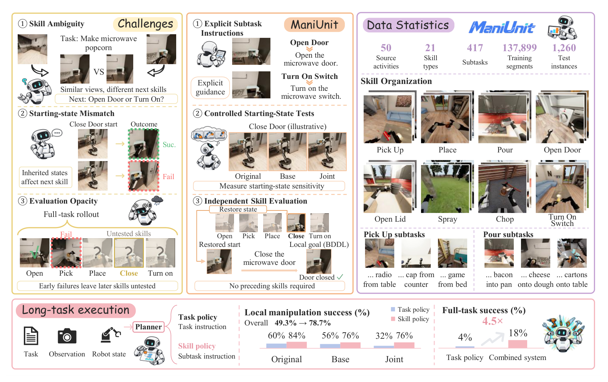
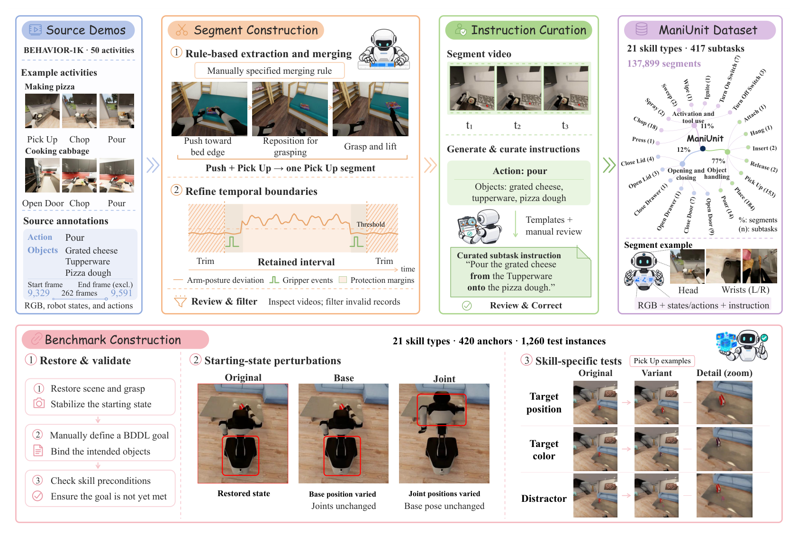
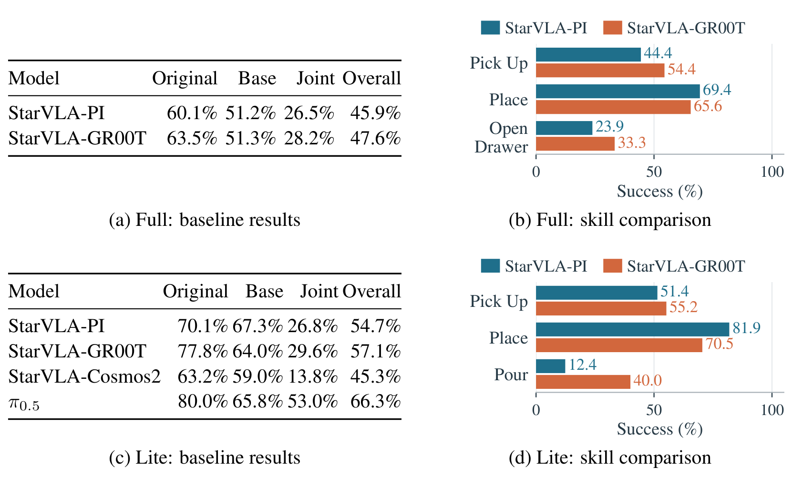
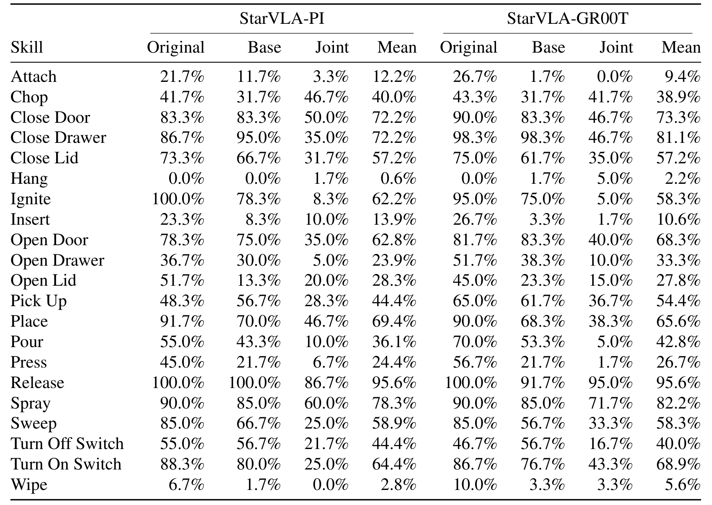
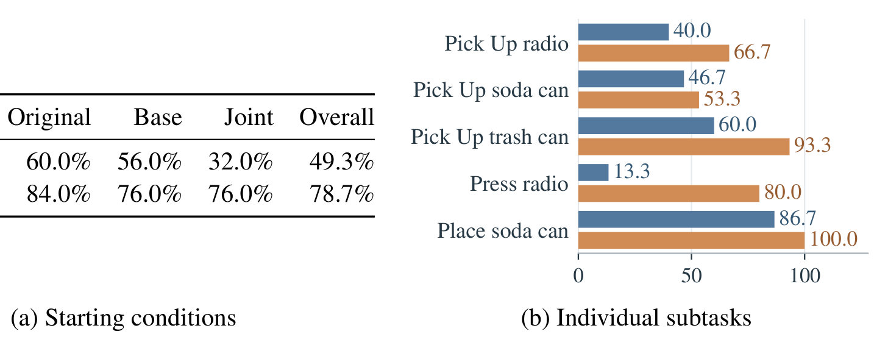

# ManiUnit: A Manipulation Skill Dataset and Benchmark for Long-Horizon Tasks

长视野移动操作的 VLA 评测有个系统性盲区：任务级指标只告诉你「整个任务成没成」，不告诉你**哪个技能挂了**——而早一步失败会让后面所有技能根本没被测到。这篇论文从 BEHAVIOR-1K 的 50 个活动里切出 **137,899 个带显式子任务指令的操作技能段**（21 技能类型 / 417 子任务），配上 **1,260 个测试实例**的技能级基准：每个技能**恢复中间仿真器状态、定义局部 BDDL 成功条件**，无需执行前置阶段即可单独评测；再加 Base/Joint 双起始扰动量化「继承状态偏离演示起点」的伤害。四策略系统评测给出两个硬发现：**关节构型扰动把所有策略打掉一半以上**（相对降幅 55.6–55.9%）；**技能策略 78.7% 对任务策略 49.3%**，规划器组合把全任务从 4.0% 拉到 18.0%。

**论文**：arXiv:2610.12089（cs.RO 交叉 cs.AI，2026-10-08 提交，Preprint）。
作者：Guoting Wei、Dawei Yan、Xia Yuan、Gengming Zhang、Yelin He、Guodong Du、Jiaquan Ye、Heng Zhang（IntelliFusion 实习工作）。
本日核查未发现项目页与代码仓库（数据集发布未在 abs 页确认）。

## 三个评测盲区：为什么需要技能级基准

论文开篇点出的三个结构性问题，每一个都对应长视野管线里的真实失败模式：

1. **技能选择歧义**：同一任务指令下，相似观测可能对应不同的下一技能——「打开微波炉门」还是「按下加热键」，从当前帧看差不多，但策略必须选对。
2. **继承状态偏离**：即使前一个技能成功了，它留给下一个技能的机器人状态也可能偏离演示数据的起始分布——**成功也会传染失败**。
3. **评测不透明**：全任务 rollout 里早失败使后续技能全部「untested」——任务级分数无法定位弱项。

ManiUnit 对这三个问题各给一个机制：显式子任务指令、起始状态受控测试、独立技能评测。

*论文原图编号：Figure 1——ManiUnit 总览：挑战（歧义/继承态/评测不透明）→ 方法（显式指令/受控起始/独立技能评测）→ 数据统计（50 活动/21 技能/137,899 段）→ 长任务结果（49.3→78.7、4.0→18.0）*

## 数据集：137,899 段怎么来

构建管线四步（图 2）：**规则抽取与合并**——BEHAVIOR-1K 的人工标注段按人工指定的合并规则处理复合动作（推到位再抓起算一个拾取段）；**时序边界精炼**——臂姿态偏差曲线 + 夹爪事件 + 保护边距裁剪（默认参数见附录表 5）；**人工审查过滤**——逐视频检查剔除无效记录；**指令策展**——模板生成 + 人工修正，每段配一句显式子任务指令（例如「把碎奶酪从保鲜盒倒到披萨面团上」）。

产出：21 技能类型（Pick Up 153 子任务最多、Place 184 段占比最大）、417 子任务、137,899 段，每段含 RGB + 机器人状态 + 动作 + 指令。

*论文原图编号：Figure 2——构建管线：源演示（BEHAVIOR-1K 50 活动）→ 段构建（规则抽取合并 + 时序边界精炼）→ 指令策展（模板 + 人工审查）→ 数据集统计环图 → 基准构建（恢复验证 / 起始扰动 / 技能特定测试）*

## 基准：恢复起始态 + 局部成功条件

基准侧的关键机制是**把「测这个技能」从「跑完前面所有技能」里解耦**：从成功演示的段终点恢复场景与抓取、稳定起始状态、人工定义该技能的 BDDL 局部目标（绑定意图对象、检查前置条件确保目标未达成）。三起始条件：Original（恢复态）、Base（底盘位姿扰动、关节不动）、Joint（关节构型扰动、底盘不动）。

成功判据：**局部目标连续 10 帧成立**、时限 3 倍子任务演示均长。聚合：技能内先平均重复试验与实例，技能间等权；Overall 平均三条件。Full 1,260 实例每实例跑 3 次，Lite 186 实例（7 技能）每实例 5 次——计入 StarVLA-Cosmos2 与 π0.5。

## 四策略评测：总分掩盖的技能画像

| 策略 | Original | Base | Joint | Overall |
|---|---|---|---|---|
| StarVLA-PI（Full） | 60.1 | 51.2 | 26.5 | 45.9 |
| StarVLA-GR00T（Full） | 63.5 | 51.3 | 28.2 | 47.6 |
| StarVLA-PI（Lite） | 70.1 | 67.3 | 26.8 | 54.7 |
| StarVLA-GR00T（Lite） | 77.8 | 64.0 | 29.6 | 57.1 |
| StarVLA-Cosmos2（Lite） | 63.2 | 59.0 | 13.8 | 45.3 |
| **π0.5（Lite）** | **80.0** | **65.8** | **53.0** | **66.3** |

*论文原图编号：Figure 3——基线与技能对比四面板：Full/Lite × 基线表/技能条形图；π0.5 在 Lite 总体 66.3% 最高*

四个读法：

- **Joint 扰动是最大伤害**：Full 上相对降幅 PI 55.9%、GR00T 55.6%——**起始关节构型是技能执行的主导因素**。π0.5 在 Lite 下保留约三分之二 Original 成功率，其他三策略只剩 22–38%；作者把这归因于 π0.5 的多机器人数据预训练（起始状态覆盖广）——**数据覆盖度比架构更能买鲁棒性**。
- **总分相近、画像互补**：GR00T 胜 Pick Up（54.4 对 44.4）与 Open Drawer（33.3 对 23.9），PI 胜 Place（69.4 对 65.6）——Lite 上 PI 的 Pour 只有 12.4、GR00T 40.0。**选型看逐技能分布，别看聚合分数**——定向补数据比换骨干便宜。
- **预训练不对齐**：π0.5 从多机器人预训练权重用 RLinf 微调，StarVLA 系是 Qwen3.5-2B + 随机初始化动作头——作者明示这不是公平架构对比，66.3 对 54.7 的一半功劳在预训练。
- **Cosmos2 换骨干无益**：45.3% 垫底，Cosmos-Predict2 视觉骨干没带来技能级优势。

每技能全景（表 6，Full 三条件均值）：Release 95.6%、Close Door 72–81%、Place 65.6–69.4% 居前；**Hang 0.6–2.2%、Wipe 2.8–5.6%、Insert 10.6–13.9% 几乎全军覆没**——接触精细技能是当前 VLA 的明显短板带。

*论文原图编号：Table 6——每技能成功率（%）：21 技能 × StarVLA-PI/GR00T × Original/Base/Joint/Mean；Hang/Wipe/Insert 近零，Release 最高*

## 技能级 vs 任务级训练

同一数据预算下两种训练（图 4，两活动各 10 episodes × 5 次重复）：

| 起始条件 | 任务策略 | 技能策略 |
|---|---|---|
| Original | 60.0 | 84.0 |
| Base | 56.0 | 76.0 |
| **Joint** | **32.0** | **76.0** |
| Overall | 49.3 | **78.7** |

差距最大处在 Joint 条件（32.0 对 76.0）——**显式子任务指令 + 技能段训练对起始偏离的鲁棒性远高于任务级训练**。逐子任务看更锋利：Press radio 13.3%→80.0%、Pick Up trash can 60.0%→93.3%、Place soda can 86.7%→100.0%。

*论文原图编号：Figure 4——技能级 vs 任务级：(a) 三起始条件总体（49.3 对 78.7）；(b) 逐子任务条形图（Press radio 13.3→80.0）*

## 全任务组合：规划器双策略切换

技能策略的局部优势能否兑现成全任务成功（表 2，两活动各 50 试验）？规划器按任务进度在**任务策略**（导航与任务级控制）与**ManiUnit 训练的技能策略**（操作技能）之间切换：全任务成功率 **4.0%→18.0%**（4.5 倍），Q-score（BDDL 目标子句满足比例，部分完成度量）同步提升。图 5 的时间轴展示了交接细节：任务提示推进到「从咖啡桌上拿起收音机」这一子任务时切换技能策略，完成后交还任务策略。

## 复用要点

- **「恢复中间态 + 局部成功条件」协议**可直接移植到任何有仿真器的长视野管线——诊断哪个技能拖后腿，比全任务成功率信息量大一个量级。
- **Base/Joint 双扰动是部署前一致性检查**：关节构型扰动比底盘位姿伤害大 3–4 倍——真机部署前先跑 Joint 扰动版。
- **137,899 段显式指令数据集**可当技能级微调语料——BEHAVIOR-1K 生态用户复用门槛低。
- **Q-score 做部分完成度量**——比二值成功更细的全任务指标，长视野评测值得采用。
- **「技能画像互补」的选型教训**：总分差 2 个点的两个策略，弱项分布可能完全不同——逐技能表格是选型的正确粒度。

## 边界与尚不能确定

论文自述与我的分析合起来的边界：**仿真基座**——技能段来自 BEHAVIOR-1K 仿真演示，sim-to-real gap 未测；**预训练不对齐**——π0.5 的 66.3% 有多机器人预训练红利，与随机动作头的 StarVLA 不是架构对比（作者明示）；**恢复态≠真实继承态**——受控近似，前技能真实留下的状态分布更广；**全任务组合只测两活动**各 10 episodes，规划器细节（如何生成切换决策）未完整披露；**绝对值 18% 说明长视野组合远未解决**——分层赢了端到端一局，但离可用还很远。扰动幅度（Base/Joint 具体量级）在正文未报（附录 D 或有）；真机技能级评测完全空白。

尚不能确定的：技能级数据反哺端到端全任务训练的最优配比；学习型规划器（LM 规划）对照；Hang/Wipe/Insert 失败模式的定性诊断——表 6 只给数字。
