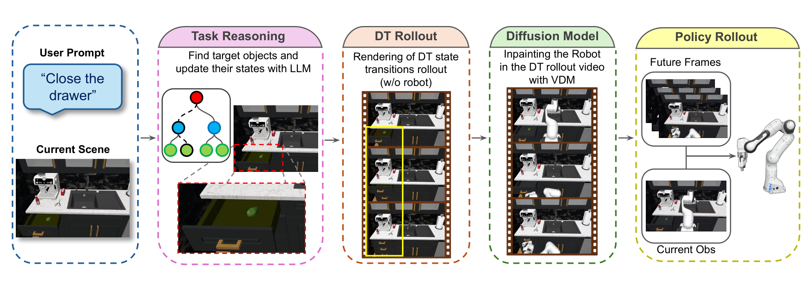
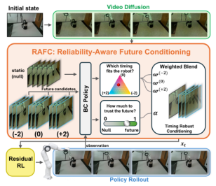
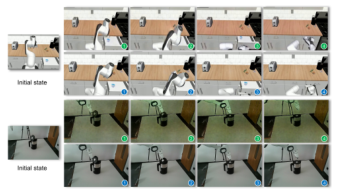
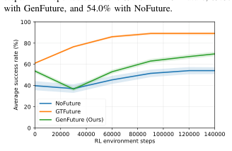

# Reliability-Aware Future Conditioning for Temporally Robust Robot Manipulation

给机器人策略喂一段「任务将来的生成视频」，是近两周具身操作最热的条件化路线之一。这篇论文先证明了一件让这条路线不舒服的事：**时间上错位的未来视频不只是没用，而是有害**——在 CALVIN 上，把一段完全正确的生成未来提前五帧，策略成功率从 81.3% 掉到 54.8%，比完全不用未来的 54.0% 还低；强加时序偏移再压到 34.2%，比裸策略低 19.8 个点。然后论文给出解法 RAFC（Reliability-Aware Future Conditioning）：把「时间兼容性」当**控制问题**而非生成问题，在每一步估计该多信任收到的片段、偏好哪个邻近时间假设，两者都不合适时回退静态分支——全部从任务奖励学出，无偏移标签、无对齐监督。Franka 真机上，无人强加的自然时序失配下，总成功率 26.7%→56.7%。

**论文**：arXiv:2610.11956（cs.RO，2026-10-08 提交）。
作者：M. Khoshnazar、M. Dehghani Tezerjani、Z. Gao、D. Qu、M. Gandyra、Y. Zhan、M. Naeem、A. Melnik、J. Schäfer、Q. Yang、M. Beetz（不来梅大学 / 北德州大学 / 丰田北美研究院）。
项目页 future-condition.github.io（承诺放出全部资源，本日核查未见代码仓库）。

## 为什么时间失配是个控制问题

未来条件化操作（future-conditioned manipulation）给策略一段任务视频作为条件输入，暴露当前帧看不到的东西：任务的终态、交互的对象、动作的顺序。FEC 系工作已经把「未来从哪来」解决得不错。剩下的问题是**时间**：生成是在任务开始时一次做的，而机器人执行有快有慢——策略走到第三步时，喂给它的未来片段可能描绘的还是第五步。

重生成不是选项：在 NVIDIA A40 上，16 帧片段 20 步去噪要 40–45 秒（bf16），每步重生成完全不可行。事后处理也不完整：CLOVER 用嵌入距离触发重规划（错误已经影响执行之后），ORCA 对齐单个演示做奖励塑形（需要参考轨迹）。论文的立场是：**在动作发出之前，在控制器内部解析时序**——这把问题从「如何生成对齐的未来」变成「如何消费未对齐的未来」。

## 未来从哪里来：FEC 测试台

RAFC 坐在 FEC（Future-Experience Conditioning）接口之上。生成器只跑一次，流程分三段：

1. **本体引导推理**：GPT-4o 收到任务指令与场景状态，按固定JSON schema 返回被操作对象、交互部位、期望状态转移与 rollout 约束。数字孪生把对象解析到仿真器实体与关节。
2. **免机器人数字孪生 rollout**：关节任务线性插值关节坐标到指令限位；平面运动任务把物体位姿插向目标区域。渲染这些状态得到一段**没有机器人**的场景变化视频——「想要什么场景变化」与「本体如何动」在此分离，孪生不必合成动力学有效的机器人轨迹。
3. **免掩码视频扩散补机器人**：CogVideoX 骨干 + VideoPainter 式条件分支，从初始机器人图像与透明 rollout 重建含机器人未来。GPT-4o 从不在闭环执行中被查询。

*论文原图编号：Fig. 2——FEC 未来生成测试台五阶段管线（本体引导LLM → 免机器人孪生 rollout → 扩散补机器人）*

整个生成只在任务初始化时付一次成本。这是后面所有可靠性讨论的前提：**未来是固定的一段视频，策略执行中的时间漂移要靠控制器自己消化**。

## RAFC 门控：静态回退与三个时间假设

### 机制流程

**第一步（候选构造）**：控制步 $t$，冻结的未来条件BC 策略收到观测历史、任务指令与未来片段。骨干 $H_\phi$ 输出策略特征 $f_t$ 与未来token 表示；未来token 池化为 $B=4$ 个桶投影为 $g_t$（式 (1)–(2)）。RAFC 从收到的未来构造**四个候选**：一个静态null分支——首帧重复 $T_f$ 次（式 (4)），保留场景与任务外观、抹掉时间演化；三个动态候选——对收到的未来做局部偏移 $s\in S=\{-2,0,+2\}$（式 (5)，越界重复边界帧），$s=0$ 即原片段。

**第二步（门）**：四个候选分别过同一个冻结BC，得到四组 $(f^{null}, g^{null}, a^{BC,null})$ 与 $(f^{(s)}, g^{(s)}, a^{BC,(s)})$。门 $G_\psi$ 只收固定顺序拼接的四个策略特征 $h_t=\mathrm{concat}(f^{null}, f^{(-2)}, f^{(0)}, f^{(+)2})$（式 (6)），输出一个信任logit 与三个相位logit：

$$\alpha_t=\sigma(\ell^\alpha_t),\qquad w_{t,s}=\frac{\exp(\ell^s_t)}{\sum_{s'\in S}\exp(\ell^{s'}_t)}$$

$\alpha_t$ 决定「动态未来该不该信」（静态回退与动态未来的总分配），$w_{t,s}$ 决定「信哪个邻近相位」（动态质量在三候选间的分配）。门看不到施加的全局偏移，也没有对齐目标——候选身份只由 $h_t$ 中的固定位置编码，与当前观测的兼容性必须从冻结BC 特征推断。

**第三步（三路混合）**：同一组系数混合BC 的全部三层输出（式 (9)–(11)）：

$$f^{gate}=(1-\alpha_t)f^{null}+\alpha_t\textstyle\sum_{s\in S}w_{t,s}f^{(s)}$$

$g^{gate}$ 与 $a^{BC,gate}$ 用完全相同的系数——特征、未来潜变量、基础动作三层一致地混合，门控后的表示与动作对应同一个时间假设。

**第四步（残差执行）**：残差演员 $\pi_\theta$ 收 $(f^{gate}, g^{gate}, a^{BC,gate})$ 输出 $\Delta a_t$，执行 $a_t = a^{BC,gate}+\Delta a_t$（式 (12)）。评估时 critics 被丢弃，只留冻结BC + 门 + 残差演员，在线 120 ms/步（8.3 Hz）。

*论文原图编号：Fig. 1——RAFC 总体架构：静态回退与三时间假设经学习到的信任与相位权重混合，再接残差控制*

### 训练：仅任务奖励，免标签

三阶段：先训视频扩散（配对孪生/机器人片段 + 首帧锚定），再训未来条件BC（式 (3)，演示未来）——RAFC 在这两阶段完全缺席；然后**冻结BC**，只训门、有界残差演员与 twin critics。演员目标（式 (13)）在延迟策略更新时联合更新门与残差演员；奖励只有步成本、残差惩罚与稀疏终端结果：

$$r_t=\mathrm{clip}(\underbrace{r_{step}}_{-0.005}-\lambda_\Delta\|\Delta a^{arm}\|_2+\underbrace{r_{terminal}}_{+120/-25/-20},\,-50,\,150),\qquad \lambda_\Delta=0.02$$

没有偏移标签、对齐分数、参考轨迹或仿真器状态距离。**可靠性是任务奖励逼出来的，不是监督出来的**——这是论文最干净的设计决定。

对应 Algorithm 1（TD3 风格残差微调）的伪码要点：每个环境步构造null 与 $\{-2,0,+2\}$ 候选→过冻结BC→拼接特征算 $\alpha_t, w_{t,s}$→三层混合→残差执行→存回放缓冲；每个梯度更新采样 minibatch、算目标门控表示与目标残差动作、twin critics 走 TD3 截断双 Q 目标，延迟更新时最小化 $\mathcal{L}_\pi$（式 (13)），目标网络指数滑动平均。（算法环境未被抽取为图片资产，伪码依据正文第三节 C 部分转写。）

## 时间失配到底有多破坏性

论文先做了「不防护」的剂量反应。评测协议（正文第四节 B 部分）设计得很讲究：对收到的未来施加全局相位偏移 $s\in\{-5,-3,-1,0,+1,+3,+5\}$——**故意全部 off-grid**，不与 RAFC 候选银行 $S=\{-2,0,+2\}$ 重合，防止「恰好命中候选」的虚假恢复。为排除大偏移下边界帧重复拉低时间多样性的伪影，另配一套独立源的窗口化协议（式 (17)：独立 28 帧 rollout 上取 16 帧连续窗口，$\pm5$ 时每窗 16 帧全不同）。

表 1 的结果（CALVIN 八任务、三种子）：

| 条件 | $s=-5$ | $s=-3$ | $s=-1$ | $s=0$ | $s=+1$ | $s=+3$ | $s=+5$ | 偏移均值 |
|---|---|---|---|---|---|---|---|---|
| GenFuture（无防护） | 34.2 | 52.9 | 64.6 | 69.8 | 65.3 | 51.9 | 41.6 | 51.8 |
| GTFuture（oracle） | 62.1 | 78.4 | 85.3 | 89.1 | 84.3 | 76.8 | 64.1 | 75.2 |
| **RAFC** | **61.7** | **76.8** | **81.2** | **82.3** | **81.5** | **76.0** | **65.2** | **73.7** |
| NoFuture 参照 | 54.0 | 54.0 | 54.0 | 54.0 | 54.0 | 54.0 | 54.0 | 54.0 |

三个读法：

- **未防护生成未来的负收益区**：GenFuture 在 $s=\pm5$ 与 $\pm3$ 全部低于 NoFuture（34.2/51.9 对 54.0 等）——**任务内容完全正确、只是相位错位，就把「增益 +15.8 点」变成「净损失 19.8 点」**。极端压力测试 $s=\pm6$ 进一步给出 25.7/42.6。
- **oracle 也难幸免**：GTFuture（真值未来）偏移均值损失 13.9 点（89.1→75.2）——时间敏感性不是生成质量的问题，是**消费方式**的问题。这正是「控制问题而非生成问题」论断的实证支撑。
- **RAFC 逐条件恢复**：未见过的偏移值上每个条件都改善（偏移均值 51.8→73.7），且在所有偏移上都超过 NoFuture；窗口化协议给出同样模式（69.7→75.6），排除伪影。率失配（0.75 倍/1.25 倍单调速度）：GenFuture 58.6%，RAFC 73.2%。

## 恢复靠什么：集成分工与学习可靠性的增量

表 6 是论文最有信息量的消融——同一候选银行、同一RL 预算，逐级加机制：

| 配置 | 偏移均值 | 相对上一级 |
|---|---|---|
| GenFuture（ShiftAug 训练时增广） | 65.1 | +13.3（相对无防护） |
| 均匀平均（同候选银行） | 66.7 | +1.6 |
| RAFC w/o null（去静态回退） | 71.3 | +4.6 |
| **完整 RAFC（学习加权）** | **73.7** | **+2.4** |

拆开读：**候选集成承担了大部分恢复**（51.8→66.7，+14.9 点），学习可靠性再加 7.0 点（66.7→73.7）——且这一增益无法用「恰好命中候选」解释，因为每个非零评测偏移都故意 off-grid。门控诊断（表 5）显示机制：偏移增大时 $\alpha_t$ 下降、$w_{t,s}$ 朝补偿方向移动（$s=-5$ 时 $\alpha$ 均值 .41、$w_{-2}$=.25，未偏移时 .79/.59）；Step-40 在线干预（表 7，$0\to\pm3$ 逼近 .92/−.88 的权重补偿）确认权重确实在响应时序变化而非静态。静态回退本身贡献 2.4 点（71.3 对 73.7）。

我的分析：这份消融的诚实度高于平均水平——作者把「大部分收益来自很便宜的集成」写在明处，而不是把 7.0 点增量藏进总提升里。对工程读者，这意味着**先上均匀平均的三候选集成，再考虑学门**——两级投入分开定价。

## 基准位置与真机证据

CALVIN/RoboCasa 与先前系统对比（表 3–4）：FEC+RAFC 拿到双基准最高的非 oracle 平均——CALVIN 82.3%（CLOVER 71.9）、RoboCasa 76.6%（CLOVER 72.6）；但逐任务看 CLOVER 仍胜 CALVIN 关抽屉（91.2 对 90.2）与滑块（46.9 对 42.6）、RoboCasa 开微波炉（84.0 对 78.2）——论文没有掩盖这一点。

*论文原图编号：Fig. 3——生成未来（绿）与策略执行（蓝）：上排 RoboCasa 关抽屉、下排 Franka 关壶；未来引导交互而非精确轨迹*

真机（Franka，三任务各 20 试验，自然时序失配、无人强加）：开壶 15%→45%、关壶 25%→55%、关微波炉门 40%→70%，合计 26.7%→56.7%。注意协议细节：两种条件用**完全相同的演示、离线训练预算与生成未来**，唯一区别是有没有 RAFC——这是「同输入比机制」的干净设计。但论文如实说明：真机失配幅度未测量，这是「优于 plain FEC」的证据而非机制隔离。

从 BC-only 到 BC+RL 的学习曲线（第 4 图）：GTFuture 约 17,260 步到 70%，GenFuture 80,955 步到 60%、140k 步 69.8%，NoFuture 140k 步内两者都未达到——RL 微调在每个未来源下都拿到最高成功率。

*论文原图编号：Fig. 4——八 CALVIN 任务平均BC+RL 学习曲线：三未来源对比，步 0 为对应BC-only 策略*

## 边界与不可外推处

作者在限制节把边界写得相当完整。最要紧的一条是**候选银行跨度**：修正只能从 $S=\{-2,0,+2\}$ 组合出来，相位误差超出这个跨度就无法完全重对齐——$\pm5$（残留三帧失配）与 $\pm6$ 压力测试下，门只降低信任、回退静态分支，不做恢复。相应地，$\alpha_t$ 是学习的分配系数，**不是校准概率**：它既不是「未来正确的概率」也不是「施加偏移的估计」，不能直接挪用为安全阈值。

实验覆盖上，受控偏移与率失配仅在仿真中进行，且率测试只覆盖单调速度失配——执行中途变速这类非平稳扭曲未测。银行大小 $|S|=3$ 与池化 $B=4$ 是设计便利还是最优，论文明确留白（敏感性未测）。BC 用演示未来训练；直接在生成未来上训BC 的变体未测。

最后一条值得工程读者注意：任务接地假定校准的对象模型，RAFC 只管时间可靠性——**目标错、对象错或基础策略弱，它都救不了**。这是作者自己划的边界，与「可靠性层」的定位一致：它修的是消费侧，不是生成侧与决策侧。

## 复用要点

- **五帧偏移测试应成为「生成未来条件」线的标准检查项**：81.3→54.8 的蒸发速度量化了整条范式的失效边界——比任何「我们的未来更逼真」的生成质量指标都更相关。
- **门控公式（式 (9)–(11)）是插件级实现**：任何能暴露特征/潜变量/动作三层接口的冻结策略都能加，混合本身是几行代码；学习的是门 $G_\psi$ 与残差演员。
- **off-grid 评测协议**（银行 $\{-2,0,+2\}$ vs 评测 $\pm1/\pm3/\pm5$）防「恰好命中候选」——任何「候选集成式」方法的消融都该照抄。
- **免机器人孪生 rollout + 扩散补机器人**：把目标场景变化与本体运动分离，生成器可整体替换（CogVideoX→任何视频模型），RAFC 完全在下游。
- **窗口化独立源协议**（式 (17)）：时间偏移实验排除边界重复伪影的卫生设计。

## 尚不能确定

- 候选银行大小 $|S|$ 与池化粒度 $B$ 的敏感性——论文明确留给未来。
- 非单调/非平稳率失配（执行中途变速）下的表现。
- 直接在生成未来上训练BC 会不会缩小BC-only 61.1→89.1 的 oracle 差距。
- $\alpha_t$ 能否升级为校准概率用于安全停止决策——作者明确否定当前版本。
- RAFC 与 CAPABLE（同团队同日论文，编号 2610.11971，修执行能力可靠性）是否可叠加：时间可靠性 × 执行能力可靠性两条轴正交与否，两篇都没测。
