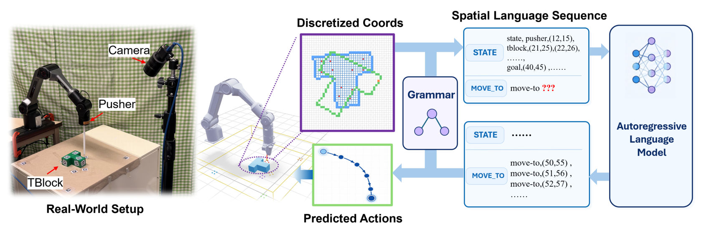
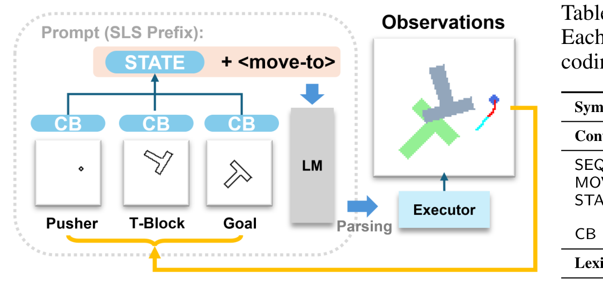
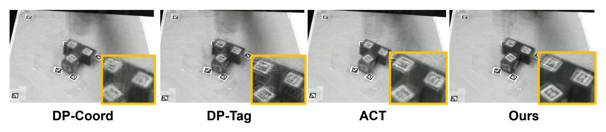
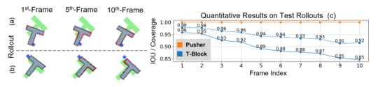
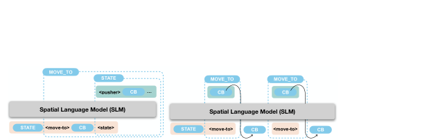

# Unifying Policy Learning and State Prediction through Spatial Language Modeling

「策略学习」与「状态预测」在具身智能里通常是两条线：策略学习选动作，世界模型懂动作的效果。这篇论文把它们压进**同一个自回归模型、同一个 next-token 目标**——不做潜空间、不做两塔、不做接口对齐，直接把动作靶点与未来场景状态写进**同一个共享词表**（离散坐标 + 语义token），一个 462M 的 Transformer 从头训练。Push-T 上这个最朴素的统一拿到了硬数字：真机 20 个初始状态成功率 0.80（ACT 0.65、DP 状态版 0.45/0.50），而消融显示**去掉状态监督的 action-only 变体只有 0.05**——状态预测不是装饰，是这套表示的骨架。

**论文**：arXiv:2610.12172（cs.RO 交叉 cs.LG，2026-10-08 提交）。
作者：Minye Wu、Zehao Wang、Tinne Tuytelaars（鲁汶大学 KU Leuven）。
本日核查未发现项目页与代码仓库。

## 研究问题：动作与场景转移为何共用一个目标

模仿学习策略只从演示学「选什么动作」，对「动作如何改变场景」没有显式监督；世界模型学场景转移，却不直接产出动作。两条线各自训练再拼接，监督信号浪费——动作生成其实需要场景转移知识（推到哪、会不会碰），场景转移也由动作引起。论文的立场：**让一个模型在同一序列里同时预测动作与动作后的场景**，动作生成的参数被转移目标一起更新。

## 空间语言：坐标与语义共享一个词表

表示层只有两个词汇表。**坐标词表** $\mathcal{Q}_{coord}$：把平面工作空间按格长 $v_s$ 离散成网格（Push-T 用 128×128），每个格子是行主序唯一整数 ID 的一个token——场景轮廓投影到网格，占据格即token，同格多点合并。**语义词表** $\mathcal{Q}_{semantic}$：状态块名（STATE）、实体类型（pusher、tblock）、运动命令（move-to）。一条空间语言句子（SLS）就是两个词表并集上的有序序列（式 (1)），由一个上下文无关文法（表 1）约束顺序：SEQ 规则定义rollout 格式——STATE 块（轮廓坐标 CB+）后面跟时间排序的 MOVE_TO 产生式，每个 MOVE_TO 块是 `move-to + 一个坐标token + 可选的后续 STATE`。

编译器把观测/动作序列化进这个格式，解析器把生成的动作块还原成坐标——**文法是序列与坐标系之间的接口层**。

*论文原图编号：Figure 1——Push-T 的空间语言建模：场景几何、目标、动作靶点与未来状态共享离散坐标与语义token 词表*

*论文原图编号：Figure 2——Push-T 工作流：STATE + move-to 前缀、解析进执行器、观测闭环（右侧Table 1 边缘为版式邻接，非本图内容）*

## 训练：两阶段，同一格式

训练目标是掩码交叉熵（式 (2)）：$m_i\in\{0,1\}$ 标记位置是否计损失。两阶段都更新同一个模型的参数。

**随机游戏预训练**：推杆随机移动（可能碰到 T 块）。关键设计：**动作坐标token 的损失位置被掩掉（$m_i=0$，紧跟 move-to 后那个）——它只条件化后续状态预测，不被预测**；状态token 提供动作条件的转移目标。真机侧收集 20 条随机游戏（5,229 帧）。

**专家演示训练**：200 条 Diffusion Policy 发布的仿真专家演示 + 真机 40 条成功演示。**后续 STATE 块以 30% 概率独立保留**：保留的块给场景转移目标，省略的块形成连续动作子序列——同一个格式里混两种监督，不需要两套数据格式。

模型：462M 参数，Qwen2 架构从头训练（不用预训练骨干），仿真训练 5 小时（4×A100，200 epochs，每 5 epoch 评测一次checkpoint）。

## 闭环控制与推理吞吐

推理时前缀是三段时间连续的 STATE–MOVE_TO 段，以 move-to 结尾等待采样下一个动作坐标。**语法状态机在控制时排除未来 STATE 块**——模型只采样动作坐标，不生成预言。解析出的目标坐标交给机器人执行，新观测更新历史进入下一步（图 2 的闭环）。

吞吐账（A100 实测）：prefill 7,000 token/s、解码 800 token/s；每个动作目标只需 1 个 move-to + 1 个坐标token，**20 步执行chunk 约 40 个输出token ≈ 0.05 秒解码**。「语言模型做策略不能实时」的直觉在这套紧凑输出格式下不成立——这是论文顺手给出的最有工程价值的数字。

## 结果：Push-T 仿真与真机

真机（20 个匹配初始状态、每方法同演示训练、成功判据覆盖 $C_t\ge0.95$、300 步上限）：

| 方法 | Max（episode 峰值覆盖均值） | 成功率 |
|---|---|---|
| DP-Coord（状态） | 0.89 | 0.45 |
| DP-Tag（状态） | 0.89 | 0.50 |
| ACT | 0.86 | 0.65 |
| **Ours（联合+预训练）** | **0.95** | **0.80** |

仿真侧（表 2 左，含 LG/IBC/BET/DP-C 基线）同样是本方法最高。图 6 的平均帧对比显示本方法鬼影更少、T 块轮廓更清晰——位置与朝向更集中。

*论文原图编号：Figure 6——各方法在测试 episode 最大覆盖帧上的平均图像：本方法 T 块轮廓更清晰、鬼影更少*

**同一模型的第二种用法**——沿人工标注的动作轨迹预测连续场景状态（图 5）：T 块覆盖从第 1 帧 0.98 到第 10 帧 0.92，IoU 从 0.96 降到 0.85。误差随rollout 复合累积（自回归预测的通病），但十步后仍有实质几何重叠——**用于生成动作的那个模型确实学到了动作条件的场景转移**。

*论文原图编号：Figure 5——给定标注动作轨迹，模型用自身先前预测作上下文预测连续状态；红色像素为 T 块预测误差区*

## 消融：状态监督是骨架不是装饰

| 变体 | 成功率 | Max |
|---|---|---|
| Action-only（去状态块、无预训练） | 0.05 | 0.67 |
| 联合训练（无预训练） | 0.65 | 0.92 |
| **联合 + 随机游戏预训练（完整）** | **0.80** | **0.95** |

三个读法：**action-only 的 0.05 是全文最重要的负结果**——同一词表同一模型，只去掉状态监督就从 0.65 崩到 0.05，动作生成在这套表示里几乎完全依赖场景转移知识（也说明坐标词表不是天然好用的动作空间，需要转移目标撑住）。**联合训练 +0.60**：状态监督给动作生成提供「推到哪、场景会变成什么样」的先验。**预训练 +0.15**：随机游戏是免标注的转移监督——动作坐标掩损失让随机数据不用标注动作质量。

*论文原图编号：Figure 3——SLS 补全：动作条件状态预测与链式 move-to 命令；语法状态机区分训练与推理两种模式*

## 复用要点

- **「动作坐标掩损失 + 状态目标」的随机游戏配方**：任何有仿真器或随机策略的团队可零标注成本生成转移监督——比采集专家演示便宜一个量级。
- **「训练含未来块、推理排除」的双模式设计**（语法状态机）：训练时多任务监督、推理时纯动作输出——一套参数两种用法，无需蒸馏。
- **30% STATE 保留**：同格式内混动作监督与转移监督的开关，避免维护两套数据管线。
- **吞吐预算算法**（800 token/s → 20 步chunk 0.05 s）：LM 策略实时性的估算模板——输出token 数才是延迟主项，模型大小不是。
- **坐标词表分辨率是旋钮**（128×128）：平面任务够用；立体任务需要 3D 词表——论文没做，是最直接的扩展方向。

## 边界与尚不能确定

论文自述的边界：真机依赖 AprilTag 定位与标定；作者另有三处值得注意。**单任务域**：只验证了平面推动——抓取、装配、铰接对象等接触更复杂的操作未测；坐标词表对立体几何的表达（体素或 SDF 采样）是开放问题。**无骨干对照**：从头训练 462M 在 200 演示上成功，但没有与「预训练 VLM 骨干 + 动作头」的直接对比——白纸路线在小数据下的优势是否普遍，从这篇推不出来。**输入模态差异**：仿真基线用状态输入、本模型用轮廓坐标——跨方法比较不完全对齐（作者在附录披露）。另有：成功判据 $C_t\ge0.95$ 是覆盖而非精确位姿；20 初始状态是小样本；自回归复合误差（IoU 0.96→0.85）的缓解未处理。

尚不能确定的：3D 词表扩展的代价；与预训练骨干的对照；状态预测升级为想象rollout 规划（像 RAFC 那样消费预测而非只当监督）是否可叠加；随机游戏数据的量效曲线（20 条是否饱和）。
