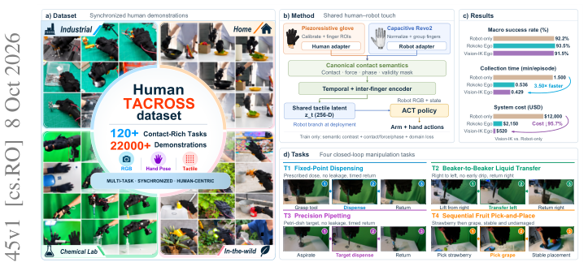
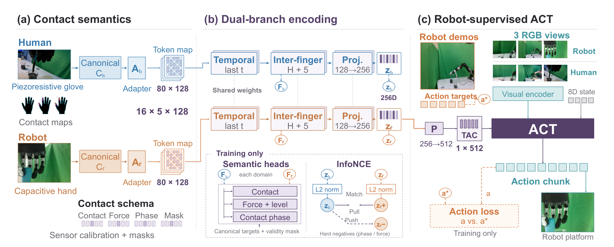
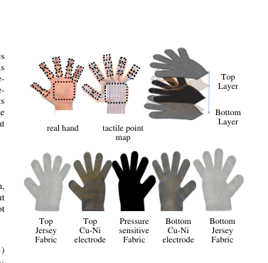
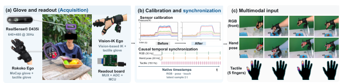
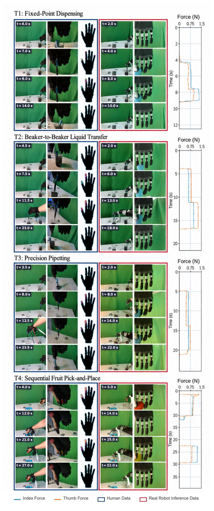
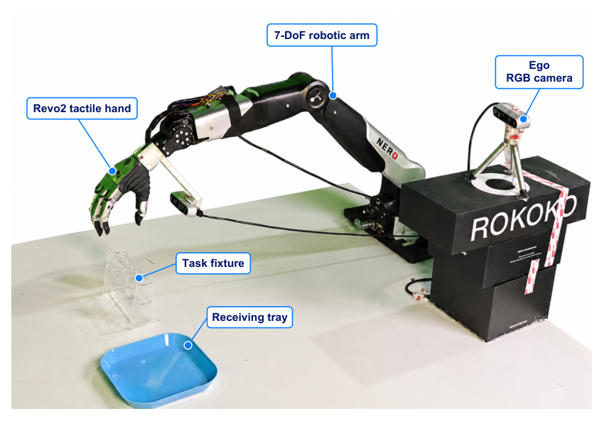
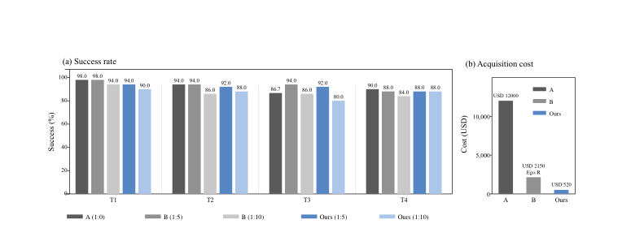

# TACROSS: An Efficient and Low-Cost Scalable Human Touch System Across Heterogeneous Tactile Sensors for Dexterous Robot Learning

用人类触觉手套采集演示、把触觉技能教给机器人——这条路线卡在一个根本问题上：**人类压阻手套和机器人电容传感器在传感原理、布局、分辨率、动态响应上全都不同**，原始信号层的通道对齐是病态的。TACROSS 的解法是换一层对齐：**在接触事件层**（Contact / Force / Phase / Mask 四个语义属性）把异构信号规范化进共享token图，再用共享时空编码器 + InfoNCE 对比把人类与机器人的触觉潜空间拉近。硬件侧是一双 **BOM 10.86 美元 的五层压阻手套**（285 感知点、150 Hz、掌侧覆盖 >85%）。真机四接触任务的结果链很锋利：完整系统 91.9%，**去掉接触语义对齐只剩 49.4%——低于完全不用触觉的 73.1%**：不对齐的触觉输入是有害的；而采集设备成本从 12,000 美元 的遥操作台降到 520 美元（−95.7%），速率反升 3.5 倍。

**论文**：arXiv:2610.11945（cs.RO 交叉 cs.HC，2026-10-08 提交）。
作者：Bo Chen、Huanzhang Hu 等 13 人——香港大学 / 港中深 / 中国海洋大学 / 武汉大学 / 武汉纺织大学 / INFIFORCE。
项目页 [tacross-touch-project.github.io](https://tacross-touch-project.github.io/)；承诺开源硬件软件 + 150 小时触觉数据集。

## 问题：异构触觉传感器的通道不可对齐

人类侧是压阻手套（电容/压阻式），机器人侧是 Revo2 电容手——换能原理不同、传感单元布局不同（掌侧全覆盖 vs 指尖阵列）、空间分辨率不同（约 4 mm vs 厘米级）、动态响应不同。直接把两者的原始读数配对训练，等于在两个不相干的信号空间里找对应——**病态问题**。TACROSS 的立场：对齐应该发生在「接触事件」这一层——哪里接触了、多大力、什么相位、读数是否有效——这些语义量在两种传感器上都有定义。

## 系统：10.86 美元 手套 + 接触语义对齐

### 机制流程

**第一步（规范化与适配）**：人类分支与机器人分支各有一个规范化器（$C_h$/$C_r$）提取四语义属性——接触、力+级别、接触相位、有效性掩码；适配器（$A_h$/$A_r$）把异构原始信号映射成统一token图：**80×128 = 16 时间步 × 5 手指 × 128 维**。

**第二步（共享编码与对比对齐）**：两支token图过**同一个**时空编码器——时序卷积 + 跨手指注意力（窗口 H+5）、投影 128→256——产出 $z_h, z_r\in\mathbb{R}^{256}$。训练期两个头：**语义头**（接触/力级/相位，对规范化目标+掩码），**InfoNCE 对比头**（把 $z_h$ 与 $z_r$ 拉近、按相位/力失配构造难负例推开）。

**第三步（机器人监督策略）**：ACT 骨干收三路 RGB + 8 维状态；触觉潜变量投影 256→512 条件化策略。**机器人演示是唯一真值动作监督**；重定向的人类手目标只做置信度加权辅助监督（带有效性掩码）。部署只用机器人观测。

**第四步（闭环评测）**：四接触任务——定点分液、烧杯互倒、精密移液、顺序水果取放；成功要求全阶段完成 + 任务约束 + 时限（T4 要求完整水果序列）。

*论文原图编号：Fig. 1——总览：(a) 工业家庭/化学/野外四场景同步人类演示；(b) 共享人机触觉方法；(c) 结果；(d) 四闭环任务*

*论文原图编号：Fig. 4——机制三面板：(a) 接触语义（人类/机器人双分支 → 80×128 token 图）；(b) 双分支共享权重编码 + 语义头 + InfoNCE；(c) 机器人监督 ACT 与触觉条件化*

## 采集经济学：三档配置

| 配置 | 设备成本 | 录制速率 | 相对速率 | 四任务均值 |
|---|---|---|---|---|
| Robot-only 遥操作 | 12,000 美元 | 40 eps/h | 1.00× | 92.2% |
| Ego-R（Rokoko 动捕+手套） | 2,150 美元 | 112 eps/h | 2.80× | 93.5% |
| **Ego-V（视觉 IK+手套）** | **520 美元** | **140 eps/h** | **3.50×** | 91.5% |

关键设计：**人类采集不占用机器人**——Ego 数据独立于机器人可用性录制，这是数据引擎产能的调度杠杆。语料总量 183.95 小时 / 24,913 录制 / 22,486 有效（有效率 86.89–91.28%）。手套硬件对比（表 III）：Tekscan Grip 4256E 约 10–15k 美元（估算）、Wuji 3,750 美元；TACROSS 10.86 美元、0.04 美元/感知点——**成本降两到三个数量级**（作者注明 Tekscan 价为估算非厂商报价）。

*论文原图编号：Fig. 2——手套传感覆盖与五层结构（285 感知点，掌侧全覆盖）*

*论文原图编号：Fig. 3——人类演示采集管线：触觉驱动分割与多模态同步*

## 主结果：对齐比触觉输入更重要

表 IV（消融，两种机器人:人类配比）：

| 配置 | 1:5（30R+150H） | 1:10（16R+160H） |
|---|---|---|
| Robot-only（纯遥操作） | 51.3% | — |
| + 人类 Ego（无触觉） | 73.1% | 71.3% |
| + 触觉（无接触语义对齐） | **49.4%** | **46.9%** |
| **完整 TACROSS** | **91.9%** | **88.3%** |

三个读法：

- **不对齐的触觉是有害的**：49.4% 不仅低于完整系统 42.5 个点，还**低于完全不用触觉的 73.1%**——这是全文最锋利的发现。触觉通道加了但没有对齐层时，它引入的是噪声与伪相关。
- **人类 Ego 数据 +40.6 pp**：同样 30 条机器人演示，加 150 条人类演示与对齐管线从 51.3% 拉到 91.9%。
- **机器人演示可以省**：1:10 配比下机器人演示减 46.7%（30→16 条），成功率只掉 3.6 pp（91.9→88.3%）。

四任务分解（30R+150H 完整）：定点分液 95.0%、烧杯互倒 92.5%、精密移液 92.5%、顺序水果 87.5%——越需要力控精度的任务（水果取放）越难。

*论文原图编号：Fig. 5——四任务人机对照：人类关键帧（左）、触觉图（中）、机器人关键帧（右）、食指/拇指力曲线（最右，蓝实/橙虚）*

*论文原图编号：Fig. 6——评测设置：7-DoF 臂、Revo2 触觉手、ego RGB 相机、任务夹具、接收盘*

## 数据量效：人类数据换机器人时间

15 条机器人演示固定、人类演示 0→90 条：四任务均值 **32.5%→85.6%**——人类数据量效曲线陡峭且未饱和。T4 专项（40 rollouts/配置）：92 条纯机器人 95.0%；**50 机器人+50 人类 92.5%**（机器人减 45.7%、掉 2.5 pp，估算采集时间 158.8→110.3 分钟、−30.6%）；75% Ego 90.0%、90% Ego 85.0%——Ego 比例升成功率单调降，**1:5 是性价比拐点**。固定时间预算下（图 7）：1:5 时 Ego-V 91.5% / Ego-R 93.5% 对 Robot-only 92.2%；1:10 掉到 86.5%/87.5%。

*论文原图编号：Fig. 7——(a) 固定采集时间预算下的任务成功率；(b) 三档采集系统设备成本（12,000 美元/2,150 美元/520 美元）*

## 复用要点

- **「接触事件层对齐」模板**（Contact/Force/Phase/Mask 四属性）：可推广到任何异构传感器对——原始信号层对齐病态时换语义层，这是跨模态转移的通用降级策略。
- **「不对齐的触觉有害」（49.4 < 73.1）是所有多模态融合工作的检查项**：加模态之前先建对齐层，否则不如不加——这个负结果比正面数字更有教育意义。
- **10.86 美元/285 点手套 BOM**：触觉数据采集的成本地板参考；开源承诺后可直接复刻（150 Hz、掌侧全覆盖 ≈200 cm²）。
- **1:5 机器人:人类配比是性价比拐点**：数据预算规划先测汇率曲线再定采集策略——机器人时间省 46.7% 只掉 3.6 pp。
- **人类采集不占机器人时间**：Ego 独立录制是数据引擎的产能调度设计。

## 边界与尚不能确定

论文自述与我的分析：**四任务全是精细接触类**（分液/移液/水果取放）——大力、动态接触（抛接、敲击）下接触语义对齐是否同样关键未验证；**人类演示需要机器人锚点**（retarget 伪标签靠置信度加权），纯人类路线未走通，机器人演示的最少数量未确定；**Ego-V 依赖手部可见性**（视觉 IK 遮挡场景需 Rokoko 兜底）；**ACT 骨干固定**——对齐收益在扩散/流策略骨干下是否同尺度未测；Tekscan 价格为估算（作者注明）。成功率上 Ego-V（91.5%）略低于 Robot-only（92.2%）——省 95.7% 的钱有约 0.7 pp 的代价，这个交换几乎所有人都会接受。

尚不能确定的：150 Hz 触觉与 60 Hz 视觉的时间戳同步误差对相位语义的影响；对齐潜空间的可解释性（哪些接触模式被共享）；手套耐久性与批次一致性（BOM 复刻的工程细节）。
