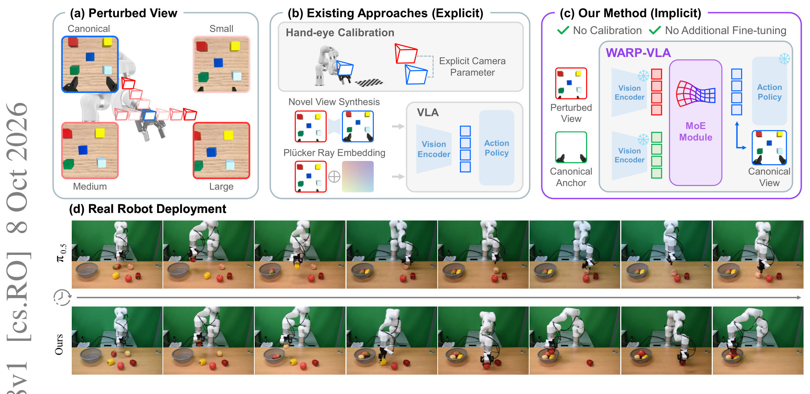
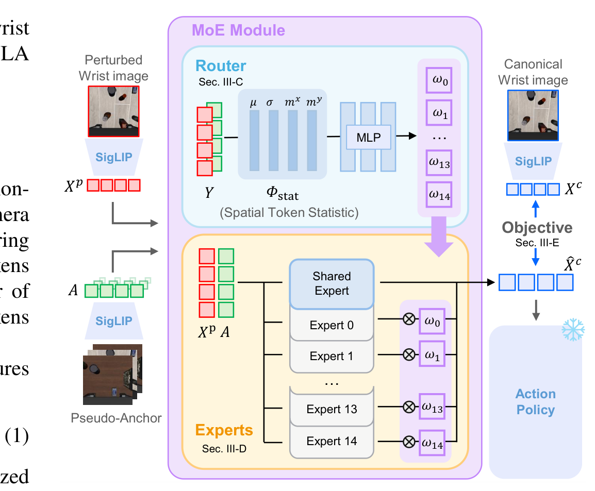
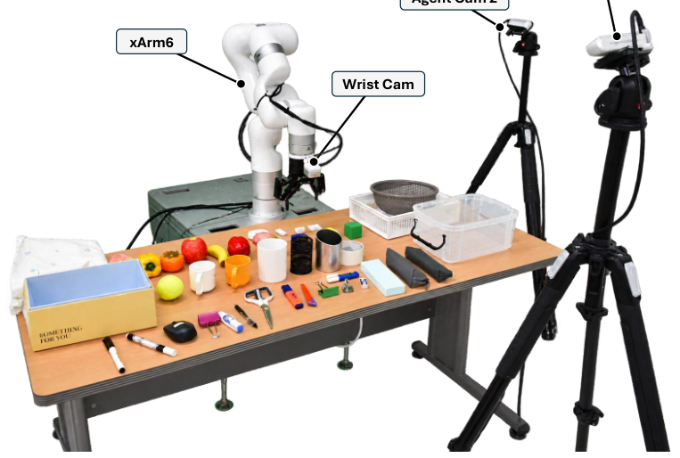
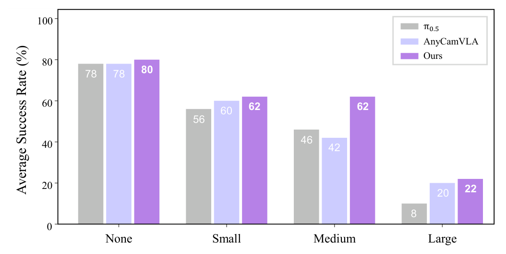
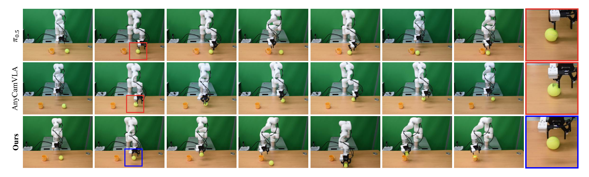
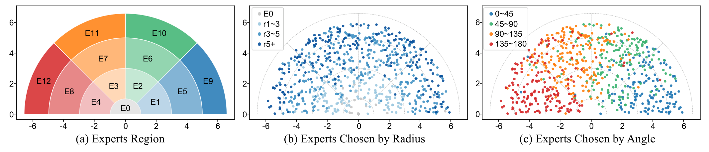

# WARP-VLA: Wrist-Camera Adaptation for View-Robust Policy Execution in Vision-Language-Action Models

把 VLA 策略部署到新设备上，最先坏掉的往往是腕相机：**复现训练时的腕相机安装位姿几乎不可能**，而腕视图比固定外视角更敏感——相机装在臂上随手一起动，几毫米的安装偏差就会改变细粒度几何线索。量化一下有多痛：π0.5 在腕相机扰动下的平均成功率**掉到 39.2%**，大扰动档只剩 6.1%。WARP-VLA 给冻结策略加一个MoE 适配器：把扰动腕特征**变换回规范特征空间**（$\hat{X}_c=f_\varphi(X_p,A)$），插在图像编码器与动作策略之间、token 形状不变——**免手眼标定、免相机外参输入、免策略再微调**。LIBERO 上 π0.5 扰动均值 39.2%→78.3%，超过要显式相机参数的 KYC 16 个点、超过新视角合成的 AnyCamVLA 6 个点；适配器在 LIBERO-Plus 与真机上零重训直接用。

**论文**：arXiv:2610.11508（cs.RO，2026-10-08 提交，9 页 6 图）。
作者：Junmyeong Lee、Dongmin Shin、Min-Gyu Park、Wooseok Jeon、Inho Chang、Hae-Gon Jeon——延世大学 / 电子通讯研究院 ETRI。
代码 [GitHub june65/WARP-VLA](https://github.com/june65/WARP-VLA)（10-08 建仓，README 尚未上传）；发布腕视角鲁棒性基准与即插即用实现。

## 问题：腕相机安装偏差是部署级灾难

跨设备（cross-setup）部署复现训练相机位姿不现实。显式路线要么要手眼标定（外参依赖末端位姿复合更新），要么做新视角合成（NVS 引入合成伪影），要么用 Plücker 射线嵌入（改骨干输入接口）。腕视图的特殊性：相机随机运动，**安装微差直接改变夹爪-物体对齐的视觉线索**——这是抓取成败的核心信息。表 I 的剂量反应：π0.5 Small 档还有 90.5%，Medium 20.9%，Large 6.1%——掉的不是渐进的，是塌方。

## 适配器：特征空间回规范

### 机制流程

**第一步（伪规范锚）**：锚 $A\in\mathbb{R}^{S\times D}$ 是基策略微调数据集（纯规范观测）上**全帧腕视图特征的平均**——跨场景任务平均消掉观测特异变化，留下与规范相机配置关联的稳定参考。真机部署只重算锚（规范真机演示平均），**适配器本身不动**。

**第二步（统计路由）**：路由输入是残差统计（式 (3)）：$z=\Phi_{stat}(X_p-A)\oplus\Phi_{stat}(A)\in\mathbb{R}^{8D}$，其中 $\Phi_{stat}(Y)=\mu(Y)\oplus\sigma(Y)\oplus m_x(Y)\oplus m_y(Y)$（式 (4)）——通道均值/标准差加**空间一阶矩**。关键设计：**不引入额外视觉编码器**，路由信号从冻结策略已产出的特征统计里来；回归分析表明这些统计能区分不同轴向的相机变化。训练时锚与任务特定规范锚随机混合，防路由过拟合单一规范视角。

**第三步（MoE 变换）**：15 个路由专家（rank-16 低秩参数化）加一个共享专家（8 块ViT、隐维 2048、注意 256 四头），$F_{MoE}(X_p,A)=\sum_e w_e F_e(X_p,A)$（式 (2)）——连续相机配置空间用有限组变换专家分段覆盖、路由连续插值。输出 $\hat{X}_c$ **替换原腕token 进入冻结策略**，token 形状不变。

**第四步（训练与部署）**：配对规范特征监督（同一演示轨迹在规范相机下重渲染）+ 目标规范特征 $X_c$；10,000 步 Adam（batch 4,096、8×RTX PRO 6000 约 30 小时）。训练数据：2,000 条 LIBERO 演示 × 40 任务，每条在 10 个扰动腕相机配置下重渲染（半圆平移 $r\le6$ cm、倾斜 $\tau\le10°$）——**只改相机配置不改任务语义**。

*论文原图编号：Fig. 1——四面板：(a) 腕相机扰动（canonical/small/medium/large）；(b) 显式路线（手眼标定/新视角合成/Plücker 嵌入）；(c) WARP-VLA 隐式MoE（免标定免再微调）；(d) 真机 π0.5 对比*

*论文原图编号：Fig. 2——MoE 适配器训练管线：路由（空间token统计+MLP 出 ω0–ω14）与专家（共享专家+15 低秩专家）；配对规范特征监督，编码器与策略冻结*

## LIBERO 主结果：免参数路线胜出

表 I（四档条件，每扰动档 14 相机配置 = 7 方位角 × 2 倾角，LIBERO 每档 560 episodes）：

| 方法（LIBERO 扰动均值） | Small | Medium | Large | 平均 |
|---|---|---|---|---|
| π0.5 裸骨干 | 90.5 | 20.9 | 6.1 | 39.2 |
| **π0.5 + WARP** | **95.5** | **80.5** | **58.8** | **78.3** |
| GR00T N1.7 裸骨干 | 86.1 | 26.1 | 11.8 | 41.3 |
| GR00T N1.7 + WARP | 88.6 | 60.5 | 50.4 | 66.5 |
| AnyCamVLA（NVS） | 93.6 | 73.8 | 49.5 | 72.3 |
| KYC（显式外参） | 86.8 | 60.0 | 40.2 | 62.3 |
| GAM（几何感知） | 87.5 | 55.0 | 33.4 | 58.6 |

三个读法：**双骨干均大幅提升**（π0.5 +39.1、GR00T +25.2）——适配器对骨干不挑，图像潜空间插入的接口通用性得到验证；**免参数胜显式**：超 KYC 16.0 点（KYC 推理时要用末端位姿复合外参做更新）、超 AnyCamVLA 6.0 点（NVS 在大扰动下合成质量崩）；**几何先验绑规范配置**：GAM 规范档 98.4 但 Large 只有 33.4——几何先验救不了未见腕视角。

## LIBERO-Plus 零迁移：适配器不重训

LIBERO 训练的适配器直接搬到 LIBERO-Plus（不同场景与任务分布）：π0.5 扰动均值 28.8→56.5（+27.7）、GR00T 30.8→49.9（+19.1）——**学到的相机特定变换跨域保持有效**，AnyCamVLA 54.7、KYC 30.1（后者在域外 Large 档崩到 6.9%）。这组数字的含义：视角适配不像任务技能那样过拟合域——变换专家在预训练视觉特征空间里工作，与场景语义解耦。

## 真机：3D 打印扰动支架

xArm6 + Robotiq 2F-85，腕相机 RealSense D405；**3D 打印一套相机支架**：1 规范 + 9 扰动（x/y 平移与倾斜三变体 × small/medium/large：2/4/6 cm、3/6/9°）。10 任务 × 50 条规范演示遥操作采集（Meta Quest Pro），基策略微调用规范位姿；**部署时换支架、只重算锚**（LIBERO 适配器原封不动）。

*论文原图编号：Fig. 4——真机平台：xArm、腕相机（D405）、两台 agent 相机（D435）与操作工作区（原图裁剪经手动重裁修复左缘正文混入）*

结果（图 6，每配置 10 任务 × 5 试验）：规范档三方法 78/78/80 几乎持平；扰动下 π0.5 掉到 36.7%、AnyCamVLA 40.7%、**WARP 48.7%**（+12.0/+8.0 点）。定性对比（图 5）：基线方法能接近目标但**无法把物体对中到夹爪指间**——策略按规范相机下学到的视觉对齐行动，把物体带到腕相机视野中心而不是夹爪中心；WARP 保持了夹爪-物体对齐完成球入杯任务。

*论文原图编号：Fig. 6——真机成功率：规范档 80 对 78；扰动均值 48.7% 对 36.7%（π0.5）与 40.7%（AnyCamVLA）*

*论文原图编号：Fig. 5——扰动腕视图下的抓取行为对比：基线把物体带到相机视野中心而非夹爪中心（右侧特写框），WARP 保持夹爪-物体对齐*

## 路由学到了什么：几何结构

图 3 的可视化是论文最漂亮的一处分析：13 个专家区域按**半径带**（r1–3/3–5/5+）与**角度扇区**（0–45/45–90/90–135/135–180°）分区，路由预测的激活模式（图 3(b)(c) 的着色）与相机偏移的真实半径/角度吻合——**统计路由从特征统计里恢复出了相机扰动的几何结构**，这是「免编码器路由」设计的直接证据。

*论文原图编号：Fig. 3——专家区域与路由：点位置为真实相机偏移，颜色为路由预测；半径带与角度扇区的激活模式吻合*

## 复用要点

- **「特征空间回规范」是免校准部署模板**：插在编码器与策略间、token 形状不变——任何兼容接口的冻结骨干可挂，π0.5/GR00T 双骨干已验证。
- **伪锚（规范观测特征平均）是零标注域参考**：真机迁移只重算锚——秒级域适配，适配器权重不动。
- **Φstat 当路由信号**：通道均值/标准差/空间一阶矩——**先查冻结特征的统计量里有没有你要的信号，再考虑加网络**；本文回归分析确认统计量携带视角线索。
- **3D 打印扰动支架 + 每配置 5 试验**：真机视角鲁棒的廉价评测协议，一套支架覆盖平移/倾斜两轴三档。
- **重渲染视角增广**：同一演示轨迹换相机渲染 10 配置——任务语义不变只改视角，视角增广的标准做法。

## 边界与尚不能确定

论文自述：适配器作用于观测特征，**视场外或完全遮挡的任务相关区域无法补偿**；大扰动下观察到**过早开爪**失败（定位准但抓取状态推断错）——夹爪可见性受限使抓取状态难推断，作者把时序记忆与补充相机观测列为下一步。我的补充：训练相机分布限定 $r\le6$ cm、$\tau\le10°$，超出范围的外推未验证（连续插值的泛化边界不明）；每骨干需单独训练适配器（π0.5 与 GR00T 各一）；真机每配置仅 5 试验小样本；表 II 的统计路由消融在抽取中不完整（单共享适配器 vs 多专家的隔离数值未能全文转写，尚不能确定具体差值）。
