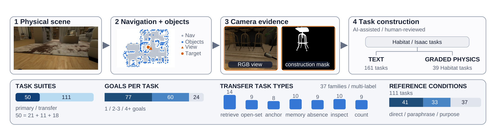
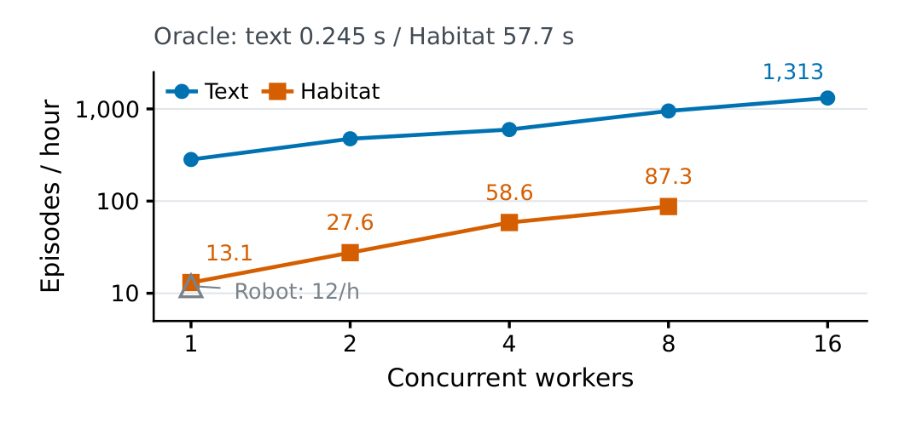
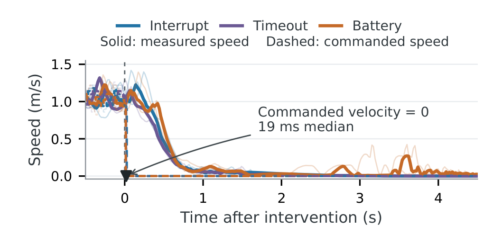

# BT-Agent: Deploying Onboard Robot Agents with Behavior Trees and Multi-Fidelity Evaluation

BT-Agent 讨论的并非怎样让语言模型直接生成电机控制，而是怎样把慢速任务推理接到可检查、可中断的机器人技能上。模型选择预定义技能，行为树在本机持续检查执行条件；配套评估把廉价文本任务、视觉物理仿真和机上运行连接起来。论文最值得保留的边界是：文本成功不能证明物理执行成功，本地停机请求也不是完整安全保证。

Fabio Hübel、Adam Lilja、Yue Yin 等，Stanford、UC Berkeley、NVIDIA；[arXiv:2610.13862v1](https://arxiv.org/abs/2610.13862)，首次提交北京时间 2026-10-10 01:08。全文 9 页，页码按 PDF 页计；论文注明提交 IEEE，并承诺后续以 Apache-2.0 发布实现和基准，本次未确认公开官方仓库。

## 模型推理不能承担每次控制检查

模型可以根据任务和失败反馈改变计划，但若每次取消、定位失效或电池告警都要等一次模型调用，反应速度便被生成延迟束缚。机器人执行还需要确定性约束：没有有效目标位置不能导航，没有必需观察不能执行某些交互；动作开始后也要持续确认条件。

*论文原图编号：Fig. 1。左侧 Actor 与 Supervisor 负责任务选择和反馈，右侧技能树每个 tick 检查条件；该图解释本地中断为何无需等待另一轮模型推理。*

行为树（Behavior Tree，BT）将固定检查节点和技能主体组织成可重复更新的执行结构。本文选择让开发者事先实现技能，不让 Actor 在运行时改写守卫。这是与模型生成或修复整棵树的路线不同的职责分配：模型保留任务级适应能力，固定树提供可单独审查的动作契约。

## 从一次技能选择到本地中断

以“拍摄眼镜”为例，Actor 首先查询场景记忆，选择观察点，导航后调查相机，再捕获图像。前一步返回的对象与观察可保存在类型化对象存储中供后续参数引用，历史被摘要以限制上下文。Actor 接收文本和结构化结果，视觉处理由感知技能完成，而不是默认每次决策都输入原始多相机图像（第 2–3 页）。

执行链分四步：

1. 任务、历史与对象存储进入 Actor，输出固定技能名与参数；Supervisor 校验参数和前置条件，一次派发一个技能。
2. 物理技能的 reactive sequence 每个 tick 依次检查取消、时限与技能专用条件；全部通过时才推进技能主体，失败即中断分支并请求控制器停机。
3. 成功、失败节点与诊断回到 Actor，模型选择重试、改变动作或报告限制；参数不能禁用守卫。取消也适用于上下文技能。
4. 完成声明经 Supervisor 转为终端提交，评估器检查所有目标、证据和预算，不能只看模型口头声称完成。

前置校验和运行中守卫是两个不同阶段。一个位置在派发时有效，导航过程中仍可能失去定位；只做调用前检查不能替代周期性监视。相反，守卫失败只说明请求阻止或中断某个技能，物理停稳仍取决于反馈与底层控制器。本文没有新的学习损失或证明全局安全的定理，核心机制是这条接口与执行链。

上下文技能在物理操作被限制时仍可用，因而机器人可以查询更多信息或报告约束。这个选择让安全停止与任务会话终止分开：动作能先停，模型再解释或恢复，而不必等待解释完成才停。

## 文本评估与物理评估共享什么

*论文原图编号：Fig. 2。仿真几何、导航图与相机记录产生场景记忆和任务，文本端与物理端共享目标与技能接口；两端执行成本和感知能力仍不同。*

基准有四个场景配置，包含同一室内住宅的两个配置、室外 Isaac 场景和额外 HSSD 住宅。主套件 50 个任务，含 39 个 Habitat 来源和 11 个 Isaac 来源；新住宅的 111 个迁移任务形成总计 161 个文本任务。文本端按预先构造的状态、可见性和交互记录执行技能；Habitat 端用真实渲染的当前图像和 VLM 感知，并通过运动模块导航。

论文还注入定位、导航进度、阻碍、视点、交互和感知故障，配对控制保持任务、目标和设置一致。这能快速检验模型如何响应失败，但文本状态表无法全面表现物理接触、定位误差与视觉误识别。39 个主任务才有定量 Habitat 配对，室外来源与迁移套件的主要量化仍在文本端。

*论文原图编号：Fig. 6。纵轴为对数吞吐，横轴是并发 worker 数；oracle 时间与含模型推理的吞吐是两种统计。*

16 个任务的无模型 oracle 平均每集文本 0.245 秒、Habitat 57.7 秒。八 workers、同一 9B 模型服务时，文本 950 集/小时，Habitat 87.3 集/小时，相差 10.9 倍；前者模型在 RTX PRO 6000，后者额外使用 RTX 5090 做仿真，吞吐排除 timeout 尝试。不能把 oracle 的约 235 倍时间差替代为智能体吞吐收益，更不能与全部失败都计入的成功率混用。

文本端更快适合比较技能编排与接口，物理端则检验这些决策在真实感知和运动约束下是否成立。第 6–7 页配对结果中，BT-Agent 文本 82.1%、Habitat 57.3%；四方法合并的文本成功中，只有 57.3% 同时在 Habitat 成功。任务均值 Spearman 相关为 0.61，说明有一定排序信息，并不提供直接替代关系。

## 小模型收益来自接口还是行为树

Act、ReAct、CaP-X 和 BT-Agent 在同一 backend 使用共同技能层和执行检查。比较主要检验模型编排、提示和历史处理，不是“有守卫”对“无守卫”的安全消融。模型是 Qwen3.5 的 NVFP4 4B、9B、27B 和 122B-A10B checkpoint；主比较每任务三个配对种子（第 4–6 页）。

| 模型 | 最强 Act/ReAct，161任务成功率 | BT-Agent | 差值 |
| --- | ---: | ---: | ---: |
| 4B | 41.4% | 51.6% | +10.1 个百分点，按未四舍五入值 |
| 9B | 49.7% | 54.7% | +5.0 个百分点 |
| 27B | 62.9% | 62.9% | 约持平 |
| 122B-A10B | 65.6% | 67.7% | +2.1 个百分点 |

这些是文本评测值，不是真机成功率。4B 的收益更集中在主套件，9B 迁移套件对 ReAct 还有 4.8 点提升。结构化工具调用改成文本动作接口后，匹配控制的 4B 成功率由 50.5% 降至 37.5%，9B 由 58.0% 降至 44.3%；只返回技能名和状态、移除详细失败反馈，也让各规模下降约 2–6 点。固定技能契约的收益有证据，但不能仅归因到树的拓扑。

Robosuite 部分比较程序生成与逐技能决策，使用阻塞 API 而不是 BT 执行，且程序方法与逐步骤方法的动作预算并不完全相同。27B 擦拭任务中，规则的 101 次调用可写成循环，CaP-X 14/20 完成，BT-Agent 在时限内 0/20；三方块重堆叠则 BT-Agent 15/20、CaP-X 4/20。程序更适合长而规律的序列，观察决定下一步时逐技能决策可能更有优势。它们是架构取舍证据，不能抹去预算差异后宣称某范式普遍更强。

## 机上试验展示的能力和未解决问题

> **图表占位：Fig. 5 — 机上五任务与失败记录**
> **建议位置：** 机上试验展示的能力和未解决问题
> **放置原因：** 图中同时展示成功任务和读取时钟失败，定义了真机验证规模。
> **当前状态：** 保留占位；自动提取候选未通过图体裁切检查，任务与次数根据第 7 页图注、正文核实。

Spot 配备 Jetson Thor，9B 模型承担 Actor 和视觉技能，Qwen3-Embedding-0.6B 检索事先建立的 FARM 场景图。场景图来自先前 RGB-D 建图，粗大标签错误已人工检查修正；另有预生成 waypoint graph 和底层规划、跟踪模块。推理、检索、BT 和控制运行在机上，**运动仍需操作员批准**，不能称无人监督自主运行。

五任务各三次，共 15 次，完成 11 次。其中找到并拍到显示器后，三个报时试验都因小表盘视觉误读失败；搜索、拍摄和检查操作有成功，并不表示视觉推理完全可靠。已知场景图与先验路线也意味着实验不是从未知环境开始的开放世界探索。

*论文原图编号：Fig. 7。虚线指令先归零，实线速度随后衰减；九次取消、超时或电池干预支持局部响应，但两种时间不能混同。*

九次移动中干预，从本地接受干预到指令速度归零中位数 19 ms，下一次模型选择动作耗时 3.2–3.9 秒。这验证守卫不等待模型即可请求停止。实测速度仍经历控制和物理减速；电池试验还包含坐下动作。因而 19 ms 不是接触安全证明，也不是机器人完全停稳时间。

## 怎样迁移到自己的机器人系统

最可复用的设计是稳定的技能结果语义：前置条件、运行状态、取消路径、失败诊断与完成证据都应可被独立测试。先以文本或状态代理评测编排，再抽取配对任务验证视觉和运动失败，最后测试实际守卫到控制器的响应链，会比只看模型的任务完成声明更有意义。

我的分析是，迁移时必须显式列出哪些故障被守卫覆盖、状态反馈多久更新、停机请求如何传到执行器，以及断连时如何停止。固定 BT 能防止模型通过参数修改守卫，却无法保证守卫覆盖未知危险。本文以有限场景、少量干预和机上演示建立可行性；进一步开放环境、跨本体和更广安全验证仍未确定。
