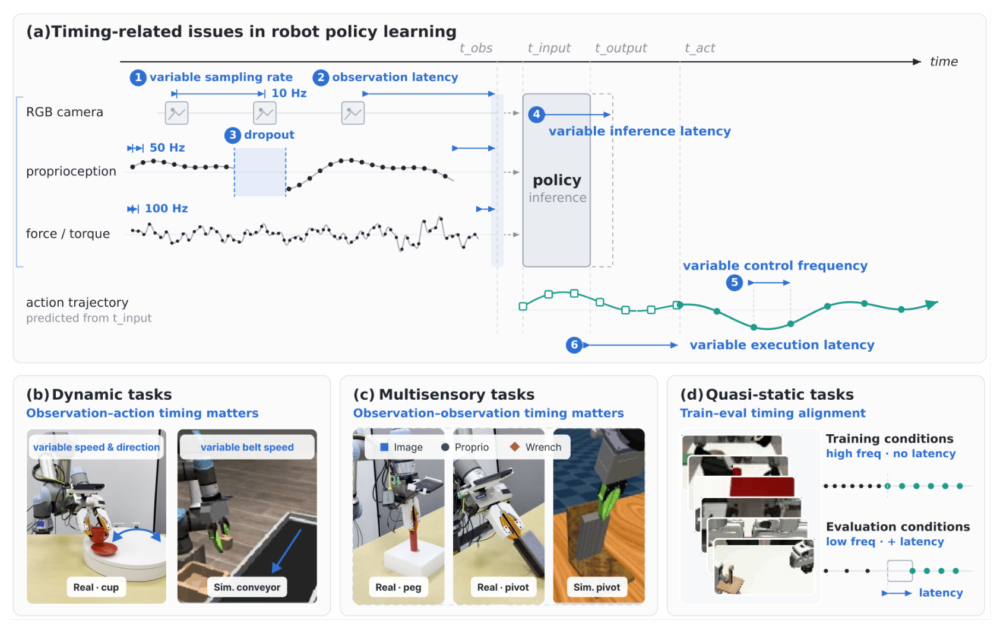
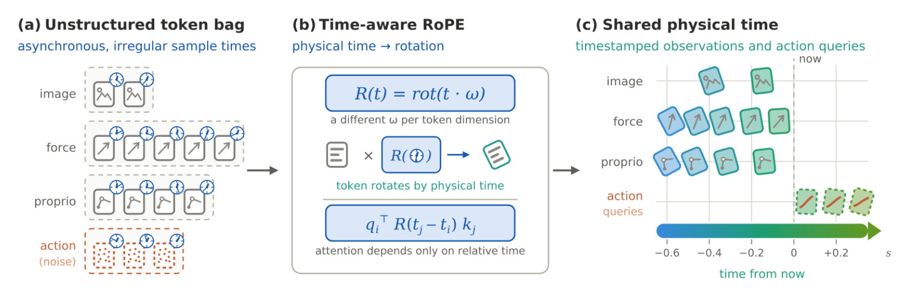
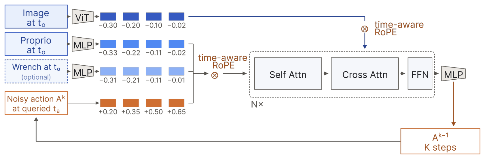
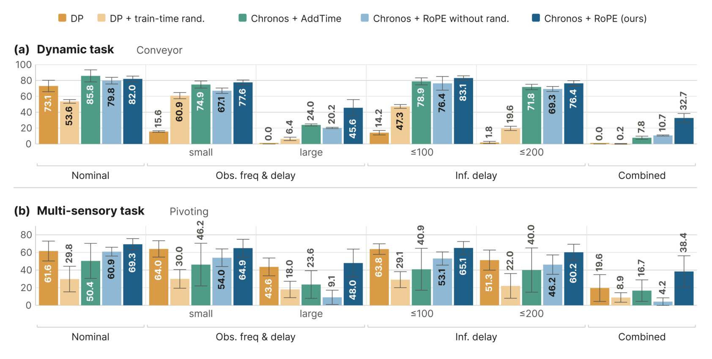
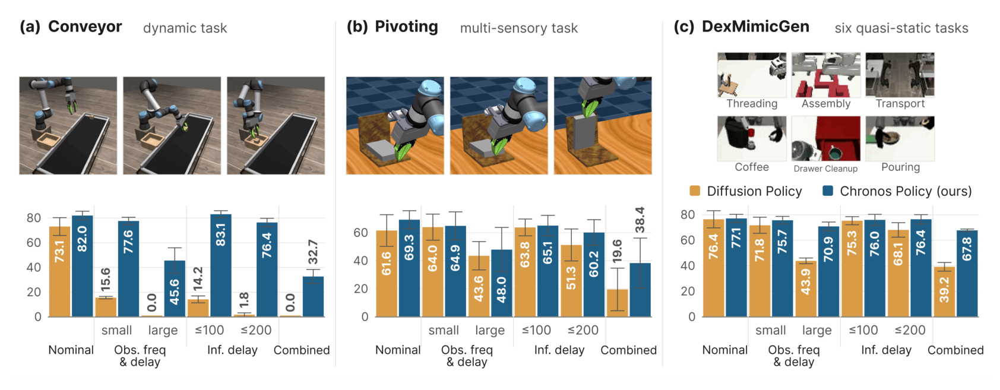
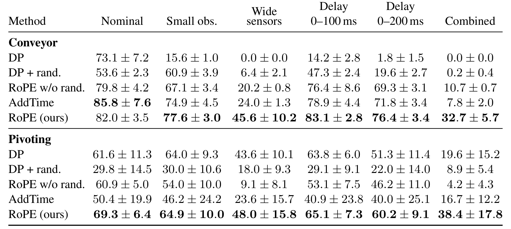
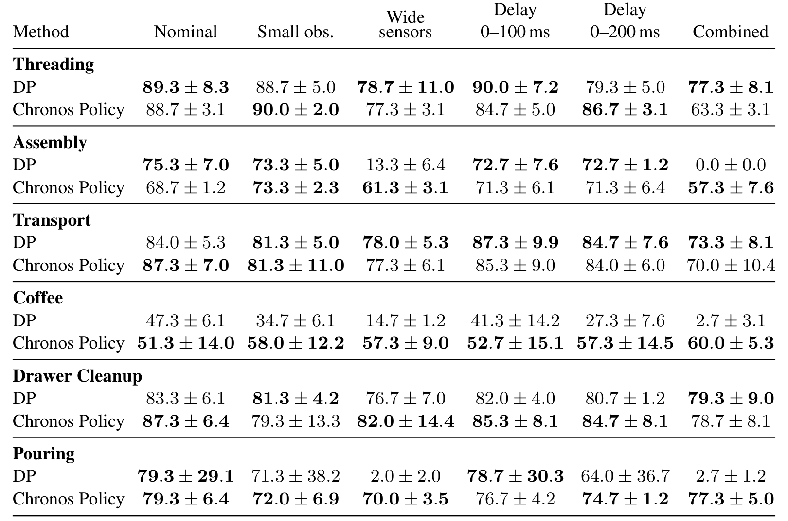
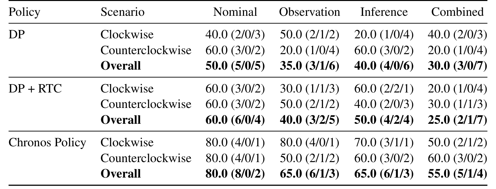
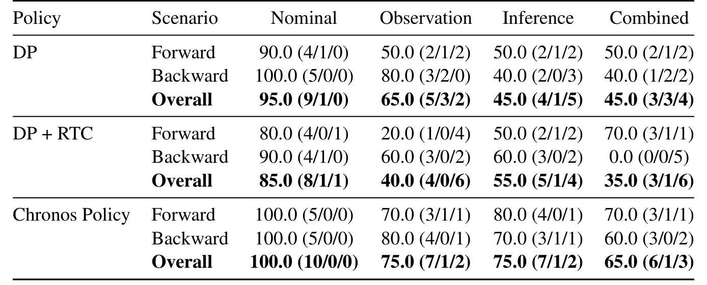
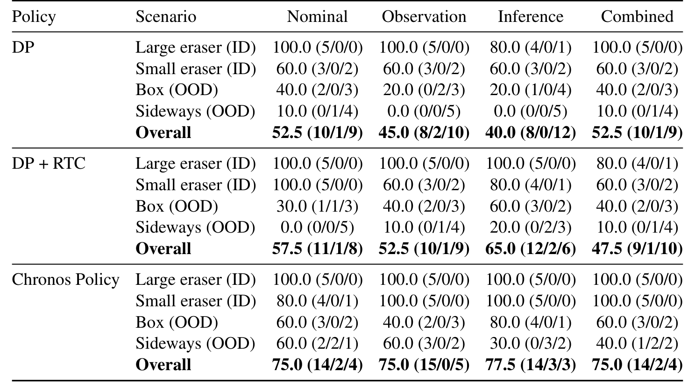

# Chronos Policy: Learning Robot Policies on Physical Time

机器人观察序列中的“上一帧”并不意味着固定的过去时刻：相机可能降频，力传感器可能更快，推理结束时物体又移动了。Chronos Policy 把观测采集时间和动作期望执行时间一起交给策略，并让注意力直接使用物理时差。它提出的主要变化是策略的数据接口，而不是换一个更大的扩散模型。

Changhao Wang、Jaden Clark、Shuran Song，Stanford；[arXiv:2610.13929v1](https://arxiv.org/abs/2610.13929)，首次提交北京时间 2026-10-10 01:55。[项目页](https://changhaowang.github.io/chronospolicy/)。全文 18 页，后六页包含实现与实验细节；页码按 PDF 页计。

## 序列位置为什么不能代表物理时间

标准策略把第一个、第二个图像和动作 词元 的序列位置当作时间的替代量。固定采样与低延迟时，这样做通常够用；当摄像头与力传感器异步、观测到达延迟或推理耗时变化时，相同序列位置可以代表不同物理间隔。对于移动目标，策略既要知道物体过去如何运动，也要知道预测动作真正生效时它在哪里。

*论文原图编号：Figure 1。上半部分区分采样率、观测延迟、丢帧、推理与执行延迟，下半部分列出动态、多传感和准静态任务；这张图定义需要建模的时间关系。*

时间误差不全是“模型推理慢”。多传感接触任务还需要判断图像、位姿与力矩是不是同一阶段的状态。只补偿 action chunk 之间的衔接，不能自动恢复丢失的观测时间语义。论文因此同时建模 observation–observation 和 observation–action 的间隔。

## 带时间戳的观测与动作怎样进入网络

*论文原图编号：Figure 2。不同模态保留独立时间戳，通过 time-aware RoPE 形成共享物理时间坐标；右侧动作查询落在未来。*

令当前请求时刻为 $t$，第一项动作的期望延迟为 $d_t$、动作间隔为 $\Delta t_a$、动作块长度为 $H$，动作查询时刻是

$$
t_{a,j}=t+d_t+j\Delta t_a,\qquad j=0,\ldots,H-1.
$$

观测值 $O_{t_o}$ 与其采集时刻 $t_o$ 一起输入，策略预测 $A_{t_a}\sim\pi_\theta(\cdot\mid O_{t_o},t_o,t_a)$。时间告诉网络测量有多旧、观测之间隔多久，以及动作需要预测到多远的未来。各传感器保留自身采集时刻，不先强行同步到公共时间网格。

网络将每个词元的时间减去请求时刻，以 $\tilde t_i=t_i-t$ 作为旋转位置编码的坐标。若原始查询向量和键向量 为 $q_i,k_j$、旋转矩阵为 $R$，则

$$
\tilde q_i=R(\tilde t_i)q_i,\qquad
\tilde k_j=R(\tilde t_j)k_j,\qquad
\tilde q_i^\top\tilde k_j=q_i^\top R(t_j-t_i)k_j.
$$

这个恒等式表明注意力依赖物理时差，而非词元序号；统一移动时钟原点不会改变相对关系。$R$ 使用多个旋转频率，词元 内容仍由图像、模态与空间特征表达。与把 Fourier 时间特征直接加到内容向量相比，它在注意力中显式分离“是什么”和“发生在什么时候”。这种分离是设计动机，其优势需要由消融确认，不能仅从公式推出。

*论文原图编号：Figure 6。位姿、可选力矩与带查询时间的噪声动作做自注意力，图像通过交叉注意力参与；各去噪步骤沿用时间语义。*

实现与基线共用 16 层、宽度 512、八个 注意力头 的 diffusion transformer。SigLIP2 base 从 256×256 图像提取 768 维 patch 特征，位姿与动作独立嵌入；插入和转轴类任务加入力矩 词元（第 13 页）。因此主实验并不是换容量后比较。策略在实验中预测 16 个动作、20 Hz 执行；公式允许查询时间变化，而超出固定动作率的时间缩放仍是作者未来方向。

## 训练与异步执行必须共享时间含义

执行路径可以拆成四步：

1. 各传感测量进入词元化环节，保留真实采集时间；未来动作 词元 获得期望执行时刻。
2. 时间坐标进入 RoPE，词元 内容进入 transformer，网络对指定未来时刻去噪并预测动作块。
3. 训练时从原始示范随机采样各模态频率、递送延迟与动作开始时间，保留原采集时间，预测与该查询时刻对应的示范动作。
4. 在线执行旧 chunk 的同时推理新 chunk，以既往请求耗时估计延迟；新结果到达后丢弃执行时刻已过的动作，按剩余查询时间执行。

训练仍使用标准扩散加噪过程 $A^{(k)}=\alpha_k A^*_{t_a}+\sigma_k\epsilon$，其中 $k$ 为扩散步、$\epsilon\sim\mathcal N(0,I)$。实验使用干净动作预测与 L1 误差。创新是样本构造和时间条件，不是新的扩散目标。

这里随机化并不随意改标签。它从同一录制轨迹挑选在模拟请求时间真正可获得的观测，并改变要预测的动作时刻；若随机打乱时间戳，或仍用固定网格动作标签，就破坏了因果含义。真实在线推理时间不可提前知道，论文以历史推理耗时估计，这仍留下延迟突变时的预测误差。

## 消融把随机化和时间表示分开检验

*论文原图编号：Figure 3。每组柱分别是 DP、只有时间随机化、AddTime、无随机化的 RoPE 和完整方法；误差条保留，不能只比较最显眼的柱。*

*论文原图编号：Figure 4。相同时间扰动下三类任务的收益不同；动态传送带最依赖观测到执行时刻的预测。*

Conveyor 名义条件下 DP 73.1%、Chronos 82.0%；适度观测扰动下 15.6% 对 77.6%；推理延迟最高 200 ms 时 1.8% 对 76.4%；组合扰动时 0% 对 32.7%。最后一组说明鲁棒性提升很大，但仍不是充分可靠的操作系统。

*论文原图编号：Table 3。各值为均值与训练种子间样本标准差，列中明确区分观测扰动、延迟和组合条件；用于核实消融的非单调结果。*

仿真使用三训练种子，每条件每方法合计 450 次评估。只增加时间随机化，Conveyor 五类扰动平均由 6.3% 提升至 26.9%，但 Pivoting 从 48.4% 降至 21.6%。没有时间戳时异步模态对应关系变得更模糊，额外多样性不必然是好增强。完整 RoPE 配合随机化在 Pivoting 组合条件达到 38.4%，但标准差为 17.8，表现仍存在明显波动。

AddTime 在 Conveyor 名义条件达到 85.8%，高于完整 RoPE 的 82.0%；完整方法并非每个设置都最好。RoPE 的优势集中在受扰动条件：Conveyor 的五扰动均值 63.1% 对 AddTime 51.5%，Pivoting 为 55.3% 对 33.5%。这才支持时间表示选择的主张。

*论文原图编号：Table 4。每任务单列 DP 与 Chronos，保留 nominal 和组合扰动；任务平均改善不掩盖 Threading 的下降。*

六个准静态任务扰动均值为 59.7%→73.4%，名义表现大体相近；但 Threading 的组合条件 DP 77.3%、Chronos 63.3%。论文的“保留标准任务表现”应理解成总体趋势，不是逐任务无代价保证。

## 真机评分支持哪些结论

> **图表占位：Figure 5 — 三项真实任务的时间扰动结果**
> **建议位置：** 真机评分支持哪些结论
> **放置原因：** 它用浅色段区分半分完成和完整成功，是阅读真实实验的关键。
> **当前状态：** 保留占位；可独立使用的图像资产缺失，以下使用附录完整表体核对。

> **图表占位：Table 6 — 真机传感频率与延迟条件**
> **建议位置：** 真机评分支持哪些结论
> **放置原因：** 它定义机器人到底受到什么时序扰动。
> **当前状态：** 保留占位；一次裁切修复仍有表外文字碎片，未发布候选；数值按第 17 页转写。

真实 RGB 名义 20 Hz、扰动 12.5–33.33 Hz；位姿/夹爪名义 20 Hz、扰动 8.33–33.33 Hz；力矩名义约 90 Hz、扰动 37.5–150 Hz，各流独立增加 0–100 ms 延迟。推理扰动从 0、50、100、150、200 ms 采样。不同模态的变化并非同步降频。

*论文原图编号：Table 7。每方向五次，Overall 共十次；格内同时列评分和完整/部分/失败次数。*

真机评分是 $100(F+0.5P)/N$，其中 $F$、$P$ 为完整和部分成功次数，$N$ 为总次数。Dynamic Cup 组合扰动 Chronos 得分 55%，DP 为 30%，RTC 为 25%；Chronos 的 55% 对应五次完整、一次部分成功、四次失败，不能写成 55% 完整成功率。

*论文原图编号：Table 8。正反孔位分别五次，Chronos 在组合条件评分 65%；小样本与半分评分必须同时保留。*

*论文原图编号：Table 9。每场景五次，共二十次，ID 和 OOD 明确分列；它说明新增时间信息并未消除对象变化带来的失败。*

插入组合条件 Chronos 65%、DP 45%；Pivoting 为 75% 对 52.5%。但 Sideways OOD 的 Chronos 组合条件只有 40%，推理延迟条件为 30%。这些评估支持三项任务、给定扰动下的优势，尚不能推到任意时钟误差或传感丢失。RTC 和时间意识处理的层面互补：RTC 主要管理 action chunk 的执行衔接，Chronos 额外解释观测与目标动作的物理间隔。

## 对机器人数据接口的启示

最直接的工程启示是记录采集时间，而不是只记录接收顺序；同时让动作标签携带执行时间，保留各传感流自己的采样节奏。复现应固定网络容量、示范和执行器，再分别消融时间条件、随机化与异步执行，避免把改善统称为“降低延迟”。

我的分析是，时钟同步、采集时间精度、丢弃过期动作的控制接口，以及突发延迟的估计误差，是把这项方法接入真实机器人前要验证的四个环节。本文展示了显式时间的收益，但没有提供任意丢帧或时间戳损坏下的安全保证。已确认项目页，本次未确认公开代码和权重仓库。
