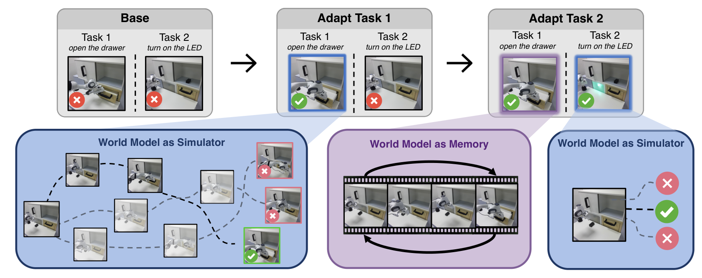
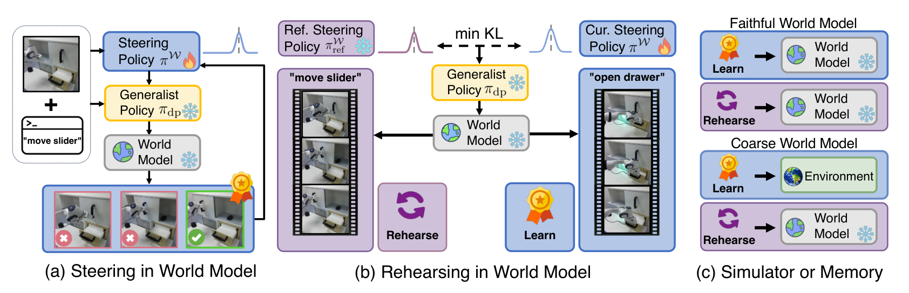
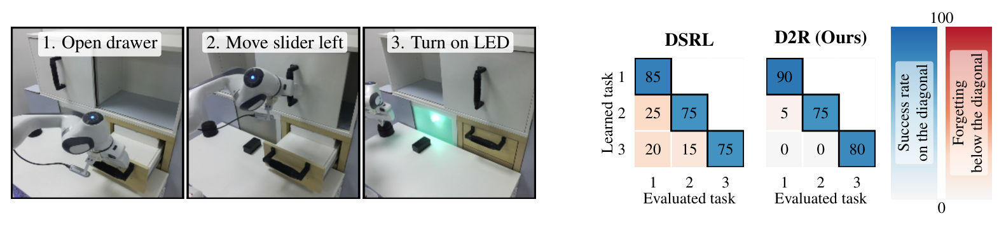

# Dream to Remember: Continual Steering of Generalist Robot Policies with World Models

冻结通用机器人策略，可以避免直接覆盖大模型权重，却不能阻止一个共享适配器遗忘。Dream to Remember（D2R）把世界模型用作可重新生成的记忆：小模块学习怎样选择策略输入噪声，同时在想象出的旧任务状态上约束自己保留旧行为。最有意思的结论是，世界模型可能不够准确，无法训练新技能，却仍足以承担旧技能复习。

Bahey Tharwat、Iman Nematollahi 等，University of Freiburg、Technical University of Munich；[arXiv:2610.13816v1](https://arxiv.org/abs/2610.13816)，首次提交北京时间 2026-10-10 00:28。全文 31 页，含训练目标、算法、实现和更多消融；下文页码按 PDF 页计。

## 冻结大策略仍然会忘记旧技能

扩散或 flow 策略从噪声产生动作块。固定这个生成器，只训练输入噪声的小网络，就能让相同观测下某些行为更容易被选中。它避免对大模型反向传播，却没有消除持续学习的核心冲突：小网络在任务二上更新后，也会改变任务一收到的噪声。因此“底座冻结”与“系统不会忘记”之间还缺一个行为保持机制。

*论文原图编号：Figure 1。新任务的想象优化和旧任务的世界模型复习同时发生，旧技能的保持由中间紫色记忆分支承担。*

本文不为每个任务增加一个永久模块，也不保存完整旧轨迹。它假设可以保留各任务的一小组初始观测，从这些起点生成旧任务状态，并让当前模块接近上一阶段参考行为。这里“没有轨迹 buffer”并不是“没有存储”：初始帧、已有世界模型、策略和必要的任务监督都仍存在。

## 把噪声选择变成强化学习动作

*论文原图编号：Figure 2。蓝色学习分支优化当前任务，紫色复习分支匹配旧模块；右侧区分世界模型能同时用于学习与复习，还是只能用于复习。*

设 $s$ 为观察历史形成的状态、$\ell$ 为语言指令、$w$ 为噪声，冻结生成器 $G$ 给出动作块 $a=G(s,\ell,w)$。小策略 $\pi^W(w\mid s,\ell)$ 产生噪声分布，通常为条件对角高斯；均值为零、标准差为一时回到原策略。新任务学习发生在噪声动作空间里，而真实机器人仍执行生成器输出的动作。确定性 DDIM 或 flow ODE 解码使这层映射清晰可定义（第 4–5 页）。

若世界模型转移为 $P_\phi(s'\mid s,a)$，噪声空间的想象转移就是

$$
P_\phi^W(s'\mid s,\ell,w)=P_\phi\bigl(s'\mid s,G(s,\ell,w)\bigr).
$$

这不是对世界模型求梯度的规划公式，而是把冻结策略吸收到环境映射中，让标准强化学习直接选择 $w$。该方法只要求策略前向访问，但仍要求世界模型动作接口与策略生成的动作一致。若世界模型对这些动作没有可信预测，强化学习可能找到预测漏洞。

从输入到下一阶段，执行顺序有四步：

1. 当前观察和指令进入噪声模块，采样噪声，经冻结生成器解码动作；可信世界模型提供想象经验，否则当前任务在环境中交互。
2. 旧任务初始帧进入世界模型，冻结的参考模块选噪声，生成旧技能可能访问的状态。
3. 当前任务经验提供强化学习损失，旧状态提供分布匹配损失；联合训练本阶段的一个新模块。
4. 本阶段结束后，新模块成为所有已见任务唯一在线模块，旧参考被丢弃；下一阶段重新初始化待训练模块，继续生成复习状态。

“每阶段从头训练新模块”是值得保留的实现细节，不能误实现为永久累积任务专用适配器。上一阶段模块在训练期间作为固定参考存在，因而在线模块数量固定不代表训练时只需一份网络。

## 世界模型怎样承担记忆

对第 $k$ 阶段的保留任务集合 $\mathcal R_k$，令 $D^j_{\mathrm{reh}}$ 为参考行为在世界模型中生成的任务 $j$ 状态。复习损失为

$$
\mathcal L_{\mathrm{KL}}=\frac{1}{|\mathcal R_k|}\sum_{j\in\mathcal R_k}
\mathbb E_{s\sim D^j_{\mathrm{reh}}}
\left[D_{\mathrm{KL}}\left(\pi_k^W(\cdot\mid s,\ell_j)\Vert\pi_{\mathrm{ref}(j)}^W(\cdot\mid s,\ell_j)\right)\right].
$$

已适配任务锚定上一阶段的噪声分布，未适配的预训练技能锚定标准高斯。匹配噪声分布使冻结生成器在旧任务状态上继续选择类似动作。这里的关键是状态来自旧任务，而不是仅给当前任务图像换一个旧任务指令；当场景变化时，后者无法覆盖旧任务所需的状态。

总目标是 $\mathcal L=\mathcal L_{\mathrm{RL}}+\alpha\mathcal L_{\mathrm{BC}}+\lambda\mathcal L_{\mathrm{KL}}$。$\alpha$ 控制想象学习时的动作行为克隆项，以减少利用模型误差；真实环境学习时设为零。$\lambda$ 控制技能保持与新任务学习的权衡。复习本身无需奖励，只比较当前与参考分布，因此可以固定长度展开；新技能在想象中优化时则需要独立的成功分类器提供奖励。

模型冻结使动力学不会因持续适配而改变，但并不证明它的生成状态完全准确，也不意味着全部记忆分布严格不变：保留任务集合和参考行为都会随阶段增长。工程上更准确的理解是“避免在线改写记忆模型”，而不是保证持续过程没有分布变化。

## 优化与复习为什么需要不同精度

CALVIN 使用在 play 数据上训练的 RSSM，底策略是每任务 150 条示范训练的扩散策略。可信动力学和任务成功分类器支持在想象中用 PPO 学习新任务。真实 Franka 设置同样使用 RSSM，但它先从六小时遥操作 play 数据学习，底策略每个七任务各用 100 条示范。因此“机器人只用于适配结果评估”只描述适配阶段，不能抹去前置真实数据成本。

LIBERO 则使用 π0 与 A2World，二者都在已有四个套件上适配过，未见目标 LIBERO-90 任务。用相同克隆配方训练，真实示范达到 74.9%，世界模型重放这些示范只有 19.6%（第 8–9 页）。这个对照说明在目标任务上把模型当训练模拟器风险很高。D2R 因而用 LIBERO 环境交互和 SAC 学新任务，仅让 A2World 生成复习状态；这里的环境交互是基准仿真交互，并非真机实验。

复习只要求旧技能的代表状态足够有用，优化则要求对新策略探索到的状态和动作也可靠。两种任务对模型覆盖面的要求不同，这是论文最值得借用的判断标准；它不是“任意粗糙模型都有记忆价值”的证明。

## 持续学习的收益和代价

> **图表占位：Table 1 — 单任务适配与保留**
> **建议位置：** 持续学习的收益和代价
> **放置原因：** 单任务对照检验输入引导能否同时改善新任务和保留其他技能。
> **当前状态：** 保留占位；候选一次重裁后仍含表外正文碎片，未插入；数值按第 7 页表体核实。

单任务 CALVIN 平均适配成功率由 63.7% 提至 79.8%。DSRL 达到 81.8%，但平均保留变化为 −5.3 个百分点；D2R 为 +1.6。DiWA 达到 79.2%，但保留变化为 −43.9。这里保留是相对基线的所有任务平均变化，包含当前任务；附录单列了仅未适配任务的遗忘指标，不能把这两种量互换。

> **图表占位：Table 2 — 八任务顺序学习的汇总比较**
> **建议位置：** 持续学习的收益和代价
> **放置原因：** 这张表区分最终成功率、保留、遗忘与存储代价。
> **当前状态：** 保留占位；自动裁切质量门拒绝候选，以下转写关键汇总值而不发布不完整图像。

| 顺序学习设置 | CALVIN 最终成功率 | LIBERO 新任务最终成功率 |
| --- | ---: | ---: |
| 初始底策略 | 63.7% | 10.4% |
| LoRA | 11.7% | 1.0% |
| DSRL，无复习 | 63.6% | 16.9% |
| 真实或存储轨迹的 replay KL | 74.0% | 73.9% |
| D2R，想象复习 | 74.8% | 74.9% |
| 每任务单独模块 | 81.8% | 91.3% |

第 8 页的结果说明单个模块确实积累了技能，但专用模块仍更强。CALVIN、LIBERO 遗忘分别为 5.7 和 8.3 个百分点，不能称完全不遗忘。约 400 个种子帧与约 59k 回放帧的存储对比也只统计复习帧，并不含世界模型参数和训练数据。

> **图表占位：Figure 3 — 持续学习成功率与遗忘热图**
> **建议位置：** 持续学习的收益和代价
> **放置原因：** 热图区分刚学会任务时的成功率和之后各阶段的遗忘。
> **当前状态：** 保留占位；自动提取未通过完整图体质量检查，正文用原页数值说明关键对照。

只用初始帧施加 KL，在 LIBERO 上仍遗忘 52.5 个百分点；只换指令也不足，最终新任务成功率 24.9%。展开旧任务状态的作用因而有直接消融支持。CALVIN 共享一个场景，指令 KL 相对有效，进一步说明复习状态的价值取决于场景差异。

*论文原图编号：Figure 4。对角线是刚学会时的成功率，下面的格子是遗忘；D2R 的旧任务遗忘更少，而非每格都表示成功率。*

真机依次学习开抽屉、左移滑块、开 LED，每阶段每任务评估 20 次。D2R 最初提升分别为 40、20、30 个百分点，末阶段平均较底策略高约 30 点；无复习的 DSRL 只保留约 15 点。对角线样本和固定初始配置支持这三个技能的验证，尚不足以说明复杂开放环境的持续泛化。

## 复现应先测试什么

先进行世界模型保真对照，决定新任务学习能否留在想象中，再分别复现无复习、只用初始帧、真实轨迹和想象展开的 KL。只有保持相同策略、学习预算和任务顺序，才能把收益归因到记忆状态覆盖，而不是额外数据或优化次数。

论文附录还讨论从头初始化、任务顺序、保持系数和行为克隆系数。我的分析是，实际系统最先需要验证世界模型与奖励分类器会不会共同产生虚假成功，以及保留状态是否覆盖失败恢复和接触变化。作者将无需保存初始帧的生成式种子机制列为后续方向；当前仍依赖这些种子。论文声称代码公开，本次未能确认可访问的官方仓库，复现准备应保留这个缺口。
