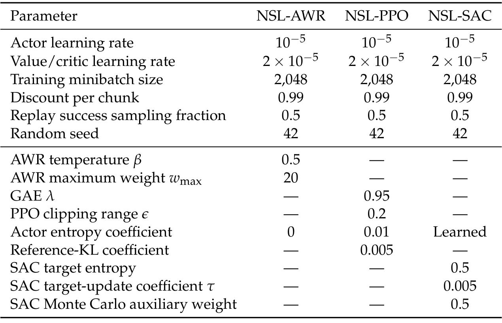
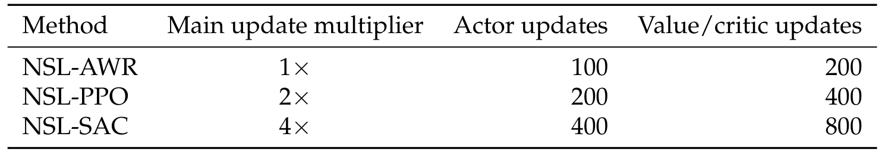
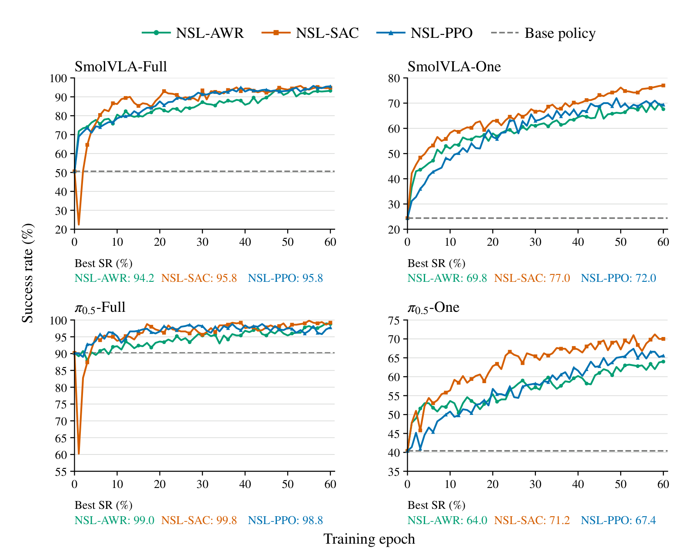
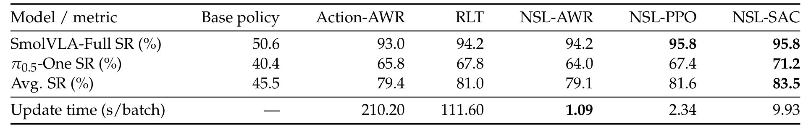
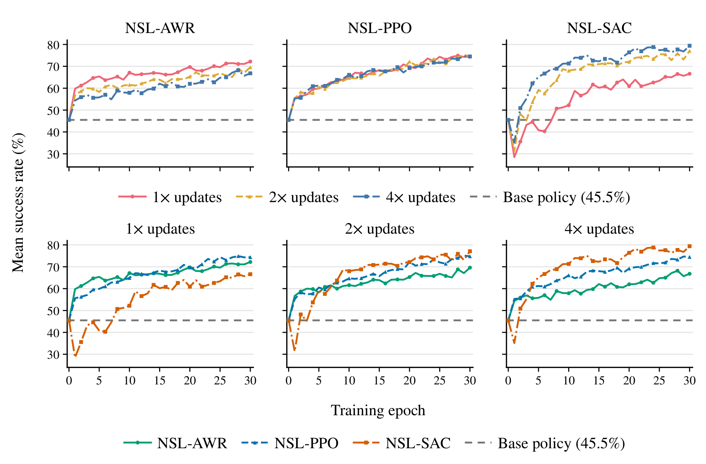
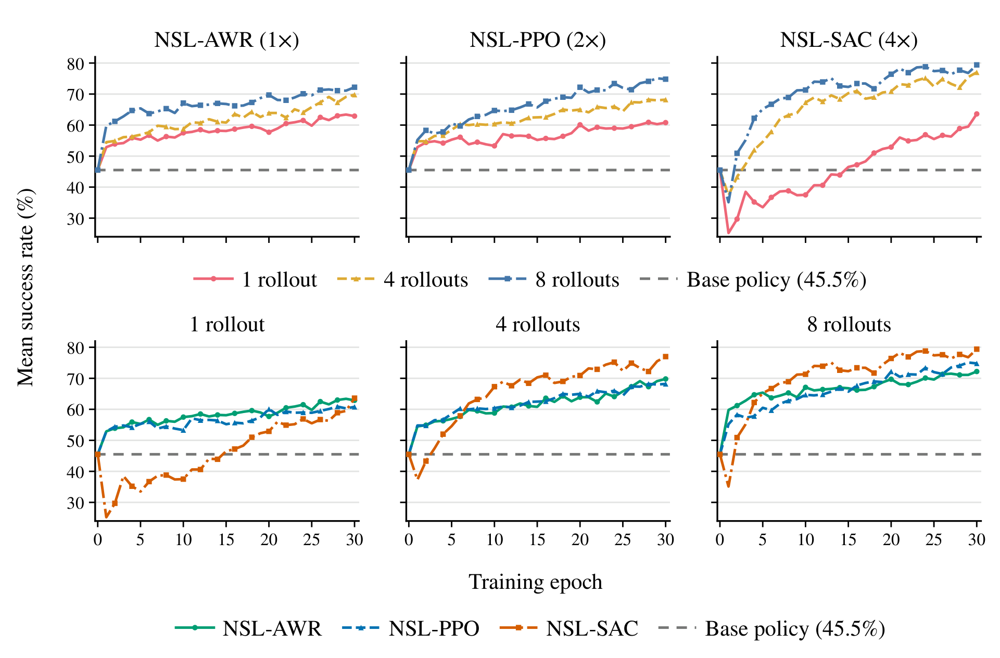
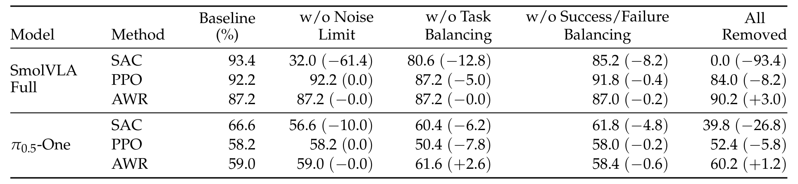
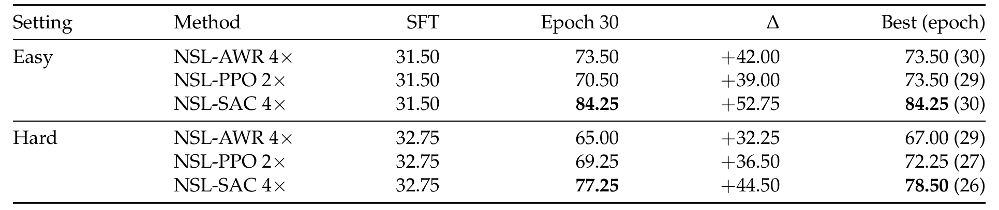
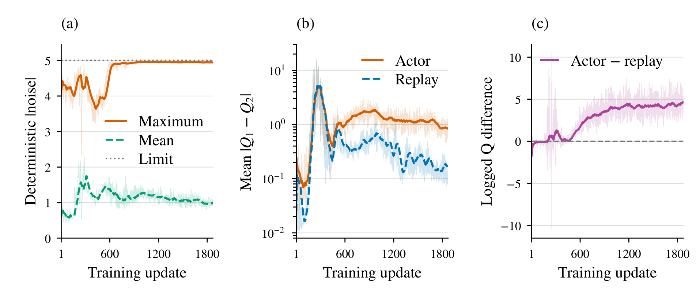

# Noise Space Learning for VLA Adaptation

这篇论文把 VLA 适配分成三个接口：更新动作生成器、修改生成后的动作、改变生成前的噪声。Noise Space Learning（NSL）选择第三种，只学习上下文条件的噪声分布，保持 flow VLA 冻结。它的价值既在于解释为什么这种接口能改变行为，也在于用 PPO、SAC、AWR 的预算与真机对照说明：最强仿真优化器未必是最合适的真实机器人适配器。

Junjie Lu、Chuheng Zhang 等，University of Technology Sydney、Microsoft Research、Nanjing University、Tsinghua University；[arXiv:2610.13943v1](https://arxiv.org/abs/2610.13943)，首次提交北京时间 2026-10-10 01:58。全文 26 页，含理论证明、真实实验协议与 RoboTwin 补充实验；页码按 PDF 页计。

## 不更新VLA，行为为什么仍能改变

Flow-matching VLA 把初始高斯噪声变成动作块。给定同一图像和语言，不同噪声能选到不同的抓取或接触动作。若预训练模型已经表示了某些有用行为，只要提高这些噪声出现的概率，就能改善任务表现，而不必重写整个噪声到动作的映射。它继承了 DSRL 等噪声引导思路，本文新增的是统一的适配接口、信息论分析及跨优化算法的系统对照，并非第一次提出学习噪声。

*论文原图编号：Figure 1。橙色为更新部分、蓝色为冻结部分；三行分别改变噪声分布、生成器和输出残差，用于解释适配发生在哪里。*

固定底座保护的是生成函数，不能自动保证动作安全或旧任务保持。改变噪声输入也能把生成器带到少见区域；本文的真实接触失败正是这个区别的实证。与继续训练动作专家相比，小模块降低梯度更新开销，但采样期间仍需完整 VLA 前向推理。

## 噪声分布如何决定可达行为

设 $s$ 包含图像、本体状态和语言，$z$ 为噪声，冻结生成器为 $G_\phi(s,z)$。原先噪声先验 $\rho=\mathcal N(0,I)$ 诱导动作分布 $\mu_\phi^a$；NSL 将先验替换为 $\pi_\theta^z(z\mid s)$，于是

$$
\mu_\phi^a=(G_{\phi,s})_\#\rho,\qquad
\pi_{\theta,\phi}^a=(G_{\phi,s})_\#\pi_\theta^z.
$$

$G_{\phi,s}$ 表示固定上下文后的噪声到动作映射，$\#$ 是推前分布：把噪声样本通过生成器，统计输出动作。实现上不需要显式构造动作密度，只要学习易求概率的噪声 actor，再运行冻结生成器即可。

第 4–5 页命题指出，对于确定性、可测生成器以及相对底策略动作分布绝对连续的目标 $q$，遍历全部允许的噪声分布，有

$$
\min_{\pi^z:(G_{\phi,s})_\#\pi^z=q}D_{\mathrm{KL}}(\pi^z\Vert\rho)
=D_{\mathrm{KL}}(q\Vert\mu_\phi^a).
$$

绝对连续意味着底策略概率为零的动作事件，目标也不能赋正概率；否则理论条件不成立。这个等式说输入分布重加权可以达到行为变化的信息成本下界，不能解释成实际小高斯 actor 一定实现最优分布，也不能解释成算力或机器人采样复杂度全局最优。比较使用共同、固定的上下文分布，闭环学习中访问状态会变化，实际性能还取决于探索和函数近似。

## PPO、SAC和AWR走同一个接口

执行链有四步。首先图像、语言和本体状态经过冻结 VLA 特征提取，小模块输出条件高斯。然后采样噪声并通过固定 flow 生成器解码动作块，LIBERO 设置预测 50 步、执行前十步后重规划。第三步把实际采样噪声、上下文、chunk 累积奖励和下一状态记录为 transition，更新 actor 及辅助价值网络。最后部署评估以 actor 的确定性均值生成噪声，再经冻结 VLA 输出动作；训练随机 rollout 和确定性评估的成功率应分别解释。

PPO 用噪声分布的概率比与优势估计更新，绕开动作生成器难处理的动作似然。SAC 在噪声空间训练双 critic，通过 critic 对噪声的导数优化 actor；梯度仍不穿过冻结 VLA。AWR 则把已观察过的成功噪声当作加权回归目标：

$$
\max_\theta\;\mathbb E_{(s,z,\hat A,Y)\sim D}
\left[Y\min\{\exp(\hat A/\beta),w_{\max}\}\log\pi_\theta^z(z\mid s)\right].
$$

$D$ 是回放经验，$\hat A$ 是估计优势，$Y$ 为整条轨迹成功指示，$\beta$ 为温度，$w_{\max}$ 为权重上限。成功过滤阻止 actor 直接模仿失败噪声，优势权重区分成功经验的价值；critic 或 value 仍可使用失败经验。它以观测到的成功行为为锚，减少依赖 critic 在陌生噪声区域的外推，但没有成功样本时无法提供这项 actor 回归信号。

*论文原图编号：Table 4。actor 学习率、batch、折扣与各优化器超参数都在表中；它用于明确算法名之外的复现条件。*

三个 actor 的学习率均为 $10^{-5}$，batch 2,048，每 chunk 折扣 0.99。AWR 温度为 0.5、最大权重 20；PPO clip 为 0.2；SAC 学习熵温度。表中主实验列出 seed 42，因此不应将数值视为已覆盖大量训练种子的稳定估计。

*论文原图编号：Table 5。20,480 条 chunk transition 下，AWR、PPO、SAC 的更新倍率不同；这张表防止把默认结果误读为严格相同计算量比较。*

同一采集批默认 actor 更新次数分别为 100、200、400，辅助 value/critic 为 200、400、800。论文进一步做等预算消融，才使算法偏好与更新次数的影响能够分开讨论。

## 计算、采样和组件预算共同决定结果

LIBERO-10 每个 backbone 使用同一 10,000 步 SFT checkpoint；One 设置每任务一条示范，共十条，Full 设置用 379 条过滤示范。每 epoch 十任务、每任务 50 个重置状态、每状态八次随机 rollout，共 4,000 条轨迹；评估是 500 个任务重置对各一次，报告 60 epoch 内最佳成功率，而非只取最后一轮（第 5–7 页）。

*论文原图编号：Figure 2。虚线是各底策略水平，曲线和面板下方数值展示不同数据量下的最佳成功率；Full 和 One 不能混成同一强度底座。*

SmolVLA-One 从 24.4% 提升至 SAC 的 77.0%，π0.5-One 从 40.4% 至 71.2%；Full 设置达到更高水平。这里 One 指底策略的示范数量，不代表 NSL 只使用一次交互；后续 RL 采样规模相当大。

*论文原图编号：Table 1。平均指标只等权汇总 SmolVLA-Full 和 π0.5-One 两个设置；更新时间排除了采集与评估。*

两设置平均，Action-AWR、RLT、NSL-AWR、PPO、SAC 成功率分别为 79.4%、81.0%、79.1%、81.6%、83.5%，更新耗时分别为 210.20、111.60、1.09、2.34、9.93 秒/采集批。SAC 的约 21 倍更新加速不能直接套到端到端运行，真实系统还要支付 VLA 推理与环境交互成本。

*论文原图编号：Figure 3。上排固定算法改变更新次数，下排固定更新次数比较算法；AWR 小预算较强，SAC 随更多更新获益。*

*论文原图编号：Figure 4。每重置状态采样一、四、八次，其他协议保持对应更新比例；它说明数据数量也能改变算法排序。*

两个消融共同支持资源条件化的选择：少采样、少更新时 AWR 很快改善；更多 rollout 让 PPO 获益；SAC 在更大采样与更新预算下达到更高末期表现。不能只用默认主表给所有部署选一个优化器。

*论文原图编号：Table 2。数值为前 30 epoch 最佳成功率，括号为百分点变化；移除噪声限制对 SAC 尤其不利。*

SmolVLA-Full 的 SAC 从 93.4% 降至无噪声限制的 32.0%，全部组件去掉为 0.0%；AWR 去全部组件反而 87.2%→90.2%。因此训练稳定组件的贡献依赖优化器，而非一套通用附加技巧。30 epoch 消融与 60 epoch 主实验的最佳值也不能直接横向替代。

*论文原图编号：Table 7。表中同时保留第 30 epoch 与全程最佳值，Easy、Hard 的底策略不同；它用于验证接口的另一套双臂任务表现。*

RoboTwin 每任务训练独立 actor，使用相同已公开 SmolVLA checkpoint；每任务每难度 50 个训练场景和 50 个不重叠重置种子的评估场景。SAC 第 30 epoch 达到 Easy 84.25%、Hard 77.25%，底策略为 31.50%、32.75%。Hard 最佳为 78.50%，应与指定轮次区分。

## 真机接触暴露了仿真分数的边界

> **图表占位：Figure 5 — 四个真实机器人任务**
> **建议位置：** 真机接触暴露了仿真分数的边界
> **放置原因：** 杯子堆叠、钓玩具、顺序插入和珠子放置定义真实交互难度。
> **当前状态：** 保留占位；未取得可独立使用的完整图像资产，任务定义按全文核实。

> **图表占位：Table 3 — 真机成功率与模型更新时间**
> **建议位置：** 真机接触暴露了仿真分数的边界
> **放置原因：** 它直接比较自主适配和有人类纠正的适配效果。
> **当前状态：** 保留占位；可用表图资产缺失，关键数值依据第 10 页表体转写。

每个真实任务各评估 40 次，各方法从该任务同一 SFT 策略开始。自主 NSL-AWR 平均成功率为 71.3%，初始策略为 37.5%，Action-AWR 为 58.8%，RLT 为 70.0%；顺序插入中 RLT 75% 高于 NSL-AWR 70%，并非逐任务全面领先。人类纠正后 NSL-AWR 达到 83.8%，DAgger 为 66.3%、UniSteer 为 73.8%。自主模型累计更新时间平均每任务 1.53 分钟，对比 Action-AWR 52.4、RLT 23.2 分钟；人类收集、重置及 VLA 前向成本不在这个数字里。

*论文原图编号：Figure 10。左侧部分噪声输出贴近幅度上限，中间显示 actor 提案的双 critic 分歧更大，右侧提案 Q 值高于回放；这是失败机制的诊断证据。*

较早的珠子实验中 SAC 发生非预期桌面接触。它的 actor 提案获得更高预测 Q，同时 critic 分歧更大，部分坐标贴近噪声幅度边界；这与利用价值外推误差的解释一致，但图本身不是严格因果证明。论文因此把有限真机数据场景的主要比较放在 AWR 上，而不是把仿真最佳 SAC 直接部署。只限制噪声幅度也没有消除该次接触问题。

## 部署前应做的机制核验

NSL 最适合首先作为固定生成器上的选择接口来研究：检查底策略是否已经有足够成功行为，再比较条件噪声、上下文无关噪声和动作残差。在同一采样量与更新量下比较优化器，并把梯度耗时与完整交互时间分开记录，才能判断真实节省在哪里。

我的分析是，支持集约束提供了一条清晰的能力边界：缺失行为需要改生成器或增加数据，不能期待重加权噪声凭空创造。真机安全也需要控制层检查，信息论结果和高成功率不能替代它。本次未找到可确认的官方代码与权重链接，复现仍需核实具体实现和数据接口。
