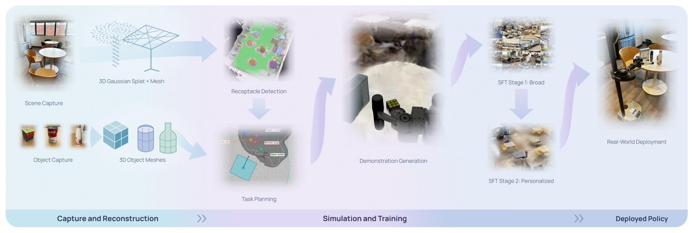
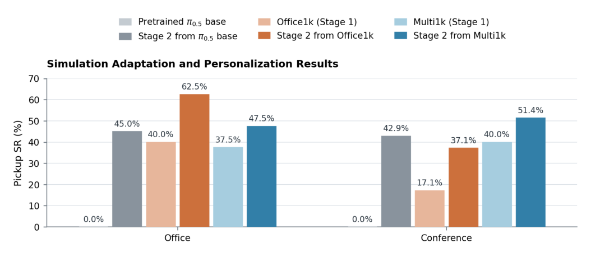
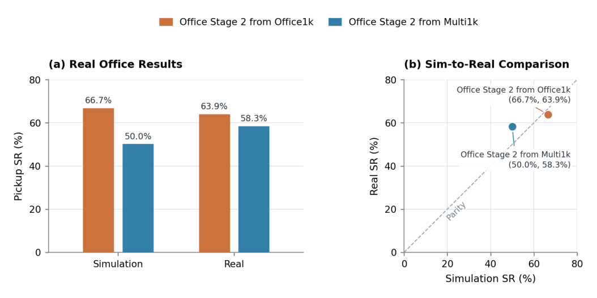
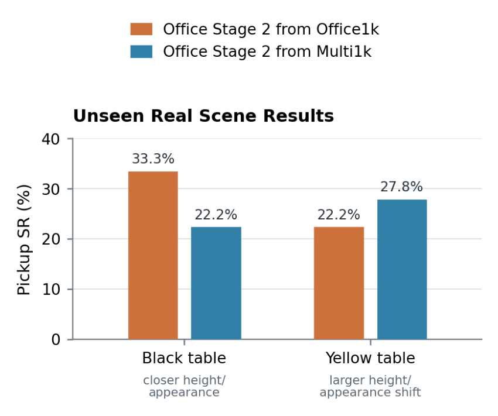

# Splat2Act: From Captured Scenes to Personalized VLA Manipulation

这篇论文把部署前的适配问题改写成数据生成问题：用户扫描办公室、提供物体照片和尺寸，系统就在数字孪生里寻找可抓取的位置、合成示范，再训练适合这个场景的视觉语言动作策略（VLA）。它真正验证的是承载面附近的抓取个性化；建筑级场景重建并不意味着机器人已经能自主完成全屋取物。

Xiaomeng Ye 等，Georgia Tech、Waymo、Toyota Research Institute；[arXiv:2610.13945v1](https://arxiv.org/abs/2610.13945)，首次提交北京时间 2026-10-10 01:59。全文 9 页；[项目页](https://splat2act.github.io/)。本文页码按 PDF 页计。

## 为什么要把部署场景变成训练环境

通用策略在新办公室里可能同时遇到陌生机器人、不同动作定义、陌生承载面和用户物体。为每个人的每个物体重复遥操作，成本会随部署数量增长。论文希望把需要人工的环节缩成一次约 20–30 分钟的扫描，以及每个物体的一张照片和尺寸输入，其余监督由仿真生成。

这里要读准 0% 基线：第 7 页说明，原始 π0.5 未见过 Stretch 本体或论文使用的动作空间。它在两个任务库中的失败，同时包含本体接口不匹配和场景适配问题。因而不能把后续提升解释成“只修复视觉域差异”，更不能概括为所有通用 VLA 在陌生办公室都无效。

与重建单个桌面的工作相比，论文的增量主要是从更大的场景几何中自动发现可操作承载面，并把可达性、物体稳定放置与抓取可行性串起来。建筑级重建扩大了可生成任务的空间；实际学习目标仍是 receptacle-local pickup，即机器人在承载面附近拾取物体。

## 扫描如何变成可执行的抓取示范

*论文原图编号：Fig. 2。左侧扫描与物体重建分别进入场景、物体资产，中间构造任务和示范，右侧两阶段训练后部署；这张图用于连接视觉表示与动作监督。*

3D Gaussian Splatting（3DGS）负责产生接近扫描场景的第一人称视觉观察，但它本身不是接触物理模型。系统先用 iPhone RGB-D 和 Polycam 捕获，使用 DN-Splatter 的深度与法线约束重建，再通过 SuGaR 提取 mesh。渲染交给 Gaussian 场景，碰撞、承载面检测与可达分析交给几何 mesh。这种分工决定了复现时需要同时检查视觉与几何误差，不能只看重建画面是否漂亮。

承载面检测先估计地板，挑选高度、面积和向上法线满足机器人条件的面片，再以位置和法线进行 HDBSCAN 聚类、合并与过滤。Habitat navmesh 限制机器人可站区域；候选站位要求至少六个物体放置采样点落在 0.70 m 水平可达半径内，之后还检查物体落稳和抓取执行可行性。这些筛选把大量视觉上存在、却无法被当前机器人操作的区域排除在示范生成之前（第 3–4 页）。

执行链可以按四步复现：

1. 输入手机扫描、物体图片与尺寸，重建视觉 3DGS、碰撞 mesh 和可移动物体，交给任务装配。
2. 输入几何和本体约束，提取承载面、过滤站位及放置点，输出经过可行性检查的抓取配置。
3. 特权 oracle 读取物体位姿与机器人状态，把缓存的对向抓取候选变换到当前物体坐标，排序腕部和底座配置，经局部离散平移、转向与伺服完成预抓取、下降、闭合和提升；失败后恢复快照尝试其他候选。
4. 只记录成功轨迹，以这些示范训练两阶段策略，部署时将视觉、本体状态和语言送入 VLA，输出动作块给控制器。

仿真物理频率为 100 Hz，控制和相机记录为 20 Hz；64 个并行环境平均每 A40 GPU 小时生成约 60 条成功示范。101 个扫描场景的中位可导航面积为 104.87 平方米，发现 852 个承载面，生成 68,021 条成功示范。生成成功轨迹不等于均匀覆盖所有困难状态：oracle 的权限和筛选本身定义了数据分布。

## 两阶段适配到底改变了什么

Stage 1 使用筛选出的 556 个 Objaverse 物体，帮助策略适配机器人、动作定义与场景；可只用部署场景，也可用全部 101 个场景。Stage 2 再用 SAM3D 从用户物体图片产生、按输入尺寸缩放的资产，训练目标场景中的用户物体抓取。两阶段共同更新 PaliGemma 语言部分和动作专家，保持 SigLIP 视觉编码器冻结，以保留视觉语义先验（第 4 页）。

训练沿用条件 flow matching。令示范动作块为 $a$、高斯噪声为 $\epsilon$、插值时间为 $t\in[0,1]$，上下文为 $o$，有

$$
x_t=t a+(1-t)\epsilon,\qquad
\mathcal L_{\mathrm{FM}}=\mathbb E_{a,\epsilon,t}\left[\left\|v_\theta(x_t,o,t)-(a-\epsilon)\right\|_2^2\right].
$$

$v_\theta$ 学习从噪声走向专家动作的速度场，目标 $a-\epsilon$ 来自线性插值的导数。因此系统改变的是示范的来源和适配顺序，并未提出新的动作生成损失。实现时必须保证仿真示范和部署动作块采用相同本体定义；仅增加物体照片不能解决这个接口问题。

实验每个配置只训练一个 epoch，batch size 64，学习率从 $5\times10^{-5}$ 余弦下降至 $5\times10^{-6}$。承载面、物体和增强数量的消融显示，四个物体条件下每对物体承载面只有八个增强任务时成功率较低；增加至 24 个时，一、二、四承载面设置分别达到 75.0%、87.5%、75.0%。这是覆盖更多配置需要更多轨迹的证据，并非“24 条对任何对象都足够”的通用规律。

## 实验支持个性化，却没有解决跨场景迁移

*论文原图编号：Fig. 3。浅色柱是原始或第一阶段策略，深色柱是个性化结果；Office 与 Conference 的最佳预适配来源不同，说明数据来源是关键变量。*

Office 任务库有 40 个配置，Conference 有 35 个，均为训练之外重新装配、且由 oracle 验证存在成功路径的配置。每个 checkpoint 最多运行 700 步，成功需满足提升目标物体的谓词，失败终止计入分母。Office 中同场景 Stage 1 后个性化达到 62.5%，直接从 π0.5 个性化为 45.0%，相差 17.5 个百分点。Conference 中 Multi1k 后个性化为 51.4%，直接个性化为 42.9%；Office1k 后个性化反而只有 37.1%。因此“先做广泛适配”必须附带数据分布条件。

> **图表占位：Fig. 5 — 个性化策略的跨场景测试**
> **建议位置：** 实验支持个性化，却没有解决跨场景迁移
> **放置原因：** 它检验个性化收益能否迁移到另一个场景，而不是重复场景内成功率。
> **当前状态：** 保留占位；自动图像候选未通过裁切质量检查，跨场景结果由第 7 页正文核实。

错配个性化场景甚至会伤害策略：Office1k 第一阶段本来在 Office 达到 40.0%，用 Conference 用户物体配置个性化后只剩 15.0%。这个对照提醒，用户物体与场景配置是耦合的，不能把第二阶段当作对物体语义的纯增强。

*论文原图编号：Fig. 4。左侧给出两种策略的仿真与真机成功率，右侧是同一对汇总值的散点；它支持有限任务子集上的转移，而非大规模仿真预测精度。*

真机使用 Stretch 3、三个承载面的 12 个任务，每个策略真机每任务三次，共 36 次，仿真每任务一次，共 12 次。同场景预适配策略真机 63.9%、仿真 66.7%；Multi1k 策略真机 58.3%、仿真 50.0%。两种策略保留排序，但仅两个聚合点和小样本不足以证明仿真能普遍精确预测真机表现。63.9% 也不能与全部 40 个 Office 配置的 62.5% 混成同一评测。

*论文原图编号：Fig. 6。黑桌与黄桌分别产生不同策略排序，成功率明显低于目标场景；这张图直接限制泛化主张。*

未见实验室中，每个桌面、每个策略有 18 次尝试。两个策略在黑桌为 33.3% 和 22.2%，黄桌为 22.2% 和 27.8%，没有一致赢家。多场景预适配可能使变化更平缓，但当前证据不能支持普遍优于场景专用适配的结论。

## 复现时最值得保留的边界

论文的工程价值在于把“场景在哪里、机器人能够从哪里抓、需要哪些示范”连成自动数据链。复现应先分别验证碰撞几何、承载面与站位筛选、oracle 成功谓词，再比较场景匹配和跨场景训练。若只报告最终成功率，重建误差与机器人接口误差会被混在一起。

作者把更长时程移动操作和通过强化学习继续改善成功率列为未来工作。本文并未验证自主搜索、全屋导航与连续多物体取放；移动底座在局部 oracle 中参与抓取，并不自动构成完整移动操作系统。本次确认项目页可访问，论文表示数据集将在录用后公开，尚未找到可确认的公开代码仓库或权重。
