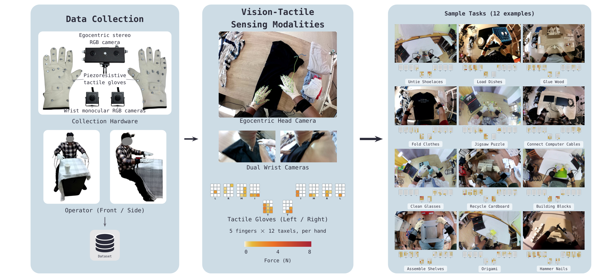
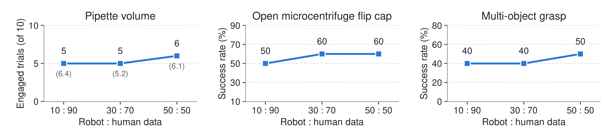

# FACT: A Multimodal Force-Action-Track Foundation Model for Human-to-Robot Dexterity

FACT 试图让人类示范不只教机器人手怎样移动，还教它移动时接触如何变化。它先用视频与视觉点轨迹生成粗动作，再共同去噪连续未来力和动作后缀。理解这项工作的关键，是区分真实触觉条件、预测未来力，以及被执行的动作命令。

Zhi Cao 等，2026；[arXiv:2610.19155](https://arxiv.org/abs/2610.19155)。依据 16 页全文，重点为第 III–V 节与附录 A–E。此 FACT 为 Force-Action-Track，与其他同名失败训练论文不同。

## 看见手部运动仍缺少接触解释

拧旋钮、捏住细线或弹弦常有相似视觉位置，却需要不同载荷。纯视觉人类数据难以监督这些差异；仅把历史触觉输入网络，也没有显式要求模型理解动作将产生的接触。作者将未来力作为联合生成目标，试图让动作和接触后果在精修阶段相互约束。

视觉点轨迹是另一条跨本体桥梁：人手与机器人动作空间不同，但场景中的手和物体如何移动可用相似的图像轨迹描述。轨迹负责粗运动预见，连续力预测负责接触细节，两者并非同一个辅助损失。

## EgoForce把什么测成了力

EgoForce 约 2,000 小时、40k 片段、1,000 任务、120 场景、1,000 名采集者，配三视角图像、手部运动和经标定的压力阵列。预训练另混入 100 小时 T-Rex 机器人示范。人手运动主要由视频姿态估计与双目尺度恢复，辅以手套弯曲和惯性信号，不能称为运动捕捉真值。

_图 8：手套、相机与接触热图说明采集模态，头视角手部轨迹是估计结果。_

标定使用 $F_i=P_iA_i$，$P_i$ 是参考气压、$A_i$ 是第 $i$ 个感元有效面积、$F_i$ 为相应法向力；逐感元拟合 A/D 到力的映射。它依赖近似均匀压力和面积标定，并不是直接测量每个接触方向的六轴传感器。

附录 C 的关键边界是：每指 12 个压力感元的和给法向力，受力中心给两个力矩；阵列不能观察的切向力与扭转力矩置零，再映射到模型的六轴槽。因此人类“六轴力”标签含结构性缺测，而机器人指尖有六轴测量。数据规模不能抹平这一模态差异。

## 粗规划如何交给力动作精修

当前三视角、状态、语言和历史轨迹进入 Wan2.2-TI2V-5B 粗规划器。未来视频、动作、轨迹共同去噪；干净状态与历史条件保持噪声为零。对目标模态 $c$、高斯噪声 $\epsilon$ 和噪声等级 $\tau$，流匹配使用

$$
x_\tau=(1-\tau)c+\tau\epsilon,\qquad v^*=\epsilon-c,\qquad \hat c=x_\tau-\tau\hat v.
$$

网络预测速度 $\hat v$，最后一式给单步干净目标估计，可用于轨迹位置与平滑约束。每个词元的 $\tau$ 控制 AdaLN，因此干净观察和不同噪声的预测目标可共存。这是生成路径和重建关系，不保证图像轨迹遵守真实物理。

_图 3：观察触觉始终是干净条件，未来力从噪声预测；两者不是同一种反馈。_

粗规划做六步 Euler 到 $\tau=0.4$，再一次前向读取视频、轨迹和隐藏状态。观察及动作隐藏状态被 detach，并投影为精修器交叉注意力的 KV 缓存；轨迹和状态词元不直接保留进该缓存。动作仍只部分去噪，交给 6 层、宽 768 的精修 Transformer。

动作是 16 步、20 Hz 的 62 维块：每臂末端相对位姿加 22 手关节目标。未来力在四个 5 Hz 刷新槽中预测，每槽十指各六维。精修器联合处理动作、当前力、VQ 历史力与未来力，双向注意力让动作和预测接触相互影响。

## 刷新触觉时哪些量可以改写

精修时动作噪声从 0.4→0，未来力从 1→0，共做四步。当前和历史触觉为干净条件；已执行动作前缀固定。到下一次 5 Hz 刷新时，将新测力填入已观察槽，只重新修正剩余动作后缀与未观察未来力，复用同一粗规划缓存。

可将关键精修目标写成

$$
\mathcal L_{refine}=\mathcal L_{a,\,suffix}
+0.5\mathcal L_{F,\,unobserved}+\mathcal L_{VQ}.
$$

第一项只回归未执行动作速度，第二项只回归未来尚未观察力的速度，最后一项训练历史力的量化表示。$a$、$F$ 分别表示动作和指尖力；suffix 与 unobserved 是由刷新偏移定义的掩码，不是额外网络。训练也在恰好 $\tau=0.4$ 构造粗缓存，并共享后缀噪声，以贴近采样交接状态。

一个容易误读的细节是：预测未来力被记录用于分析，**不直接作为低层控制器的力参考**。它通过联合去噪影响动作。附录 B 还出现 64 维线性层而总体动作描述为 62 维的记号差异；复现应核对 padding 与实际投影实现，不能凭笔记补造缺失维度。

## 十项任务不能压成一个成功率

真机为双 YAM 臂与 Sharpa Wave 手，每任务微调数据是新收集的 10 条机器人和 90 条人类示范。后者不是从 EgoForce 任意抽取；这不是零样本迁移。基线同样逐任务微调，但 π0.5 无触觉且通过每手 10 维 PCA 压缩关节，T-Rex 则共享 62 维动作和触觉。因此与 π0.5 的差异不单是未来力目标。

七个二值任务各 10 次 rollout，另两任务按十个音符的清晰发声数计分；移液器旋钮先计十次中接触成功数，再只在已接触试验上算体积误差。

| 指标 | FACT | T-Rex | π0.5 |
|---|---:|---:|---:|
| 实验室移液成功 | 40% | 0% | 0% |
| 试管盖成功 | 80% | 20% | 10% |
| 多物体抓取成功 | 40% | 0% | 0% |
| 竖琴清晰音符 / 10 | 6.7 | 2.1 | 0.5 |
| 旋钮接触成功 / 10 | 5 | 2 | 文本未列 |
| 接触后体积误差 / µL | 6.4 | 14.0 | 17.0 |

这些结果支持特定接触技能的提升，不能把 6.4 µL 当作全部十次操作误差。五次接触中四次误差不超过 4 µL，说明接触建立仍是明显瓶颈。每任务十次的二值结果分辨率只有 10 个百分点，不适合过度解读细小差异。

去未来力预测使试管盖 80→40%、竖琴 6.7→0 音符、旋钮接触 5→2 次；去轨迹使移液 40→20%、洗牌 30→20%、木琴 5.4→3.9。移除的是对应词元、头和损失，结构也变化，因此不是仅改变一项标量权重的纯损失实验。

人类预训练去力监督使试管盖 80→0%，但多物体抓取仍为 40%，说明力监督收益并不均匀。仅机器人预训练的旋钮没有成功接触。加入微调人类数据，系鞋带 10→20%、洗牌 10→30%，旋钮误差 11.2→6.4 µL，也仍是有目标任务人类数据的比较。

_图 6：提高机器人比例有小幅收益，括号内旋钮误差仍以成功接触为条件。_

> 图表占位：原文图 7，第 7 页，人类数据规模与验证 MSE。原候选已核对，但未完成正式 300 dpi 资产审批，故不嵌图。100 小时有/无触觉为 0.042/0.047，2,000 小时为 0.031/0.036；这是验证损失，不能直接换算真机成功率。

## 最值得迁移的接口与未解问题

我的分析：有价值的工程接口是粗规划缓存、不可改写的动作前缀和可刷新的触觉槽。它让大视频模型的成本按块摊销，同时允许接触阶段修改剩余动作。预训练使用 240 张 Alibaba T-Head PPU，逐任务微调用 8 GPU，数据便宜不意味着总训练资源便宜。

尚不能确定的是人类缺失切向力的标签偏差如何影响更复杂滑移，及更大测试集、多训练种子和新物体条件下能否维持相同优势。本文也没有给出完整异步控制的端到端延迟分布；20 Hz 动作执行频率不能直接当成大模型实时推理吞吐。
